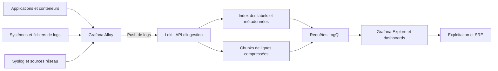
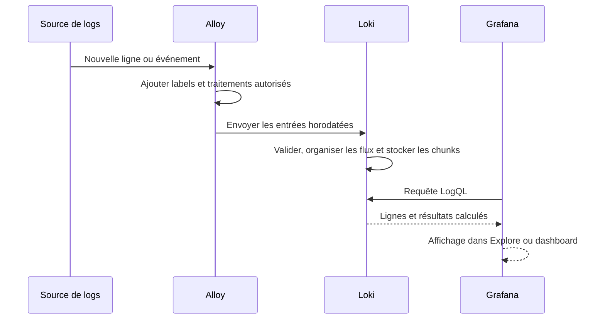
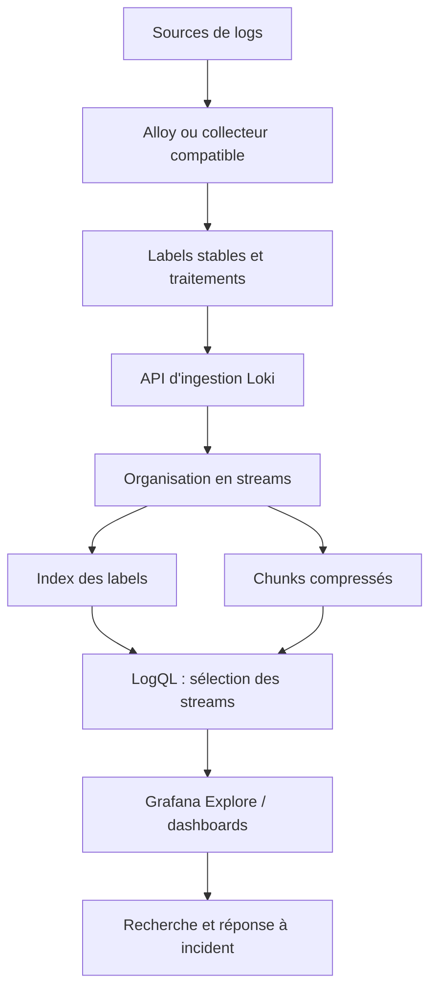
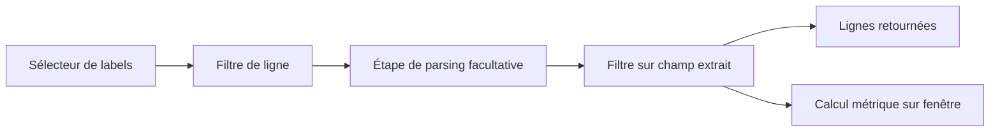
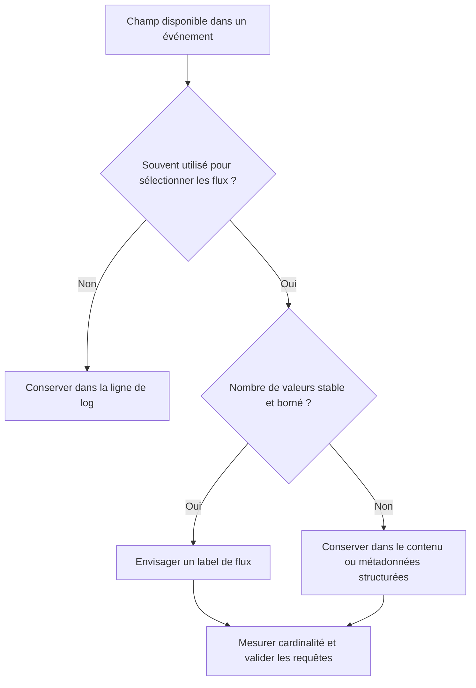
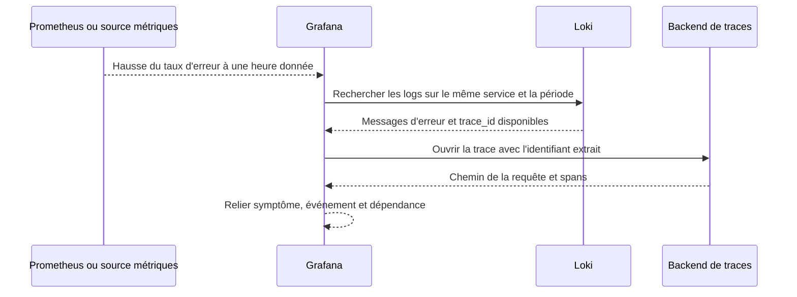
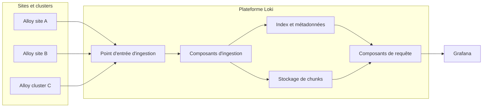

# Loki et Grafana pour les logs

## 1. Introduction

### 1.1. Pourquoi une plateforme de logs différente

Une infrastructure moderne produit des logs depuis les systèmes d'exploitation, les applications, les conteneurs, les équipements réseau et les services cloud. Lorsqu'un incident survient, ces événements permettent de répondre à des questions essentielles : quelle erreur s'est produite, à quel moment, sur quelle instance, après quel changement et avec quelle conséquence ? Mais ces données ne sont réellement utiles que si elles peuvent être collectées, conservées et recherchées dans un délai raisonnable.

Loki est un système d'agrégation de logs conçu dans l'écosystème Grafana. Son modèle diffère de celui d'un moteur de recherche textuelle généraliste comme Elasticsearch. Loki indexe principalement les métadonnées sous forme de labels qui identifient les flux de logs, tandis que les lignes de log sont regroupées en chunks compressés et conservées dans un stockage adapté. À la recherche, Loki utilise les labels pour sélectionner les flux candidats, puis lit et filtre les lignes pertinentes. Cette approche peut limiter le coût d'indexation et tirer parti de stockages objet, mais elle place une responsabilité importante sur la stratégie de labels et la conception des requêtes.

Grafana fournit l'interface permettant de rechercher et visualiser les logs à l'aide de la source Loki. LogQL est le langage de requête de Loki. Il permet de sélectionner des flux par labels, filtrer des lignes, parser certains formats, extraire des labels de requête temporaires et calculer des métriques dérivées des logs. Les alertes fondées sur ces données peuvent détecter une hausse d'erreurs ou un motif persistant, à condition que le volume et la fenêtre de calcul rendent le signal exploitable.

La collecte est un autre composant de la chaîne. Grafana Alloy est le collecteur recommandé dans la documentation actuelle de Loki pour de nombreux nouveaux déploiements. Il peut lire des fichiers, recevoir des événements de plusieurs sources, transformer les données et les envoyer à Loki. Des agents historiques et d'autres collecteurs restent présents dans de nombreuses infrastructures ; leur choix dépend de l'environnement, de la compatibilité et de la stratégie de migration. Il faut distinguer le collecteur, le moteur de stockage et l'interface d'exploration.

Loki n'est pas simplement un endroit où copier des lignes de texte. Une plateforme fiable exige une taxonomie de labels stable, des timestamps corrects, un pipeline de collecte observable, une stratégie de rétention, une gestion des données sensibles et des requêtes conçues pour limiter le volume examiné. Des labels trop nombreux ou trop variables peuvent augmenter considérablement le nombre de flux et dégrader les performances. Une requête qui parcourt trop de lignes peut également devenir coûteuse, même lorsque l'index des labels reste compact.

> **Mise en contexte — vous rejoignez l'équipe SRE d'une plateforme de commerce en ligne.** Les services tournent dans des conteneurs répartis sur plusieurs nœuds Kubernetes. Lors d'une campagne commerciale, les utilisateurs constatent des erreurs intermittentes sur l'API de paiement. Les métriques indiquent une hausse du taux d'erreur, mais il faut explorer les logs pour retrouver les messages correspondants et comprendre les dépendances en panne. Vous devez mettre en place une collecte avec Alloy, définir des labels durables, interroger les événements avec LogQL, construire des vues Grafana et contrôler la qualité des données tout au long de la chaîne.

### 1.2. Ce que Loki fait et ne fait pas

Loki est conçu pour regrouper, stocker et rechercher des logs. Son index est volontairement centré sur les labels. Les lignes de log ne sont pas toutes transformées en champs textuels indexés de la même manière qu'avec un moteur orienté recherche plein texte. Le contenu peut être filtré après avoir sélectionné des flux avec des labels. Cette conception permet une architecture où le stockage des lignes compressées peut être externalisé vers des systèmes objet compatibles.

Cette approche ne veut pas dire que le contenu des logs est inaccessible ou qu'aucune extraction de champs n'est possible. LogQL propose des filtres de lignes et des étapes de parsing comme JSON, logfmt ou d'autres extracteurs pris en charge. La différence se situe dans le modèle de sélection et le travail effectué lors d'une requête. Il est généralement préférable de réduire d'abord les flux à l'aide de labels peu nombreux et stables, puis de filtrer les lignes.

Loki ne remplace pas les métriques de service. Une métrique permet d'estimer rapidement un débit ou un taux d'erreur sur une période, tandis que les logs aident à examiner les événements individuels. Il ne remplace pas automatiquement les traces distribuées non plus. Une trace dotée d'un identifiant permet de reconstituer le parcours d'une requête entre services ; les logs peuvent contenir cet identifiant et servir de point d'entrée vers la trace, mais le log seul ne décrit pas nécessairement la relation parent-enfant entre les opérations.

Le succès de Loki dépend donc de son rôle dans une architecture d'observabilité. Prometheus ou un système équivalent répond à des questions numériques, Loki aide à analyser les événements, un backend de traces conserve les spans, et Grafana peut fournir un espace commun d'exploration. Les signaux deviennent plus utiles lorsqu'ils partagent des noms de services, des environnements et des identifiants de corrélation cohérents.

### 1.3. Architecture générale

Une architecture Loki de base comprend des producteurs de logs, un collecteur tel qu'Alloy, le service Loki et Grafana. En production, Loki peut être déployé selon différents modes, de la configuration simple à une architecture distribuée avec plusieurs rôles de composants, des caches et un stockage objet. Les détails dépendent de la version et du mode de déploiement choisi.



Le collecteur lit ou reçoit les événements, leur donne les labels appropriés, éventuellement les transforme et les transmet à Loki. Loki organise les entrées par flux et stocke les données selon son architecture. Grafana envoie les requêtes LogQL et présente les résultats. Des règles peuvent calculer des métriques depuis les logs ou déclencher des alertes selon les mécanismes configurés.

Chaque couche doit être supervisée. Une source qui cesse d'écrire, un agent bloqué, un réseau interrompu, un refus d'ingestion, une limite de débit ou un stockage inaccessible peut provoquer une absence de logs. Si la collecte disparaît, l'absence d'erreurs affichées ne signifie pas que le service va bien. Il faut contrôler les logs eux-mêmes, la fraîcheur, les erreurs du collecteur et l'état de Loki.

### 1.4. Différence entre flux, labels et lignes

Un **flux de logs** est défini par un ensemble de labels. Toutes les entrées qui partagent la même combinaison de labels appartiennent au même flux, dans le cadre de la période et du modèle de stockage. Les labels décrivent le contexte durable d'origine : environnement, application, cluster, namespace ou job, par exemple.

Une **ligne de log** est l'événement textuel ou structuré individuel, comme une requête HTTP, une erreur ou une opération métier. Elle porte son timestamp et son contenu. Le contenu peut inclure des informations à haute cardinalité comme un identifiant de requête, un numéro de commande ou une adresse IP. Ces données peuvent être recherchables sans forcément devenir des labels de flux.

La distinction est essentielle. Si chaque ligne ajoute un label request_id différent, chaque valeur crée potentiellement un nouveau flux. Cela multiplie l'index, les chunks de petite taille et le travail d'ingestion. Le fait que la valeur soit utile pour rechercher une demande individuelle ne signifie pas qu'elle doive faire partie de l'identité du flux. Les labels sont destinés surtout aux dimensions à faible cardinalité qui servent à sélectionner les logs.

Loki 3.0 a introduit les métadonnées structurées pour certains usages à haute cardinalité. Ce mécanisme permet de joindre des paires clé-valeur aux entrées sans les transformer en labels de flux. Le support réel, les contraintes et les exigences de configuration doivent être vérifiés sur la version installée. Quand cette option n'est pas appropriée ou disponible, la valeur peut rester dans la ligne de log et être extraite au moment de la requête.

### 1.5. Objectifs pédagogiques

À la fin de ce cours, vous devez pouvoir :

1. expliquer le modèle de stockage de Loki et son index de labels ;
2. distinguer labels de flux, contenu des lignes et métadonnées structurées ;
3. choisir une stratégie de labels à faible cardinalité ;
4. collecter des fichiers et des événements avec Grafana Alloy ;
5. construire des sélecteurs, filtres et pipelines LogQL ;
6. analyser des logs JSON et logfmt sans confondre extraction et indexation ;
7. calculer des métriques dérivées à partir des logs ;
8. utiliser Grafana Explore, dashboards et liens de corrélation ;
9. gérer les erreurs d'ingestion, la fraîcheur, les limites et la rétention ;
10. sécuriser les endpoints, identifiants et données sensibles ;
11. diagnostiquer une recherche lente ou un flux manquant ;
12. concevoir une étude de cas complète et reproductible.

## 2. Concepts clés

### 2.1. Le modèle de labels de Loki

Les labels constituent la principale clé de sélection des flux. Un ensemble de labels identifie un flux de logs ; lorsque plusieurs entrées partagent les mêmes valeurs, elles peuvent être regroupées ensemble. Exemples de labels utiles : env, cluster, namespace, app ou job. Ces labels décrivent un contexte de collecte stable et sont souvent connus avant de lire le contenu de chaque ligne.

La cardinalité correspond au nombre de combinaisons de labels observées. Deux labels de faible cardinalité peuvent déjà créer beaucoup de flux lorsqu'ils sont combinés. Par exemple, 4 environnements, 20 applications et 15 namespaces donnent jusqu'à 1 200 combinaisons possibles si toutes les combinaisons apparaissent. Ce nombre peut rester gérable selon le volume, mais il illustre que l'ajout d'un label a un coût multiplicatif.

Évitez d'utiliser comme labels les identifiants de requête, de session, d'utilisateur ou de commande, les timestamps, les adresses IP très variables, les chaînes de message et souvent les noms de pods éphémères. Ces valeurs peuvent être utiles pour une recherche précise, mais elles font exploser le nombre de flux si elles servent de labels indexés. Stockez-les dans la ligne de log, comme champs extraits au moment de la requête ou, lorsque c'est adapté, dans les métadonnées structurées.

Une règle de conception utile : un label doit répondre à une question fréquente de sélection des logs et avoir un ensemble de valeurs connu ou borné. Si l'équipe ne l'utilise presque jamais pour réduire un ensemble de logs, il est peut-être inutile comme label. Une stratégie de labels peut évoluer au fil de l'expérience : commencez avec une petite base, analysez les usages réels et ajoutez des dimensions seulement si elles apportent une valeur mesurable.

### 2.2. Labels, contenu et métadonnées structurées

Ces trois types de données remplissent des rôles différents :

| Élément | Exemple | Usage recommandé |
|---|---|---|
| Label de flux | app="payment-api" | Sélectionner les flux d'une application |
| Ligne de log | "timeout de connexion à la base" | Filtrer ou inspecter le contenu de l'événement |
| Champ extrait par LogQL | status="500" après parsing JSON | Filtrer, grouper ou calculer dans une requête |
| Métadonnée structurée | trace_id ou request_id, si configuré | Conserver une valeur utile à haute cardinalité sans créer un flux par valeur |
| Label ajouté à l'ingestion | env="production" | Décrire le contexte stable du producteur |

Les labels de flux doivent rester peu nombreux et stables. Les filtres de ligne permettent d'éliminer des messages après la sélection initiale. Les filtres de label après parsing permettent de sélectionner une propriété extraite du contenu dans une requête. Ces étapes ne doivent pas être confondues avec la définition des labels envoyés pendant l'ingestion.

Les métadonnées structurées permettent, dans les versions et configurations qui les supportent, de conserver certains attributs sans les intégrer au jeu de labels indexés. Elles ne rendent pas la donnée gratuite : elles ont des contraintes de support, de stockage, d'accès et de recherche. Les champs réellement utiles pour un regroupement à grande échelle doivent être validés et dimensionnés.

### 2.3. Collecte avec Grafana Alloy

Grafana Alloy est un collecteur de télémétrie qui peut rassembler, transformer et expédier des logs, ainsi que d'autres signaux pris en charge. Pour Loki, ses composants de logs peuvent lire des fichiers, recevoir des événements de diverses sources, ajouter des labels et envoyer les entrées à une destination Loki. La documentation actuelle de Loki recommande Alloy comme méthode principale pour de nombreux nouveaux déploiements.

Une configuration Alloy est construite à partir de composants connectés par des références. Les composants sources collectent les données, les composants de traitement modifient ou filtrent les événements, et les composants d'écriture expédient les logs. Le nom précis du composant et la syntaxe évoluent selon la version ; il faut s'appuyer sur la référence de composants correspondant à l'installation. L'objectif est de maîtriser le chemin logique de bout en bout, pas de copier une configuration incompatible.

Exemple conceptuel pour lire des fichiers, ajouter des labels statiques, puis envoyer à Loki. Les noms et chemins sont illustratifs et doivent être ajustés au système :

```alloy
local.file_match "app_logs" {
  path_targets = [{
    __path__ = "/var/log/ecommerce/*.log",
    job      = "ecommerce",
    app      = "payment-api",
    env      = "production",
  }]
}

loki.source.file "app_logs" {
  targets    = local.file_match.app_logs.targets
  forward_to = [loki.write.local.receiver]
}

loki.write "local" {
  endpoint {
    url = "http://loki.internal:3100/loki/api/v1/push"
  }
}
```

Cet exemple illustre le principe : un composant repère des fichiers, une source lit les lignes et une cible d'écriture envoie les données à Loki. La syntaxe exacte, les arguments acceptés et les contrôles de sécurité doivent être validés pour la version installée ; cet extrait n'est pas une configuration universelle de production. Une installation sécurisée doit protéger le transport, vérifier les certificats lorsque TLS est utilisé, limiter les droits d'accès et surveiller les erreurs de livraison.

Alloy doit lui-même être supervisé. Vérifiez le fonctionnement du processus, les erreurs de lecture, les offsets, les files, le taux de livraison et les échecs vers Loki. Si l'agent lit plusieurs fichiers, il faut tester la rotation, la suppression, le renommage et la reprise après un redémarrage. Une configuration qui fonctionne sur un fichier stable peut perdre ou relire des lignes quand le système de rotation est différent.

### 2.4. Le chemin d'un log jusqu'à Loki



La livraison n'est pas une preuve de disponibilité immédiate de la ligne dans toutes les requêtes. Le collecteur peut mettre en tampon, le réseau peut introduire un retard, Loki peut appliquer des limites d'ingestion et la requête peut sélectionner le mauvais flux. Les horodatages d'événement et d'ingestion doivent être compris. Un journal peut arriver tard et se situer dans la plage temporelle de l'incident, même s'il n'apparaît pas immédiatement.

### 2.5. LogQL : le langage des logs

LogQL combine la sélection de flux, les filtres de ligne, les filtres de labels et les opérations d'analyse ou d'agrégation. La première étape consiste souvent à sélectionner un ensemble de flux par labels. Par exemple :

```logql
{app="payment-api", env="production"}
```

Cette expression sélectionne les flux qui portent les valeurs exactes de label. Le contenu de leurs lignes n'est pas encore filtré par mot-clé. On peut alors ajouter un filtre de ligne :

```logql
{app="payment-api", env="production"} |= "timeout"
```

Le filtre |= conserve les lignes contenant la chaîne demandée. D'autres opérateurs permettent d'exclure une chaîne, de rechercher avec une expression régulière ou d'exclure un motif. Les filtres de lignes sont souvent plus coûteux que la sélection initiale par labels, car Loki doit lire les chunks concernés pour inspecter le contenu. Il est donc préférable de sélectionner d'abord des flux étroits.

Les expressions LogQL doivent respecter les règles de syntaxe et d'échappement du langage. Une chaîne qui contient des guillemets, des barres obliques ou des caractères spéciaux peut nécessiter un échappement. Une expression régulière trop large peut parcourir beaucoup de lignes. Testez la requête sur une fenêtre limitée et élargissez progressivement la période après confirmation du sens du résultat.

### 2.6. Filtres de ligne et filtres de labels

Les filtres de ligne cherchent une chaîne ou un motif dans le contenu de chaque entrée retenue. Ils sont utiles pour des messages comme "connection refused", "panic" ou un code de diagnostic stable. Un filtre de ligne ne transforme pas automatiquement la chaîne en champ structuré.

Le parsing JSON ou logfmt permet d'extraire des champs du contenu. À partir d'une ligne structurée telle que {"level":"error","status":500,"route":"/checkout","message":"db timeout"}, une étape JSON peut rendre les propriétés accessibles dans la suite de la requête. Ensuite, un filtre de label de requête peut sélectionner status=500 ou route="/checkout". Ces labels extraits pour la requête ne sont pas nécessairement ajoutés comme labels de flux persistants à l'ingestion.

Exemple LogQL :

```logql
{app="payment-api"} | json | status="500"
```

Cette requête suppose que le contenu est du JSON valide et contient status. Si le parsing échoue, la ligne peut recevoir des métadonnées d'erreur de parsing, selon le mode et la version. Il faut vérifier les résultats plutôt que supposer que chaque log de l'application respecte le même format. Un bon pipeline amène des logs structurés et cohérents au plus près de la source ; LogQL permet ensuite une analyse ciblée.

### 2.7. Pipelines de parsing dans LogQL

Les étapes de pipeline peuvent parser, filtrer, formater ou extraire des informations. Elles s'exécutent dans l'ordre de la requête. Commencer par un sélecteur de labels permet de réduire le nombre de streams ; un filtre de ligne peut réduire les lignes avant d'appliquer un parseur ; les champs extraits peuvent être filtrés ensuite. L'ordre peut donc affecter les performances.

Exemple pour rechercher les erreurs HTTP 5xx dans des logs JSON :

```logql
{job="nginx", env="production"}
  |= "status"
  | json
  | status >= 500 and status < 600
```

La requête suppose que le parseur JSON expose status comme valeur numérique compatible avec les comparaisons. Selon le format, le type extrait peut être textuel ou nécessiter une conversion appropriée. Les versions de LogQL peuvent proposer différentes méthodes de parsing, de filtrage et de transformation ; vérifiez les capacités exactes de la version en production.

Pour des logs au format logfmt, une ligne contenant level=error route=/checkout latency_ms=800 peut être analysée avec l'étape logfmt puis filtrée sur level. Pour du texte traditionnel, il peut être nécessaire d'utiliser des expressions régulières d'extraction, mais il est préférable de structurer le format en amont lorsqu'on contrôle le producteur. Un parseur fragile devient une dette de maintenance chaque fois que l'application modifie le message.

### 2.8. Les opérations métriques de LogQL

LogQL peut produire des métriques dérivées des logs. Il est possible de compter le nombre de lignes correspondantes sur une fenêtre, calculer des débits d'événements ou agréger les résultats selon les dimensions extraites. Cette approche permet de construire des alertes sur des événements qui ne disposent pas encore d'une métrique applicative dédiée, à condition de comprendre le coût de la requête et les limites de l'inférence.

Exemple : estimer le débit de lignes contenant une erreur pour un flux donné :

```logql
sum by (app) (
  rate({env="production"} |= "ERROR" [5m])
)
```

Cette forme donne un débit de lignes sélectionnées dans la fenêtre, agrégé par la dimension app lorsqu'elle est portée par les streams retenus. Si app n'est pas un label de flux, il ne sera pas disponible pour cette agrégation sans extraction appropriée. Il faut vérifier les labels réels de la source, la signification de la chaîne "ERROR" et le type de logs couverts.

Pour des événements JSON, on peut parser le statut puis compter les lignes qui correspondent aux erreurs. La requête dépendra de la syntaxe de LogQL acceptée par la version ; il est judicieux de tester d'abord une requête de logs qui montre les lignes attendues, puis d'en faire une expression métrique. Une métrique dérivée des logs est un agrégat calculé à partir des événements, pas nécessairement un substitut aux compteurs instrumentés directement dans l'application.

### 2.9. Labels à faible cardinalité : la règle la plus importante

L'indexation Loki est fondée sur les labels de flux, donc les labels à forte cardinalité constituent l'une des causes les plus fréquentes de performances médiocres et d'utilisation excessive des ressources. Les labels doivent décrire l'origine stable et le contexte. Des exemples courants sont app, env, cluster, namespace ou job. Le choix exact dépend du modèle de déploiement, mais l'idée est de garder les dimensions relativement stables et limitées.

Évitez généralement les labels tels que request_id, trace_id, user_id, order_id, IP client ou message d'erreur. Une valeur unique par événement peut créer autant de flux supplémentaires, parfois très éphémères. L'effet de plusieurs dimensions se multiplie, même si chacune semble modeste isolément. Les symptômes incluent une forte cardinalité, de nombreux petits chunks, une hausse de mémoire et des requêtes plus coûteuses.

Les champs à forte cardinalité peuvent rester dans les lignes et être extraits au moment de la requête, ou être stockés comme métadonnées structurées si la version et le pipeline le supportent. Le but n'est pas de rendre ces informations introuvables ; il est de les garder sans les transformer en dimensions d'indexation permanentes. Pour une recherche par trace_id, sélectionnez d'abord l'application et la période, puis filtrez le champ à l'intérieur de ce périmètre.

### 2.10. Métadonnées structurées

Les métadonnées structurées permettent d'attacher des paires clé-valeur à une entrée sans modifier l'ensemble des labels qui identifie son flux. Elles sont utiles pour des informations comme trace_id, request_id ou certains attributs de log qui ont beaucoup de valeurs distinctes et qu'on souhaite néanmoins rechercher ou afficher.

Ce mécanisme ne doit pas conduire à copier tous les champs de chaque événement sans discernement. Les champs conservés doivent répondre à des besoins réels, être gouvernés et rester compatibles avec la version de Loki. Les contraintes d'ingestion, de requête et de stockage doivent être examinées. Une donnée sensible ne devient pas appropriée simplement parce qu'elle se trouve dans les métadonnées structurées au lieu des labels.

La stratégie de données devrait préciser quels champs sont des labels de flux, quelles valeurs restent dans le contenu et lesquelles deviennent des métadonnées structurées. Cette convention doit être commune aux producteurs et aux équipes qui écrivent des requêtes. Les dashboards et alertes peuvent échouer si un champ change de représentation entre versions ou si un pipeline cesse de l'envoyer.

### 2.11. Horodatage et ordre des événements

Chaque entrée de log possède un timestamp qui influence son emplacement dans la chronologie et les résultats des requêtes temporelles. La source peut produire un timestamp, ou le collecteur peut en créer un lors de la lecture. L'heure d'événement et l'heure d'ingestion ne sont pas identiques lorsque l'agent est déconnecté, qu'une file se remplit ou que le stockage est en retard.

Synchronisez les systèmes via une source de temps fiable et documentez le fuseau des logs. Si une application écrit une heure locale sans décalage, le collecteur doit connaître ce contexte pour la convertir correctement. Si le temps est erroné à la source, Loki ne peut pas deviner avec certitude la chronologie vraie. Les décalages d'horloge peuvent également perturber les limites de fenêtre et les requêtes d'agrégation.

Les retards d'ingestion doivent être surveillés. Un événement peut être envoyé après l'incident tout en portant l'heure correcte de son occurrence. Les recherches doivent utiliser la plage de temps adéquate et l'équipe doit tenir compte de la livraison en retard. Lorsqu'un log semble manquer, vérifiez d'abord s'il est arrivé plus tard que la fenêtre affichée ou si son timestamp a été mal interprété.

### 2.12. Stockage des chunks et architecture Loki

Loki organise les logs en streams selon leurs labels et regroupe les lignes dans des chunks compressés. L'index sert essentiellement à repérer les streams ; les chunks contiennent les données qui doivent être lues après sélection. Les chunks peuvent être stockés dans un stockage objet compatible, ce qui soutient des architectures à coût réduit et une rétention de grande ampleur. La configuration exacte dépend de la version et du mode d'exploitation.

L'architecture simple peut servir au développement ou aux environnements modestes. Un déploiement distribué répartit davantage les responsabilités pour l'ingestion, la recherche, l'indexation, le cache et le stockage. La distribution améliore la capacité de mise à l'échelle si elle est correctement dimensionnée, mais ajoute de la complexité : réseau interne, authentification entre composants, files, objets de stockage, caches, limites et surveillance.

Le modèle de stockage influence l'exploitation. Les composants doivent être surveillés pour l'acceptation des logs, les erreurs de chunks, le cache, les requêtes lentes, les limites d'ingestion et l'accès au stockage objet. Si le backend de stockage est indisponible, les symptômes peuvent affecter l'ingestion ou les recherches selon l'architecture. Il faut comprendre la topologie déployée plutôt que supposer qu'une seule instance Loki se comporte comme une base locale monolithique.

### 2.13. Rétention et coûts

La rétention définit combien de temps les logs restent disponibles. Une durée longue améliore l'analyse historique, la recherche d'incidents passés et certaines exigences d'audit ; elle augmente aussi le stockage, les coûts de requête potentiels et le volume de données sensibles conservées. La durée doit être choisie selon la criticité, les besoins de l'équipe et les contraintes organisationnelles.

La politique de rétention dépend du mode de stockage et de la configuration Loki. Il faut suivre le mécanisme de compactor et la stratégie de rétention lorsqu'ils sont pertinents dans l'architecture utilisée. Ne supprimez pas directement des objets dans le stockage sans comprendre la manière dont Loki gère l'index, les chunks et les métadonnées. Une suppression manuelle non coordonnée peut rendre l'état du système incohérent.

Le volume de logs se contrôle aussi à la source. Les logs de debug très verbeux, la répétition d'erreurs identiques et les messages sans utilité opérationnelle peuvent représenter une part élevée des coûts. Il faut ajuster la journalisation, filtrer les événements inutiles lorsque la politique le permet et conserver une visibilité sur les erreurs de collecte. Réduire le volume ne doit cependant pas supprimer les informations nécessaires à l'investigation ou aux exigences de sécurité.

### 2.14. Intégration avec Grafana Explore

Grafana Explore fournit un espace d'exploration interactif. L'utilisateur choisit Loki comme source, sélectionne des labels et construit une requête LogQL. L'interface affiche les lignes, le volume de résultats et, selon la vue, des histogrammes de fréquence. Les filtres permettent de réduire progressivement l'ensemble de logs.

Une méthode pratique consiste à partir des labels les plus sélectifs, limiter la période, puis appliquer un filtre de ligne ou une étape de parsing. Il est souvent préférable d'effectuer une recherche sur cinq minutes puis de l'élargir lorsque la requête est correcte. Lancer immédiatement une recherche de plusieurs jours sur tous les flux, puis filtrer une chaîne, peut nécessiter la lecture d'un très grand volume de chunks.

Explore permet de passer d'une vue métrique à une vue logs lorsque les sources et l'intégration sont configurées. Les métriques peuvent aider à identifier la fenêtre d'une hausse d'erreurs ; les logs permettent alors de lire les événements correspondants. Avec des identifiants de trace partagés, le parcours peut ensuite rejoindre un backend de tracing. La corrélation doit conserver la période et le service pour éviter de regarder une population différente.

### 2.15. Dashboards et tableaux de bord de logs

Un dashboard de logs doit servir un usage défini. Pour une API, il peut afficher le débit de logs d'erreur, les principaux messages, le volume par service et la fraîcheur de chaque source. Pour le NOC, il peut suivre les erreurs de collecte, les services qui cessent d'émettre et les problèmes de livraison. Pour la sécurité, il peut présenter des événements d'authentification et des anomalies choisies, avec des permissions strictes.

Les panels doivent limiter les labels à des dimensions pertinentes. Un tableau qui affiche trop de combinaisons ou des identifiants uniques devient difficile à interpréter. La plage de temps et les filtres devraient être partagés entre les panels. Les titres doivent expliquer la mesure, et les liens doivent mener vers une exploration plus détaillée lorsqu'une action est nécessaire.

Un dashboard n'est pas la même chose qu'une alerte. Une hausse de log errors peut être informative, mais le seuil doit tenir compte du volume normal, des périodes de pointe et de la criticité. Les règles peuvent être évaluées via les mécanismes de Loki ou de Grafana selon l'architecture. La gouvernance doit préciser quel composant évalue l'alerte, qui la reçoit et comment elle est supprimée ou rétablie.

### 2.16. Alertes basées sur les logs

Loki peut calculer des métriques à partir de logs et sa fonction de ruler, selon la configuration, peut évaluer des règles d'alerte. Grafana offre également un système d'alerting qui peut interroger des sources de données. Le choix doit correspondre à la plateforme et à ses capacités. Évitez de dupliquer la même règle dans plusieurs moteurs sans politique claire, car cela entraîne des alertes doubles ou des comportements divergents.

Une alerte sur les logs doit privilégier un motif significatif, pas une simple présence du mot "error" si les applications l'utilisent aussi pour des conditions normales. Elle peut viser un taux de messages d'erreur sur une fenêtre, une absence de logs attendus, ou un motif de sécurité. Le taux doit être interprété avec le trafic. Dix erreurs par minute peuvent être graves pour un service qui ne reçoit habituellement que quelques requêtes, ou insignifiantes pour un système qui en traite des millions.

L'alerte doit inclure les labels de service et d'environnement, un résumé, une indication de la fenêtre et une piste de diagnostic. Il faut tester la condition, la persistance, le routage, les silences, la récupération et le canal de notification. Le système d'alerting doit aussi être surveillé pour vérifier qu'une panne de collecte ou de notification ne rende pas les alertes muettes.

### 2.17. Corrélation logs, métriques et traces

Les métriques détectent souvent la dégradation plus tôt et à moindre coût de requête. Les logs fournissent le contenu des événements ; les traces permettent de comprendre la propagation d'une opération entre services. Un workflow d'incident peut partir d'un taux d'erreur métrique, ouvrir les logs sur la même plage et rechercher trace_id pour afficher la trace correspondante.

Les conventions de service, d'environnement et de namespace doivent rester homogènes dans tous les signaux. Une même application ne devrait pas être nommée différemment dans les logs, métriques et traces sans raison documentée. Les timestamps doivent également être comparables. Sans une identité stable, les opérateurs passent du temps à traduire les noms au lieu d'analyser l'incident.

Les IDs de requête ou de trace sont à haute cardinalité et ne sont généralement pas adaptés comme labels de flux Loki. Ils peuvent cependant rester dans le contenu ou les métadonnées structurées. Cette distinction permet d'effectuer une recherche ciblée sur un identifiant sans multiplier les streams. Il faut également protéger les IDs s'ils peuvent servir de secrets ou contenir une donnée personnelle indirecte.

### 2.18. Sécurité et données sensibles

Les logs peuvent contenir des identifiants, tokens, cookies, noms d'utilisateur, adresses IP, URLs avec paramètres ou données personnelles. Centraliser les logs améliore la recherche, mais rassemble aussi des informations sensibles dans un seul système. Il faut empêcher l'émission de secrets à la source lorsque c'est possible et appliquer des protections complémentaires dans le collecteur.

Les endpoints d'ingestion doivent être accessibles uniquement aux collecteurs autorisés. Les connexions doivent être protégées selon les capacités du déploiement, et les identifiants doivent être gérés par un mécanisme approprié. Les accès à Grafana et Loki doivent respecter les rôles, tenants ou frontières d'isolation utilisés dans l'environnement. Les utilisateurs qui doivent consulter les logs opérationnels ne devraient pas automatiquement accéder à tous les événements d'authentification ou de sécurité.

La rétention, l'exportation et les snapshots doivent suivre la politique de l'organisation. Les logs partagés dans un ticket ou un canal de discussion peuvent révéler le même niveau de détail que le backend. Les procédures d'incident devraient expliquer comment extraire des preuves utiles sans diffuser des secrets. La minimisation des données doit être conçue sur l'ensemble du trajet, y compris les buffers des collecteurs et les journaux d'erreur.

### 2.19. Limites, quotas et multi-tenant

Les déploiements de Loki peuvent imposer des limites sur le débit d'ingestion, la taille des lignes, les séries, le nombre de résultats ou le coût des requêtes, selon la configuration et le mode multi-tenant. Ces limites protègent le service contre les pointes et les requêtes trop lourdes. Lorsque des logs disparaissent ou une requête échoue, inspectez les messages d'erreur et les métriques du backend pour déterminer si une limite a été atteinte.

Un système multi-tenant doit maintenir une isolation cohérente entre les clients ou équipes. Le tenant, ses labels, ses règles d'ingestion et ses permissions doivent être documentés. Une requête qui ne voit aucun résultat peut viser le mauvais tenant ou manquer les labels attendus. Le contrôle d'accès n'est pas seulement un sujet d'interface : il faut vérifier le chemin d'ingestion et les paramètres de tenant.

Augmenter un quota sans diagnostiquer la cause n'est pas toujours la bonne réponse. Une cardinalité excessive ou une requête trop large peut continuer d'épuiser les ressources. Commencez par limiter la sélection, réduire les labels à forte cardinalité et agréger les résultats. N'augmentez les limites que si la charge est légitime et que la capacité du système a été dimensionnée et mesurée.

### 2.20. Diagnostiquer les requêtes lentes

Une requête Loki peut être lente si elle sélectionne trop de flux, utilise une plage temporelle très large, filtre le contenu après avoir lu une grande quantité de lignes ou applique un parsing coûteux sur de nombreux événements. Les limites de cardinalité, de séries retournées et de volume peuvent également provoquer une erreur explicite. La première optimisation consiste souvent à resserrer les labels et la période, plutôt qu'à augmenter les limites.

Un bon parcours commence par un sélecteur précis : app, env ou cluster. On ajoute ensuite le filtre de ligne le plus utile, avant un parsing JSON si nécessaire. Une requête qui commence par tous les streams et applique ensuite plusieurs expressions régulières peut être très coûteuse. Testez l'expression sur une fenêtre courte et mesurez le temps de réponse avant d'élargir le périmètre.

Les labels ne sont pas tous automatiquement de bons filtres. Un label à très forte cardinalité peut créer de nombreux flux et coûter cher à l'ingestion ; son usage comme première sélection peut aussi avoir un index et une cardinalité problématiques. La stratégie consiste à utiliser des labels stables qui réduisent efficacement l'ensemble des streams, puis les champs de la ligne ou les métadonnées pour un filtrage plus précis.

### 2.21. Qualité d'ingestion et fraîcheur des sources

Une plateforme de logs doit détecter l'absence inattendue d'événements. Si un service critique émet normalement des logs chaque minute et que plus rien n'arrive depuis une heure, le système doit distinguer cette absence d'un service parfaitement silencieux. Cette surveillance peut reposer sur les métriques du collecteur, des requêtes de débit ou des contrôles externes, selon le cas.

La fraîcheur doit être évaluée par source, job ou équipe. Un taux global de logs en hausse pourrait masquer un service qui s'est arrêté d'émettre. Les métriques d'Alloy et de Loki aident à connaître les erreurs, les files et la livraison. Les contrôles de santé doivent rester distincts de l'activité métier, car une application peut fonctionner mais ne pas journaliser correctement, ou inversement produire de nombreux logs tout en étant défaillante.

Après une coupure, des événements peuvent être rejoués ou arriver en retard selon le collecteur et la configuration. Une reprise de livraison ne garantit pas que toutes les données manquantes ont été récupérées. Les incidents de collecte doivent documenter la période affectée, les sources concernées et l'éventuelle perte de logs. Une supervision crédible distingue le retour du service et l'exhaustivité de l'historique.

## 3. Architecture et Schémas

### 3.1. Le flux de traitement et de requête



La stratégie de labels détermine quelles données peuvent être sélectionnées efficacement. Le contenu est lu et filtré après la sélection des streams ; c'est pourquoi la réduction initiale par labels et par période est importante. Un sélecteur large peut entraîner la lecture d'un grand nombre de chunks même si le mot recherché n'apparaît que rarement.

### 3.2. Anatomie d'une requête LogQL



L'ordre aide à réduire le travail. Le sélecteur définit les streams, le filtre de ligne réduit le contenu, le parseur extrait des propriétés et le filtre sur champ applique une condition. Les expressions métriques calculent ensuite un taux, un compte ou une agrégation sur une fenêtre. Il faut tester chaque étape avant de combiner plusieurs opérations.

### 3.3. Choix des labels



Cette décision doit être prise à partir des usages réels. Un label utile dans un environnement peut être coûteux dans un autre. Il faut considérer le nombre de valeurs seul et les combinaisons avec les autres labels. Lorsque la stratégie évolue, vérifiez les effets sur les dashboards, les règles et les requêtes existants.

### 3.4. Corrélation métriques, logs et traces



Cette séquence fonctionne si les sources sont configurées, que les conventions d'identité sont partagées et que l'application propage un identifiant de corrélation. Un timestamp proche ne suffit pas à prouver que deux événements appartiennent à la même requête. Il faut interpréter la relation à partir des identifiants et de la chronologie disponible.

### 3.5. Architecture distribuée simplifiée



Ce schéma résume des responsabilités logiques, pas un déploiement universel. Le mode monolithique, les rôles distribués, le stockage, les caches et les limites sont choisis selon la version et la charge. Chaque composant ajouté augmente les besoins de surveillance, de sécurité et de maintenance.

### 3.6. Matrice de diagnostic

| Symptôme | Vérifications prioritaires |
|---|---|
| Aucun log d'un service | Source, agent, chemin, permission, fraîcheur, erreur d'envoi |
| Logs présents mais mauvais timestamp | Format source, fuseau, horloge et traitement du timestamp |
| Recherche trop lente | Sélecteur de labels, fenêtre temporelle, filtre de ligne, parsing et volume de streams |
| Cardinalité en forte hausse | Labels dynamiques, nouvelles valeurs, combinaisons et changement d'instrumentation |
| Rejet ou limite d'ingestion | Débit par tenant, taille de ligne, quotas, labels et capacité |
| Résultat vide dans Grafana | Source Loki, tenant, labels, plage horaire, syntaxe LogQL et permissions |
| Logs dupliqués | Deux collecteurs, redémarrage/relecture, duplication à la source ou configuration de routage |
| Aucun message d'alerte | Règle, état, ruler ou Grafana Alerting, routage et canal de notification |

## 4. Étude de cas

### 4.1. Incident : erreurs intermittentes sur l'API de paiement

Une plateforme de commerce en ligne exécute plusieurs services : frontend, API, paiement, base de données et workers asynchrones. Pendant une campagne, certaines opérations échouent de manière intermittente. Les métriques Prometheus indiquent une hausse du taux d'erreur autour de 14 h 05, mais les équipes ont besoin de lire les événements concrets qui accompagnent ces échecs.

Le premier travail consiste à définir une convention de logs. Chaque source doit fournir un timestamp cohérent, un niveau ou type d'événement, un service identifiable et un message. Lorsque cela est possible, l'application inclut un identifiant de requête ou de trace. Les labels Loki restent limités à env, cluster, namespace, app et job si ces dimensions sont pertinentes. Les identifiants de transaction ne sont pas transformés en labels de flux.

Grafana Alloy lit les logs des conteneurs et les transmet vers Loki. La configuration exacte dépend de la plateforme, mais le principe reste de séparer la collecte, l'ajout de labels, les éventuels traitements et l'écriture. Les règles réseau autorisent le transport uniquement depuis les collecteurs prévus. Les erreurs d'Alloy et les échecs d'ingestion sont surveillés afin qu'une panne de collecte ne soit pas confondue avec une absence d'erreurs applicatives.

### 4.2. Choisir les labels et valider la collecte

L'équipe adopte les labels suivants pour les flux : env, cluster, namespace et app. Elle vérifie que les valeurs sont cohérentes entre les workloads. Les champs tels que trace_id, request_id, customer_id, adresse IP client et URL complète restent dans le contenu ou sont traités comme métadonnées structurées lorsque cela est supporté et justifié.

Un test est réalisé sur un seul service. L'équipe vérifie que les nouvelles lignes arrivent, que leurs timestamps correspondent à la période, que les labels attendus sont présents et que le collecteur n'émet pas une nouvelle combinaison de labels à chaque événement. Les statistiques de la plateforme sont observées pendant une période d'activité normale puis pendant le pic de trafic.

La validation comprend aussi la rotation des logs, un redémarrage du collecteur et une interruption contrôlée de la destination. Le but est d'établir ce qui est conservé, ce qui est rejoué, le délai de reprise et les pertes éventuelles. Le déploiement est étendu aux autres applications après confirmation du comportement.

### 4.3. Rechercher les erreurs avec LogQL

Pour sélectionner les flux de l'API de paiement en production :

```logql
{app="payment-api", env="production"}
```

Pour filtrer les lignes qui contiennent un timeout :

```logql
{app="payment-api", env="production"} |= "timeout"
```

Si les lignes sont structurées en JSON et contiennent un champ level, on peut parser le JSON et filtrer les erreurs :

```logql
{app="payment-api", env="production"}
  | json
  | level="error"
```

Ces requêtes sont illustratives ; il faut adapter les noms de labels et les champs aux événements réellement envoyés. L'équipe vérifie d'abord qu'une requête de sélection retourne les bonnes lignes. Elle ajoute ensuite les filtres et parsing progressivement afin d'identifier l'étape qui ferait disparaître des résultats.

Dans les résultats, plusieurs logs mentionnent une attente de connexion à la base de données et incluent trace_id. La recherche par identifiant permet de retrouver les événements connexes dans les logs de l'API et du service de paiement. L'équipe corrèle ensuite avec les métriques de connexions actives et les traces distribuées, ce qui permet de réduire les hypothèses.

### 4.4. Créer un indicateur dérivé des logs

L'équipe souhaite voir le débit de lignes d'erreur sans lire chaque événement manuellement. Pour les logs en texte dont la présence de la chaîne ERROR représente bien un événement à compter, une expression de taux peut servir de signal de départ :

```logql
sum by (app) (
  rate({env="production"} |= "ERROR" [5m])
)
```

Cette requête n'est pertinente que si app est un label de flux et si "ERROR" a une sémantique fiable. Si plusieurs messages normaux contiennent ce mot ou si certaines erreurs utilisent un autre format, la mesure sera biaisée. Pour des logs JSON, l'équipe devrait plutôt parser le champ de niveau et compter les événements correspondant à une catégorie définie. Les requêtes métriques doivent être testées sur des logs réels.

Le dashboard met la mesure à côté du taux d'erreur de l'API issu des métriques applicatives. Les deux chiffres ne sont pas censés être identiques : l'application peut compter les réponses 500 alors que le log compte les lignes d'erreur, et une seule requête peut produire plusieurs lignes. L'équipe documente la différence entre les indicateurs et conserve Prometheus comme référence du taux de réponse HTTP tandis que Loki sert au diagnostic événementiel.

### 4.5. Examiner la cardinalité et la qualité

Après une première version, un développeur propose d'ajouter trace_id et request_id comme labels. L'équipe refuse cette approche, car les identifiants changent presque à chaque requête et pourraient créer un très grand nombre de streams. Elle les conserve dans les lignes JSON, où le filtre de contenu et les métadonnées structurées peuvent aider à les retrouver.

L'équipe suit le nombre de streams, les erreurs d'ingestion, les requêtes lentes et l'évolution du volume de logs. Une augmentation soudaine du nombre de combinaisons app/namespace peut signaler une nouvelle nomenclature ou une multiplication de workloads. La cardinalité n'est pas uniquement une propriété d'un seul label : c'est le produit des combinaisons qui apparaissent réellement.

Une analyse d'incident nécessite souvent un identifiant individuel, mais cela ne justifie pas de l'indexer comme label de flux. Le bon compromis maintient une sélection rapide par application et environnement, puis filtre le détail au moment de l'enquête. Si les requêtes sur certains champs à haute cardinalité sont fréquentes et coûteuses, l'équipe évalue les métadonnées structurées et la conception des logs plutôt que d'ajouter aveuglément de nouveaux labels.

### 4.6. Construire une vue Grafana utile

Le dashboard possède une rangée de synthèse : taux d'erreur applicatif, débit de logs error, fraîcheur de collecte et nombre de sources indisponibles. Une rangée de diagnostic montre les erreurs par application, les messages fréquents et les logs de paiement dans la période de l'incident. Les panels de logs utilisent un filtre sur env et app ; l'équipe peut ensuite passer dans Explore pour inspecter un trace_id ou un message particulier.

Un lien vers la trace et le runbook conserve le contexte temporel autant que possible. Le dashboard indique que le taux d'erreur est calculé à partir des métriques de réponse HTTP, tandis que le débit de logs d'erreur est dérivé du contenu. Les utilisateurs comprennent que les deux mesures représentent des phénomènes différents.

La vue de collecte est distincte de la vue métier. Si Alloy cesse d'envoyer les événements, le dashboard doit l'afficher au lieu de présenter une courbe d'erreur qui tombe artificiellement à zéro. L'équipe teste un arrêt d'agent sur un service pilote, vérifie le signal de fraîcheur et s'assure que l'astreinte est avertie.

### 4.7. Identifier la cause et valider la résolution

Les logs montrent que les erreurs suivent un déploiement du service de paiement. Les traces et métriques de base révèlent que la nouvelle version conserve trop longtemps des connexions, puis rencontre des délais d'attente. Les équipes corrigent le pooling, déploient une version corrigée et vérifient que le taux d'erreur, la latence et les lignes de timeout baissent.

Après résolution, le NOC teste plusieurs critères : les logs récents sont reçus, l'horodatage est cohérent, la requête de recherche retrouve les événements attendus, la métrique de logs évolue correctement et aucun flux de label ne s'est multiplié de manière inattendue. Un ticket documente la chronologie, les indicateurs et les limites de la recherche.

L'équipe ajoute un test de pipeline pour le format de log et le champ trace_id, améliore le runbook et précise les responsabilités. La mission se termine par une chaîne plus observable, et non seulement par un dashboard plus riche. La surveillance de la collecte fait désormais partie du périmètre de production.

## 5. Pièges à éviter

### 5.1. Utiliser des labels à forte cardinalité

Les identifiants uniques, adresses IP très variables, timestamps et chaînes libres créent de nombreuses combinaisons de labels. Loki peut alors construire un nombre excessif de streams et de petits chunks, ce qui pénalise la mémoire, l'index et les requêtes. Gardez les labels pour des dimensions stables et bornées ; conservez les détails individuels dans les lignes ou métadonnées structurées.

### 5.2. Commencer une requête par tous les flux

Une sélection trop large peut obliger Loki à lire un grand volume de chunks avant de trouver le motif demandé. Commencez avec les labels d'application, d'environnement ou de cluster, réduisez la période, puis ajoutez un filtre de ligne et le parsing nécessaire. Il faut privilégier une requête qui réduit d'abord les données plutôt qu'une expression complexe appliquée à tous les logs.

### 5.3. Confondre extraction LogQL et label de flux

Un champ extrait avec l'étape JSON dans une requête n'est pas automatiquement devenu un label persistant du stream. Une agrégation par un champ qui n'existe pas comme label de flux peut donc ne pas produire le résultat attendu, selon la requête. Inspectez les labels et l'effet des étapes de parsing avant d'écrire des agrégations.

### 5.4. Traiter les logs comme des métriques exactes

Le nombre de lignes contenant ERROR ne correspond pas forcément au nombre de requêtes échouées. Une requête peut produire plusieurs lignes, certains échecs peuvent ne pas loguer le mot attendu, et la collecte peut avoir des pertes. Utilisez les métriques applicatives pour les indicateurs numériques de référence et les logs pour comprendre les événements. Documentez la sémantique de chaque taux dérivé.

### 5.5. Ignorer le timestamp et le retard d'ingestion

Une entrée peut arriver tard ou être placée au mauvais moment si le fuseau ou le timestamp source est incorrect. Synchronisez les horloges, documentez le format des dates et distinguez l'heure de l'événement de l'heure de réception. Lorsque des logs semblent absents, inspectez les offsets, la fenêtre temporelle et les files du collecteur avant de conclure à une perte définitive.

### 5.6. Exposer les logs sans contrôle d'accès

Les logs peuvent contenir des informations privées, des tokens, des adresses IP et des relations entre services. Restreignez l'accès aux sources, chiffrez les flux lorsque c'est applicable, appliquez les rôles et séparez les domaines sensibles. Ne supposez pas que l'interface Grafana protège automatiquement chaque endpoint ou tenant : vérifiez le modèle de sécurité de l'ensemble de la chaîne.

### 5.7. Conserver tous les logs indéfiniment

Une durée de conservation arbitraire augmente les coûts et les risques. Définissez des durées adaptées à la criticité, à l'analyse d'incidents et aux règles de l'organisation. Appliquez la rétention selon la méthode documentée pour la version et le stockage utilisés ; évitez de supprimer directement des objets sous-jacents sans comprendre l'index et les chunks.

### 5.8. Augmenter les limites avant de comprendre le problème

Un rejet ou une requête lente peut venir d'une sélection trop large, d'une cardinalité élevée, d'un débit anormal ou d'une erreur de configuration. Augmenter les quotas peut repousser l'erreur sans résoudre la cause, et dégrader les autres tenants. Commencez par les labels, la période, les volumes et les métriques de santé, puis ajustez les limites si la charge légitime le justifie.

### 5.9. Ignorer les erreurs du collecteur

L'agent peut être arrêté, perdre la lecture des fichiers, être incapable d'envoyer les événements ou rencontrer une limite d'ingestion. Une vue des logs sans fraîcheur ni état du collecteur peut donner une illusion de santé. Surveillez Alloy, les erreurs, le débit et le dernier événement reçu pour les sources critiques.

### 5.10. Confondre Grafana, Loki et Alloy

Alloy collecte et expédie ; Loki reçoit, organise, stocke et interroge les logs ; Grafana présente les résultats. Modifier un dashboard ne corrige pas une ingestion défaillante, et redémarrer Loki ne résout pas nécessairement un chemin de fichiers invalide dans Alloy. Diagnostiquez chaque couche séparément et rassemblez des preuves avant de changer la configuration.

### 5.11. Parser toutes les lignes sans nécessité

Les étapes de parsing peuvent coûter cher lorsqu'elles sont appliquées à un très grand nombre de lignes. Réduisez les streams et filtrez le texte avant le parsing quand c'est possible. Si vous contrôlez l'application, privilégiez des événements structurés et stables. Les regex complexes ont besoin de tests, car une modification mineure du message peut faire échouer l'extraction.

### 5.12. Ne pas tester la rétention et la reprise

Une configuration peut accepter les logs en temps normal mais échouer pendant une interruption ou une reprise. Simulez les pannes contrôlées, testez la taille des files et observez le comportement des timestamps et de l'ingestion. Validez également la rétention sur un jeu de test et documentez les périodes où les données peuvent avoir été perdues ou retardées.

### 5.13. Laisser les labels diverger entre applications

Une application utilise env="prod", une autre environment="production", et une troisième n'a aucun label d'environnement. Les requêtes deviennent difficiles à partager et les dashboards oublient des services. Normalisez les conventions au niveau de l'organisation et automatisez l'ajout des labels stables dans les collecteurs ou la plateforme de déploiement.

## 6. Checklist / À retenir

### 6.1. Avant de collecter une source

- [ ] Le propriétaire, le format et le volume du log sont identifiés.
- [ ] Le timestamp, le fuseau et la rotation du fichier sont connus.
- [ ] Les champs utiles et les données sensibles sont identifiés.
- [ ] Les labels de flux sont stables et à faible cardinalité.
- [ ] Les identifiants uniques ne sont pas transformés en labels de flux.
- [ ] Le collecteur et sa version sont supportés et documentés.
- [ ] Les droits de lecture et les flux réseau sont limités.
- [ ] La reprise après interruption et le comportement des buffers sont testés.
- [ ] L'état du collecteur et la fraîcheur des logs sont surveillés.
- [ ] Les coûts et la rétention ont été estimés.

### 6.2. Avant d'écrire une requête LogQL

- [ ] Le sélecteur commence par des labels pertinents et sélectifs.
- [ ] La fenêtre temporelle est adaptée à l'incident ou à la question.
- [ ] Les filtres de ligne sont ajoutés avant un parsing coûteux lorsque cela est utile.
- [ ] Le parseur correspond au format de log réellement émis.
- [ ] Les champs extraits et leurs types sont vérifiés.
- [ ] Les agrégations utilisent des labels disponibles dans le résultat.
- [ ] Les taux dérivés des logs ont une sémantique documentée.
- [ ] Les résultats sont comparés à un échantillon de lignes connues.
- [ ] Le coût de la requête est mesuré sur une période représentative.
- [ ] L'absence de résultat n'est pas interprétée automatiquement comme zéro.

### 6.3. Avant la mise en production

- [ ] La stratégie labels/contenu/métadonnées structurées est documentée.
- [ ] Les secrets sont empêchés à la source et protégés dans toute la chaîne.
- [ ] La source Loki et les composants de stockage sont sécurisés.
- [ ] Les limites et quotas sont adaptés à la charge.
- [ ] La politique de rétention a été testée.
- [ ] Les dashboards et alertes ont un propriétaire.
- [ ] Les liens de corrélation entre métriques, logs et traces sont testés.
- [ ] Les erreurs d'ingestion et la fraîcheur font l'objet d'une surveillance.
- [ ] Le comportement après interruption est connu.
- [ ] Le runbook et la procédure de retour arrière sont disponibles.

### 6.4. Lorsqu'un log attendu n'apparaît pas

1. Vérifiez la source de données, le tenant éventuel, les labels sélectionnés et la plage temporelle.
2. Confirmez que le service produit encore le message et que le fichier ou endpoint est accessible.
3. Inspectez le collecteur, les permissions, les offsets, le débit et les erreurs de livraison.
4. Vérifiez les réponses d'ingestion Loki et les limites atteintes.
5. Réduisez la requête à un sélecteur de flux simple, puis ajoutez les filtres un par un.
6. Vérifiez le timestamp et le retard d'ingestion avant de conclure à une perte.
7. Comparez les métriques du service et les métriques de santé du pipeline.
8. Après correction, contrôlez la fraîcheur, l'absence de doublons et la cohérence des labels.
9. Documentez la période affectée et les éventuelles données manquantes.

### 6.5. Tableau mental des composants

| Élément | Fonction principale |
|---|---|
| Grafana Alloy | Collecter, transformer et expédier les logs |
| Loki | Organiser les flux, stocker les lignes et répondre aux requêtes |
| Label de flux | Identifier un stream avec des dimensions stables |
| Ligne de log | Contenir l'événement et les champs détaillés |
| Métadonnée structurée | Conserver certains attributs sans créer de nouvelles combinaisons de labels |
| LogQL | Sélectionner les flux, filtrer les lignes et calculer des métriques |
| Chunk | Groupe de lignes compressées stockées ensemble |
| Index de labels | Aider à trouver les streams pertinents |
| Grafana Explore | Explorer et affiner les recherches |
| Dashboard | Présenter les tendances et accès de diagnostic |
| Rétention | Définir la durée pendant laquelle les logs restent disponibles |
| Alerting | Déclencher et router une action sur des conditions définies |
| Métriques de pipeline | Montrer la santé, le débit, les erreurs et la fraîcheur de collecte |

### 6.6. Exercices de consolidation avec correction

**Exercice 1 — Un développeur propose d'ajouter request_id et user_id aux labels Loki afin de rechercher plus facilement les demandes individuelles. Quelle est la bonne réponse ?**

**Correction :** conserver généralement ces valeurs dans les lignes de log ou dans les métadonnées structurées si la version et le pipeline le permettent. Les identifiants changent très souvent et créent une cardinalité élevée lorsqu'ils deviennent des labels de flux. Les labels devraient décrire le contexte stable, comme app, env, cluster ou namespace. La recherche individuelle reste possible après avoir sélectionné les flux et la période qui conviennent.

**Exercice 2 — Une requête LogQL parcourt tous les logs depuis trois jours puis filtre le mot timeout. Pourquoi est-elle lente et comment l'améliorer ?**

**Correction :** la sélection initiale est trop large ; Loki doit parcourir de nombreux chunks avant de filtrer le contenu. Commencez par un sélecteur précis, par exemple app et env, réduisez la plage temporelle à l'incident, puis appliquez le filtre de ligne. Si le parsing est nécessaire, ajoutez-le après la réduction. Mesurez le coût avant d'élargir la période, et évitez d'augmenter les limites sans comprendre la charge.

**Exercice 3 — Les métriques indiquent une hausse du taux d'erreur, mais aucun log n'apparaît dans Grafana. Quelles couches devez-vous examiner ?**

**Correction :** vérifier d'abord la période et le sélecteur de labels, puis confirmer que l'application produit les logs et qu'Alloy les lit. Examinez les erreurs de livraison, les permissions, les limites d'ingestion, la fraîcheur Loki et les labels réellement attachés aux streams. Une panne du pipeline peut expliquer les logs absents alors que les métriques continuent d'être collectées par un autre chemin. L'absence de logs ne prouve donc pas l'absence d'erreurs.

**Exercice 4 — Pourquoi une requête de métrique dérivée des logs peut-elle ne pas correspondre au taux d'erreur Prometheus ?**

**Correction :** les deux mesures comptent potentiellement des choses différentes. Une requête peut produire plusieurs lignes de log ; certains échecs peuvent ne pas contenir le mot ciblé ; les logs peuvent être retardés ou perdus ; le compteur HTTP peut mesurer les réponses au niveau d'une autre couche. Documentez la sémantique du signal. Utilisez la métrique instrumentée pour le SLI de référence et les logs pour expliquer les événements.

**Exercice 5 — Après une modification du collecteur, le nombre de streams explose. Quelle est l'hypothèse la plus utile à vérifier ?**

**Correction :** une dimension très variable a peut-être été ajoutée comme label de flux, ou une valeur auparavant normalisée est devenue unique pour chaque entrée. Inspectez les labels nouveaux et le nombre de combinaisons réelles, puis retirez du jeu de labels les identifiants comme trace_id ou request_id. Conservez ces valeurs dans le contenu ou les métadonnées structurées si c'est approprié. Vérifiez ensuite les dashboards et requêtes qui dépendent de la stratégie de labels.

**Exercice 6 — Des logs apparaissent avec plusieurs minutes de retard, mais leur timestamp correspond à l'heure de l'événement. Est-ce nécessairement une erreur de Loki ?**

**Correction :** non. Le retard peut venir du collecteur, d'une queue, d'un problème de réseau ou d'une congestion d'ingestion. Il faut distinguer le timestamp d'événement de l'heure de réception, surveiller les files et les erreurs et vérifier le débit d'entrée comme de sortie. Après une interruption, certains agents peuvent transmettre des données tamponnées. La résolution doit identifier le goulot et documenter l'éventuelle perte historique.

**Exercice 7 — Une alerte fondée sur le mot ERROR se déclenche tout le temps. Comment la rendre plus pertinente ?**

**Correction :** confirmer la sémantique du message : certains composants peuvent employer ERROR pour une condition attendue ou produire plusieurs lignes pour une seule requête. Restreignez le sélecteur aux applications et environnements concernés, parsez un champ de niveau fiable si le format est structuré, et calculez un taux sur une fenêtre adaptée. Le seuil doit tenir compte du trafic normal et des conséquences métier ; ajoutez une annotation et un propriétaire clair.

**Exercice 8 — Une plateforme Loki est utilisée par plusieurs équipes et les données de sécurité ne doivent pas être accessibles à tous. Quelles protections mettre en place ?**

**Correction :** contrôler les accès aux tenants ou périmètres d'isolation disponibles, limiter les endpoints d'ingestion aux collecteurs autorisés, protéger le transport, gérer les identifiants et appliquer les rôles Grafana appropriés. Les logs sensibles devraient être minimisés dès la source, avec une rétention définie. Les dashboards et liens ne doivent pas contourner les permissions du backend. La gouvernance doit couvrir également les buffers, exports et journaux d'erreur.

### 6.7. Conclusion opérationnelle

Loki propose une approche de centralisation des logs orientée vers des flux identifiés par des labels, avec des lignes regroupées en chunks et recherchées à l'aide de LogQL. Cette architecture peut être économique et scalable, mais elle dépend fortement de la qualité de la stratégie de labels et de la réduction initiale du volume interrogé. Grafana fournit l'espace d'exploration, de dashboard et de corrélation, tandis qu'Alloy collecte les événements et les expédie vers la plateforme.

Retenez quatre principes : **des labels peu nombreux et stables**, **des requêtes qui réduisent d'abord les flux**, **une collecte dont la fraîcheur est surveillée**, et **des logs protégés selon leur sensibilité**. Les identifiants uniques restent précieux pour les enquêtes, mais ils ne doivent pas automatiquement devenir des labels de flux. Une métrique issue des logs peut compléter l'instrumentation, sans la remplacer aveuglément. Enfin, un dashboard vide ou un taux d'erreur qui tombe à zéro ne prouve rien tant que le chemin d'ingestion et les données attendues sont validés.

### 6.8. Références officielles pour approfondir

- Documentation officielle Grafana Loki : https://grafana.com/docs/loki/latest/
- Présentation de l'architecture Loki : https://grafana.com/docs/loki/latest/get-started/overview/
- Comprendre les labels Loki : https://grafana.com/docs/loki/latest/get-started/labels/
- Requêtes LogQL : https://grafana.com/docs/loki/latest/query/
- Envoi de logs avec Grafana Alloy : https://grafana.com/docs/loki/latest/send-data/alloy/
- Composants de logs Alloy : https://grafana.com/docs/alloy/latest/reference/components/
- Dépannage des requêtes Loki : https://grafana.com/docs/loki/latest/operations/troubleshooting/troubleshoot-query/
- Concepts Grafana Explore : https://grafana.com/docs/grafana/latest/explore/

La nomenclature des composants, les mécanismes de métadonnées structurées, les options d'ingestion et l'architecture de stockage évoluent. Vérifiez la documentation correspondant à la version réellement installée, et validez les exemples sur un environnement de test avant de les appliquer à la production.
