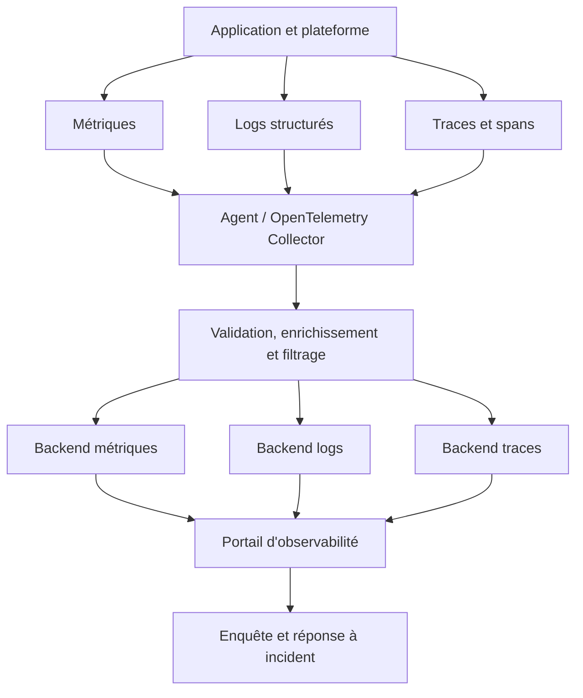
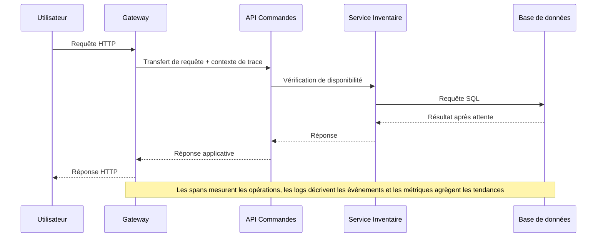
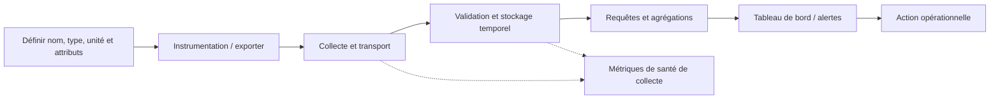
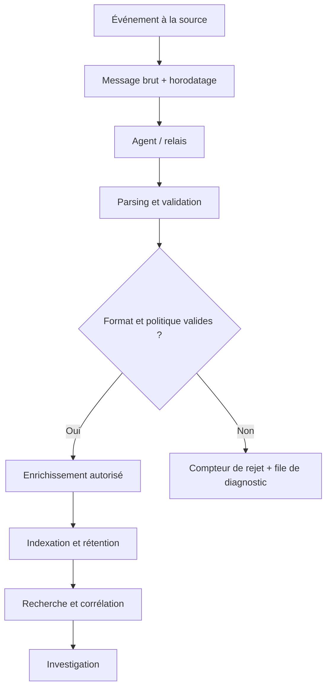
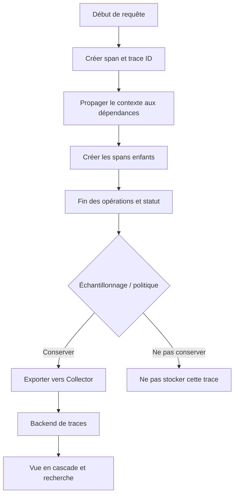
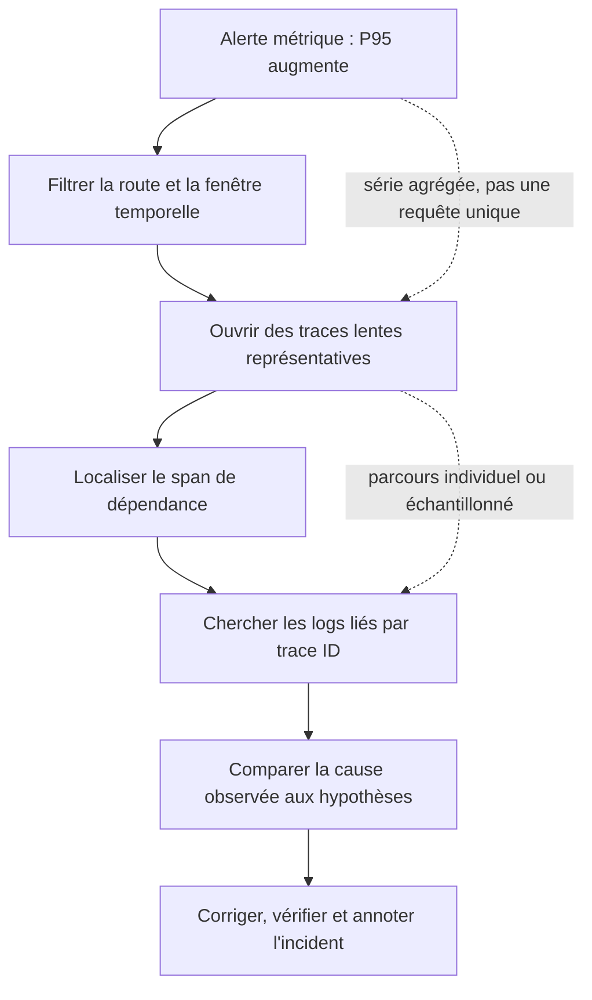

# Métriques vs Logs vs Traces

## 1. Introduction

### 1.1. Pourquoi trois signaux au lieu d'un seul journal géant ?

Imaginez une application de commerce en ligne qui répond lentement. Les utilisateurs voient des pages qui chargent pendant plusieurs secondes, certains paiements échouent et l'équipe support reçoit des plaintes. Le serveur web affiche pourtant un taux de disponibilité élevé ; le processeur semble normal sur la moyenne de la journée ; les journaux contiennent des milliers de lignes sans erreur évidente. Chaque outil montre une partie de la situation, mais aucun ne permet encore de répondre à la question opérationnelle : où le temps est-il passé et pourquoi certaines requêtes échouent-elles ?

C'est précisément le problème auquel répond l'observabilité. Elle ne signifie pas simplement installer un tableau de bord de plus ni accumuler toutes les données disponibles. Elle consiste à rendre un système suffisamment explicable depuis l'extérieur pour pouvoir examiner son comportement, vérifier des hypothèses et comprendre des situations qui n'avaient pas été anticipées. Les signaux de télémétrie habituellement associés à cette démarche sont les **métriques**, les **journaux (logs)** et les **traces distribuées**. Ils se complètent parce qu'ils répondent à des questions différentes.

Une métrique indique une mesure agrégée ou un état mesuré dans le temps : combien de requêtes arrivent, quel pourcentage échoue, quelle est la consommation mémoire ou combien de temps prennent les requêtes selon une distribution. Un log décrit un événement particulier avec du contexte : une authentification a échoué, une commande a été refusée, une connexion à la base de données a expiré. Une trace raconte le parcours d'une opération à travers plusieurs composants : une requête est entrée dans la passerelle, a été traitée par une API, a attendu un service de paiement puis a interrogé une base de données.

Si l'on ne collecte que des métriques, on peut détecter une hausse des erreurs sans savoir quelles requêtes sont concernées. Si l'on ne collecte que des logs, une application très bavarde peut générer des millions de lignes difficiles à parcourir et coûteuses à stocker. Si l'on ne collecte que des traces, il peut être difficile d'estimer une tendance fiable à grande échelle, notamment si les traces sont échantillonnées. La bonne approche consiste à choisir chaque signal en fonction de la question à résoudre, puis à créer des liens fiables entre eux.

### 1.2. Encadré de mise en contexte

> **Situation professionnelle.** À 10 h 17, le tableau de bord indique que le taux d'erreurs HTTP 5xx est passé de 0,2 % à 6 % et que le percentile P95 du temps de réponse a doublé. Un log d'erreur isolé n'explique pas cette hausse. Une trace d'une requête en échec montre que l'API a attendu 2,8 secondes sur le service d'inventaire, lequel a lui-même attendu une requête SQL. La métrique identifie l'ampleur et le début de la dégradation ; la trace localise le temps passé ; les logs fournissent le détail de l'erreur SQL et le contexte de la transaction. Les trois signaux permettent de relier un impact visible à un mécanisme technique vérifiable.

Ce scénario présente le mode de travail que nous voulons construire. La métrique indique **quand et à quelle échelle** le problème survient. La trace aide à répondre à **où et dans quelle séquence** le délai ou l'erreur s'est produit. Le log explique souvent **ce qui s'est passé à un instant précis**. Ce ne sont pas des frontières absolues : un log structuré peut contenir un identifiant de trace, une trace peut exposer un statut d'erreur et une métrique peut être calculée à partir d'événements. Mais les modèles restent différents et il est utile de les distinguer.

### 1.3. Objectifs du cours

À la fin de ce cours, vous devez pouvoir définir métrique, log, trace, span, attribut, ressource, échantillonnage et cardinalité ; choisir un signal adapté à une question ; reconnaître les principaux types de métriques ; concevoir des journaux structurés utiles à l'investigation ; lire une trace distribuée ; et relier les signaux sans perdre leur contexte. Vous saurez aussi reconnaître les coûts et risques d'une instrumentation excessive, en particulier lorsque les données contiennent des identifiants personnels, des charges utiles métier ou des dimensions qui changent à chaque requête.

Le parcours est progressif. Nous commencerons par la différence conceptuelle entre les trois signaux, puis examinerons les modèles de données et leurs usages. Ensuite, nous étudierons l'architecture de collecte, la propagation du contexte, les conventions de nommage, les alertes, la rétention et les coûts. Enfin, une étude de cas suivie d'un laboratoire montrera comment passer d'un symptôme de production à une explication fondée sur plusieurs preuves.

### 1.4. Observabilité, monitoring et télémétrie

Le **monitoring** consiste souvent à vérifier un ensemble de conditions connues : un service répond-il, un disque est-il presque plein, le taux d'erreur dépasse-t-il une limite ? Ces contrôles sont essentiels pour détecter rapidement les incidents prévisibles. L'**observabilité** vise aussi à permettre des questions nouvelles, auxquelles on n'a pas nécessairement pensé lors de la création du tableau de bord. Elle demande que les données disponibles permettent de découper le comportement selon des dimensions utiles, d'examiner des événements et de reconstruire des parcours.

La **télémétrie** désigne les données émises par un système sur son état et son activité. Il peut s'agir de compteurs, de mesures de durée, d'événements applicatifs, de spans ou d'informations sur le processus. Les trois signaux ne constituent pas une observabilité complète à eux seuls : la qualité de l'instrumentation, les conventions de nommage, la propagation du contexte, les métadonnées, les contrôles de sécurité et la possibilité de requêter les données comptent tout autant. Des données abondantes mais incohérentes ne rendent pas un système facile à diagnostiquer.

OpenTelemetry est un projet et un ensemble de conventions largement utilisés pour instrumenter, collecter et exporter la télémétrie. Il fournit notamment des API, des SDK et un Collector qui peuvent relier des applications à différents backends. Il ne constitue pas à lui seul une base de données de métriques, un moteur de recherche de logs ou une interface de traces. Il facilite la production et le transport cohérents des données, tandis que les plateformes de stockage et d'analyse assurent d'autres rôles. Voir les concepts officiels des signaux : https://opentelemetry.io/docs/concepts/signals/.

### 1.5. Une règle de base : formuler la question avant de choisir le signal

Avant d'ajouter un agent ou une ligne de code, formulez la question opérationnelle. « Le service est-il lent ? » nécessite une mesure de durée agrégée et un objectif de performance. « Quelle opération est lente ? » appelle un découpage par type d'opération puis probablement une trace. « Pourquoi une transaction précise a-t-elle échoué ? » exige des logs et des détails de trace avec un contexte d'identification sécurisé. « Le problème touche-t-il tous les utilisateurs ou seulement une région ? » nécessite des métriques segmentées par dimensions stables, éventuellement complétées par des traces représentatives.

Une mauvaise question mène à une collecte inutile. Journaliser chaque valeur mémoire à chaque milliseconde produit un volume énorme qui ressemble à une métrique mal conçue. Transformer chaque exception en une série temporelle avec un label unique par message crée une cardinalité excessive. Créer une trace détaillée pour chaque tâche de fond sans politique de rétention ni stratégie de volume peut coûter cher sans améliorer le diagnostic. L'instrumentation devrait expliquer un service, pas le noyer sous ses propres données.

### 1.6. Comparaison rapide des trois signaux

| Dimension | Métriques | Logs | Traces |
|---|---|---|---|
| Question centrale | Quelle tendance, quel niveau ou quel taux ? | Quel événement s'est produit et avec quel détail ? | Quel chemin a suivi une opération et où le temps a-t-il été dépensé ? |
| Forme habituelle | Séries temporelles numériques | Événements horodatés, texte ou champs structurés | Traces composées de spans liés |
| Échelle typique | Agrégation fréquente | Événement individuel | Parcours individuel ou échantillon de parcours |
| Point fort | Tendances, alertes, agrégats | Détails, contexte, audit et messages d'erreur | Dépendances, causalité instrumentée et latence par étape |
| Limite typique | Peu de détails sur un événement précis | Volume et recherche difficiles sans structure | Coût, échantillonnage et dépendance à la propagation du contexte |
| Exemple | P95 HTTP à 1,8 seconde | Échec d'appel SQL avec timeout | Requête HTTP -> API -> base de données |
| Question à éviter | « Quel utilisateur précis a causé cette valeur ? » | « Combien de requêtes au total échouent chaque minute ? » | « Quelle sera exactement la tendance de toutes les requêtes si seulement une partie est tracée ? » |

Cette comparaison est un point de départ et non une loi absolue. Les systèmes modernes peuvent créer des métriques à partir de logs, résumer les traces en histogrammes et relier les logs à une trace. L'important est de savoir quelle information le signal conserve ou élimine, et quel coût est associé à la conservation de cette information.

## 2. Concepts clés

### 2.1. Comprendre le modèle de donnée d'une métrique

Une métrique décrit une caractéristique mesurable du système : le nombre de requêtes traitées, la durée d'une opération, le nombre de connexions actives, l'occupation d'un disque ou la taille d'une file d'attente. Dans un système de séries temporelles, chaque échantillon associe généralement une valeur à un instant ou à un intervalle, avec un nom de métrique et un ensemble de dimensions. Une série temporelle représente donc les observations d'une même combinaison de nom et de dimensions au fil du temps.

Prenons une métrique appelée **http.server.request.duration**. Si on la segmente par service, méthode HTTP, route normalisée et code de statut, on peut comparer la latence des opérations sans mélanger tous les trafics. Les dimensions doivent être choisies avec soin. Le nom d'une route tel que **/orders/{order_id}** est habituellement plus stable que le chemin concret **/orders/938475**, car chaque identifiant de commande unique peut créer une série distincte. Un label ne doit pas accueillir une valeur qui change à chaque requête si l'on veut garder un nombre de séries maîtrisable.

Les métriques sont souvent agrégées et stockées sur des durées significatives. Une mesure relevée toutes les quinze secondes peut servir à afficher une tendance d'une heure, une journée ou un mois. Des systèmes peuvent conserver les données brutes à une résolution plus fine, puis réduire la précision temporelle après un certain âge. Cette agrégation économise le stockage mais fait perdre certains détails : une pointe de deux secondes peut disparaître dans une moyenne d'une minute. La stratégie de rétention et de downsampling doit donc être liée aux scénarios de diagnostic.

Un échantillon numérique ne suffit pas si l'on ne connaît pas son unité et sa sémantique. Une durée en secondes ne doit pas être confondue avec une durée en millisecondes ; une taille en octets avec une taille en mégaoctets ; une utilisation CPU exprimée comme ratio de 0 à 1 avec un pourcentage de 0 à 100. Les noms et les unités doivent être cohérents au sein de la plateforme. Les conventions sémantiques communes, comme celles d'OpenTelemetry, réduisent les conversions inutiles et permettent aux outils de mieux comprendre les données.

### 2.2. Les principaux types : Counter, Gauge, Histogram et Summary

Un **Counter** représente une quantité cumulative qui augmente au fil du temps, sauf réinitialisation. On peut l'utiliser pour compter le total de requêtes reçues, les exceptions, les octets envoyés ou les tâches terminées. La valeur brute d'un compteur est rarement l'indicateur le plus intéressant pour un tableau de bord ; on utilise plutôt son taux de variation, par exemple des requêtes par seconde ou des erreurs par minute. Les réinitialisations au redémarrage doivent être prises en compte par l'outil de requête.

Un **Gauge** représente une valeur qui peut augmenter ou diminuer et qui décrit généralement l'état courant : nombre de connexions simultanées, taille actuelle d'une file, température ou mémoire utilisée. Calculer un taux sur un gauge comme s'il s'agissait d'un compteur est souvent incorrect. Si le nombre d'éléments d'une file passe de 30 à 10, cela ne signifie pas une perte de 20 tâches ; la file a simplement diminué entre les deux mesures. Une même grandeur peut être exprimée par un counter ou un gauge selon sa sémantique, et ce choix change les possibilités d'analyse.

Un **Histogram** regroupe des mesures dans des distributions ou des compartiments. Il est souvent utilisé pour les durées de requête ou les tailles de réponse : il peut permettre d'estimer combien d'opérations se situent sous un seuil, ainsi que la distribution des latences. Il est utile parce qu'une moyenne seule masque les requêtes lentes. Dans Prometheus, les histogrammes classiques exposent des compteurs de buckets cumulés, un compte total et une somme ; les histogrammes natifs ont un modèle plus riche et leur prise en charge dépend des composants utilisés. La documentation officielle sur les types de métriques décrit les particularités d'implémentation : https://prometheus.io/docs/concepts/metric_types/.

Un **Summary**, dans les environnements qui l'emploient, peut calculer des quantiles du côté de l'instrumentation et exposer des valeurs récapitulatives. Ces quantiles locaux ne s'agrègent généralement pas aussi simplement entre plusieurs instances qu'un histogramme. Par exemple, la moyenne de deux P95 calculés indépendamment ne représente pas nécessairement le P95 global. Il faut choisir le modèle selon la question à laquelle le tableau de bord doit répondre et la possibilité de combiner les résultats de plusieurs instances.

Les types ne sont pas de simples étiquettes décoratives. Ils déterminent comment calculer un taux, comment traiter une réinitialisation, comment agréger plusieurs instances et comment interpréter les valeurs manquantes. Une erreur de type peut fournir un graphe visuellement plausible tout en donnant une conclusion erronée. Lors de l'instrumentation d'une nouvelle grandeur, demandez-vous si la valeur est cumulative, si elle peut diminuer, si son historique compte, si elle doit être agrégée et si la distribution a plus de valeur que la moyenne.

### 2.3. Compteurs, taux et dénominateurs

Un compteur d'erreurs peut monter de 100 à 130 pendant une minute. Cela signifie que 30 erreurs supplémentaires ont été comptées pendant l'intervalle, pas que le taux d'erreurs est de 30 %. Pour obtenir un taux, on divise les erreurs observées par le nombre de requêtes pertinentes sur la même fenêtre. Si 30 erreurs surviennent parmi 1 000 requêtes, le taux est de 3 %. Si les mêmes 30 erreurs surviennent parmi 100 000 requêtes, le taux est de 0,03 %. Le contexte du volume change totalement l'interprétation.

Un bon indicateur comporte souvent un numérateur et un dénominateur. Le taux d'erreur HTTP peut être calculé en divisant le nombre de réponses classées comme erreurs par le nombre de requêtes sur la même période, après avoir défini ce qu'est une erreur pour le service. Le taux de réussite peut être plus utile pour un objectif métier, mais il doit utiliser une définition cohérente avec le contrat. N'incluez pas silencieusement des requêtes annulées ou des réponses qui ne relèvent pas du service mesuré sans expliquer la règle.

Le taux instantané peut être bruité lorsque le trafic est faible. Dix erreurs en dix requêtes correspondent à 100 %, mais peuvent résulter d'un test très petit ; dix erreurs sur un million de requêtes racontent une histoire différente. À l'inverse, un taux moyen quotidien peut cacher une panne complète de deux minutes. Choisissez la fenêtre en fonction du type d'alerte : une fenêtre courte aide à détecter un incident rapide, une fenêtre longue réduit le bruit et mesure un comportement durable. Les tableaux de bord doivent rendre cette fenêtre visible.

Un compteur peut être remis à zéro lors d'un redémarrage ou d'une réinitialisation, et un collecteur peut manquer plusieurs échantillons. Les fonctions de calcul du taux doivent tenir compte de ces événements. Ne calculez pas manuellement une variation entre deux valeurs isolées sans savoir si un redémarrage est survenu, si le temps entre les valeurs est connu et si l'outil dispose d'une fonction adaptée au compteur. Une valeur instantanément plus basse n'implique pas nécessairement une diminution du trafic réel.

### 2.4. Agrégation, percentiles et distribution

La moyenne est facilement compréhensible, mais elle peut masquer les mauvaises expériences d'une fraction des utilisateurs. Si 99 requêtes durent 100 ms et une requête dure 10 secondes, la moyenne est proche de 199 ms, mais un utilisateur a tout de même vécu un délai très important. Les percentiles décrivent la position d'une observation dans une distribution : P50 est la médiane ; P95 est une durée en dessous de laquelle se situent environ 95 % des observations selon la méthode de calcul ; P99 décrit une queue encore plus lente.

Il faut toutefois comprendre ce qu'un percentile ne dit pas. P95 ne signifie pas que chaque utilisateur attend ce délai ; il ne révèle pas non plus l'identité des requêtes les plus lentes. Les calculs dépendent de la fenêtre, de la population d'échantillons, du type d'histogramme et de l'algorithme utilisé. Un percentile calculé par instance n'est pas nécessairement agrégeable comme une simple moyenne. Les métriques de distribution doivent être conçues selon la manière dont les données seront interrogées dans le backend.

Les buckets d'un histogramme classique représentent des plages de valeurs. Des limites trop larges peuvent rendre certaines estimations peu précises ; un nombre excessif de compartiments peut augmenter le coût. Choisissez les buckets selon les seuils d'intérêt opérationnel : si l'objectif interne est de répondre en moins de 300 ms pour la plupart des requêtes, les limites autour de ce seuil sont pertinentes. La capacité du backend et les exigences de précision doivent être équilibrées. La configuration ne devrait pas être copiée d'un autre service sans tenir compte des durées réellement observées.

La distribution change souvent en fonction de la route, de la région, du type de client ou de la dépendance. Une métrique d'histogramme segmentée uniquement par application peut mélanger une route rapide et une route lente, ce qui dilue le signal. Ajouter une dimension utile améliore l'analyse, mais chaque dimension augmente le nombre potentiel de séries. L'art de l'instrumentation consiste à conserver les dimensions qui changent réellement la décision opérationnelle, et à renvoyer vers les traces ou les logs pour les détails à haute cardinalité.

### 2.5. Dimensions, labels et cardinalité

Les dimensions, souvent appelées labels ou attributs selon le système, permettent de filtrer et d'agréger les séries. On peut distinguer les requêtes par service, environnement, route normalisée, méthode ou code de résultat. Une série est généralement définie par la combinaison de son nom et de ses labels ; ajouter ou modifier une valeur de label crée une nouvelle série temporelle dans les systèmes de type Prometheus. Sa documentation insiste sur ce principe : https://prometheus.io/docs/concepts/data_model/.

La **cardinalité** désigne le nombre de combinaisons possibles ou effectivement présentes de dimensions. Une métrique avec cinq services et quatre environnements peut rester facile à gérer. Une métrique enrichie d'un identifiant de commande unique, d'un identifiant utilisateur, d'une adresse complète et d'un identifiant de requête peut produire des millions de séries. Cette multiplication augmente l'utilisation de mémoire, le coût du stockage, le travail d'indexation et la complexité des requêtes. Une hausse de cardinalité peut parfois être plus coûteuse qu'une simple augmentation du nombre d'échantillons.

La règle pratique est de réserver les labels des métriques aux dimensions relativement stables et utiles à l'agrégation. Une route doit être normalisée en modèle de chemin ; un type d'erreur peut être regroupé dans une classification bornée ; un identifiant de trace ou d'utilisateur unique devrait normalement figurer dans un log ou un span, pas dans chaque série de métriques. Les attributs à haute cardinalité peuvent servir à la recherche d'un événement, mais ils ne doivent pas automatiquement devenir des dimensions permanentes des séries.

La cardinalité ne se décide pas en regardant seulement une étiquette. Deux dimensions de cardinalité moyenne peuvent produire un produit cartésien élevé. Par exemple, 100 routes × 20 codes internes × 50 régions × 10 versions = potentiellement un million de combinaisons, avant même d'inclure les instances. Faites des estimations et contrôlez les données réellement émises. Mettez en place des limites ou des règles d'attributs pour éviter qu'un changement d'instrumentation introduise un label unique par requête en production.

### 2.6. Un log : un enregistrement d'événement avec contexte

Un log est un enregistrement décrivant qu'un événement a eu lieu ou qu'un composant a observé une situation. Il peut être composé d'une chaîne de texte, d'un objet structuré ou d'un message normalisé par un collecteur. Un log peut enregistrer un échec d'authentification, la fermeture d'une connexion, une tentative de paiement refusée, une mise à jour de configuration ou une erreur d'accès à la base. Il est particulièrement précieux quand l'événement porte une information détaillée qui serait trop lourde ou trop riche pour une métrique.

Un journal utile possède un horodatage, une source et un contenu interprétable. Dans un format structuré, il peut également inclure le niveau de gravité, le nom du service, l'environnement, le type d'événement, un code d'erreur et des identifiants de corrélation. Le JSON est fréquent, mais il ne suffit pas de sérialiser n'importe quel objet : les champs doivent avoir des noms cohérents, des types stables et des valeurs pertinentes. Un champ parfois numérique et parfois texte rend les recherches plus fragiles et complique les agrégations.

Le log doit être écrit au bon niveau de détail. Un message comme « échec » n'aide guère : il ne précise ni l'opération, ni la cause disponible, ni l'endroit où l'échec a été observé. Un message extrêmement verbeux qui recopie tout le contexte, y compris des données personnelles ou des secrets, est également mauvais. Un bon événement inclut les champs nécessaires à l'action et conserve le contexte riche dans une source sécurisée lorsqu'il doit être consulté. Il doit pouvoir être compris sans inventer une cause qui n'a pas été vérifiée.

Le niveau de gravité d'un log est une indication donnée par l'application ; il n'est pas automatiquement l'importance métier de l'événement. Un avertissement peut être très important s'il se répète et touche un service critique, alors qu'une erreur d'un composant optionnel de test peut avoir peu d'impact. L'alerting doit intégrer le contexte, la fréquence, la criticité et les conséquences, tout en gardant la gravité originale afin de préserver la signification du message source.

### 2.7. Logs structurés, champs communs et qualité du texte

Un log structuré sépare le message humain de champs manipulables par un moteur de recherche. Au lieu d'écrire « appel vers service paiement lent » sans autre détail, l'application peut émettre un événement avec un nom stable, un temps écoulé, un statut, le service appelant et l'identifiant de trace. Le message reste utile à la lecture, tandis que les champs permettent de filtrer ou d'agréger. Il est souvent préférable d'avoir des champs communs bien définis que des messages textuels qui changent selon les développeurs.

Les champs doivent rester sémantiquement cohérents. Si une application écrit **duration_ms** dans certains endroits et **elapsed_seconds** ailleurs, les consommateurs doivent convertir et risquent de se tromper. Choisissez une convention d'unité, de niveau, d'identité de service, d'environnement et de résultat. Des conventions communes telles que celles d'OpenTelemetry décrivent les attributs partagés pour les logs, métriques et traces ; elles améliorent la compatibilité entre langages et bibliothèques. Voir : https://opentelemetry.io/docs/specs/semconv/general/.

Les messages libres gardent leur utilité, notamment pour les exceptions et les détails qui changent. Ils ne devraient pas être le seul emplacement d'informations essentielles comme le statut, l'opération ou le code d'erreur. Une extraction par expression régulière peut fonctionner un temps puis casser lorsque le message change. Quand la donnée est importante pour les alertes, collectez-la comme champ structuré et testez le schéma dans le processus de développement.

Il est utile de tester les logs comme on teste une interface. Pour chaque événement important, définissez quels champs doivent toujours être présents, lesquels sont optionnels, les types de données et les règles de confidentialité. Le test doit aussi vérifier le cas d'erreur : un log qui n'est émis que lors du succès n'aidera pas l'analyse d'un échec. Une modification de schéma doit être traitée comme un changement de contrat et non comme une simple variation esthétique du texte.

### 2.8. À quoi servent les logs dans une investigation ?

Les logs donnent les détails qui ont été explicitement enregistrés par le code ou la plateforme. Ils peuvent indiquer qu'une requête de base de données a expiré, qu'un certificat est arrivé à expiration, qu'un compte a été refusé ou qu'une politique de sécurité a bloqué une action. Ils sont particulièrement utiles lorsque l'événement possède des paramètres ou un message d'erreur qui expliquent le contexte. Ils peuvent aussi servir de trace d'audit des actions administratives si leur intégrité et leur rétention sont gérées correctement.

Mais les logs ne reconstituent pas automatiquement toute la causalité. Si un composant enregistre qu'une requête distante a expiré, on sait que ce composant a observé un timeout, mais pas nécessairement si la base était en panne, si le réseau perdait des paquets ou si le délai était trop court. Les logs peuvent eux-mêmes être retardés, perdus, échantillonnés ou produits avec une horloge incorrecte. Une investigation doit relier le message à d'autres observations indépendantes.

Les journaux peuvent aussi être trompeurs si l'application consigne l'erreur trop tôt ou la transforme. Par exemple, une exception générique « connexion refusée » peut masquer une erreur DNS, une configuration incorrecte, un filtrage ou un service qui n'écoute pas. L'événement doit préserver le contexte technique disponible, sans exposer des secrets. Lorsque le diagnostic est important, ajoutez une catégorie d'erreur stable et conservez une chaîne de cause si le langage ou la bibliothèque en fournit une.

### 2.9. Une trace distribuée : suivre une opération de bout en bout

Une trace distribuée représente le parcours d'une opération qui traverse des composants. Elle est composée de **spans** (portions de travail) associés à une même trace et reliés par une relation parent-enfant ou une autre relation explicitement définie. Un span possède généralement une heure de début, une durée, un nom d'opération, un type, des attributs et éventuellement des événements ou un statut d'erreur. L'ensemble donne une vue temporelle de la requête, plutôt qu'une simple liste de messages isolés.

Imaginons une requête de recherche de commande. Le navigateur appelle une API ; l'API interroge le service de commandes ; le service de commandes appelle l'inventaire ; l'inventaire interroge une base de données. La trace peut montrer que la requête totale a duré 1,4 seconde, dont 40 ms au niveau de la passerelle, 90 ms dans le service de commandes, 1,1 seconde dans l'appel d'inventaire et 80 ms dans un autre traitement. Cette décomposition oriente l'enquête vers la dépendance qui consomme la plus grande part du temps.

Le span le plus long n'est pas toujours la cause racine. Un span client qui dure 1,1 seconde peut attendre un service distant lent, un réseau congestionné, un timeout ou une file d'attente interne. Le span serveur correspondant peut être absent si l'instrumentation n'est pas propagée ; ou il peut montrer que l'attente se produit dans la base de données. Une trace offre une structure causale instrumentée, mais elle ne peut pas montrer ce que le système n'a pas instrumenté ou ce qui n'a pas été conservé par la politique d'échantillonnage.

Une trace n'est pas un dump exhaustif de tous les appels internes d'un processus. Si seuls les appels HTTP entre services sont instrumentés, les opérations CPU locales ou les files internes ne seront pas nécessairement représentées. L'instrumentation doit choisir des frontières significatives et éviter de créer des milliers de spans inutiles pour chaque petite fonction. La qualité dépend de la granularité : assez détaillée pour localiser les délais, mais assez stable pour être lue et maintenue.

### 2.10. Trace ID, Span ID et propagation du contexte

Chaque trace a un identifiant de trace, et chaque span a son propre identifiant. Lorsqu'une requête passe d'un service à l'autre, le contexte de trace doit être propagé pour que les spans générés dans différents processus puissent être reliés. Dans les systèmes HTTP, un mécanisme courant est le format W3C Trace Context, qui transporte notamment un identifiant de trace et des informations sur le span parent via des en-têtes standardisés. L'implémentation doit respecter les règles de propagation et de validation de la bibliothèque utilisée.

Sans propagation, chaque service peut créer une nouvelle trace indépendante. Les données existent alors, mais la vue de bout en bout est fragmentée : on voit un appel client et un traitement serveur sans pouvoir établir le lien fiable entre eux. Les systèmes asynchrones comme les files de messages nécessitent une propagation du contexte à travers les métadonnées du message. Une tâche peut commencer longtemps après l'émission du message ; la relation doit être modélisée correctement, et toutes les opérations ne se représentent pas forcément comme un arbre strict parent-enfant.

L'identifiant de trace est utile pour relier un log précis à une trace, mais il doit rester un identifiant de corrélation et non être traité comme une identité utilisateur ou un secret d'autorisation. L'exposer dans une URL ou dans des métriques à cardinalité élevée n'est généralement pas une bonne idée. Un identifiant de trace peut être enregistré dans un log structuré et utilisé pour naviguer vers la trace dans l'interface appropriée. Le lien doit préserver les droits d'accès et éviter de rendre des données sensibles publiquement accessibles.

La propagation de contexte doit être vérifiée à travers les frontières techniques : proxies, API gateways, services écrits dans des langages différents, bibliothèques HTTP, middleware, queues et fonctions serverless. Un composant qui supprime ou remplace les en-têtes peut rompre la chaîne. Un test de bout en bout doit confirmer qu'une seule requête produit une trace cohérente, avec des identifiants liés, des durées plausibles et le bon statut. Il faut aussi décider comment traiter les requêtes entrantes qui fournissent un contexte de trace externe, afin de ne pas accepter aveuglément des identifiants contrôlés par un tiers comme preuve de confiance.

### 2.11. Événements dans les traces et liens entre spans

Un span peut contenir des événements horodatés qui marquent des étapes pertinentes à l'intérieur d'une opération : début d'une tentative, cache manqué, exception observée ou déclenchement d'une logique de secours. Ces événements sont plus précis qu'une simple durée de span, mais ils ne doivent pas être utilisés pour recopier aveuglément tout le journal applicatif dans chaque trace. La décision d'ajouter un événement doit être guidée par sa valeur au diagnostic et par le volume généré.

Des opérations asynchrones ou distribuées peuvent être liées sans former un arbre unique. Un message peut être produit par une trace, puis consommé plus tard ou par plusieurs workers. Des liens entre spans permettent de représenter certaines relations de cause ou de contexte sans inventer un parent unique qui ne correspond pas au déroulement réel. Les interfaces de traçage offrent des vues de dépendances, mais les utilisateurs doivent connaître les conventions de l'instrumentation pour interpréter les liens.

Les attributs des spans décrivent l'opération : méthode HTTP, route normalisée, type d'opération de base de données, résultat, nom de dépendance et catégorie d'erreur. Les attributs doivent être assez riches pour guider l'analyse, mais ne devraient pas contenir par défaut des charges utiles, des tokens, des mots de passe ou des données personnelles inutiles. Un span peut être envoyé vers un backend à accès plus large que celui prévu pour le contenu d'une requête ; la confidentialité doit être conçue dès l'instrumentation.

### 2.12. Comment lire une trace sans confondre durée et consommation CPU

La durée d'un span correspond au temps écoulé entre son début et sa fin observés. Elle peut comprendre du travail CPU, des attentes de réseau, du temps passé en file, des verrous ou une attente d'une dépendance. Un span de 900 ms n'implique donc pas 900 ms de CPU utilisé. Il indique que l'opération n'a pas été terminée pendant cet intervalle. Pour comprendre le temps, il faut examiner les spans imbriqués, les événements et les mesures des composants.

Dans une vue en cascade, les spans parent peuvent englober les spans enfants. Additionner naïvement toutes les durées peut compter plusieurs fois le même temps. Si un span serveur dure 1 seconde et inclut un span d'appel SQL de 700 ms, le temps SQL est déjà inclus dans la durée du serveur. Les durées ne doivent pas être additionnées comme si elles étaient toutes indépendantes. Il faut lire les relations et les chevauchements temporels.

Une trace peut également être incomplète à cause de l'échantillonnage, d'une perte de données, d'un export retardé ou d'une instrumentation manquante. Un parent peut exister sans enfant ou un span d'un service distant peut être absent. Il faut éviter de conclure que le composant n'a pas été appelé simplement parce qu'aucun span n'est visible. Vérifiez la politique d'échantillonnage, les erreurs d'export et les frontières où le contexte est propagé.

### 2.13. Échantillonnage et représentativité des traces

En production, conserver toutes les traces d'un service à très haut débit peut être coûteux. L'échantillonnage sélectionne une partie des traces à enregistrer. Un échantillonnage probabiliste simple peut retenir une fraction déterminée ; un échantillonnage par trace doit veiller à conserver des spans cohérents, sinon certaines parties du parcours disparaissent. Le choix dépend de la charge, du coût et du besoin de trouver certains types d'incidents.

Un échantillonnage en tête de trace prend une décision tôt, au début du parcours. Il est efficace, mais il peut ne pas connaître l'issue finale : une requête qui se termine en erreur ou qui dure très longtemps pourrait ne pas avoir été retenue. Un échantillonnage en fin de trace peut décider en fonction des informations finales, mais il demande de conserver temporairement plus de données et nécessite une architecture adaptée. Dans les grands systèmes, il faut tenir compte des délais, des mémoires tampons et des risques de saturation.

L'échantillonnage influence l'interprétation statistique. Si toutes les requêtes normales sont échantillonnées mais que les erreurs sont plus souvent conservées, la proportion d'erreurs dans les traces conservées ne représente pas le taux d'erreur global. C'est parfois un choix utile pour le diagnostic, mais il ne faut pas calculer un SLO à partir d'une population volontairement biaisée sans méthode appropriée. Utilisez plutôt des métriques définies pour les taux agrégés, puis servez-vous des traces pour approfondir les cas représentatifs ou importants.

La politique doit préciser ce qui déclenche une conservation prioritaire : erreur, durée supérieure à un seuil, type de client, environnement ou service critique. Les critères basés sur une valeur difficile à connaître tôt peuvent demander un échantillonnage en fin de trace ou une stratégie spécifique. Surveillez le taux de traces retenues, les pertes, les refus d'export et les ressources du collecteur. Une politique théorique sans mesure de sa couverture peut être à la fois coûteuse et peu utile.

### 2.14. Ressource, service, environnement et conventions communes

Pour corréler des signaux, il faut des attributs cohérents. Un service peut s'identifier par son nom, sa version, son environnement, son instance et sa zone de déploiement. OpenTelemetry utilise le concept de **Resource** pour décrire l'entité qui produit la télémétrie, alors que les attributs d'un span ou d'un log décrivent l'opération ou l'événement lui-même. Distinguer les deux évite de recopier des informations d'identité différentes dans chaque champ et facilite les recherches transversales.

Par exemple, **service.name** devrait avoir une valeur stable pour un service logique, tandis que l'identifiant de l'instance peut varier entre les réplicas. Si la même API s'appelle **orders-api** dans une métrique, **order-service** dans un log et **orders** dans une trace, l'agrégation exige des mappages et peut produire une vue fragmentée. Définissez le nom canonique et appliquez-le dans les bibliothèques d'instrumentation, les exports et l'inventaire.

Les conventions sémantiques définissent des noms, types et significations communs pour les attributs et les instruments. Elles améliorent l'interopérabilité entre bibliothèques, langages et backends, mais leur version et leur statut de stabilité doivent être considérés. Ne créez pas de conventions locales divergentes sans raison ; si des attributs personnalisés sont nécessaires, documentez leur signification, leurs unités, leurs types et leur sensibilité. Référence officielle : https://opentelemetry.io/docs/specs/semconv/.

### 2.15. Corréler métriques, logs et traces sans tout mélanger

Une corrélation utile établit un lien entre plusieurs vues sur le même comportement. Une alerte sur la métrique de durée HTTP peut être découpée par service et route. L'opérateur ouvre ensuite des traces représentatives de la période, filtre sur une route ou un statut, puis sélectionne une trace lente. Dans cette trace, il suit le span d'appel à une dépendance et retrouve les logs associés grâce à l'identifiant de trace. Le parcours devient une enquête guidée plutôt qu'une recherche séparée dans trois outils.

La corrélation nécessite des règles de conservation. Un identifiant de trace est utile dans un log, mais il est souvent trop cardinal pour une étiquette de métrique. Une métrique doit garder des dimensions agrégables ; une trace doit conserver un identifiant permettant de suivre une opération ; un log doit inclure suffisamment de contexte pour expliquer un événement. L'objectif est de partager les identifiants et les conventions, pas de copier tous les attributs de tous les signaux dans toutes les données.

Les liens automatiques entre métriques et traces dépendent également de la couverture. Une métrique agrégée peut représenter un million de requêtes, tandis qu'une trace représente une requête. L'interface doit indiquer que la trace est un exemple ou un échantillon, et non la preuve que toutes les requêtes se comportent de la même manière. Lorsque l'échantillonnage est biaisé, il faut prendre en compte cette limite dans l'interprétation.

### 2.16. Définir des SLI et SLO utiles à partir des métriques

Un SLI, ou indicateur de niveau de service, quantifie un aspect de la qualité réellement observée par les utilisateurs : disponibilité, réussite, latence ou capacité. Un SLO définit une cible sur cet indicateur pendant une fenêtre : par exemple, la proportion de requêtes valides répondant en moins d'un délai déterminé doit atteindre une cible donnée. Le seuil, la population, les exclusions et la fenêtre doivent être définis explicitement. Un SLO ne peut pas être calculé de façon fiable si les métriques n'ont pas une sémantique cohérente.

Les logs et les traces aident à expliquer les violations d'un SLO, mais ils ne remplacent généralement pas le numérateur et le dénominateur de son calcul. Si le SLO repose sur toutes les requêtes valides, les compteurs ou histogrammes doivent couvrir cette population de manière cohérente. Un échantillon de traces qui conserve surtout les erreurs ne constitue pas une population non biaisée pour calculer le taux de succès. Utilisez les logs et les traces pour comprendre les raisons, puis validez le calcul avec les métriques appropriées.

Une alerte fondée uniquement sur un seuil matériel peut ne pas refléter l'expérience utilisateur. Une CPU à 95 % peut être normale si le service continue de répondre dans l'objectif ; une CPU à 40 % peut coexister avec un défaut de réseau ou une dépendance lente. Les signaux techniques restent utiles, mais les alertes de fiabilité devraient inclure autant que possible les symptômes qui affectent directement le service. Les métriques système aident à expliquer ces symptômes lorsqu'une dégradation est détectée.

### 2.17. Observabilité et diagnostic des systèmes réseau

Dans un environnement réseau, les trois signaux gardent leurs rôles distincts. Les métriques peuvent suivre le débit des interfaces, les erreurs, les pertes, les sessions actives ou les temps de réponse. Les logs peuvent documenter les changements de configuration, les événements d'authentification, les liens qui changent d'état et les décisions de pare-feu. Les traces deviennent utiles lorsque les opérations traversent plusieurs composants logiciels, par exemple une requête d'API de gestion qui interroge un contrôleur réseau, lequel appelle plusieurs systèmes d'inventaire.

SNMP, Syslog, ICMP, Prometheus, les agents d'application et OpenTelemetry ne sont pas des alternatives directes. SNMP peut collecter des compteurs d'équipements ; Syslog centralise des événements ; ICMP teste une connectivité donnée ; Prometheus stocke des métriques dans des séries temporelles ; OpenTelemetry fournit des instruments et un pipeline d'export pour les signaux supportés. Les combiner demande une architecture, des conventions et des propriétaires, mais cette approche permet de relier une panne d'interface à un impact applicatif mesuré.

Un exemple : une interface WAN montre une hausse du nombre de paquets perdus ou d'erreurs ; le routeur émet un log de changement d'état ; le service web observe un P95 plus élevé ; une trace montre qu'une API attend plus longtemps un service hébergé à travers ce lien. La corrélation de ces faits renforce l'hypothèse de dégradation réseau. Il faut cependant vérifier les horodatages, les chemins et les autres causes possibles. L'observabilité augmente la capacité à raisonner, elle ne remplace pas la validation de cause.

### 2.18. Ce que l'observabilité ne garantit pas

Aucun signal n'est complet, parfait ou neutre. Une métrique dépend de la définition de la mesure et de la fréquence d'échantillonnage. Un log dépend de ce que l'application a choisi d'enregistrer, de l'horloge, du transport, du parsing et de la rétention. Une trace dépend des frontières instrumentées, de la propagation du contexte, de l'échantillonnage et de la conservation des spans. Une absence de donnée ne prouve pas une absence d'activité.

Les systèmes d'observabilité peuvent être en panne eux-mêmes. Le collecteur peut être saturé, le backend de métriques peut refuser des séries, le pipeline de logs peut perdre des messages et le système de traces peut ne conserver que les traces échantillonnées. Il faut donc surveiller la chaîne d'observabilité avec des indicateurs de santé et, pour les fonctions critiques, disposer d'un contrôle indépendant. Ne confondez jamais « aucun événement visible » avec « aucun événement survenu » sans examiner la qualité de la collecte.

Les données collectées peuvent révéler l'architecture interne, les habitudes d'utilisation et des informations personnelles. L'augmentation de l'observabilité n'autorise pas à capturer le contenu complet de chaque requête. La minimisation, le contrôle d'accès, la rétention, le masquage des données et la séparation des environnements doivent être pensés en même temps que l'instrumentation. Plus de données n'est pas synonyme de meilleure compréhension ; les données les plus utiles sont celles qui répondent à une question avec un coût et un risque acceptables.

## 3. Architecture et Schémas

### 3.1. Une architecture de collecte cohérente

Une architecture peut comprendre une instrumentation dans l'application, des bibliothèques de métriques et de tracing, des sorties de logs structurés, un agent ou Collector, un transport, des backends spécialisés et des interfaces de recherche. Les métriques, les logs et les traces ne sont pas obligés de partager une seule base de données. En revanche, les noms des services, les environnements, les versions et les identifiants de corrélation doivent être suffisamment cohérents pour relier les vues.

Le Collector ou agent peut recevoir des signaux, les traiter et les exporter vers les destinations configurées. Les processors peuvent par exemple enrichir les ressources, filtrer certaines données, ajuster des attributs ou gérer des limites. Il faut vérifier les capacités et l'état des composants réellement déployés ; toutes les combinaisons de signaux, d'exporters et de backends ne sont pas identiques. L'architecture doit documenter les formats, les ports, les certificats, les dépendances et les limites de volume.

Séparer les backends peut être une bonne décision lorsque les profils d'usage diffèrent. Les métriques demandent une agrégation temporelle efficace, les logs une recherche événementielle, et les traces une navigation dans les relations et les durées des spans. Une plateforme intégrée peut proposer une expérience unifiée, mais il reste nécessaire de comprendre quels mécanismes de stockage et quelles politiques s'appliquent à chaque signal. Un bouton « ouvrir la trace liée » ne signifie pas que les données sont conservées de façon identique.

### 3.2. Parcours d'une requête et temps passé par composant

Le contexte de trace doit accompagner les appels instrumentés afin que les spans puissent être reliés. Les métriques peuvent mesurer le volume et la durée des appels de chaque service, tandis que les logs capturent les erreurs explicites ou les décisions significatives. Le diagramme est logique : les systèmes réels peuvent inclure des caches, une file de messages, des retries, des appels parallèles ou des traitements asynchrones qui modifient le modèle de parenté.

Il faut éviter d'instrumenter uniquement les appels qui ont l'air importants sur le diagramme nominal. Les retries, le cache, les dépendances optionnelles et les échecs doivent aussi être visibles quand ils sont pertinents. Un span d'appel qui échoue après un timeout peut donner une durée importante, mais le message exact de l'erreur peut être disponible seulement dans un log. Un compteur de retries peut montrer que l'événement est fréquent. La vue la plus utile associe chaque signal à son rôle plutôt que de répéter les mêmes données à trois endroits.

### 3.3. Pipeline de métriques : instrumenter, collecter, agréger et alerter

Les métriques commencent par une définition claire : que mesure-t-on, dans quelle unité, avec quelles dimensions et quelle fréquence ? L'instrumentation ou l'exporter produit les observations. Le collecteur ou le serveur de monitoring les récupère selon le modèle choisi. Le backend stocke les points, applique les règles de requête et d'agrégation, puis les tableaux de bord et les alertes consomment les séries. Chaque étape doit être surveillée afin que la fraîcheur des données et les erreurs de collecte restent visibles.

Pour les systèmes qui utilisent Prometheus, le modèle de données repose sur des séries temporelles identifiées par le nom de métrique et les labels. Le modèle pull, très utilisé, signifie que le serveur va récupérer les métriques exposées par les cibles ; d'autres architectures peuvent faire intervenir des agents ou des mécanismes de remote write. Ne mélangez pas la méthode de collecte et le type de donnée : une métrique reste une métrique qu'elle soit obtenue par pull, par push ou par export OTLP.

Un tableau de bord de métriques doit montrer les unités et les fenêtres. Une valeur « 0,8 » n'est pas claire sans savoir s'il s'agit d'un ratio CPU, d'une seconde ou d'un taux par requête. Le taux d'erreur doit rendre visible son dénominateur et sa période. Quand une cible cesse de publier des données, l'interface doit indiquer que la mesure est absente ou périmée, plutôt que représenter une valeur zéro qui pourrait être interprétée comme un état sain.

### 3.4. Pipeline de logs : source, transport, parsing et indexation

Les logs sont généralement émis par l'application, le système ou l'équipement, puis envoyés vers un agent ou un collecteur. Celui-ci peut décoder le format, ajouter des métadonnées de source, retirer certains champs sensibles selon la politique, normaliser les attributs et transmettre le message à une base de recherche. Les règles peuvent ensuite regrouper ou détecter certains motifs. Chaque transformation doit être documentée et testée avec des exemples réels.

Le message brut conserve l'information émise par la source. Le parsing crée les champs exploitables, et l'enrichissement ajoute des informations d'inventaire telles que le site ou la criticité de l'actif. Le système doit indiquer si un champ a été fourni par la source ou ajouté par le pipeline. Un nom d'hôte inscrit dans le corps du message ne devrait pas remplacer silencieusement l'adresse source observée. De même, une valeur absente ne doit pas devenir un contenu inventé.

Le volume de logs peut augmenter brutalement lors d'une panne, précisément au moment où la chaîne de collecte est sous pression. Les files, les limites de taille, la persistance, les erreurs d'indexation et le stockage disque doivent être observables. Une règle de réduction de bruit doit préserver les événements critiques et permettre de connaître le nombre d'événements supprimés ou regroupés. Sans ces métriques, une diminution du volume peut être interprétée comme un retour à la normale alors que le collecteur a perdu des données.

### 3.5. Pipeline de traces : spans, propagation et export

L'instrumentation crée des spans autour d'opérations importantes et ajoute les attributs utiles. Le contexte est propagé à travers les appels pour relier les spans entre composants. Un SDK applique éventuellement une politique d'échantillonnage, puis exporte les spans vers un collecteur ou un backend. Le stockage doit pouvoir retrouver les spans d'une même trace et présenter les relations temporelles et de parenté. Les échecs de propagation, les pertes et les délais d'export doivent être surveillés.

Une trace partielle doit être reconnue comme telle. L'absence d'un span peut signifier que la frontière n'est pas instrumentée, que le contexte a été perdu, que le span a été rejeté ou que le backend n'a pas reçu l'export. Les outils doivent montrer autant que possible le statut de la collecte et le contexte de trace disponible. Une vue en cascade ne doit pas être interprétée comme une représentation exhaustive de toute l'exécution si la couverture est incomplète.

La politique d'échantillonnage peut s'appliquer dans l'application, dans le SDK ou au niveau du collecteur selon l'architecture. Vérifiez les effets de chaque choix et les capacités du backend. L'échantillonnage n'est pas une excuse pour ne pas mesurer les taux avec des métriques ; il est un compromis pour conserver des parcours détaillés à un coût acceptable. Les métriques gardent le rôle de décrire la population, tandis que les traces offrent un zoom sur certains parcours.

### 3.6. Liens entre les trois signaux

Les liens doivent conduire à la bonne période, au bon service et à une population comparable. Si une alerte porte sur dix minutes mais que l'utilisateur ouvre des traces de la veille, la corrélation est inutile. Si un log contient un trace ID mal propagé, le lien peut ouvrir une trace sans rapport. Si les métriques utilisent des noms de service différents de ceux des logs, l'opérateur peut manquer les données qui devraient correspondre.

Une bonne interface préserve les filtres au cours de navigation. Lorsqu'on sélectionne un service ou un intervalle, les vues des autres signaux devraient reprendre ce contexte lorsque c'est possible. Les liens ne doivent toutefois pas masquer les différences de population. Par exemple, la métrique peut inclure toutes les requêtes alors que le backend de traces ne conserve que 10 % d'entre elles. Il faut l'expliquer à l'utilisateur afin de ne pas tirer une statistique globale à partir d'une sélection biaisée.

### 3.7. Conventions d'instrumentation et schéma commun

Définissez un catalogue d'événements, de métriques et de spans. Pour chaque métrique, notez le nom, le type, l'unité, les dimensions autorisées, le propriétaire, la question opérationnelle et la règle d'alerte éventuelle. Pour chaque événement de log, définissez le nom, les champs obligatoires, le niveau attendu, les informations sensibles et le contexte de corrélation. Pour chaque span, indiquez l'opération représentée, ses frontières temporelles, les attributs stables et les conditions d'erreur.

Les conventions doivent être partagées entre équipes. Un service ne devrait pas utiliser « app », un autre « application_name », et un troisième « component » pour décrire le même concept sans nécessité particulière. Un inventaire des attributs, des unités et des types permet aux dashboards et aux requêtes de réutiliser les données. Il doit être versionné, revu et maintenu comme un contrat technique, surtout dans un environnement polyglotte.

Évitez de capturer automatiquement tous les champs disponibles. Les conventions sémantiques conseillent de sélectionner les attributs qui apportent une valeur et de tenir compte de leur coût, de leur taille et de leur sensibilité. Une trace avec des centaines d'attributs inutilisés est plus difficile à analyser et augmente la quantité de données. Commencez avec les attributs essentiels, utilisez les retours des investigations pour identifier les manques, puis ajoutez les attributs nécessaires avec des tests.

### 3.8. Mesurer la santé de la chaîne d'observabilité

Un système d'observabilité doit exposer sa propre santé : nombre de mesures reçues et rejetées, retard d'ingestion, file d'attente, débit des logs, erreurs de parsing, export de spans, traces incomplètes, refus dus aux limites de cardinalité, erreurs de stockage et temps de requête de la plateforme. Sans ces données, la plateforme peut devenir aveugle en silence. Pour les chemins critiques, il est utile de produire des tests synthétiques ou des signaux heartbeat qui vérifient le transport jusqu'à la destination.

L'absence d'un signal ne signifie pas qu'il n'y a pas eu d'activité. Une application peut être active mais ne plus exporter de métriques ; un agent peut être arrêté ; un certificat peut expirer ; le backend peut être saturé ; un processeur peut supprimer les attributs ou les événements. Les états « zéro observé », « aucune donnée » et « données anciennes » doivent être distingués. Une valeur zéro est une observation valide, alors qu'une valeur manquante décrit l'absence d'observation.

Testez les scénarios de panne de la plateforme, pas seulement ceux de l'application. Simulez dans un environnement autorisé une destination d'export indisponible, une queue saturée, un parseur qui rejette un message, un changement de schéma et une hausse de volume. Vérifiez que l'incident d'observabilité est détecté et qu'il n'est pas transformé en centaines de fausses alertes d'indisponibilité applicative. La plateforme doit pouvoir expliquer quand elle n'a pas été capable de mesurer correctement le système.

## 4. Étude de cas

### 4.1. Contexte : une API de commandes devient lente

Une entreprise exploite une API de commandes, un service d'inventaire, un fournisseur de paiement et une base de données relationnelle. Le service traite des centaines de requêtes par seconde. En journée normale, le P95 de réponse est proche de 250 ms et le taux d'erreur reste inférieur à 0,5 %. À 10 h 17, le P95 atteint 1,4 seconde, les erreurs 5xx augmentent et le support signale des commandes qui restent en attente. Les ressources CPU ne sont pas saturées, ce qui rend une surcharge CPU globale moins évidente.

Le premier tableau de bord contient seulement CPU, mémoire et disponibilité du processus. Il confirme que l'application tourne, mais il n'explique pas l'expérience utilisateur. L'équipe ajoute une requête de métriques applicatives, puis examine les logs structurés et les traces. Les métriques révèlent que la dégradation touche surtout les requêtes de consultation de stock ; les traces montrent que l'appel du service d'inventaire consomme la majorité du temps ; les logs de cette dépendance indiquent des attentes de base de données et des expirations de délai.

### 4.2. Première étape : définir les indicateurs et le périmètre

Avant de corriger quoi que ce soit, l'équipe définit le symptôme : durée des requêtes HTTP et proportion de requêtes en échec pour l'API de commandes. Elle choisit des dimensions stables, comme le nom du service, la route normalisée, la méthode et la catégorie de statut, tout en évitant un label unique par commande. Elle vérifie que les compteurs représentent toutes les requêtes et que le dénominateur du taux d'erreur est cohérent.

Les mesures sont examinées sur des fenêtres de cinq minutes et de trente minutes. La fenêtre courte montre précisément le début de l'incident ; la fenêtre longue permet de comparer à la tendance de la matinée. L'équipe ne conclut pas que la base de données est fautive à partir de la seule latence du service. Elle utilise d'abord les métriques pour identifier l'impact et limiter la population étudiée, puis passe aux données détaillées.

### 4.3. Deuxième étape : sélectionner les traces pertinentes

Le backend de traces contient une fraction des requêtes, selon la politique d'échantillonnage. L'équipe filtre les traces lentes du service de commandes pendant la fenêtre de l'incident, en vérifiant que le statut et la route correspondent aux métriques observées. Dans les traces, la durée est surtout concentrée sur l'appel vers le service d'inventaire. L'API de commandes passe peu de temps en traitement local ; le span client attend le service distant pendant plus d'une seconde.

Cette observation rétrécit le champ de recherche, mais ne prouve pas encore que le service d'inventaire a un défaut interne. Le délai pourrait être dû au réseau, à une file d'attente, à la base de données ou à un timeout côté client. L'équipe recherche le span serveur correspondant, vérifie les identifiants de trace et compare plusieurs parcours. Elle examine si les traces lentes présentent un motif commun et si les traces réussies ont un parcours différent.

### 4.4. Troisième étape : lire les logs liés à la trace

Les logs structurés du service d'inventaire contiennent un identifiant de trace et un code d'erreur de requête de base de données. Les événements montrent que certaines requêtes passent en attente sur une table utilisée pour les disponibilités. D'autres logs indiquent que le pool de connexions s'approche de sa limite. L'équipe vérifie les métriques de taille du pool, de temps d'attente, de requêtes actives et de connexions libres avant d'attribuer la cause.

Les observations convergent : la dégradation correspond à une nouvelle requête de reporting lancée à 10 h 15, qui effectue des lectures coûteuses et sollicite le même pool de connexions que le service d'inventaire. La métrique indique quand la latence augmente et combien d'opérations sont concernées ; les traces montrent le chemin où le temps est consommé ; les logs expliquent le type d'attente constaté. La cause est retenue après validation des métriques et des journaux de base de données, et non à partir d'une seule trace.

### 4.5. Quatrième étape : remédier et vérifier

L'équipe suspend temporairement le reporting non critique, puis ajuste la requête et déplace son exécution vers un pool ou un créneau séparé après validation. Elle surveille le P95, le taux d'erreur, la taille de file, les attentes sur le pool et les traces récentes. La récupération est confirmée lorsqu'une série d'échantillons consécutifs montre une latence revenue dans la cible et que les erreurs cessent, pas simplement lorsque le tableau de bord passe au vert une seule fois.

Après l'incident, l'équipe met à jour les seuils, ajoute des métriques plus explicites sur l'attente du pool et améliore les logs d'erreur avec une catégorie stable. Elle examine si la politique de traces conserve suffisamment de parcours lents pour rendre la prochaine enquête plus rapide. Elle ne tente pas de stocker chaque trace et chaque détail SQL sans limite : le but est d'augmenter l'information utile tout en maîtrisant le coût, le volume et la confidentialité.

### 4.6. Leçons de l'étude de cas

La première leçon est qu'une métrique système comme la CPU ne suffit pas pour évaluer l'expérience utilisateur. Une application peut être lente parce qu'elle attend une dépendance même si elle consomme peu de CPU. La deuxième leçon est que les traces orientent l'investigation vers une zone, mais elles doivent être interprétées avec les logs et les métriques. La troisième leçon est que la qualité des identifiants, des champs et de l'horodatage détermine si la corrélation est facile ou fragile.

Enfin, l'équipe doit vérifier ses hypothèses et documenter les faits séparément des suppositions. Un span lent désigne un intervalle où l'opération a attendu ; un log d'expiration décrit un événement observé ; une hausse de métrique quantifie l'impact. La cause racine est une conclusion technique qui doit être confirmée par une chaîne de preuves, et non par le composant qui semble le plus suspect.

### 4.7. Variante : métriques normales mais absence de traces

Supposons qu'une application continue à exporter ses compteurs, mais que le backend de traces n'affiche plus de spans depuis quinze minutes. Il serait erroné de conclure que les requêtes n'existent plus. Le problème peut provenir de l'exporteur de traces, du collecteur, d'une politique d'échantillonnage, d'un changement de configuration ou de la destination de stockage. Les métriques restent disponibles et fournissent une preuve que le service traite encore des requêtes, tandis que la chaîne de tracing doit être diagnostiquée séparément.

L'équipe vérifie les compteurs de spans émis, les décisions d'échantillonnage, les erreurs d'export, la file de traitement et le retard d'ingestion. Elle teste ensuite une requête de bout en bout qui doit produire une trace connue. Si le span est créé dans l'application mais n'arrive pas au backend, elle examine le transport et le collecteur. Si le SDK ne produit plus de span, elle vérifie l'initialisation de l'instrumentation et les modifications récentes.

Cette variante illustre une règle fondamentale : l'observabilité doit aussi être observée. Le fait qu'une vue soit vide ne prouve pas que le phénomène sous-jacent soit absent. Les métriques, les logs et les traces peuvent servir à diagnostiquer leurs propres pertes, à condition de disposer d'indicateurs de santé indépendants et de préserver les états inconnus.

### 4.8. Exemple de compte rendu opérationnel

**Symptôme :** le P95 de l'API de commandes dépasse 1,4 seconde entre 10 h 17 et 10 h 31 ; le taux de réponses 5xx augmente au même moment.

**Périmètre :** les requêtes de consultation de stock sont les plus affectées ; les autres routes restent plus proches de leur niveau habituel.

**Constats métriques :** hausse de durée, augmentation des erreurs et du temps d'attente du pool de connexions ; CPU non saturée.

**Constats de traces :** plusieurs traces lentes montrent que l'appel au service d'inventaire représente la plus grande part du délai écoulé.

**Constats de logs :** événements d'attente et timeouts de requêtes SQL ; corrélation temporelle avec un job de reporting.

**Cause retenue après vérification :** consommation excessive du pool de base de données partagée par le job de reporting.

**Actions :** isoler le job, optimiser sa requête, surveiller les métriques du pool et vérifier le retour au niveau attendu.

**Limites :** la politique d'échantillonnage ne conserve pas toutes les traces ; la preuve quantitative globale repose sur les métriques, tandis que les traces servent à examiner des parcours représentatifs.

Ce compte rendu distingue la mesure de l'impact, le contexte d'un événement et le chemin d'exécution. Il reste vérifiable et évite de présenter une trace isolée comme l'ensemble de l'activité du service.

## 5. Pièges à éviter

### 5.1. Utiliser un seul signal pour toutes les questions

Une métrique ne raconte pas l'histoire complète d'une transaction ; un log n'est pas une série temporelle normalisée ; une trace n'est pas un recensement statistique de toutes les requêtes si elle est échantillonnée. Il est tentant de choisir un outil connu et de lui demander de résoudre tous les problèmes, mais chaque modèle perd certaines informations et conserve d'autres détails. Le choix doit être déterminé par la question et les conditions d'exploitation.

Évitez également de collecter les trois signaux sans plan. Si personne ne sait quel champ permet de relier les signaux ou quelle alerte devrait ouvrir quelle enquête, vous aurez trois systèmes coûteux et une investigation toujours manuelle. Définissez des parcours de diagnostic concrets : alerte métrique vers traces, traces vers logs, puis vers actions et validation de retour à la normale. Mesurez si ces parcours sont réellement utilisables par les personnes chargées du support.

### 5.2. Ajouter des identifiants uniques comme labels de métriques

Les identifiants de requête, de trace, de client ou de commande changent souvent à chaque opération. Les placer comme labels crée un nombre de séries potentiellement immense. Cela augmente la mémoire, le stockage, l'indexation et peut provoquer une saturation de la plateforme. Une métrique doit rester agrégeable ; un identifiant unique est plutôt un champ de log ou de trace lorsque l'on doit retrouver une opération particulière.

La cardinalité peut augmenter sans qu'un développeur ait l'impression d'avoir changé radicalement l'instrumentation. Ajouter l'URL brute, un message d'erreur complet ou l'adresse complète du client peut transformer une dimension stable en une valeur presque unique par requête. Mettez en place des conventions de labels, des revues de code et des alertes sur l'évolution du nombre de séries. La protection doit être préventive : attendre la saturation pour corriger la cardinalité est coûteux et risqué.

### 5.3. Croire qu'une moyenne représente l'expérience de tout le monde

La moyenne est utile pour certaines tendances, mais elle peut cacher les requêtes très lentes. Utilisez des percentiles et des distributions lorsque la queue de latence est importante. Comparez aussi les routes, les régions, les méthodes ou les dépendances utiles, sans créer trop de dimensions. Si un groupe de requêtes est lent mais représente une petite part du trafic, la moyenne globale peut sembler correcte alors que l'impact pour ces utilisateurs reste élevé.

Ne comparez pas non plus des percentiles calculés sur des populations différentes sans lire leur définition. Un P95 par instance n'est pas nécessairement le P95 global. Deux percentiles ne peuvent pas être moyennés simplement pour créer un percentile de tout le service. Choisissez un modèle de distribution qui permet l'agrégation requise et vérifiez le comportement du backend. Documentez la fenêtre temporelle et le nombre d'échantillons lorsqu'il est pertinent.

### 5.4. Confondre absence de données avec valeur zéro

L'absence d'une série peut venir d'un service arrêté, d'un collecteur qui ne fonctionne plus, d'un exporter défaillant, d'une erreur de requête ou d'une configuration d'instrumentation. Une valeur égale à zéro est une observation valide, tandis qu'une donnée absente signifie que la plateforme ne dispose pas de valeur. Les deux doivent conduire à des traitements différents. Une interface qui transforme silencieusement les données absentes en zéro peut déclarer un service sain alors que son système de mesure est aveugle.

Définissez la fraîcheur maximale acceptée et l'état présenté au-delà de cette limite. Surveillez les dernières mesures reçues, les erreurs d'export et les files du collecteur. Pour les systèmes critiques, ajoutez un signal indépendant de la chaîne principale. Lorsque les données deviennent anciennes, la plateforme doit afficher une alerte de collecte et non masquer le problème derrière une ligne plate.

### 5.5. Écrire des logs trop vagues ou trop bavards

Un message comme « erreur » ne permet pas d'agir. À l'inverse, enregistrer le corps entier de chaque requête, les en-têtes de sécurité et tous les objets internes expose des données sensibles et augmente le volume. Définissez un événement précis et structuré : opération, statut, catégorie d'erreur, dépendance et contexte de corrélation lorsque cela est approprié. Conservez un détail plus riche uniquement lorsqu'il est nécessaire et protégé par les contrôles d'accès.

La répétition du même message peut aussi rendre la recherche difficile. Si un timeout se produit mille fois, un message uniforme est utile à l'agrégation, mais il doit être possible de connaître le nombre d'occurrences, les périodes, les sources et les requêtes concernées. Ne remplacez pas toutes les occurrences par une ligne unique qui fait perdre la fréquence. Un regroupement peut réduire le bruit, mais le total et la portée doivent rester accessibles.

### 5.6. Capturer des données sensibles sans politique

Les logs et traces peuvent contenir des identifiants personnels, des jetons, des paramètres, des chemins internes, des requêtes SQL ou des informations sur les transactions. L'absence de politique entraîne souvent une copie involontaire de données sensibles dans plusieurs backends. Limitez ce qui est instrumenté, masquez les champs à risque avant l'export lorsque cela est nécessaire, appliquez des droits d'accès par rôle et définissez les durées de rétention selon les exigences de l'organisation.

Le masquage doit être testé et centralisé quand c'est possible. Une règle qui retire un jeton dans les logs mais le laisse dans les attributs de span ne protège pas la chaîne. Les valeurs sensibles peuvent se cacher dans les noms d'événement, les erreurs ou les paramètres de requête. Les tests doivent utiliser des valeurs fictives et vérifier que les secrets attendus ne sont présents dans aucun signal exporté. La minimisation réduit à la fois le risque de fuite et le coût de stockage.

### 5.7. Oublier de propager le contexte de trace

Si la gateway transmet un contexte mais qu'un service le perd, les traces deviennent fragmentées. L'opérateur voit plusieurs parcours isolés et peut croire que la dépendance n'a pas été appelée. Vérifiez les bibliothèques instrumentées, les en-têtes, les queues et les frontières asynchrones. Les tests doivent traverser les principaux chemins réels, pas uniquement un appel local dans un environnement de développement.

La propagation doit également considérer les appels externes et les entrées non fiables. Ne faites pas confiance à un contexte entrant pour prendre une décision d'autorisation ou identifier un utilisateur. Le contexte est un mécanisme de corrélation, pas une preuve de confiance. Validez le format, définissez des politiques pour les appels venant de l'extérieur et évitez d'inclure les identifiants de trace comme labels à cardinalité élevée dans les métriques.

### 5.8. Échantillonner les traces sans comprendre le biais

Une politique d'échantillonnage réduit le coût, mais certaines traces seront absentes. Un échantillonnage simple peut manquer un incident rare ; un échantillonnage qui conserve prioritairement les erreurs peut rendre les erreurs surreprésentées dans l'ensemble de traces affichées. Cette sélection est parfois souhaitable pour le diagnostic, mais elle ne doit pas être utilisée sans précaution pour calculer des statistiques globales. Conservez les taux et les numérateurs pertinents dans des métriques adaptées.

La politique doit être documentée, surveillée et adaptée au volume. Un taux nominal de 10 % ne signifie pas forcément que 10 % de toutes les traces sont disponibles après pertes et limites de stockage. Mesurez les spans émis, exportés, rejetés et stockés. Révisez la politique lorsque les objectifs changent, par exemple quand un service devient plus critique ou lorsque les coûts augmentent. La bonne solution peut nécessiter plusieurs règles ou une stratégie distincte pour les cas lents et les erreurs.

### 5.9. Instrumenter trop finement ou trop grossièrement

Si chaque fonction crée un span sans intérêt opérationnel, les traces deviennent massives et difficiles à lire. Si seuls les appels entre deux services sont instrumentés, un temps d'attente interne peut rester inexpliqué. L'instrumentation doit couvrir les frontières utiles : entrée de requête, dépendances distantes, base de données, file de messages, opérations coûteuses ou étapes métier importantes. Le niveau de détail peut évoluer selon les leçons tirées des incidents.

Une granularité homogène facilite la comparaison. Si certains services créent des spans pour chaque retry et d'autres ne les représentent pas, il devient difficile de comparer le nombre et le coût des tentatives. Définissez les conventions et vérifiez que les bibliothèques automatiques n'enregistrent pas trop de détails ou ne manquent pas les opérations clés. Les attributs doivent décrire l'opération sans multiplier les champs redondants.

### 5.10. Additionner des durées qui se chevauchent

Dans une trace, les spans peuvent être imbriqués et leur durée peut se chevaucher. Additionner toutes les durées d'une requête donne parfois un temps bien supérieur à la durée totale observée, car le temps parent inclut celui des enfants, ou plusieurs opérations se déroulent en parallèle. Interprétez la cascade et les relations de parenté. La durée totale d'une requête et la durée cumulée du travail effectué sont deux mesures différentes.

Un span long signifie que l'opération a pris longtemps entre ses instants de début et de fin, mais pas nécessairement qu'elle consomme du CPU en continu. Elle peut attendre le réseau, un pool, un verrou ou une dépendance. Comparez les spans enfants, les métriques de ressource, les logs et les mesures du service distant. Ne déclarez pas une consommation CPU importante à partir du seul temps écoulé.

### 5.11. Utiliser les noms de service de manière incohérente

Des noms différents pour le même service brisent les tableaux de bord, les filtres et les liens automatiques. Un environnement peut créer des variantes de service avec suffixes de pod ou noms d'hôtes éphémères, puis les considérer par erreur comme des services distincts. Définissez une identité logique de service, des attributs d'instance séparés et une convention d'environnement. Les ressources et les métadonnées doivent être appliquées de façon cohérente à chaque signal.

Les conventions évoluent parfois, par exemple lors d'un renommage ou d'une migration de backend. Planifiez ces changements, mettez à jour les requêtes et dashboards, et conservez un mappage temporaire si l'historique doit rester comparable. Ne laissez pas des alias non documentés se multiplier. L'identité des services fait partie du modèle de données et mérite une gestion de version.

### 5.12. Alertes sur chaque événement plutôt que sur un symptôme durable

Envoyer une notification pour chaque log d'erreur crée rapidement une fatigue d'alerte. Certains événements sont attendus, répétitifs ou peu importants lorsqu'ils sont isolés. Les alertes doivent mesurer un symptôme et un impact : taux d'erreur, latence, saturation durable, dépassement d'un SLO ou motif de sécurité suffisamment significatif. Les logs peuvent déclencher une règle contextuelle, mais le seuil et le regroupement doivent être conçus pour éviter les rafales inutiles.

L'alerte doit inclure un runbook et une équipe responsable. Un événement sans action définie peut rester une donnée consultable plutôt qu'une notification urgente. Définissez les conditions de déclenchement, la persistance, la déduplication, les règles de récupération et les critères d'escalade. Après chaque incident, évaluez si l'alerte était pertinente, trop bruyante ou arrivée trop tard. La qualité d'un système ne se mesure pas au nombre d'alertes, mais à sa capacité à prévenir et guider une action utile.

### 5.13. Confondre instrumenter et tout collecter

Une application peut exposer des centaines de métriques et écrire plusieurs logs par ligne de code ; cela n'implique pas qu'elle soit plus observable. L'instrumentation devrait être guidée par les questions qui comptent : disponibilité, latence, erreurs, saturation, dépendances, parcours métier et événements de sécurité. Un catalogue géré évite que les équipes créent des données redondantes ou des noms incompatibles.

Commencez par les signaux de base, puis ajoutez de la précision après analyse des lacunes. Mesurez le coût par signal, le volume par service, le nombre de séries, la taille de l'index et le taux d'utilisation des dashboards. Un champ rarement utilisé et coûteux peut être retiré ou déplacé vers une source plus appropriée. Ces arbitrages doivent être documentés, en préservant les exigences de sécurité et de conformité.

### 5.14. Ne pas tester la chaîne d'observabilité après un changement

Une mise à jour de bibliothèque peut modifier les noms ou attributs, un changement réseau peut interrompre l'export, un certificat peut expirer et une nouvelle règle peut rejeter des événements. Il faut tester la collecte après les changements importants. Les tests doivent vérifier que les métriques attendues sont présentes, que les logs sont parsés, que les traces traversent les frontières et que les liens entre signaux fonctionnent.

Conservez un jeu d'événements synthétiques et non sensibles pour tester le parcours de bout en bout. Exécutez les tests avec le même type de collector, de transport et de backend que la production, au moins dans un environnement de validation représentatif. Testez aussi la panne : destination indisponible, file saturée, instrument absent ou identifiant de contexte manquant. La chaîne doit remonter ses erreurs au lieu de perdre silencieusement les données.

### 5.15. Laisser le système d'observabilité devenir un point de panne unique

Si le même collecteur, réseau, compte de stockage et mécanisme d'alerte est nécessaire pour signaler ses propres défaillances, une panne commune peut rendre la plateforme aveugle. Surveillez la santé des composants d'observabilité avec un mécanisme indépendant lorsque le risque le justifie. Maintenez des limites de consommation, des files bornées, une politique de reprise et des alertes sur le retard de collecte.

La résilience doit inclure le comportement en surcharge. Un problème applicatif peut déclencher une avalanche de logs et de spans, ce qui surcharge le collecteur et diminue la capacité à observer le problème. Les limites, la priorisation et la réduction de bruit doivent préserver les signaux essentiels. Testez ces scénarios au lieu de supposer que les composants de télémétrie resteront toujours opérationnels sous pression.

### 5.16. Ignorer les conventions et la stabilité des attributs

Un attribut dont le nom ou le type change sans versionnement peut briser les requêtes, les dashboards, les alertes et les liens. Évitez de transformer un champ numérique en texte, de renommer une route normalisée en URL concrète ou de modifier l'unité d'une durée sans transition. Une convention stable est un contrat entre la source, le collecteur et les consommateurs de données.

Lorsque le changement est nécessaire, documentez la nouvelle version, mettez à jour les tests et vérifiez les consommateurs. Les conventions sémantiques OpenTelemetry aident à converger sur des noms communs, mais il reste nécessaire de vérifier la stabilité et le statut des conventions utilisées. Les attributs personnalisés doivent avoir un propriétaire et une raison d'exister, afin d'éviter une prolifération impossible à maintenir.

### 5.17. Oublier les horloges, la rétention et l'accès

La corrélation entre métriques, logs et traces dépend d'horodatages exploitables. Une dérive d'horloge peut rendre les événements incohérents et les spans sembler négatifs ou disjoints selon la source et l'outil. Surveillez la synchronisation du temps, conservez les timestamps de source et d'ingestion lorsque cela est pertinent, et documentez les transformations appliquées. N'attribuez pas une causalité à partir de l'ordre d'affichage seul.

La rétention doit être choisie selon les usages et les exigences de sécurité, de support et de conformité. Les métriques agrégées peuvent parfois rester utiles longtemps pour les tendances, tandis que les logs et traces détaillés peuvent être conservés sur des périodes plus courtes ou selon leur sensibilité. Les droits doivent suivre le moindre privilège et inclure les exports, les sauvegardes et les accès via liens de corrélation. Le fait que les signaux soient centralisés ne signifie pas que toutes les équipes doivent les voir tous.

## 6. Checklist / À retenir

### 6.1. Checklist de conception d'une métrique

- [ ] La question opérationnelle à laquelle la métrique répond est écrite.
- [ ] Le nom est stable, lisible et cohérent avec les conventions adoptées.
- [ ] Le type (counter, gauge, histogram ou autre) correspond à la sémantique.
- [ ] L'unité est documentée et cohérente.
- [ ] Le numérateur et le dénominateur du taux sont clairement définis.
- [ ] Les dimensions sont bornées et suffisamment stables.
- [ ] Les identifiants uniques ne sont pas utilisés comme labels sans justification robuste.
- [ ] Le nombre potentiel de séries et le coût de collecte sont estimés.
- [ ] Les fenêtres de requête et d'alerte sont adaptées au besoin de détection.
- [ ] La fraîcheur, les valeurs manquantes et les réinitialisations sont traitées explicitement.
- [ ] Les tests vérifient les unités, les limites, les cas d'erreur et l'agrégation.
- [ ] Une équipe possède l'instrumentation et révise sa pertinence.

### 6.2. Checklist pour des logs exploitables et sûrs

- [ ] Les événements importants sont identifiés par un nom ou une catégorie stable.
- [ ] Les logs sont structurés lorsque des champs doivent être recherchés ou agrégés.
- [ ] Chaque événement possède les horodatages et l'identité de source nécessaires.
- [ ] Le niveau original reste disponible après normalisation.
- [ ] Les messages contiennent assez de contexte pour orienter le diagnostic sans prétendre à une cause non vérifiée.
- [ ] Les secrets, tokens, charges utiles et données personnelles sont minimisés ou masqués selon la politique.
- [ ] Les champs ont des types stables et les parsers sont testés.
- [ ] Les rejets, troncatures, retards et erreurs d'ingestion sont mesurés.
- [ ] La rétention, l'accès, les exports et les sauvegardes sont documentés.
- [ ] Les doublons et les rafales sont gérés sans effacer le nombre d'occurrences.
- [ ] Un test contrôlé vérifie la chaîne du message brut jusqu'à sa recherche finale.

### 6.3. Checklist pour des traces utiles

- [ ] Les frontières de spans représentent des opérations significatives.
- [ ] Les spans ont des noms stables et une durée interprétable.
- [ ] Le contexte se propage à travers les appels synchrones et asynchrones pertinents.
- [ ] Les ressources identifient cohérentement service, version, environnement et instance.
- [ ] Les attributs sont utiles, bornés et exempts de données sensibles inutiles.
- [ ] Les erreurs et opérations lentes peuvent être retrouvées selon une politique documentée.
- [ ] La stratégie d'échantillonnage est comprise et son biais est connu.
- [ ] Les pertes d'export, les traces incomplètes et la fraîcheur sont surveillées.
- [ ] La durée d'un parent n'est pas additionnée naïvement aux durées de ses enfants.
- [ ] Les liens vers les logs et les métriques reprennent le bon service et la bonne fenêtre.
- [ ] La chaîne est testée sur un parcours complet traversant les principales dépendances.

### 6.4. Parcours pratique du débutant

**Étape 1 — Choisir une application de test.** Prenez une petite API, un service local ou un environnement de démonstration autorisé. Identifiez une requête réussie, une requête qui produit une erreur contrôlée et une requête qui appelle une dépendance lente. N'utilisez pas de charge utile réelle contenant des données sensibles. Notez les conditions du test et conservez une version de référence.

**Étape 2 — Définir deux métriques.** Commencez par un compteur de requêtes et un instrument de durée. Le compteur doit permettre de distinguer les résultats pertinents ; la durée doit être mesurée dans une unité documentée. Créez un tableau de bord avec volume, taux d'erreur et distribution de durée. Vérifiez les numérateurs, dénominateurs et fenêtres. Si vous utilisez Prometheus, observez les noms de métriques et labels exposés ; assurez-vous que les labels sont bornés.

**Étape 3 — Émettre un log structuré.** Lors d'une requête, produisez un événement contenant le nom de l'opération, le résultat, le code d'erreur s'il existe et l'identité du service. Si un identifiant de trace est disponible, incluez-le comme contexte de corrélation. Ne journalisez pas le corps complet de la requête ni les informations d'identification. Vérifiez le type des champs et que le message reste intelligible lorsqu'il est lu indépendamment de la trace.

**Étape 4 — Instrumenter le parcours.** Créez un span pour l'entrée de la requête et des spans autour des appels importants. Vérifiez que l'identifiant de trace traverse la frontière vers la dépendance. Si la requête est asynchrone, transmettez le contexte de façon adaptée. Comparez le temps total à la durée du span de dépendance, en évitant de les additionner lorsque l'un englobe l'autre.

**Étape 5 — Corréler les trois signaux.** Provoquez plusieurs requêtes normales et une erreur contrôlée. Identifiez dans les métriques la fenêtre où le symptôme apparaît, ouvrez la trace correspondante si elle a été conservée, puis retrouvez le log par son identifiant de trace. Vérifiez que les noms de service et les horodatages concordent. Si la trace manque, recherchez si elle a été échantillonnée ou si l'export a échoué avant d'en conclure qu'aucun parcours n'existe.

**Étape 6 — Tester la perte d'un signal.** Interrompez la destination de collecte uniquement dans l'environnement de test ou désactivez temporairement un exporteur selon une procédure contrôlée. Vérifiez que l'application continue de fonctionner comme prévu, que l'échec d'export est visible et que l'absence de données n'est pas interprétée comme une valeur zéro. Restaurez la configuration et testez la récupération.

**Étape 7 — Rédiger la conclusion.** Séparez les observations, les hypothèses et les causes confirmées. Exemple : « Le P95 a augmenté de 250 ms à 1,2 s ; les traces disponibles montrent que l'appel au service d'inventaire représente la majeure partie du délai ; les logs indiquent des timeouts SQL sur la même période ; les métriques du pool confirment une hausse des attentes. » Cette formulation garde un lien vérifiable entre les signaux et la décision.

### 6.5. Mini-laboratoire : données factices et interprétation

Considérez les mesures simplifiées suivantes sur une fenêtre d'une minute :

| Mesure | Valeur de référence | Valeur pendant l'incident |
|---|---:|---:|
| Requêtes traitées | 6 000 | 6 200 |
| Réponses 5xx | 12 | 372 |
| P95 de durée | 250 ms | 1 350 ms |
| Attentes du pool de base de données | 20 | 310 |
| CPU moyenne du service | 45 % | 51 % |
| Traces lentes conservées | rares | plusieurs |
| Logs de timeout SQL | aucun ou très rares | fréquents |

Calculez le taux 5xx de référence et celui de l'incident, en supposant que les nombres de requêtes et d'erreurs appartiennent au même périmètre temporel. Pour la référence, 12 / 6 000 = 0,2 %. Pour l'incident, 372 / 6 200 = 6 %. Le taux a donc augmenté de manière importante. Le CPU n'a augmenté que modestement, ce qui ne permet pas d'expliquer la hausse par une saturation CPU seule.

Les métriques signalent une dégradation et indiquent où approfondir. Les traces montrent si les requêtes concernées attendent une dépendance ou une étape particulière. Les logs de timeout SQL apportent le détail de l'erreur observée ; la métrique du pool aide à confirmer un problème de contention. L'hypothèse d'une pression sur la base de données devient plus solide, mais il reste utile de vérifier les changements, la charge de la base, les requêtes et le réseau.

**Variante d'exercice :** supposez que les logs SQL n'arrivent plus depuis le début de l'incident, tandis que les métriques et les traces continuent. Ne concluez pas que les erreurs SQL ont cessé. Vérifiez la santé du pipeline de logs, les compteurs de collecte et les éventuels changements de parsing. La donnée absente doit être traitée comme une limite d'observation, pas comme une preuve d'absence de problème.

### 6.6. Exercices avec corrections

**Exercice 1 — Choisir un signal.** Vous voulez savoir combien de requêtes échouent chaque minute. Quel signal choisissez-vous en premier et pourquoi ?

**Correction :** Une métrique avec un compteur de requêtes et une classification de résultat bornée convient pour mesurer le volume et calculer un taux. Les logs peuvent expliquer certains échecs, et les traces permettent d'examiner le parcours d'une requête, mais ils ne sont pas le meilleur premier outil pour obtenir une statistique globale fiable à chaque minute, surtout si les logs ou traces sont échantillonnés ou tronqués.

**Exercice 2 — Cardinalité.** Un développeur ajoute l'identifiant de commande unique comme label d'une métrique de durée HTTP. Pourquoi cela peut-il poser problème et quelle alternative proposez-vous ?

**Correction :** Chaque commande peut créer une combinaison de labels différente, ce qui augmente fortement le nombre de séries, la mémoire et le coût de stockage. Utilisez des labels bornés tels que route normalisée, méthode, service et catégorie de statut. Si l'investigation doit retrouver une commande particulière, utilisez un log ou une trace avec une référence autorisée et sécurisée, en évitant d'exposer des identifiants sensibles dans les métriques.

**Exercice 3 — Moyenne et P95.** La moyenne de durée reste stable mais le P95 double. Que peut-on en déduire ?

**Correction :** Une partie des requêtes devient nettement plus lente alors que la majorité peut rester proche du comportement habituel ; la moyenne peut masquer la dégradation de la queue de distribution. Il faut comparer les distributions par route ou dépendance et examiner des traces lentes représentatives. Le P95 n'identifie pas directement la cause ni les utilisateurs concernés ; il oriente la sélection de la population à étudier.

**Exercice 4 — Logs sans trace.** Un log d'erreur contient un trace ID, mais aucun résultat de recherche ne trouve cette trace. Quelles hypothèses vérifiez-vous ?

**Correction :** Le trace ID peut ne pas avoir été propagé, la trace peut ne pas avoir été échantillonnée, les spans peuvent avoir échoué à l'export, le backend peut être en retard ou les données peuvent avoir expiré. Il faut vérifier les erreurs d'export, la période, le service, le format de l'identifiant et la politique de rétention. La présence du log ne garantit pas que la trace correspondante a été stockée.

**Exercice 5 — Durées imbriquées.** Un span serveur dure 1 000 ms et son span enfant SQL dure 700 ms. Peut-on dire que la requête a consommé 1 700 ms ?

**Correction :** Non. Le span SQL est inclus dans l'intervalle du span serveur si les relations temporelles sont imbriquées. La somme naïve compte deux fois une partie du temps. Le temps écoulé de la requête représentée par le span serveur reste 1 000 ms ; les 700 ms indiquent la part liée à l'opération SQL. Les opérations parallèles et autres spans nécessitent également une lecture des chevauchements.

**Exercice 6 — Échantillonnage.** Le backend de traces conserve prioritairement les requêtes en erreur. Peut-on calculer le taux d'erreur global en divisant le nombre de traces en erreur par toutes les traces conservées ?

**Correction :** Pas sans une méthode qui compense le biais. La population conservée surreprésente les erreurs parce que la politique de rétention les privilégie. Le taux global doit être calculé avec des métriques couvrant de manière cohérente le total et les erreurs. Les traces servent à diagnostiquer les parcours retenus et doivent être présentées comme une population sélectionnée.

**Exercice 7 — Aucune métrique récente.** Une dashboard montre que la file d'attente vaut zéro, mais les derniers échantillons datent de vingt minutes. Quelle est la bonne interprétation ?

**Correction :** La valeur zéro n'est pas une preuve d'un état actuel si elle n'est plus fraîche. Il faut afficher un état périmé ou inconnu, vérifier l'exporteur, le collecteur et le backend, puis confirmer si la file est réellement vide par une observation indépendante. Les données absentes ou anciennes doivent être distinctes des observations valides égales à zéro.

**Exercice 8 — Nom de service incohérent.** Les métriques utilisent inventory-api, les logs stock-service et les spans inventory. Pourquoi la corrélation sera-t-elle difficile et que faire ?

**Correction :** Les filtres et liens peuvent traiter le même service comme trois entités différentes. Définissez un nom logique canonique dans les ressources et les métadonnées, séparez le nom du service de l'identité d'instance, puis mettez à jour l'instrumentation, la collecte et les dashboards. Si une transition est nécessaire, documentez un mappage et vérifiez l'historique afin d'éviter une rupture silencieuse.

**Exercice 9 — Interprétation d'une trace lente.** Une trace montre un span HTTP client de 900 ms, mais aucun span serveur correspondant. Que concluez-vous ?

**Correction :** On peut conclure que le span client a attendu pendant environ 900 ms ; on ne peut pas conclure automatiquement que le serveur distant a consommé toute cette durée ou n'a pas été appelé. La propagation peut avoir échoué, la trace distante peut ne pas être échantillonnée, ou l'attente peut provenir du réseau, d'un proxy ou d'une connexion. Il faut vérifier les autres signaux et les limites de couverture avant d'attribuer la cause.

**Exercice 10 — Plan d'instrumentation.** Une nouvelle application comporte une API, une base SQL et une file de messages. Proposez les premiers signaux à instrumenter.

**Correction :** Commencez par un compteur de requêtes, une mesure de durée avec une distribution adaptée, les taux de résultat, la santé du processus et de la file, ainsi que des logs structurés pour les erreurs importantes. Ajoutez des spans sur l'entrée API, les appels SQL significatifs, l'envoi et la consommation des messages, avec propagation du contexte lorsque c'est pertinent. Documentez noms, unités, attributs, sensibilité, échantillonnage et tests de bout en bout avant d'élargir la collecte.

### 6.7. Dix idées à retenir

1. **Les métriques quantifient une tendance ou un état mesurable.** Elles sont adaptées aux agrégats, aux alertes et aux objectifs de service.
2. **Les logs décrivent des événements.** Ils donnent le contexte détaillé enregistré par la source, mais doivent être structurés et protégés.
3. **Les traces décrivent le parcours d'une opération.** Les spans indiquent des durées, des relations et des attributs associés.
4. **Un signal n'explique pas tout à lui seul.** La corrélation guide l'enquête et les autres sources permettent de vérifier les hypothèses.
5. **Un Counter n'est pas un Gauge.** Un compteur augmente cumulativement ; un gauge peut monter ou descendre.
6. **La cardinalité est un choix d'architecture.** Des identifiants uniques comme labels peuvent créer un nombre incontrôlable de séries.
7. **La moyenne ne suffit pas toujours.** Les percentiles et distributions révèlent les problèmes qui touchent une partie des requêtes.
8. **Une trace échantillonnée n'est pas une population complète.** Les taux globaux doivent être calculés à partir des métriques adaptées.
9. **La propagation du contexte et les conventions sont essentielles.** Des noms et attributs cohérents rendent les signaux interopérables.
10. **La chaîne d'observabilité doit se surveiller elle-même.** L'absence ou le retard de données ne doit jamais être confondu avec une valeur zéro sans vérification.

### 6.8. Fiche de diagnostic rapide

| Question | Premier signal à examiner | Complément utile |
|---|---|---|
| Le nombre d'erreurs augmente-t-il ? | Métrique de taux et de volume | Logs structurés et traces d'erreur |
| Quelle dépendance rend la requête lente ? | Traces de parcours lentes | Métriques de la dépendance et logs associés |
| Pourquoi un appel précis a-t-il échoué ? | Log structuré lié à la trace | Span du client et du serveur, code d'erreur |
| Le problème touche-t-il toutes les routes ? | Métriques segmentées par route normalisée | Échantillon de traces par route |
| Le collecteur perd-il des données ? | Métriques de santé du pipeline | Logs d'export, files et traces de test |
| L'application est-elle sous pression de ressources ? | Métriques CPU, mémoire, file, saturation | Logs du runtime et traces des opérations longues |
| La proportion de réussite respecte-t-elle l'objectif ? | Métriques de numérateur et dénominateur définis | Logs/traces pour expliquer une violation |
| Un changement a-t-il modifié le comportement ? | Séries temporelles et annotations de changement | Logs de déploiement, événements d'audit et traces |

Cette fiche sert à choisir la prochaine source à consulter. Elle ne remplace pas le jugement technique. Si la métrique manque de fraîcheur, si la trace est échantillonnée ou si le log provient d'une source non fiable, ces limites doivent influencer la confiance accordée à la conclusion.

### 6.9. Références techniques pour approfondir

- OpenTelemetry, **Signals** : https://opentelemetry.io/docs/concepts/signals/ — présentation des métriques, logs, traces, baggage et autres signaux.
- OpenTelemetry, **Observability primer** : https://opentelemetry.io/docs/concepts/observability-primer/ — instrumentation et raisonnement d'observabilité.
- OpenTelemetry, **Metrics** : https://opentelemetry.io/docs/concepts/signals/metrics/ — instruments, mesures et agrégations.
- OpenTelemetry, **General semantic conventions** : https://opentelemetry.io/docs/specs/semconv/general/ — conventions partagées des attributs.
- OpenTelemetry, **Trace semantic conventions** : https://opentelemetry.io/docs/specs/semconv/general/trace/ — attributs et description des opérations tracées.
- Prometheus, **Data model** : https://prometheus.io/docs/concepts/data_model/ — séries temporelles, noms et labels.
- Prometheus, **Metric types** : https://prometheus.io/docs/concepts/metric_types/ — compteurs, gauges, histograms et summaries.

Les outils et backends n'implémentent pas tous les modèles de manière identique. Vérifiez leur version, leurs capacités, leurs limites de cardinalité, leur traitement des histogrammes et les conventions prises en charge. Dans un environnement professionnel, gardez un catalogue de métriques, logs et spans, testez les données produites et révisez les règles après chaque évolution importante.

### 6.10. Conclusion : choisir, relier et vérifier

La maturité de l'observabilité ne se mesure pas au nombre de tableaux de bord ou de lignes de logs, mais à la rapidité avec laquelle une équipe peut passer d'un symptôme à une explication fiable. Une métrique détecte et quantifie le phénomène ; une trace montre le chemin d'une opération ; un log apporte les détails d'un événement. Les liens entre les signaux deviennent solides lorsque les conventions sont cohérentes, que les identifiants de corrélation sont propagés, que les horloges sont maîtrisées et que la politique de collecte est connue.

La meilleure architecture est celle qui maintient cette qualité au fil des changements. Les services évoluent, les dépendances changent, les volumes varient et les coûts augmentent. Chaque instrument doit avoir un objectif, un propriétaire et une sémantique documentée. Les secrets doivent être exclus ou masqués, les données absentes distinguées des zéros, les traces échantillonnées interprétées avec prudence et les systèmes de collecte surveillés comme tout autre service critique.

Lors d'un incident, commencez par décrire ce qui est observé, puis formulez une hypothèse et cherchez la donnée qui peut la confirmer ou la réfuter. Ne transformez pas la corrélation temporelle en preuve de causalité sans vérification. Conservez des traces représentatives, des logs structurés pertinents et des métriques robustes, tout en mesurant les limites de chacune de ces sources. C'est ainsi que les métriques, les logs et les traces deviennent trois perspectives complémentaires sur un même système plutôt que trois silos qui se contredisent.
