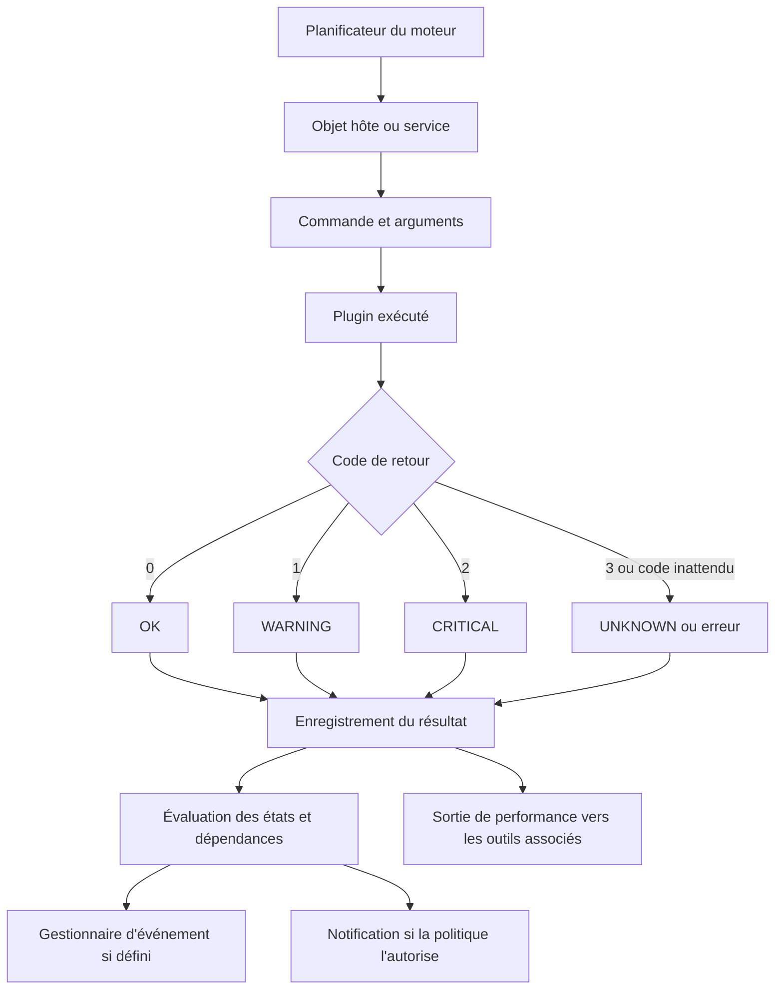
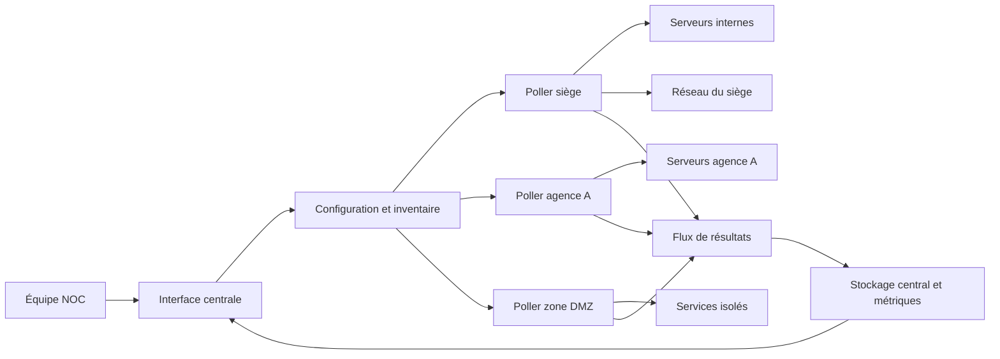
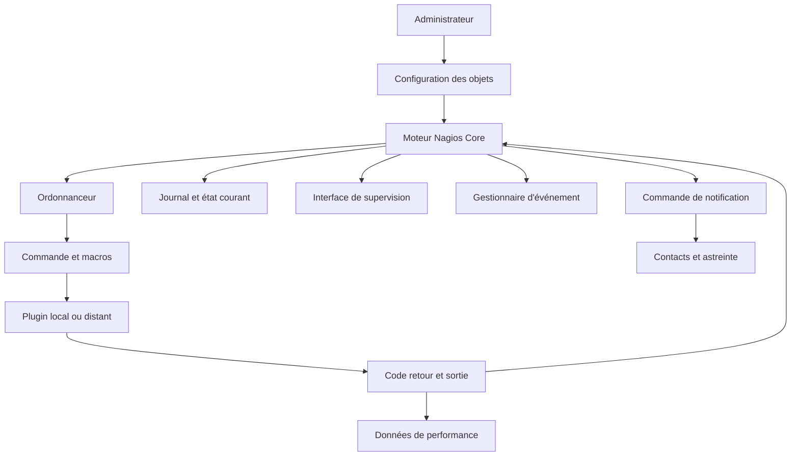
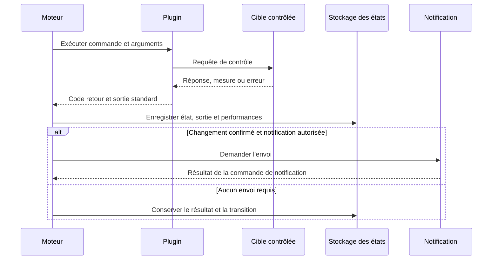
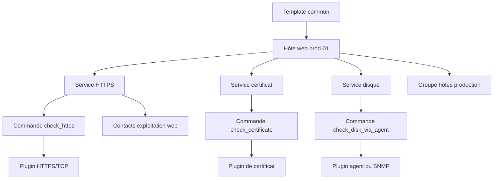
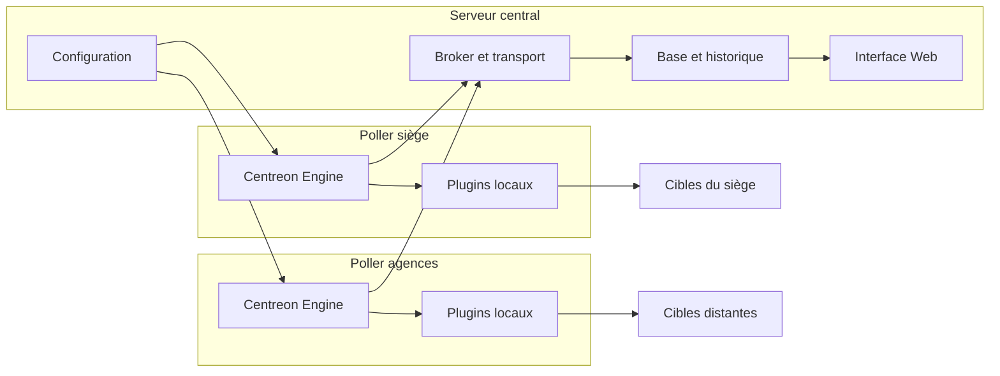
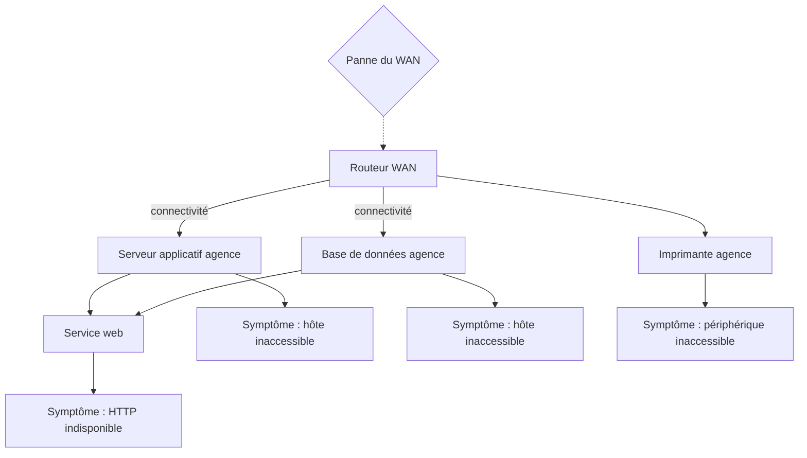
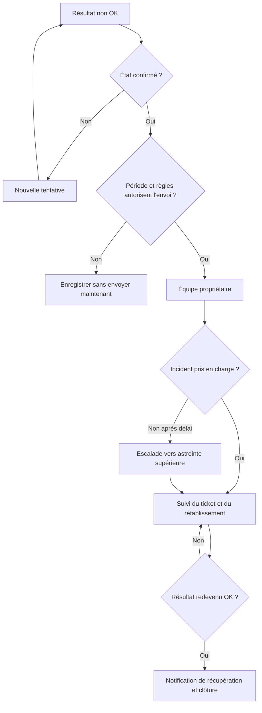

# Supervision avec Nagios/Centreon

## 1. Introduction

### 1.1. Pourquoi la supervision reste un métier d'exploitation

Une infrastructure informatique n'est pas disponible simplement parce que ses équipements répondent à un ping. Une application de production dépend d'un ensemble de composants : alimentation électrique, hyperviseur, système d'exploitation, espace disque, résolution DNS, certificats, base de données, équilibrage de charge, pare-feu, réseau d'accès et services métier. Chacun peut fonctionner isolément tout en participant à une panne globale. La supervision cherche donc à convertir des observations techniques en informations exploitables : un état, une mesure, une tendance, une alerte ou un événement permettant à l'équipe d'intervenir au bon moment.

Nagios Core est un moteur de supervision historique et extensible. Il planifie des contrôles, lance des programmes appelés plugins, interprète leurs codes de retour, suit les états des hôtes et des services, enregistre les changements et peut déclencher des notifications ou des gestionnaires d'événements. Sa logique repose sur un principe simple : le moteur orchestre les vérifications, mais les plugins réalisent le contrôle spécialisé. Un plugin peut interroger une adresse IP, ouvrir une connexion TCP, vérifier une réponse HTTP, analyser une métrique locale ou appeler une interface de supervision.

Centreon fournit une plateforme de supervision qui reprend une logique compatible avec l'écosystème Nagios tout en ajoutant une interface d'administration, des modèles, des connecteurs de supervision, des mécanismes de déploiement de configuration, des pollers et des composants de collecte et de stockage des données. Le moteur Centreon Engine exécute les contrôles planifiés. La plateforme présente les états, facilite l'administration du parc et peut distribuer les vérifications sur plusieurs pollers. Les deux solutions partagent des concepts importants, mais leurs interfaces, leurs mécanismes d'administration, leurs connecteurs et certains composants internes ne doivent pas être considérés comme identiques.

Le but de ce cours est de passer d'une connaissance générale de la supervision à la capacité de concevoir, configurer, tester et dépanner une installation de type Nagios Core ou Centreon. Vous apprendrez à définir des hôtes et des services, comprendre les commandes et plugins, choisir entre contrôles actifs et passifs, calibrer les seuils, traiter les transitions d'état, maîtriser les notifications, répartir les contrôles, sécuriser les sondes et conduire une analyse de panne.

> **Mise en contexte — vous êtes ingénieur supervision dans une entreprise multisite.** Le réseau du siège relie une plateforme e-commerce, un cluster de bases de données, des routeurs de bordure, des systèmes Linux et Windows et plusieurs agences. L'équipe reçoit parfois des alertes en rafale, parfois trop tard, et parfois pour des symptômes secondaires au lieu de la cause initiale. Votre travail n'est pas d'ajouter le plus grand nombre possible de contrôles : il consiste à transformer les besoins opérationnels en vérifications fiables, mesurables, corrélées, sécurisées et accompagnées d'une réponse claire.

### 1.2. Ce que l'on doit surveiller

Il est utile de classer les contrôles par niveau, sans croire qu'un seul niveau suffit.

- **Disponibilité réseau :** l'adresse est-elle joignable, le chemin réseau est-il fonctionnel, la perte de paquets est-elle acceptable, le temps de réponse est-il normal ?
- **Disponibilité d'un port :** le service accepte-t-il une connexion TCP sur le port attendu ? Un port ouvert ne prouve pas qu'une application fonctionne correctement.
- **Protocole applicatif :** le serveur HTTP répond-il avec le code attendu, présente-t-il le bon certificat, renvoie-t-il un contenu identifiable, applique-t-il une authentification correcte ?
- **Santé du système :** la charge CPU, la mémoire, le stockage, les processus, les interfaces ou les journaux signalent-ils un risque ?
- **Dépendances :** les serveurs DNS, bases de données, files de messages, API tierces ou services d'identité sont-ils disponibles ?
- **Expérience du service :** un parcours utilisateur synthétique peut-il parcourir le chemin critique et obtenir le résultat métier ?
- **Capacité et tendance :** une partition se remplit-elle trop rapidement ? La latence augmente-t-elle ? Le nombre de connexions approche-t-il une limite ?

Chaque contrôle doit répondre à une question opérationnelle. Une vérification qui ne mène à aucune décision, aucun diagnostic et aucune action est souvent un bruit coûteux. Une architecture sérieuse associe chaque service supervisé à un responsable, une criticité, une méthode de vérification, une fréquence, des seuils, des dépendances, un calendrier de notification et une procédure d'intervention.

### 1.3. Hôtes, services, commandes et plugins

Un **hôte** représente une ressource à superviser : serveur, routeur, machine virtuelle, pare-feu, switch, imprimante, équipement industriel ou endpoint logique. Le nom court de l'hôte sert de référence dans la configuration. Son adresse réseau est un attribut de connexion et peut être une adresse IP ou un nom résolu.

Un **service** représente une vérification associée à un hôte. Sur un serveur web, les services pourraient être « HTTP public », « certificat TLS », « espace disque racine », « charge CPU » et « processus de l'application ». Dans Nagios, la description du service fait partie de son identité et doit être stable. Sur un routeur, les services peuvent mesurer la perte de paquets, l'état du lien WAN, la disponibilité SNMP ou le niveau d'utilisation des interfaces.

Une **commande** associe un nom logique à un exécutable et à des arguments. Elle indique comment lancer la vérification. Le **plugin** est le programme qui effectue réellement l'opération et retourne un code d'état ainsi qu'un texte de diagnostic. Un même plugin peut être utilisé par plusieurs commandes, avec des arguments différents. Par exemple, un plugin réseau peut vérifier un endpoint de production et un endpoint de préproduction avec des seuils ou des paramètres d'authentification distincts.

Le moteur ne sait pas automatiquement si une réponse applicative est bonne : il se fonde sur le résultat défini par le plugin. La qualité de la supervision dépend donc de la pertinence du contrôle, de la robustesse du plugin, de ses délais d'expiration, de ses seuils, de son identité d'exécution et de la manière dont son résultat est interprété.

### 1.4. Nagios Core et Centreon : savoir distinguer les couches

Nagios Core est centré sur le moteur de supervision et sa configuration d'objets. L'administrateur définit des commandes, des hôtes, des services, des contacts, des groupes, des périodes temporelles, des dépendances et les politiques de notification. La configuration est généralement stockée dans des fichiers texte et peut être étendue à l'aide de templates.

Centreon ajoute une expérience de gestion de la supervision plus intégrée : interface Web, modèles d'hôtes et de services, Monitoring Connectors, outils de découverte, bases de configuration et de données, gestion des pollers et déploiement des configurations. Le vocabulaire « poller » désigne couramment un serveur de collecte exécutant son moteur. Selon l'architecture retenue, le serveur central, des serveurs distants et des pollers peuvent se partager la charge. Un poller n'est pas seulement un proxy passif : il exécute les contrôles sur le périmètre qui lui est confié.

Le choix entre Nagios Core et Centreon dépend du contexte. Nagios Core peut convenir à une équipe qui veut contrôler finement des fichiers de configuration et assembler son propre environnement. Centreon peut être intéressant lorsqu'une équipe souhaite administrer un grand inventaire, standardiser les configurations, exploiter des connecteurs prêts à l'emploi et déléguer des périmètres de supervision. Dans les deux cas, une bonne plateforme ne compense pas un inventaire incohérent, des seuils arbitraires, des accès excessifs ou des procédures d'exploitation absentes.

### 1.5. Objectifs pédagogiques et méthode de travail

À la fin du cours, vous devez être capable de :

1. expliquer le flux d'un contrôle, du planificateur au plugin et jusqu'à la notification ;
2. interpréter les états OK, WARNING, CRITICAL et UNKNOWN ;
3. distinguer les contrôles actifs des résultats passifs ;
4. définir des objets cohérents et réutiliser des templates ;
5. créer une commande sans introduire une injection de shell ;
6. exécuter et diagnostiquer un plugin en ligne de commande ;
7. lire une sortie avec données de performance ;
8. maîtriser les répétitions, les états SOFT et HARD et la suppression des alertes inutiles ;
9. organiser les contacts, les périodes, les dépendances et les notifications ;
10. dimensionner et sécuriser une architecture multi-pollers ;
11. valider une configuration avant son déploiement ;
12. construire un scénario de dépannage démontrable.

Apprenez en partant d'un besoin réel. Commencez par définir le risque à détecter, le comportement observable, les seuils acceptables et l'action qu'impliquera un état anormal. Choisissez ensuite un plugin et ses paramètres, testez-le depuis l'environnement réel du moteur, créez la configuration, validez-la, déployez-la, observez les résultats et simulez une panne. Cette démarche évite de configurer des objets uniquement parce qu'ils existent dans un catalogue.

## 2. Concepts clés

### 2.1. Cycle d'exécution d'un contrôle

Le flux logique d'un contrôle se déroule en plusieurs étapes. Le moteur détermine qu'une vérification doit être exécutée selon les intervalles, les périodes autorisées, les dépendances et les états antérieurs. Il résout la commande et ses macros, lance le plugin dans le contexte du moteur, attend le résultat jusqu'à la limite de temps configurée, puis traite le code de sortie et la sortie standard. Il met à jour l'état, conserve les informations pertinentes, identifie éventuellement une transition, exécute les gestionnaires prévus et évalue la politique de notification.



Cette représentation simplifie le fonctionnement interne, mais elle donne le bon ordre mental : la notification n'est pas le plugin et le plugin n'est pas le moteur. Si une alerte manque, examinez chaque étape. La commande a-t-elle été planifiée ? Le plugin a-t-il été lancé ? A-t-il terminé ? Le code a-t-il été interprété ? Le résultat est-il devenu un état HARD ? La notification était-elle autorisée à ce moment-là ? Le contact était-il éligible ? Une dépendance a-t-elle supprimé la notification ? Le système de messagerie a-t-il ensuite accepté la demande ?

Cette séparation facilite le diagnostic et évite de conclure trop vite que « Nagios est en panne » ou que « le plugin ne fonctionne pas ». Un état inconnu peut provenir du plugin, du moteur, d'une dépendance absente, d'une authentification expirée, d'une résolution DNS, d'un délai d'attente ou d'une mauvaise définition de commande. Une notification absente peut, au contraire, être due à une période silencieuse ou à une règle de contact.

### 2.2. Les quatre états des services

Les plugins Nagios suivent le contrat classique de quatre codes de retour pour les contrôles de service.

| Code de sortie | État | Signification attendue |
|---:|---|---|
| 0 | OK | Le contrôle a été exécuté et les conditions sont satisfaites. |
| 1 | WARNING | Le contrôle a réussi mais signale une situation dégradée ou proche d'un seuil. |
| 2 | CRITICAL | Le contrôle identifie une défaillance ou un seuil critique dépassé. |
| 3 | UNKNOWN | Le plugin n'a pas pu fournir un résultat interprétable ou la vérification a échoué dans des conditions qui empêchent de conclure. |

Le sens exact de WARNING dépend du service. Une utilisation disque à 75 % peut être un avertissement, tandis qu'une erreur de certificat expiré peut être critique malgré une réponse HTTP correcte. UNKNOWN ne doit pas devenir une poubelle où l'on range toutes les erreurs : il représente une incapacité à qualifier la cible ou un problème d'exécution du contrôle. Si le service est effectivement inaccessible, le plugin devrait généralement le signaler CRITICAL avec un diagnostic explicite, dans la mesure où il peut distinguer cette panne d'un défaut local.

Pour les **hôtes**, la logique comporte les états UP, DOWN et UNREACHABLE. Le moteur utilise des vérifications d'hôte et les relations de parenté pour déterminer si un équipement est indisponible ou inaccessible en raison d'une panne située plus haut dans le chemin réseau. Les codes de retour utilisés pour les checks d'hôte ne se lisent donc pas exactement comme ceux d'un service. Le modèle mental à retenir : les quatre codes ci-dessus sont le contrat des contrôles de service ; la détection de reachability des hôtes fait intervenir la topologie et la logique spécifique des contrôles d'hôte.

Le texte de sortie du plugin doit permettre une action. « CRITICAL » seul est pauvre. « CRITICAL - HTTPS: connexion refusée sur 10.20.30.40:443 après 3 s » identifie le périmètre et le symptôme. Une sortie utile mentionne la mesure, la limite, l'unité et un motif compréhensible quand ces informations sont disponibles. Ne publiez pas dans cette sortie de secret, jeton d'authentification, clé privée ou contenu sensible récupéré sur la cible.

### 2.3. Codes, seuils et sémantique

Le choix des seuils ne doit pas précéder la compréhension du service. Pour une partition de données, le seuil peut s'exprimer en pourcentage occupé ou en espace libre. Pour un contrôle HTTP, il peut associer la disponibilité à un code attendu et à une durée maximale. Pour une interface réseau, il peut s'agir de la charge, du taux d'erreurs ou du nombre de changements d'état. Pour une base de données, il peut concerner le nombre de connexions actives, la latence d'une requête représentative ou la réplication.

Un seuil WARNING est utile lorsqu'il reste assez de temps pour intervenir. Un seuil CRITICAL correspond à une condition exigeant une action prioritaire. Ces niveaux doivent être liés à une capacité, un objectif de service, un comportement connu ou un engagement de production. Des seuils trop serrés déclenchent des alertes sur le bruit normal. Des seuils trop permissifs ne laissent aucun temps de réaction. Les seuils à usage permanent devraient être testés avec les données historiques, revus après un changement majeur et expliqués dans le runbook associé.

La condition « disque utilisé supérieur à 90 % » n'est pas universelle. Une petite partition système peut être critique à 90 %, car elle ne laisse que peu de marge à la croissance rapide des journaux. Une grande partition d'archives peut rester en WARNING à 90 % si le taux de croissance est lent et qu'une procédure de purge est définie. À l'inverse, même une partition à 60 % peut être critique si sa croissance indique qu'elle sera pleine avant la prochaine fenêtre de maintenance. Il faut donc surveiller simultanément les seuils absolus et, lorsqu'il est pertinent, la vitesse de croissance.

Pour définir un seuil robuste, documentez la mesure, l'unité, l'intervalle d'observation, la méthode de calcul, la zone d'avertissement, la zone critique, les exclusions, la fréquence, les effets d'un dépassement et la date de la dernière revue. La supervision devient alors un contrat opérationnel, pas seulement un nombre dans une commande.

### 2.4. Hôtes et services : concevoir un inventaire utile

Les objets hôtes doivent avoir des noms stables, un alias compréhensible, une adresse valide et une relation de parenté lorsque celle-ci reflète la topologie. La nomenclature doit permettre à l'astreinte d'identifier le site, le rôle et, éventuellement, l'environnement sans devoir consulter une table externe. Évitez les noms qui encodent plusieurs informations variables dans une chaîne impossible à maintenir.

Sur chaque hôte, créez les services qui répondent aux questions de disponibilité ou de capacité. La liste doit être volontairement limitée au début, puis enrichie selon la criticité. Le contrôle de disponibilité de l'hôte permet de distinguer une panne réseau apparente d'une panne du processus applicatif. Le service HTTP contrôle ensuite la réponse du serveur web. Un contrôle de certificat détecte une échéance proche. Un service applicatif peut vérifier une route de santé, tandis qu'un service système contrôle l'espace disque ou la mémoire.

Chaque service devrait porter une intention simple. Un seul service qui tente simultanément de contrôler HTTP, le certificat, la base de données et l'espace disque produirait des diagnostics ambigus. À l'inverse, créer des dizaines de services qui répètent exactement la même requête consomme des ressources et génère du bruit. Une bonne granularité permet de séparer les causes, de choisir un propriétaire et d'utiliser une priorité adaptée.

Les groupes d'hôtes et de services facilitent les vues opérationnelles. Les contacts et les groupes de contacts orientent les notifications vers les bonnes équipes. Les périodes temporelles définissent les plages d'exécution ou de notification. Les dépendances expriment qu'un service dépend d'un autre composant et peuvent empêcher d'alerter sur les effets en cascade lorsqu'une panne supérieure suffit à expliquer les symptômes.

### 2.5. Les objets de configuration et l'héritage

Dans Nagios Core, les objets sont généralement définis dans des fichiers de configuration. La configuration principale indique les fichiers ou répertoires qui contiennent ces définitions. Les objets comprennent notamment hôtes, services, commandes, contacts, groupes, périodes, dépendances et escalades. Les templates évitent de répéter les attributs communs. Ils peuvent définir des intervalles, des contacts par défaut, des options de notification, une période temporelle ou des contrôles génériques.

Le principe d'héritage doit être compris et testé. Un template commun peut définir les paramètres organisationnels, un template Linux peut ajouter des contrôles système et un hôte spécifique peut préciser son adresse ou sa criticité. Si plusieurs templates fournissent le même attribut, la règle de priorité doit être étudiée dans la documentation de la version employée. Ne supposez pas qu'un attribut de modèle écrase toujours ce qui existe : l'ordre d'application, le caractère explicite de la valeur et les options d'héritage peuvent influencer le résultat.

Exemple simplifié d'une définition de commande, puis d'un service qui l'utilise :

```cfg
define command {
    command_name    check_https_port
    command_line    $USER1$/check_tcp -H $HOSTADDRESS$ -p 443 -w 2 -c 5
}

define service {
    use                     generic-service
    host_name               web-prod-01
    service_description     HTTPS TCP
    check_command           check_https_port
}
```

Cet exemple illustre la structure classique de Nagios Core et suppose que le plugin check_tcp existe dans le répertoire désigné par la macro $USER1$. Les chemins varient selon l'installation. Le contrôle vérifie qu'une connexion TCP peut être établie sur le port 443 et mesure le temps de réponse selon les paramètres du plugin. Il ne vérifie pas à lui seul la validité du certificat, le code HTTP, l'authentification, l'intégrité de la réponse ou le fonctionnement métier du site. C'est un contrôle de couche transport, utile mais limité.

Le mot générique-service correspond à un template présent dans votre configuration, pas à un objet garanti par toutes les installations. Si votre template porte un autre nom, adaptez-le. Une définition correcte syntaxiquement n'est pas nécessairement pertinente opérationnellement : le service doit être associé au bon hôte, utiliser la bonne adresse, employer un plugin installé et disposer de seuils cohérents.

### 2.6. Les commandes et la sécurité de leur exécution

Une commande de supervision est à la fois une recette d'exécution et une frontière de sécurité. Le moteur lance des programmes avec des arguments. Si une valeur issue de l'inventaire ou d'une macro est assemblée dans une ligne shell sans contrôle, elle peut provoquer une injection de commande. Les noms de cibles, paramètres, chemins et chaînes passés à un plugin doivent donc être validés et utilisés selon les mécanismes d'échappement pris en charge.

Quelques règles essentielles :

- N'exécutez pas tous les contrôles avec un compte root. Donnez uniquement les permissions nécessaires.
- N'utilisez pas de saisie provenant d'un utilisateur non fiable comme nom d'exécutable.
- Évitez les scripts qui concatènent des chaînes dans une commande shell ; préférez une invocation sûre des arguments ou une validation stricte.
- Stockez les identifiants dans un mécanisme approprié et limitez la lecture aux seuls processus requis.
- Ne placez jamais un mot de passe dans une sortie de plugin, un message d'alerte ou une ligne de commande facilement visible.
- Limitez les commandes autorisées sur les agents distants et sur les interfaces d'administration.
- Ajoutez des délais d'expiration au plugin pour éviter qu'une connexion bloquée immobilise une ressource.
- Documentez chaque plugin personnalisé, ses arguments, son code retour, ses dépendances et son propriétaire.

Le fait qu'un plugin soit exécuté par le moteur ne signifie pas que son code est fiable. Un plugin téléchargé depuis un dépôt quelconque peut exfiltrer des informations ou modifier le système. Privilégiez les sources identifiées, vérifiez les fichiers installés, comprenez les permissions, testez d'abord en environnement isolé et gérez les mises à jour comme pour tout autre logiciel de production.

### 2.7. Le contrat de sortie d'un plugin

Un plugin Nagios doit retourner un code de sortie reconnu et au moins une ligne de texte sur la sortie standard. Une sortie typique associe un diagnostic lisible à des données de performance séparées par un caractère barre verticale. Cette séparation permet d'afficher un message utile à l'opérateur tout en transmettant des mesures à un système de graphe ou d'analyse.

Exemple de sortie :

```text
DISK WARNING - /data used 82% | used_pct=82%;80;90;0;100 free_gb=36.2GB
```

La partie avant la barre verticale donne le message humain. Après la barre, le plugin peut fournir une ou plusieurs métriques avec leurs valeurs et, lorsque le format le prévoit, leurs seuils et leur plage. La syntaxe doit rester conforme aux conventions de données de performance si l'on veut que les collecteurs les interprètent correctement. Utilisez des noms de métriques stables, des unités cohérentes et des valeurs numériques valides. Ne changez pas arbitrairement « disk_used » en « useddisk » d'une version à l'autre : un changement de nom peut casser les graphes ou les règles externes.

La sortie de performance n'est pas la même chose que la durée d'exécution du contrôle. Le moteur peut mesurer le temps nécessaire à la vérification ainsi que son retard par rapport à l'horaire attendu. Le plugin, lui, expose les données spécifiques à la ressource contrôlée. Les deux catégories aident à distinguer un service lent d'une plateforme de supervision elle-même surchargée.

### 2.8. Développer un plugin simple et testable

Un plugin personnalisé peut être écrit dans un langage adapté au parc : shell, Python, Perl ou langage compilé. Le choix doit tenir compte de la disponibilité de l'interpréteur sur tous les pollers, de la gestion des dépendances, des performances, de l'équipe qui assurera la maintenance et de la sécurité. Un script doit avoir une interface claire : paramètres documentés, délai maximal, code de sortie conforme, sortie standard structurée et diagnostics en cas d'échec.

Exemple de squelette Python pour vérifier qu'une URL de santé répond en moins d'un délai donné. Ce squelette illustre le contrat d'un plugin et doit être adapté aux exigences de sécurité, de certificat, de proxy et d'authentification de votre entreprise.

```python
#!/usr/bin/env python3
import sys
import time
import urllib.error
import urllib.request

OK, WARNING, CRITICAL, UNKNOWN = 0, 1, 2, 3

def main():
    if len(sys.argv) != 2:
        print("UNKNOWN - usage: check_health.py URL")
        return UNKNOWN

    url = sys.argv[1]
    started = time.monotonic()
    request = urllib.request.Request(
        url,
        headers={"User-Agent": "skilltree-monitor/1.0"},
        method="GET",
    )

    try:
        with urllib.request.urlopen(request, timeout=4) as response:
            elapsed = time.monotonic() - started
            code = response.status
            if code == 200:
                state = OK
                label = "OK"
            else:
                state = CRITICAL
                label = "CRITICAL"
            print(f"{label} - HTTP status {code}, duration {elapsed:.3f}s"
                  f" | duration={elapsed:.3f}s")
            return state
    except urllib.error.HTTPError as exc:
        print(f"CRITICAL - HTTP status {exc.code}")
        return CRITICAL
    except (urllib.error.URLError, TimeoutError) as exc:
        print(f"CRITICAL - URL check failed: {exc}")
        return CRITICAL
    except Exception as exc:
        print(f"UNKNOWN - unexpected plugin error: {exc}")
        return UNKNOWN

if __name__ == "__main__":
    sys.exit(main())
```

Ce code est volontairement pédagogique, pas un produit final universel. En production, il faudrait limiter les informations révélées dans les exceptions, définir explicitement les URL autorisées, traiter correctement les réponses redirigées, vérifier éventuellement un contenu précis, gérer les codes HTTP selon le contrat applicatif, imposer des délais adaptés, appliquer les règles de proxy et confirmer la disponibilité des dépendances. Le code évite de désactiver arbitrairement la validation TLS : c'est une bonne base de sécurité, car ignorer les certificats pourrait masquer une erreur que l'on cherche justement à détecter.

Testez un plugin à la main avant de l'enregistrer dans le moteur. Vérifiez les quatre cas : succès, seuil d'avertissement, seuil critique et incapacité à déterminer le résultat. Vérifiez le code de sortie avec la commande système qui affiche le dernier statut du processus. La sortie standard doit être lue par l'opérateur ; les messages de débogage détaillés peuvent aller sur la sortie d'erreur ou dans un journal contrôlé. Assurez-vous que les scripts fonctionnent avec le même utilisateur, les mêmes variables d'environnement, les mêmes permissions et la même résolution DNS que le moteur de production.

### 2.9. Contrôles actifs

Un contrôle actif est initié par le moteur de supervision. Le moteur planifie le contrôle selon son intervalle, son calendrier, ses dépendances et les règles d'ordonnancement. Lorsqu'il arrive à échéance, le moteur exécute le plugin, récupère le résultat et met à jour l'état. C'est le mécanisme principal pour les vérifications périodiques : disponibilité TCP, requête HTTP, espace disque via un agent, interrogation SNMP ou métrique système.

L'avantage des contrôles actifs est que la plateforme décide quand elle observe la cible. Elle peut estimer l'ancienneté des données et répéter une vérification après un état problématique. L'inconvénient est que le contrôle peut être empêché par un pare-feu, une route, une surcharge du poller ou une dégradation du chemin réseau. Il faut également dimensionner la fréquence et la durée d'exécution : une vérification plus fréquente n'est pas toujours meilleure.

Une fréquence de 60 secondes n'offre pas une détection instantanée. Un incident qui apparaît juste après un contrôle peut attendre presque une minute avant le suivant, sans compter le temps de répétition éventuelle. Le délai de notification dépend des intervalles, du nombre de tentatives, des règles de transition et du transport de notification. Définissez donc un objectif de détection réaliste et mesurez-le au lieu d'annoncer une réactivité que la configuration ne garantit pas.

### 2.10. Contrôles passifs

Un contrôle passif est effectué par une application externe qui envoie ensuite le résultat au moteur. La plateforme de supervision n'initie pas elle-même le test : elle traite une observation réalisée ailleurs. Les résultats peuvent provenir d'un agent, d'un script distant, d'un système de gestion d'événements, d'un processus métier ou de pièges SNMP.

Les contrôles passifs sont utiles lorsque les événements sont asynchrones, lorsqu'une cible est isolée derrière un pare-feu ou lorsqu'il existe déjà un système capable de fournir le résultat. Ils sont particulièrement adaptés aux alertes générées par un événement imprévisible : une alerte de sécurité, une tâche de sauvegarde échouée ou un événement applicatif. Ils exigent cependant une stratégie de fraîcheur. L'absence de nouveau résultat passif n'indique pas nécessairement que le service va bien ; elle peut signifier que le collecteur est arrêté ou que le transport est rompu.

Un système de contrôle passif doit donc surveiller la réception et l'âge des résultats. Lorsqu'un service passif est censé produire une mise à jour toutes les cinq minutes mais n'en a plus envoyé depuis vingt minutes, la supervision doit rendre cette absence visible. Sans contrôle de fraîcheur, un état OK peut rester affiché alors que la source a cessé d'émettre depuis longtemps.

Le modèle passif implique aussi de sécuriser le chemin de soumission. Le récepteur doit authentifier l'émetteur, limiter les hôtes et services autorisés, valider les données reçues et protéger le transport. Ne laissez pas un acteur quelconque soumettre un état CRITICAL ou OK pour un service de production. Le résultat passif est une entrée de confiance dans le moteur : protégez-le comme vous protégez une API de monitoring.

### 2.11. Choisir entre actif et passif

La décision dépend du phénomène observé. Pour savoir si un port TCP est ouvert, un check actif depuis un poller proche de l'utilisateur est généralement pertinent. Pour connaître l'échec d'une sauvegarde qui se produit une fois par nuit, un événement passif généré par le système de sauvegarde peut être plus précis. Pour la surveillance de logs, un agent peut envoyer des résultats lorsqu'un motif significatif apparaît, mais la supervision doit aussi confirmer que l'agent continue de fonctionner. Pour une application derrière un pare-feu, un agent ou un relais peut exécuter le contrôle localement et transmettre le résultat de manière sécurisée.

| Besoin | Approche souvent adaptée | Point de vigilance |
|---|---|---|
| Port TCP / HTTP public | Actif | Le point de mesure doit refléter le chemin utilisateur réel. |
| Mesures système régulières | Actif via agent ou plugin local | Permissions et coût du contrôle. |
| Échec d'une sauvegarde | Passif depuis l'outil de sauvegarde | Fraîcheur et identification de chaque exécution. |
| Trap SNMP ou événement de sécurité | Passif | Volume, authenticité et corrélation. |
| Ressource isolée en DMZ | Actif depuis un poller de zone ou passif sécurisé | Filtrage réseau et réduction des flux entrants. |
| Processus métier asynchrone | Passif, éventuellement associé à un contrôle actif de fraîcheur | Ne pas assimiler silence et réussite. |

Une architecture hybride est généralement la plus robuste. Les contrôles actifs vérifient régulièrement l'accessibilité et l'état, tandis que les résultats passifs apportent des événements qui n'existent pas au moment où le moteur interroge la cible. Évitez de configurer deux contrôles identiques uniquement pour se rassurer : ils peuvent apporter une vraie redondance, ou simplement doubler le bruit si les deux utilisent la même dépendance et le même chemin réseau.

### 2.12. États SOFT, HARD et répétition des contrôles

Un résultat ponctuel n'est pas toujours suffisant pour déclencher une notification. Nagios Core distingue les transitions SOFT et HARD pour les hôtes et services. Lorsqu'un contrôle passe d'un état normal à un résultat problématique, le moteur peut considérer le changement comme provisoire et effectuer des vérifications de nouvelle tentative. Si le résultat reste problématique pendant le nombre de tentatives défini, l'état devient généralement HARD et peut déclencher les actions prévues.

Cette approche réduit les alertes provoquées par un incident bref ou une perte de paquets isolée. Elle introduit cependant un délai de détection et de notification. Si le service a un intervalle de contrôle de cinq minutes et plusieurs tentatives espacées, une panne réelle peut être confirmée beaucoup plus tard que le premier échec. Le nombre de tentatives doit donc dépendre de la criticité, du coût d'un faux positif et du délai d'intervention acceptable.

SOFT ne veut pas dire « ignorer ». Un état provisoire peut être visible dans les tableaux de bord et les journaux. HARD ne veut pas dire que le diagnostic est exact ; cela signifie que les conditions de confirmation ont été atteintes. Un plugin peut être mal configuré et produire une série cohérente de résultats critiques. Il faut donc valider la qualité du check autant que les états qu'il retourne.

Le rétablissement est tout aussi important. Lorsque le résultat redevient OK, le moteur peut confirmer la reprise et signaler la récupération selon la politique de notification. Évitez les contrôles trop sensibles qui alternent fréquemment entre OK et CRITICAL. Le « flapping » désigne précisément une instabilité des états. Il peut rendre l'interface illisible et les notifications inutiles. La stabilité se traite par des seuils mieux calibrés, une fenêtre de mesure adaptée, un nombre raisonnable de tentatives et une analyse de la cause des oscillations, pas par la suppression systématique des alertes.

### 2.13. Intervalles, charge et planification

Chaque contrôle consomme du temps CPU, des processus, des connexions, de la mémoire et éventuellement des ressources sur la cible. Avec plusieurs milliers de services, un intervalle trop faible peut produire une charge importante. Supposons 3 000 contrôles qui durent en moyenne 0,4 seconde et sont planifiés toutes les minutes : la charge moyenne théorique n'est pas seulement le temps de calcul du moteur, car les plugins peuvent ouvrir des sessions réseau, déclencher des requêtes sur les systèmes surveillés et être ralentis par les timeouts. Un contrôle qui attend 10 secondes peut occuper un emplacement de processus bien au-delà de la moyenne.

L'estimation simplifiée du nombre d'exécutions par seconde est le nombre de checks divisé par leur intervalle en secondes. Si 6 000 checks tournent toutes les 60 secondes, cela représente une moyenne de 100 exécutions par seconde, avant prise en compte des répétitions, des contrôles supplémentaires liés aux événements et des variations de répartition temporelle. Cette estimation ne suffit pas pour dimensionner un poller, mais elle donne un ordre de grandeur.

Mesurez les temps moyens et les percentiles, la latence de planification, les contrôles en attente, le nombre de plugins simultanés, la charge CPU, l'utilisation mémoire, les erreurs d'exécution et la durée des requêtes sur les cibles. Évitez que tous les checks lourds démarrent au même moment. Utilisez les mécanismes de distribution et d'ordonnancement de votre produit, ainsi que les intervalles de contrôle appropriés. Les contrôles qui interrogent une base critique doivent être moins coûteux que les opérations de diagnostic manuelles utilisées par un DBA.

Les intervalles ne doivent pas être uniformes pour tout le parc. Un cœur de réseau peut demander une détection rapide ; un capteur environnemental peut être contrôlé moins fréquemment ; un certificat peut être surveillé plusieurs fois par jour ou une fois par heure selon l'exigence ; une sauvegarde doit être évaluée après son exécution et surveillée pour l'absence de résultat. La fréquence doit suivre le risque et la capacité à agir.

### 2.14. Plugins courants et portée des vérifications

Les plugins forment une couche d'abstraction. Certains vérifient un protocole simple, d'autres interrogent un agent, une API ou un équipement spécialisé. Les plugins standard de l'écosystème Nagios permettent notamment des vérifications de ping, TCP, HTTP, DNS, SMTP, SSH, charge, processus et stockage. Les plugins pour SNMP collectent des données d'équipements réseau et d'infrastructure. Des plugins communautaires peuvent surveiller des bases de données, des plateformes cloud ou des applications métier.

Dans Centreon, les Monitoring Connectors et les packs disponibles fournissent souvent des modèles, des commandes et des règles de contrôle destinés à un produit particulier. Il reste nécessaire de lire les options, de comprendre les métriques et de vérifier les permissions. Le nom du connecteur n'est pas une garantie : les versions de l'application supervisée, des plugins, du moteur et des modèles peuvent différer.

Chaque plugin doit être testé sur la même machine de collecte que celle qui l'exécutera en production. Un contrôle effectué avec succès depuis le poste de l'administrateur peut échouer sur le poller parce que le DNS diffère, que le pare-feu bloque l'accès, qu'un certificat racine manque, que le compte d'exécution n'a pas le droit de lire un fichier ou que l'agent n'est pas joignable. Le contexte d'exécution fait partie du test.

Le contrôle d'un endpoint doit être aussi proche que possible du contrat de service. Si l'on veut vérifier le parcours utilisateur, une simple ouverture de port ne suffit pas. Si l'on veut vérifier l'accès à la base de données, le port ouvert ne garantit pas que l'authentification fonctionne ou que les requêtes répondent à temps. Si l'on veut vérifier un routeur, un ping ne confirme pas qu'une interface n'est pas saturée ou qu'une route est installée. Plusieurs contrôles complémentaires peuvent donc être nécessaires, chacun avec un objectif distinct.

### 2.15. NRPE, agents, SNMP et exécution distante

Certaines mesures doivent être prises sur la cible elle-même. Un plugin exécuté depuis le poller ne peut pas lire directement l'espace disque d'un serveur distant sans mécanisme d'accès. Plusieurs approches sont possibles : agent de supervision, protocole SNMP, exécution distante limitée, API du système ou remontée passive.

NRPE est un mécanisme traditionnel de l'écosystème Nagios permettant au moteur de demander l'exécution de commandes prédéfinies sur un hôte distant. Il doit être configuré avec des règles strictes : seules les commandes nécessaires devraient être autorisées, les arguments doivent être maîtrisés et la communication doit être filtrée sur le réseau. Un endpoint distant qui autorise l'exécution arbitraire d'une commande revient à exposer une voie d'administration. Dans des environnements Windows, des agents comme NSClient++ ou d'autres agents compatibles peuvent fournir des vérifications de services, de processus, de mémoire et de disques. Le choix dépend des versions prises en charge, des pratiques de sécurité et du mode de gestion du parc.

SNMP est fréquent pour les routeurs, switchs, onduleurs, imprimantes et équipements qui exposent des compteurs ou des états via des OID. SNMPv3 est à privilégier lorsque l'équipement et la politique du parc le permettent, car il apporte des mécanismes d'authentification et de protection des messages. Les communautés SNMPv1/v2c ne doivent pas être traitées comme des secrets robustes sur un réseau ouvert. Définissez des listes d'accès, isolez le plan de gestion et évitez d'exposer SNMP à des réseaux non approuvés.

Le protocole n'est pas une solution de supervision à lui seul. Il faut choisir les indicateurs et leur interprétation. Les compteurs SNMP peuvent revenir à zéro après un redémarrage ou un rollover ; la comparaison de deux valeurs doit alors tenir compte du temps écoulé et des limites du compteur. Pour calculer un débit, le plugin doit convertir les deltas en unités pertinentes et gérer correctement les périodes d'absence de données. Un graphique de trafic paraît rassurant s'il est rempli de valeurs, mais une unité mal interprétée peut rendre toute alerte fausse.

### 2.16. Données de performance : graphes et capacité

Les données de performance permettent de dépasser le simple état. Un contrôle de disque peut exposer le pourcentage utilisé et l'espace libre ; un plugin HTTP peut exposer le temps de réponse ; un contrôle réseau peut exposer perte de paquets et latence ; une base de données peut exposer le nombre de connexions et le temps moyen d'une requête. Ces métriques rendent possible l'analyse de tendance, la comparaison avant/après incident et la planification de capacité.

La donnée doit avoir une sémantique claire. Une mesure en millisecondes ne doit pas être enregistrée comme des secondes. Un compteur monotone n'est pas une jauge. Une valeur instantanée ne doit pas être interprétée comme une moyenne sur cinq minutes. Un pourcentage doit être borné de manière cohérente. Les noms doivent être stables pour que les systèmes de graphe puissent conserver leur historique. Les labels très variables — tels qu'un identifiant de session différent à chaque contrôle — peuvent créer une cardinalité incontrôlée si le système aval les transforme en séries distinctes.

Le moteur peut fournir des macros ou des fichiers de sortie permettant d'exporter les performances vers un collecteur. Il faut concevoir ce flux en incluant le volume, la rotation des fichiers, les erreurs d'écriture, le traitement des métriques manquantes et les responsabilités d'exploitation. Les graphes doivent répondre à une question : quelle est la tendance, quelle limite approche, quand la dégradation a-t-elle commencé et quelle dimension est corrélée à l'incident ?

### 2.17. Notifications, contacts et fenêtres temporelles

Une notification est une décision opérationnelle. Elle devrait dire ce qui est dégradé, quelle ressource est concernée, depuis quand, à quel niveau et où chercher les détails. Un e-mail qui ne contient qu'un nom de service et le mot CRITICAL n'est pas suffisant pour une astreinte. Le message peut inclure l'hôte, la description, l'état antérieur et actuel, la sortie du plugin, l'heure, le lien vers l'interface, le groupe responsable et un lien vers le runbook. Les informations exactes disponibles dépendent des macros, du produit et de la configuration.

Les contacts peuvent être associés à des groupes, et les services ou hôtes peuvent cibler ces groupes. Les filtres de notification déterminent quels états et quelles transitions sont notifiés. Une notification de récupération n'est généralement pertinente que si le destinataire a reçu ou aurait dû recevoir la notification initiale. La configuration doit être testée du point de vue du récepteur réel, pas seulement par la présence d'un contact dans un objet.

Les périodes temporelles sont essentielles pour gérer les horaires de service et les astreintes. Elles peuvent définir quand les contrôles actifs sont autorisés et quand une équipe reçoit des alertes. Attention : l'interruption des notifications n'est pas la même chose que l'arrêt des contrôles. On peut continuer à mesurer l'état pendant une fenêtre de maintenance tout en désactivant les notifications attendues. Pour une maintenance planifiée, la procédure devrait préciser ce qui est suspendu, qui l'a approuvée, à quelle heure l'état normal revient et comment vérifier que les alertes sont réactivées.

La limitation des notifications répétées doit être équilibrée. Une répétition utile rappelle un incident non résolu à l'astreinte, mais des notifications trop rapprochées finissent par être ignorées. Une absence de répétition peut, au contraire, masquer un incident durable si le premier message s'est perdu. Il faut déterminer le délai initial, les répétitions, les escalades, les règles de période et la politique de récupération en tenant compte de la criticité et du mode de travail de l'équipe.

### 2.18. Dépendances et corrélation des symptômes

Imaginez un routeur WAN en panne qui isole dix serveurs d'une agence. Sans dépendances, le moteur peut générer dix alertes de serveurs indisponibles, plus des alertes sur les services HTTP, les bases de données et les imprimantes. Les symptômes sont vrais, mais ils n'identifient pas forcément la cause première. Une relation de parenté correctement modélisée permet de mieux distinguer un hôte DOWN d'un hôte UNREACHABLE et de réduire les notifications secondaires lorsque l'infrastructure supérieure explique le problème.

Les dépendances de service ont une logique semblable. Une alerte sur une API peut être la conséquence d'une base de données indisponible. Une dépendance peut éviter une avalanche d'alertes si la panne de la base est connue. Elle doit être conçue avec précaution : si la dépendance est incorrecte, elle peut masquer un incident réel et empêcher l'équipe de découvrir un second problème.

La bonne approche consiste à modéliser les dépendances déterminantes et justifiées, pas chaque relation imaginable. Documentez ce qui s'appuie sur quoi, quelles alertes doivent continuer à remonter, quels contrôles doivent confirmer les symptômes et comment le moteur se comportera lors d'une panne de surveillance elle-même. La corrélation n'est pas la certitude de causalité : elle réduit le bruit et améliore le diagnostic, mais l'opérateur doit toujours vérifier la cause réelle.

### 2.19. Flapping et stabilité des états

Un service est considéré comme instable lorsque son état bascule fréquemment entre normal et anormal. Cela se produit avec un seuil trop proche de la variabilité habituelle, une requête trop sensible au bruit, un service en cours de déploiement ou une dépendance intermittente. La détection de flapping peut contribuer à limiter les alertes en rafale, mais elle ne remplace pas un diagnostic.

Pour réduire le flapping, commencez par examiner les valeurs brutes et les horaires. Les transitions correspondent-elles à une saturation brève, à un délai réseau variable, à une rotation de logs, à une limite temporaire de connexion ou à une panne intermittente ? Le contrôle doit-il utiliser une moyenne ou un percentile ? Les seuils WARNING et CRITICAL sont-ils suffisamment distincts ? Le timeout est-il trop court pour les variations normales ? L'intervalle de contrôle est-il inadapté ?

N'augmentez pas aveuglément les répétitions pour cacher un plugin instable. Une répétition peut réduire les faux positifs, mais elle allonge le délai de détection et peut retarder une alerte critique. Évaluez le taux de faux positifs et de faux négatifs, mesurez le temps de détection réel et comparez-le aux objectifs. Une modification de supervision devrait être accompagnée d'un test sur un scénario de panne réel ou simulé.

### 2.20. Configuration en environnement Centreon

Dans Centreon, l'administrateur travaille fréquemment avec des hôtes, des modèles, des services, des commandes et des connecteurs depuis l'interface de configuration. Les modèles permettent de normaliser les paramètres et d'éviter de définir manuellement chaque contrôle. Les connecteurs fournissent des modèles et des commandes associées à des technologies connues. Après la préparation des objets, la configuration doit être générée et déployée vers les collecteurs concernés, selon le flux prévu par la version et l'architecture installées.

Une modification dans l'interface n'est pas nécessairement active sur le moteur dès qu'elle est enregistrée. Il faut distinguer l'enregistrement de l'objet, la génération de configuration, la vérification de la configuration, le déploiement vers le ou les pollers et le contrôle du résultat de déploiement. Une erreur ou une omission dans cette chaîne peut laisser l'interface présenter des paramètres qui ne sont pas encore utilisés par le moteur. Un runbook de mise en production doit inclure le statut de génération et de déploiement.

Les versions de Centreon et de ses composants évoluent. Les menus, noms de paquets et commandes de déploiement peuvent changer selon la version. N'utilisez pas une commande copiée d'une ancienne documentation sans vérifier qu'elle correspond à la plateforme installée. L'approche pédagogique reste stable : comprendre les objets, valider la commande, vérifier les droits, générer et déployer, confirmer que le poller exécute bien le contrôle, puis vérifier l'état et les notifications.

### 2.21. Architecture centralisée et distribuée

Pour une petite installation, un serveur central peut héberger l'interface, le moteur et les composants de stockage nécessaires. À mesure que le nombre de ressources augmente, une architecture distribuée répartit les contrôles sur plusieurs pollers. Le serveur central apporte la vue de gestion. Les pollers exécutent les contrôles près des ressources surveillées et transmettent les données vers les composants centraux.



Une architecture distribuée peut améliorer l'échelle, réduire la latence des contrôles et limiter les flux entre zones. Elle peut aussi créer de nouvelles dépendances : réseau entre poller et serveur central, transmission des résultats, synchronisation de configuration, gestion des identifiants, disponibilité du stockage et surveillance des pollers eux-mêmes. Un poller en panne peut produire un trou de supervision pour tout un périmètre. La plateforme doit donc surveiller l'état de ses composants, l'âge des résultats, les files, la connectivité et les erreurs de déploiement.

Le choix du nombre de pollers ne doit pas reposer uniquement sur le nombre d'hôtes. La durée des contrôles, la fréquence, les protocoles, le volume de données, la taille des zones réseau, le niveau de redondance et les contraintes de sécurité sont aussi déterminants. Un poller qui réalise des milliers de vérifications légères n'a pas la même charge qu'un poller effectuant des appels lents sur une API coûteuse. Il faut répartir par zone ou par charge, mesurer et redimensionner à partir de données réelles.

### 2.22. Sécuriser le plan de supervision

La supervision possède souvent des accès étendus : elle interroge les équipements réseau, observe les systèmes et parfois exécute des commandes sur des hôtes. Elle doit donc être considérée comme une infrastructure sensible. Un compte de collecte compromis peut dévoiler des noms d'hôtes, des versions logicielles, des métriques d'utilisation ou des détails sur l'architecture. Un plugin malveillant peut également devenir une voie d'exécution de code.

Appliquez les principes suivants : réseau de management séparé lorsque c'est possible, accès strictement limité entre pollers et cibles, authentification forte à l'interface, comptes individuels, permissions selon les responsabilités, journaux administratifs, sauvegardes, mises à jour suivies, gestion sûre des secrets, et contrôle des modifications de plugins. Les serveurs de supervision ne doivent pas devenir un point d'entrée universel sans cloisonnement.

Pour les accès distants, préférez des comptes limités et des commandes explicitement autorisées. Vérifiez les certificats, utilisez des protocoles sécurisés et évitez d'exposer un port d'administration sur Internet. SNMPv3 avec authentification et confidentialité est préférable aux communautés en clair lorsque les équipements le supportent. Les secrets ne doivent pas être intégrés dans les modèles partagés sans mécanisme de protection.

Limitez la sortie des plugins. Les messages d'erreur de bibliothèques peuvent inclure des chemins locaux, des URL internes, des noms de compte ou parfois des informations sensibles. Le message d'alerte doit transmettre ce qui est nécessaire au diagnostic sans publier d'identifiants. Contrôlez les droits de lecture de la configuration, des fichiers de commande externes, des scripts et des historiques. Une supervision doit être sûre même lorsqu'un plugin échoue.

### 2.23. Gestion des changements et de la configuration

La configuration est un actif à versionner. Pour Nagios Core, la configuration textuelle peut être stockée dans Git avec validation par environnement, revue de code et historique des changements, en retirant bien sûr les secrets. Pour Centreon, les objets de configuration doivent suivre le mécanisme d'export, de sauvegarde ou d'automatisation réellement pris en charge par la version installée. Ne confondez pas le versionnement de fichiers et l'existence d'une sauvegarde cohérente de la base de données.

Toute modification devrait préciser le besoin, l'objet touché, le risque, les conditions de retour arrière, les tests réalisés et la validation de mise en production. Une correction urgente peut être nécessaire, mais une configuration modifiée manuellement sans trace provoque des divergences entre environnements et complique la prochaine mise à jour. La revue de changement est particulièrement importante lorsque la modification touche une commande, un template partagé, une période de notification, une relation de dépendance ou un plugin utilisé par de nombreux services.

Les changements de plugin exigent une validation fonctionnelle et de compatibilité. Une nouvelle version peut modifier les paramètres ou le texte de sortie, supprimer une métrique ou changer une interprétation. Un upgrade qui paraît anodin peut faire passer tous les services en UNKNOWN. Testez quelques cas représentatifs sur un poller pilote, vérifiez les codes de retour, les mesures, les temps d'exécution et les messages, puis déployez par étapes si l'architecture le permet.

### 2.24. Mesurer la qualité de la supervision

La réussite d'une plateforme ne se mesure pas au nombre de checks configurés ni au volume de courriels envoyés. Il faut regarder la qualité de détection, la fraîcheur, la pertinence des alertes et la capacité des opérateurs à utiliser les résultats.

Quelques indicateurs opérationnels sont particulièrement utiles :

- **Couverture :** proportion des composants et parcours critiques supervisés par un contrôle pertinent.
- **Fraîcheur :** délai depuis le dernier résultat valide et proportion de résultats reçus à temps.
- **Temps de détection :** temps entre le début d'un incident et le premier signal exploitable.
- **Taux de faux positifs :** proportion d'alertes qui ne correspondent pas à un problème à traiter.
- **Taux de faux négatifs connus :** incidents réels pour lesquels aucune alerte utile n'a été générée.
- **Bruit par incident :** nombre de notifications et d'objets en alerte pour une seule cause.
- **Délai de résolution associé :** influence de l'information apportée par la supervision sur le diagnostic et la restauration.
- **Disponibilité de la supervision :** capacité de la plateforme elle-même à exécuter les contrôles et transporter les résultats.
- **Âge des configurations :** temps écoulé depuis le dernier examen de la pertinence des seuils, de la commande et du responsable.

Une équipe mature examine régulièrement ces indicateurs, supprime les contrôles redondants, améliore les alertes pauvres, corrige les angles morts, teste les scénarios de panne et met à jour les runbooks. Une alerte utile n'est pas seulement une alerte qui se déclenche ; c'est une alerte qui arrive à la bonne personne, dans le bon contexte, avec un niveau de confiance suffisant pour guider l'action.

### 2.25. Bonnes pratiques de conception

Adoptez une séquence cohérente. Inventoriez les ressources, établissez la criticité, identifiez les dépendances et choisissez les objectifs. Sélectionnez ensuite la méthode de mesure, construisez la commande, testez le plugin, définissez le service, renseignez les fenêtres temporelles, les seuils, les contacts et les dépendances, puis déployez. Enfin, simulez des incidents et mesurez le délai de détection.

Pour chaque contrôle, documentez :

- la question qu'il cherche à résoudre ;
- la ressource et le point réseau depuis lequel il s'exécute ;
- la commande et la version du plugin ;
- les paramètres, seuils et unités ;
- la fréquence, le timeout et les répétitions ;
- le sens des états et les limites du contrôle ;
- la personne ou l'équipe responsable ;
- les notifications, dépendances et plages de maintenance ;
- les symptômes d'erreur et la procédure de diagnostic ;
- la date de revue.

Un bon contrôle ne doit pas dépendre d'un hasard de nom de fichier ou d'une variable d'environnement présente uniquement dans le shell d'un administrateur. Il doit fonctionner dans l'environnement du moteur, avec des droits explicitement conçus, une configuration validable et une sortie compréhensible.

## 3. Architecture et Schémas

### 3.1. Architecture fonctionnelle d'un moteur Nagios

Le moteur centralise la planification et l'état, mais les plugins assurent les vérifications spécifiques. L'interface présente les résultats et les administrateurs définissent les objets. Selon la configuration, des composants externes peuvent recevoir les données de performance, fournir des résultats passifs ou transporter les notifications.



Cette architecture distingue la configuration, l'exécution, le traitement du résultat et les actions. En cas de problème, il faut isoler la couche touchée avant de modifier quoi que ce soit. Si une commande ne se lance pas, examinez les objets, les macros et les permissions. Si le plugin tourne manuellement mais échoue depuis le moteur, comparez l'identité, le répertoire courant, les variables d'environnement et le chemin d'exécution. Si l'état est correct mais la notification manque, examinez les transitions, les périodes, les contacts et le mécanisme de remise du message.

### 3.2. Flux d'un plugin et interprétation des résultats



Le diagramme ne suppose pas que le moteur doive notifier à chaque check. Un service peut être vérifié des centaines de fois sans générer de message si son état ne change pas et si aucune répétition n'est due. Un état peut aussi devenir critique sans notification immédiate si la politique attend des nouvelles tentatives ou si les conditions d'envoi ne sont pas satisfaites. La notification est une étape conditionnelle de traitement, pas une conséquence automatique de tout code de sortie non nul.

### 3.3. Hôte, service, commande et template : modèle logique



Ce modèle explicite la réutilisation. Le template porte les paramètres communs sans rendre identiques tous les services. Chaque service conserve une intention mesurable et une commande déterminée. Les groupes et contacts sont des outils d'administration ; ils ne devraient pas devenir des substituts à une définition claire de la responsabilité. Si un service est critique pour plusieurs équipes, il faut définir qui reçoit l'alerte initiale, qui est escaladé et qui est propriétaire de la correction.

### 3.4. Flux de supervision distribuée Centreon



Le poller doit être placé selon le périmètre réseau, le niveau de sécurité et les besoins de disponibilité. Un poller proche de la cible peut diminuer la latence et éviter d'ouvrir des accès depuis le siège vers une zone isolée. En revanche, il doit envoyer ses résultats et recevoir sa configuration selon les flux autorisés. Il faut superviser sa santé, les retards de résultats, l'utilisation des ressources et les erreurs de communication. La documentation de Centreon décrit plusieurs formes de déploiement ; les rôles exacts et les commandes varient selon la version et l'architecture.

### 3.5. Dépendances et suppression des symptômes secondaires



Le schéma montre que plusieurs alertes peuvent résulter d'une cause commune. Les relations de parenté et les dépendances devraient aider à expliquer la topologie et à limiter certaines notifications secondaires. Mais il faut éviter de masquer un symptôme qui peut persister après le rétablissement du WAN. Les contrôles doivent être exécutés de nouveau, et les états doivent revenir à la normale en fonction de résultats valides. Un incident réseau ne dispense pas de vérifier que les applications sont bien revenues en ligne.

### 3.6. Architecture de notification et escalade



Une chaîne de notification robuste doit être testée de bout en bout. Un service peut être critique et un contact configuré correctement, mais si le serveur de messagerie refuse la connexion ou si le script de notification a perdu ses permissions, personne ne sera alerté. Il est utile de définir un contrôle de test qui permet de vérifier le canal sans créer un faux incident en production. L'escalade dépend du processus de l'entreprise, et non de la seule configuration technique.

### 3.7. Matrice de choix de la méthode de contrôle

| Question | Contrôle possible | Limite à documenter |
|---|---|---|
| La cible répond-elle sur le réseau ? | Ping/ICMP ou test de connectivité | Un filtrage ICMP ne veut pas toujours dire panne. |
| Le port du service accepte-t-il une connexion ? | Plugin TCP | Ne prouve pas la santé de l'application. |
| Le site répond-il au contrat HTTP ? | Plugin HTTP ou test applicatif | Un code 200 peut contenir une page d'erreur. |
| Le système manque-t-il de ressources ? | Agent local, SNMP ou API | Vérifier droits et fraîcheur. |
| Un traitement asynchrone a-t-il échoué ? | Résultat passif de l'application | Absence d'événement à surveiller. |
| Une interface réseau se sature-t-elle ? | Compteurs et calcul du débit | Tenir compte des compteurs, unités et resets. |
| Une sauvegarde a-t-elle réussi ? | Événement passif plus contrôle de fraîcheur | L'événement doit identifier le travail et son horodatage. |

### 3.8. Vérifier l'état de la plateforme elle-même

Une plateforme de supervision est une dépendance opérationnelle. Elle doit avoir des contrôles de disponibilité : processus moteur, disque pour les journaux, espace pour les données, latence d'exécution, files de contrôles, fraîcheur de collecte, fonctionnement des notifications et état de chaque poller. Certains checks doivent être réalisés depuis une source indépendante afin qu'une panne totale du serveur central ne fasse pas disparaître en même temps l'outil qui devait la détecter.

La supervision doit également distinguer « la cible est OK » de « le dernier contrôle connu était OK ». Ce second état n'est rassurant que si la fraîcheur de la donnée est garantie. Une stratégie de haute disponibilité peut inclure un serveur secondaire ou une solution d'observation externe. La redondance ne doit pas produire deux systèmes qui notifient chacun les mêmes incidents sans coordination. Il faut définir l'autorité de notification, la conservation de l'état et le comportement lors d'une bascule.

## 4. Étude de cas

### 4.1. Scénario : plateforme e-commerce multisite

Vous prenez en charge une entreprise qui exploite une boutique en ligne au siège et des services distribués dans deux agences. La plateforme comprend un routeur WAN par site, une paire de serveurs web, une base de données primaire, un environnement de cache, un service DNS et un système de sauvegarde. Le NOC signale trois problèmes récurrents : les alertes sont nombreuses en cas de coupure réseau, les certificats expirent parfois sans avertissement suffisant et les équipes reçoivent des alertes tardives sur les tâches de sauvegarde.

Le premier objectif est de définir un périmètre mesurable. Les services critiques sont : résolution DNS, contrôle HTTPS public, validité du certificat, réponse de l'endpoint de santé, connexion à la base de données via un contrôle autorisé, état de la réplication, disponibilité du WAN, capacité disque et résultat de chaque sauvegarde. Il ne faut pas traiter ces contrôles comme interchangeables. Le port TCP ne prouve pas que la boutique rend le bon contenu, tandis qu'une page d'accueil peut être mise en cache alors que la base est en panne.

On établit une matrice de contrôle avec propriétaire, criticité, source de mesure, fréquence, timeout, seuils, dépendances et réponse opérationnelle. Pour le HTTPS public, un check actif depuis un point de mesure représentatif de l'utilisateur vérifie l'établissement de la connexion, le code HTTP et un marqueur de contenu. Un service séparé surveille la date d'expiration du certificat. Un autre check interne vérifie l'endpoint de santé qui teste les dépendances critiques. Les résultats de sauvegarde arrivent en passif depuis la solution de sauvegarde ; une vérification distincte surveille l'âge du dernier résultat reçu.

### 4.2. Inventaire et nomenclature

La nomenclature utilise le site, l'environnement et le rôle sans exposer d'informations sensibles dans les noms. On pourrait adopter des noms tels que web-prod-siege-01, db-prod-siege-01, rtr-wan-agence-a et poller-dmz-01. L'adresse IP est conservée dans l'attribut prévu. Les hôtes réseau ont une relation de parenté qui correspond à la connectivité réellement modélisée, et les services sont nommés selon une convention stable.

La nomenclature ne doit pas devenir une taxonomie illisible. Évitez d'inclure dans le nom chaque équipe, VLAN, numéro de ticket, version de système et date de mise en service. Ces informations évoluent et se prêtent mieux à des champs d'inventaire, tags ou outils de gestion. Le nom doit rester stable pour l'historique et les intégrations. Si le produit prend en charge les tags, utilisez-les pour grouper des ressources par application, site, environnement ou équipe, en gardant une politique commune.

Une revue de l'inventaire permet de repérer les objets orphelins, adresses dupliquées, hôtes sans propriétaire, services sans contact, périodes incohérentes, templates divergents et anciennes commandes. Chaque nouveau contrôle doit être attaché à une ressource existante et justifié par un besoin. L'équipe maintient aussi un catalogue de plugins homologués et de versions prises en charge afin de limiter les différences entre pollers.

### 4.3. Configuration d'un contrôle simple dans Nagios Core

Pour un exemple de test, on suppose que le répertoire des plugins est défini par la macro USER1 et que le plugin check_tcp est disponible. Le contrôle ci-dessous teste la connexion au port HTTPS d'un hôte. Il s'agit d'un exemple pour illustrer l'objet commande, pas d'un test applicatif complet.

```cfg
define command {
    command_name    check_https_port
    command_line    $USER1$/check_tcp -H $HOSTADDRESS$ -p 443 -w 2 -c 5
}

define host {
    use                     generic-host
    host_name               web-prod-siege-01
    alias                   Serveur Web de production - siège
    address                 10.20.10.21
    check_command           check-host-alive
    max_check_attempts      3
    check_interval          5
    retry_interval          1
    notification_period     24x7
    contact_groups          web-oncall
}

define service {
    use                     generic-service
    host_name               web-prod-siege-01
    service_description     HTTPS TCP
    check_command           check_https_port
    max_check_attempts      3
    check_interval          1
    retry_interval          1
    notification_period     24x7
    contact_groups          web-oncall
}
```

Les templates generic-host, generic-service, la commande check-host-alive, la macro USER1 et le groupe web-oncall doivent exister dans votre environnement. Les intervalles exprimés dans cet exemple reflètent la convention historique en minutes selon la configuration Nagios, tandis que les options du plugin check_tcp utilisent des unités qui dépendent de son interface. Vérifiez toujours les définitions de votre version, ainsi que les règles applicables aux délais et aux périodes.

Le contrôle de port vise une question limitée. En production, on ajoute les contrôles HTTP et applicatif séparés. La commande du plugin doit être testée avec le même utilisateur du moteur. Si l'accès est autorisé uniquement depuis un poller précis, l'adresse du poller doit être prise en compte dans les règles réseau. L'objet doit également avoir un propriétaire qui sait ce que signifie chaque état et ce qu'il faut faire après une alerte.

Avant de recharger le moteur, validez la configuration à l'aide de l'outil fourni avec l'installation. Les chemins ci-dessous correspondent à une installation classique sous /usr/local/nagios et doivent être adaptés à la distribution utilisée.

```bash
/usr/local/nagios/bin/nagios -v /usr/local/nagios/etc/nagios.cfg
```

Ne recharger pas le moteur simplement parce que le fichier a été modifié. Si la validation signale une commande inexistante, un hôte non référencé ou un attribut mal écrit, corrigez l'erreur, puis relancez la validation complète. Une erreur de configuration partagée peut affecter de nombreux objets ; c'est pourquoi un contrôle avant rechargement constitue une étape obligatoire et automatisable.

### 4.4. Contrôle HTTP plus proche du service métier

Après le contrôle TCP, ajoutez un plugin HTTP qui vérifie le chemin d'accès critique. Il doit confirmer une réponse attendue, éventuellement une valeur dans le contenu et une durée maximale acceptable. Pour un service public, il faut tenir compte du certificat TLS, des redirections, de l'en-tête Host, du DNS, du proxy éventuel et du point de mesure. Un appel direct à l'adresse IP peut éviter le DNS ou le tester séparément, mais il ne reproduit pas toujours exactement le trajet normal de l'utilisateur.

Définissez le résultat attendu avant de choisir les paramètres. Si le site renvoie HTTP 200 même lorsqu'il affiche une page de maintenance, un simple code de statut n'est pas suffisant. Si un reverse proxy répond 200 avec un cache même lorsque la base est en panne, le contrôle doit également examiner une route de santé qui teste les dépendances nécessaires. Ne multipliez pas les tests intrusifs : l'endpoint de santé doit être conçu pour ne pas lancer d'opérations coûteuses ni divulguer les détails internes.

Le test doit différencier les scénarios. Une résolution DNS échouée n'a pas le même diagnostic qu'un refus TCP ou un code HTTP inattendu. Une requête lente n'a pas le même sens qu'un certificat expiré. Il peut être pertinent de séparer ces conditions en services distincts, ou de faire fournir au plugin un message précis si la distinction est sûre et claire. Le choix doit aider l'astreinte à décider de la première vérification manuelle.

### 4.5. Service de certificat : prévenir au lieu de constater

Une alerte de certificat devrait arriver avant l'expiration, avec assez de temps pour comprendre la chaîne, identifier le propriétaire et programmer le renouvellement. Des seuils typiques pourraient être des alertes à 30 jours, 14 jours et 7 jours, adaptés à la politique interne et au délai de renouvellement. Un service critique peut demander une fenêtre plus large si le processus de changement est long. Ces valeurs sont des exemples, pas des exigences universelles.

La vérification doit suivre le certificat réellement présenté par le service concerné. Un certificat valide sur l'adresse IP interne ne prouve pas que le bon certificat est utilisé sur le nom public. Les serveurs avec SNI, les chaînes intermédiaires, les certificats de plusieurs domaines et les load balancers exigent que le plugin teste le bon nom et le bon point d'accès. Les contrôles doivent couvrir les échéances et les erreurs de chaîne de confiance, et la date du poller doit être synchronisée.

Le runbook précise la procédure : identifier le point de terminaison, examiner la date d'expiration, confirmer le propriétaire, suivre le processus de renouvellement, déployer le certificat et vérifier à nouveau la chaîne depuis un point externe. À la fin, il confirme que le service reste OK et que le seuil d'alerte a été recalculé. Une alerte sur le certificat sans procédure de renouvellement ne règle pas le risque opérationnel.

### 4.6. Résultats passifs des sauvegardes

Le système de sauvegarde émet un résultat après chaque exécution. Le résultat devrait identifier le nom de la tâche, la ressource sauvegardée, l'heure de début ou de fin, le succès, la durée et, si disponible, le volume traité. La supervision convertit l'événement en état pour un service correspondant. Un échec confirmé devient CRITICAL ; un résultat en retard peut déclencher une alerte de fraîcheur.

Si l'on ne reçoit aucun événement à l'heure prévue, le problème peut venir de la tâche elle-même, de l'agent, du réseau, du transport de résultat ou du moteur. La surveillance de fraîcheur doit distinguer ces causes autant que possible. Il peut être utile d'exposer deux services : résultat de la dernière sauvegarde et fraîcheur du flux de supervision. Ainsi, un résultat de sauvegarde réussi datant de trois jours ne reste pas affiché comme rassurant si la tâche devrait tourner chaque nuit.

Le chemin passif est sécurisé par un endpoint ou un mécanisme d'ingestion authentifié. Les émetteurs sont limités aux sources prévues et ne peuvent soumettre que les résultats attendus. Les données sont validées, horodatées et journalisées. La procédure de réconciliation prévoit comment retrouver les résultats si un problème de transport a empêché leur transmission. La plateforme doit signaler les messages rejetés et surveiller elle-même l'état du collecteur passif.

### 4.7. Réduire le bruit pendant une panne WAN

Avant la correction, une coupure WAN fait apparaître plusieurs hôtes inaccessibles, des contrôles HTTP en échec, des contrôles de base de données, des imprimantes et des équipements distants. Le NOC reçoit une longue série de notifications sans pouvoir identifier le point commun. La nouvelle conception documente la relation entre le routeur, les hôtes distants et les services de ces hôtes. Elle définit un contrôle du WAN depuis un point approprié, puis utilise les dépendances pour réduire les alertes secondaires lorsque le routeur parent est réellement indisponible.

La validation ne consiste pas seulement à provoquer une perte de paquets. On teste plusieurs scénarios : routeur totalement hors ligne, seul service web indisponible, DNS indisponible, poller distant coupé et communication avec le serveur central rompue. Pour chaque scénario, l'équipe vérifie les états, les messages, les dépendances, les journaux et le nombre de notifications. La dépendance doit réduire le bruit sans empêcher de signaler une panne indépendante.

Un test révèle parfois que les hôtes possèdent une relation de parenté erronée ou qu'un lien est traversé par plusieurs chemins redondants. Il faut alors ajuster le modèle au réseau réel. L'objectif n'est pas d'obtenir un seul message à tout prix, mais une alerte principale clairement priorisée et des éléments de diagnostic suffisants pour vérifier que les autres symptômes correspondent à la même cause.

### 4.8. Répartir les contrôles sur les pollers

Le siège supervise les services publics et les équipements internes ; un poller de l'agence contrôle les ressources locales ; un poller de DMZ exécute uniquement les vérifications autorisées vers les serveurs isolés. Les contrôles internes restent près des cibles, mais les résultats sont transmis vers le système central. Cette approche réduit le besoin d'ouvrir des flux transversaux et permet de répartir les contrôles lourds.

Les critères de placement incluent le nombre et la durée des checks, la disponibilité réseau, la zone de sécurité, la latence requise, les fenêtres de maintenance et la capacité de retour des résultats. Les pollers doivent être surveillés par une source indépendante autant que possible. Un check du moteur sur lui-même ne suffit pas à signaler sa propre panne totale à l'extérieur. Le NOC doit également connaître l'âge du dernier résultat reçu depuis chaque zone.

Le test de bascule couvre au moins la perte de communication du poller, son arrêt, le redémarrage après maintenance et un défaut de déploiement. Il faut documenter quels contrôles s'arrêtent, lesquels peuvent être repris ailleurs, comment le système distingue une panne de cible d'une absence de collecte et qui est averti. Une architecture distribuée mal surveillée peut créer une illusion de disponibilité parce que l'interface centrale affiche encore les derniers états connus.

### 4.9. Runbook pour une alerte CRITICAL sur HTTPS

Le runbook doit commencer par confirmer la portée. Consultez l'heure du dernier check, le nom du poller, la sortie exacte du plugin, l'état de l'hôte, les changements récents et les alertes liées au DNS, au WAN, au certificat et au service applicatif. Ne redémarrez pas le serveur avant d'avoir recueilli des preuves ; un redémarrage inutile peut effacer des indices ou aggraver l'incident.

Ensuite, effectuez des contrôles depuis un point de mesure autorisé : résolution DNS, établissement TCP, négociation TLS, code HTTP et endpoint de santé. Si la connexion est refusée, examinez le service d'écoute et les règles réseau. Si le certificat échoue, examinez le nom demandé, la chaîne de confiance, la date et le certificat effectivement présenté. Si la réponse est lente, comparez la durée par étape, les métriques système et les dépendances. Si le contenu diffère, utilisez le marqueur validé par l'équipe applicative.

Le runbook indique qui peut intervenir sur le reverse proxy, le serveur web, le DNS, les certificats et la base de données. Il définit la condition de transfert au niveau supérieur, les commandes diagnostiques autorisées, les critères de retour en service et la communication à publier. Après correction, confirmez que le contrôle revient à OK de façon stable, que les alertes connexes se rétablissent et que le message de récupération est transmis. Un ticket d'incident consigne la cause, l'impact, la durée et l'amélioration préventive.

### 4.10. Exercice de validation de bout en bout

L'équipe réalise un test planifié en environnement de préproduction. Elle rend temporairement indisponible un endpoint de santé, sans toucher aux données de production. Le contrôle doit passer de OK à CRITICAL après la stratégie de répétition attendue, fournir une sortie explicite et envoyer une notification au groupe de test. La procédure de rétablissement est ensuite appliquée, le contrôle revient à OK et un événement de récupération est enregistré.

Le test vérifie séparément que le plugin fonctionne avec le compte du moteur, que le timeout est respecté, que la configuration est valide, que les journaux contiennent les transitions et que le canal de notification accepte le message. Si le message n'arrive pas, l'équipe cherche si le moteur a demandé l'envoi, si la commande de notification a été lancée et si le serveur SMTP ou le relais a accepté le message. Chaque couche doit fournir une preuve observable.

L'exercice doit être répété lors d'une mise à jour importante du moteur, d'un changement de poller, d'une migration de système ou d'une modification des connecteurs. La supervision qui n'a jamais été testée en situation de panne n'est qu'une hypothèse d'exploitation. Une simulation bien préparée augmente la confiance dans les mécanismes de détection et révèle les manques de documentation.

### 4.11. Mesurer avant et après l'amélioration

Après la mise à jour, le NOC compare le délai entre début simulé de la panne et première alerte, la quantité de messages pour une seule cause, le taux de checks UNKNOWN, la fraîcheur des résultats passifs et la proportion de notifications qui arrivent à l'équipe responsable. Les résultats sont enregistrés dans un rapport de changement. Si la réduction du bruit s'accompagne d'une augmentation du délai de détection, le compromis doit être discuté.

La qualité du projet ne se résume pas à une capture d'écran montrant des états verts. Il faut présenter la matrice des contrôles, les seuils, les dépendances, les procédures, les permissions, le résultat des simulations, le retour arrière et les métriques de fonctionnement. Un état vert peut simplement signifier que le plugin testé une question trop limitée. La démonstration doit montrer ce qui se passe lorsque la réponse attendue n'est plus obtenue.

## 5. Pièges à éviter

### 5.1. Confondre disponibilité et santé applicative

Un ping qui répond confirme qu'un chemin autorise ICMP, pas que l'application est prête. Un port TCP ouvert confirme qu'une connexion peut être établie, pas que le traitement métier fonctionne. Une page renvoyant HTTP 200 peut parfois afficher une erreur ou fonctionner en mode dégradé. Le contrôle doit correspondre à l'objectif. Utilisez plusieurs checks complémentaires seulement lorsqu'ils isolent des risques ou améliorent le diagnostic.

### 5.2. Utiliser UNKNOWN pour masquer un contrôle mal conçu

UNKNOWN doit signifier que le plugin ne peut pas déterminer l'état de manière correcte. Si le service est inaccessible et que le plugin le sait, un état critique accompagné du motif est plus utile. Si la vérification est impossible en raison d'un problème local — fichier absent, paramètre invalide, dépendance logicielle manquante — l'équipe doit corriger le contrôle. Des UNKNOWN répétitifs peuvent indiquer un défaut de déploiement plutôt qu'une panne de cible.

### 5.3. Ignorer les timeouts

Sans timeout, un contrôle peut attendre très longtemps et consommer les ressources du moteur. Un timeout trop court transforme une variation normale en incident ; un timeout trop long retarde la détection et encombre les exécutions. Mesurez les temps réels et choisissez une limite cohérente avec le service. Définissez également un mécanisme de délai maximal pour les scripts personnalisés, en sachant qu'il peut y avoir un timeout dans le plugin et un autre au niveau du moteur.

### 5.4. Répéter un check lourd trop souvent

Une requête coûteuse lancée chaque seconde peut charger davantage la base qu'une simple mesure ne le laisse penser. La supervision ne doit pas devenir la cause de la dégradation. Évaluez le coût sur la cible, la durée, la concurrence et les périodes de pointe. Pour certaines métriques, une fréquence modérée et une bonne agrégation donnent une information plus utile qu'une rafale de contrôles.

### 5.5. Construire une commande fragile

Une commande peut fonctionner dans le terminal d'un administrateur mais échouer sous le compte du moteur. Le PATH, le répertoire courant, les permissions, les variables d'environnement et les versions des bibliothèques peuvent être différents. Testez avec le compte exact et les chemins absolus lorsqu'ils améliorent la prévisibilité. Documentez les dépendances des scripts et évitez de les exécuter avec des privilèges élevés inutiles.

### 5.6. Laisser des secrets dans la configuration ou les messages

Ne placez pas de secret dans un dépôt non protégé, une macro accessible à tous, l'argument visible d'une commande, la sortie du plugin ou la notification envoyée largement. Appliquez les mécanismes de secrets supportés par votre environnement, réduisez les droits et contrôlez les journaux. Les accès des pollers vers les cibles doivent être filtrés et le compte d'un agent distant ne doit pas autoriser des opérations générales.

### 5.7. Omettre les contrôles de fraîcheur des données passives

Un résultat PASSIF OK peut rester le dernier état connu alors que l'émetteur est arrêté. Définissez un délai attendu, une règle de fraîcheur et un service qui alerte en l'absence de nouveaux résultats. Surveillez le transport et le collecteur. Cette règle s'applique aux sauvegardes, aux journaux, aux événements de sécurité et à toute télémétrie dont l'envoi est déclenché par un événement.

### 5.8. Définir des notifications sans tester la chaîne

La présence d'un contact dans le fichier ne prouve pas que le message arrive. Vérifiez la transition d'état, le filtre du contact, sa période, le groupe cible, la commande de notification, le relais de messagerie et les journaux. Testez aussi les récupérations et escalades. Une configuration doit être vérifiée du point de vue de la personne qui reçoit réellement le message.

### 5.9. Mettre en place des dépendances qui cachent trop

Une dépendance incorrecte peut empêcher de notifier un problème distinct. Elle doit représenter une relation opérationnelle réelle et être testée avec plusieurs pannes. La réduction du bruit est un objectif, mais la suppression de toute alerte secondaire n'est pas toujours souhaitable. Conservez les vérifications qui apportent des preuves utiles ou identifient un incident indépendant.

### 5.10. Faire confiance aux états sans regarder les horodatages

Un état vert datant d'hier n'est pas une preuve que le service fonctionne aujourd'hui. L'âge des données doit être visible, notamment dans une architecture distribuée. Surveillez le dernier résultat, la latence de collecte, l'état des pollers et la transmission vers le central. Un dashboard devrait montrer les données absentes ou périmées comme un problème de qualité de supervision.

### 5.11. Déployer sans valider la configuration

Une modification de template ou de commande peut affecter des centaines d'objets. Validez la syntaxe, les références, les exécutables et les permissions avant le rechargement ou le déploiement. Conservez un retour arrière et examinez les journaux après la mise en production. Dans Centreon, distinguez l'objet enregistré de la configuration réellement déployée sur chaque poller.

### 5.12. Installer des plugins sans gouvernance

Un plugin supplémentaire peut ajouter des dépendances, utiliser une ancienne bibliothèque ou exécuter des commandes non maîtrisées. Établissez un catalogue de plugins approuvés, de versions, de propriétaires et de règles de mise à jour. Réalisez les essais en préproduction, vérifiez les changements de paramètres et contrôlez le code si nécessaire. Les plugins sont des éléments exécutables de l'infrastructure, pas de simples fichiers texte.

### 5.13. Confondre les versions et les chemins d'installation

Les chemins de configuration diffèrent selon la distribution, la méthode d'installation et la version de la solution. Les paramètres ou interfaces Centreon peuvent aussi évoluer. La documentation de la version installée est la référence. Avant d'appliquer une procédure, identifiez le système, les paquets, le répertoire des plugins, le compte du moteur, l'emplacement de la configuration et les mécanismes de déploiement en usage.

### 5.14. Ne pas surveiller le système de supervision

Un moteur stoppé, un poller saturé, une base pleine ou un canal de notification en panne peut faire disparaître la visibilité au moment le plus critique. Surveillez les processus, les ressources, la fraîcheur des résultats, les erreurs de commande, les déploiements et les files de données. Utilisez un contrôle indépendant pour au moins quelques fonctions vitales et testez la procédure d'escalade lorsque la plateforme centrale est indisponible.

### 5.15. Ne pas mettre à jour les runbooks

Une alerte sans documentation transforme une détection technique en enquête improductive. Chaque service critique doit pointer vers une procédure actuelle qui définit les premiers contrôles, les commandes sûres, le propriétaire, le transfert et le critère de rétablissement. Mettez à jour la procédure après un incident, une migration, une modification des dépendances ou une évolution de la commande.

### 5.16. Ignorer la dérive de configuration

Deux hôtes censés suivre le même modèle peuvent finir par avoir des paramètres différents, des contacts manquants ou des seuils incohérents. Utilisez l'héritage, la revue des changements, le versionnement ou les fonctions de gestion de configuration disponibles. Réalisez des audits périodiques des objets orphelins, des commandes dupliquées, des services sans propriétaire et des hôtes qui ne respectent plus les modèles. La cohérence facilite les opérations et diminue le risque d'une panne de surveillance inattendue.

### 5.17. Se focaliser sur un tableau de bord esthétique

Un tableau de bord est utile s'il permet de comprendre l'impact, la priorité, l'ancienneté et les prochaines actions. Une vue remplie de voyants sans contexte devient rapidement décorative. Organisez les vues selon les responsabilités : état global du service, incidents actifs, capacité, pollers, qualité de collecte et changements récents. Les équipes doivent pouvoir passer de l'indicateur au contrôle détaillé et au runbook sans chercher le contexte pendant plusieurs minutes.

## 6. Checklist / À retenir

### 6.1. Avant de créer un hôte ou un service

- [ ] L'objectif de supervision est explicite et lié à un risque réel.
- [ ] Le propriétaire du service et son groupe de notification sont identifiés.
- [ ] Le nom est stable, la zone réseau est connue et l'adresse est vérifiée.
- [ ] Les dépendances importantes sont documentées.
- [ ] Le plugin choisi mesure réellement le comportement recherché.
- [ ] L'intervalle, le timeout et la fréquence sont compatibles avec le risque et la charge.
- [ ] Les états OK, WARNING, CRITICAL et UNKNOWN ont un sens opérationnel défini.
- [ ] La sortie du plugin est compréhensible et ne contient pas de secret.
- [ ] Les données de performance, les unités et les seuils sont documentés.
- [ ] Les permissions du compte d'exécution sont limitées.

### 6.2. Avant d'ajouter un plugin personnalisé

- [ ] La provenance et la version du plugin sont connues.
- [ ] Le code est relu, testé et placé sous un processus de changement.
- [ ] Le plugin utilise un timeout explicite et gère les erreurs.
- [ ] Le code de sortie respecte le contrat de supervision.
- [ ] Une sortie utile est générée sur la sortie standard.
- [ ] Les données de performance utilisent des noms, unités et formats stables.
- [ ] Les paramètres ne permettent pas une injection de commande.
- [ ] Le compte du moteur peut exécuter le plugin et accéder uniquement aux ressources nécessaires.
- [ ] Le plugin a été testé depuis le poller cible, pas seulement depuis le poste d'administration.
- [ ] Un plan de mise à jour et de retour arrière existe.

### 6.3. Avant un déploiement

- [ ] Les modifications ont été relues et leur impact est compris.
- [ ] La configuration est syntaxiquement valide.
- [ ] Toutes les commandes, macros, hôtes, services et templates référencés existent.
- [ ] Les chemins et permissions des plugins sont corrects.
- [ ] Les secrets ne sont pas exposés.
- [ ] La configuration a été déployée vers les pollers nécessaires.
- [ ] Les journaux ne contiennent pas d'erreur de chargement ou d'exécution.
- [ ] Le contrôle revient avec un code et une sortie attendus.
- [ ] Les notifications ont été testées du début à la fin.
- [ ] Le retour arrière et le propriétaire du changement sont identifiés.

### 6.4. Lors d'une alerte en production

1. Confirmez l'heure, l'état, le texte exact du plugin et la fraîcheur du dernier résultat.
2. Consultez les hôtes et services corrélés, les dépendances et les changements récents.
3. Vérifiez si le problème vient de la cible, du réseau, du poller, du plugin, du moteur ou de la notification.
4. Appliquez le runbook et collectez les preuves avant une action invasive.
5. Escaladez vers le propriétaire approprié lorsque le périmètre dépasse les autorisations de l'astreinte.
6. Après correction, vérifiez un rétablissement stable, la récupération des services dépendants et la notification correspondante.
7. Consignez la cause, l'impact, le délai de détection et les améliorations à intégrer.

### 6.5. Tableau mental des composants

| Composant | Question à laquelle il répond |
|---|---|
| Hôte | Quelle ressource logique ou physique est surveillée ? |
| Service | Quel comportement ou indicateur est contrôlé sur cette ressource ? |
| Commande | Quel exécutable est lancé et avec quels paramètres ? |
| Plugin | Comment la mesure est-elle réellement effectuée et qualifiée ? |
| Code retour | Quel état le moteur doit-il interpréter ? |
| Sortie de plugin | Quel diagnostic lisible l'opérateur reçoit-il ? |
| Données de performance | Quelles mesures peuvent être historisées ou graphées ? |
| Template | Quels paramètres communs sont réutilisés ? |
| Dépendance | Quelle relation aide à interpréter les symptômes et les notifications ? |
| Contact et période | Qui doit être prévenu, et quand ? |
| Poller | Où les contrôles s'exécutent-ils ? |
| Fraîcheur | Les derniers résultats sont-ils suffisamment récents ? |
| Runbook | Quelle action sûre l'opérateur doit-il entreprendre ? |

### 6.6. Exercices de consolidation avec correction

**Exercice 1 — Un serveur répond au ping, mais le site ne fonctionne pas.** Quel check ajouter en premier ?

**Correction :** un contrôle applicatif HTTP sur le nom et le chemin réellement utilisés, qui valide le code de réponse, un marqueur de contenu ou un endpoint de santé et un délai maximal. Le ping continue d'être utile comme indicateur réseau distinct, mais il ne valide pas l'application.

**Exercice 2 — Un plugin retourne le code 3 après un changement de paquet sur le poller.** Quelle est l'hypothèse prioritaire ?

**Correction :** investiguer d'abord le plugin ou son environnement d'exécution : chemin, dépendance logicielle, permission, paramètre invalide, interpréteur ou bibliothèque manquante. UNKNOWN signifie que le contrôle ne peut pas fournir un résultat normal. Il ne faut pas conclure immédiatement que la cible est en panne.

**Exercice 3 — Les sauvegardes sont OK, mais le dernier événement reçu date de deux jours.** Que faut-il corriger ?

**Correction :** l'état OK reflète potentiellement le dernier résultat connu, pas la situation actuelle. Il faut mettre en œuvre une règle de fraîcheur, surveiller l'âge de la dernière réception et contrôler le transport de résultats. On doit séparer l'état de la dernière sauvegarde et la capacité à recevoir les événements.

**Exercice 4 — Une panne WAN déclenche vingt alertes d'hôtes et services distants.** Comment réduire le bruit sans aveugler le NOC ?

**Correction :** vérifier la topologie, les parents, les dépendances, le contrôle du WAN et les points de mesure. Établir la cause principale, réduire les notifications des symptômes clairement dépendants et conserver des contrôles permettant de confirmer le rétablissement ou d'identifier un problème indépendant.

**Exercice 5 — Le plugin marche depuis un terminal administrateur, mais renvoie UNKNOWN depuis le moteur.** Quels éléments comparer ?

**Correction :** identité d'exécution, permissions, chemin absolu, variables d'environnement, répertoire courant, résolution DNS, certificats, accès réseau, disponibilité de l'interpréteur et limites de temps. Reproduire le contrôle sous le compte réel du moteur est la preuve la plus utile.

**Exercice 6 — Un contrôle HTTP renvoie toujours 200, même lorsque la base de données est arrêtée.** Que manque-t-il ?

**Correction :** le contrôle ne vérifie qu'un point insuffisant, peut-être un reverse proxy ou une page en cache. Il faut identifier le contrat applicatif et utiliser un endpoint de santé qui valide les dépendances nécessaires, sans lancer de requêtes trop coûteuses ni révéler des informations internes. Le contrôle TCP peut rester séparé, mais ne doit pas être présenté comme un test métier.

**Exercice 7 — Vous devez superviser une ressource dans une DMZ inaccessible directement depuis le réseau central.** Quelle architecture envisager ?

**Correction :** un poller dans la zone appropriée ou un mécanisme passif sécurisé, selon les contraintes de flux. Les accès doivent être strictement filtrés, les résultats authentifiés et la communication vers le central conçue. Il faut aussi surveiller la fraîcheur des résultats et la santé du poller, car la perte du collecteur ne doit pas être confondue avec une cible saine.

**Exercice 8 — Une mise à jour change le format de sortie d'un plugin.** Quelles étapes suivre ?

**Correction :** tester la version en environnement de validation, comparer codes retours, texte, unités et données de performance, contrôler les paramètres et les dépendances, vérifier les graphes et seuils aval, puis déployer progressivement avec un retour arrière prévu. Une sortie modifiée peut briser des intégrations même si le plugin continue de fonctionner.

### 6.7. Conclusion opérationnelle

Nagios Core et Centreon donnent des mécanismes pour planifier les vérifications, interpréter les résultats et coordonner les réponses. L'expertise consiste à assembler ces mécanismes avec un inventaire cohérent, des plugins maîtrisés, des seuils justifiables, des contrôles actifs et passifs adaptés, des dépendances explicites, des notifications testées, des pollers sécurisés et des runbooks maintenus.

Gardez quatre principes : **mesurer le bon phénomène**, **faire confiance uniquement à des résultats frais**, **transformer l'alerte en action** et **tester régulièrement la chaîne complète**. Un service déclaré OK n'est utile que si le check représente réellement le comportement attendu et si le résultat vient d'être obtenu. Une notification n'est utile que si elle parvient au bon intervenant avec les éléments nécessaires. Enfin, une architecture distribuée n'est robuste que si la santé des collecteurs et du transport est surveillée elle aussi.

### 6.8. Références officielles pour approfondir

- Documentation officielle Nagios Core : https://www.nagios.org/documentation/
- Documentation Nagios Core sur les plugins : https://assets.nagios.com/downloads/nagioscore/docs/nagioscore/4/en/plugins.html
- API des plugins Nagios Core : https://assets.nagios.com/downloads/nagioscore/docs/nagioscore/4/en/pluginapi.html
- Documentation sur les contrôles actifs : https://assets.nagios.com/downloads/nagioscore/docs/nagioscore/4/en/activechecks.html
- Documentation sur les contrôles passifs : https://assets.nagios.com/downloads/nagioscore/docs/nagioscore/4/en/passivechecks.html
- Définitions des objets Nagios Core : https://assets.nagios.com/downloads/nagioscore/docs/nagioscore/4/en/objectdefinitions.html
- Documentation sur les notifications Nagios Core : https://assets.nagios.com/downloads/nagioscore/docs/nagioscore/4/en/notifications.html
- Documentation sur les données de performance : https://assets.nagios.com/downloads/nagioscore/docs/nagioscore/4/en/perfdata.html
- Principes de supervision Centreon : https://docs.centreon.com/docs/monitoring/about/
- Éléments d'une plateforme Centreon : https://docs.centreon.com/docs/25.10/getting-started/platform/

Consultez les pages correspondant à la version installée, notamment pour les commandes de déploiement, les connecteurs disponibles, les compatibilités et les paramètres qui ont évolué.
