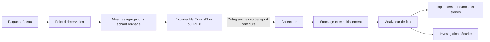
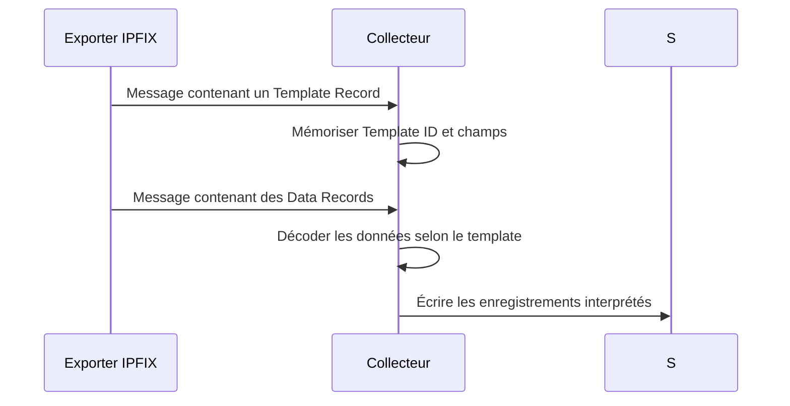
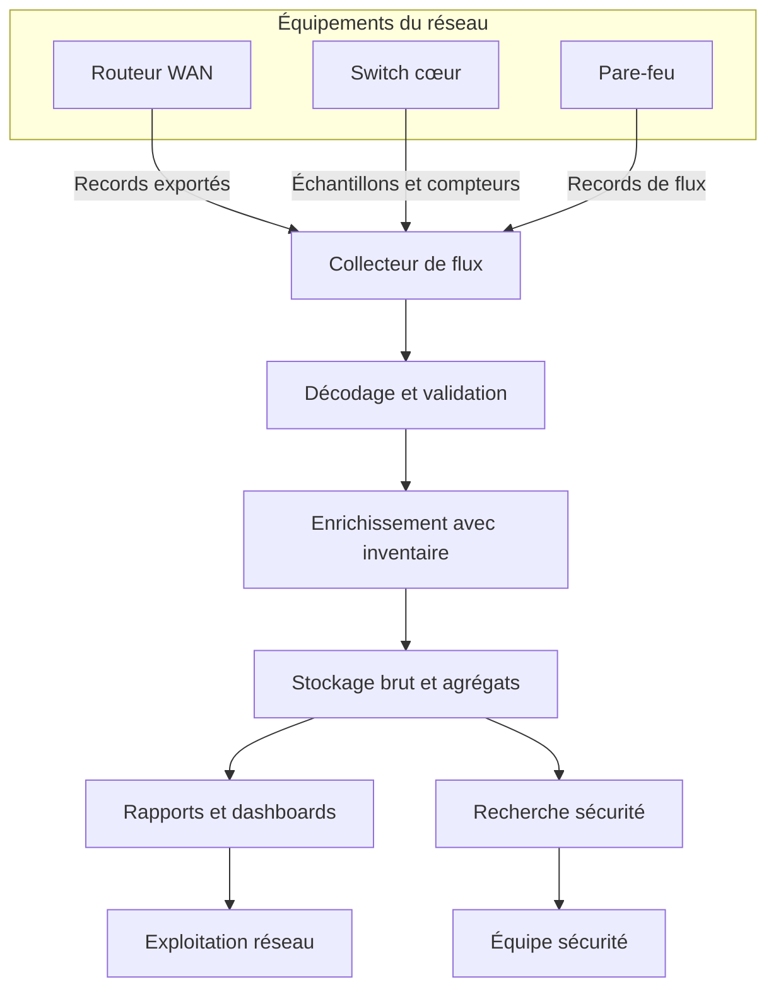
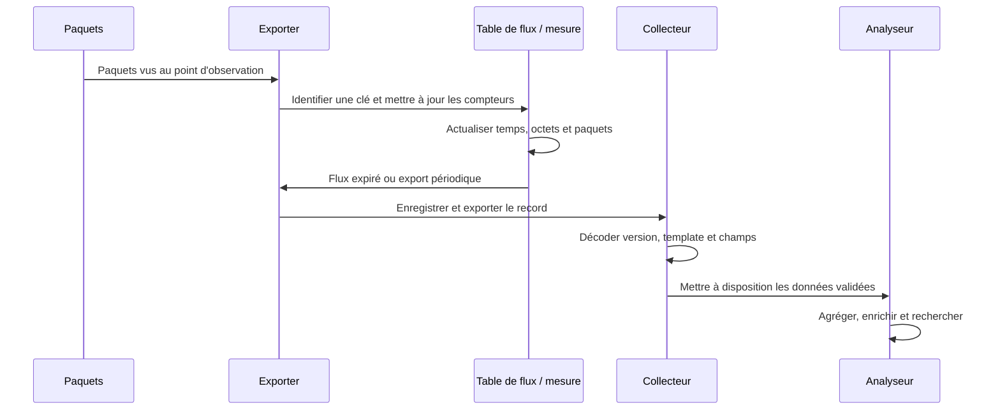
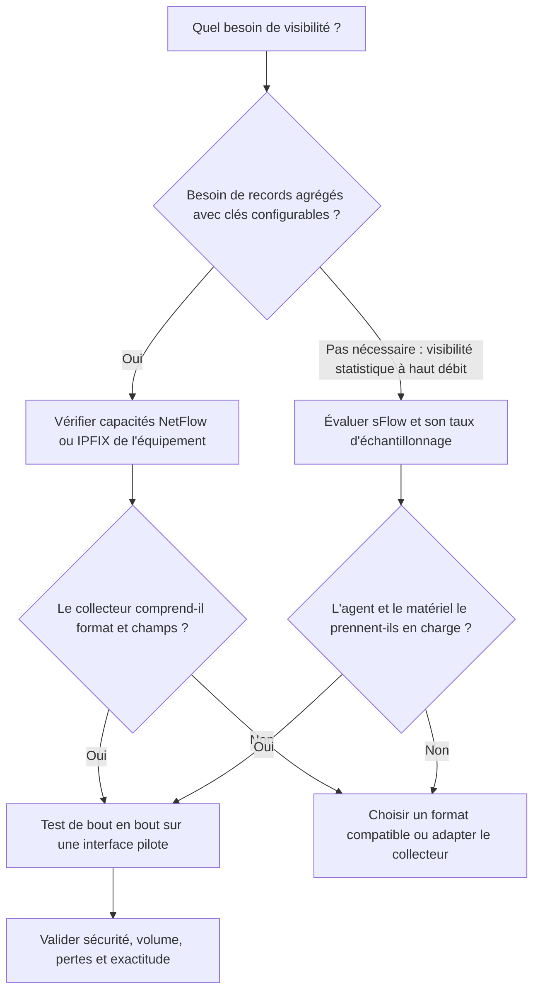
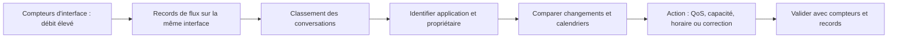
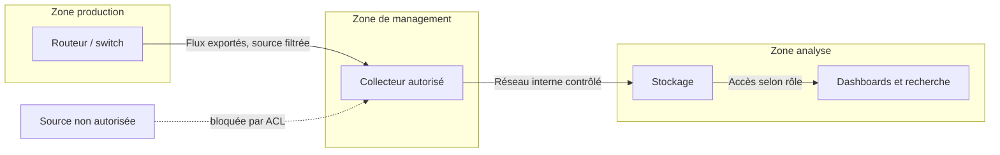

# NetFlow, sFlow, IPFIX

## 1. Introduction

### 1.1. Pourquoi superviser les flux réseau

Un réseau d'entreprise peut transporter des millions de paquets sans qu'un simple contrôle d'interface révèle précisément qui communique avec qui, quelles applications consomment la bande passante, quels serveurs reçoivent un trafic inhabituel ou à quel moment un transfert volumineux a commencé. Les compteurs d'interface indiquent des volumes globaux, mais ne décrivent pas directement les conversations qui composent ce volume. Les contrôles de disponibilité montrent qu'un équipement répond, sans expliquer pourquoi un lien WAN est saturé. Les journaux de pare-feu peuvent apporter des détails, mais ils ne sont pas toujours collectés de manière homogène sur l'ensemble du réseau.

La télémétrie de flux réseau complète ces signaux. Des mécanismes tels que NetFlow, sFlow et IPFIX permettent de décrire des ensembles de paquets présentant des propriétés communes, par exemple les adresses source et destination, les ports, le protocole, les interfaces, le volume de paquets et le volume d'octets. Un équipement ou un agent observe le trafic, maintient des compteurs ou sélectionne des échantillons, puis exporte des informations vers un collecteur. Les données peuvent ensuite être analysées pour comprendre les principaux interlocuteurs, les applications dominantes, les changements de profil, les transferts anormaux ou les signes de congestion.

**NetFlow** désigne une famille de technologies de mesure et d'export de flux historiquement associée à Cisco et adoptée sous différentes formes dans l'industrie. **sFlow** fournit un mécanisme de supervision statistique par échantillonnage des paquets et remontée périodique de compteurs d'interfaces. **IPFIX**, ou IP Flow Information Export, est un protocole normalisé par l'IETF pour exporter des informations de flux à l'aide d'enregistrements et de modèles décrivant leurs champs. Ces technologies sont proches dans leur objectif, mais leurs méthodes de collecte, formats et implications opérationnelles diffèrent.

Le sujet n'est pas d'activer aveuglément l'export sur chaque port. Il faut identifier la question métier, les points d'observation, le volume attendu, la précision souhaitée, les capacités matérielles de l'équipement, le format supporté par le collecteur et la politique de conservation. Une mauvaise configuration peut surcharger le plan de contrôle, saturer un collecteur, perdre des datagrammes, créer des données difficiles à interpréter ou exposer des informations sensibles sur les communications internes.

> **Mise en contexte — vous êtes ingénieur réseau dans une entreprise multisite.** Le lien WAN du siège atteint régulièrement sa capacité, le trafic entre le VLAN bureautique et les serveurs augmente sans explication, et l'équipe sécurité veut comprendre un transfert inhabituel vers une destination externe. Les compteurs SNMP montrent la charge globale, mais ils ne suffisent pas à distinguer les applications et les conversations dominantes. Vous allez choisir une technologie de flux, configurer les points d'observation, acheminer les données vers un collecteur, vérifier leur qualité, analyser les principaux flux et définir une exploitation sécurisée.

### 1.2. Ce que représente un flux

Dans ce contexte, un flux est un ensemble de paquets ou trames observés à un point du réseau pendant une période donnée et regroupés parce qu'ils partagent certaines propriétés. Le modèle traditionnel utilise souvent le quintuplet : adresse IP source, adresse IP destination, port source, port destination et protocole de transport. On peut y ajouter l'interface d'entrée ou de sortie, le type de service, les informations de routage, les identifiants d'application ou d'autres champs selon le produit et le protocole.

Exemple : plusieurs milliers de paquets TCP circulent entre un client et un serveur HTTPS. L'équipement peut agréger les paquets qui correspondent aux mêmes clés de flux et conserver une date de début, une date de fin, un nombre de paquets et un nombre d'octets. Il exporte alors un enregistrement décrivant cette communication observée. Cela ne signifie pas qu'il a conservé tous les paquets ou leur contenu applicatif. Le flux résume les propriétés et les volumes observés, et non le contenu complet de chaque échange.

La définition exacte d'un flux dépend de la configuration et de l'équipement. Certains flux sont unidirectionnels : l'aller et le retour peuvent être représentés par des enregistrements distincts. L'exporter peut agréger selon un ensemble de clés qui inclut les interfaces ou les champs de couche réseau. Un collecteur peut ensuite rapprocher les directions, enrichir les enregistrements et tenter d'identifier l'application. Les analyses doivent tenir compte de ces conventions, sous peine de doubler des volumes ou de compter deux fois une même conversation.

### 1.3. Pourquoi les compteurs d'interface ne suffisent pas

Les compteurs SNMP d'une interface permettent de mesurer des octets, paquets, erreurs et abandons sur une période. Ils sont essentiels pour la supervision de la capacité. Si un port transporte 800 Mbit/s, on sait qu'il est fortement utilisé ; on ne sait pas nécessairement si la charge vient des sauvegardes, d'un transfert de fichiers, de nombreux petits appels applicatifs ou d'une seule conversation volumineuse. La télémétrie de flux ajoute une vue par conversation, en fonction des champs collectés et de la méthode d'observation.

Les technologies de flux aident notamment à répondre aux questions suivantes :

- Quels hôtes, sous-réseaux et applications contribuent le plus au trafic ?
- Quels flux traversent un lien WAN à l'heure de pointe ?
- Le trafic a-t-il changé après un déploiement ou une modification de routage ?
- Quels protocoles ou ports dominent un segment ?
- Existe-t-il des conversations inhabituelles entre des zones qui ne devraient pas communiquer ?
- Une distribution anormale de sources ou de destinations mérite-t-elle une enquête ?
- Le volume est-il concentré sur quelques flux ou réparti entre de nombreuses petites conversations ?
- Les mesures par flux sont-elles cohérentes avec les compteurs globaux d'interface ?

Cette analyse ne remplace pas l'inspection approfondie de paquets, les journaux de pare-feu, les traces applicatives ou les métriques de systèmes. Les flux agrègent des informations de conversation ; ils permettent de comprendre des volumes et des relations, mais ils n'apportent pas nécessairement le contenu des applications. Le chiffrement TLS masque également une grande partie du contenu applicatif, même si des champs réseau et certains métadonnées restent observables.

### 1.4. Les composants de l'architecture

Une plateforme de flux possède généralement un ou plusieurs points d'observation, un processus de mesure, un mécanisme d'export, un collecteur et un outil d'analyse. Ces fonctions peuvent se trouver sur le même équipement ou être distribuées.

L'**observation point** est l'endroit où les paquets sont vus : interface d'entrée, interface de sortie, VLAN, ligne physique, port d'un switch, routeur ou sonde dédiée. Le **processus de mesure** identifie ou échantillonne les paquets, met à jour les statistiques et termine les enregistrements selon des conditions et temporisations. L'**exporter** envoie les données vers un collecteur. Le **collector** reçoit les messages, les décode, valide les modèles si nécessaire, les met en forme et peut les enrichir. L'**analyseur** utilise les enregistrements pour produire des rapports, graphes, alertes, recherches et investigations.

Un même équipement peut à la fois observer le trafic et exporter les flux. Dans d'autres architectures, une sonde dédiée reçoit une copie du trafic via SPAN ou TAP et réalise elle-même la mesure. Chaque choix présente un compromis entre coût, couverture, visibilité, charge sur les équipements de production et risque de perte d'information. Il faut connaître précisément le point où les paquets sont observés pour interpréter les chiffres.

### 1.5. Les trois familles à comparer

NetFlow est une technologie de flow monitoring apparue dans l'écosystème Cisco. Les versions et variantes disponibles dépendent de la plateforme : les anciennes versions utilisent des structures relativement fixes, tandis que NetFlow v9 et Flexible NetFlow permettent des modèles plus flexibles. Le comportement exact, les champs exportables et les mécanismes de configuration doivent être vérifiés sur le produit utilisé.

sFlow repose sur une méthode statistique : l'agent peut échantillonner des paquets et transmettre périodiquement des compteurs d'interfaces. Cette combinaison donne une vue du trafic à grande échelle avec un coût de mesure contrôlable. Les paquets échantillonnés ne constituent pas un recensement exhaustif de toutes les communications ; les estimations dépendent du taux et de la méthode d'échantillonnage.

IPFIX est une norme de protocole d'export. Il utilise des Information Elements pour décrire les champs et des templates pour annoncer la structure des enregistrements transmis. Le collecteur doit connaître ces templates afin d'interpréter correctement les données. IPFIX est conçu pour être extensible et indépendant du protocole d'application qui produit les informations. Il peut transporter divers champs définis dans les registres de l'IANA ou des extensions spécifiques conformes au modèle.

Ces noms ne sont pas trois produits parfaitement symétriques. NetFlow peut désigner une famille de versions et de fonctionnalités, sFlow précise un modèle statistique et un format de datagramme, tandis qu'IPFIX standardise un mécanisme de représentation et de transport des informations de flux. Les équipements réels peuvent prendre en charge plusieurs options, mais il faut vérifier les capacités exactes du constructeur, du système logiciel et du collecteur.

### 1.6. Les objectifs d'apprentissage

À la fin de ce cours, vous devez pouvoir :

1. expliquer la notion de flux et les principaux champs d'un enregistrement ;
2. distinguer compteurs d'interface, flow records et capture de paquets ;
3. comparer NetFlow, sFlow et IPFIX ;
4. expliquer l'échantillonnage, l'agrégation, les timeouts et les templates ;
5. concevoir une architecture exporter-collecteur-analyseur ;
6. choisir des points d'observation sans double comptage inutile ;
7. vérifier la réception et la qualité des données ;
8. utiliser des statistiques de flux pour analyser la bande passante et les conversations ;
9. interpréter les limites liées au sampling, aux champs manquants, au routage et au NAT ;
10. sécuriser les flux exportés et limiter les accès au collecteur ;
11. diagnostiquer une absence de données ou un écart avec les compteurs d'interface ;
12. construire une procédure d'analyse réutilisable pour l'exploitation et la sécurité.

## 2. Concepts clés

### 2.1. Le quintuplet et les clés de flux

Le quintuplet classique comprend les adresses IP source et destination, les ports source et destination, et le protocole IP transporté, souvent TCP ou UDP. Il permet de distinguer des communications qui partagent les mêmes hôtes mais utilisent des ports ou protocoles différents. Par exemple, deux échanges entre un même client et un même serveur peuvent former deux flux distincts si les ports ou le protocole diffèrent.

Le quintuplet ne suffit pas toujours. On peut vouloir inclure les interfaces d'entrée et sortie pour comprendre le chemin, les VLAN pour analyser la segmentation, le type de service DSCP pour vérifier les politiques QoS, les AS source et destination pour analyser le trafic inter-domaine, ou une information de tunnel pour étudier une infrastructure overlay. Les champs disponibles dépendent de la capacité de l'équipement, de la version du protocole, du mode d'observation et de la configuration.

Les clés déterminent le niveau d'agrégation. Si l'on inclut trop de champs distinctifs, le nombre de flux actifs augmente et l'équipement consomme plus de mémoire. Si l'on utilise trop peu de champs, les conversations que l'on souhaite distinguer peuvent être fusionnées. La conception est un compromis : la précision doit répondre au besoin sans dépasser les limites de l'équipement ou du collecteur.

Les flux peuvent être unidirectionnels ou être rapprochés en conversations bidirectionnelles par l'analyseur. Il faut le savoir avant de calculer les volumes. Un export effectué à l'entrée et un autre à la sortie d'un même routeur peuvent représenter deux observations du même trafic. Selon les points de mesure, sommer les deux peut doubler artificiellement les octets observés.

### 2.2. Champs mesurés et champs descriptifs

Un enregistrement de flux regroupe les identifiants de la communication et des statistiques. Parmi les champs fréquents :

- adresse IPv4 ou IPv6 source et destination ;
- ports de transport source et destination, lorsque le protocole s'y prête ;
- identifiant du protocole de couche transport ;
- horodatages de début et de fin ;
- compteurs de paquets et d'octets ;
- interfaces d'entrée et de sortie ;
- indicateurs TCP ou classe de service ;
- champs de routage, de tunnel ou d'AS selon les possibilités ;
- identifiants de domaine d'observation ou de source exportatrice.

Les champs descriptifs identifient les propriétés utilisées pour grouper les paquets, tandis que les champs mesurés agrègent les caractéristiques de l'ensemble. La distinction n'est pas seulement théorique : elle détermine les dimensions de la recherche et les statistiques disponibles.

Le collecteur peut enrichir les enregistrements avec des informations externes, telles que les noms d'hôtes, les groupes d'adresses, la région, le propriétaire de service ou une classification d'application. Ces enrichissements dépendent de référentiels qui peuvent changer. Il est important de conserver les champs originaux de l'observation et de documenter les règles d'enrichissement. Un nom DNS résolu aujourd'hui ne prouve pas que la même machine utilisait cette adresse au moment du trafic.

### 2.3. Début, fin et expiration des enregistrements

Les équipements n'exportent pas nécessairement un enregistrement au début de chaque paquet. Ils maintiennent généralement des informations d'état ou des agrégats pour un flux, puis exportent un record lorsque certaines conditions sont satisfaites. Les critères peuvent inclure un délai d'inactivité, une durée active maximale, une fermeture de connexion observée, une limite de cache ou d'autres conditions propres à la plateforme.

Un **inactive timeout** termine habituellement un flux qui n'a plus connu de paquet pendant une certaine durée. Un **active timeout** permet d'exporter périodiquement un flux encore actif, afin que les longues communications puissent apparaître au fil du temps. Les valeurs, noms de paramètres et détails de comportement dépendent du constructeur. Le collecteur peut donc recevoir plusieurs records successifs qui couvrent une même conversation longue.

Un délai d'inactivité élevé peut retarder la disponibilité des données pour les petites conversations silencieuses. Un délai trop faible augmente le nombre d'enregistrements et la charge d'export. Un délai actif trop long peut retarder la détection d'un transfert volumineux toujours en cours ; un délai actif très court augmente le volume d'enregistrements. Les paramètres sont à adapter au besoin d'analyse, au débit de création de flux et aux ressources disponibles.

L'heure de début et l'heure de fin doivent être interprétées avec le contexte d'export. Des erreurs d'horloge peuvent rendre l'ordre des événements incohérent. Une dérive de temps entre routeurs et collecteurs complique la corrélation avec les logs et incidents. Synchronisez les équipements et les serveurs de collecte avec un service de temps fiable et surveillez leur état de synchronisation.

### 2.4. NetFlow v5, v9 et Flexible NetFlow

NetFlow v5 est une version classique avec une structure d'enregistrement fixe et une prise en charge surtout centrée sur les informations IPv4 traditionnelles. Il est relativement simple à décoder, mais moins extensible qu'une solution fondée sur des templates. Il n'est pas adapté à tous les besoins modernes, notamment lorsqu'il faut représenter un ensemble plus large de champs ou de technologies réseau.

NetFlow v9 introduit un mécanisme de templates. L'exporter annonce la structure des enregistrements au collecteur, qui interprète ensuite les data records selon le modèle reçu. Cela facilite l'extension des champs et permet aux vendeurs d'exporter des ensembles de données plus riches. Le collecteur doit conserver et actualiser l'état des templates ; si les templates ne sont pas reçus ou deviennent indisponibles, les données peuvent être impossibles à décoder même si des paquets d'export arrivent.

Flexible NetFlow, sur les équipements qui le prennent en charge, sépare habituellement la définition des champs de flux, la configuration d'export et l'application du moniteur à une interface ou à un point d'observation. Les termes du constructeur peuvent inclure flow record, flow exporter, flow monitor et sampler. Un record définit les clés et les champs collectés ; un exporter décrit la destination et le transport ; un monitor associe la mesure et l'export ; un sampler peut limiter la quantité de trafic observée. Les détails de syntaxe et les limites dépendent de l'équipement et de sa version logicielle.

La flexibilité a un coût. Ajouter des champs peut augmenter le volume, affecter les capacités du matériel et changer la structure que doit interpréter le collecteur. Avant d'activer un nouveau modèle, vérifiez si le collecteur comprend les champs et si les rapports les exploitent. Il faut également prévoir la compatibilité et le retour arrière si une modification de record interrompt les analyses existantes.

### 2.5. IPFIX et les templates

IPFIX formalise l'échange d'informations de flux entre un processus exportateur et un processus collecteur. Le protocole transporte des messages contenant des records. Un **Information Element** définit la signification d'un champ, par exemple une adresse source, un port ou un nombre d'octets. Les templates décrivent l'ensemble des champs et leur longueur pour les records transmis. Le collecteur doit connaître le template avant d'interpréter les data records qui s'y rapportent.

Le message de données ne suffit donc pas toujours à interpréter un flux isolément. Si le collecteur redémarre ou manque un template, il peut devoir attendre que l'exporter le retransmette. La fréquence de réémission, le maintien de l'état des templates et le comportement de reconnexion varient selon le protocole de transport et l'implémentation. Le dépannage doit vérifier à la fois les messages reçus et la disponibilité des templates.

IPFIX vise l'interopérabilité en offrant un modèle de données extensible et un registre de champs standardisés. La norme de protocole, la définition des Information Elements et leur registre sont des documents liés mais distincts. Un équipement peut ajouter des champs spécifiques ; le collecteur doit savoir les interpréter, ou au minimum préserver les données sans les confondre avec un élément standard. Le numéro et la sémantique d'un élément ne doivent pas être supposés à partir du nom affiché dans l'interface du vendeur.

### 2.6. Transport et fiabilité de l'export

Les technologies et implémentations peuvent exporter les données via différents transports. Le protocole exact supporté doit être vérifié sur l'équipement et le collecteur. Dans les déploiements traditionnels, on rencontre fréquemment UDP pour l'export de flux. Certains déploiements IPFIX peuvent utiliser TCP ou SCTP selon la prise en charge. Les propriétés de fiabilité, d'ordre des messages, de gestion des sessions et de congestion varient.

UDP est simple et peu coûteux, mais les messages peuvent être perdus ou arriver dans le désordre. Si le réseau de collecte est congestionné, le collecteur est arrêté ou les buffers sont dépassés, des enregistrements peuvent être manquants. Cela peut conduire à des volumes sous-estimés sans qu'une erreur visible apparaisse dans chaque dashboard. Il est donc utile de surveiller la réception, les séquences lorsqu'elles sont disponibles, les datagrammes perdus, le trafic d'export et la capacité du collecteur.

Un transport orienté connexion peut améliorer certaines propriétés de livraison et de gestion des sessions, mais ne garantit pas à lui seul une chaîne de collecte infaillible. Une application peut échouer en aval, un buffer peut saturer et des données peuvent être rejetées à l'ingestion. Il faut choisir en fonction du support réel des équipements et collecteurs, de la criticité de l'analyse et du coût opérationnel.

Ne déduisez pas qu'un port de destination unique est universel pour NetFlow, sFlow ou IPFIX. Les ports par défaut sont courants, mais les installations peuvent les modifier et les plateformes peuvent proposer des profils différents. L'équipe réseau doit documenter le port choisi, le transport, la source autorisée, la destination et les règles de pare-feu. Les ACL doivent correspondre à la configuration réelle, pas à une liste copiée d'un guide générique.

### 2.7. sFlow : échantillonnage des paquets et compteurs

sFlow est conçu pour fournir une visibilité statistique à l'échelle d'un réseau avec une méthode d'observation par échantillonnage des paquets, complétée par des compteurs d'interface périodiques. Un agent sFlow peut résider sur un équipement réseau ou un hôte. Il sélectionne des paquets selon une politique d'échantillonnage et exporte des datagrammes vers un collecteur. Les datagrammes peuvent inclure des informations d'interface et des échantillons de données de paquets.

L'échantillonnage permet de limiter la quantité d'informations à traiter sur des liens très rapides. Plutôt que de décrire chaque paquet, le système observe une partie statistiquement sélectionnée, puis le collecteur estime les caractéristiques globales à partir des échantillons et du facteur d'échantillonnage. Les compteurs d'interface périodiques apportent une vision agrégée complémentaire des octets, paquets, erreurs et autres statistiques prises en charge.

Il faut interpréter les estimations selon la méthode d'échantillonnage et la nature du trafic. Les petits flux peuvent être absents de l'échantillon ; les estimations sur un intervalle court sont plus variables ; certains événements rares peuvent ne pas être vus. Un échantillonnage plus fréquent peut améliorer la représentation statistique, mais augmente le volume d'export et la charge de traitement. Le choix du taux dépend du débit, du matériel, des objectifs de visibilité et des capacités du collecteur.

sFlow ne doit pas être présenté comme une capture exhaustive de chaque paquet. Il est très utile pour suivre les grandes tendances, les principaux interlocuteurs, les distributions de trafic et des informations d'hôte ou de réseau lorsque l'agent les expose. Pour un incident exigeant l'examen exact de chaque paquet, il faut envisager une capture ciblée via TAP/SPAN ou une sonde adaptée, avec des précautions de sécurité et de performance.

### 2.8. Comparaison pratique

| Critère | NetFlow | sFlow | IPFIX |
|---|---|---|---|
| Nature | Famille de technologie d'export de flux | Architecture statistique d'échantillonnage et de compteurs | Protocole standardisé d'export de flux |
| Mesure typique | Records agrégés par flux, selon la version | Échantillons de paquets et compteurs d'interface | Records décrits par templates et Information Elements |
| Échantillonnage | Variable selon les versions et capacités | Principe central de l'observation des paquets | Peut transporter des informations issues de mécanismes de sélection |
| Extensibilité | Dépend de la version ; v9 et Flexible NetFlow sont plus flexibles | Structures définies par la spécification et extensions | Modèle extensible via Information Elements |
| Point d'attention | Compatibilité du modèle et du collecteur | Nature statistique des résultats | Gestion et décodage des templates |
| Usage courant | Analyse de trafic et capacité | Réseaux très rapides, visibilité statistique et hôtes | Interopérabilité et export standardisé |

Il ne faut pas choisir uniquement à partir de ce tableau. La prise en charge du matériel compte beaucoup. Un switch peut bien supporter sFlow mais ne pas offrir tous les champs souhaités pour IPFIX. Un routeur peut exporter Flexible NetFlow avec certains champs, mais la capacité des tables ou des processeurs dépend de la plateforme. Un collecteur peut prendre en charge NetFlow v9 et IPFIX, mais pas une extension propriétaire. Faites un test de bout en bout sur la combinaison exacte entre équipement, version, configuration et collecteur.

### 2.9. Échantillonnage : biais, précision et coût

L'échantillonnage réduit le coût de mesure, mais modifie la manière d'interpréter les observations. Si une fraction des paquets est sélectionnée, le collecteur peut utiliser le facteur d'échantillonnage pour estimer le volume total. Cela reste une estimation et ne transforme pas chaque échantillon en connaissance exacte du trafic. Les résultats dépendent de la méthode de sélection, du taux, du comportement du trafic et de la manière dont le collecteur applique le facteur.

Les flux courts ou rares ont davantage de chances de ne pas être représentés dans un échantillon. Un trafic massif et continu sera plus probablement visible dans les statistiques. Une analyse de « top talkers » peut donc fournir un bon aperçu du trafic dominant tout en manquant des événements faibles en volume mais intéressants pour la sécurité. L'analyse de sécurité doit croiser les flux avec les journaux de pare-feu, les logs, les alertes d'endpoint et d'autres sources.

Les taux d'échantillonnage doivent être documentés. Si une interface utilise un facteur de 1 sur N et qu'un collecteur applique un facteur incorrect, l'estimation des volumes sera fausse. Si l'échantillonnage change au cours de la période, les rapports doivent identifier la période et les paramètres correspondants. Évitez d'additionner sans distinction des volumes exacts, des estimations issues d'échantillonnage et des compteurs d'interface.

Une stratégie peut utiliser un échantillonnage plus détaillé sur les liens critiques et moins détaillé sur le trafic moins prioritaire, si le matériel et l'architecture le permettent. Elle peut aussi activer une capture plus précise seulement pendant un incident ciblé. Cette approche réserve les ressources aux situations où la précision supplémentaire a une valeur claire.

### 2.10. Observation : entrée, sortie et zones

Un même paquet peut être observé à différents endroits : entrée et sortie d'un routeur, port d'un switch puis interface du pare-feu, ou côté utilisateur et côté serveur. Les valeurs ne sont pas nécessairement identiques à cause de l'encapsulation, de la traduction d'adresses, des filtres, de la segmentation, du cache, du routage asymétrique ou des pertes. La comparaison des flux doit donc préciser le point d'observation.

Exporter sur une interface d'entrée permet souvent d'observer le trafic tel qu'il arrive à l'équipement. Exporter en sortie permet d'étudier ce qui quitte une interface et peut aider à comprendre la charge du lien. Certains matériels permettent plusieurs points d'observation ou des modes distincts. Les champs disponibles peuvent inclure l'interface d'entrée ou de sortie, mais leur signification doit être vérifiée dans la documentation du produit.

Pour analyser une saturation WAN, l'observation la plus utile peut être sur l'interface WAN du routeur de bordure. Pour analyser les communications entre VLAN, le point de mesure doit voir le trafic qui traverse le chemin concerné. Pour un problème à l'intérieur d'un serveur, une télémétrie d'hôte peut être plus informative qu'un export du routeur central. Choisir le bon point d'observation est souvent plus important que choisir une nouvelle visualisation.

Les architectures asymétriques méritent une attention particulière. Le trafic aller et retour peut traverser des équipements différents, de sorte qu'un collecteur ne reçoit qu'une partie de la conversation. Les NAT peuvent modifier les adresses et ports visibles selon l'endroit et le moment de l'observation. Un rapprochement bidirectionnel doit alors utiliser des informations suffisantes et ne pas supposer que l'adresse observée est toujours l'adresse originale du client.

### 2.11. Exporter, collecteur et analyseur

L'exporter mesure et expédie les données. Le collecteur reçoit les messages, conserve l'état nécessaire au décodage, valide leur structure, interprète les champs et stocke ou transmet les enregistrements. L'analyseur fournit les recherches et rapports. Certains produits réunissent collecteur et analyseur ; d'autres utilisent plusieurs composants.

Les responsabilités sont distinctes. Si un équipement n'exporte rien, examinez le monitor appliqué, l'exporter, la destination, le transport, les interfaces et les compteurs du matériel. Si des paquets arrivent mais ne sont pas décodés, vérifiez la version du protocole, les templates, les Information Elements et les compatibilités. Si les records sont reçus mais absents des rapports, examinez les règles d'ingestion, la fenêtre de temps, le filtrage, le stockage et la requête de l'analyseur.

Le collecteur doit absorber le volume attendu avec une marge raisonnable. Le débit dépend du nombre de sources, du taux de création de flux, des timeouts, des champs collectés, de la fréquence des templates, du sampling et de la technologie utilisée. Les pics d'export peuvent survenir lors d'une charge réseau élevée, précisément au moment où l'équipe a le plus besoin de données. Il faut donc dimensionner le collecteur selon le trafic de pointe, pas seulement la moyenne.

### 2.12. Table de flux et limites de capacité

De nombreux équipements maintiennent en mémoire une table ou un cache de flux avant l'export. Chaque nouvelle combinaison de clés peut ajouter une entrée jusqu'à son expiration. Une forte diversité de conversations, des flux courts en grand nombre ou une combinaison de clés trop détaillée peuvent augmenter rapidement l'utilisation de cette table.

Si la table atteint sa capacité, le comportement dépend de la plateforme : les nouveaux flux peuvent être traités différemment, des statistiques peuvent être perdues ou l'équipement peut produire des compteurs d'erreur. Les limites précises doivent être vérifiées dans la documentation constructeur. Le plan de contrôle ne doit pas être mis en danger par une collecte trop ambitieuse.

Le nombre de flux n'est pas proportionnel uniquement au nombre de paquets. Une charge composée d'un petit nombre de transferts longs peut produire moins d'entrées qu'un trafic composé de millions de requêtes très courtes vers des destinations multiples. Les fonctions d'échantillonnage, les clés, les timeouts et la capacité matérielle influencent le résultat. Avant un déploiement global, testez sur un périmètre représentatif et examinez les statistiques de ressources et de pertes.

Les données de flux doivent aussi avoir une rétention définie. Les exports peuvent être volumineux et sensibles. Définissez la conservation brute, la durée des agrégats, les règles d'archivage et les objectifs de recherche. Les données peuvent servir à analyser un incident sur quelques minutes et à comparer les grandes tendances sur plusieurs mois, mais ces usages ne demandent pas forcément le même niveau de détail.

### 2.13. Détecter les principaux interlocuteurs

Les « top talkers » désignent les sources, destinations, couples ou conversations qui contribuent fortement au volume ou au nombre de paquets. L'analyse peut être orientée octets, paquets, nombre de flux, durée ou nombre de destinations. Chacune répond à une question différente. Un grand transfert de sauvegarde peut dominer le volume d'octets, tandis qu'une machine infectée peut être remarquée par le nombre de connexions vers des destinations multiples.

Pour identifier les contributeurs à une saturation, classez les flux par octets sur une fenêtre qui correspond à l'incident, puis reliez-les à l'interface observée, au sens de trafic, à la zone réseau et au propriétaire. Vérifiez si les adresses sont internes, des NAT, des serveurs de proxy ou des équipements intermédiaires. Un nom DNS peut faciliter la lecture mais doit être corroboré par l'inventaire au moment observé.

Les principaux interlocuteurs ne sont pas automatiquement suspects. Un serveur de sauvegarde ou un système de réplication peut légitimement générer un débit très élevé. Le contexte du calendrier, la fenêtre de maintenance, le rôle de la machine et la destination aident à interpréter. Une alerte utile combine un dépassement mesurable, une attente connue et un propriétaire capable d'agir.

### 2.14. Surveillance sécurité et limites d'interprétation

Les flux peuvent révéler des communications inattendues, des transferts sortants importants, des balayages de ports, un nombre inhabituel de connexions, ou des relations entre segments incompatibles avec la politique de segmentation. Ils peuvent aider à construire des baselines de communication et à repérer les changements de profil.

Mais une anomalie n'est pas une preuve de compromission. Un pic de trafic peut venir d'une sauvegarde, d'une mise à jour, d'une campagne commerciale ou d'un incident de routage. Un scan peut être un audit autorisé. Il faut enrichir les records avec l'inventaire, le propriétaire, les fenêtres d'administration et les événements connus. Les conclusions doivent être validées avec les logs de sécurité et les autres systèmes.

L'échantillonnage peut manquer des événements rares ou très courts. Les communications chiffrées limitent la visibilité sur le contenu. Les protocoles encapsulés, tunnels, NAT et routage asymétrique peuvent compliquer l'attribution. Les flux peuvent révéler la volumétrie et les métadonnées de communication, mais ne remplacent pas nécessairement un IDS/IPS, l'inspection de paquets ou l'analyse endpoint.

Les résultats doivent être traités comme des données opérationnelles sensibles. Ils peuvent révéler qui communique avec quel service, quelles destinations externes sont contactées et quand des transferts se produisent. Limitez les droits, chiffrez les transports lorsque c'est possible, définissez une rétention et documentez les usages légitimes. Évitez de donner un accès universel aux records bruts à des personnes qui n'en ont pas besoin.

### 2.15. Corréler avec SNMP, logs et métriques

Les compteurs SNMP montrent le volume global et les erreurs d'interface. Les flow records répartissent ce volume entre les conversations observées. Les logs de pare-feu indiquent des décisions et événements de sécurité ; les métriques d'application renseignent sur les requêtes et latences ; les traces décrivent les chemins d'exécution internes. Une analyse robuste utilise ces signaux ensemble.

Supposons que l'interface WAN atteigne 95 % de sa capacité à 14 h 05. Les flux montrent qu'un serveur de sauvegarde a envoyé un volume inhabituel vers le site secondaire, et les logs du système de sauvegarde confirment le démarrage d'une tâche hors du calendrier prévu. Les métriques de l'application montrent une hausse de latence en même temps. Cette corrélation permet de formuler une hypothèse et de vérifier si la sauvegarde consomme le lien nécessaire aux transactions.

Il est important que les horloges soient synchronisées et que les fenêtres de requête soient comparables. Les compteurs d'interface sont souvent calculés à partir de deltas; les records de flux peuvent arriver avec retard après un timeout; les logs peuvent utiliser un horodatage d'événement distinct de leur heure d'ingestion. Une différence de plusieurs minutes peut fausser une corrélation apparemment évidente.

Chaque source doit conserver ses limites. Les volumes de flux peuvent ne pas coïncider exactement avec les octets d'interface à cause des points d'observation, de la couche comptée, des en-têtes, du sampling et des pertes d'export. Les écarts doivent être analysés, pas effacés par une correction arbitraire. La priorité est de comprendre si les mesures sont comparables et de connaître leur incertitude.

### 2.16. IPv6, tunnels, VLAN et traduction d'adresses

Une stratégie de flux doit couvrir les protocoles réellement utilisés. Une configuration limitée à IPv4 peut laisser des angles morts dans un réseau IPv6 dual stack. Les champs, records et capacités varient selon les versions et implémentations. Testez les adresses source et destination, la représentation des ports, la segmentation par VLAN et les informations nécessaires pour distinguer les chemins.

Le trafic tunnelisé nécessite une attention spécifique. Selon le point d'observation et les champs collectés, l'enregistrement peut représenter les adresses de l'enveloppe externe, le paquet interne ou certaines informations des deux couches. Une architecture VXLAN, GRE, IPsec ou autre peut donc rendre les conversations apparentes très différentes. Pour analyser les hôtes internes, il faut vérifier que le point de mesure expose les champs nécessaires ou ajouter une instrumentation à l'endroit approprié.

Le NAT modifie les adresses et parfois les ports. Avant traduction, le collecteur peut observer la source privée et la destination originale ; après traduction, il peut voir l'adresse publique et le port mappé. Les records ne peuvent être rapprochés que si l'on dispose de champs, journaux ou informations qui relient les deux vues. Ne supposez pas que le champ source représente toujours l'utilisateur d'origine.

Les VLAN et zones de sécurité peuvent être des dimensions essentielles dans l'enquête. Si les champs sont disponibles, les conserver permet de distinguer deux conversations semblables observées dans des contextes différents. Mais chaque dimension supplémentaire peut augmenter le nombre de records. Il faut équilibrer la valeur analytique et le coût de collecte.

### 2.17. Sécuriser le flux d'export

Les exporteurs envoient leurs données à des collecteurs désignés. Les règles de pare-feu doivent n'autoriser que les sources et destinations requises. Les ports et transports doivent être explicitement documentés. Lorsqu'un transport sécurisé est supporté, utilisez les mécanismes d'authentification et de chiffrement appropriés, en évaluant la compatibilité de l'équipement et du collecteur.

Même si un protocole d'export n'offre pas de confidentialité intégrée dans une variante donnée, le réseau peut protéger le transport avec des mécanismes adaptés, par exemple un segment de management isolé ou un tunnel sécurisé. Les contrôles doivent être conçus selon les capacités réelles et la politique du parc ; il ne faut pas présumer que tous les équipements prennent en charge les mêmes options. Restreignez les datagrammes de collecte et surveillez le trafic inattendu vers les ports concernés.

Les serveurs collecteurs sont aussi sensibles que les données qu'ils traitent. Ils peuvent recevoir des informations sur les relations entre systèmes, les volumes et les destinations. Appliquez les mises à jour, limitez les services exposés, séparez les comptes, sécurisez les accès aux requêtes, auditiez les exportations de données et définissez une rétention qui respecte les règles de l'organisation.

Le collecteur doit résister à des messages malformés, à une source non autorisée et à un volume excessif. Déployez des versions maintenues, surveillez les erreurs de décodage, appliquez des limites raisonnables et évitez qu'un simple flux UDP provenant d'un réseau non fiable puisse consommer toutes les ressources du service.

### 2.18. Capacité et dimensionnement du collecteur

La capacité dépend du nombre de records par seconde, de la taille moyenne des enregistrements, du nombre d'exporters, du taux de sampling, de la fréquence des templates, des enrichissements, du format de stockage et des requêtes des analystes. Une moyenne quotidienne ne suffit pas. Pendant un incident ou une attaque, le nombre de conversations distinctes peut augmenter fortement, faisant grossir l'export et le stockage.

Mesurez les records reçus par seconde, les octets d'export, les pertes détectées, les erreurs de décodage, la file d'ingestion, l'utilisation CPU et mémoire, la latence d'écriture et les requêtes les plus coûteuses. Gardez une marge pour les pointes et les opérations de maintenance. Les composants qui enrichissent chaque record par DNS ou interrogation d'inventaire doivent être évalués : des appels externes synchrones peuvent ralentir l'ingestion.

Le stockage des données brutes se distingue des agrégats analytiques. Les recherches détaillées sur une heure peuvent nécessiter les records bruts ; les tendances d'utilisation d'un WAN sur trois mois peuvent être calculées et conservées sous forme agrégée. Définissez les durées selon la valeur d'investigation, le coût et les exigences de conformité. Le stockage doit être surveillé pour éviter que sa saturation supprime les historiques au mauvais moment.

La redondance du collecteur doit être conçue avec soin. Si plusieurs collectors reçoivent le même export, il faut comprendre si les données sont dupliquées, réparties ou répliquées, et comment les rapports évitent les doubles comptages. La haute disponibilité n'est pas acquise simplement en configurant deux destinations. Testez un arrêt, une perte réseau, une reprise et une saturation, puis vérifiez l'intégrité des données.

### 2.19. Vérifier la qualité de la télémétrie

Une plateforme de flux n'est utile que si les données sont complètes dans les limites de sa méthode, fraîches, décodables et interprétables. Les contrôles de qualité doivent couvrir l'existence de chaque exporter, la réception du trafic attendu, les erreurs de parsing, les templates manquants, les changements de volume, les drops et les statistiques de l'équipement lorsqu'elles sont exposées.

Les tests de cohérence comparent les volumes de flux à ceux des compteurs d'interface sur des périodes similaires. Il faut tenir compte de la couche à laquelle le compteur s'applique, des headers, des points d'observation, des directions, du sampling et de la définition des bytes dans l'outil. L'objectif n'est pas une égalité artificielle exacte, mais un écart explicable dans les limites de mesure.

Des tests synthétiques peuvent générer une conversation contrôlée entre deux hôtes et vérifier qu'un record apparaît avec les champs et le sens attendus. Utilisez un environnement de test ou une fenêtre autorisée. Testez aussi des flux TCP et UDP, IPv4 et IPv6 lorsque nécessaire, plusieurs interfaces et les chemins NAT ou tunnel importants. Un test uniquement basé sur un transfert volumineux peut manquer les problèmes concernant les petits flux ou les champs optionnels.

La validation doit aussi considérer les cas négatifs : destination incorrecte, port bloqué, collecteur arrêté, template perdu, taux d'échantillonnage modifié et redémarrage de l'équipement. Les résultats attendus doivent être documentés afin que l'équipe puisse distinguer une défaillance réelle de la plateforme d'une conséquence normale du modèle de mesure.

### 2.20. Exemples de questions analytiques

Le format des requêtes dépend du collecteur et de l'outil d'analyse ; il n'existe pas une syntaxe universelle pour toutes les bases de données de flux. Les exemples ci-dessous sont donc des objectifs analytiques, pas une requête directement exécutable dans chaque produit.

- **Top sources par octets** : regrouper les records par adresse source sur les dix dernières minutes et trier par somme des octets.
- **Top destinations par paquets** : regrouper par adresse destination et sommer les paquets sur la période.
- **Top conversations** : regrouper par source, destination, ports et protocole afin d'isoler les communications les plus volumineuses.
- **Trafic par interface** : regrouper par exporter et interface de sortie, en distinguant le sens du trafic.
- **Répartition par protocole** : calculer les octets ou records par protocole observé.
- **Trafic inter-VLAN** : regrouper par VLAN ou zone lorsque les champs sont disponibles et fiables.
- **Écart par rapport à la base habituelle** : comparer la période actuelle à des fenêtres précédentes comparables.
- **Connexions vers destination rare** : repérer les destinations vues pour la première fois, puis confirmer avec l'inventaire et les données de sécurité.

Une analyse doit toujours préciser la période, l'unité, le point d'observation, l'éventuel facteur d'échantillonnage et la méthode d'agrégation. Les mêmes flux peuvent apparaître dans différents points de collecte ; sans normalisation, une requête globale peut additionner plusieurs observations du même trafic. La définition du périmètre est une partie de la requête, pas un détail administratif.

### 2.21. Mettre en place une baseline

Une baseline décrit le comportement habituel d'un réseau : volumes par heure, top conversations, ratio de protocoles, trafic vers les services connus, nombre de nouvelles destinations ou distribution par segment. Elle doit tenir compte des variations saisonnières, des horaires de travail, des sauvegardes, des mises à jour et des campagnes commerciales.

Une comparaison utile examine une fenêtre temporelle cohérente. Comparer un lundi matin à un dimanche nuit peut signaler une différence normale comme anomalie. Les calendriers d'exploitation, les changements et les périodes de maintenance doivent être connus. La baseline ne doit pas être figée à jamais : un nouveau service ou une croissance légitime peut modifier la forme du trafic.

Les alertes peuvent viser un dépassement absolu, une variation relative ou une apparition inhabituelle. Une variation relative importante sur un petit volume ne présente pas nécessairement le même risque qu'une variation modérée qui sature le WAN. Le contexte de capacité et la criticité de la destination restent nécessaires.

L'automatisation peut mettre en évidence des changements, mais un analyste doit valider les résultats. Un service de découverte, une sauvegarde exceptionnelle ou un transfert de données autorisé peut générer un écart légitime. Documentez ce qui constitue une anomalie suffisamment importante pour déclencher une investigation, et conservez les preuves permettant d'expliquer une décision.

### 2.22. Utiliser les flux pour planifier la capacité

Pour planifier un WAN, on suit la charge globale de l'interface, les principaux contributeurs, les volumes par période et les tendances. Les records de flux identifient les applications ou sites qui contribuent au trafic. Les compteurs d'interface fournissent la mesure globale de référence. En combinant les deux, l'équipe peut distinguer une croissance générale, un transfert ponctuel et un changement de profil.

Les volumes de flux peuvent aider à estimer les besoins d'une liaison, mais les projections doivent distinguer débit moyen, pointe et durée. Une moyenne de 40 % peut cacher des pics répétés au-dessus de la capacité. Les rapports devraient montrer les percentiles ou maxima, les périodes de pointe et les marges. Les mesures devraient être conservées assez longtemps pour couvrir les cycles d'activité.

La planification doit aussi tenir compte des limites d'observation. Un export par échantillonnage peut estimer les volumes, mais les chiffres ne doivent pas être traités comme un compteur comptable exact. Les flux exportés tardivement à cause des timeouts peuvent décaler une partie de la mesure entre les fenêtres. Le compteur d'interface demeure utile pour valider la tendance générale, avec un périmètre et une méthodologie documentés.

### 2.23. Gouvernance des enregistrements et conservation

Les données de flux peuvent présenter des informations sensibles même lorsqu'elles ne contiennent aucun payload. Il faut donc décider qui peut consulter les sources et destinations, combien de temps les enregistrements bruts sont conservés, quels champs sont nécessaires et quelles exportations vers des outils externes sont autorisées. Les rapports agrégés peuvent parfois satisfaire les besoins de capacité tout en exposant moins de détails que le stockage brut.

L'équipe doit documenter les objectifs de collecte : exploitation, sécurité, capacity planning, dépannage ou audit. Ces objectifs déterminent les champs, la rétention, les rôles, les méthodes de recherche et les limites de partage. Une collecte plus détaillée que nécessaire augmente les coûts et les risques. La minimisation des données doit être appliquée dès la configuration des records, quand la plateforme permet de choisir les champs.

Le cycle de vie inclut la création, l'ingestion, l'enrichissement, le stockage, l'accès, l'archivage et la suppression. Une suppression manuelle de vieux fichiers peut casser la base ou les index si elle contourne le mécanisme du produit. Utilisez les politiques de rétention et les méthodes d'archivage documentées, et testez la restauration si l'historique est nécessaire aux incidents.

## 3. Architecture et Schémas

### 3.1. Architecture d'une plateforme de flow monitoring

Le collecteur doit pouvoir recevoir et décoder les formats réellement envoyés. L'enrichissement aide à transformer des adresses en contexte opérationnel, mais ne doit pas être nécessaire pour conserver les records bruts. La recherche sécurité peut demander un niveau de détail et une rétention différents du reporting de capacité. Les rôles et permissions doivent distinguer ces usages.

### 3.2. Cycle de vie d'un record NetFlow ou IPFIX

Le flux exact dépend de la technologie. Les exporters basés sur templates transmettent la structure nécessaire à l'interprétation ; d'autres formats peuvent avoir une structure fixe. Les records périodiques d'une conversation longue peuvent représenter plusieurs intervalles. Le temps de réception par le collecteur ne doit pas être confondu avec le temps d'observation ou de fin du flux.

### 3.3. Choisir entre NetFlow, sFlow et IPFIX

Le choix final est une décision de compatibilité et d'exploitation autant qu'une décision de protocole. Un standard ne garantit pas que tous les produits prennent en charge tous les champs, et un taux d'échantillonnage ne garantit pas que les événements rares seront visibles. Vérifiez les capacités, testez les données reçues et documentez les limites.

### 3.4. Du volume d'interface à l'identification du contributeur

La mesure globale décrit le symptôme. Les records de flux aident à repérer les contributeurs. Le contexte et l'inventaire permettent de déterminer si le trafic est attendu. Après une action, vérifiez l'impact sur les compteurs et la qualité du service, car la réduction du trafic d'une application peut simplement déplacer la congestion vers une autre interface.

### 3.5. Matrice de contrôle de qualité

| Contrôle | Preuve à collecter | Symptôme d'échec |
|---|---|---|
| Exporter activé | État et compteurs du monitor | Aucun record produit |
| Connectivité export | Paquets reçus sur l'interface de collecte | Silence ou perte de transport |
| Décodage | Compteurs de messages et erreurs | Records rejetés ou illisibles |
| Templates IPFIX/NetFlow v9 | Templates connus et actualisés | Messages de données non interprétables |
| Sampling | Facteur et méthode documentés | Volumes estimés incohérents |
| Couverture des points d'observation | Carte des interfaces surveillées | Trafic important invisible |
| Synchronisation horaire | État NTP et dérive | Chronologie incohérente |
| Stockage | Files, espace et ingestion | Retards, pertes ou historique incomplet |
| Réconciliation | Comparaison avec compteurs d'interface | Écart inexpliqué |
| Sécurité | ACL, transport et permissions | Export non autorisé ou fuite de métadonnées |

### 3.6. Contrôles réseau et frontières de confiance

La plateforme de flow monitoring traverse généralement plusieurs zones de confiance : interfaces de production, réseau de management, collecteur, stockage et outils d'analyse. Les exporters devraient envoyer uniquement vers des destinations approuvées. Les collecteurs ne devraient recevoir que les transports nécessaires depuis les équipements autorisés. Les accès utilisateurs au stockage brut doivent être séparés selon la fonction et la sensibilité des données.

Cette séparation limite l'exposition du collecteur et réduit le risque qu'un tiers injecte des datagrammes ou récupère des métadonnées de communication. Les règles doivent aussi permettre les opérations de dépannage et de maintenance, mais ces accès doivent être authentifiés, journalisés et documentés.

## 4. Étude de cas

### 4.1. Problème de saturation sur un WAN

Une entreprise relie un siège, deux agences et un centre de données. Le WAN du siège transporte le trafic des applications métier, la navigation Internet et les sauvegardes vers le centre de données. Les compteurs montrent des pointes à 95 % de la capacité chaque soir. Les applications deviennent parfois lentes, mais l'équipe ne sait pas quelles conversations dominent.

La première étape consiste à définir la question : quels flux contribuent au débit de l'interface WAN pendant la plage de dégradation ? L'équipe identifie le routeur d'accès et l'interface concernée, vérifie les capacités NetFlow/IPFIX ou sFlow du matériel et choisit un collecteur compatible. Elle ne commence pas par activer l'export globalement sur toutes les interfaces. Elle pilote la configuration sur l'interface qui voit le trafic du lien, puis compare les résultats avec les compteurs d'interface.

Les champs minimums incluent les adresses source et destination, les ports, le protocole, les octets, les paquets, l'horodatage et le point d'observation disponible. Les VLAN ou interfaces peuvent être nécessaires pour distinguer certains segments. L'équipe vérifie si les records sont unidirectionnels et si le même trafic sera exporté à plusieurs endroits. Cette vérification est essentielle pour éviter de doubler les volumes.

### 4.2. Définir le profil d'export

Dans un équipement prenant en charge Flexible NetFlow, la démarche conceptuelle se décompose en plusieurs objets : définition des clés et des champs à collecter, destination et paramètres d'export, moniteur qui associe le record à l'exporter, éventuel sampler, puis application du moniteur à l'interface ou au point d'observation. La syntaxe exacte dépend de la gamme, du système logiciel et des capacités matérielles. On ne doit pas copier une suite de commandes générique sans la confronter au guide officiel de la version installée.

L'équipe sélectionne les champs nécessaires pour répondre à la question et évite d'ajouter des champs non utilisés. Elle configure l'adresse du collecteur, le transport et le port documentés, puis applique le monitor sur l'interface prévue. Une fenêtre de test permet d'observer le volume exporté, les statistiques du moniteur et l'impact sur la CPU ou les ressources de l'équipement. Si la plateforme dispose de limitations connues sur la taille de la table ou le taux de création de flows, elles sont intégrées au plan.

Si l'équipement utilise sFlow, l'équipe définit l'adresse du collecteur, le taux d'échantillonnage, l'intervalle de compteurs et les ports à surveiller selon les fonctions supportées. Les données sont ensuite interprétées comme statistiques échantillonnées. Le facteur d'échantillonnage est documenté et la méthode de calcul du collecteur est validée. Il ne faut pas appliquer un facteur supplémentaire si le collecteur l'a déjà pris en compte.

### 4.3. Vérifier la réception au collecteur

L'équipe vérifie d'abord que les paquets arrivent sur l'interface réseau du collecteur. Ensuite, elle consulte les compteurs d'entrée du service, les erreurs de décodage, les modèles IPFIX/NetFlow v9 présents et la fraîcheur des derniers records. Une capture réseau ciblée peut être utilisée pendant la validation, en respectant la politique de sécurité et en évitant de conserver inutilement des données sensibles.

Un flux exporté ne doit pas être confondu avec un flux utilisateur. Le collecteur doit décoder les messages et créer des records exploitables. Pour NetFlow v9 ou IPFIX, le manque de templates peut empêcher d'interpréter les data records. Pour sFlow, il faut vérifier la prise en charge des structures et le facteur d'échantillonnage. Pour NetFlow v5, la prise en charge et les champs sont plus fixes, mais l'interprétation dépend toujours de la compatibilité du collecteur.

Après le décodage, l'équipe vérifie les adresses, ports, interfaces, heures, nombres d'octets et de paquets. Elle compare un transfert contrôlé à ce que le collecteur présente, sans exiger une égalité exacte si l'export est échantillonné ou agrégé à un point d'observation différent. Les écarts sont consignés avec les hypothèses retenues.

### 4.4. Trouver les contributeurs dominants

Sur la période 18 h–20 h, l'équipe classe les conversations par octets et par interface. Elle découvre qu'un serveur de sauvegarde produit une grande part du trafic vers le centre de données, tandis qu'un système de mise à jour génère une deuxième pointe. Une vue par destination montre que le trafic est attendu mais qu'il entre en concurrence avec les applications interactives.

L'équipe vérifie le calendrier des sauvegardes, les journaux de tâches et les métriques de latence applicative. Elle propose de décaler certaines copies volumineuses, de revoir la politique QoS si elle est conforme à l'architecture, ou d'augmenter la capacité si la demande est durablement supérieure au dimensionnement. Les flux sont une preuve de contribution, pas une autorisation automatique de bloquer la source. Le propriétaire du système valide le changement et l'impact sur les objectifs de sauvegarde.

Après modification, l'équipe compare le débit WAN, les principaux flux et la latence applicative sur des périodes similaires. Elle vérifie que les transferts ne se sont pas simplement déplacés vers une autre interface saturée. Le rapport décrit la période, le point d'observation, la technologie utilisée, le facteur de sampling le cas échéant et les limites connues de la mesure.

### 4.5. Investigation sécurité : trafic sortant inhabituel

Un poste d'un VLAN utilisateur envoie soudain un volume important vers une adresse externe peu fréquente. Les records de flux indiquent la source, la destination, les ports, le protocole, le volume et la fenêtre temporelle. L'équipe sécurité rapproche cette observation des journaux de pare-feu, du système de DNS, des alertes endpoint et des changements récents.

Le flux peut signaler un transfert autorisé, une synchronisation cloud, une sauvegarde ou un comportement malveillant. L'équipe ne bloque pas la communication sur la seule base d'un volume élevé sans évaluer le risque et le contexte. Elle vérifie le propriétaire de la machine, la destination, les horaires, les conversations similaires et les politiques attendues. Si une action de confinement est nécessaire, elle suit le processus de réponse à incident.

La télémétrie peut être limitée par le sampling. Si la communication est rare et brève, elle peut ne pas être représentée dans le jeu de données sFlow. Les logs de pare-feu ou de proxy peuvent fournir une observation complémentaire. L'équipe note le niveau de certitude et les sources qui soutiennent l'hypothèse. Les conclusions deviennent plus fiables quand plusieurs sources indépendantes concordent.

### 4.6. Contrôler les données et éviter le double comptage

L'équipe compare les octets exportés avec les compteurs SNMP de l'interface WAN sur la même période. Les totaux diffèrent. Avant de considérer cela comme un défaut, elle vérifie que les deux mesures portent sur le même sens du trafic, la même interface et la même couche. Elle confirme que les flux sont observés sur l'interface de sortie tandis que le compteur SNMP représente les octets selon la définition de l'équipement, et que le collecteur applique déjà le facteur d'échantillonnage.

Elle examine aussi les exports d'une interface de cœur et d'une interface de bordure. Une partie du trafic apparaît aux deux endroits, ce qui signifie que sommer les records des deux exporters compterait plusieurs observations d'un même paquet. L'équipe crée des rapports distincts par point d'observation ou utilise des règles de déduplication compatibles avec les champs disponibles. Il n'existe pas de déduplication universelle qui puisse résoudre tous les cas de routage asymétrique, NAT et tunnels sans connaissance de la topologie.

Le résultat final n'est pas l'égalité de deux compteurs provenant de modèles différents, mais un profil d'écarts stable et expliqué. La procédure documente les champs, les points de collecte, les facteurs de sampling et les éventuelles corrections du collecteur. Une modification de l'une de ces dimensions déclenche un nouveau contrôle de cohérence.

### 4.7. Runbook d'une alerte de trafic anormal

Le runbook commence par identifier l'interface, la période, la source et la destination, les octets et paquets, le protocole et l'éventuel facteur d'échantillonnage. L'opérateur vérifie que le record est récent, qu'il a été décodé correctement et que les volumes sont cohérents avec les compteurs d'interface. Il consulte ensuite l'inventaire et les changements planifiés.

Si le trafic est attendu, il identifie le propriétaire et décide si une adaptation de calendrier ou de capacité est nécessaire. Si le trafic semble anormal, il rapproche les logs de sécurité, les alertes endpoint et le DNS. Selon la criticité et les règles d'autorisation, il peut escalader à l'équipe sécurité et suivre le processus de réponse à incident. Le runbook précise les actions autorisées et évite qu'un opérateur ne bloque un service métier sans évaluation d'impact.

Après intervention, l'équipe vérifie le comportement sur le même point d'observation, contrôle les compteurs et les records, puis confirme le retour à un profil acceptable. Le ticket documente la cause, l'impact, la période, les preuves et les mesures préventives. Si le collecteur a perdu des données, ce problème est traité séparément, car une analyse incomplète peut donner une fausse conclusion sur l'évolution du trafic.

### 4.8. Plan de validation avant généralisation

Avant d'étendre la configuration à tout le parc, l'équipe valide un équipement de chaque famille représentative : routeur de bordure, switch cœur, équipement d'agence et, si nécessaire, appareil virtuel ou réseau overlay. Elle confirme la version et les champs exportables, le taux de création de records, la précision requise, la consommation des ressources et la prise en charge par le collecteur.

Le test couvre les périodes calmes et chargées, plusieurs protocoles, plusieurs interfaces, des flux courts et longs, et les conditions de panne du collecteur. Il vérifie la récupération après redémarrage, l'arrivée des templates, la synchronisation temporelle et le comportement lorsque l'export est bloqué. Les résultats sont mesurés et comparés à la charge de référence.

Le déploiement global est réalisé par étapes. Une nouvelle famille de matériel ne rejoint la collecte qu'après validation. Les modifications de champs ou de sampling sont versionnées et documentées. Les dashboards et rapports possèdent un owner, une rétention définie, et une méthode de signalement si la collecte devient incomplète.

## 5. Pièges à éviter

### 5.1. Confondre flux et capture complète de paquets

Un flow record résume des propriétés et compteurs d'un ensemble de paquets. Il ne contient pas nécessairement la totalité des paquets ni leur payload. sFlow échantillonne des paquets ; les technologies de flux peuvent agréger des conversations. Si l'enquête a besoin du contenu détaillé ou de chaque paquet, choisissez une capture ou une sonde dédiée et encadrez son usage.

### 5.2. Considérer les volumes échantillonnés comme exacts

Le facteur de sampling sert à estimer le trafic représenté, mais l'estimation garde une incertitude. Des petits flux ou événements rares peuvent être absents. Le facteur doit être correctement documenté et appliqué une seule fois. Les rapports ne doivent pas additionner sans distinction des métriques exactes, des volumes estimés et des observations provenant de plusieurs points.

### 5.3. Exporter sur toutes les interfaces sans plan

Une collecte trop large peut générer un volume important, ajouter de la charge, accroître les tables de flux et rendre les rapports difficiles à lire. Commencez par les points d'observation qui répondent à une question, puis élargissez après mesure de la charge et de la valeur analytique. Documentez chaque interface et son sens.

### 5.4. Oublier les templates dans IPFIX ou NetFlow v9

Des datagrammes peuvent arriver sans que leurs données soient décodables si le collecteur n'a pas reçu le template correspondant ou si l'identifiant et la structure ne sont pas disponibles. Contrôlez le flux des templates, les versions, les options de réémission et les logs du collecteur. Le simple fait de voir des paquets UDP n'est pas une preuve que les enregistrements sont correctement interprétés.

### 5.5. Utiliser des ports et transports supposés universels

Les ports habituels ne sont pas garantis dans chaque installation. Le transport supporté diffère selon les versions et les capacités du matériel. Documentez ce que l'équipement et le collecteur utilisent réellement, puis créez des règles de pare-feu précises. Ne copiez pas des ports ou commandes d'un autre modèle d'équipement sans validation.

### 5.6. Double-compter le trafic

Le même paquet peut être observé à l'entrée d'un équipement, à la sortie d'un autre ou sur les deux sens d'une conversation. Les NAT, tunnels et routages asymétriques compliquent le rapprochement. Définissez les points d'observation et le sens des données avant de sommer les records. Un rapport fiable doit indiquer son périmètre.

### 5.7. Négliger l'horloge

Une mauvaise synchronisation peut inverser l'ordre apparent des événements ou rendre les corrélations erronées. Synchronisez les horloges des équipements et collecteurs. Distinguez l'heure d'observation, l'horodatage de l'enregistrement et l'heure de réception. Les records peuvent être exportés après la fin du flux, selon les timeouts.

### 5.8. Choisir un échantillonnage sans définir l'usage

Un sampling adapté à la capacité peut être insuffisant pour détecter de petits événements rares. Un sampling excessif peut peser sur l'équipement et le collecteur. Reliez le taux à la volumétrie, la précision souhaitée et le cas d'usage. Réévaluez-le si le profil de trafic ou le matériel change.

### 5.9. Prendre chaque grand flux pour une anomalie

Une sauvegarde, une réplication ou une distribution logicielle peuvent légitimement dominer le réseau. Comparez le flux à la baseline, au calendrier, à l'inventaire et au propriétaire. L'alerte doit indiquer une anomalie par rapport au comportement attendu, pas seulement un grand volume.

### 5.10. Exposer des métadonnées réseau sans contrôle

Les records dévoilent les adresses, ports, relations et horaires de communication. Protégez le transport, limitez les sources autorisées, gérez les accès au collecteur et appliquez une rétention adaptée. Les données brutes ne doivent pas être accessibles à tous les utilisateurs simplement parce qu'elles sont utiles à plusieurs équipes.

### 5.11. Sous-dimensionner le collecteur

Le trafic d'export peut augmenter brutalement au moment d'un incident. Surveillez les records par seconde, les drops, les erreurs de décodage, les files et l'espace de stockage. Dimensionnez selon les pics et testez la perte du collecteur. Une plateforme saturée peut enregistrer sélectivement ou perdre des données sans qu'une erreur visible soit attachée à chaque record.

### 5.12. Supposer que le collecteur connaît tous les champs

La compatibilité dépend du protocole, des versions et des extensions. Un champ vendeur spécifique peut ne pas être pris en charge ou être interprété différemment. Vérifiez le modèle d'enregistrement, les Information Elements et les capacités du collecteur. Préservez les données brutes utiles et documentez les champs non interprétés.

### 5.13. Ignorer le coût des champs supplémentaires

Des clés plus nombreuses ou des records plus riches peuvent augmenter les entrées, le trafic exporté et le stockage. N'ajoutez que les champs nécessaires à une décision ou une enquête. Les détails qui n'ont pas de valeur d'exploitation peuvent ajouter du coût sans améliorer la visibilité.

### 5.14. Confondre un manque de flux et une absence de trafic

Une absence de record peut être normale, mais peut aussi venir d'un exporteur arrêté, d'un port bloqué, d'un template manquant, d'un sampling, d'un filtre ou d'une panne de collecte. Vérifiez les compteurs d'interface, les statistiques de l'exporter, la réception des messages et les cibles attendues. Un silence doit être interprété avec les autres données.

### 5.15. Ne jamais tester le retour à la normale

Une collecte peut reprendre après une coupure tout en ayant perdu des données pendant l'intervalle. Un collecteur peut retrouver le trafic sans reconstruire l'historique manquant. La procédure doit distinguer le rétablissement de service et l'exhaustivité des données. Vérifiez les pertes, les timestamps et la continuité de stockage après chaque incident de collecte.

## 6. Checklist / À retenir

### 6.1. Avant d'activer un exporter

- [ ] L'objectif d'analyse et le point d'observation sont définis.
- [ ] La plateforme prend en charge la technologie et les champs requis.
- [ ] La version logicielle et la documentation constructeur sont vérifiées.
- [ ] Les clés et champs répondent à une question opérationnelle précise.
- [ ] Les timeouts actif/inactif sont cohérents avec le volume et le besoin de fraîcheur.
- [ ] Le taux de sampling, le cas échéant, est documenté.
- [ ] Le collecteur, le transport et le port sont définis.
- [ ] Les règles réseau autorisent uniquement les sources et destinations prévues.
- [ ] Les ressources de l'équipement ont été évaluées en pilote.
- [ ] Le retour arrière est prêt.

### 6.2. Avant de considérer les données comme fiables

- [ ] Le collecteur reçoit des messages des exporteurs attendus.
- [ ] Les records sont décodés, et les templates sont disponibles lorsque nécessaires.
- [ ] Les adresses, ports, interfaces, horodatages et compteurs sont cohérents.
- [ ] Le facteur de sampling est connu et appliqué une seule fois.
- [ ] Le point d'observation et le sens du trafic sont documentés.
- [ ] Les horloges des équipements et du collecteur sont synchronisées.
- [ ] Les volumes sont comparés aux compteurs d'interface sur des fenêtres comparables.
- [ ] Les données dupliquées par plusieurs points d'observation sont identifiées.
- [ ] Les erreurs de collecte, de parsing et de stockage sont surveillées.
- [ ] La rétention et les permissions sont définies.

### 6.3. Lors d'une enquête de trafic

1. Définissez une fenêtre de temps et l'interface ou le point d'observation concerné.
2. Vérifiez le débit global via les compteurs d'interface.
3. Classez les conversations par octets, paquets, source, destination ou protocole selon la question.
4. Confirmez l'identité et le propriétaire des hôtes par l'inventaire.
5. Comparez les flux à la baseline, au calendrier et aux changements récents.
6. Croisez les résultats avec logs de pare-feu, métriques d'application et alertes de sécurité.
7. Évaluez les limites de sampling, les effets de NAT, les tunnels et les observations multiples.
8. Décidez d'une action contrôlée, puis vérifiez le résultat avec la même méthode de mesure.
9. Documentez les preuves, les incertitudes, l'impact et les mesures préventives.

### 6.4. Tableau mental des composants

| Composant | Rôle |
|---|---|
| Point d'observation | Définit où les paquets sont vus |
| Clé de flux | Définit quelles communications sont regroupées |
| Flow record | Résume les propriétés et compteurs d'un flux observé |
| Exporter | Produit et envoie les records ou échantillons |
| Template | Décrit la structure des records dans les formats qui l'utilisent |
| Collecteur | Reçoit, décode et prépare les données |
| Analyseur | Recherche, agrège et présente les informations |
| Sampling | Sélectionne une partie des paquets et conditionne l'incertitude |
| Timeout | Contrôle le moment où les records sont exportés |
| Compteur d'interface | Mesure le volume global de l'interface |
| Baseline | Décrit le comportement habituel pour le comparer à l'actuel |
| Rétention | Définit la période pendant laquelle les données sont disponibles |

### 6.5. Exercices de consolidation avec correction

**Exercice 1 — Le WAN est saturé, mais les compteurs SNMP ne montrent que le débit global. Quelle valeur ajoutée apporte la collecte de flux ?**

**Correction :** elle aide à ventiler les volumes selon les communications observées : sources, destinations, ports, protocoles, interfaces et octets ou paquets selon les champs disponibles. L'équipe peut classer les principaux contributeurs et relier le trafic à un propriétaire ou une application. Les compteurs restent nécessaires comme référence globale, mais les points d'observation et le double comptage doivent être maîtrisés.

**Exercice 2 — Le collecteur reçoit des messages IPFIX, mais ne peut pas décoder les enregistrements. Quel point vérifier en priorité ?**

**Correction :** vérifier les templates et leur état dans le collecteur, ainsi que la compatibilité du protocole et des Information Elements. Les data records IPFIX s'interprètent grâce à la structure décrite par les templates. L'arrivée de paquets ne garantit pas que le collecteur dispose du contexte nécessaire. Il faut aussi examiner les erreurs de parsing, les identifiants de template et les options de réémission de l'exporter.

**Exercice 3 — Une analyse sFlow ne montre pas une petite conversation très courte. Peut-on conclure que le trafic n'a jamais existé ?**

**Correction :** non. sFlow échantillonne les paquets ; les flux courts ou rares peuvent ne pas être représentés dans un échantillon donné. Il faut considérer le taux de sampling et compléter l'enquête avec les logs ou une capture ciblée si la précision est indispensable. Les conclusions doivent indiquer le niveau de confiance et les limites du modèle de collecte.

**Exercice 4 — Le volume NetFlow est deux fois plus élevé que prévu parce que deux routeurs exportent les mêmes conversations. Que faire ?**

**Correction :** cartographier les points d'observation, le sens d'export et le chemin du trafic. Le même paquet peut être observé à plusieurs interfaces ou équipements, et les enregistrements peuvent être unidirectionnels. Les rapports doivent séparer les points d'observation ou appliquer une méthode de déduplication qui s'appuie sur des champs et une topologie fiables. Il ne faut pas supprimer arbitrairement la moitié des volumes.

**Exercice 5 — Un trafic sortant massif apparaît sur un poste utilisateur. Est-ce une preuve d'attaque ?**

**Correction :** non, il s'agit d'un signal d'enquête. Il peut correspondre à une sauvegarde, une synchronisation cloud, un transfert autorisé ou un comportement malveillant. Il faut rapprocher les flux avec l'inventaire, les horaires, les journaux de pare-feu, le DNS, les alertes endpoint et le propriétaire. Une décision de confinement doit suivre le processus de sécurité et tenir compte de l'impact métier.

**Exercice 6 — Les records d'une conversation apparaissent plusieurs minutes après la fin du transfert. Quel paramètre peut l'expliquer ?**

**Correction :** les flux sont souvent exportés lorsque les conditions de terminaison ou d'expiration sont atteintes. Un inactive timeout, un active timeout ou une limite de cache peut retarder l'export par rapport au dernier paquet. Les valeurs dépendent de la plateforme et influencent la fraîcheur comme le volume de records. Il faut vérifier les timeouts, puis distinguer l'heure de l'événement de l'heure de réception.

**Exercice 7 — Les records sont présents, mais leur somme ne correspond pas exactement aux compteurs d'interface. Quelle démarche adopter ?**

**Correction :** comparer le même point d'observation, la même direction, la même fenêtre temporelle et la même définition des octets. Vérifier le sampling, les pertes d'export, les templates, les timeouts, l'encapsulation, les headers et la possibilité de double comptage. Il ne faut pas forcer l'égalité entre deux modèles différents ; l'écart doit être expliqué et documenté dans les limites de précision.

**Exercice 8 — Comment déployer la collecte sur des centaines d'équipements avec un risque limité ?**

**Correction :** commencer par un pilote représentatif, valider les champs, le collecteur, la charge matérielle, le transport, les templates et la qualité des données. Déployer ensuite par familles d'équipements et par étapes avec une procédure de retour arrière. Surveiller les records par seconde, la réception, les erreurs, les pertes, le stockage et la cohérence avec les compteurs. Une modification de sampling ou de modèle doit être versionnée et retestée.

### 6.6. Conclusion opérationnelle

NetFlow, sFlow et IPFIX permettent de comprendre le trafic réseau à un niveau plus fin que les compteurs d'interface. NetFlow et ses variantes proposent des mécanismes d'export de records de flux, sFlow offre une visibilité statistique par échantillonnage et compteurs, et IPFIX définit un protocole extensible fondé sur des Information Elements et des templates. Le bon choix dépend du matériel, du collecteur, du besoin de précision, du volume et des capacités de l'équipe.

Gardez quatre principes : **définir le point d'observation**, **comprendre les limites de mesure**, **valider la chaîne d'export de bout en bout** et **protéger les métadonnées de communication**. Les records de flux sont très utiles pour l'analyse de capacité et l'investigation, mais ils doivent être rapprochés des compteurs, de l'inventaire et des événements. Un résultat statistique n'est pas une preuve exhaustive ; une corrélation n'est pas une cause certaine ; une collecte présente n'est fiable que si sa qualité et sa fraîcheur sont surveillées.

### 6.7. Références officielles pour approfondir

- RFC 7011 — Spécification du protocole IPFIX : https://www.rfc-editor.org/rfc/rfc7011
- RFC 7012 — Modèle d'information IPFIX : https://www.rfc-editor.org/rfc/rfc7012
- Registre IANA des Information Elements IPFIX : https://www.iana.org/assignments/ipfix
- Spécifications officielles sFlow : https://sflow.org/developers/specifications.php
- Guide Cisco Flexible NetFlow : https://www.cisco.com/c/en/us/td/docs/switches/lan/c9000/fnf-avc/flexible-netflow-configuration-guide.html
- Documentation Cisco sur les données NetFlow : https://docs.manage.security.cisco.com/cdfmc/c_netflow_data_in_the_firepower_system.html

Les capacités d'export, les champs, les transports et les commandes de configuration varient selon le matériel et la version logicielle. Utilisez le guide du constructeur correspondant à chaque équipement et testez les données reçues avant toute généralisation.
