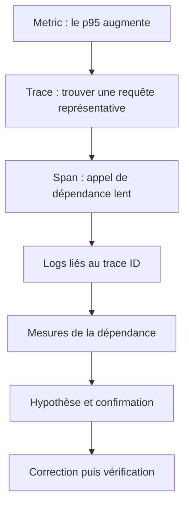
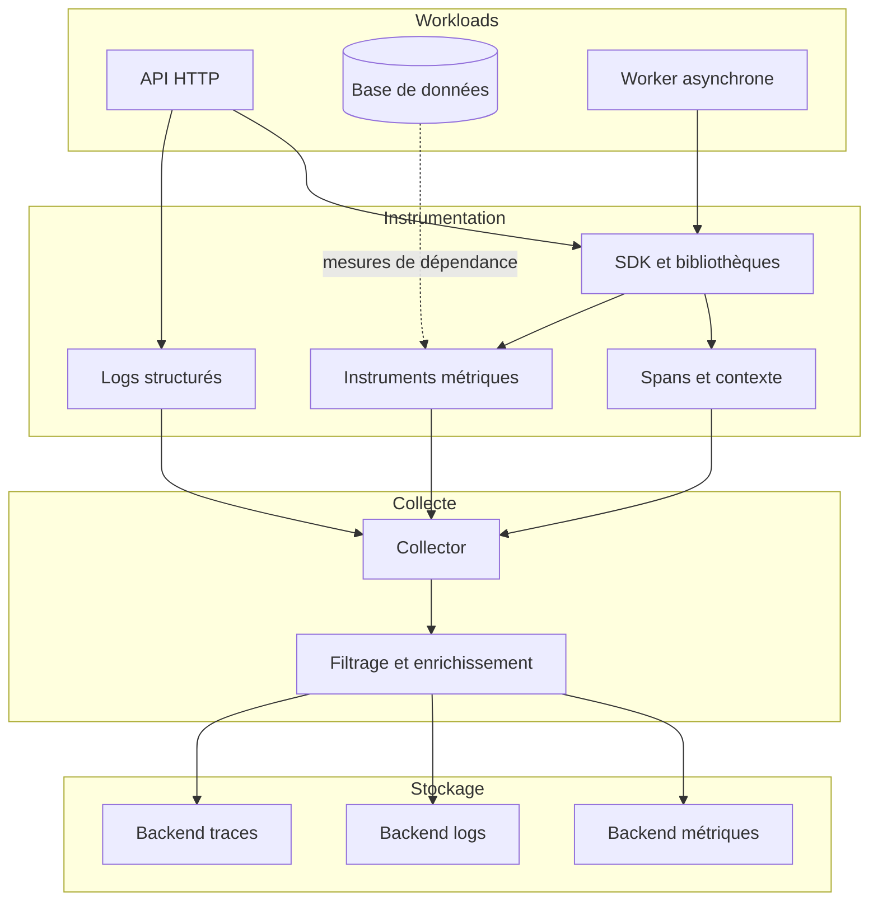
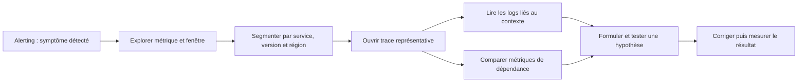
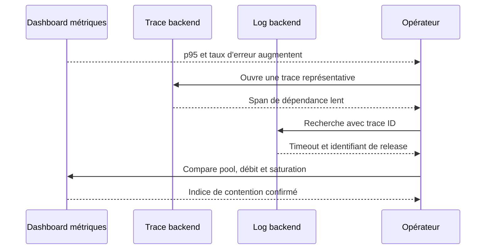
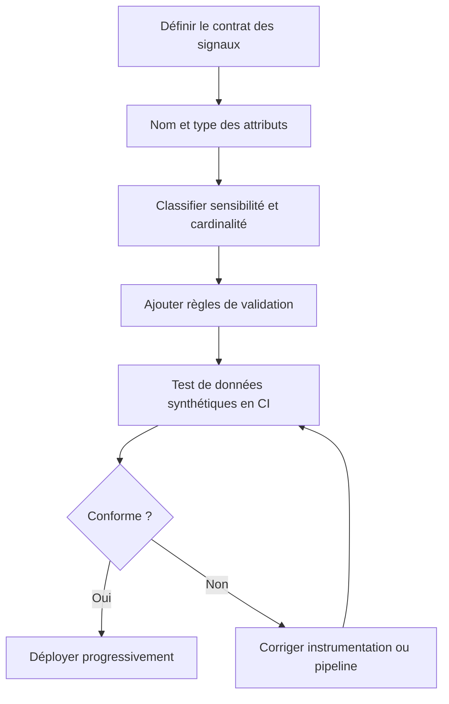
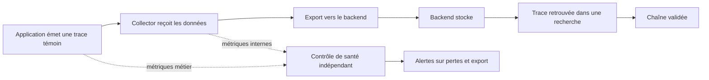

# Observabilité complète (3 piliers)

L’observabilité permet de comprendre le comportement d’un système à partir des données qu’il émet, y compris lorsque le problème rencontré n’a pas été anticipé. Elle repose couramment sur trois familles complémentaires : les métriques, les logs et les traces distribuées. Les métriques décrivent des tendances quantitatives, les logs consignent des événements et les traces montrent le parcours d’opérations dans un système distribué. Au niveau expert, il ne suffit pas de collecter les trois signaux : il faut définir leur rôle respectif, les corréler, réduire les angles morts, protéger les données, contrôler la cardinalité et les coûts, puis concevoir des procédures de diagnostic qui les utilisent ensemble.

## 1. Introduction

### 1.1 De la supervision à l’observabilité

La supervision classique est efficace lorsqu’on sait à l’avance quels symptômes surveiller : un disque presque plein, une interface réseau saturée, un certificat qui expire ou un processus arrêté. Ces contrôles sont nécessaires et restent indispensables en production. Cependant, les systèmes modernes associent souvent des services, des files d’attente, des bases, des API externes, des conteneurs, des fonctions serverless et du code exécuté dans des navigateurs. Une panne peut se produire dans un chemin qui n’avait pas été identifié comme critique, ou une régression peut être visible uniquement pour une combinaison particulière de données et de dépendances.

L’observabilité cherche à rendre le fonctionnement interne compréhensible à partir des sorties du système. Elle permet de poser de nouvelles questions sans devoir systématiquement redéployer du code pour ajouter la première mesure. Une bonne instrumentation n’anticipe pas toutes les pannes possibles ; elle fournit suffisamment de contexte pour que l’équipe puisse formuler puis tester une hypothèse nouvelle.

La distinction est importante. Disposer d’un tableau de bord rempli de courbes ne rend pas automatiquement un système observable. Une base de logs volumineuse ne garantit pas qu’on puisse retrouver l’événement associé à une requête lente. Un graphe de traces impressionnant peut rester inutile si les noms de services sont incohérents, si les erreurs ne sont pas correctement marquées ou si la moitié des données manque sans indication. L’observabilité dépend de la qualité, de la cohérence et de l’exploitabilité des signaux, pas simplement de leur quantité.

### 1.2 Objectifs du cours

À la fin de ce cours expert, l’apprenant doit pouvoir expliquer la différence entre métriques, logs et traces et déterminer ce que chaque signal démontre ; concevoir une stratégie de collecte à partir des questions opérationnelles et du risque métier ; relier les événements de logs aux trace IDs, spans, services, environnements et versions ; comprendre les ressources, conventions sémantiques, attributs et identifiants de corrélation ; choisir des métriques agrégées et des distributions adaptées à la mesure de la santé ; interpréter des traces avec des opérations parallèles, des retries et des traitements asynchrones ; utiliser les exemplars et les mécanismes de navigation entre métriques et traces lorsqu’ils sont pris en charge ; contrôler la cardinalité, les volumes, la rétention et les coûts sans détruire la capacité de diagnostic ; concevoir des alertes liées à des symptômes utilisateurs et à des objectifs de fiabilité ; organiser la confidentialité, les permissions et la gouvernance de la télémétrie.

### 1.3 Les trois piliers classiques

Les métriques, logs et traces sont souvent appelés les trois piliers de l’observabilité. Cette expression est utile pour expliquer les différences de rôle, mais elle ne signifie pas que ces trois catégories suffisent à tous les besoins. Selon le service, les profils de performance, les événements de déploiement, les tests synthétiques, les mesures RUM, les événements de sécurité ou les résultats métier peuvent être tout aussi importants. Les signaux sont complémentaires, et une architecture mature sait associer chacun à une question précise.

Une métrique est une mesure structurée dans le temps, comme un débit de requêtes, un taux d’erreur ou une distribution de latence. Un log est un événement horodaté, comme un échec d’authentification, une réponse externe inattendue ou l’expiration d’un délai. Une trace est un ensemble d’opérations corrélées, par exemple la requête HTTP qui traverse un gateway, un service de commande, une base de données et un prestataire externe.

Le bon signal dépend de la question. Pour savoir si 8 % des requêtes échouent durant une période de dix minutes, une métrique agrégée est plus efficace qu’une recherche exhaustive dans les logs. Pour expliquer une erreur spécifique, un log détaillé peut donner le message de l’exception. Pour comprendre quelle dépendance a consommé la majorité du délai de bout en bout, une trace est souvent le point de départ le plus utile.

### 1.4 Pourquoi les signaux doivent se compléter

Une métrique peut indiquer un p95 en hausse, mais ne pas expliquer quelle étape est responsable. Une trace peut montrer qu’un appel de base de données est lent, mais pas si ce problème touche une seule requête ou une large part du trafic. Un log peut montrer une erreur de timeout, mais sans mesures agrégées il est parfois difficile d’en déterminer la fréquence et l’impact. Les signaux se renforcent mutuellement.

La démarche opérationnelle est généralement la suivante : détecter un symptôme à partir d’une métrique ou d’un test synthétique ; segmenter la population touchée ; sélectionner une trace représentative ; retrouver les logs associés à cette trace ; examiner les métriques et événements de la dépendance ; puis confirmer l’hypothèse avec un test ou une observation indépendante. Ce processus évite de tirer une conclusion d’un seul événement isolé.

Une bonne architecture doit permettre cette navigation sans exiger que l’opérateur connaisse à l’avance les noms exacts de toutes les tables, fichiers et services internes. Cela nécessite des conventions stables, des identifiants propagés, des horloges suffisamment fiables et une politique de rétention qui préserve les données requises pendant la durée des investigations.

### 1.5 L’observabilité n’est pas une collection exhaustive

Collecter tout ce que le programme peut émettre est rarement une bonne stratégie. Des logs détaillés peuvent révéler des informations sensibles et coûter cher. Une instrumentation qui crée un span pour chaque opération triviale peut rendre les traces illisibles. Des métriques portant un identifiant unique par utilisateur ou requête peuvent générer un nombre énorme de séries. Les données doivent être choisies d’après leur utilité et leur risque.

Il faut définir les questions prioritaires : la disponibilité du parcours, le délai de réponse, le taux de succès métier, la qualité d’une dépendance, la saturation d’une ressource ou la fréquence de certains événements. Ensuite, choisir les mesures qui répondent à ces questions. L’instrumentation doit être révisée lorsque l’architecture ou les questions opérationnelles changent.

## 2. Concepts clés

### 2.1 Les métriques : tendances et comportement agrégé

Une métrique représente une mesure numérique associée à un moment ou à une fenêtre temporelle, accompagnée de dimensions qui permettent de la regrouper. Les exemples courants incluent le nombre de requêtes, le taux d’erreur, la durée des appels, les connexions actives, l’utilisation CPU, le nombre de messages en attente et le volume d’objets traités.

Les métriques sont particulièrement efficaces pour les alertes et les tableaux de bord parce qu’elles résument de grandes quantités d’activité en séries relativement compactes. On peut calculer un taux d’erreur, comparer la latence de plusieurs versions ou détecter une augmentation du backlog. Elles peuvent cependant perdre le détail d’une opération individuelle : un histogramme de latence montre une distribution, mais ne dit pas quelle commande précise a attendu un verrou.

Le choix de la métrique et de son type est important. Un compteur convient à un événement cumulatif comme le nombre de requêtes traitées. Un gauge représente une valeur instantanée ou observable telle que le nombre de connexions actives. Un histogramme permet d’étudier la distribution de mesures comme les durées. Les noms et instruments précis dépendent de l’API et du backend utilisés ; il faut respecter les conventions standard lorsqu’elles sont appropriées.

### 2.2 Compteurs, gauges, histogrammes et distributions

Un compteur représente typiquement une quantité cumulative monotone, comme le total de requêtes terminées. Pour obtenir un débit, on étudie le changement sur une fenêtre temporelle et on le rapporte à sa durée. Un gauge sert à observer un état tel que les workers actuellement actifs ou la profondeur instantanée d’une file.

Un histogramme regroupe des observations dans des buckets ou conserve des informations de distribution selon le modèle de données du système. Il permet d’estimer la répartition des durées et de calculer des percentiles lorsque les données et le backend le permettent. Il est généralement plus utile qu’une moyenne seule pour des latences qui présentent une longue traîne.

Il faut éviter d’agréger des percentiles de manière incorrecte. La moyenne des p95 de deux services n’est pas le p95 global. Les fenêtres doivent être comparables, et la définition de l’observation doit être identique. Les histogrammes peuvent être agrégés selon leurs règles, tandis que les percentiles calculés à partir de distributions séparées ne peuvent pas être simplement moyennés.

### 2.3 Les logs : événements détaillés

Un log représente un événement horodaté, parfois associé à un niveau de gravité, un corps de message, un attribut de service, un trace ID ou un contexte métier. Un log structuré utilise des champs explicites et typés plutôt que de tout encoder dans une phrase libre. Cette structure facilite les filtres et les agrégations.

Les logs aident à répondre à « que s’est-il passé à ce moment-là ? ». Ils peuvent fournir le message d’une exception, le résultat d’une validation, une décision de politique ou un changement d’état. Mais ils peuvent devenir difficiles à exploiter si les formats changent selon les équipes, si les timestamps ne sont pas uniformes ou si les identifiants de corrélation sont absents.

Un bon log comporte le niveau approprié, le service, la version et un message utile, mais ne répète pas inutilement tout le contenu de la requête. Les logs doivent éviter les mots de passe, jetons, cookies, données personnelles et corps complets de demande. Le niveau de détail doit être choisi pour la valeur opérationnelle, pas pour satisfaire l’idée que plus de texte signifie plus d’information.

### 2.4 Les traces distribuées : chemin causal d’une opération

Une trace est composée de spans qui décrivent les opérations effectuées au cours d’un parcours logique. Un span contient un nom, un début, une fin, un contexte, des attributs, un statut et éventuellement des événements ou des liens. Les trace IDs permettent de regrouper les spans reliés, tandis que les span IDs identifient les opérations individuelles.

Les traces sont utiles pour décomposer une latence de bout en bout, visualiser des appels entre services, identifier des dépendances lentes et distinguer des chemins d’exécution. Elles ne sont pas nécessairement complètes : l’échantillonnage, l’absence d’instrumentation, une propagation défectueuse et la perte d’export peuvent supprimer des segments visibles.

Une durée de span est un temps écoulé, pas automatiquement du temps CPU. Elle peut inclure des attentes de réseau, de file, de pool ou de verrou. Quand un span est long, il indique où approfondir, mais il ne prouve pas à lui seul la cause racine. Il faut consulter des mesures complémentaires et vérifier l’hypothèse.

### 2.5 Ressources et conventions sémantiques

Une ressource décrit l’entité observée qui produit la télémétrie, par exemple un service, un processus ou un conteneur. Les ressources permettent de relier les traces, métriques et logs issus de la même entité. Les attributs de span décrivent plutôt une opération individuelle. Cette distinction favorise une navigation cohérente entre les signaux.

Les conventions sémantiques définissent des noms communs pour les attributs et opérations. Elles réduisent la quantité de conventions maison à maintenir dans chaque équipe. Les attributs peuvent concerner HTTP, RPC, bases de données, messagerie, ressources de service ou erreurs. Les conventions évoluent et certaines peuvent être en transition ; les équipes doivent vérifier la version appliquée aux bibliothèques et dashboards.

Une valeur telle que le nom de service doit rester stable. Les versions, environnements et détails d’instance sont des dimensions distinctes. Si chaque pod apparaît comme un service totalement différent, les regroupements deviennent difficiles. Si une URL contient un identifiant unique dans le nom de ressource, le nombre de groupes peut exploser. Le nommage fait donc partie de l’architecture d’observabilité.

### 2.6 Le modèle de corrélation

Corréler ne veut pas simplement dire placer les données dans le même outil. Il faut des clés communes, des conventions compatibles et une chronologie cohérente. Les dimensions typiques comprennent le service, l’environnement, la version et le nom de l’opération. Un trace ID et parfois un span ID relient les logs à la trace correspondante. Les métriques peuvent fournir des exemplars qui pointent vers un exemple de trace.

Le trace ID ne doit pas être confondu avec un identifiant métier. Un identifiant de commande peut être utile à une investigation métier, mais il peut être sensible ou prévisible. Le trace ID sert à relier les spans d’un parcours. On peut ajouter une référence métier pseudonymisée si la politique le permet, mais il ne faut pas transformer les champs de traçage en conteneur pour secrets ou données d’identité.

Une corrélation est fiable uniquement si la propagation est correcte. Si un proxy enlève les en-têtes, les services peuvent générer des traces indépendantes. Si un logger n’inclut pas le contexte courant, les logs ne seront pas liés à la trace. Si les attributs de version changent de nom, la comparaison avant/après peut échouer. La chaîne doit être testée avec un parcours contrôlé de bout en bout.

### 2.7 Exemplars : passer d’une métrique à une trace

Un exemplar peut associer une observation métrique à un contexte de trace, notamment le trace ID et le span ID selon le modèle et les capacités d’export. Il sert de raccourci entre une donnée agrégée et un exemple individuel. Par exemple, un bucket d’histogramme peut montrer une observation de latence élevée et fournir un lien permettant d’ouvrir la trace correspondante.

Les exemplars sont particulièrement utiles pour éviter une recherche manuelle difficile. Un opérateur remarque que le p99 augmente, sélectionne une observation pertinente dans l’histogramme et ouvre la trace liée. La trace permet alors de voir les appels, tandis que les métriques gardent la perspective statistique sur la population totale.

Ils ne garantissent pas que chaque événement possède un exemplar. Leur disponibilité dépend de l’instrumentation, du SDK, du mode de stockage, de l’échantillonnage et du backend. Il faut également vérifier que les champs de contexte ne révèlent pas d’informations sensibles. Un lien vers une trace doit respecter les permissions d’accès à cette trace.

### 2.8 Métriques dérivées des traces et métriques indépendantes

Certains pipelines peuvent produire des métriques à partir des spans, par exemple le nombre de requêtes ou la durée par service et opération. Cela peut faciliter l’usage des conventions communes et la corrélation entre traces et métriques. Toutefois, si la dérivation est basée sur des traces échantillonnées, les métriques résultantes peuvent ne pas représenter tout le trafic, sauf mécanisme prévu et configuration adaptée.

Les métriques indépendantes du sampling restent utiles pour la disponibilité, le taux d’erreur et les SLO. Si la mesure repose sur une fraction de traces, elle peut sous-estimer le débit et manquer des erreurs rares. Il faut connaître la provenance de chaque série et les hypothèses qui rendent l’agrégation valide.

L’architecture doit choisir si les métriques critiques sont collectées directement depuis l’application, produites par la plateforme de tracing ou calculées à partir des logs. Éviter les doubles comptages lorsque plusieurs couches mesurent la même requête. Documenter le point de mesure, la population couverte et l’impact de l’échantillonnage.

### 2.9 Modèle de nommage et cardinalité

La cardinalité est le nombre de valeurs distinctes d’une dimension. Elle est essentielle pour les métriques, car chaque combinaison d’attributs peut créer une série temporelle distincte. Un label par utilisateur, un UUID de requête ou une URL libre peut rendre le nombre de séries ingérable. Dans les logs et traces aussi, des attributs de forte cardinalité peuvent augmenter le coût et compliquer les recherches, même si les impacts sont différents selon la plateforme.

Préférer les dimensions bornées et utiles : service, environnement, région, méthode HTTP, route normalisée, classe de résultat et version. Ne pas utiliser un nom de service ou une ressource dynamique pour représenter chaque requête. Les identifiants uniques peuvent parfois être conservés au niveau événement si le besoin est légitime, mais il faut éviter de les transformer en dimensions globales sans connaître les effets de stockage et d’indexation.

Le choix des attributs doit être revu avant la mise en production. Chaque champ devrait avoir un propriétaire, une finalité, un type et une règle de confidentialité. Les attributs qui proviennent d’une entrée utilisateur demandent une vigilance particulière, car leur valeur et leur cardinalité sont difficiles à prévoir.

### 2.10 Niveaux de logs et politique de bruit

Les niveaux de logs sont utiles lorsqu’ils représentent une politique cohérente. Une erreur doit signaler un événement qui nécessite une attention ou un échec d’opération selon la définition de l’équipe. Un avertissement indique une condition inhabituelle qui peut être acceptable. L’information documente un événement pertinent ; le debug donne des détails destinés au diagnostic et ne devrait pas être activé à grande échelle sans raison.

Si chaque refus de validation normal est journalisé comme une erreur, les alertes et recherches deviennent bruyantes. Si une panne critique ne produit qu’un message de debug absent en production, le contexte sera perdu. Définir des règles communes et vérifier comment les exceptions sont converties en logs et statuts de span.

La fréquence des événements doit être contrôlée. Une boucle qui journalise à chaque itération peut produire un volume énorme sous charge. Des logs répétitifs peuvent être échantillonnés ou agrégés lorsque cela est sûr, mais les premiers événements et l’évolution des erreurs doivent rester visibles. Le but est de conserver des preuves exploitables, pas de collecter chaque répétition sans discernement.

### 2.11 Temps, fenêtres et synchronisation

Les signaux sont horodatés et agrégés dans le temps. Si les horloges sont désynchronisées, la corrélation temporelle devient moins fiable. Des spans peuvent apparaître comme s’ils commençaient avant leur parent. Des logs venant de plusieurs hôtes peuvent être triés dans un ordre qui ne correspond pas exactement à l’exécution. La synchronisation de temps fait donc partie des dépendances d’observabilité.

Il faut également comparer des fenêtres cohérentes. Une métrique sur une minute n’est pas directement comparable à un agrégat sur une heure sans tenir compte de la granularité. Des fenêtres courtes détectent rapidement les incidents mais peuvent être bruyantes. Des fenêtres longues stabilisent les tendances mais retardent la détection.

Les traces et logs peuvent arriver dans le backend avec un retard dû à la collecte, au batch ou au réseau. L’ordre d’ingestion n’est pas nécessairement l’ordre d’exécution. Lors d’un incident, examiner les horodatages des événements et l’état de la collecte avant d’interpréter une différence de quelques secondes comme une relation causale.

### 2.12 Signaux de santé et les quatre Golden Signals

Pour un service orienté utilisateur, quatre familles de mesures sont souvent utiles : latence, trafic, erreurs et saturation. La latence décrit le délai de réponse ; le trafic mesure la demande ; les erreurs indiquent les opérations qui ne réussissent pas ; la saturation révèle si une ressource approche de sa limite. Ces signaux servent à détecter des symptômes et à orienter l’investigation.

Une hausse du nombre absolu d’erreurs peut simplement accompagner une hausse du trafic. Les taux et distributions aident à distinguer ces cas. Il faut également séparer la latence des requêtes réussies de celle des requêtes échouées : une erreur rapide n’est pas un succès, et une erreur très lente peut dégrader davantage l’expérience.

Les signaux doivent être choisis selon le service. Une file de messages peut avoir un indicateur de retard et de consommation ; un système de traitement batch peut mesurer le retard de fraîcheur et le taux d’échec des tâches ; une base peut suivre les connexions actives, la latence des requêtes et la saturation des ressources. Un ensemble de métriques purement système ne démontre pas que l’opération métier fonctionne.

### 2.13 SLI, SLO et alertes exploitables

Un SLI est une mesure de la qualité observée, par exemple la proportion de requêtes réussies ou la part de demandes achevées dans une limite de latence. Un SLO définit un objectif sur une fenêtre temporelle. Les métriques constituent souvent la base de calcul. Les traces et logs sont ensuite utiles pour expliquer pourquoi le SLI s’est dégradé.

Une alerte efficace indique un symptôme qui nécessite une action. Des alertes qui se déclenchent pour chaque écart mineur génèrent de la fatigue et perdent en crédibilité. Les règles doivent correspondre à l’impact utilisateur ou à un risque opérationnel important, avec un propriétaire, une sévérité et un chemin de réponse documentés. Les détails d’une trace ne remplacent pas une mesure agrégée du SLO.

Le budget d’erreur représente la marge restante avant de dépasser un objectif défini. Si cette marge est consommée trop rapidement, l’organisation peut ralentir les livraisons ou prioriser la fiabilité. L’observabilité doit aider à déterminer si les incidents sont concentrés sur une version, une région ou une dépendance et si les mesures correctives restaurent le niveau attendu.

### 2.14 Logs structurés et trace context

Les logs structurés permettent de filtrer et d’agréger des événements en fonction de champs stables. Dans un service instrumenté, ils peuvent également inclure les identifiants de trace et de span du contexte courant. Cela crée une navigation entre la trace et les événements émis pendant l’opération.

La corrélation doit être validée de bout en bout. Un champ peut être nommé différemment selon le framework ou le backend. Le logger peut être exécuté dans un thread ou une tâche où le contexte n’a pas été propagé. Si les IDs sont ajoutés manuellement dans certains chemins seulement, une partie des logs restera orpheline.

Éviter d’injecter le trace ID dans chaque phrase libre si le backend sait le stocker comme attribut structuré. Les champs doivent conserver un format et une casse cohérents. L’identifiant ne doit pas remplacer les messages détaillés ou les identifiants métier nécessaires. Les données personnelles doivent être minimisées même lorsque les logs sont liés à une trace.

### 2.15 Traces échantillonnées et biais d’observation

L’échantillonnage réduit le volume en ne conservant qu’une partie des traces. L’échantillonnage de tête décide généralement tôt et limite les coûts en amont ; l’échantillonnage de fin examine davantage d’informations mais nécessite des buffers et un traitement adapté. Les deux méthodes ont des compromis et leurs détails varient selon les SDK et collecteurs.

Une trace absente ne prouve pas que l’opération n’a pas eu lieu. Une métrique dérivée d’un échantillon peut également sous-estimer ou mal représenter le trafic si le mode de calcul n’est pas adapté. Il faut savoir quelles données sont échantillonnées et quelles métriques restent exhaustives.

Une politique de collecte peut favoriser les erreurs, les durées anormales ou les parcours critiques lorsque la solution le permet. Elle ne doit pas être conçue comme une boîte noire. Tester des scénarios rares, examiner le taux de données retenues et mesurer la complétude des traces est nécessaire pour conserver la confiance dans l’outil.

### 2.16 Confidentialité et sécurité des signaux

Les logs et traces peuvent contenir des URL, des paramètres, des requêtes SQL, des messages d’exception et des attributs métier. Les métriques peuvent révéler la présence d’utilisateurs, le volume d’activité ou les opérations sensibles. Le fait qu’une donnée se trouve dans un système d’observabilité ne la rend pas non confidentielle.

Ne pas collecter les mots de passe, jetons, cookies, clés API, numéros de paiement ou corps complets de requêtes sans justification validée et protection appropriée. Les identifiants personnels doivent être exclus ou transformés selon la finalité, et les règles doivent être testées sur des exemples synthétiques. La meilleure protection reste de minimiser les données à la source, puis de compléter par des filtres.

Les accès doivent suivre le moindre privilège. Le droit de consulter des traces détaillées peut révéler des informations internes. La rétention, l’archivage, les exports secondaires et les sauvegardes doivent appliquer des règles cohérentes. La sécurité doit être vérifiée sur chaque destination, pas seulement sur l’interface principale.

## 3. Architecture et Schémas

### 3.1 Architecture de collecte à plusieurs signaux

Une architecture mult signal doit harmoniser l’identité des ressources, le contexte de corrélation et les destinations. Les applications peuvent instrumenter différents signaux et les exporter par un ou plusieurs pipelines. Les collecteurs peuvent appliquer du filtrage, de l’enrichissement et du batch. Les backends peuvent être distincts, mais les conventions de ressources et de service doivent permettre de passer d’un signal à l’autre.

Le schéma ne signifie pas que chaque signal doit suivre exactement le même protocole ou chemin. Une métrique peut être collectée par un agent système, un log peut être expédié par un agent de journalisation et une trace peut être exportée via OTLP. L’important est que les métadonnées et conventions permettent de relier ces systèmes, et que les responsabilités de transformation et de sécurité soient explicites.

### 3.2 Modèle de métadonnées commun

Définir les champs communs nécessaires à la navigation : nom du service, environnement, version, région si pertinente, identifiant de trace lorsqu’il existe, opération normalisée et état. Les champs doivent être cohérents entre logs, traces et métriques lorsque leur sémantique s’y prête. Il ne faut toutefois pas copier mécaniquement chaque attribut dans chaque signal, car cela peut augmenter la cardinalité ou transporter des données inutiles.

Un contrat de télémétrie peut documenter les noms de champs, le type, la source, la finalité, la cardinalité attendue, la classification de confidentialité et la politique de rétention. Il peut être versionné avec les services et vérifié dans la CI. Ce modèle évite que plusieurs équipes créent des variantes incompatibles du même champ.

Les conventions sémantiques OpenTelemetry fournissent un vocabulaire commun pour de nombreux signaux et ressources. Elles ne couvrent pas toutes les dimensions métier ; des conventions internes restent parfois nécessaires. Elles doivent cependant être choisies avec prudence, avec des noms stables et une distinction claire entre dimensions communes et attributs propres au domaine.

### 3.3 Flux de diagnostic : du signal à la cause

Une alerte agrégée doit fournir un point d’entrée et permettre de descendre vers les preuves. Le flux type commence par une métrique ou un test synthétique, passe par la segmentation du service et de la version, puis ouvre une trace et les logs correspondants. Les métriques de dépendance permettent de confirmer une saturation ou une latence externe.

La démarche limite les conclusions prématurées. Un événement de log ne permet pas d’estimer à lui seul la proportion de requêtes concernées. Une trace lente ne garantit pas que toutes les requêtes le sont. Une métrique agrégée peut montrer l’impact sans localiser la cause. Il faut passer d’une observation à l’autre avec une hypothèse explicitement formulée.

### 3.4 Corrélation entre logs et traces

Le contexte de traçage permet d’associer un log à un span lorsque le framework et le logger propagent les identifiants. Un format structuré rend la recherche plus efficace et évite de parser une phrase pour extraire un trace ID. Les attributs de service et de version aident à identifier quel composant a émis le message.

La corrélation n’est fiable que si le contexte survit aux opérations asynchrones et aux appels entre services. Les contextes locaux peuvent se perdre quand un événement est traité dans un autre thread, coroutine, worker ou callback. Il faut tester l’injection et l’extraction à chaque frontière importante.

Ne pas utiliser un trace ID comme substitut d’identité, et ne pas écrire un secret dans un champ de corrélation. Les outils de recherche doivent respecter les permissions du système de logs et du backend de traces. Un opérateur ne doit pas obtenir un accès plus large aux données privées en passant d’une interface à l’autre.

### 3.5 Corrélation métriques-traces et exemplars

Une métrique agrégée indique la tendance, alors qu’une trace permet d’inspecter un exemple. Lorsque les exemplars sont disponibles, un point de distribution peut être lié à un trace ID et permettre d’ouvrir une trace représentative sans rechercher manuellement parmi toutes les traces. Ce mécanisme est particulièrement utile pour diagnostiquer une longue traîne.

L’instrumentation, le SDK, l’exporteur, le stockage et l’interface doivent tous prendre en charge la fonction requise. Il faut vérifier que les exemplars sont conservés et qu’ils pointent vers des traces accessibles. Un lien peut être inutile si la trace a été échantillonnée ou supprimée par la rétention.

Une métrique critique pour un SLO ne doit pas reposer sur un simple sous-ensemble de traces sans justification. Le calcul de la santé globale doit suivre une population définie. Les exemplars apportent des raccourcis d’investigation ; ils ne remplacent pas la métrique agrégée elle-même.

### 3.6 Pipeline et points de transformation

Les logs, métriques et traces peuvent être transformés par des collecteurs ou des agents avant le stockage. Les transformations doivent être documentées : champs ajoutés, attributs supprimés, noms normalisés, règles d’échantillonnage, filtrage et destination. Sans cette documentation, l’équipe peut interpréter les données comme si elles étaient exactement celles émises par l’application.

Un filtre trop agressif peut supprimer le champ qui permet de corréler les signaux. Un processeur qui renomme l’environnement d’une façon différente dans les traces et les logs peut rendre les tableaux de bord incohérents. Des transformations peuvent aussi introduire une cardinalité excessive si elles construisent des noms à partir d’une URL ou d’un identifiant. Chaque changement doit être vérifié avec un jeu de données connu.

Il est recommandé de disposer de tests synthétiques de pipeline. Ils envoient une trace, un log et une mesure connus, puis vérifient la destination, les attributs et les règles de filtrage. Ces tests doivent aussi confirmer que les données interdites sont supprimées et que les signaux attendus ne sont pas perdus.

### 3.7 Architecture de haute disponibilité

La collecte et le stockage doivent être dimensionnés selon le débit, le volume des données, les exigences de rétention et le niveau de perte acceptable. Des collecteurs redondants peuvent éviter qu’une seule instance devienne un point unique de défaillance. Mais si un système requiert que les spans d’une même trace soient regroupés pour un échantillonnage de fin, la répartition doit préserver l’affinité requise.

Les backends de logs, métriques et traces ont parfois des modèles de stockage et de rétention différents. Il ne faut pas supposer qu’ils ont la même tolérance aux pertes ou les mêmes coûts. Le modèle doit définir quelle télémétrie peut être perdue temporairement, quel tampon est nécessaire et quelle alerte s’applique lorsque la collecte devient dégradée.

La haute disponibilité doit être testée avec une instance retirée, une destination indisponible et une surcharge. Mesurer la pression mémoire, l’âge des files et la capacité de reprise. Au retour du backend, un rattrapage excessif peut saturer à nouveau le stockage. Le système doit disposer d’un comportement maîtrisé sous panne, plutôt que d’espérer que les buffers suffiront.

### 3.8 Couverture des signaux et angles morts

Une architecture peut posséder de bonnes métriques infra sans traces métier, ou des traces de requêtes sans logs corrélés. Elle peut collecter des logs mais omettre les résultats des opérations asynchrones. Il faut analyser les parcours du point de vue des signaux disponibles : quel symptôme détecte-t-on, quelle preuve permet de localiser le problème et quelle donnée confirme la cause ?

Une matrice de couverture peut associer chaque parcours critique à des métriques, logs, traces et tests synthétiques nécessaires. L’absence d’un signal peut être acceptable si la question est couverte autrement. Ce qui doit être évité, c’est une lacune inconnue que l’équipe découvre au milieu de l’incident.

Revoir la matrice après les incidents et changements d’architecture. Si une panne réelle ne peut pas être diagnostiquée, identifier si le problème venait du manque d’instrumentation, de la propagation, d’une rétention trop courte, d’un filtre ou d’une incapacité à rechercher les données. Ajouter des signaux uniquement lorsque cela corrige un angle mort réel.

## 4. Étude de cas

### 4.1 Incident : le taux de conversion chute alors que les serveurs semblent sains

Une plateforme de commerce électronique constate une baisse du taux de conversion. Le CPU et la mémoire des serveurs sont normaux, l’API d’accueil répond rapidement et le taux global d’erreurs HTTP semble stable. Pourtant, les commandes complétées sont moins nombreuses et le support signale que certains clients restent bloqués sur l’étape de paiement.

L’équipe vérifie d’abord les métriques métier : nombre de paniers commencés, nombre de paiements lancés, nombre de confirmations et taux d’abandon. Elle constate que la rupture apparaît entre la demande de paiement et la confirmation finale. Les métriques d’API montrent une augmentation de la latence p95 de l’opération de finalisation, mais le taux d’erreur HTTP n’augmente presque pas.

Les traces représentatives révèlent que l’API de paiement attend un appel au prestataire externe. Certaines requêtes se terminent correctement après un délai élevé, tandis que d’autres retentent l’appel avant de réussir. Les logs corrélés au trace ID indiquent un timeout suivi d’une tentative de reprise. Les métriques du client HTTP montrent davantage d’attentes et une hausse de la durée des requêtes externes.

### 4.2 Hypothèses et confirmation

L’équipe envisage trois hypothèses : une lenteur du prestataire, un pool de connexions trop réduit ou une régression introduite par la nouvelle politique de retry. Le fait que le symptôme apparaisse après une livraison est une piste, mais pas encore une preuve. L’équipe compare les versions, le taux de retry, le délai d’appel et les résultats externes.

Les traces indiquent que le délai est concentré dans les spans du prestataire, et que les retries augmentent la durée globale. Les métriques de pool ne montrent pas de saturation équivalente. Les logs confirment que la réponse externe n’arrive pas dans le délai configuré sur un sous-ensemble d’opérations. Une comparaison de la configuration récente révèle que le nombre de tentatives et le budget temporel total ne sont plus cohérents.

L’équipe corrige la politique de retry afin de rester dans le budget de latence et de ne pas multiplier les appels lorsque la dépendance est en difficulté. Elle vérifie l’idempotence du parcours de paiement, car une réponse tardive ou perdue ne prouve pas que le prestataire n’a pas traité la transaction. Le correctif ne consiste pas simplement à augmenter les timeouts : cela pourrait rendre les requêtes encore plus longues et retenir les ressources plus longtemps.

### 4.3 Pourquoi chaque signal était nécessaire

Les métriques métier ont révélé le problème fonctionnel alors que les indicateurs système semblaient normaux. La métrique de latence a localisé une dégradation de la finalisation. Les traces ont montré les appels externes et les tentatives de reprise. Les logs ont expliqué les timeouts observés et les métriques de la dépendance ont confirmé l’évolution du comportement externe.

Aucun de ces signaux n’aurait été suffisant à lui seul. Les logs ne démontraient pas immédiatement l’impact global. La trace d’une commande lente ne suffisait pas à prouver que le taux de conversion avait chuté. Le tableau de bord système ne révélait pas le problème fonctionnel. La combinaison a transformé une plainte utilisateur en une hypothèse vérifiable.

Après le déploiement du correctif, l’équipe suit la latence, le nombre de retries, le taux de conversion, les paiements réussis et les éventuels doublons. Elle compare des fenêtres et populations cohérentes. La résolution est confirmée lorsque les métriques métier se rétablissent et que les traces montrent moins de tentatives inutiles.

### 4.4 Prévention

L’équipe ajoute une métrique de taux de confirmation métier, un indicateur du nombre de retries, et un test synthétique sur un parcours de paiement de démonstration dans un environnement de test contrôlé. Les logs incluent le contexte de trace et le résultat de la tentative, mais pas les données de paiement. Les traces utilisent des noms de ressources stables et gardent seulement les attributs nécessaires au diagnostic.

Elle définit également les budgets de temps pour le parcours complet et ses dépendances. Chaque retry consomme une partie de ce budget. Les règles d’alerte distinguent la latence élevée, le taux d’erreur et la baisse de conversion afin de ne pas produire des notifications sans action claire.

Un compte rendu d’incident distingue les faits, les hypothèses envisagées, la cause confirmée, le correctif et les limites de la télémétrie disponible. Ce compte rendu permet d’améliorer la couverture sans ajouter des logs à chaque ligne de code.

### 4.5 Variante : hausse des erreurs uniquement sur une nouvelle version

Un service déploie une version qui passe les tests unitaires, mais le taux de 5xx augmente dans une région. Les logs contiennent une exception de parsing, tandis que les métriques globales restent proches de la normale parce que la région représente une faible fraction du trafic. Les traces montrent que la réponse externe présente une structure différente sur cette région, et les attributs de version permettent d’associer l’incident à la livraison.

L’équipe filtre les données par région, service et version, puis reproduit la réponse avec un jeu de test synthétique. La correction gère explicitement le champ absent et ajoute un test de contrat. Le retour à la normale est confirmé par une baisse du taux d’exception, un rétablissement du taux de réussite et le passage du test de parcours.

Cette variante montre pourquoi une moyenne globale peut masquer une régression localisée, pourquoi les champs de version sont importants et pourquoi les logs, traces et métriques doivent partager des dimensions communes.

## 5. Pièges à éviter

### 5.1 Penser que le nombre de signaux prouve la qualité

Trois backends et une multitude de dashboards ne prouvent pas que le système est observable. La question est de savoir si l’équipe peut identifier le symptôme, explorer les preuves et confirmer la cause sans instrumentation supplémentaire à chaque incident. Les données doivent être liées à des usages opérationnels.

### 5.2 Utiliser les logs comme métriques

Compter des mots dans des messages de log peut produire des indicateurs fragiles. Les formats changent, les messages peuvent être dupliqués, et les événements peuvent être échantillonnés ou perdus. Pour les SLO et alertes quantitatives, utiliser des métriques explicites, ou une extraction dont le comportement et les limites sont documentés.

### 5.3 Utiliser une seule moyenne de latence

La moyenne peut masquer une longue traîne. Suivre des percentiles ou distributions pertinents et segmenter par route, version ou région. Ne pas calculer une moyenne de p95 comme s’il s’agissait du percentile global. Comparer des fenêtres et populations compatibles.

### 5.4 Confondre un span long et une CPU élevée

La durée d’un span inclut l’attente réseau, les pools, les files et d’autres délais. Elle ne mesure pas automatiquement la consommation CPU. Combiner traces avec métriques de ressources et profils lorsqu’il faut déterminer où le temps est réellement passé.

### 5.5 Ignorer le sampling

L’absence d’une trace ne prouve pas l’absence de requête. Il faut savoir quelles traces sont échantillonnées, quel taux est conservé et si des règles favorisent les erreurs. Les métriques essentielles ne doivent pas dépendre d’un échantillon biaisé sans que le calcul tienne compte de cette limitation.

### 5.6 Créer une cardinalité incontrôlée

Des identifiants uniques et URL libres peuvent multiplier les séries et groupes. Normaliser les routes, limiter les dimensions, séparer ressources et attributs de span, et contrôler les champs nouveaux. L’attribut utile dans une trace individuelle ne doit pas forcément devenir un label global.

### 5.7 Collecter des informations sensibles

Les logs et traces peuvent contenir des secrets dans les exceptions, paramètres, en-têtes ou requêtes. Ne pas compter uniquement sur la suppression après collecte. Minimiser les données à la source, appliquer des filtres testés et sécuriser les destinations, les accès et la rétention.

### 5.8 Corréler avec des identifiants incohérents

Si les services utilisent des noms de service différents ou si les trace IDs disparaissent dans les tâches asynchrones, les signaux resteront fragmentés. Standardiser les ressources, utiliser les conventions sémantiques et tester la propagation de bout en bout. Les identifiants métier ne doivent pas remplacer les identifiants de tracing.

### 5.9 Alerter sur tous les écarts

Une alerte doit conduire à une action. Les petites variations, événements attendus ou compteurs d’erreurs bruts peuvent produire un bruit excessif. Relier les alertes aux symptômes et SLO, définir un propriétaire et documenter la réponse. Les traces servent souvent au diagnostic après l’alerte, plutôt qu’à déclencher une alarme sur chaque span.

### 5.10 Oublier les métriques métier

CPU, mémoire et disponibilité HTTP peuvent rester normales alors qu’un parcours de conversion, de sauvegarde ou d’authentification échoue. Identifier les résultats qui comptent pour l’utilisateur et créer des mesures métier contrôlées. Les métriques métier doivent respecter la confidentialité et ne pas inclure un identifiant unique comme dimension globale.

### 5.11 Négliger les transformations du pipeline

Un Collector ou une plateforme peut filtrer, enrichir ou renommer les données. Sans documentation, l’équipe peut mal interpréter les champs ou croire qu’une donnée n’a jamais été produite. Versionner les transformations, les tester et surveiller la différence entre filtrage attendu et perte inattendue.

### 5.12 Laisser la rétention au hasard

Une rétention trop courte peut effacer les traces avant le diagnostic d’un incident découvert tardivement. Une rétention trop longue augmente les coûts et l’exposition. Définir des durées selon les besoins d’investigation, les exigences de conformité et le coût par signal, puis vérifier les destinations secondaires et sauvegardes.

### 5.13 Oublier l’état du système d’observabilité

Un backend en panne ou un Collector saturé peut supprimer les preuves alors que le service métier continue de répondre. Suivre les files, erreurs d’export, pertes, mémoire et latence du pipeline. L’absence de données doit être distinguée d’un état sain.

### 5.14 Faire confiance à une corrélation temporelle seule

Deux événements proches dans le temps ne sont pas nécessairement liés causalement. Le lien est plus solide si les IDs de trace, les relations de spans et les événements de déploiement convergent. Écrire une hypothèse, puis chercher une preuve indépendante ou reproduire le scénario.

### 5.15 Doubler la collecte sans vérifier les doublons

Plusieurs agents ou bibliothèques peuvent instrumenter la même opération. Le nombre de spans et logs peut augmenter sans nouvelle activité métier. Comparer le nombre de signaux par requête avant et après un changement, et désactiver les doublons ciblés plutôt que réduire aveuglément l’observabilité.

### 5.16 Ne pas documenter le contrat de télémétrie

Sans conventions partagées, le nom des champs, les niveaux de log, les labels et les règles de confidentialité divergent. Définir un contrat de télémétrie léger, documenter les exceptions et vérifier les attributs dans la CI. Une convention utile doit être maintenue, pas seulement publiée une fois.

### 5.17 Confondre la santé du système et la santé du signal

Un service sain peut ne produire aucune trace si aucun trafic n’arrive, et un service dégradé peut paraître calme si son SDK n’exporte plus. Les sondes synthétiques, les métriques de santé de la collecte et les indicateurs métier doivent compléter la présence brute de télémétrie.

### 5.18 Avoir des dashboards sans procédure de diagnostic

Un graphique ne dit pas à lui seul quoi faire. Chaque dashboard d’astreinte doit guider vers la prochaine étape : segmentation, trace, logs, métriques de dépendance et action attendue. Les liens, filtres, propriétaires et runbooks doivent être entretenus avec la même rigueur que le code.

## 6. Checklist / À retenir

### 6.1 Checklist de conception

- Les questions métier et opérationnelles prioritaires sont écrites.
- Les métriques, logs et traces ont chacun un objectif défini.
- Les ressources et conventions sémantiques sont cohérentes entre services.
- Les trace IDs et autres champs de corrélation traversent les frontières nécessaires.
- Les logs sont structurés et ne contiennent pas de secrets ou de charges utiles inutiles.
- Les métriques utilisent des instruments et distributions adaptés à l’analyse.
- Les routes, services et dimensions sont normalisés pour maîtriser la cardinalité.
- Les métriques critiques et SLI restent interprétables malgré l’échantillonnage.
- Les exemplars ou liens de navigation sont testés lorsqu’ils sont utilisés.
- Les transformations et filtres du pipeline sont versionnés et documentés.
- Les accès, rétention, redaction et destinations secondaires respectent la politique de confidentialité.
- Les coûts et volumes sont mesurés séparément pour chaque signal.
- Les alertes sont liées à un impact ou SLO et possèdent un propriétaire.
- Le pipeline d’observabilité est lui-même supervisé.

### 6.2 Checklist lors d’un incident

- Confirmer le symptôme et la population affectée avec des métriques agrégées ou des contrôles synthétiques.
- Déterminer l’heure de début et comparer les fenêtres avant/après.
- Segmenter par service, environnement, version, région et opération.
- Choisir une trace représentative et vérifier la complétude probable du parcours.
- Ouvrir les logs liés au contexte et examiner les erreurs détaillées.
- Comparer les métriques des dépendances et des ressources.
- Vérifier les événements de déploiement, de configuration et les changements de trafic.
- Formuler une hypothèse et chercher une preuve qui la distingue des autres causes possibles.
- Corriger puis comparer les signaux sur des fenêtres et populations compatibles.
- Documenter les limites de la télémétrie disponible et les améliorations nécessaires.

### 6.3 Mini-projet expert

Instrumenter une application fictive comprenant une API, une base de données et un worker. Produire une métrique de débit, un histogramme de latence, des logs structurés et des spans pour le parcours de création d’une commande. Propager le contexte de tracing entre l’API et le worker, puis vérifier que les logs du traitement contiennent les identifiants de corrélation appropriés.

Injecter dans un environnement de test une lenteur de base, une erreur de dépendance et une réponse métier incorrecte. Construire un dashboard qui montre les quatre familles de santé du service, une alerte sur un SLI significatif et une procédure qui relie métriques, traces et logs. Ajouter des données synthétiques pour vérifier que les champs sensibles sont exclus des sorties.

Enfin, mesurer le volume par signal et vérifier si les attributs ont des dimensions maîtrisées. Simuler une panne de backend d’observabilité et vérifier que l’application continue à traiter les opérations selon la politique attendue. Le projet est réussi quand l’apprenant peut expliquer la relation entre les signaux, identifier les preuves manquantes et proposer une correction fondée sur des observations.

### 6.4 Questions de révision

**Quelle est la différence principale entre métrique, log et trace ?** Une métrique résume un comportement quantitatif dans le temps, un log décrit un événement horodaté et une trace relie les opérations d’un parcours distribué. Chaque signal répond à une question différente et devient plus utile lorsqu’il est corrélé aux autres.

**Pourquoi une trace individuelle ne suffit-elle pas à calculer la santé globale ?** Elle décrit un cas observé et peut être échantillonnée. Les indicateurs de santé nécessitent une population et une définition stables, souvent mesurées par des métriques agrégées. Les traces permettent d’expliquer des cas représentatifs après la détection.

**À quoi sert un exemplar ?** Lorsqu’il est pris en charge, il peut lier une observation métrique à un contexte de trace afin de passer d’une distribution ou d’un bucket à un exemple individuel. Il accélère la navigation, mais ne garantit pas que chaque point possède une trace conservée.

**Pourquoi faut-il éviter les dimensions de forte cardinalité ?** Chaque valeur distincte peut créer de nombreuses séries ou groupes, augmenter le coût et rendre les recherches plus lourdes. Les dimensions métriques doivent être choisies selon des questions qui nécessitent une comparaison collective. Un identifiant individuel peut être sensible et doit être évalué séparément selon la finalité, la confidentialité et le modèle de stockage.

**Pourquoi une hausse du p95 doit-elle être corrélée aux logs et aux traces ?** Le percentile indique la dégradation statistique mais ne localise pas forcément l’étape responsable. Une trace montre le parcours d’un cas lent et les logs apportent les événements détaillés, tandis que les métriques de dépendance aident à confirmer la cause.

**Pourquoi la propagation de contexte est-elle importante ?** Sans trace ID et relations cohérentes entre services, les données restent fragmentées. La propagation facilite la navigation entre les opérations et les logs, mais le contexte doit être traité comme une métadonnée, et non comme un mécanisme d’autorisation.

**Pourquoi la mesure métier est-elle importante si l’infrastructure est supervisée ?** Une API peut répondre et les serveurs rester sains alors que le résultat utile à l’utilisateur échoue, par exemple une commande non confirmée. Les métriques métier exposent l’impact réel que les métriques système ne révèlent pas nécessairement.

**Que faut-il vérifier lorsqu’aucun log n’est corrélé à une trace ?** Contrôler la propagation du contexte, l’intégration du logger, les tâches asynchrones, la structure des champs et les transformations. L’absence de corrélation peut être un défaut d’instrumentation plutôt qu’une absence d’événement.

**Pourquoi les règles de rétention doivent-elles différer selon les signaux ?** Les métriques agrégées peuvent rester utiles sur une longue période, tandis que les logs et traces détaillés peuvent être plus coûteux ou sensibles. Les durées doivent refléter l’investigation, la conformité, le coût et la réduction du risque d’exposition.

**Pourquoi surveiller le pipeline d’observabilité lui-même ?** Une collecte défaillante peut donner une fausse impression de santé en faisant disparaître les preuves. Les erreurs d’export, les files, les pertes et l’état du backend doivent être visibles pour distinguer un service calme d’un système de télémétrie en panne.

### 6.5 À retenir

Les métriques, logs et traces sont des perspectives complémentaires, et non trois moyens interchangeables de stocker la même information. Les métriques détectent les tendances et quantifient l’impact ; les logs détaillent des événements ; les traces décrivent les parcours et relations entre opérations. Les données deviennent plus utiles lorsque les ressources, conventions et identifiants de corrélation sont cohérents.

Une stratégie experte conçoit l’instrumentation à partir des questions métier et opérationnelles, maîtrise la cardinalité, utilise des distributions de latence adaptées, protège les champs sensibles et définit des règles de rétention proportionnées. Les exemplars et liens de navigation peuvent accélérer le passage de la métrique à la trace, à condition que le support technique et les permissions soient vérifiés.

L’observabilité doit servir les SLO et la réponse à incident. Une alerte indique un symptôme ; les métriques définissent son ampleur ; les traces localisent une partie du parcours ; les logs apportent des événements précis ; les données de dépendances et de déploiement permettent de confirmer l’hypothèse. Les conclusions doivent reposer sur des preuves indépendantes lorsque c’est possible.

Enfin, l’observabilité elle-même doit être observable. Les pertes, retards, filtres, échantillonnages et limites de rétention peuvent créer des angles morts. La meilleure stratégie n’est pas la collecte exhaustive, mais une télémétrie fiable, sécurisée, gouvernée et assez cohérente pour aider une équipe à résoudre des problèmes qu’elle n’avait pas prévus.

### 3.9 Exemple d’incident corrélé sur les trois signaux

Ce schéma représente un parcours de diagnostic, pas une automatisation garantie par la plateforme. Les liens entre interfaces doivent être configurés et autorisés. Les noms de champs, l’authentification et les conventions doivent être cohérents entre les backends pour que cette navigation soit réellement utilisable.

### 3.10 Contrat de télémétrie et contrôle qualité

Le contrat doit couvrir les attributs obligatoires, les valeurs possibles, les champs interdits, les conventions de nommage et la responsabilité de mise à jour. Le but n’est pas de bloquer chaque évolution légitime, mais de rendre visibles les changements qui affectent les tableaux de bord, la confidentialité, la cardinalité et les procédures d’investigation.

### 3.11 Détecter une panne de télémétrie

Un contrôle indépendant doit vérifier que la télémétrie arrive réellement, sans dépendre uniquement du système qu’il vérifie. Une trace témoin peut être utile, mais son absence doit être interprétée avec le trafic et les délais d’export. Les métriques internes du Collector aident à localiser l’étape fautive.

### Références techniques

- OpenTelemetry Observability Primer : https://opentelemetry.io/docs/concepts/observability-primer/
- OpenTelemetry Signals : https://opentelemetry.io/docs/concepts/signals/
- OpenTelemetry Semantic Conventions : https://opentelemetry.io/docs/concepts/semantic-conventions/
- OpenTelemetry Resource : https://opentelemetry.io/docs/specs/otel/resource/
- OpenTelemetry Metrics Data Model and Exemplars : https://opentelemetry.io/docs/specs/otel/metrics/data-model/
- Google SRE, Monitoring Distributed Systems : https://sre.google/sre-book/monitoring-distributed-systems/
