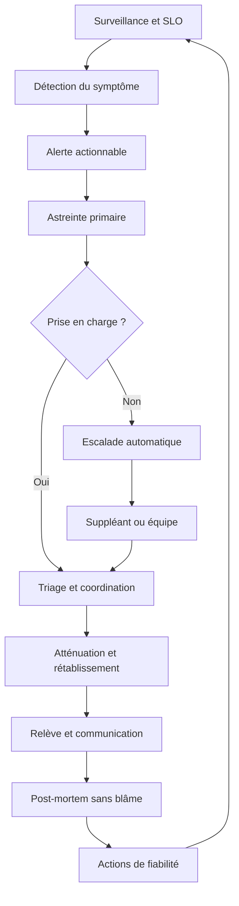
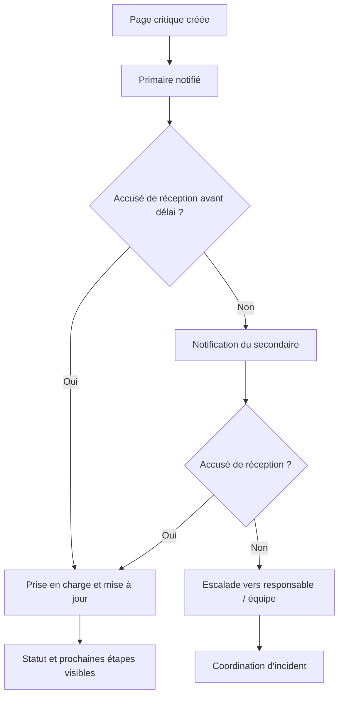
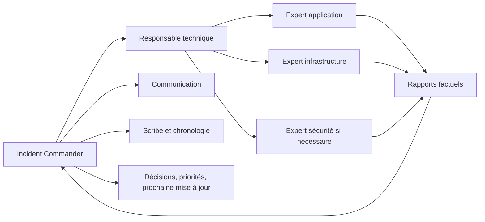
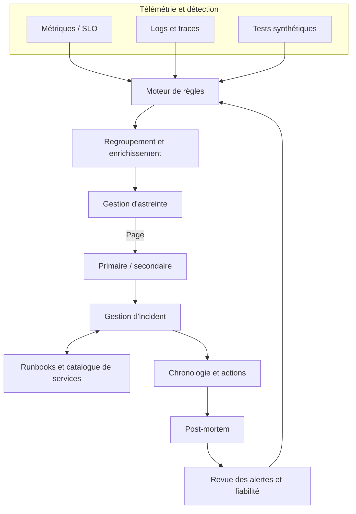
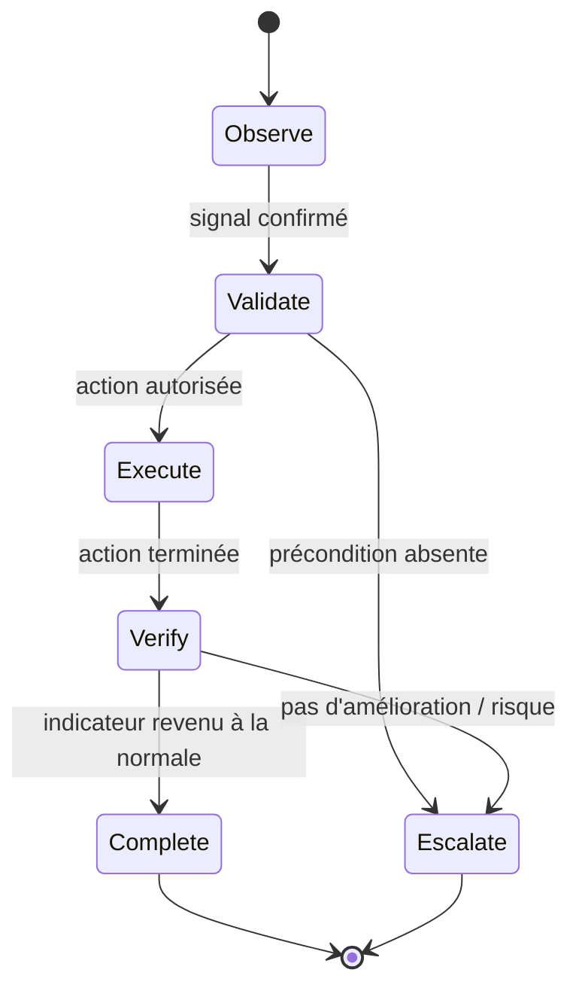

# On-call, runbooks et post-mortems

## Encadré de mise en contexte

Une plateforme peut disposer de métriques, de journaux, de traces distribuées et d’alertes sophistiquées tout en restant difficile à exploiter lorsqu’une panne survient à 03 h 17. Le monitoring révèle un symptôme ; l’astreinte organise la réaction humaine ; le runbook transforme l’expérience en procédure vérifiable ; la gestion d’incident coordonne les décisions ; le post-mortem convertit l’événement en améliorations durables. Ces disciplines forment une chaîne unique de fiabilité.

À un niveau expert, l’objectif n’est pas de demander à une personne de « rester disponible et de tout réparer ». Il s’agit de construire un système opérationnel qui détecte les incidents importants, contacte la bonne personne, lui donne le contexte et les moyens d’agir, protège la continuité de service, facilite l’escalade et apprend de chaque événement. Une astreinte saine s’appuie sur des responsabilités explicites, des alertes actionnables, une documentation à jour, une relève structurée et une charge soutenable.

Ce cours présente les méthodes, les choix d’architecture et les exercices nécessaires pour concevoir et améliorer ce système. Les noms d’outils et les seuils donnés en exemple sont adaptables : la procédure définitive doit suivre les risques, les engagements de service, les contraintes réglementaires et l’organisation réelle de chaque équipe.

## Objectifs pédagogiques

À la fin du cours, vous serez capable de concevoir une rotation d’astreinte avec suppléant et escalade, de distinguer une notification informative d’une alerte qui exige une action immédiate, de rédiger un runbook exploitable sous pression, d’organiser un incident majeur, de préparer une relève fiable et de produire un post-mortem sans blâme. Vous saurez aussi mesurer la qualité du dispositif sans transformer les métriques opérationnelles en outils de surveillance individuelle.

## 1. Introduction

### 1.1. L’astreinte est une capacité de service, pas simplement un calendrier

Une organisation qui exploite un service en dehors des heures ouvrées doit décider comment elle réagit lorsqu’un incident nécessite une intervention humaine. L’astreinte, souvent appelée on-call, est une période pendant laquelle une personne ou une équipe accepte d’être contactée et de répondre selon des règles connues. Elle ne se limite pas à inscrire un nom sur un planning : elle suppose des systèmes de notification fiables, des conditions de réponse, un périmètre de responsabilité, des mécanismes d’escalade et des moyens de remédier au problème.

Une rotation mal conçue concentre la connaissance sur une seule personne, dépend d’un téléphone personnel non testé, n’a pas de suppléant, diffuse des alertes sans contexte ou tolère des runbooks incomplets. Une rotation mature assume qu’une personne peut être indisponible, que la première hypothèse de diagnostic peut être fausse et qu’un incident peut dépasser le périmètre d’une seule équipe. Elle remplace donc la dépendance à un héros par une capacité collective.

Le résultat recherché est double. D’une part, une défaillance importante doit être reconnue et prise en charge dans un délai compatible avec son impact. D’autre part, le coût humain de cette vigilance doit rester soutenable. Une astreinte qui déclenche des pages inutiles toutes les nuits finira par réduire la vigilance, épuiser les intervenants et augmenter le risque d’erreur. Le bruit d’alerte est donc un problème de fiabilité, pas seulement un problème de confort.

### 1.2. Les mots à distinguer

Une métrique est une mesure dans le temps, par exemple le taux d’erreur HTTP ou la profondeur d’une file. Un événement est un changement observable, comme un redémarrage de processus. Une alerte est une condition évaluée par le système de monitoring. Une notification est le message transmis à une personne ou à un canal. Une page est une notification qui exige une réaction rapide, généralement parce que l’impact peut être important ou s’aggraver. Un incident est une interruption ou une dégradation nécessitant une coordination et des actions pour rétablir le service. Ces objets peuvent être reliés, mais ils ne sont pas synonymes.

Cette distinction évite une erreur fréquente : transformer chaque seuil technique en appel téléphonique. Un avertissement de capacité peut créer un ticket à traiter pendant les heures ouvrées ; une indisponibilité confirmée d’un parcours client critique peut déclencher une page ; un événement de sécurité peut déclencher un processus spécialisé qui protège les preuves et limite les accès. Le canal, l’urgence et les responsabilités doivent être choisis à partir du risque, non du fait qu’un seuil a été franchi.

### 1.3. Le cycle de fiabilité opérationnelle

Le dispositif fonctionne comme une boucle d’amélioration. La surveillance repère une dégradation. L’alerte décrit le symptôme et renvoie vers le contexte de diagnostic. L’astreinte accuse réception et évalue l’impact. La réponse d’incident stabilise le service, identifie une voie de remédiation et communique sur la situation. La relève transmet le contexte qui reste pertinent. Enfin, le post-mortem analyse les conditions qui ont rendu l’incident possible et transforme les constats en actions suivies.



Le dispositif ne s’améliore que si la boucle revient réellement vers la configuration, les alertes, les procédures et la conception du service. Un post-mortem sans action suivie devient un compte rendu administratif. De même, une correction technique sans mise à jour du runbook peut laisser la personne suivante répéter le même diagnostic laborieux.

### 1.4. Les principes de conception

Cinq principes structurent une astreinte professionnelle. Le premier est l’actionnabilité : une page doit appeler une action compréhensible, et son propriétaire doit disposer des informations et accès nécessaires. Le deuxième est la résilience : la personne principale n’est pas l’unique voie de réponse. Le troisième est la clarté : la gravité, le décideur, le canal de communication et le seuil d’escalade sont définis à l’avance. Le quatrième est l’apprentissage : on corrige les conditions du système plutôt que de rechercher un coupable. Le cinquième est la durabilité : les rotations, les récupérations et les volumes d’alertes sont mesurés et revus.

Ces principes n’imposent pas le même outil ni la même structure à toutes les organisations. Une petite équipe peut commencer avec un calendrier partagé, des alertes correctement routées, une fiche d’intervention et un canal de crise. Une grande plateforme peut utiliser une gestion d’astreinte dédiée, un catalogue de services, des politiques d’escalade, un système de gestion d’incident et des workflows automatisés. La sophistication logicielle ne compense cependant ni des responsabilités ambiguës ni des alertes mal conçues.

## 2. Concepts clés

### 2.1. Périmètre et niveaux de gravité

Le périmètre d’une rotation doit indiquer les services couverts, les plages horaires, les responsabilités, les compétences attendues et les situations qui nécessitent une autre équipe. « Être d’astreinte infrastructure » est trop vague si personne ne sait qui s’occupe du DNS, du réseau cloud, de la base de données ou de l’application. La propriété opérationnelle doit être explicite et consultable depuis l’alerte.

Les niveaux de gravité devraient décrire l’impact et l’urgence plutôt que l’inquiétude du déclarant. Une convention simple peut distinguer :

- **SEV-1 / critique :** panne majeure, perte importante de fonctionnalité, risque de sécurité élevé ou impact étendu nécessitant une coordination immédiate.
- **SEV-2 / majeur :** dégradation sévère d’un service important, avec impact significatif mais étendue ou durée plus limitée.
- **SEV-3 / modéré :** incident limité ou contournement disponible, qui exige une prise en charge mais pas nécessairement une cellule de crise complète.
- **SEV-4 / faible :** défaut non urgent, dette opérationnelle ou anomalie sans impact immédiat justifiant un ticket planifié.

Ces libellés ne constituent pas une norme universelle. Il faut définir pour chaque niveau des critères observables, des délais cibles, des rôles, des canaux et des règles de mise à jour. Par exemple, une panne complète du parcours de paiement peut être critique même si les serveurs répondent ; une alerte disque à 82 % peut rester non urgente si la croissance est lente, la capacité restante suffisante et le seuil critique éloigné. À l’inverse, un volume à 82 % qui augmente rapidement et ne peut être étendu sans intervention peut justifier une action immédiate.

La gravité doit être réévaluée lorsque les faits changent. Une dégradation initialement localisée peut devenir critique si elle affecte la majorité des utilisateurs. Il doit être normal de monter ou descendre un niveau en documentant les raisons. Les équipes ne doivent pas être incitées à sous-classer un incident pour améliorer artificiellement leurs statistiques.

### 2.2. Ce qui mérite une page

Une règle utile est de réserver la page aux symptômes dont l’impact actuel ou la probabilité d’aggravation exige une intervention dans un délai court. Pour une application en ligne, les signaux les plus utiles se trouvent souvent au niveau des parcours utilisateurs : disponibilité, taux d’échec, latence de bout en bout et saturation qui menace directement la continuité. Les signaux internes restent nécessaires pour diagnostiquer, mais ils ne doivent pas tous réveiller un humain.

Les questions suivantes aident à décider si une alerte doit paginer :

1. Un utilisateur, un client ou un processus métier subit-il déjà un impact sérieux ?
2. L’impact va-t-il devenir sérieux avant la prochaine période de travail normale ?
3. Une intervention humaine peut-elle réduire l’impact ou éviter l’aggravation ?
4. Le destinataire est-il en mesure d’agir avec les accès et les compétences disponibles ?
5. L’alerte contient-elle une description et des liens qui permettent de vérifier le symptôme ?

Si les réponses sont négatives, une notification informative ou un ticket peut être plus approprié. Si l’action attendue est seulement « regarder demain », la page en pleine nuit n’est probablement pas nécessaire. Une exception existe lorsque le retard entraîne un risque légal, financier ou de sécurité important, même si l’impact n’est pas visible pour les utilisateurs.

Les alertes devraient se concentrer sur les symptômes. Une base de données peut afficher une température élevée, un stockage proche du seuil et une latence accrue ; si les utilisateurs rencontrent des erreurs, l’alerte principale doit annoncer cette dégradation de service et guider le répondant vers les signaux explicatifs. Des alertes de causes potentielles restent utiles lorsqu’elles exigent une intervention en amont, mais il faut éviter plusieurs pages concurrentes pour un seul incident.

### 2.3. Déduplication, regroupement, inhibitions et temporisation

Un incident peut déclencher des centaines d’alertes corrélées. Si chaque instance d’un service envoie un message séparé, la personne reçoit du bruit au moment où elle a le moins de disponibilité cognitive. La déduplication rassemble les occurrences partageant une clé logique. Le regroupement rassemble les alertes proches dans le temps ou dans leur périmètre. L’inhibition empêche certaines alertes secondaires d’ajouter du bruit lorsque le symptôme parent est déjà actif. Le silence temporaire supprime des notifications connues pendant une fenêtre bornée.

Ces mécanismes doivent être configurés avec prudence. Une inhibition trop large peut masquer une seconde panne indépendante ; un silence sans expiration peut faire disparaître un signal durable ; une clé de déduplication insuffisante peut mélanger des services différents. Toute suppression doit être observable, limitée dans le temps, attribuée à un propriétaire et réévaluée après une intervention.

Une période de maintien de la condition, parfois appelée pending period ou durée de confirmation, évite de paginer pour un pic bref. Elle doit toutefois être cohérente avec le budget de temps disponible. Exiger dix minutes de persistance pour une panne totale peut retarder inutilement la réaction. Une courte période convient à un symptôme brutal ; une période plus longue peut être appropriée pour une saturation progressive ou des mesures bruyantes. Les seuils devraient être testés sur des historiques représentatifs et non choisis uniquement pour faire disparaître les alertes.

### 2.4. Concevoir une rotation primaire, secondaire et d’escalade

La rotation primaire est le premier point de contact. Le secondaire offre une voie de secours clairement désignée, afin de réduire l’ambiguïté sur la personne à appeler. Si personne ne prend en charge après un délai défini, le système escalade vers le niveau suivant : responsable technique, équipe de service ou cellule d’incident selon la gravité. Une politique d’escalade devrait préciser l’ordre des destinataires, le délai de relance, le canal utilisé et la condition d’arrêt.

Un délai de cinq minutes est parfois utilisé comme point de départ, mais il ne doit pas être adopté mécaniquement. Le délai approprié dépend du service, des horaires, du délai maximal tolérable avant impact accru et de la fiabilité des canaux de notification. Le mécanisme doit être testé : si une notification push ne passe pas, une autre voie peut être nécessaire. Un numéro de téléphone mal enregistré, un mode Ne pas déranger qui bloque les pages ou un fuseau horaire erroné transforme le planning en faux sentiment de sécurité.



Un accusé de réception indique que la demande a été vue ou prise en charge selon la définition du système ; il ne prouve pas que le problème est résolu. Il faut distinguer « reçu », « investigation en cours », « atténué », « rétabli » et « clôturé ». Certains systèmes permettent des états explicites, d’autres exigent de consigner la transition dans un ticket ou un canal de communication.

Le planning doit tenir compte des congés, des échanges de garde, des contraintes locales et des compétences. Toute modification doit être confirmée aux personnes concernées et dans l’outil de planning. Il faut éviter que l’échange soit seulement indiqué dans un message privé qui ne met pas à jour le système de notification. La rotation de secours doit aussi être réellement disponible : une liste de noms sans engagement de couverture ne constitue pas un backup.

### 2.5. Préparation avant de prendre l’astreinte

Une personne ne devrait pas découvrir pendant une panne comment accéder à la console, retrouver le dépôt, obtenir un accès d’urgence ou joindre l’équipe dépendante. La préparation comprend au minimum :

- vérifier le planning, la plage de couverture et les règles de remplacement ;
- tester les canaux de notification, les appels et le contournement du mode silencieux ;
- vérifier l’accès aux tableaux de bord, journaux, traces, déploiements et outils de remédiation ;
- connaître la procédure d’élévation temporaire de privilèges et les contraintes de sécurité ;
- lire les incidents récents, les risques connus et les changements prévus ;
- localiser le catalogue des services, les runbooks, les contacts et les niveaux de gravité ;
- vérifier le moyen de contacter le secondaire et les équipes partenaires.

Les accès doivent respecter le principe du moindre privilège. La préparation ne signifie pas conserver des secrets dans un document personnel, partager des mots de passe ou désactiver les contrôles de sécurité. Les moyens d’accès d’urgence doivent être gérés, audités et exercés. Une procédure qui suppose un compte administrateur absent ou un secret expiré est une dépendance cachée.

### 2.6. Le runbook : procédure exécutable par un humain

Un runbook est une procédure opératoire centrée sur une situation identifiable. Il aide le répondant à confirmer le symptôme, comprendre le risque, suivre des vérifications sûres, appliquer une remédiation autorisée et valider le rétablissement. Il n’est ni une encyclopédie de tout le système ni une simple liste de commandes sans explication.

Un bon runbook décrit ce qui déclenche son utilisation, le service concerné, les prérequis, les accès requis, les commandes ou liens à utiliser, les résultats attendus, les décisions conditionnelles, les actions interdites, les critères d’escalade et les vérifications après intervention. Il comprend une date ou un mécanisme de révision, un propriétaire et un lien vers les procédures voisines.

La première étape doit être une vérification du symptôme, pas une opération destructive. Par exemple, avant de redémarrer un service, on examine le taux d’erreur, l’état des dépendances, les déploiements récents et les journaux. Le redémarrage peut effacer des indices, provoquer une indisponibilité supplémentaire ou cacher le mécanisme racine. Les runbooks doivent donc différencier les observations sans risque, les actions réversibles et les changements à fort impact.

Une procédure ne doit jamais supposer que tous les lecteurs ont le même niveau d’expérience. Les étapes devraient être numérotées, chaque commande devrait indiquer où elle s’exécute et les résultats attendus devraient être décrits. Une commande d’exemple doit être adaptable aux environnements, expliciter les placeholders et éviter de divulguer des secrets. Les exemples doivent être testés dans un environnement non productif lorsqu’ils changent l’état du système.

### 2.7. Patron de runbook réutilisable

Le modèle suivant peut servir de base. Les champs entre crochets doivent être remplacés par des informations validées avant publication.

```text
Titre : [symptôme visible et service]
Propriétaire : [équipe responsable]
Dernière validation : [date]
Alerte déclenchante : [nom, lien, seuil et période]
Impact potentiel : [parcours utilisateur / processus métier]
Gravité initiale : [SEV et critères]
Préconditions : [accès, outils, autorisations]
Sécurité : [actions interdites, précautions, preuves à préserver]

1. Confirmer le symptôme :
   - Ouvrir [tableau de bord].
   - Vérifier [indicateur utilisateur].
   - Comparer [fenêtre temporelle] avec [référence saine].
   Résultat attendu : [valeur ou comportement observable].

2. Définir l'étendue :
   - Vérifier [zone, région, tenant, service].
   - Comparer [composants dépendants].
   Résultat attendu : [condition qui confirme ou exclut une panne globale].

3. Examiner les changements récents :
   - Consulter [déploiements, modifications, opérations planifiées].
   - Noter les corrélations temporelles sans les traiter comme une preuve définitive.

4. Atténuer :
   - Action autorisée : [description et commande testée].
   - Risque : [effets secondaires].
   - Condition d'arrêt : [signal à surveiller].
   - Retour arrière : [procédure vérifiée].

5. Valider :
   - Vérifier [métrique de succès].
   - Confirmer [parcours utilisateur ou test synthétique].
   - Observer pendant [durée justifiée].

6. Escalader si :
   - [critère de gravité ou absence de progrès].
   - Contacter [équipe / secondaire] via [canal].
   - Fournir [horodatages, portée, actions déjà tentées].

Après l'incident :
   - Joindre le résumé et les preuves utiles.
   - Créer les actions de suivi.
   - Proposer une mise à jour du runbook.
```

Ce patron ne doit pas rester un formulaire rempli à moitié. Si une valeur varie d’un service à l’autre, la procédure doit dire comment la retrouver. Si une commande ne peut pas être exécutée sans autorisation particulière, le rôle autorisé et le mécanisme d’approbation doivent être clairs.

### 2.8. Conduite d’un incident majeur

Quand l’incident est complexe, la coordination devient un travail distinct du diagnostic. Une personne peut connaître le système mais être incapable de conserver une vue d’ensemble tout en exécutant des changements. Pour les incidents importants, il est utile de séparer plusieurs rôles :

- **Incident Commander (IC) :** coordonne la réponse, fixe les priorités, attribue les tâches, suit les décisions et s’assure que les dépendances sont prises en compte.
- **Responsable technique :** conduit ou supervise l’investigation technique et recommande des remédiations.
- **Scribe :** consigne les horodatages, les faits, les décisions, les changements et les résultats.
- **Responsable communication :** publie les mises à jour vers les parties prenantes et, si nécessaire, vers les utilisateurs.
- **Experts contributeurs :** mènent des investigations ciblées et rendent compte au coordinateur.

Dans une petite équipe, une même personne peut porter deux rôles si la charge le permet. Pour un incident critique, séparer la coordination de l’intervention réduit les angles morts. L’Incident Commander n’est pas nécessairement la personne la plus experte techniquement ; il doit surtout maintenir une vue cohérente et favoriser les décisions claires. Les rôles peuvent évoluer à mesure que l’incident grandit, mais le transfert doit être explicite.

Un canal unique de coordination évite les informations concurrentes. Les appels peuvent servir à résoudre rapidement une ambiguïté, mais les décisions importantes doivent aussi être consignées dans un espace visible. Les échanges privés peuvent être nécessaires pour certains détails sensibles, mais le statut principal ne doit pas dépendre d’un fil inaccessible au reste de l’équipe.



### 2.9. Un modèle de communication pendant la crise

Une mise à jour utile dit ce qui est affecté, depuis quand, ce qui est connu, ce qui est en cours, le contournement éventuel et l’heure de la prochaine communication. Elle distingue faits et hypothèses. Une phrase telle que « le réseau est cassé » n’aide pas à comprendre l’étendue ni l’avancement. Une formulation opérationnelle serait : « Depuis 10 h 14, les connexions vers l’API de paiement échouent dans la région A ; le parcours de paiement est dégradé ; l’équipe examine une modification de routage effectuée à 10 h 08 ; prochaine mise à jour à 10 h 30. »

Ne communiquez pas un retour à la normale sur la base d’un unique indicateur redevenu vert. Il faut vérifier le parcours concerné, les régions, les files en attente et la stabilité sur une période adaptée. Si les causes ne sont pas encore certaines, indiquez-le. La transparence sur l’incertitude est plus utile qu’une explication définitive prématurée.

La fréquence de communication devrait être établie en fonction de la gravité et de l’audience. Les parties prenantes ont besoin d’une cadence prévisible, même si la mise à jour dit seulement que l’investigation continue. En revanche, publier chaque hypothèse technique à tout le monde peut produire de la confusion ; le canal public devrait fournir des faits confirmés et des décisions utiles, alors que le canal d’intervention peut conserver le niveau de détail technique.

### 2.10. Chronologie et prise de notes

La chronologie permet de reconstruire ce qui s’est passé et de comprendre pourquoi une décision semblait raisonnable à l’instant où elle a été prise. Elle doit enregistrer les événements avec un horodatage cohérent : première alerte, reconnaissance, confirmation de l’impact, escalade, changement, observation des résultats, atténuation et rétablissement. Les timestamps devraient préciser le fuseau horaire ou utiliser une référence uniforme, par exemple UTC, afin d’éviter les erreurs lors d’incidents multi-régions.

Une note utile sépare observation, hypothèse, action et résultat. Exemple : « 10:22 UTC — taux d’erreur API passe de 0,4 % à 18 % ; erreurs concentrées sur région A. Hypothèse : changement récent de route. Action : comparaison de la configuration avant/après. Résultat : différence observée sur la route du sous-réseau client ; aucun changement appliqué pour le moment. » Cette entrée est plus exploitable que « route bizarre, on regarde ».

Il faut conserver les éléments nécessaires à l’apprentissage tout en respectant les règles de confidentialité et de rétention. Les secrets, jetons, données personnelles non nécessaires ou contenus sensibles ne doivent pas être copiés dans les canaux généraux. Pour un incident de sécurité, il faut suivre les règles de préservation des preuves et éviter d’altérer des journaux ou machines avant les consignes de l’équipe responsable.

### 2.11. Atténuer d’abord, diagnostiquer ensuite

En situation de crise, une équipe peut être tentée de trouver la cause racine avant toute intervention. Pourtant, le but immédiat est souvent de réduire l’impact. L’atténuation peut consister à revenir à un déploiement connu comme sain, désactiver temporairement une fonctionnalité, déplacer le trafic, limiter un traitement, augmenter une capacité ou activer un contournement validé. Le choix dépend de la réversibilité, du risque et de l’efficacité attendue.

Chaque opération doit avoir une hypothèse explicite et un critère de succès. Avant de faire un changement, demandez : quel symptôme devrait évoluer, combien de temps faut-il observer, quel indicateur pourrait révéler un effet secondaire et comment revenir à l’état précédent ? Lorsque le système est critique, deux personnes peuvent être nécessaires pour les opérations sensibles. Les changements non nécessaires devraient être gelés pendant l’incident pour réduire le nombre de variables.

La cause racine peut être approfondie après le rétablissement, une fois le système stable. Il faut toutefois préserver les données permettant cette analyse. « Atténuer avant d’expliquer » ne veut pas dire agir à l’aveugle : les actions doivent être fondées sur des observations, limitées et contrôlées.

### 2.12. Escalade technique et escalade de gravité

Il existe plusieurs formes d’escalade. L’escalade technique appelle une personne ou une équipe qui possède une compétence ou un accès nécessaire. L’escalade de gravité change le niveau de coordination et de communication parce que l’impact augmente. L’escalade hiérarchique informe les responsables décisionnaires lorsqu’un arbitrage de risque, de capacité ou de communication est nécessaire. Les confondre peut retarder la prise en charge : prévenir un manager ne remplace pas le spécialiste du service défaillant.

Chaque personne d’astreinte doit savoir quand passer la main. Une règle pratique peut demander de solliciter un second regard dès qu’un certain temps s’est écoulé sans progrès, lorsqu’une action à haut risque est envisagée, lorsque plusieurs dépendances sont affectées ou lorsque le problème sort du domaine de compétence. Il ne faut pas attendre l’épuisement du primaire pour faire venir de l’aide. Escalader tôt est une mesure de sécurité, pas un aveu d’échec.

### 2.13. Passage de relais entre deux rotations

La relève est une opération de fiabilité. Le nouvel intervenant doit connaître les incidents actifs, les alertes temporairement neutralisées, les changements récents, les services instables, les tâches de suivi urgentes et les contacts utiles. Une passation efficace ne se contente pas de dire « tout va bien ». Elle fait le tour des signaux faibles : une file augmente lentement, un job a échoué une fois, une dépendance externe est instable ou une opération de maintenance approche.

Une fiche de relève peut comprendre :

- période couverte, noms du primaire et du secondaire ;
- incidents ouverts et gravité actuelle ;
- alertes silencées, raison et heure d’expiration ;
- déploiements ou changements à risque ;
- vérifications restant à effectuer et responsable ;
- changements de planning ou de contact ;
- décision ou escalade à reprendre si un seuil est franchi.

Le transfert est terminé lorsque le remplaçant a confirmé qu’il comprend les points critiques. Si un incident majeur est encore en cours, le passage de relais doit être piloté : chronologie, impact, hypothèses, décisions prises, actions en cours, risques et prochaine échéance doivent être transférés. Ne présumez pas que le prochain intervenant lira tous les messages anciens sous la pression.

### 2.14. Les post-mortems sans blâme

Un post-mortem est une analyse structurée d’un incident, menée après le rétablissement pour identifier les facteurs techniques et organisationnels, l’efficacité de la détection, les décisions prises et les améliorations nécessaires. « Sans blâme » ne signifie pas supprimer la responsabilité ni ignorer les erreurs délibérées. Cela signifie que l’analyse cherche d’abord à comprendre les conditions dans lesquelles les personnes ont agi : informations disponibles, charge de travail, outils, procédure, formation, contraintes et signaux reçus.

Les systèmes complexes échouent rarement pour une cause unique, isolée et évidente. Un changement peut révéler une faiblesse de test, une alerte peut masquer la portée, une procédure peut être dépassée et une dépendance peut manquer de mécanisme de retour arrière. Chercher la personne qui « aurait dû savoir » conduit souvent à une action peu efficace, comme envoyer un rappel, sans améliorer le système. Une analyse utile demande quelles barrières auraient pu prévenir, détecter ou limiter l’incident et pourquoi elles n’ont pas fonctionné comme prévu.

Un post-mortem doit se concentrer sur les faits établis et conserver les incertitudes. Il peut proposer une chronologie, la portée et l’impact, les facteurs contributifs, ce qui a bien fonctionné, ce qui a compliqué la réponse, les mesures immédiates, les actions préventives et les propriétaires associés. Il ne doit pas réécrire l’histoire après coup comme si les intervenants avaient connu la cause dès le départ.

### 2.15. Structure d’un post-mortem exploitable

Une structure pratique comporte les sections suivantes :

1. **Résumé exécutif :** ce qui s’est produit, qui ou quoi a été touché et comment le service a été rétabli.
2. **Impact :** durée, portée, parcours touchés, volumes, conséquences connues et incertitudes.
3. **Détection :** premier signal, délai avant la page, qualité de l’alerte et symptômes non détectés.
4. **Chronologie :** faits et décisions avec horaires.
5. **Facteurs contributifs :** conditions techniques, conception, déploiement, documentation, alerting et coordination.
6. **Réponse :** interventions efficaces, actions inutiles ou risquées, qualité des escalades et communication.
7. **Ce qui a bien fonctionné :** barrières qui ont limité l’impact et pratiques à renforcer.
8. **Actions :** mesures concrètes classées par priorité, avec responsable, échéance et preuve de réalisation.
9. **Diffusion et révision :** lecteurs concernés, partage des enseignements et date de suivi.

Le document doit être adapté à la gravité et à la complexité. Un incident mineur répétitif peut être traité par une analyse courte. Un incident critique avec plusieurs équipes mérite une revue plus complète et parfois une facilitation indépendante. Il est préférable de commencer l’analyse rapidement, lorsque les traces et souvenirs sont accessibles, mais de vérifier les faits plutôt que de conclure dans la précipitation.

### 2.16. Transformer les constats en actions

Les recommandations vagues sont les ennemies de l’amélioration. « Faire plus attention », « mieux surveiller » ou « communiquer davantage » ne définissent ni un résultat ni une preuve. Une action de qualité décrit le changement attendu, son propriétaire, son échéance et la manière de vérifier qu’il fonctionne. Par exemple : « Ajouter un test synthétique du parcours de paiement dans la région A, alerter si deux échecs consécutifs surviennent pendant cinq minutes et vérifier l’escalade lors du prochain exercice. » Cette action peut être testée et clôturée sur une preuve.

Un portefeuille d’actions devrait distinguer les mesures immédiates, les corrections à court terme et les changements structurels. Les mesures immédiates réduisent le risque actuel. Les actions à court terme peuvent corriger une alerte bruyante ou documenter une procédure manquante. Les changements structurels peuvent exiger une évolution de l’architecture, de l’automatisation ou de la propriété opérationnelle. Une action ne doit pas être fermée simplement parce que le code a été fusionné : il faut vérifier son déploiement, son effet et son absence d’effets secondaires.

Un suivi périodique est essentiel. L’équipe peut examiner les actions ouvertes, leur ancienneté, les causes des retards, les incidents qui se répètent et les réductions de risque réellement obtenues. Les post-mortems ne devraient pas devenir un outil de performance individuelle ; leur objectif est d’améliorer la capacité collective du service.

### 2.17. Mesurer la santé de l’astreinte

Les métriques utiles décrivent le système, pas la valeur d’une personne. Elles peuvent inclure le nombre de pages par semaine et par service, le taux de pages sans action possible, le taux de fausses alertes, le temps d’accusé de réception, le délai jusqu’à l’atténuation et au rétablissement, les escalades manquées, les incidents récurrents, la proportion de runbooks testés et l’âge des actions post-mortem.

Chaque métrique a des limites. Un délai d’accusé de réception très court peut masquer une absence d’investigation. Un MTTR moyen peut dissimuler quelques incidents extrêmement longs. Un faible volume d’alertes peut indiquer un bon filtrage ou une couverture insuffisante. Les métriques doivent être segmentées par gravité et interprétées avec le contexte. La cible ne doit jamais pousser les personnes à fermer prématurément un incident ni décourager l’escalade nécessaire.

Il peut être utile d’examiner le volume de pages par personne sur les rotations, mais seulement pour identifier une distribution inéquitable ou une charge excessive, pas pour noter la performance individuelle. Une personne qui reçoit beaucoup de pages peut couvrir le service le plus fragile ou avoir réparé des alertes récurrentes. Il faut s’intéresser au système générateur de charge.

### 2.18. Le bien-être et la durabilité opérationnelle

La fatigue réduit la qualité du raisonnement, les capacités de mémoire de travail et la prudence face aux actions risquées. Les organisations doivent donc limiter le bruit, fournir une rotation secondaire, garantir des temps de récupération après les interruptions nocturnes, permettre les échanges de garde et éviter qu’une seule personne couvre trop de systèmes critiques simultanément. Les règles de compensation et de repos doivent respecter le droit applicable et les politiques internes.

Une personne d’astreinte ne devrait pas être tenue de résoudre chaque problème seule ni de rester disponible au-delà de ce que prévoit la rotation. Si la charge devient trop élevée, les options incluent réduire les alertes non actionnables, augmenter la couverture, déplacer des tâches vers les heures ouvrées, améliorer l’auto-remédiation contrôlée ou renforcer la résilience du service. Faire reposer la solution sur la bonne volonté individuelle ne résout pas la cause structurelle.

Il faut aussi que la culture permette de dire « je n’ai pas les informations nécessaires », « je ne peux pas exécuter ce changement sans validation » ou « nous devons escalader ». La résilience humaine fait partie de la résilience technique. Les procédures, les permissions et les politiques de repos contribuent à la sécurité opérationnelle.

### 2.19. Automatisation et garde-fous

L’automatisation peut enrichir une page avec les derniers déploiements, des liens vers les graphes, l’état des dépendances et les événements pertinents. Elle peut dédupliquer les alertes, créer un ticket, lancer un test de santé ou exécuter une remédiation limitée. Plus une action modifie l’état de production, plus ses garde-fous doivent être solides.

Une auto-remédiation mature doit définir les préconditions, les limites de fréquence, les résultats attendus, les critères d’abandon, le retour arrière et l’audit. Elle ne devrait pas relancer indéfiniment un service en échec ni supprimer les preuves nécessaires au diagnostic. Une automatisation peut échouer silencieusement, être exécutée au mauvais moment ou amplifier une panne si elle agit sur toutes les instances en même temps. Les tests, le mode simulation lorsque possible, les déploiements progressifs et les alertes sur l’échec de l’automatisation sont essentiels.

Les procédures doivent indiquer clairement ce qui est automatique et ce qui exige une décision humaine. L’astreinte ne doit pas recevoir une page à laquelle elle ne peut répondre parce qu’un robot a verrouillé le seul accès ou que l’automatisation a déjà lancé un changement non documenté. Les opérations à fort impact, comme la suppression de données ou une modification irréversible, requièrent des contrôles plus stricts qu’une vérification en lecture seule.

### 2.20. Sécurité et incidents particuliers

Un incident de sécurité peut exiger une approche différente d’une panne de disponibilité. Il peut être nécessaire de préserver des journaux, des artefacts et la chaîne de conservation des preuves, de limiter la diffusion de données sensibles, de restreindre les accès ou d’isoler un système. Les étapes habituelles de redémarrage ou de nettoyage pourraient détruire des indices. Le runbook doit donc indiquer quand arrêter les opérations ordinaires et activer la procédure de réponse sécurité.

Les incidents de données, de confidentialité ou de conformité peuvent avoir des obligations légales et des délais d’escalade spécifiques. L’intervenant de première ligne ne doit pas inventer la procédure de notification externe ; il doit contacter les rôles désignés et consigner les faits. Les canaux de crise doivent être adaptés à la sensibilité des informations et aux risques de compromission du système de communication principal.

Pour les dépendances externes, il faut distinguer la défaillance du fournisseur de son effet sur le service que l’on exploite. Même si la cause est externe, l’équipe reste responsable de la communication, des contournements disponibles, des protections contre les répétitions de requêtes, du traitement des files et du suivi du rétablissement. « C’est le fournisseur » n’est pas un plan de réponse.

### 2.21. Choisir le bon niveau de formalisation

Toutes les alertes ne nécessitent pas une conférence et un document de dix pages. Un signal informatif peut créer une tâche ; une alerte actionnable peut déclencher une investigation simple avec un runbook ; un incident majeur nécessite une coordination et un statut partagé ; un incident critique peut exiger un Incident Commander, une communication cadencée et un post-mortem formel. Le processus doit s’adapter à l’ampleur de l’impact.

Le risque inverse est de ne formaliser que les incidents très visibles. Les petits incidents répétitifs peuvent révéler une défaillance structurelle : plusieurs minutes d’indisponibilité chaque semaine peuvent être plus dommageables à long terme qu’un événement rare et spectaculaire. Les données de tendance, les retours des intervenants et les tickets récurrents doivent aider à choisir les améliorations.

## 3. Architecture et Schémas

### 3.1. Architecture fonctionnelle de l’astreinte

Une architecture de référence peut contenir les couches suivantes :

1. **Production et télémétrie :** applications, infrastructure, dépendances, métriques, journaux, traces et tests synthétiques.
2. **Évaluation des alertes :** règles, seuils, durées de confirmation et évaluation des symptômes.
3. **Routage et réduction du bruit :** enrichissement du contexte, regroupement, déduplication, inhibition et silences contrôlés.
4. **Orchestration de l’astreinte :** calendrier, primaire, secondaire, canaux de notification et escalade.
5. **Gestion de l’incident :** canal de coordination, rôles, chronologie, statut, tâches et communication.
6. **Base de connaissances :** runbooks, catalogue de services, dépendances, procédures de changement et contacts.
7. **Apprentissage :** post-mortems, actions, revues de fiabilité et tests réguliers.



L’architecture doit également surveiller son propre fonctionnement. Si la plateforme de monitoring cesse de collecter, si le routeur ne distribue plus les pages ou si les notifications ne sont plus envoyées, l’organisation peut perdre sa capacité à détecter les pannes. Il faut des signaux indépendants ou externes pour vérifier l’arrivée de bout en bout d’une alerte de test. La surveillance de la surveillance est souvent appelée metamonitoring.

### 3.2. Le catalogue de services comme source de vérité

Le catalogue de services associe chaque service à une équipe responsable, une criticité, un canal d’astreinte, des dépendances, des tableaux de bord, des runbooks, des procédures de changement et un statut de support. Sans source de vérité, les alertes s’adressent à une personne qui a changé d’équipe, les contacts ne répondent plus et le runbook pointe vers une ancienne infrastructure.

La propriété opérationnelle doit être maintenue comme du code ou un artefact versionné lorsqu’il est possible de l’intégrer au processus de livraison. Une modification de service peut alors inclure la validation des alertes, des liens et des responsabilités. Une règle de qualité peut empêcher de mettre en production une alerte critique sans propriétaire ni runbook associé. Cette politique doit néanmoins éviter de bloquer les réparations d’urgence ; les exceptions doivent avoir une durée et un responsable.

Pour chaque service, documentez son objectif, le niveau de criticité, ses dépendances, les parcours utilisateurs, les indicateurs de succès et les procédures d’atténuation. Le catalogue ne doit pas recopier une documentation encyclopédique : il sert de point d’entrée permettant à la personne d’astreinte de trouver rapidement l’information appropriée.

### 3.3. Contrat de qualité d’une alerte

Une alerte de production de bonne qualité comporte un nom stable, une description explicite du symptôme, une gravité, un propriétaire, un lien vers le tableau de bord pertinent, un lien vers le runbook, les labels qui permettent le routage et une explication de l’action attendue. Le message devrait présenter l’horodatage de début, la portée connue et les valeurs qui ont conduit au déclenchement lorsque cela est utile.

L’alerte doit expliquer pourquoi une personne doit intervenir maintenant. « CPU high » ne précise ni l’impact ni le contexte. « Le taux d’échec du parcours API dépasse le seuil opérationnel dans la région A depuis cinq minutes ; vérifier le tableau de bord du parcours et suivre le runbook de dégradation API » est plus exploitable. Le seuil exact doit venir des objectifs et des données réelles du service, pas d’une valeur universelle copiée d’un autre système.

Les labels doivent permettre un routage prévisible, sans être trop nombreux au point de créer une explosion de cardinalité ou des combinaisons difficiles à gérer. Le nom d’alerte doit être stable pour la déduplication, tandis que les détails variables doivent être placés dans les labels ou annotations appropriés. Les liens doivent être testés avec les droits de la personne d’astreinte.

### 3.4. Contrôle du chemin de notification

Il ne suffit pas de vérifier que l’alerte existe dans l’interface. Il faut tester le trajet complet : une condition de test est produite, le moteur la détecte, le routeur l’enrichit, la plateforme d’astreinte la transmet et le destinataire reçoit une notification. Le test doit être conçu pour ne pas créer une vraie crise ; il peut utiliser une alerte de synthèse, un environnement dédié ou une procédure de test documentée.

La réussite du test doit confirmer le bon destinataire, le bon canal et le délai attendu. Il est également utile de vérifier le scénario d’absence de réponse : le primaire ne confirme pas la page, puis le secondaire est contacté. Les tests doivent respecter les personnes de garde et ne pas multiplier les réveils inutiles ; leur fréquence dépend du risque et peut être complétée par une vérification lors de chaque changement de politique d’escalade.

Le chemin de notification doit disposer d’une visibilité sur les erreurs. Les notifications rejetées, les numéros invalides, les canaux désactivés ou les limites de débit doivent être suivis. Si l’outil d’astreinte repose sur un fournisseur externe, la documentation doit indiquer la procédure de secours en cas d’indisponibilité de ce fournisseur.

### 3.5. Exemple de règle Prometheus à traiter comme un modèle

Voici un exemple pédagogique de règle Prometheus pour détecter un taux d’erreur HTTP élevé. Il suppose que la métrique applicative s’appelle http_requests_total et qu’elle comporte les labels status et service. Ces noms doivent être adaptés au modèle réel de métriques.

```yaml
groups:
  - name: application-symptoms
    rules:
      - alert: ServiceHighErrorRate
        expr: |
          sum by (service) (
            rate(http_requests_total{status=~"5.."}[5m])
          )
          /
          clamp_min(
            sum by (service) (rate(http_requests_total[5m])),
            1e-9
          ) > 0.05
        for: 5m
        labels:
          severity: page
        annotations:
          summary: "Taux d'erreur élevé pour {{ $labels.service }}"
          description: "Le taux de réponses 5xx dépasse 5 % depuis cinq minutes."
          runbook_url: "https://docs.example.invalid/runbooks/high-error-rate"
```

Cet exemple ne doit pas être copié tel quel en production. Il faut confirmer la définition de la métrique, l’absence de problèmes de labels, le comportement à faible trafic, le traitement des erreurs de collecte et la pertinence du seuil. Une protection contre une division par zéro est ici illustrée par clamp_min, mais le plan exact de requête doit être vérifié avec les métriques disponibles. Dans certains systèmes, un ratio d’erreur par type de requête ou un indicateur directement dérivé des SLO sera plus pertinent.

La valeur de 5 % et la fenêtre de cinq minutes sont uniquement illustratives. Un service avec peu de requêtes peut subir un impact grave avec quelques erreurs ; un service à très fort trafic peut devoir utiliser une fenêtre et un volume minimum différents. Les alertes fondées sur le taux doivent aussi être complétées si une absence totale de trafic est un symptôme possible, car un ratio calculé sur zéro requête ne signale pas nécessairement une panne.

### 3.6. Exemple de vérifications de diagnostic non destructives

Lorsqu’un service Linux est en échec, une collecte initiale en lecture seule peut aider à déterminer l’état avant toute remédiation. Les commandes exactes dépendent de la distribution et du gestionnaire de services.

```bash
date -Is
systemctl status nom-du-service --no-pager
journalctl -u nom-du-service --since "30 minutes ago" --no-pager
df -h
free -h
uptime
```

Ces commandes servent d’illustration. Remplacez le nom du service et la fenêtre temporelle ; vérifiez les droits et la politique de journalisation. La commande systemctl status donne un état synthétique, journalctl permet de consulter les messages du service, df présente l’occupation des systèmes de fichiers, free résume la mémoire et uptime montre la charge moyenne depuis le démarrage. Aucun de ces signaux, pris seul, ne suffit à établir une cause racine.

Pour un service conteneurisé, les commandes et permissions peuvent être différentes. Par exemple, kubectl get pods et kubectl describe pod peuvent fournir un état et des événements Kubernetes si le contexte de cluster est déjà correctement configuré. Avant d’exécuter une commande qui modifie des objets, il faut confirmer le cluster, le namespace, la portée et le plan de retour arrière. Un contexte de production actif doit être visible et non ambigu.

### 3.7. Garde-fous d’une remédiation automatisée

Une réponse automatique doit fonctionner comme une petite machine à états : détection, validation des préconditions, exécution limitée, vérification, succès ou escalade. Elle doit disposer d’un verrou ou d’un mécanisme de déduplication lorsqu’une même action ne doit pas s’exécuter en parallèle. La boucle ne devrait pas répéter indéfiniment une opération dont le résultat ne s’améliore pas.



Les garde-fous comprennent une limite de tentatives, une limite de portée, une fenêtre d’exécution, un journal d’audit, un mécanisme de désactivation, un contrôle d’autorisation et des critères d’escalade. Toute remédiation doit avoir un propriétaire qui comprend les effets secondaires. Le fait qu’une opération ait fonctionné une fois ne prouve pas qu’elle est sûre dans toutes les configurations.

### 3.8. Préparer la relève comme un processus contrôlé

La relève peut être structurée par une courte checklist générée à partir des incidents, des silences et des changements. L’automatisation peut préparer la fiche mais ne doit pas décider seule qu’un problème n’est plus pertinent. Le sort d’une alerte silenciée doit être explicitement revu : le silence a-t-il une fin, la cause a-t-elle été corrigée, le signal de fond est-il toujours utile ?

Une relève robuste enregistre la prochaine action, son responsable, le délai et le critère de succès. « Surveiller la base de données » ne dit pas ce qu’il faut observer ; « vérifier avant 09 h que la réplication reste dans le seuil défini et ouvrir l’escalade si le retard continue d’augmenter sur trois mesures successives » donne un comportement observable. La personne qui cède la garde doit également signaler les situations incertaines plutôt que de transmettre une assurance infondée.

## 4. Étude de cas

### 4.1. Contexte : dégradation d’un service de paiement

Une plateforme de commerce en ligne expose une API de paiement. Le parcours traverse un frontal web, une API, un fournisseur de paiement externe et une base de données de commandes. Les paiements réussis sont essentiels au chiffre d’affaires. L’équipe a défini un objectif de fiabilité et suit les erreurs visibles par les clients, la latence, le taux de succès du fournisseur et la profondeur de la file de traitement.

À 02 h 13 UTC, le taux d’échec du parcours dépasse le seuil de page pendant la fenêtre de confirmation. L’astreinte primaire reçoit une notification avec la gravité, le tableau de bord et le runbook. Le secondaire est aussi identifié dans la politique d’escalade. Le runbook indique de commencer par confirmer le parcours synthétique, de mesurer la portée par région, de consulter les déploiements récents et de ne pas redémarrer les composants avant d’avoir collecté les signaux de base.

### 4.2. Les cinq premières minutes

Le primaire accuse réception et publie dans le canal d’incident qu’il commence le triage. Il vérifie d’abord si la page correspond à un impact réel : les tests synthétiques échouent dans une région, le taux d’erreur côté API augmente et la réussite du fournisseur varie. Le service n’est pas complètement arrêté, mais une partie des utilisateurs ne peut plus payer. La gravité est élevée et justifie la coordination.

L’intervenant consulte ensuite les changements récents. Une modification de configuration de routage a été appliquée huit minutes avant l’alerte. Cette corrélation est une piste, pas encore une preuve. Les journaux montrent que la plupart des erreurs concernent une destination réseau spécifique. Le primaire conserve les horodatages, les requêtes de diagnostic et les liens utilisés. Il ne copie pas les jetons de paiement ni les données personnelles dans le canal général.

Comme l’impact touche un parcours métier critique et que plusieurs équipes pourraient être impliquées, un Incident Commander est désigné. Une personne prend la chronologie, une autre analyse le réseau et la configuration, tandis qu’un responsable communication prépare une mise à jour vers les parties prenantes. Le primaire ne doit plus gérer seul à la fois la coordination, les messages et les changements.

### 4.3. Stabilisation et décision

L’équipe confirme que la dégradation est concentrée sur un chemin réseau précis. Elle compare la configuration actuelle avec la version précédente et vérifie qu’un retour arrière est possible. Le responsable technique explique le changement proposé, la portée et les effets secondaires. L’Incident Commander s’assure que les parties prenantes comprennent le risque et autorise la stratégie prévue par les règles d’intervention de l’organisation.

La remédiation consiste à restaurer la configuration connue comme saine, selon le mécanisme de retour arrière testé. Après application, l’équipe n’annonce pas immédiatement que tout est résolu : elle observe les erreurs, exécute des tests synthétiques, vérifie la réussite des paiements sur les régions concernées et contrôle les files qui auraient pu accumuler des demandes. Les indicateurs s’améliorent, mais le statut reste « atténuation en cours » pendant la période de validation.

Un nouveau contrôle révèle une petite quantité de transactions qui avaient échoué et nécessitent une réconciliation selon la procédure métier. L’équipe les traite par le processus prévu, sans relancer aveuglément les paiements et créer un risque de double débit. Ce détail illustre pourquoi la remédiation ne doit pas être évaluée uniquement sur la disponibilité technique : il faut aussi vérifier l’intégrité du processus métier.

### 4.4. Communication, rétablissement et relève

Le responsable communication publie une mise à jour factuelle : le parcours est dégradé depuis un horaire connu, l’impact est circonscrit à une partie des requêtes, une modification a été annulée et les contrôles de validation sont en cours. Une prochaine mise à jour est annoncée. Lorsque les tests et métriques sont revenus à un état sain pendant la fenêtre définie, l’incident passe à « rétabli » ; la clôture administrative et l’analyse suivent ensuite.

Avant la fin de la garde, la personne principale transmet l’état de la réconciliation, les alertes encore actives, la configuration restaurée, les vérifications à refaire et les contacts des équipes impliquées. Le nouvel intervenant confirme la réception. La relève précise que l’investigation sur le mécanisme exact de la régression et la mise à jour du runbook restent ouvertes.

### 4.5. Analyse post-mortem

La revue montre que la configuration a passé une validation syntaxique mais qu’un test de connectivité représentatif de la région touchée n’était pas inclus dans le pipeline. Le tableau de bord infrastructure indiquait une route disponible, mais aucun test synthétique ne mesurait le parcours de paiement à travers cette route. Le runbook existant mentionnait les erreurs génériques mais ne donnait pas de méthode pour corréler les échecs au chemin réseau. Enfin, l’alerte principale était pertinente mais le lien vers la chronologie des changements n’était pas ajouté automatiquement.

L’analyse ne conclut pas qu’une personne a « oublié un test ». Elle examine pourquoi le processus permettait la mise en production sans test de parcours suffisant, pourquoi les alertes ne reliaient pas le symptôme à la zone touchée et pourquoi la procédure n’aidait pas à distinguer une panne de routage d’une panne du fournisseur. Cette formulation met l’accent sur les barrières de fiabilité.

Les actions sont priorisées en fonction du risque : ajouter un test synthétique du paiement sur la région concernée ; renforcer les validations de configuration en préproduction ; enrichir les alertes avec les derniers changements ; compléter le runbook avec une procédure de vérification du chemin réseau ; créer un exercice de retour arrière ; vérifier la réconciliation des transactions après toute panne similaire. Chaque action a un propriétaire, une échéance et une preuve attendue.

### 4.6. Ce que l’étude de cas enseigne

La première leçon est qu’un incident doit être piloté par son impact observable. L’équipe n’a pas traité toute alerte réseau comme une crise ; elle a vérifié le parcours utilisateur et la portée. Deuxième leçon : une corrélation temporelle sert à orienter l’enquête mais ne suffit pas seule à prouver une cause. Troisième leçon : la coordination doit être distribuée lorsque la charge augmente. Quatrième leçon : le rétablissement se valide par les signaux techniques et métier. Cinquième leçon : la documentation, les tests et les alertes évoluent à partir des apprentissages.

Cette approche rend l’intervention plus reproductible. Un autre intervenant, avec le même contexte et les mêmes données, aurait pu suivre le runbook, demander la même escalade et aboutir au même choix sans dépendre de la mémoire d’un expert particulier. C’est la finalité d’un système opérationnel mature.

### 4.7. Atelier pratique : simuler une dégradation en environnement de test

**Objectif :** pratiquer le cycle de réponse sans toucher à la production. Créez un service de test ou utilisez un environnement local existant, un dashboard factice et une alerte de simulation. N’injectez pas de panne sur un système réel et ne modifiez pas les routes de production pour reproduire le cas.

**Préparation :**
1. Choisir un service non critique avec un signal observable, par exemple un endpoint de santé.
2. Définir une alerte de test qui indique explicitement qu’il s’agit d’une simulation.
3. Rédiger un runbook court qui comprend confirmation, mesure de portée, diagnostic en lecture seule, remédiation réversible et validation.
4. Désigner un primaire, un secondaire et un scribe.
5. Préparer une chronologie fictive contenant une alerte, un changement récent et une hypothèse plausible mais non confirmée.

**Exécution :**
- Le scribe déclenche la simulation et enregistre l’heure.
- Le primaire accuse réception, reformule l’impact et suit les vérifications.
- Le secondaire intervient uniquement lorsque le scénario lui demande de prendre le relais.
- L’équipe doit énoncer les faits, les hypothèses et les inconnues séparément.
- La remédiation choisie doit rester sans risque et être réversible dans l’environnement de test.
- Après le retour à la normale, l’équipe publie une mise à jour de statut puis réalise une mini-rétrospective.

**Critères de réussite :** l’alerte atteint le bon destinataire ; le répondant trouve le runbook ; la gravité est justifiée ; l’escalade fonctionne ; les actions sont consignées ; la validation ne repose pas sur une unique métrique ; la relève contient les points ouverts ; les améliorations sont formulées comme des actions testables.

### 4.8. Atelier pratique : construire un runbook pour la saturation disque

Dans un environnement de test Linux, imaginez qu’une alerte indique que le système de fichiers d’un service approche d’une capacité critique. Le runbook ne doit pas commencer par supprimer des fichiers. Il doit mesurer le système de fichiers touché, déterminer la vitesse de croissance, identifier les répertoires les plus volumineux selon les permissions et règles de confidentialité, examiner la rotation des journaux, puis établir une remédiation autorisée.

Des commandes d’observation communes sont présentées ci-dessous. Elles doivent être adaptées et validées localement, car les options et permissions peuvent varier selon les systèmes.

```bash
df -h
du -xhd1 /var 2>/dev/null | sort -h
journalctl --disk-usage
```

Sur certains systèmes, du ne prend pas exactement les mêmes options ; si l’option -d n’est pas prise en charge, utiliser la variante disponible, telle que --max-depth=1 sur GNU du. La commande du peut prendre du temps sur un gros volume et doit être exécutée avec une portée maîtrisée. Il faut éviter les commandes destructives du type suppression récursive improvisée. La correction doit privilégier une politique de rotation, un archivage ou un agrandissement du volume approuvé, selon la cause et les règles de conservation.

Le runbook doit spécifier ce qui est sûr à nettoyer, ce qui doit être conservé et qui autorise l’action. Après remédiation, contrôler à nouveau l’espace, vérifier que le service fonctionne et créer une action de suivi si la cause est une croissance non bornée ou une politique de rétention manquante.

## 5. Pièges à éviter

### 5.1. Faire pager chaque anomalie

Si chaque seuil est une urgence, la personne finit par traiter la page comme du bruit. Un seuil technique isolé n’est pas automatiquement un incident utilisateur. Il faut associer les alertes à l’impact, définir le canal adéquat et revoir régulièrement les pages sans action. La bonne réponse à une surcharge d’alertes n’est pas de demander aux intervenants d’être plus attentifs, mais d’améliorer les règles, la télémétrie et la propriété des signaux.

Évitez cependant l’excès inverse : éliminer une alerte parce qu’elle déclenche trop souvent sans vérifier si le symptôme est réel. Une alerte bruyante peut être un signal utile mal calibré. Il faut mesurer ses déclenchements, les actions qui suivent, les effets de son silence et la possibilité de la remplacer par un indicateur plus proche de l’impact.

### 5.2. Traiter le silence comme une résolution

Un silence est une suppression temporaire de notification, pas une preuve de rétablissement. Il doit posséder une raison, un auteur, une portée et une expiration. Le silence devrait être réexaminé lors de la relève et supprimé lorsque la cause a disparu. Toute politique qui permet un silence permanent sans justification ou audit rend possible la disparition silencieuse des signaux critiques.

Lorsqu’une maintenance prévoit une interruption connue, il est souvent préférable de planifier et de documenter l’inhibition appropriée plutôt que de désactiver globalement les alertes. Les contrôles non concernés doivent continuer à fonctionner.

### 5.3. Dépendre du héros de service

Une organisation qui n’a qu’une personne capable de dépanner une application est fragile. Il faut partager la connaissance, organiser des rotations d’observation pour les nouveaux membres, tester les runbooks avec des personnes autres que leur auteur et prévoir la montée en compétence. Si le document ne peut être suivi que par l’expert qui l’a écrit, il n’est pas encore un runbook utilisable collectivement.

La montée en compétence ne signifie pas donner à tout le monde tous les privilèges. Elle consiste à fournir les procédures, les accès nécessaires dans un cadre contrôlé, des scénarios d’exercice et une voie claire d’escalade.

### 5.4. Lancer une commande destructive trop tôt

Redémarrer, supprimer, purger ou modifier la configuration peut faire disparaître le symptôme sans corriger la cause, amplifier l’impact ou détruire des preuves. Avant toute action risquée, documentez la raison, vérifiez la portée, contrôlez les sauvegardes ou le retour arrière et obtenez l’autorisation requise. En cas d’incident de sécurité, suivez d’abord la procédure de conservation des preuves.

Il faut savoir reconnaître les limites du runbook. Si les conditions observées ne correspondent pas aux branches documentées, n’improvisez pas une opération irréversible : collectez les faits, arrêtez les changements non essentiels et escaladez.

### 5.5. Accumuler les rôles sur une seule personne

Le répondant principal peut être capable de diagnostiquer, mais gérer en même temps les notifications, la communication, la chronologie et les décisions devient difficile lors d’un incident majeur. Dès que la coordination devient lourde, attribuez des rôles explicites. Le but n’est pas la bureaucratie : il s’agit de protéger du temps cognitif pour les décisions importantes et de réduire les informations perdues.

### 5.6. Fermer l’incident dès que le graphe redevient vert

Un indicateur peut se normaliser alors que des files restent bloquées, que certains clients sont toujours affectés, que des transactions doivent être réconciliées ou qu’une dépendance est encore instable. La validation doit couvrir les parcours concernés, les régions et la durée de stabilité adaptée au service. Le statut devrait être « atténué » ou « validation en cours » tant que les critères de rétablissement ne sont pas satisfaits.

### 5.7. Confondre cause immédiate et facteurs contributifs

« Le déploiement a déclenché l’incident » est un début de chronologie, pas une analyse complète. Pourquoi le déploiement était-il autorisé ? Quel test manquait ? Pourquoi l’alerte n’a-t-elle pas détecté l’échec plus tôt ? Qu’est-ce qui a rendu le retour arrière difficile ? L’analyse devrait examiner les mécanismes qui ont laissé la défaillance atteindre les utilisateurs et augmenter sa durée.

Évitez l’expression « erreur humaine » comme fin d’analyse. Elle décrit rarement une cause exploitable. Si une étape a été manquée, demandez pourquoi l’étape était facile à manquer, pourquoi le système ne l’a pas vérifiée et comment réduire la probabilité ou l’impact d’une omission semblable.

### 5.8. Écrire des actions trop vagues

« Améliorer le monitoring » n’indique ni le signal, ni le seuil, ni le propriétaire, ni la vérification. Convertissez le constat en comportement observable. Une action peut être testée par une simulation, une validation de configuration, une métrique de succès ou un exercice de relève. Chaque action doit être priorisée selon le risque et disposer d’une échéance réaliste.

Ne créez pas trop d’actions sans capacité de les réaliser. Un portefeuille d’amélioration irréaliste reste ouvert indéfiniment et érode la confiance dans les post-mortems. Il vaut mieux sélectionner les mesures à fort effet, expliciter les risques reportés et revoir périodiquement les priorités.

### 5.9. Mesurer des délais sans mesurer la qualité

Un temps de réponse faible n’assure pas une bonne résolution. Une page peut être acquittée en trente secondes mais rester mal triée pendant une heure. Inversement, une investigation responsable peut demander du temps supplémentaire pour éviter un changement dangereux. Combinez les indicateurs de délai avec la qualité des décisions, le taux de récurrence, l’impact utilisateur, le bruit et les retours des intervenants.

Les données doivent servir à l’amélioration. Évitez les classements individuels simples qui incitent à fermer vite, à sous-déclarer ou à ne pas escalader. Les variations par service et par gravité offrent généralement plus de sens que les moyennes globales.

### 5.10. Négliger le chemin de secours

Une organisation peut perdre en même temps le service, le dashboard et le canal de notification. Définissez une solution de secours : canal indépendant, page d’état externe, contact téléphonique ou procédure papier pour certaines situations critiques. Ce mécanisme doit être testé et sa sécurité évaluée. Un plan de secours jamais exercé est une hypothèse, pas une capacité.

### 5.11. Laisser le runbook vieillir

Une procédure peut devenir dangereuse après un changement d’architecture, de nom de métrique, de fournisseur ou d’accès. Associez chaque runbook à un propriétaire, une date de revue et un déclencheur de mise à jour. Une modification d’alerte ou un changement de service devrait entraîner une vérification de la procédure correspondante. Les exercices et incidents réels sont des opportunités de vérifier que le document reste exécutable.

Les liens cassés, les commandes qui n’existent plus et les accès manquants doivent être considérés comme des défauts opérationnels. Il peut être utile d’automatiser les vérifications simples de liens et d’organiser des simulations périodiques.

### 5.12. Oublier les dépendances et les frontières d’équipe

L’équipe responsable du service doit connaître ses dépendances et les moyens de joindre leurs propriétaires. Lors d’une panne, un service peut être sain en interne mais indisponible pour les utilisateurs parce qu’un fournisseur, un DNS, un certificat ou une route est défaillant. Le runbook doit guider la vérification des dépendances tout en évitant d’appeler toutes les équipes sans preuve. Il est utile de définir des critères d’escalade et de partager un résumé factuel lorsqu’une dépendance extérieure est suspectée.

### 5.13. Diffuser trop d’informations ou trop peu

Un canal d’incident doit offrir assez de contexte pour prendre des décisions, mais les secrets, les données personnelles et les informations de sécurité ne doivent pas être copiés sans nécessité. À l’inverse, des conversations privées non résumées privent les intervenants de l’historique. Définissez l’espace de vérité, les règles de partage et le mécanisme de transfert des conclusions importantes.

La communication externe doit rester exacte. N’annoncez pas une cause définitive alors qu’elle reste une hypothèse, ne promettez pas une heure de retour sans base solide et ne laissez pas les parties prenantes sans mise à jour pendant une longue période. Une communication transparente peut reconnaître ce qui est encore inconnu.

### 5.14. Ignorer la fatigue et la récupération

Plus de pages ne signifie pas nécessairement plus de professionnalisme. La fatigue, les interruptions répétées et les rotations trop longues peuvent accroître le risque opérationnel. Une équipe doit suivre la charge, permettre des remplacements, organiser une récupération après les interventions nocturnes et réduire les causes récurrentes de réveil. Il faut aussi traiter les problèmes de couverture : le secondaire doit pouvoir agir, et la relève doit être préparée.

Une culture de fiabilité ne glorifie pas l’épuisement. Elle fait remonter la charge comme un défaut du système et donne des moyens d’y remédier.

### 5.15. Ne pas tester les exercices ni l’escalade

Un plan peut sembler complet sur papier tout en échouant au moment critique. Organisez des exercices de table et des simulations en environnement de test. Testez l’absence du primaire, l’échec d’un canal, l’indisponibilité d’un dashboard et la perte de la dépendance principale. Les exercices doivent être annoncés, bornés et suivis de corrections. N’utilisez jamais la production pour une expérience imprévue susceptible d’affecter les utilisateurs.

## 6. Checklist / À retenir

### 6.1. Checklist pour préparer une rotation

- [ ] Le calendrier précise la période, le primaire, le secondaire et la voie d’escalade.
- [ ] Les coordonnées, fuseaux horaires et canaux de notification ont été testés.
- [ ] Le périmètre des services et les limites de responsabilité sont clairs.
- [ ] Les accès nécessaires existent et suivent le principe du moindre privilège.
- [ ] Les dashboards, logs, traces, déploiements et contacts sont accessibles.
- [ ] Les incidents ouverts, changements à risque et silences temporaires sont connus.
- [ ] Les règles de gravité, les canaux et les délais d’escalade sont documentés.
- [ ] Le mécanisme de secours est connu et a été testé récemment.

### 6.2. Checklist pour une alerte actionnable

- [ ] Le symptôme ou l’impact potentiel est formulé clairement.
- [ ] La gravité correspond à l’urgence et à l’intervention requise.
- [ ] Un propriétaire ou une équipe responsable est défini.
- [ ] Le message contient un lien vers le dashboard et le runbook.
- [ ] La condition, la fenêtre de confirmation et les filtres ont été testés.
- [ ] Le regroupement et l’inhibition réduisent le bruit sans masquer les incidents indépendants.
- [ ] Le chemin complet de notification et le scénario d’escalade ont été vérifiés.
- [ ] La règle dispose d’une justification, d’un propriétaire et d’une revue périodique.

### 6.3. Checklist pendant un incident

- [ ] Accuser réception conformément à la procédure et signaler la prise en charge.
- [ ] Confirmer le symptôme et déterminer la portée réelle.
- [ ] Séparer faits, hypothèses et inconnues.
- [ ] Attribuer les rôles de coordination lorsque la complexité le nécessite.
- [ ] Consigner horaires, actions, résultats et décisions.
- [ ] Privilégier les observations sûres avant les changements.
- [ ] Choisir une remédiation avec préconditions, critère de succès et retour arrière.
- [ ] Escalader si le risque augmente, si la progression stagne ou si une expertise manque.
- [ ] Publier des mises à jour factuelles avec une prochaine échéance.
- [ ] Vérifier le parcours métier, pas uniquement la santé d’un composant.
- [ ] Organiser la relève si le problème ou les actions restent ouverts.

### 6.4. Checklist d’un post-mortem

- [ ] L’impact, la durée et la portée sont décrits avec des faits.
- [ ] La chronologie distingue observations, hypothèses et décisions.
- [ ] Les facteurs techniques, humains, procéduraux et organisationnels sont examinés.
- [ ] L’analyse ne s’arrête pas à « erreur humaine » ou au dernier changement visible.
- [ ] Les pratiques qui ont aidé sont aussi identifiées.
- [ ] Les actions sont précises, priorisées, attribuées et datées.
- [ ] Chaque action a une preuve de réalisation et un critère de succès.
- [ ] Les runbooks, règles d’alerte et tests pertinents sont mis à jour.
- [ ] La revue d’efficacité vérifie que le risque a réellement diminué.

### 6.5. Les dix règles à retenir

1. Une page doit appeler une action immédiate, pas simplement signaler une donnée inhabituelle.
2. La personne primaire doit disposer d’un secondaire et d’une politique d’escalade testée.
3. L’alerte doit apporter le contexte nécessaire : symptôme, gravité, propriétaire et runbook.
4. Observer et confirmer avant d’effectuer une opération risquée.
5. Pendant un incident majeur, distinguer coordination, analyse technique, chronologie et communication.
6. Définir des critères explicites d’atténuation et de rétablissement.
7. Transmettre les incidents ouverts et les risques résiduels dans une relève confirmée.
8. Analyser les post-mortems sans blâme, avec une attention aux barrières techniques et organisationnelles.
9. Assigner les actions d’amélioration à une personne, une échéance et une preuve de succès.
10. Protéger la santé des intervenants en réduisant le bruit, en améliorant l’automatisation et en assurant la récupération.

## 7. Exercices corrigés

### Exercice 1 — Page ou ticket ?

Pour chaque situation, choisissez une page immédiate, une notification non urgente ou un ticket planifié. Expliquez le raisonnement et les informations qu’il faudrait encore vérifier.

**A.** L’utilisation disque atteint 80 %, mais le volume croît lentement, il reste plusieurs jours de capacité estimée et aucun impact n’est visible.

**B.** Les tests de paiement échouent pour une grande partie des utilisateurs depuis six minutes et le taux d’erreur augmente.

**C.** Un certificat non critique expire dans trente jours, sans effet actuel sur le service.

**D.** Le système de monitoring n’a envoyé aucune métrique depuis un collecteur critique et aucune source indépendante ne confirme l’état du service.

#### Correction

**A.** Il s’agit probablement d’un ticket ou d’une notification de capacité à traiter pendant les heures ouvrées, à condition que la tendance soit fiable et que le délai avant saturation soit suffisant. La décision changerait si la croissance s’accélérait, si une période de forte charge approchait ou si l’agrandissement exigeait une action urgente. Il faut documenter le propriétaire et la date de suivi.

**B.** Une page immédiate est appropriée parce que le symptôme touche directement un parcours métier critique et que l’impact s’aggrave. L’alerte doit préciser la région, la période, le dashboard, le runbook et le canal d’escalade. L’astreinte confirme l’étendue, coordonne les experts et communique sur la situation.

**C.** Un ticket planifié avec propriétaire et échéance est généralement suffisant. Le seuil de trente jours ne prouve pas l’urgence, mais le suivi doit vérifier la portée, le mécanisme de renouvellement et l’absence de dépendances oubliées. Un certificat utilisé pour un parcours critique et impossible à renouveler automatiquement pourrait nécessiter un niveau de priorité plus élevé.

**D.** La perte de télémétrie peut être une panne du monitoring et laisser l’organisation aveugle. Il faut une alerte de metamonitoring et une vérification indépendante. Le niveau de gravité dépend de l’importance du collecteur et des mécanismes alternatifs. On ne doit pas conclure que le service est sain parce que ses métriques manquent.

### Exercice 2 — Évaluer un runbook

Un document contient la seule instruction suivante : « Si l’API est lente, redémarrer le serveur et prévenir l’équipe si cela ne marche pas. » Donnez au moins six défauts et proposez une version plus sûre.

#### Correction

Ce runbook ne définit pas ce que « lente » signifie, ne distingue pas la latence d’un seul endpoint de la latence générale, ne propose pas de vérification initiale, ne précise pas le service ou le serveur concernés, ne décrit pas les accès nécessaires, ne dit pas qui est autorisé à redémarrer, ne documente pas les effets secondaires, ne propose aucun contrôle après intervention et ne définit ni délai d’escalade ni critère de succès. Il peut aussi effacer des indices et aggraver la panne.

Une version plus sûre commence par ouvrir le dashboard de latence, vérifier le taux d’erreur et comparer les régions. Elle examine les déploiements, les dépendances et les journaux en lecture seule. Si le symptôme est confirmé et une procédure de redémarrage approuvée existe, elle précise la portée exacte, le risque, la méthode de retour arrière et les critères de validation. Si l’origine demeure inconnue, si la latence continue de croître ou si une action risquée est envisagée, elle définit qui appeler et quelles informations fournir. Enfin, elle exige une vérification synthétique et un suivi de stabilité avant de conclure au rétablissement.

### Exercice 3 — Construire une chronologie utile

Vous disposez des faits suivants : le taux d’erreur augmente à 10 h 02 ; la page est envoyée à 10 h 04 ; le primaire l’accuse à 10 h 05 ; un déploiement avait commencé à 09 h 57 ; un rollback est lancé à 10 h 14 ; les erreurs baissent à 10 h 17 ; le parcours est validé à 10 h 24. Rédigez une chronologie courte qui ne transforme pas une corrélation en certitude.

#### Correction

- **09:57** — Début d’un déploiement ; noter le service, la version et la portée.
- **10:02** — Augmentation observée du taux d’erreur ; la chronologie indique un symptôme, pas encore sa cause.
- **10:04** — Déclenchement et envoi de la page selon la règle configurée.
- **10:05** — Le primaire accuse réception et commence les vérifications.
- **10:14** — Décision d’appliquer le rollback après les contrôles prévus ; consigner l’hypothèse, le périmètre et l’autorisation.
- **10:17** — Baisse des erreurs observée ; le rollback semble corrélé à l’amélioration, mais la validation continue.
- **10:24** — Parcours synthétique validé ; confirmer les régions, files et autres critères de rétablissement applicables avant clôture.

Cette chronologie préserve l’ordre des faits et sépare le moment d’une action de la preuve de son effet. L’analyse post-mortem examinera ensuite les données de déploiement, les différences de configuration et les métriques pour déterminer les facteurs contributifs.

### Exercice 4 — Rédiger deux actions post-mortem

Après une panne, l’équipe constate que le runbook était obsolète et que plusieurs pages sans action ont été envoyées pendant la nuit. Écrivez une action concernant chaque constat.

#### Correction

**Runbook :** « L’équipe propriétaire met à jour le runbook de dégradation API avant le 15 du mois. Le document devra inclure les commandes actuelles, les résultats attendus, les critères d’escalade et les vérifications après remédiation. Un autre membre de l’équipe exécutera la procédure en environnement de test et consignera les écarts avant clôture. »

**Alertes sans action :** « Le responsable du service examine les pages des trente derniers jours, classe les déclenchements par cause et décide pour chaque règle si elle doit paginer, créer un ticket ou être retirée. Les règles retenues sont testées sur des données historiques et en simulation ; le tableau de suivi mesure à nouveau les pages sans action pendant les quatre semaines après mise en production. »

Ces actions ont un propriétaire ou une équipe responsable, une échéance, un résultat attendu et une manière de prouver la réalisation. Elles visent le système et non une injonction à « faire plus attention ».

### Exercice 5 — Concevoir une escalade

Une règle critique notifie le primaire. Le primaire est en déplacement et n’accuse pas réception. Proposez un flux d’escalade qui évite de dépendre d’un seul canal.

#### Correction

La page est envoyée au primaire via le canal configuré. Si aucun accusé de réception n’arrive dans le délai défini pour cette gravité, l’outil notifie le secondaire par un canal adapté, puis l’équipe ou le responsable prévu par la politique. Le délai et l’ordre doivent être testés et correspondre à l’urgence. Le mécanisme doit détecter les erreurs de livraison et ne pas considérer une notification envoyée comme une notification reçue. L’équipe doit aussi disposer d’une procédure de secours si le fournisseur de notification est indisponible.

Au quotidien, la préparation comprend le contrôle du planning, des coordonnées, du mode Ne pas déranger et de la connectivité. La rotation secondaire doit être réellement couverte et les échanges de garde doivent modifier la source de vérité. Le test de bout en bout doit vérifier le scénario de non-réponse et l’arrêt approprié de l’escalade lorsqu’une personne accepte la prise en charge.

## 8. Défi final : concevoir le dispositif d’astreinte d’un service critique

### Énoncé

Vous êtes responsable de la fiabilité d’une plateforme d’apprentissage en ligne. Les utilisateurs se connectent, suivent des cours et passent des examens. Le service dépend d’une API, d’une base de données, d’un système d’authentification et d’un fournisseur externe d’e-mails. L’équipe reçoit trop de pages la nuit, le runbook principal contient des instructions de redémarrage non documentées et les incidents se répètent sans post-mortem suivi.

Concevez un dispositif couvrant la détection, la politique d’astreinte, les runbooks, la réponse aux incidents, la relève et l’amélioration continue. Le résultat doit pouvoir être examiné par une équipe opérationnelle, pas seulement présenter des principes généraux.

### Travail attendu

**1. Définir la propriété et la gravité.** Identifiez les services, l’équipe responsable, le primaire, le secondaire, les voies d’escalade et les critères de gravité. Définissez au moins un cas critique, un cas majeur et un cas à traiter en heures ouvrées. Justifiez la décision par l’impact et le délai d’intervention nécessaire.

**2. Construire trois alertes.** Proposez une alerte de symptôme centrée sur l’expérience utilisateur, une alerte de perte de télémétrie et une notification de capacité non urgente. Pour chacune, décrivez la condition, la fenêtre, la gravité, le propriétaire, le lien au runbook et l’action attendue. Choisissez les seuils à partir d’objectifs et d’observations, plutôt que de copier des chiffres arbitraires.

**3. Rédiger le plan du runbook de l’API.** Incluez préconditions, vérifications initiales, analyse des changements, étapes d’atténuation réversibles, validation du parcours, critères d’arrêt et d’escalade, ainsi que la mise à jour après incident. Interdisez les changements destructifs non approuvés et prévoyez l’accès aux dashboards, logs, traces et dernières versions.

**4. Définir la conduite d’un incident majeur.** Attribuez les rôles de coordination, technique, chronologie et communication. Donnez un exemple de première mise à jour aux parties prenantes, puis un modèle de mise à jour périodique. Décrivez comment l’équipe passe de l’investigation à l’atténuation et comment elle décide que le service est rétabli.

**5. Préparer la relève.** Créez une liste de contrôle contenant incidents actifs, silences en cours, changements récents, tâches ouvertes, risques résiduels et prochaines actions. Indiquez comment le remplaçant confirme le transfert.

**6. Préparer le post-mortem.** Proposez un modèle avec impact, chronologie, détection, facteurs contributifs, barrières efficaces et actions. Chaque action doit avoir un propriétaire, une échéance et une preuve de succès. Incluez une action visant le bruit d’alerte et une action visant la qualité du runbook.

**7. Définir les métriques de santé de l’astreinte.** Choisissez des mesures qui évaluent la pertinence des alertes, l’efficacité de l’escalade, le temps de rétablissement, la récurrence, la couverture documentaire et la charge humaine. Précisez comment éviter les interprétations qui pénalisent l’escalade ou encouragent une clôture prématurée.

### Correction proposée

Une solution raisonnable commence par une propriété claire pour l’API, la base de données, l’authentification et la relation avec le fournisseur d’e-mails. Le catalogue rassemble contacts, dépendances, tableaux de bord, niveaux de criticité et runbooks. L’astreinte primaire est toujours accompagnée d’un secondaire, et la politique est testée pour prouver que le non-accusé du primaire déclenche bien la suite de l’escalade. Un mécanisme de secours documente le cas où le fournisseur de notification ou l’outil d’astreinte est indisponible.

L’alerte principale devrait refléter un symptôme utilisateur : échecs de connexion ou d’examen, erreurs et latence sur le parcours, avec une fenêtre adaptée à l’objectif du service. L’alerte de perte de télémétrie vérifie la santé de la chaîne de monitoring au moyen d’un signal indépendant lorsque possible. L’alerte de capacité crée un ticket ou une notification non urgente si la tendance laisse suffisamment de temps pour agir, mais elle est reclassée en fonction de la vitesse de croissance et de la possibilité de remédiation. Chaque règle possède un propriétaire, un dashboard et un runbook.

Le runbook de l’API commence par confirmer l’impact avec des tests synthétiques et des métriques, détermine la portée par région et parcours, puis analyse les déploiements et dépendances. Il collecte les faits en lecture seule avant toute modification. Les actions d’atténuation doivent être approuvées, limitées, réversibles et accompagnées d’un critère d’arrêt. Le redémarrage ne doit pas être la première instruction universelle. La procédure définit les cas où il faut escalader vers l’équipe de base de données, d’authentification ou de fournisseur externe.

Lors d’un incident majeur, l’Incident Commander reste responsable de la coordination et de la prochaine décision, tandis que le responsable technique dirige l’investigation. Le scribe tient les horaires et les résultats. Le responsable communication partage un statut qui identifie l’impact, les faits confirmés, les travaux en cours et le prochain horaire de mise à jour. L’équipe annonce le rétablissement uniquement après validation du parcours de connexion et d’examen, contrôle des files et vérification de stabilité selon les critères du service.

La fiche de relève énumère les incidents non clôturés, la gravité et le propriétaire, les silences avec expiration, les changements récents, les vérifications à refaire, les actions et le délai de prochaine revue. Le remplaçant confirme explicitement la compréhension du transfert. Les points incertains sont formulés comme tels ; le message « tout est bon » ne remplace pas l’énumération des risques résiduels.

Le post-mortem explique la chronologie, la portée et l’impact, le déclenchement, le délai de réponse, ce qui a fonctionné et les barrières manquantes. Il analyse pourquoi les pages nocturnes ne demandaient pas d’action, comment elles peuvent être regroupées ou reclassées, pourquoi le runbook n’était pas fiable et comment sa validation future sera intégrée au cycle de changement. Les actions définissent un résultat, un responsable, une échéance, une méthode de test et une preuve. Leur efficacité est vérifiée plusieurs semaines après la mise en œuvre plutôt que supposée à la fusion du code.

Enfin, le tableau de bord de santé agrège pages par service et gravité, pages sans action, accusés et escalades manquées, délai jusqu’à atténuation et rétablissement, incidents récurrents, runbooks testés, actions échues et retours d’expérience sur la charge. Les mesures sont examinées collectivement et contextualisées. L’organisation protège la récupération et corrige la source de bruit au lieu de demander aux intervenants de tolérer davantage d’interruptions.

### Barème d’autoévaluation

- **Détection et gravité (20 points) :** les alertes reflètent l’impact, les délais sont justifiés et les propriétaires sont clairement définis.
- **Résilience de l’astreinte (15 points) :** primaire, secondaire, escalade et solution de secours ont été prévus et testés.
- **Runbooks (20 points) :** étapes sûres, résultats attendus, limites, retour arrière et conditions d’escalade sont explicites.
- **Gestion de crise (15 points) :** les rôles, les mises à jour, la chronologie et les critères de rétablissement sont définis.
- **Apprentissage (20 points) :** le post-mortem est sans blâme, les actions sont mesurables et leur effet est suivi.
- **Durabilité (10 points) :** les métriques examinent le bruit et la charge humaine sans créer d’incitation contre-productive.

Un résultat supérieur à 85/100 indique un dispositif bien structuré sur le papier. Pour démontrer sa maturité opérationnelle, il faut encore pratiquer une simulation, tester les notifications de bout en bout, vérifier les runbooks par une personne qui ne les a pas écrits et réviser les actions après un exercice réel.

## 9. Plan de mise en œuvre sur 30 jours

### Semaine 1 — Cartographier et assainir

Établissez la liste des services couverts, des propriétaires, des parcours critiques, des contacts, des dépendances et des alertes qui génèrent des pages. Identifiez les rotations sans secondaire, les alertes sans propriétaire, les notifications dont le chemin n’a pas été testé et les runbooks obsolètes. Ne cherchez pas à réécrire toute la documentation en une semaine : priorisez les services où un incident aurait l’impact le plus fort.

Organisez une revue avec les intervenants, y compris les personnes qui reçoivent les pages la nuit. Demandez quelles alertes appellent réellement une action, lesquelles manquent de contexte et quelles commandes sont dangereuses ou inadaptées. Cette information d’expérience complète les données du monitoring.

### Semaine 2 — Réparer le minimum opérationnel

Définissez les niveaux de gravité et les politiques d’escalade. Ajoutez un secondaire clairement planifié. Testez les coordonnées et les canaux. Priorisez la révision des alertes à fort volume et des runbooks pour les incidents les plus fréquents. Chaque alerte critique reçoit une description claire et des liens qui fonctionnent pour la personne d’astreinte.

Ajoutez un contrôle de santé pour la chaîne de notification, avec une simulation qui ne réveille pas inutilement l’équipe. Vérifiez que les silences sont bornés et que leur expiration est visible. Documentez le chemin de secours en cas de défaillance de l’outil d’astreinte.

### Semaine 3 — Exercer la réponse

Faites un exercice de table pour un incident majeur et une simulation de non-réponse du primaire. Utilisez un environnement de test pour valider les commandes de runbook. Mesurez le temps nécessaire pour trouver les informations, comprendre l’impact, nommer les rôles et prendre la décision de remédiation. Ne cherchez pas à attribuer une note aux personnes ; utilisez les observations pour améliorer le système.

Enregistrez les résultats et attribuez les actions. Si la personne de garde ne trouve pas le dashboard ou n’a pas le droit requis, corrigez le chemin d’accès et la documentation. Si les alertes arrivent trop tard, réévaluez la fenêtre de confirmation et la télémétrie.

### Semaine 4 — Installer la boucle d’apprentissage

Définissez le modèle de post-mortem, la cadence de revue des actions et les métriques de santé de l’astreinte. Choisissez un incident récent et analysez-le en suivant le modèle. Vérifiez que les actions comprennent un propriétaire, une échéance, une priorité et une preuve de succès. Organisez la première revue opérationnelle pour décider quelles améliorations apportent le plus de réduction de risque.

À la fin des trente jours, le résultat attendu n’est pas nécessairement une plateforme d’astreinte sophistiquée. Le résultat est un système dont la couverture est claire, la détection pertinente, l’escalade testée, les procédures sûres et l’apprentissage mesurable. L’outillage pourra évoluer à partir de ces fondations.

## 10. Conclusion

L’astreinte, les runbooks et les post-mortems sont trois composantes d’une même discipline : rendre la réponse aux incidents prévisible et améliorer continuellement la fiabilité du service. L’astreinte définit qui répond et comment l’aide arrive. Le runbook transforme l’expérience en étapes sûres, vérifiables et partagées. La gestion d’incident coordonne les priorités et les décisions. La relève maintient la continuité humaine. Le post-mortem réduit le risque de répétition grâce à des actions qui changent réellement le système.

Le niveau expert consiste à concevoir la capacité dans son ensemble plutôt qu’à optimiser uniquement le temps de réaction individuel. Les alertes doivent être pertinentes, les responsabilités connues, les canaux fiables et les actions réversibles autant que possible. Les résultats sont observés à travers l’impact utilisateur, la qualité de l’escalade, le rétablissement, la récurrence et la charge soutenable.

La meilleure astreinte n’est pas celle où une personne héroïque sauve régulièrement le service au milieu de la nuit. C’est celle où les problèmes importants sont détectés à temps, où la bonne personne reçoit une page compréhensible, où l’équipe sait coordonner une réponse, où les utilisateurs reçoivent des informations exactes et où les incidents conduisent à des améliorations concrètes.

## Références techniques

- Prometheus, « Alerting » : recommandations pour alerter sur les symptômes, limiter les pages sans action et surveiller la chaîne de monitoring. https://prometheus.io/docs/practices/alerting/
- PagerDuty, « Being On-Call » : préparation, triage, escalade, rôles de secours et passation de garde. https://docs.pagerduty.com/ops-guides/incident-response-guide/being-oncall
- PagerDuty, « Incident Response Guide » : préparation avant incident, rôles, conduite de crise et suivi après l’incident. https://docs.pagerduty.com/ops-guides/incident-response-guide
- Grafana, « Prometheus alerting best practices » : validation des règles, périodes de maintien et qualité des alertes. https://grafana.com/docs/grafana/latest/datasources/prometheus/alerting/

Les recommandations de ces ressources sont des guides de conception, non des règles universelles à copier aveuglément. Les définitions de gravité, les durées, les voies d’escalade et les obligations de communication doivent être ajustées au service réel, aux engagements contractuels et aux politiques de l’organisation.
