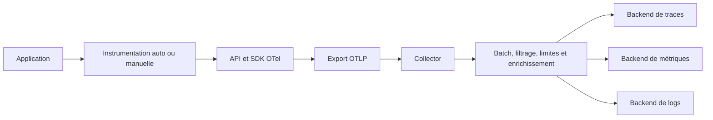
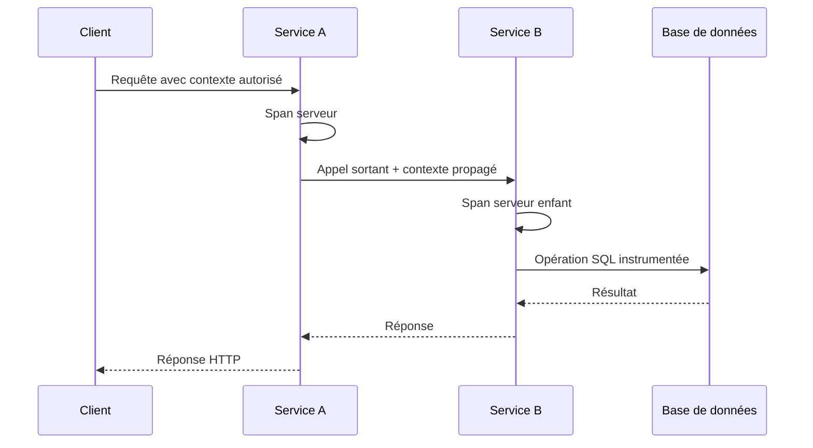
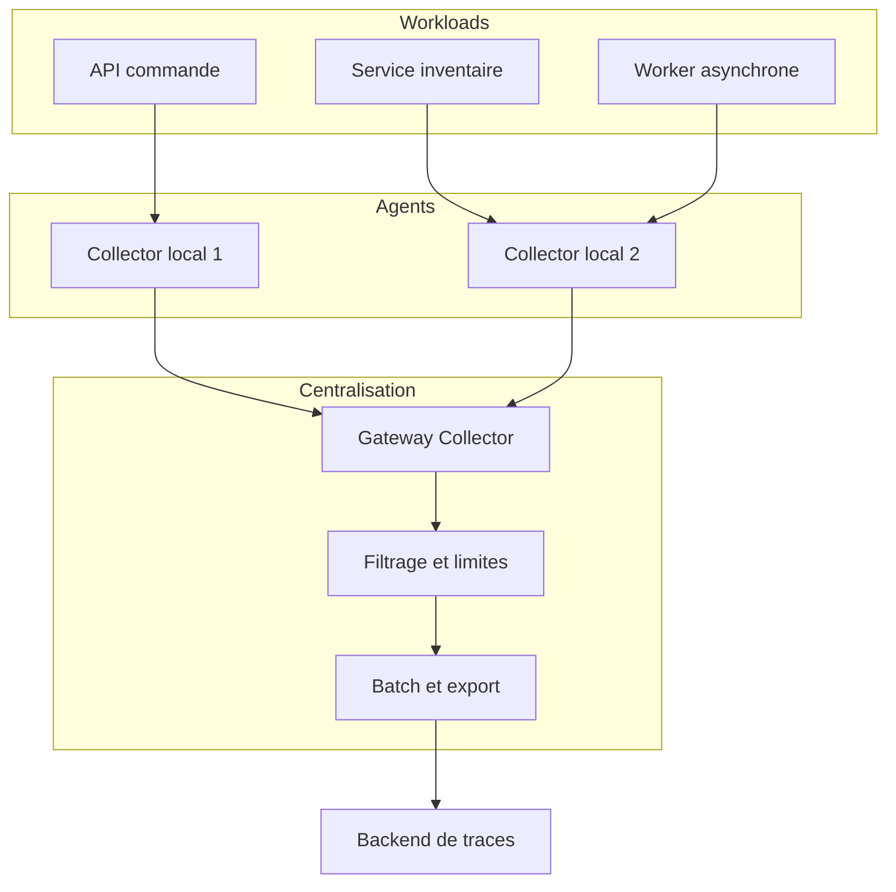
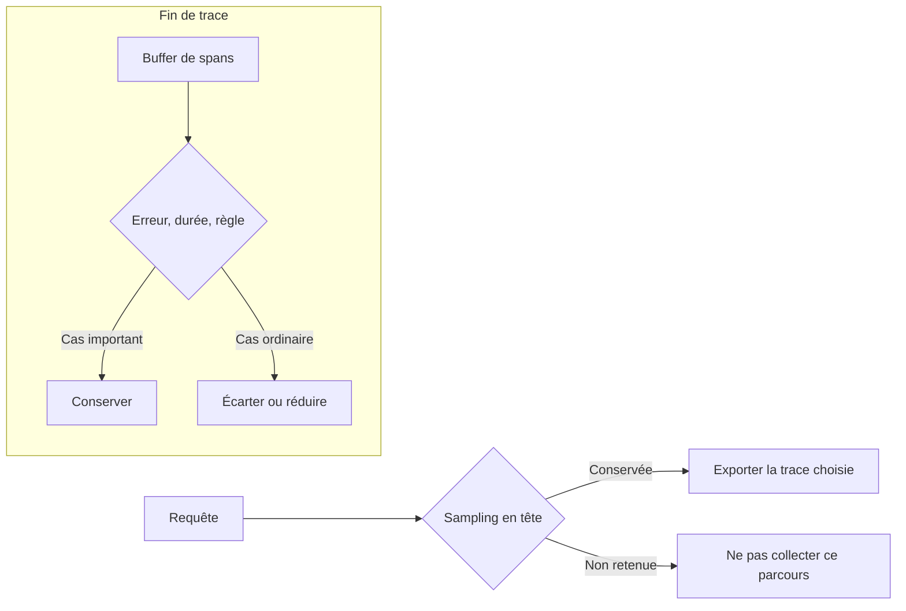
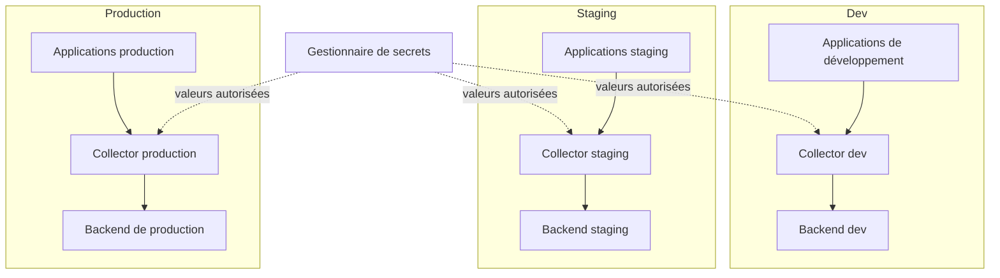
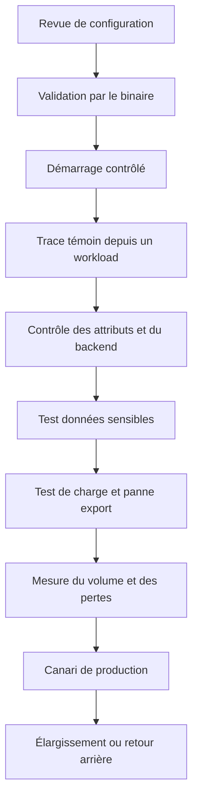

# OpenTelemetry en production

OpenTelemetry (OTel) est un ensemble de standards, d’API, de SDK et de composants qui permettent de produire et de transporter des données d’observabilité de façon cohérente. En production, il ne suffit pas de créer une trace et de l’envoyer à un backend : il faut standardiser les ressources, maîtriser l’instrumentation, configurer les exporteurs, rendre la collecte résistante aux interruptions, protéger les données sensibles et mesurer les pertes et les coûts. Ce cours expert présente une démarche complète, de l’application au stockage, pour exploiter OpenTelemetry sans coupler inutilement le code à un fournisseur particulier.

## 1. Introduction

### 1.1 Du laboratoire à la production

Une démonstration OpenTelemetry se résume parfois à initialiser un SDK, créer un span et l’afficher dans une interface. Cette expérience prouve que le mécanisme fonctionne, mais elle ne répond pas aux exigences d’un système réel : plusieurs langages, des milliers de requêtes, des workers asynchrones, des pics de trafic, des données sensibles, des interruptions réseau et des mises à jour de bibliothèques.

Une application peut continuer à répondre aux utilisateurs alors que son exporteur a perdu sa connexion au backend. Un Collector peut recevoir les spans, mais ne pas les envoyer faute d’authentification. Une modification de l’instrumentation peut doubler le nombre de spans par requête. Un filtre peut supprimer les erreurs que l’équipe voulait conserver. Une configuration peut démarrer sans erreur tout en envoyant les traces à un environnement incorrect. La production exige donc des contrôles au-delà de la simple présence de traces.

Une architecture de télémétrie devrait être traitée comme un service exploité : elle a une conception, une capacité, des objectifs de disponibilité, des règles de sécurité, des métriques internes, un propriétaire et un plan de retour arrière. Elle doit être capable de signaler sa propre dégradation. Si l’observabilité s’arrête silencieusement pendant un incident majeur, l’équipe perd précisément les preuves dont elle a besoin.

### 1.2 Objectifs pédagogiques

À la fin de ce cours, l’apprenant sera capable de distinguer API, SDK, ressources, instrumentation, propagateurs, exporteurs et collecteurs ; de choisir entre instrumentation zéro-code, manuelle et hybride ; de standardiser les ressources et attributs ; de configurer les SDK par environnement ; de concevoir un pipeline Collector ; de choisir un modèle agent, gateway ou hybride ; de maîtriser les files, retries, limites mémoire et pertes ; de protéger les informations confidentielles ; de planifier les mises à jour ; de mesurer le coût de l’instrumentation et de diagnostiquer une absence de télémétrie.

### 1.3 Ce qu’OpenTelemetry apporte et ce qu’il ne fait pas

OpenTelemetry fournit des API et SDK d’instrumentation, des conventions sémantiques et des mécanismes d’export. Le projet couvre les traces, les métriques et les logs. Une trace représente des opérations reliées ; une métrique mesure une tendance numérique ; un log décrit un événement. Ces signaux peuvent se corréler, mais n’ont pas la même fonction.

OTel ne choisit pas automatiquement les SLO de l’organisation, ne définit pas la signification métier du succès et ne décide pas quelles données sont confidentielles. L’outil aide à produire des données cohérentes et à les transporter, mais la qualité reste liée aux choix d’instrumentation, au nommage, à la propagation, aux filtres et aux destinations. Les équipes restent responsables de l’usage des données et de la vérification des bibliothèques qu’elles déploient.

Il ne faut pas confondre OpenTelemetry avec un backend de stockage et de recherche. Des plateformes spécialisées peuvent fournir l’indexation, les tableaux de bord, les alertes, l’exploration des traces, le profilage ou des fonctions de gestion d’incidents. Les API et protocoles OTel aident à séparer le code d’instrumentation de ces plateformes, sous réserve des fonctionnalités réellement prises en charge par la destination.

### 1.4 Chaîne logique de télémétrie

Une architecture typique comporte une application instrumentée, un SDK ou un agent, un exporteur, éventuellement un Collector, puis un ou plusieurs backends. L’API définit les interfaces de création de données ; le SDK effectue l’échantillonnage et le traitement local ; l’exporteur transmet les données ; le Collector peut recevoir, filtrer, enrichir, grouper et router les signaux.



Ce schéma est conceptuel. Une petite application peut exporter directement vers un backend compatible. Une organisation plus grande peut utiliser des collecteurs proches des workloads puis une gateway centrale. Il n’existe pas de topologie unique adaptée à tous les volumes et à toutes les frontières réseau. Chaque composant doit avoir un objectif, des ressources et une procédure d’exploitation.

### 1.5 Principes de production

Collecter uniquement les données nécessaires à l’investigation, utiliser des noms stables, éviter les attributs de cardinalité excessive et maintenir une propagation de contexte cohérente. L’export de télémétrie ne doit pas bloquer sans limite le traitement métier. Les files, retries et buffers doivent posséder des limites. Toute perte inattendue doit être observable. Les secrets ne doivent pas être intégrés dans le code ou les logs. Chaque configuration doit être versionnée, testée et associée à un responsable.

Ces principes doivent s’appliquer dès la conception. Corriger une fuite de données après qu’elles ont été exportées vers plusieurs destinations est plus difficile que de ne pas les collecter. Réduire la collecte après une explosion de volume peut devenir risqué si l’équipe n’a pas défini quelles traces sont essentielles. L’objectif est de rendre le système prévisible avant qu’il soit soumis à la pression d’un incident.

### 1.6 Références officielles

Les composants et conventions évoluent. Vérifier les documents correspondant aux versions utilisées :

- Documentation OpenTelemetry : https://opentelemetry.io/docs/
- Déploiement du Collector : https://opentelemetry.io/docs/collector/deploy/
- Configuration du Collector : https://opentelemetry.io/docs/collector/configuration/
- Configuration des SDK : https://opentelemetry.io/docs/languages/sdk-configuration/
- Variables d’environnement SDK : https://opentelemetry.io/docs/specs/otel/configuration/sdk-environment-variables/
- Instrumentation zéro-code : https://opentelemetry.io/docs/concepts/instrumentation/zero-code/
- Données sensibles : https://opentelemetry.io/docs/security/handling-sensitive-data/
- Bonnes pratiques de sécurité du Collector : https://opentelemetry.io/docs/security/config-best-practices/

## 2. Concepts clés

### 2.1 API, SDK et instrumentation

L’API définit les interfaces auxquelles le code applicatif fait appel. Le SDK fournit une implémentation qui gère les ressources, l’échantillonnage, les processeurs de spans, les métriques et les exporteurs. Un composant qui crée un span en mémoire n’assure pas à lui seul que le span est transmis à la bonne destination. Le cycle d’export doit être configuré et testé.

L’instrumentation relie le code réel aux interfaces de télémétrie. L’instrumentation automatique s’appuie sur les bibliothèques et frameworks compatibles. Elle peut générer des spans pour les serveurs HTTP, les clients de base de données et des dépendances connues. L’instrumentation manuelle ajoute des données autour des étapes métier invisibles pour une bibliothèque générique.

Une approche hybride est souvent efficace : instrumentation automatique pour les opérations standard et spans manuels pour les traitements métier importants. Il faut toutefois éviter la duplication. Si un client HTTP instrumenté automatiquement crée déjà un span d’appel, un span manuel qui représente exactement le même appel peut alourdir la trace sans apporter de contexte supplémentaire. Il est parfois utile d’ajouter un span métier englobant, à condition que sa finalité soit différente et clairement nommée.

La couverture dépend des versions de langage, runtime et bibliothèques. Avant d’activer un agent, vérifier les dépendances supportées, l’ordre de chargement, les limitations connues et la façon dont les erreurs sont représentées. Un paquet installé ne prouve pas que tous les chemins sont instrumentés.

### 2.2 Ressources, attributs et conventions

Une ressource décrit l’entité productrice : service, processus, hôte, conteneur ou fonction. Les attributs de ressource accompagnent les signaux associés à cette entité. Les attributs de span décrivent une opération particulière, comme la méthode HTTP, la route normalisée ou le type de dépendance. Distinguer ces niveaux permet de regrouper correctement les données.

Le nom du service doit être stable et compréhensible. Il ne devrait pas changer à chaque pod, requête ou identifiant client. La version du logiciel, l’environnement et l’instance sont des dimensions distinctes. Les conventions et noms d’attributs peuvent évoluer ; vérifier les conventions actuelles pour les SDK et outils concernés avant de créer des tableaux de bord ou des règles permanentes.

La cardinalité est le nombre de valeurs distinctes d’un attribut. Un nom de service stable a généralement un nombre de valeurs limité. Un identifiant unique par requête ou un chemin URL contenant un ID client peut générer des milliers ou millions de valeurs. Cela rend certaines recherches coûteuses et peut multiplier les groupes de tableau de bord. Garder les attributs individuels seulement lorsqu’ils répondent à un besoin explicite et que les règles de confidentialité l’autorisent.

### 2.3 Identité de service, environnement et version

Définir une convention partagée pour les noms de service, la version et l’environnement. Par exemple, les services d’un même domaine métier peuvent suivre une structure de nom cohérente, tandis que la version est ajoutée séparément. Le pipeline de build devrait injecter les informations de version, au lieu de demander à chaque équipe de les saisir manuellement.

La valeur de l’environnement doit venir de la configuration ou de l’orchestrateur. Une convention erronée peut mélanger staging et production et conduire à des conclusions trompeuses. Les noms doivent être validés dans les traces réellement reçues. Une variable présente sur le système ne garantit pas qu’un SDK la comprend ou la propage correctement.

Les conventions de nommage constituent un contrat d’exploitation. Il faut les documenter, définir un propriétaire et vérifier les écarts. Un déploiement qui change les noms de service peut sembler créer de nouveaux services et interrompre les alertes, même lorsque le code métier n’a pas changé.

### 2.4 Instrumentation zéro-code

L’instrumentation zéro-code vise à obtenir des données sans modifier directement le code métier. Selon le langage, elle peut utiliser un agent de démarrage, des bibliothèques de hooking ou un mécanisme d’injection. Elle peut accélérer l’instrumentation d’une application historique et couvrir rapidement les opérations standard.

Elle ne révèle pas automatiquement toutes les règles métier. Un agent peut instrumenter la requête HTTP et l’accès SQL, mais ne connaît pas forcément l’étape « calcul de tarification ». Elle peut aussi être sensible aux versions de runtime, aux bibliothèques et aux paramètres de démarrage. Une mise à jour de dépendance peut modifier le nombre de spans ou la forme de leurs attributs.

Activer toutes les instrumentations disponibles peut créer un volume inutile ou capturer des champs qui ne sont pas nécessaires. Sélectionner les bibliothèques adaptées au service, tester les parcours critiques et désactiver les intégrations redondantes lorsque la configuration le permet. Les options de configuration varient selon le langage et l’implémentation. Consulter la documentation spécifique plutôt que transposer une variable d’environnement d’un runtime à l’autre.

### 2.5 Instrumentation manuelle et cycle de vie

Un span manuel devrait représenter une unité de travail cohérente : validation d’une commande, étape d’import, appel à une règle, traitement d’un lot ou réservation d’une ressource. Le nom doit être stable, les attributs utiles et le résultat correctement représenté. Éviter de créer un span pour chaque ligne de code, ce qui augmente le volume et réduit la lisibilité.

Les fournisseurs et exporteurs doivent être initialisés selon le cycle de vie du processus. Dans un service long vivant, l’initialisation est généralement faite au démarrage et les traceurs sont réutilisés. L’arrêt doit permettre le traitement des données en attente dans les limites prévues. Initialiser un SDK à chaque requête crée des objets redondants, des surcoûts et des risques de fuite de ressources.

Les tâches courtes et les environnements serverless exigent une attention particulière. Une fonction peut terminer avant l’export de ses dernières données. Le mécanisme d’arrêt doit être testé dans les conditions réelles du runtime. Il ne faut pas attendre indéfiniment un backend indisponible : un compromis explicite entre vidage, délai de terminaison et perte acceptable est nécessaire.

### 2.6 Contexte et propagation

Les traces distribuées ont besoin d’un contexte cohérent. Le trace ID identifie un parcours logique et le span ID identifie une opération. Une propagation standard permet aux services de transmettre le contexte d’une requête à l’autre. W3C Trace Context définit les en-têtes HTTP traceparent et tracestate. Les bibliothèques instrumentées doivent les propager correctement lorsqu’une frontière fait partie de la même trace.

Le contexte ne doit pas être confondu avec une identité ou un mécanisme d’autorisation. Un trace ID est une valeur de corrélation, pas un jeton permettant d’accéder à une ressource. Les en-têtes qui arrivent d’Internet doivent être traités avec une politique de confiance adaptée. Une application peut décider de contrôler ou de redémarrer le contexte à certaines frontières pour éviter la corrélation entre domaines de confiance.

Le baggage permet de propager des paires clé-valeur, mais il faut résister à la tentation d’y mettre des données métier sensibles. Chaque valeur augmente le volume des en-têtes et peut être transmise à des services qui n’en ont pas besoin. Définir un objectif, limiter la taille et la portée, et vérifier qu’aucune information personnelle ou secret n’est propagé.



Voir des spans dans chaque service ne garantit pas que la propagation fonctionne. Il faut vérifier les identifiants et relations dans une trace connue, au niveau du backend, à travers les proxies, gateways et clients asynchrones.

### 2.7 Messages et traitements asynchrones

Dans une architecture asynchrone, un producteur publie un message et un consommateur le traite plus tard. La publication et le traitement peuvent être séparés de plusieurs secondes ou minutes. Le temps passé dans la file n’est pas équivalent au temps de traitement du worker. Il faut décider comment le contexte est transporté et comment la relation causale sera représentée.

Le contexte peut être injecté dans les métadonnées du message selon les mécanismes de la bibliothèque. Le consommateur l’extrait et crée son span. Si un lot regroupe plusieurs messages issus de traces différentes, un parent unique peut être trompeur ; des liens entre spans peuvent mieux représenter la relation réelle. Les retries doivent être visibles pour différencier une tentative initiale, une reprise et le résultat final.

Les métriques du broker sont nécessaires pour expliquer une attente prolongée dans la file. La trace montre la publication et le traitement instrumentés, mais une longue période sans spans peut refléter la file d’attente, l’absence d’instrumentation ou une perte de données. Examiner le nombre de messages en attente, le délai de consommation, les erreurs du worker et les traces de producteur.

### 2.8 OpenTelemetry Protocol et exporteurs

OTLP est le protocole de transport standardisé d’OpenTelemetry pour les données de télémétrie. Il aide à découpler l’instrumentation du backend et peut être utilisé entre les SDK, les collecteurs et les destinations qui le prennent en charge. Cela n’assure pas une parité totale des fonctionnalités : le stockage, les requêtes, les règles d’indexation ou les analyses propriétaires varient selon les fournisseurs.

Les exporteurs doivent être configurés avec le bon endpoint, protocole, certificat et mécanisme d’authentification. Un port ouvert ne prouve pas que l’exporteur fonctionne. Un export peut être rejeté à cause de permissions, de TLS, de limites de taille ou d’une configuration incompatible. La validation doit partir du processus applicatif ou du Collector réel, avec ses droits et son réseau.

L’export direct vers le backend peut simplifier un petit système. En production, un Collector apporte souvent des fonctions de batching, retry, chiffrement, filtrage, enrichissement et routage. Le choix dépend du volume, du besoin de traitement centralisé et des exigences de sécurité.

### 2.9 Le Collector : composants et pipelines

Le Collector est conçu autour de récepteurs, processeurs, exporteurs et extensions. Les récepteurs acceptent les signaux ; les processeurs les manipulent ; les exporteurs les transmettent ; les extensions fournissent des fonctions de service. Les pipelines déclarent explicitement quels composants s’appliquent à chaque signal. Un composant déclaré dans un fichier n’est pas nécessairement actif s’il n’est pas relié à un pipeline.

Le processeur batch regroupe les éléments pour améliorer l’efficacité. Un limiteur de mémoire réduit le risque de consommation excessive. Les processeurs d’attributs, de ressources et de redaction permettent d’enrichir ou de protéger les données. Le filtre peut écarter les données non désirées. Chaque processeur ajoute toutefois un comportement et doit être justifié, testé et surveillé.

L’ordre est important. Si une règle de filtre dépend d’un attribut ajouté ou transformé, le pipeline doit appliquer les traitements dans le bon ordre. Un filtre trop général peut supprimer des données utiles ou empêcher une règle d’échantillonnage de reconnaître les erreurs. Il faut tester les traces finales, et pas uniquement valider la syntaxe de configuration.

### 2.10 Exemple de pipeline local

L’exemple suivant montre un pipeline minimal qui reçoit OTLP et écrit les traces dans une sortie de diagnostic. Il est destiné à un laboratoire local. Les composants disponibles et options exactes dépendent de la distribution du Collector utilisée.

```yaml
receivers:
  otlp:
    protocols:
      grpc:
        endpoint: 127.0.0.1:4317
      http:
        endpoint: 127.0.0.1:4318

processors:
  memory_limiter:
    check_interval: 1s
    limit_mib: 512
  batch:

exporters:
  debug:
    verbosity: basic

service:
  pipelines:
    traces:
      receivers: [otlp]
      processors: [memory_limiter, batch]
      exporters: [debug]
```

Les adresses loopback évitent d’exposer inutilement les ports au réseau. Pour une collecte distante, définir les interfaces d’écoute, TLS, l’authentification et les règles réseau appropriées. L’exporteur debug aide à vérifier les données, mais ne constitue pas un stockage de production. La limite mémoire est illustrative et doit être dimensionnée selon les ressources du conteneur, le volume et les caractéristiques du pipeline.

La configuration devrait être validée avec le binaire exact, puis testée avec une trace témoin. Un fichier YAML qui passe une validation générique peut contenir un composant inconnu pour la distribution installée. Tester également une interruption de destination pour observer les erreurs, les queues et le comportement sous contrainte.

### 2.11 Modèles agent, gateway et hybride

Le modèle agent place le Collector près du workload, sur le même hôte, nœud ou dans une couche d’exécution proche. Cela peut réduire la distance réseau et fournir du contexte local. Il multiplie cependant les instances à maintenir et nécessite une politique cohérente de version et de configuration.

Le modèle gateway envoie les données vers un ou plusieurs collecteurs centraux. Il simplifie certaines politiques communes, le filtrage et le routage, mais peut créer un point de saturation et une dépendance réseau. Il faut surveiller sa capacité, sa disponibilité et ses files. L’échantillonnage de fin de trace peut nécessiter de regrouper les spans d’une même trace avant de décider, ce qui influence le routage et l’affinité.

Une architecture hybride combine agent et gateway. Les agents reçoivent la télémétrie près des applications, puis les gateways appliquent des règles communes et exportent. Le choix doit suivre le volume, les besoins de sampling, les frontières de sécurité et la tolérance aux pertes, pas une préférence théorique.



### 2.12 Files, retries, timeouts et backpressure

Le batching réduit le coût des envois, tandis que les files et retries peuvent absorber de courtes interruptions. Ils ne garantissent pas une livraison définitive. Une file trop petite peut perdre des données lors d’un pic ; une file trop grande consomme de la mémoire ou du disque et peut retarder les données au point qu’elles arrivent trop tard pour l’incident.

Les timeouts doivent être cohérents avec les latences et contraintes du backend. Des délais trop courts entraînent des erreurs inutiles ; des délais trop longs gardent les ressources occupées et peuvent aggraver la saturation. Les retries doivent être bornés et utiliser un comportement de reprise maîtrisé. Quand le backend est indisponible longtemps, il faut décider si la télémétrie est perdue, tamponnée de façon persistante ou réduite.

La backpressure doit être observée. La longueur de file ne suffit pas : l’âge des éléments en attente est également important. Au retour du backend, un rattrapage agressif peut le saturer à nouveau. Tester les pics, les interruptions et la reprise, puis ajuster les limites selon les ressources disponibles.

### 2.13 Dimensionner la mémoire et le stockage

Les lots, files, événements, attributs volumineux, récepteurs et exporteurs utilisent tous de la mémoire. Le nombre de spans n’est pas le seul facteur : une trace contenant des descriptions et attributs longs peut être beaucoup plus volumineuse qu’une trace courte. Le dimensionnement doit être fait à partir du trafic observé, puis validé sous charge.

Un limiteur de mémoire protège le processus, mais peut provoquer le refus ou la limitation des données lorsque les seuils sont atteints. Ces événements doivent être enregistrés et alertés. Une baisse inexpliquée du volume exporté est un signal d’incident d’observabilité, pas une amélioration automatique.

Une file persistante peut réduire le risque de perte lors de certaines interruptions, mais ajoute des obligations de chiffrement, de permissions, d’espace disque et de récupération. Une queue en mémoire ne résiste pas à toutes les interruptions brutales. Choisir la résilience en fonction de la perte admissible, et documenter les garanties réelles plutôt que promettre une livraison absolue.

### 2.14 Échantillonnage de tête et de fin

L’échantillonnage de tête prend une décision au début de la trace. Il permet de réduire le volume rapidement et de propager une décision cohérente, mais ne sait pas toujours si la requête deviendra lente ou échouera. Il peut donc manquer des erreurs rares lorsqu’il retient une petite fraction des requêtes.

L’échantillonnage de fin décide après avoir reçu suffisamment d’informations sur une trace, par exemple le statut final, la durée ou certains attributs. Il peut favoriser les traces lentes ou en erreur et réduire la conservation des traces ordinaires. En contrepartie, il exige des buffers, du temps d’attente, un routage cohérent et suffisamment de mémoire. Les spans arrivant après la décision peuvent être perdus pour cette trace.

La politique doit être testée avec des requêtes normales, lentes, en erreur, parallèles et asynchrones. Le volume rejeté doit être mesuré. Un taux d’échantillonnage doit être interprété comme une limite de visibilité : l’absence d’une trace conservée ne prouve pas que l’opération n’a pas eu lieu.



### 2.15 Haute cardinalité et attributs inutiles

Les identifiants uniques, URLs complètes, champs libres et textes d’erreur peuvent générer de nombreuses valeurs distinctes. Il faut distinguer la collecte de l’information, sa conservation et son indexation. Un champ peut être utile dans un span individuel mais inadapté comme dimension de regroupement globale. Les détails exacts dépendent du backend.

Normaliser les routes HTTP, utiliser des noms stables et garder les versions séparées du nom de service. Ne pas utiliser les identifiants métier comme noms de spans. Réviser les nouveaux attributs avant d’ajouter une dimension, notamment lorsqu’ils viennent du navigateur ou d’une entrée utilisateur. Des valeurs d’attributs très nombreuses peuvent affecter la taille, les performances de recherche et les coûts.

### 2.16 Sécurité de la collecte et données sensibles

Le Collector peut recevoir des données, initier des connexions internes et externes, et contenir des informations d’authentification dans sa configuration. Il faut chiffrer les communications, activer l’authentification nécessaire, limiter les interfaces d’écoute, appliquer les règles réseau et utiliser des permissions minimales. Ne pas committer les secrets, certificats privés ou jetons.

Les traces peuvent contenir des URLs, exceptions, paramètres, noms internes ou attributs métier. Éviter les mots de passe, cookies, jetons, informations financières et corps complets de requêtes. La meilleure protection est de ne pas produire ces données. Les processeurs de redaction et de filtrage offrent une couche supplémentaire, mais doivent être testés sur les données réelles générées par l’instrumentation.

Le hachage ne garantit pas toujours l’anonymat, notamment lorsque l’identifiant d’origine est prévisible ou que plusieurs systèmes peuvent être corrélés. La politique de confidentialité doit définir les objectifs, les champs autorisés, la rétention et l’accès. Les mêmes règles s’appliquent aux exports secondaires et sauvegardes.

### 2.17 Variables d’environnement et configuration déclarative

La configuration du SDK peut être fournie par du code, des propriétés système, des variables d’environnement ou un fichier déclaratif si l’implémentation prend ce mécanisme en charge. Les variables standard permettent d’harmoniser certains réglages, mais toutes les implémentations ne supportent pas nécessairement chaque option. Il faut vérifier la documentation du langage et la matrice de conformité.

Les paramètres courants incluent le nom du service, les attributs de ressource, le protocole et l’endpoint d’export, le propagateur et l’échantillonneur. Ne pas définir une même valeur dans plusieurs couches sans règle de priorité documentée. Une variable injectée par l’orchestrateur peut surcharger un fichier, tandis qu’une configuration par programmation peut interférer avec les valeurs externes.

Exemple adapté à un laboratoire local, à condition que le SDK utilisé supporte ces variables :

```bash
export OTEL_SERVICE_NAME="orders-api"
export OTEL_RESOURCE_ATTRIBUTES="deployment.environment.name=staging,service.version=2.4.0"
export OTEL_TRACES_EXPORTER="otlp"
export OTEL_EXPORTER_OTLP_PROTOCOL="http/protobuf"
export OTEL_EXPORTER_OTLP_ENDPOINT="http://127.0.0.1:4318"
export OTEL_PROPAGATORS="tracecontext,baggage"
```

L’endpoint non chiffré sur loopback convient à un essai local, pas automatiquement à la production. L’environnement réel doit définir le transport sécurisé, les identifiants nécessaires et la destination autorisée. La configuration doit être validée à partir des spans reçus : la présence de variables ne prouve pas qu’elles sont appliquées par le SDK.

### 2.18 Kubernetes et injection automatique

Dans Kubernetes, le Collector peut être déployé comme agent de nœud, sidecar ou gateway. L’OpenTelemetry Operator prend en charge certaines formes d’instrumentation automatique pour les langages compatibles, ainsi que la gestion de ressources. La compatibilité varie selon le langage, l’image et les versions ; l’injection doit être testée plutôt qu’activée globalement sans validation.

Les permissions RBAC, webhooks, variables injectées, volumes et secrets font partie de la surface de sécurité. Limiter les droits de l’Operator et garantir que seuls les workloads autorisés peuvent envoyer des données aux destinations prévues. Les NetworkPolicies et règles de sortie doivent autoriser le flux requis sans ouvrir inutilement les endpoints.

Les tests réseau doivent être lancés depuis le contexte réel du workload : namespace, service account, DNS, règles réseau et identité. Un test depuis un poste d’administration peut réussir alors qu’un pod est bloqué. Vérifier les services nouvellement instrumentés et comparer les attributs de ressource avant de déployer à grande échelle.

### 2.19 Gestion des versions et conventions sémantiques

Les SDK, instrumentations et Collectors évoluent. Une mise à jour peut modifier le nom d’un attribut, la couverture automatique, le volume de spans ou le comportement d’export. Garder les versions documentées et effectuer des tests en staging avant de généraliser. Les mises à jour entièrement automatiques peuvent rendre difficile l’identification de l’origine d’une régression.

Les conventions sémantiques servent à harmoniser les champs entre services. Si des conventions évoluent, des dashboards, filtres et règles peuvent devenir incomplets sans que le pipeline tombe en panne. Avant une mise à jour, rechercher les requêtes qui utilisent les champs concernés, prévoir une période de transition si nécessaire et comparer les données réelles avant et après.

Le test de mise à jour doit examiner le nombre de spans par requête, le volume exporté, les ressources, la propagation, le contenu des attributs et les pertes. Il doit aussi vérifier que les filtres ne suppriment pas des erreurs et qu’aucune donnée sensible ne s’ajoute silencieusement.

### 2.20 Mesurer le surcoût et la perte

Comparer l’application instrumentée et non instrumentée sous une charge contrôlée : débit, p50/p95/p99, CPU, mémoire et taux d’erreur. Dans la collecte, mesurer le débit reçu et exporté, les files, la mémoire et les rejets. L’objectif est de quantifier le surcoût de la configuration réelle et de déterminer les limites adaptées, pas d’invoquer une constante universelle.

Tester trafic stable, pic soudain, backend lent, export indisponible et reprise. Le retour du backend ne doit pas créer une surcharge incontrôlée à cause d’un rattrapage de file. Vérifier que l’application continue de traiter le métier en cas de perte de télémétrie et que les erreurs d’export sont visibles.

Comparer les données entrantes et sortantes nécessite de tenir compte des filtres, échantillonnages et transformations attendus. Une différence n’est pas toujours une perte accidentelle. Documenter le comportement voulu et alerter sur les rejets inattendus, le vieillissement de file, la mémoire proche des limites et les erreurs persistantes.

### 2.21 Portabilité entre backends

OTLP et les conventions standard facilitent la migration, mais ne garantissent pas des fonctionnalités identiques entre fournisseurs. Les requêtes, index, rétentions, interfaces, alertes et fonctions propriétaires peuvent différer. Garder le code centré sur l’API OpenTelemetry et isoler les spécificités de plateforme dans la configuration lorsque c’est possible.

Pour une migration, envoyer un jeu connu de traces vers la nouvelle destination, puis vérifier les ressources, attributs, statuts, recherches et filtres. Comparer les coûts et rétentions, et vérifier que les équipes disposent toujours des données nécessaires pour leurs procédures. Une connexion réseau réussie ne prouve pas que les fonctions essentielles sont équivalentes.

### 2.22 Les métriques internes du pipeline

La plateforme de collecte doit être supervisée. Suivre les éléments reçus, exportés, rejetés, abandonnés ou en attente, les erreurs, la mémoire, les files et la latence de traitement. Les noms précis des métriques dépendent des composants, versions et distributions. Un test de télémétrie connu peut aider à détecter une rupture même pendant les périodes où le trafic métier est faible.

Les alertes doivent correspondre à des actions possibles. Par exemple, une file qui vieillit, un taux de rejet inattendu, un exporteur qui échoue durablement ou une mémoire proche de la limite peut demander une intervention. Une simple baisse du nombre de spans ne doit pas déclencher automatiquement une alerte si le trafic diminue. Ajouter le volume de requêtes métier comme contexte.

Ne pas considérer le pipeline comme une boîte noire. Un problème de collecte peut supprimer des preuves sans affecter le site. Les dashboards de l’observabilité doivent eux-mêmes présenter les erreurs d’export et la santé du backend, afin que l’équipe sache si elle peut se fier à l’absence ou à la présence de traces.

### 2.23 Reprise et mode dégradé

Un changement d’instrumentation ou de pipeline doit avoir un plan de retour arrière. Il peut être nécessaire de revenir à une version de Collector, de désactiver une instrumentation coûteuse, de réduire le taux de collecte ou de restaurer l’endpoint précédent. Les changements doivent être versionnés et l’étape de retour arrière testée avant la production.

Un mode dégradé peut conserver les métriques agrégées et une fraction de traces, tout en réduisant les spans très verbeux. Les données prioritaires devraient être définies à l’avance : erreurs critiques, parcours d’authentification, transactions métier importantes ou services sensibles. Réduire la collecte pendant un incident doit être une décision contrôlée, car cette action réduit également la capacité d’analyse.

Après le retour à la normale, documenter la période pendant laquelle les données ont été filtrées ou perdues. Une trace conservée pendant cette période ne représente pas nécessairement l’ensemble du trafic. Les rapports d’incident doivent distinguer les faits observés, les hypothèses et les limites liées à la télémétrie manquante.

## 3. Architecture et Schémas

### 3.1 Architecture multi-environnements

Les environnements de développement, validation, staging et production ne doivent pas partager aveuglément leurs destinations, secrets, rétentions ou niveaux de collecte. Les modèles de configuration peuvent être communs, mais les valeurs et permissions doivent suivre l’environnement. Les tests synthétiques ne doivent pas injecter leurs données dans le tenant de production.



Une infrastructure partagée peut être appropriée, si la séparation logique et les permissions sont explicites. Les destinations doivent être contrôlées lors du déploiement. Toute exception, comme l’envoi vers deux backends durant une migration, doit posséder un objectif, une durée et un processus de retrait.

### 3.2 Gestion de configuration

La configuration doit être versionnée et relue comme du code. Les secrets sont injectés à partir d’un gestionnaire sécurisé ou d’un mécanisme protégé, jamais copiés dans un dépôt public. La CI doit valider les champs requis, le nom des composants, les pipelines actifs et les options reconnues par le binaire cible.

Il est utile de séparer les modèles partagés des variables d’environnement. Les modèles réduisent la dérive entre services ; les valeurs injectées déterminent les endpoints, versions, certificats et niveaux de collecte de chaque environnement. Une validation YAML générique ne garantit pas qu’un Collector particulier reconnaît tous les composants et champs.

Le test de configuration doit utiliser la distribution exacte. Démarrer le service, envoyer une trace témoin, vérifier la réception, l’export et l’arrivée dans le backend. Ensuite, retirer temporairement la destination dans un environnement de test, observer les files et les erreurs, puis confirmer la reprise.

### 3.3 Pipeline configurable

Un pipeline de production aura généralement besoin d’un récepteur, de processeurs, d’un exporteur, de la sécurité et de paramètres dimensionnés. Le fragment ci-dessous illustre le câblage général ; l’endpoint est un nom de démonstration à remplacer par la configuration réelle et la syntaxe doit être vérifiée contre la distribution utilisée.

```yaml
receivers:
  otlp:
    protocols:
      grpc:
        endpoint: 127.0.0.1:4317

processors:
  memory_limiter:
    check_interval: 1s
    limit_mib: 768
  batch:
    send_batch_size: 512

exporters:
  otlp:
    endpoint: otel-backend.example:4317

service:
  pipelines:
    traces:
      receivers: [otlp]
      processors: [memory_limiter, batch]
      exporters: [otlp]
```

Ce fragment n’est pas prêt à être exposé dans un réseau de production : il faut intégrer TLS, l’authentification, les limites de queue et les politiques de retry requises. Le port loopback suppose que le récepteur soit appelé localement. Les paramètres de mémoire et de batch sont illustratifs, pas des recommandations universelles.

### 3.4 Haute disponibilité

La haute disponibilité peut exiger plusieurs réplicas, un mécanisme de découverte, un équilibrage de charge, des limites de ressources et un plan de reprise. Cependant, plusieurs collecteurs ne suffisent pas si le routing répartit les spans d’une même trace au mauvais endroit pour l’échantillonnage de fin. L’affinité par trace et la stratégie de distribution doivent être conçues ensemble.

La collecte doit se comporter de manière maîtrisée quand un réplica disparaît, le réseau est lent ou le backend n’est plus joignable. Tester un réplica retiré, une interruption de destination et un retour du trafic. Observer la perte, le temps de reprise et la pression sur les files. Ne pas faire de l’export une dépendance bloquante du code métier.

### 3.5 Frontières réseau

Les applications doivent communiquer uniquement avec les endpoints nécessaires. Les ports d’ingestion sont distincts des interfaces de recherche et d’administration. La collecte peut traverser des zones de confiance différentes : workloads, cluster Collector, réseau de gestion et backend externe. Chaque frontière exige une politique adaptée de chiffrement, d’authentification et de permissions.

Tester les communications depuis le contexte exact du workload. Une requête réussie depuis le nœud d’administration ne garantit pas que le pod possède les mêmes droits DNS ou réseau. Dans Kubernetes, vérifier les namespaces, service accounts, NetworkPolicies, règles de sortie et certificats. Les ports de debug et de health check ne doivent pas être largement exposés.

### 3.6 Validation de bout en bout

Une procédure de validation devrait vérifier la syntaxe avec le binaire exact, le démarrage, la réception et l’export d’une trace témoin, les attributs de ressources, les filtres, la confidentialité et les limites sous charge.



La validation de confidentialité doit utiliser des valeurs artificielles et inspecter la télémétrie reçue dans toutes les destinations. Il faut confirmer que les filtres se comportent comme prévu et qu’ils ne suppriment pas des spans essentiels. La publication ne devrait être élargie qu’après vérification de la qualité réelle des données.

### 3.7 Déploiement progressif et canari

Déployer la nouvelle instrumentation ou configuration sur un petit périmètre, puis élargir après observation. Les critères de progression incluent la couverture des spans, la stabilité de la latence applicative, le volume exporté, la mémoire du Collector et l’absence de fuite de données. Un canari doit recevoir assez de trafic pour révéler les comportements représentatifs ; sinon, envoyer une trace synthétique contrôlée.

Comparer le canari à un groupe de référence comparable. Deux services qui possèdent des profils de trafic différents ne constituent pas un bon groupe de comparaison. Avant le déploiement, préparer un retour arrière qui restaure la configuration, désactive une instrumentation coûteuse ou change l’endpoint sans intervention improvisée.

## 4. Étude de cas

### 4.1 Le volume double après une mise à jour

Une entreprise instrumente plusieurs API, workers et consommateurs avec OpenTelemetry. Après une mise à jour d’une bibliothèque, le volume ingéré double et les recherches deviennent plus lentes. Les applications répondent encore, mais le Collector consomme plus de mémoire et l’export vers le backend présente des retards.

L’équipe confirme d’abord que le trafic métier n’a pas doublé. Elle compare le nombre de requêtes HTTP, le volume exporté et le nombre de spans par requête. Ce dernier indicateur a augmenté. L’inspection révèle que l’instrumentation automatique couvre désormais un appel déjà instrumenté manuellement, créant des spans équivalents. Certaines nouvelles instrumentations génèrent aussi des opérations de bas niveau dont la valeur de diagnostic n’est pas démontrée.

L’équipe ne désactive pas aveuglément toute instrumentation. Elle identifie les spans redondants, mesure leur contribution au volume et désactive l’instrumentation qui fait double emploi lorsque la bibliothèque le permet. Les spans manuels autour d’étapes métier utiles restent en place, car ils améliorent la décomposition d’un traitement important.

### 4.2 Revoir le pipeline et ses limites

La hausse du volume pousse le Collector vers sa limite mémoire. Le batch fonctionne, mais l’exporteur accumule les données lorsque le backend répond lentement. L’équipe mesure les files, le taux d’export, les erreurs et la mémoire pendant une charge contrôlée. Elle ajuste les limites en fonction des ressources disponibles et ajoute des alertes sur les files, l’âge des éléments et la mémoire.

Une interruption de backend est ensuite simulée. Le but n’est pas de conserver toutes les données à n’importe quel prix : il s’agit de connaître les pertes possibles, de ne pas bloquer les requêtes métier et de garder les signaux agrégés essentiels. L’équipe définit une politique de dégradation qui applique les limites et avertit l’exploitation sans laisser la mémoire croître indéfiniment.

### 4.3 Appliquer une politique de données

L’inspection des traces révèle des attributs de requête qui peuvent contenir des données métier sensibles. L’équipe définit une liste de champs autorisés, supprime les champs non nécessaires et teste la redaction. La protection est appliquée à la source lorsque possible et au Collector comme seconde ligne de défense. Les règles sont testées avec des chaînes synthétiques ressemblant à des secrets.

La configuration d’instrumentation est versionnée et validée dans la CI. Les mises à jour de bibliothèques passent par un test de volume, de couverture et de confidentialité. Chaque nouveau champ ou span manuel doit être justifié : quelle question permettra-t-il de résoudre, et quelle conséquence aura-t-il sur le coût et la confidentialité ?

### 4.4 Résultats

Après correction, le nombre de spans par requête revient vers une valeur cohérente, les files d’export restent sous contrôle et les recherches de traces redeviennent exploitables. L’équipe garde des métriques de volume et de pertes comme garde-fous. Elle documente également les données que l’échantillonnage et les filtres rendent indisponibles.

L’incident montre qu’une mise à jour d’instrumentation peut modifier le volume sans changer la logique métier. La collecte doit être surveillée comme une application : des métriques normales côté API ne garantissent pas que le pipeline exporte correctement la télémétrie. Le cycle de mise à jour inclut désormais une comparaison du nombre de spans par requête, du volume exporté et des attributs présents.

### 4.5 Variante : staging marche, production n’exporte rien

Une autre équipe constate que les traces apparaissent en staging mais pas en production. Les images applicatives sont identiques. L’analyse révèle que l’endpoint de production exige une identité d’export et un certificat absents du contexte du service. La connexion réseau peut s’établir, mais le backend refuse les données.

Le test depuis la machine d’administration avait réussi parce qu’il utilisait une autre identité et un autre réseau. La correction concerne donc la distribution sécurisée du certificat, les permissions et la configuration du workload, non le code applicatif. Un test de bout en bout est ajouté pour envoyer une trace synthétique depuis chaque environnement et confirmer son apparition dans la destination attendue.

Cet exemple rappelle qu’il faut tester la chaîne depuis le processus réel avec ses droits et son réseau. La présence du SDK ne prouve pas l’export, et une réussite dans un environnement ne garantit pas l’identité ou les routes d’un autre.

## 5. Pièges à éviter

### 5.1 Confondre installation et couverture

Installer un agent ou SDK ne garantit pas que toutes les opérations importantes sont instrumentées. Les versions, frameworks, clients réseau et options de démarrage peuvent modifier la couverture. Exécuter des scénarios représentatifs et vérifier les spans attendus dans le backend.

### 5.2 Configurer les variables sans vérifier leur support

Les variables standard ne sont pas nécessairement prises en charge par chaque implémentation. Vérifier la documentation et la matrice de conformité, puis valider les valeurs effectivement appliquées. Une variable ignorée peut laisser l’export dirigé vers une destination inattendue ou les attributs requis absents.

### 5.3 Initialiser plusieurs SDK ou exporteurs

Les initialisations multiples peuvent créer des spans redondants, des ressources qui fuient ou des données envoyées vers plusieurs destinations. Initialiser les fournisseurs conformément au cycle de vie, réutiliser les traceurs et prévoir un arrêt propre.

### 5.4 Exposer le Collector sans contrôle

Un port OTLP ouvert peut permettre l’injection de télémétrie arbitraire, consommer des ressources ou divulguer des informations internes. Restreindre le réseau, activer TLS et l’authentification lorsque nécessaire, limiter les composants et éviter les permissions excessives.

### 5.5 S’appuyer uniquement sur une redaction après collecte

Les données sensibles peuvent déjà se retrouver dans les buffers, les logs de debug, les files ou une destination secondaire avant d’être supprimées. La meilleure protection consiste à empêcher leur génération à la source, puis à utiliser des filtres testés comme défense complémentaire.

### 5.6 Dimensionner sur le trafic moyen

Un pipeline dimensionné uniquement pour le débit moyen peut saturer lors des pics ou lorsque le backend ralentit. Tester les bursts, les grandes traces, les files qui vieillissent et les scénarios de rattrapage. Les limites mémoire, retries et timeouts doivent correspondre aux ressources réelles.

### 5.7 Ignorer les pertes d’export

L’application peut continuer à fonctionner normalement pendant que des traces sont refusées ou abandonnées. Surveiller la réception, l’export, les rejets, la file et la mémoire. Documenter la différence entre volume volontairement filtré et perte anormale.

### 5.8 Utiliser une configuration de laboratoire en production

Exporteur de debug, endpoint non chiffré, loopback, limites arbitraires et absence d’authentification peuvent être tolérés dans un essai local, mais pas dans un environnement réel. Sécuriser et valider la configuration avec la distribution exacte.

### 5.9 Laisser dériver les noms de service

Des noms instables par pod, version ou requête fragmentent les données. Standardiser les ressources et séparer le nom du service de la version et de l’instance. Contrôler les écarts à la réception.

### 5.10 Activer toutes les instrumentations

Une couverture excessive augmente parfois le coût sans améliorer le diagnostic. Commencer avec les intégrations utiles, ajouter des spans manuels ciblés et désactiver les doublons. Mesurer le nombre de spans par requête et vérifier la couverture des parcours.

### 5.11 Mettre à jour sans test

Une nouvelle version peut modifier les attributs, la couverture et le volume. Fixer les versions, tester en staging, comparer les données et prévoir un retour arrière. Revalider dashboards et alertes après mise à jour.

### 5.12 Oublier l’arrêt et les tâches courtes

Workers, jobs ponctuels et fonctions serverless peuvent terminer avant l’export des données en attente. Contrôler le cycle de vie du SDK, les délais de vidage et les contraintes du runtime. Ne pas attendre indéfiniment un backend indisponible.

### 5.13 Confondre OTLP et portabilité parfaite

OTLP facilite le transport, mais ne garantit pas des fonctionnalités identiques entre backends. Requêtes, index, rétention et fonctions propriétaires peuvent différer. Isoler les dépendances spécifiques et tester les capacités importantes lors d’une migration.

### 5.14 Négliger les secrets dans la configuration

Des fichiers peuvent contenir des tokens et certificats. Ne pas committer de secrets, utiliser un gestionnaire sécurisé et appliquer les droits minimaux. Tester la rotation pour éviter une interruption d’export.

### 5.15 Faire du Collector un point de blocage du métier

L’export ne doit pas devenir une dépendance synchrone à chaque requête. Configurer les processeurs et exporteurs de manière adaptée et tester la panne du backend. Si l’indisponibilité de l’observabilité bloque le métier, revoir la séparation des responsabilités.

### 5.16 Ne pas documenter ce que les filtres suppriment

Un filtre qui supprime une catégorie de spans peut rendre certaines investigations impossibles. Chaque règle doit expliquer son but, les données écartées, le risque accepté et le propriétaire. Revoir les règles après les incidents.

### 5.17 Confondre absence de données et santé

Une absence de traces peut signifier qu’il n’y a pas de trafic, que le SDK est mal configuré, que l’export est bloqué ou que les données sont filtrées. Un scénario de télémétrie connu et les métriques internes du pipeline permettent de différencier ces cas.

### 5.18 Empiler des processeurs sans mesure

Chaque processeur augmente la complexité et peut ajouter de la latence. Garder uniquement les composants utiles, tester leur ordre et mesurer leur coût. Une configuration plus longue n’est pas nécessairement plus sûre ou plus complète.

## 6. Checklist / À retenir

### 6.1 Checklist de conception

- Les objectifs de télémétrie et les parcours critiques sont documentés.
- Les noms de service, versions et environnements suivent une convention partagée.
- L’instrumentation automatique, manuelle et hybride est choisie explicitement.
- Le support des langages et bibliothèques est vérifié.
- Le SDK est initialisé une seule fois et son cycle de vie est maîtrisé.
- Les variables d’environnement et fichiers déclaratifs sont validés pour l’implémentation.
- Le protocole OTLP et les destinations sont compatibles et sécurisés.
- Les récepteurs, processeurs et exporteurs sont reliés explicitement aux pipelines.
- La topologie agent/gateway correspond au volume et aux contraintes de sampling.
- Files, retries, timeouts et limites mémoire sont dimensionnés par test.
- Les pertes et erreurs d’export sont mesurées et alertées.
- Les données sensibles sont minimisées à la source et les filtres sont testés.
- Les secrets, certificats et permissions sont gérés hors du code.
- Les versions et conventions sont documentées et testées.
- Un retour arrière et un mode dégradé sont définis.

### 6.2 Checklist avant déploiement

- Valider la configuration avec la version exacte du Collector.
- Envoyer une trace témoin de bout en bout.
- Vérifier les ressources et attributs au niveau du backend.
- Tester la propagation sur les appels synchrones et asynchrones.
- Tester la confidentialité avec des valeurs synthétiques.
- Mesurer le comportement avec et sans instrumentation.
- Tester l’indisponibilité de l’exporteur et la saturation d’une file.
- Mesurer les spans par requête, mémoire et volume exporté.
- Vérifier les permissions réseau depuis les workloads réels.
- Confirmer que la télémétrie dégradée ne bloque pas le métier.
- Valider les dashboards et alertes après une mise à jour.
- Désigner le propriétaire et tester le retour arrière.

### 6.3 Procédure de diagnostic d’une télémétrie absente

1. Vérifier que le service a reçu du trafic et que le chemin est instrumenté.
2. Contrôler les variables, le nom de service et l’endpoint réellement appliqué.
3. Vérifier l’initialisation du SDK et les erreurs de l’exporteur.
4. Tester connectivité, protocole, TLS et permissions depuis le workload.
5. Examiner les métriques du Collector : réception, files, mémoire, rejets et erreurs d’export.
6. Vérifier les processeurs et filtres qui peuvent éliminer les données.
7. Confirmer l’arrivée de la trace témoin et ses attributs dans le backend.
8. Comparer les versions d’instrumentation si le problème est apparu après une mise à jour.
9. Réduire le problème à une couche avec un test contrôlé, puis corriger cette couche.
10. Tester la reprise et documenter les limites de perte éventuelle.

### 6.4 Mini-projet expert

Déployer une petite API et un worker instrumentés avec OpenTelemetry. Ajouter un Collector avec un récepteur OTLP, une limite mémoire, un batch et un exporteur vers un backend de laboratoire. Standardiser le nom du service, la version et l’environnement. Ajouter un span manuel autour d’une étape métier, puis vérifier les spans automatiques du serveur HTTP et du client de stockage.

Effectuer des tests de succès, d’erreur, d’appel lent et d’exporteur indisponible. Mesurer le nombre de spans, le débit d’export, la mémoire et les pertes. Injecter une chaîne synthétique représentant un secret dans un champ de test et vérifier qu’elle ne se retrouve pas dans le backend. Documenter les différences entre données produites, filtrées et exportées.

Enfin, simuler une mise à jour de configuration : changer la destination et ajuster le taux d’échantillonnage en staging. Comparer les résultats et démontrer que le retour arrière fonctionne. Le projet réussit lorsque l’apprenant peut expliquer la chaîne complète, localiser chaque catégorie d’échec et présenter des preuves que la configuration est fonctionnelle sous les conditions testées.

### 6.5 Questions de révision

**Quelle différence existe entre l’API et le SDK OpenTelemetry ?** L’API fournit les interfaces d’instrumentation utilisées par le code, tandis que le SDK implémente le traitement, les ressources, l’échantillonnage et l’export. La création d’un span en mémoire ne prouve pas que le SDK l’exporte vers la bonne destination.

**Pourquoi utiliser un Collector en production ?** Il centralise des fonctions comme le batching, le retry, le chiffrement, le filtrage, l’enrichissement et le routage. Il crée aussi une brique à dimensionner et surveiller, qui peut subir une saturation ou une perte.

**Quand choisir agent ou gateway ?** Un agent est utile pour le traitement proche du workload et certaines règles locales ; une gateway facilite les politiques communes et le traitement centralisé. Le choix dépend de la topologie, du volume, de la résilience, des frontières de sécurité et des besoins de sampling.

**Pourquoi une queue plus grande n’est-elle pas toujours meilleure ?** Une queue absorbe une interruption courte mais consomme des ressources et peut retarder les données. Si elle est trop volumineuse, elle peut épuiser la mémoire ou provoquer un rattrapage agressif lorsque le backend revient.

**Comment protéger les données sensibles ?** Éviter leur collecte à la source, minimiser les attributs, sécuriser le transport et appliquer des filtres testés comme défense supplémentaire. La redaction ne remplace pas le contrôle d’accès et la gouvernance.

**Pourquoi fixer et tester les versions ?** Les mises à jour peuvent modifier la couverture, les attributs, les conventions ou le volume. Une validation en staging permet de détecter des incompatibilités et de préparer le retour arrière.

**Comment vérifier qu’OTLP fonctionne réellement ?** Depuis le workload, envoyer une trace témoin, vérifier le protocole, TLS et les droits, puis confirmer son arrivée au backend avec les attributs attendus. Un port ouvert ne prouve pas l’export complet.

**Pourquoi surveiller la mémoire du Collector ?** Les buffers, lots, files, récepteurs et exporteurs consomment de la mémoire. Lorsqu’ils approchent des limites, des données peuvent être refusées ou perdues. Suivre mémoire, files et rejets.

**OTLP garantit-il une migration transparente entre fournisseurs ?** Non. Il facilite le transport, mais les fonctions de recherche, stockage, sampling et intégrations peuvent différer. Tester les capacités dont les équipes dépendent avant de migrer.

**Que signifie une absence de traces après un déploiement ?** Elle peut venir d’un faible trafic, d’une instrumentation inactive, d’un endpoint incorrect, d’un défaut de propagation, d’un filtre ou d’un rejet d’export. Examiner toute la chaîne avant de conclure.

### 6.6 À retenir

OpenTelemetry est une chaîne qui va du code instrumenté aux SDK, exporteurs, collecteurs et backends. Chacune des couches a un rôle et des modes de défaillance. L’architecture doit être compréhensible et résiliente, afin d’absorber les variations de trafic et les interruptions prévues.

Une stratégie solide établit des ressources cohérentes, sélectionne les instrumentations utiles, configure les SDK de façon reproductible et déploie un Collector sécurisé lorsque ses fonctions apportent une valeur mesurable. Files, batchs, retries, timeouts et limites mémoire doivent être testés. Les erreurs d’export et les pertes constituent des signaux opérationnels à part entière.

OTLP et les conventions standard facilitent la portabilité, mais n’éliminent pas les différences entre backends. Les mises à jour exigent des tests de compatibilité, de volume et de confidentialité. Les données sensibles doivent être évitées dès la source, puis protégées par le transport et le contrôle d’accès.

Enfin, le pipeline d’observabilité doit être observable. Une trace absente ne prouve pas que rien ne s’est passé, et une trace présente ne garantit pas que tout le parcours est capturé. La valeur de la plateforme dépend de la capacité à distinguer les données filtrées, échantillonnées, retardées ou perdues et à fournir des preuves fiables au moment de l’incident.

### Références techniques

- OpenTelemetry documentation: https://opentelemetry.io/docs/
- Collector deployment patterns: https://opentelemetry.io/docs/collector/deploy/
- Collector configuration: https://opentelemetry.io/docs/collector/configuration/
- SDK configuration: https://opentelemetry.io/docs/languages/sdk-configuration/
- SDK environment variables: https://opentelemetry.io/docs/specs/otel/configuration/sdk-environment-variables/
- Zero-code instrumentation: https://opentelemetry.io/docs/concepts/instrumentation/zero-code/
- Handling sensitive data: https://opentelemetry.io/docs/security/handling-sensitive-data/
- Collector security configuration best practices: https://opentelemetry.io/docs/security/config-best-practices/
