# Métriques avec Prometheus

## 1. Introduction

### 1.1. Pourquoi les métriques sont indispensables en exploitation

Une infrastructure peut sembler disponible tout en étant déjà en train de se dégrader. Une application répond encore, mais les requêtes prennent deux fois plus de temps que la semaine précédente. Un serveur accepte des connexions, mais son espace temporaire se remplit rapidement. Un cluster reste accessible, mais le nombre de redémarrages augmente. Un service peut aussi fonctionner correctement à un instant donné tout en accumulant une file de traitement qui provoquera une panne dans quelques minutes. Les métriques servent à observer ces comportements de manière chiffrée dans la durée.

Une métrique est une mesure numérique associée à une grandeur : nombre de requêtes, durée, quantité de mémoire, nombre de connexions, température, taille d'une file, nombre d'erreurs ou état numérique. Lorsqu'une mesure est enregistrée avec un horodatage, on obtient un échantillon. Une suite d'échantillons forme une série temporelle. L'évolution de cette série permet de détecter une saturation, d'identifier une rupture, de comparer les heures de pointe et de vérifier si une modification a amélioré le service.

Prometheus est un système de collecte, de stockage et d'interrogation de métriques conçu pour la supervision. Il utilise un modèle de données multidimensionnel, où une série est identifiée par un nom de métrique et un ensemble de labels. Il possède son propre langage de requête, PromQL, et peut évaluer des règles d'enregistrement et d'alerte. Son fonctionnement habituel consiste à interroger périodiquement des cibles HTTP qui exposent leurs métriques. Des mécanismes complémentaires permettent de superviser des jobs très courts ou d'intégrer des données provenant de systèmes spécialisés.

Prometheus ne doit pas être réduit à un serveur qui dessine des graphes. Il constitue une chaîne de mesure : instrumentation, exposition, découverte de cibles, collecte, stockage, interrogation, règles, alerting et visualisation. Une défaillance dans une seule de ces étapes peut produire une métrique absente, une mesure trompeuse ou une alerte qui arrive trop tard. La qualité du résultat dépend autant de la conception des mesures que de l'outil qui les conserve.

> **Mise en contexte — vous rejoignez l'équipe SRE d'une plateforme de commerce en ligne.** Les utilisateurs signalent des lenteurs durant les périodes de pointe. Les équipes disposent de journaux et d'un tableau de bord sommaire, mais elles ne savent pas si le problème provient du serveur web, d'une base de données, d'une file de messages ou de la saturation CPU. Vous allez mettre en place une collecte cohérente, interroger les données avec PromQL et créer des alertes qui détectent le symptôme sans transformer chaque variation normale en incident.

### 1.2. Les objectifs d'une plateforme de métriques

La première fonction des métriques est la **détection** : signaler qu'une ressource ou un service sort d'un comportement acceptable. La deuxième est le **diagnostic** : aider à comprendre où et quand la dégradation a commencé. La troisième est la **prévention** : identifier des tendances, comme une partition qui se remplit, avant l'incident. La quatrième est la **mesure de fiabilité** : calculer des indicateurs de niveau de service, comparer un objectif à la réalité et mesurer la consommation d'un budget d'erreur. La cinquième est la **validation** : comparer les performances avant et après une mise à jour ou une modification d'architecture.

Il faut cependant séparer une mesure disponible d'une conclusion opérationnelle. Une valeur CPU de 90 % n'est pas toujours une panne : certains traitements sont conçus pour utiliser tous les cœurs disponibles. Une latence de 500 millisecondes peut être acceptable pour un export lourd mais catastrophique pour une recherche interactive. Une augmentation du nombre de requêtes n'est pas nécessairement négative si elle accompagne une croissance normale du trafic. Le contexte métier, la ligne de base et le contrat de service donnent du sens à la mesure.

La supervision doit aussi être compréhensible durant une panne. Un système de métriques utile conserve assez de données récentes pour permettre une investigation, expose des labels stables, répond aux requêtes essentielles et rend visible sa propre santé. Une plateforme ne devrait pas devenir inutilisable précisément au moment où une panne réseau ou une saturation mobilise l'équipe. Prometheus a été conçu autour de serveurs autonomes qui stockent localement les séries qu'ils collectent ; cette autonomie simplifie certains scénarios, mais ne supprime ni le besoin de sauvegardes ni celui d'une stratégie de haute disponibilité.

### 1.3. Ce que Prometheus collecte — et ce qu'il ne remplace pas

Prometheus est adapté aux données numériques échantillonnées dans le temps : compteurs, jauges, durées, ratios et distributions représentées par des histogrammes. Il se prête au monitoring système, aux services applicatifs, aux infrastructures cloud natives et aux systèmes réseau qui exposent des mesures sous une forme compatible ou via un exportateur.

Il ne remplace pas nécessairement un système de logs, un système de traces, une base transactionnelle ou une plateforme de facturation exacte. Les métriques agrègent souvent les événements en compteurs ou distributions. Elles ne contiennent pas le détail de chaque requête, de chaque utilisateur ou de chaque événement. Un système de métriques peut parfaitement montrer que le taux d'erreur a augmenté sans conserver le corps de chaque requête fautive. Pour analyser un incident, on corrèle donc les métriques avec des logs et des traces, au lieu de chercher à transformer une métrique en journal individuel.

Prometheus n'est pas non plus un moteur de paiement ou de comptabilité transactionnelle. Son modèle de collecte périodique n'est pas destiné à fournir une preuve exhaustive pour chaque événement métier. Si l'entreprise doit garantir qu'aucune transaction facturable ne disparaît, cette vérité doit être conservée dans le système transactionnel approprié. Les métriques apporteront alors des indicateurs de fonctionnement, de volume et de délai, mais pas la preuve individuelle de chaque opération.

### 1.4. Architecture conceptuelle

L'architecture minimale comprend un serveur Prometheus, une ou plusieurs cibles qui exposent des métriques, et une méthode de visualisation. Prometheus interroge les cibles par HTTP à une fréquence définie, traite le résultat et écrit des échantillons dans sa base temporelle intégrée. Il fournit une interface de requête et une API. Des composants comme Grafana peuvent utiliser cette API pour créer des dashboards. Alertmanager, lorsqu'il est utilisé, reçoit les alertes produites par Prometheus et s'occupe du regroupement, du routage, de la déduplication, des silences et des inhibitions.

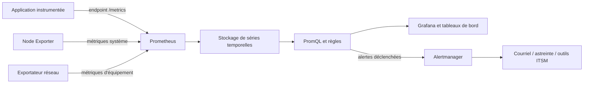

Ce schéma est logique. En pratique, les exporters peuvent être installés à proximité des hôtes, les cibles peuvent être découvertes dynamiquement et les règles de collecte peuvent être réparties par job. Il est possible d'avoir plusieurs serveurs Prometheus indépendants, des collectes fédérées, des outils de stockage longue durée ou une architecture de haute disponibilité. Ces ajouts répondent à des contraintes distinctes et doivent être décidés à partir des besoins, pas ajoutés automatiquement.

### 1.5. Le modèle mental à retenir

Il faut distinguer cinq notions :

- **La cible** est le point que Prometheus tente d'interroger.
- **Le job** regroupe des cibles de nature ou de fonction similaire.
- **La métrique** nomme la grandeur mesurée.
- **Les labels** décrivent les dimensions qui identifient les séries.
- **L'échantillon** est une valeur associée à un instant.

Par exemple, un job nommé api peut interroger trois instances applicatives. Chacune expose une métrique http_requests_total. Des labels tels que method, route et status permettent de comparer les méthodes, les routes et les catégories de réponse. Une combinaison différente de nom de métrique et de labels correspond à une série temporelle distincte. Le choix de ces dimensions détermine la facilité d'analyse et le coût de stockage.

La question de conception n'est donc pas seulement « quelles métriques activer ? ». Elle est : quelle décision voulons-nous prendre, quelle mesure permet de la prendre, quelles dimensions sont nécessaires et quel volume de séries ces dimensions vont-elles créer ? Une métrique sans usage peut consommer des ressources sans améliorer la fiabilité. À l'inverse, une mesure manquante sur une file critique peut empêcher de détecter une saturation avant qu'elle n'affecte les utilisateurs.

## 2. Concepts clés

### 2.1. Scraping : le modèle pull

Dans le modèle habituel de Prometheus, le serveur se connecte à une cible et récupère les métriques exposées par HTTP. Cette opération périodique s'appelle un scrape. La configuration précise les jobs, les cibles, l'intervalle de collecte, le chemin HTTP, le timeout et éventuellement les paramètres d'authentification, TLS et transformation de labels.

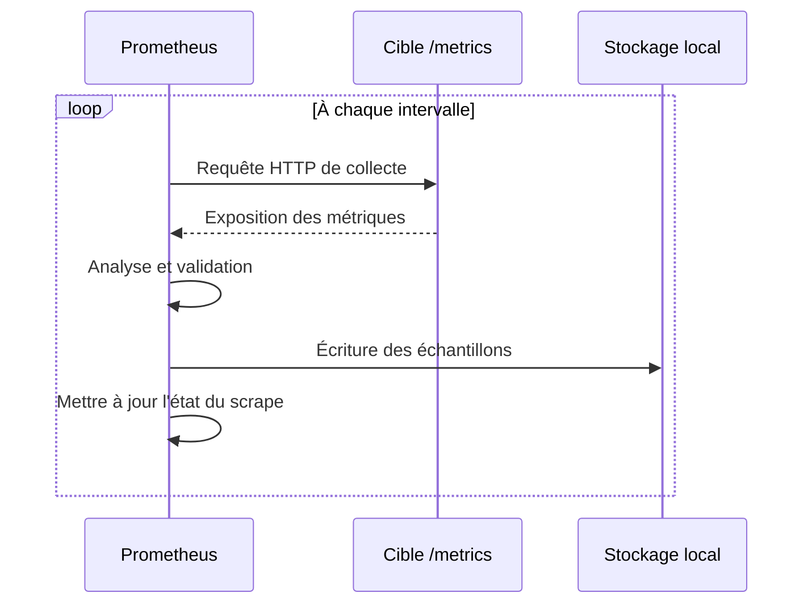

L'avantage essentiel de ce modèle est que Prometheus contrôle le rythme d'observation et peut connaître l'état de la cible grâce à la métrique spéciale up. Pour un scrape réussi, up vaut 1 ; lorsqu'une cible est injoignable ou que la collecte échoue, up vaut généralement 0 pour la série de cible correspondante. Cette information ne démontre pas que l'application fonctionne parfaitement : elle indique que le scrape a réussi. Un endpoint peut répondre avec des métriques valides alors qu'une fonction métier est cassée. Il faut donc combiner l'état de collecte et les métriques fonctionnelles.

Le modèle pull simplifie la surveillance des cibles qui ont une durée de vie stable et une adresse joignable depuis le serveur de collecte. Il permet de collecter les métriques même si l'application ne sait rien d'Alertmanager ou de l'emplacement final des tableaux de bord. Il limite aussi le besoin de confier à chaque instance la responsabilité de trouver le serveur central et d'envoyer ses mesures à chaque intervalle.

Le modèle pull impose cependant un choix réseau. Le serveur Prometheus doit pouvoir atteindre les cibles et accéder à leur endpoint de métriques. Lorsque les cibles sont séparées par un pare-feu, un NAT ou des frontières de sécurité, il faut adapter le placement, les règles réseau, la découverte ou un mécanisme de relais. Une architecture peut placer un Prometheus à l'intérieur de la zone réseau concernée plutôt que d'ouvrir des accès depuis une zone moins fiable.

### 2.2. Pull et push : comprendre les différences

Dans un modèle push général, chaque application envoie spontanément ses métriques à un collecteur. Prometheus, lui, adopte habituellement le pull et expose un endpoint de collecte aux cibles. Il existe un composant appelé Pushgateway, mais il ne constitue pas une raison de pousser toutes les métriques. L'usage recommandé est limité, notamment aux jobs de traitement très courts qui disparaissent avant qu'un scrape puisse les interroger et pour lesquels une mesure au niveau du service est utile après l'exécution.

Les métriques d'un serveur web de longue durée devraient généralement être exposées par ce serveur et collectées régulièrement. Si l'application pousse toutes ses mesures vers une gateway commune, la gateway peut devenir un point unique de défaillance ou de congestion ; les séries peuvent survivre après la disparition de l'instance qui les a poussées ; et la métrique up ne révèle plus directement l'état de santé de chaque instance d'origine. Il faut ensuite nettoyer les séries périmées, car le cycle de vie des données dans le Pushgateway est distinct du cycle de vie du job producteur.

Le Pushgateway est surtout approprié lorsque le job est global au service plutôt que rattaché à une machine particulière, par exemple une tâche périodique de rapprochement qui calcule un résultat au niveau de toute l'application. Pour un job lié à une machine, un collecteur textfile de Node Exporter peut souvent être plus adapté. Pour les environnements où un pare-feu empêche la collecte directe, le placement de Prometheus derrière la frontière réseau ou un relais spécifique peuvent être plus robustes qu'un push universel.

| Critère | Pull natif | Push vers une gateway |
|---|---|---|
| Qui initie l'échange ? | Prometheus | Le job producteur |
| Santé de collecte | La métrique up traduit le résultat du scrape | Il faut vérifier la réception et la fraîcheur des données poussées |
| Cycle de vie des séries | Suit la présence des cibles et des échantillons | Peut persister jusqu'au nettoyage manuel ou automatisé |
| Usage courant | Services et exporters de longue durée | Certains jobs courts à portée de service |
| Risque principal | Cible inaccessible depuis le collecteur | Gateway partagée, données périmées et lifecycle mal géré |

Il ne suffit donc pas de demander si un framework sait pousser des métriques. Il faut déterminer si la durée de vie du producteur, le réseau et le besoin opérationnel justifient ce modèle. Une solution qui réduit la difficulté d'une collecte peut transférer le problème au nettoyage, à la fiabilité du transport ou à la supervision de la gateway.

### 2.3. Jobs, targets et découverte

Dans la configuration, un job définit un groupe logique de collectes. Les cibles peuvent être déclarées statiquement, récupérées par un mécanisme de découverte ou générées à partir d'une plateforme comme Kubernetes, un fournisseur cloud ou une source de service discovery prise en charge. La découverte dynamique est utile lorsque des instances apparaissent et disparaissent fréquemment ; elle évite de maintenir manuellement chaque adresse dans un fichier.

Exemple minimal de configuration statique, à adapter aux hôtes réels et à la version de Prometheus :

```yaml
global:
  scrape_interval: 30s
  evaluation_interval: 30s

scrape_configs:
  - job_name: prometheus
    static_configs:
      - targets: ["localhost:9090"]

  - job_name: node
    scrape_interval: 15s
    static_configs:
      - targets:
          - "10.20.10.21:9100"
          - "10.20.10.22:9100"
        labels:
          environment: production
          team: platform
```

L'intervalle global est ici de 30 secondes, tandis que le job node utilise 15 secondes. L'intervalle d'évaluation des règles est défini séparément de l'intervalle de collecte. La configuration n'installe pas elle-même Node Exporter : elle suppose que les deux endpoints sont disponibles et autorisés depuis le serveur Prometheus.

Le nom job devient un label utile pour regrouper les séries. La cible peut également avoir un label instance issu de son adresse, ainsi que des labels statiques ajoutés explicitement. Les labels doivent décrire des dimensions utiles et stables. On peut utiliser environment, region, cluster, team ou role pour filtrer les données, à condition que ces valeurs soient cohérentes au niveau de toute l'organisation.

Un job trop large qui regroupe des endpoints de nature différente rend la configuration difficile à lire, alors qu'un job différent pour chaque instance devient excessivement fragmenté. L'objectif est de définir des groupes par technologie, responsabilités, comportement de collecte et paramètres partagés. Les exceptions devraient être explicites plutôt que dissimulées dans des règles complexes de réécriture.

### 2.4. Endpoint de métriques et exporters

Certaines applications instrumentées exposent directement des métriques au format Prometheus. D'autres logiciels ne parlent pas ce format. Un exporter interroge alors une source — système d'exploitation, équipement réseau, base de données, application ou API — et transforme les observations en métriques que Prometheus peut collecter.

Node Exporter est souvent utilisé pour les métriques des systèmes de type Unix : charge système, CPU, mémoire, système de fichiers, réseau et de nombreuses autres observations. D'autres exporters existent pour des produits et protocoles particuliers. Il faut choisir un exporter actif, maintenu, compatible avec les versions de la source et adapté à la politique de sécurité. Un exporter n'est pas un remplacement du serveur Prometheus : c'est un pont entre la source de données et le format d'exposition.

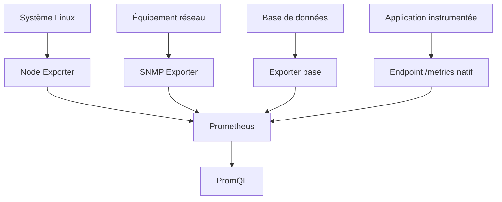

Un endpoint de métriques ne doit pas être publié sans analyse de risque. Les mesures exposent parfois la version d'un logiciel, la liste de périphériques, les erreurs internes, les noms de services, des indicateurs de volume ou des labels qui facilitent la cartographie du système. Même sans secrets, ces informations peuvent être sensibles. Limitez l'accès par réseau, chiffrement, authentification ou proxy adapté lorsque cela s'applique, et veillez à ne pas exposer l'endpoint sur Internet par défaut.

Les exporters doivent aussi être monitorés. Une cible qui ne répond plus peut indiquer un problème sur le système, sur l'exporter, sur son port ou sur le chemin réseau. On distingue ainsi la santé de l'hôte, la santé de l'exporter et la santé de l'application. Les métriques de processus d'un exporter ne prouvent pas que toutes ses sources sont joignables. Il faut examiner les indicateurs spécifiques et tester les chemins de collecte.

### 2.5. Les séries temporelles et les labels

Une série Prometheus est identifiée par un nom de métrique associé à l'ensemble des labels. Par exemple, http_requests_total avec les labels job="api", instance="api-01:8080", method="GET" et status="200" est une série. La même métrique avec status="500" représente une autre série. Chaque combinaison unique de valeurs de labels crée une série distincte, avec son propre ensemble d'échantillons.

Les labels permettent d'agréger les données à plusieurs niveaux. On peut calculer les erreurs par instance, par route, par région ou par équipe, puis retirer une dimension pour obtenir une vue globale. Cette souplesse est un avantage majeur, mais elle a un coût : plus on crée de combinaisons distinctes, plus le nombre de séries, la mémoire, le stockage et le travail de requête augmentent.

Évitez les labels non bornés : identifiant individuel d'utilisateur, e-mail, adresse de requête complète, identifiant aléatoire de commande, identifiant de session ou texte d'erreur libre. Chaque nouvelle valeur peut créer une série supplémentaire. Une route paramétrée doit être normalisée : /users/123 et /users/456 devraient souvent être représentés par un modèle comme /users/{id}, plutôt que conservés comme deux valeurs littérales distinctes.

Le bon label est une dimension qui aide à une décision et dont l'ensemble de valeurs est maîtrisé. L'instance, le service, l'environnement, le code de statut ou une région sont souvent appropriés. L'adresse IP peut être utile dans une infrastructure statique, mais dans des systèmes dynamiques il peut être plus utile d'ajouter un label logique stable. N'ajoutez pas toutes les métadonnées connues « au cas où » ; l'excès de labels augmente le coût du système et peut compliquer chaque requête.

### 2.6. Cardinalité : le coût caché des dimensions

La cardinalité correspond au nombre de combinaisons distinctes de labels observées pour une métrique ou l'ensemble des séries. Si une métrique a 10 instances, 5 méthodes, 6 codes de statut et 20 routes normalisées, elle peut potentiellement produire jusqu'à 10 × 5 × 6 × 20 = 60 000 combinaisons, même si toutes ne sont pas réellement utilisées. Si l'on ajoute un label user_id contenant des centaines de milliers de valeurs, le nombre de séries peut rapidement devenir incontrôlable.

L'effet ne se limite pas au disque. Chaque série active possède des métadonnées et des structures en mémoire. Les requêtes doivent sélectionner, parcourir et agréger ces séries. Les changements de labels peuvent créer de nouvelles séries et accroître le churn. Une cardinalité excessive peut allonger les réponses, augmenter la consommation mémoire et réduire la marge disponible pendant un incident, lorsque les requêtes sont justement les plus importantes.

Pour maîtriser la cardinalité :

- normalisez les routes et les noms d'opérations ;
- préférez les catégories aux chaînes arbitraires ;
- évitez les identifiants personnels ou transactionnels comme labels ;
- n'exposez que les dimensions nécessaires à la décision ;
- surveillez le nombre de séries et les séries nouvelles ;
- examinez les métriques les plus coûteuses ;
- utilisez une collecte plus agrégée lorsque l'analyse par individu n'est pas un besoin de monitoring.

Il n'existe pas de seuil universel qui conviendrait à tous les systèmes. Une faible cardinalité relative par série reste un bon principe, mais une plateforme doit mesurer sa propre charge. Le volume total, la fréquence de scraping, la variété des labels, la durée de rétention, la capacité machine et les profils de requête sont liés. Un indicateur qui semblait inoffensif en préproduction peut exploser quand il observe plusieurs milliers de services ou une route avec un nombre imprévisible de paramètres.

### 2.7. Convention de nommage des métriques

Une bonne métrique exprime clairement la grandeur mesurée. Le nom devrait indiquer le domaine ou le composant, le phénomène et l'unité si applicable. Les compteurs cumulatifs se terminent généralement par _total ; les durées utilisent des secondes et souvent le suffixe _seconds ; les volumes utilisent des unités cohérentes comme bytes. Une métrique ne devrait pas mélanger des unités différentes selon les instances.

Exemples de noms compréhensibles :

```text
http_requests_total
http_request_duration_seconds
process_cpu_seconds_total
process_resident_memory_bytes
queue_messages
database_connections_active
backup_last_success_timestamp_seconds
```

La dernière métrique peut être exposée comme horodatage Unix du dernier succès, à condition que son nom et sa sémantique soient documentés. Une autre stratégie consiste à exposer un âge en secondes ; le choix dépend du modèle d'instrumentation. Les deux approches ont des conséquences pour les requêtes et la gestion des valeurs absentes.

Évitez les noms qui mélangent l'unité, par exemple une métrique de latence qui renvoie des millisecondes sur une instance et des secondes sur une autre. Évitez aussi de mettre le nom des labels directement dans le nom de la métrique. Au lieu de http_requests_get_total et http_requests_post_total, utilisez une métrique http_requests_total avec un label method. Cela facilite les regroupements et évite les duplications de noms.

La convention est une interface entre les producteurs et les consommateurs. Une métrique utilisée par des règles, dashboards, scripts ou systèmes d'export doit évoluer avec précaution. Renommer un compteur ou changer son unité peut casser les requêtes et les historiques. Documentez les unités, le type, les labels et le cycle de vie, et utilisez une période de transition si un changement incompatible est nécessaire.

### 2.8. Compteurs, jauges, histogrammes et résumés

Les types classiques permettent d'exprimer des comportements différents.

**Counter — compteur cumulatif.** Il augmente ou reste stable jusqu'à un éventuel redémarrage ou reset. Il convient au nombre total de requêtes, d'erreurs, de tâches terminées ou d'octets traités. Pour calculer un débit sur une fenêtre, on utilise généralement rate() ou irate() selon le besoin. Les fonctions PromQL tiennent compte des remises à zéro observées dans les échantillons, sous certaines limites. Un compteur n'est pas directement une jauge de débit : une valeur de 1 000 000 requêtes depuis le démarrage ne dit pas à elle seule si le trafic actuel est de 10 ou de 1 000 requêtes par seconde.

**Gauge — jauge.** Elle peut augmenter et diminuer. Elle sert à mesurer une utilisation mémoire instantanée, le nombre de connexions actives, la taille d'une file ou la température. Une jauge peut être sommée, moyennée ou comparée à un seuil, selon sa signification. Ne lui appliquez pas mécaniquement rate() : la variation d'une jauge peut être un phénomène normal et ne correspond pas à un nombre d'événements.

**Histogramme — distribution en buckets.** Il compte les observations réparties dans des compartiments cumulés, ainsi qu'un nombre d'observations et une somme. Pour les latences, il permet de calculer un percentile approximatif à partir des buckets, avec une précision dépendante des limites choisies et de la distribution. Les histogrammes classiques exposent souvent des séries par borne le long du label le, plus des séries de count et sum selon la représentation utilisée.

**Summary — distribution calculée côté instrumenté.** Il peut exposer des quantiles déjà calculés et des compteurs d'observations. Les quantiles d'un summary sont généralement calculés par instance et ne peuvent pas être agrégés de manière mathématiquement correcte entre instances comme on le ferait avec les buckets d'un histogramme. Le choix entre histogramme et summary dépend du besoin de quantiles, des possibilités d'agrégation et de la bibliothèque employée.

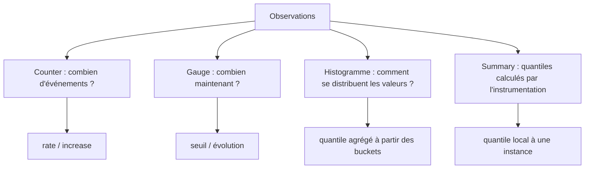

Le type n'est pas un détail décoratif. Choisir un compteur pour une valeur instantanée ou interpréter une jauge comme une somme cumulative produit des requêtes trompeuses. Lorsqu'une application expose un nom de métrique, l'équipe doit préciser la sémantique et la façon dont le compteur réagit au redémarrage. La bonne requête dépend de ce contrat.

### 2.9. PromQL : interroger les données

PromQL est le langage de requête de Prometheus. Il permet de sélectionner des séries, filtrer leurs labels, effectuer des calculs, agréger plusieurs séries et exprimer une évolution sur une fenêtre de temps. Les résultats peuvent être de type vecteur instantané, vecteur de plage, scalaire ou chaîne, selon la forme de l'expression.

Une sélection simple :

```promql
http_requests_total
```

sélectionne les séries actuelles de cette métrique. Un filtre de label peut réduire la sélection :

```promql
http_requests_total{job="api", status="500"}
```

Le filtre exact status="500" sélectionne les séries correspondantes. Des opérateurs de correspondance par expression régulière existent, mais ils doivent être employés avec prudence sur de gros ensembles. Une requête qui sélectionne trop de séries peut être coûteuse ou renvoyer un résultat moins ciblé que prévu.

Un vecteur instantané contient une valeur par série correspondante à l'instant évalué. Un vecteur de plage contient une fenêtre d'échantillons par série, exprimée par une durée entre crochets. La fonction rate() s'applique à une plage de compteur et estime la vitesse moyenne de croissance par seconde sur cette fenêtre.

```promql
rate(http_requests_total[5m])
```

Cette expression calcule le taux moyen des requêtes sur les cinq dernières minutes, pour chaque série. Les labels restent présents dans le résultat, sauf si une agrégation ultérieure les élimine. Il est important de choisir une fenêtre compatible avec l'intervalle de collecte : une fenêtre trop courte peut avoir trop peu d'échantillons, tandis qu'une fenêtre longue réagit moins rapidement aux changements récents.

### 2.10. Agrégation : sum, avg, max, min et by

Les fonctions d'agrégation permettent de résumer les séries tout en conservant les dimensions nécessaires. Pour calculer le débit de requêtes par application sans distinguer les instances :

```promql
sum by (job) (rate(http_requests_total[5m]))
```

On agrège les taux par valeur de job. En retirant instance, method et status, on obtient une valeur par job, mais il faut se demander si cette perte de détail est acceptable. Pour analyser le taux d'erreurs, on peut conserver status ou sélectionner les codes concernés avant de sommer.

Exemple de calcul d'un ratio d'erreurs HTTP 5xx :

```promql
sum by (job) (rate(http_requests_total{status=~"5.."}[5m]))
/
sum by (job) (rate(http_requests_total[5m]))
```

La formule suppose que la métrique et le label existent tels quels dans l'application instrumentée. Si le dénominateur peut être nul ou absent, le dashboard ou l'alerte doit traiter ce cas et éviter d'interpréter l'absence de données comme un taux de 0 %. La sémantique exacte dépend également de ce que l'application compte comme requête, notamment les redirections, les requêtes en cache et les échecs avant l'arrivée au serveur instrumenté.

Les agrégations les plus courantes ont des significations différentes. sum additionne des valeurs ; avg calcule une moyenne arithmétique ; min et max retiennent les extrêmes ; count compte les séries présentes, pas nécessairement les événements sous-jacents. Une moyenne peut masquer des valeurs extrêmes ou une instance très lente. Pour les latences, regardez souvent les percentiles, la proportion d'observations dépassant une limite et la répartition par endpoint.

### 2.11. Compteurs : rate, irate et increase

rate() estime le rythme par seconde d'un compteur sur une fenêtre. Elle est généralement appropriée pour les dashboards et alertes, car elle réduit le bruit produit par des compteurs discrets en répartissant les changements sur la période d'observation. irate() utilise les derniers échantillons disponibles pour estimer le taux le plus récent ; elle est plus réactive mais plus susceptible de fluctuer. increase() estime l'augmentation totale du compteur sur la fenêtre, en tenant compte des resets détectés.

Exemples :

```promql
rate(http_requests_total[5m])
irate(http_requests_total[1m])
increase(http_requests_total[1h])
```

Ne choisissez pas irate() uniquement parce qu'il semble plus précis. Pour une alerte de fiabilité, les variations les plus récentes peuvent générer des déclenchements instables. Pour une visualisation très réactive d'un trafic fluctuant, irate() peut être utile. Pour estimer le nombre d'événements dans une période, increase() peut être plus intuitif, tout en restant une estimation liée aux échantillons et à la fenêtre.

Il faut généralement calculer rate avant d'agréger plusieurs compteurs. Si l'on agrège les compteurs bruts puis applique rate, un redémarrage d'une instance peut rendre l'interprétation incorrecte, car les resets de compteurs individuels ne sont plus visibles de manière fiable. La règle pratique est d'appliquer rate() sur chaque série puis d'agréger le résultat.

### 2.12. Latence et histogrammes

La latence est souvent mieux comprise à partir de sa distribution que de sa moyenne. Supposons que 95 % des requêtes terminent en 100 ms et 5 % en 2 secondes. La moyenne est proche de 195 ms, mais les utilisateurs du groupe lent ressentent une expérience nettement différente. Un percentile 95 donne une lecture plus utile de la queue de distribution, à condition que l'instrumentation collecte suffisamment d'observations et que la méthode de calcul soit connue.

Avec un histogramme classique, on utilise les buckets cumulés pour estimer un quantile à l'aide de histogram_quantile(). Exemple :

```promql
histogram_quantile(
  0.95,
  sum by (le, job) (
    rate(http_request_duration_seconds_bucket[5m])
  )
)
```

L'agrégation conserve le label le, qui représente la limite du bucket. Il agrège les données entre instances pour produire le percentile par job. Le résultat est une estimation : la précision dépend des frontières des buckets, notamment autour de la zone où se situe le percentile. Une définition de buckets mal adaptée au temps de réponse réel peut produire une estimation grossière.

Les labels de bucket et la sémantique des séries dépendent de la façon dont l'application expose l'histogramme. Dans les histogrammes classiques, les séries _bucket ont généralement le label le et les séries _count et _sum sont distinctes. Certaines versions récentes de l'écosystème supportent également des histogrammes natifs, dont l'activation et le traitement dépendent de la version et des options. Avant d'écrire une requête de production, inspectez les séries réellement exposées et la documentation de la version utilisée.

Il peut être utile de définir un objectif directement en proportion : quelle part des requêtes termine sous 300 ms ? Pour des buckets bien choisis, une requête peut calculer le nombre de requêtes sous cette borne et le diviser par le nombre total de requêtes. Ce type d'indicateur représente parfois mieux un SLO qu'un percentile unique, mais il nécessite que le bucket demandé existe et que le dénominateur soit correct.

### 2.13. Alerte sur la disponibilité de collecte

La métrique up est générée par Prometheus pour les cibles scrapées. Une règle peut alerter lorsqu'elle reste à zéro pendant une durée donnée. Exemple de règle :

```yaml
groups:
  - name: targets
    rules:
      - alert: PrometheusTargetDown
        expr: up == 0
        for: 5m
        labels:
          severity: warning
        annotations:
          summary: "La cible {{ $labels.instance }} ne répond plus au scrape"
          description: "Le job {{ $labels.job }} est indisponible depuis plusieurs minutes."
```

Cette règle peut signaler une cible inaccessible, un exporter arrêté, un endpoint incorrect ou un blocage réseau. Elle ne dit pas automatiquement laquelle de ces causes est responsable. Elle devrait inclure des labels qui permettent de router l'alerte vers l'équipe propriétaire de la cible, et une procédure de diagnostic : vérifier l'endpoint, la connectivité depuis Prometheus, les logs de l'exporter et la page Targets.

La métrique up n'existe que lorsqu'une cible est connue et fait partie de la configuration effective. Une cible qui a disparu de la découverte peut ne plus produire une série up comme prévu ; il faut alors envisager une règle distincte pour détecter l'absence d'une cible attendue ou la baisse anormale du nombre de cibles. L'absence d'une série n'équivaut pas toujours à zéro. PromQL ne peut pas comparer une valeur qui n'existe plus à un seuil, à moins de concevoir une expression qui rende cette absence détectable.

### 2.14. Règles d'enregistrement

Une règle d'enregistrement calcule périodiquement une expression PromQL et enregistre le résultat comme une nouvelle série temporelle. Elle permet de pré-calculer une agrégation chère, d'utiliser une expression standard sur plusieurs dashboards ou d'établir des indicateurs de service cohérents. Une règle peut aussi rendre plus lisible le langage utilisé par les tableaux de bord.

Exemple :

```yaml
groups:
  - name: api-recording
    interval: 30s
    rules:
      - record: job:http_requests:rate5m
        expr: sum by (job) (rate(http_requests_total[5m]))
      - record: job:http_errors:rate5m
        expr: sum by (job) (rate(http_requests_total{status=~"5.."}[5m]))
```

La convention de nommage des règles doit faciliter la lecture de la formule et des labels conservés. Une règle d'enregistrement crée des données supplémentaires ; elle ne rend pas le coût nul. Il faut vérifier qu'elle réduit réellement le coût des requêtes en aval et qu'elle ne supprime pas une dimension nécessaire aux investigations.

Les règles doivent avoir un propriétaire, une revue et des tests. Une expression incorrecte peut être répétée à intervalles réguliers et contaminer les dashboards qui s'appuient sur elle. Les tests de règles disponibles dans l'écosystème Prometheus permettent de vérifier l'expression et les alertes sur des jeux de données connus. Les environnements de production devraient intégrer ce contrôle dans le processus de modification des règles.

### 2.15. Règles d'alerte : seuil, durée et labels

Une règle d'alerte déclenche un état d'alerte lorsqu'une expression PromQL devient vraie selon les données collectées. Le paramètre for permet d'exiger que la condition persiste pendant une durée avant de déclarer l'alerte firing. Cela limite les alertes générées par un pic très court, mais ajoute un délai à la détection. Une règle doit donc être alignée sur la criticité et sur le délai dans lequel l'équipe doit agir.

Exemple de seuil sur un taux d'erreurs élevé :

```yaml
groups:
  - name: api-alerts
    rules:
      - alert: ApiHighErrorRatio
        expr: |
          (
            sum by (job) (rate(http_requests_total{status=~"5.."}[5m]))
            /
            sum by (job) (rate(http_requests_total[5m]))
          ) > 0.05
        for: 10m
        labels:
          severity: critical
        annotations:
          summary: "Taux d'erreurs élevé pour {{ $labels.job }}"
          description: "La proportion d'erreurs 5xx dépasse 5 % depuis 10 minutes."
```

Cet exemple suppose une instrumentation, un label status et un trafic suffisant pour produire un ratio interprétable. Une application à très faible trafic peut avoir un ratio de 100 % sur une seule requête. L'alerte devrait alors tenir compte du volume minimal, du nombre d'erreurs et de la conséquence métier. Un seuil de pourcentage seul n'est pas universel.

Il faut distinguer la condition PromQL et la politique de notification. Prometheus évalue l'expression et attache les labels et annotations à l'alerte. Alertmanager reçoit ensuite les alertes, les regroupe, les déduplique et les route vers des destinataires. Si l'alerte ne se déclenche pas, examinez d'abord la série et l'expression. Si elle est firing mais ne génère pas le message attendu, examinez Alertmanager, les routes, les silences, les inhibitions et le récepteur.

### 2.16. Alertmanager : grouper, router, inhiber, silencer

Alertmanager traite les alertes envoyées par Prometheus. Il est conçu pour empêcher que chaque instance en panne devienne un message distinct envoyé séparément à toute l'organisation. Il déduplique les alertes identiques, les groupe en notifications compréhensibles, choisit le récepteur selon un arbre de routage et gère les silences et les inhibitions.

Le **grouping** rassemble plusieurs alertes ayant des labels communs dans un même avis. Lorsqu'un réseau de site tombe, il peut éviter d'envoyer cent courriels pour cent services injoignables. Le message devrait tout de même permettre d'examiner les instances touchées.

Le **routing** détermine où l'alerte est envoyée. Un label severity peut orienter les alertes critiques vers l'astreinte immédiate et les warnings vers un canal de suivi. Un label team ou service peut transmettre l'alerte au propriétaire. Les labels utilisés par le routage doivent être normalisés. Si certaines alertes utilisent critical, d'autres CRIT et d'autres P1 pour la même priorité, les règles deviennent fragiles.

L'**inhibition** empêche l'envoi de certaines alertes lorsqu'une alerte plus fondamentale est active et que des labels de contexte coïncident. Par exemple, une panne totale de cluster peut inhiber les alertes secondaires sur les instances inaccessibles de ce cluster. La règle doit être conçue avec précision pour ne pas supprimer un incident indépendant.

Une **silence** est une suppression temporaire associée à des conditions. Elle convient à une maintenance planifiée ou à un incident connu en cours de traitement. Un silence doit avoir un propriétaire, une raison, une portée et une expiration. Un silence large ou permanent peut masquer un problème réel. Les silences ne corrigent pas l'instrumentation, et leur accumulation doit être auditée.

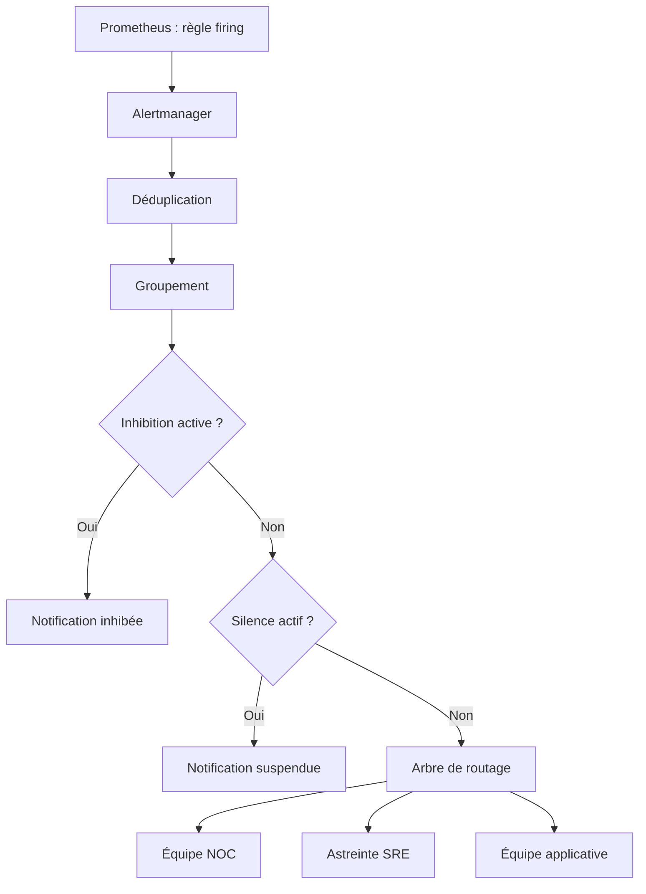

Le canal de notification doit être observé lui-même. Une alerte correcte qui est bloquée par un silence erroné, un récepteur cassé ou une configuration de routage incorrecte n'améliore pas la fiabilité. Il est utile de tester la route à l'aide d'alertes de test contrôlées et de vérifier la réception sur les outils utilisés réellement par les équipes.

### 2.17. Instrumenter une application

L'instrumentation consiste à ajouter des mesures là où le comportement de l'application est connu. Les bibliothèques client Prometheus fournissent des types de métriques et des mécanismes d'exposition pour plusieurs langages. Une application web peut enregistrer le nombre de requêtes, la durée, les erreurs, les requêtes en cours, les opérations métier et l'état de dépendances. Une file peut exposer la taille de la file et l'âge du message le plus ancien. Une tâche peut exposer le nombre de succès, d'échecs et sa dernière exécution.

Il faut éviter de sur-instrumenter sans stratégie. Chaque métrique doit représenter une grandeur définie, être mise à jour de manière cohérente et avoir une politique de labels. Le nombre de requêtes doit augmenter une seule fois par événement conformément au point choisi dans le code. Une durée devrait être calculée autour de la section qui a du sens pour le service. Si elle inclut la sérialisation dans un endpoint mais pas dans un autre, la comparaison n'est pas fiable.

Pour une API, les métriques RED sont un point de départ : Rate (taux de requêtes), Errors (taux d'erreurs) et Duration (durée ou latence). Pour les systèmes, les ressources CPU, mémoire, disque et réseau restent utiles, avec les métriques de saturation adaptées au composant. Ces catégories doivent ensuite être reliées à des parcours utilisateur et à des objectifs de fiabilité. L'indicateur d'une ressource n'est pas nécessairement l'indicateur de l'expérience.

La meilleure instrumentation se fait souvent avec les développeurs de l'application. Ils savent ce qu'est une opération métier réussie, une file qui se bloque, une dépendance dégradée ou une réponse partielle. L'équipe de supervision, de son côté, sait quelle mesure est nécessaire pour diagnostiquer, alerter et calculer un SLI. La collaboration évite les métriques techniques qui ne correspondent pas au problème observé.

### 2.18. Métriques système et réseau

Node Exporter expose des métriques de systèmes de type Unix. Les données courantes comprennent les compteurs CPU, la mémoire, les systèmes de fichiers, les interfaces réseau, les statistiques de kernel et d'autres informations système. Le sens exact des métriques dépend de la version et des collectors activés. L'utilisation CPU est généralement calculée à partir des variations de compteurs, et non d'un seul compteur brut.

Une requête utile doit distinguer l'utilisation CPU par mode de la capacité disponible. L'état d'un disque dépend de l'espace disponible, de l'inode si le système de fichiers en utilise, de la vitesse de croissance et parfois de la latence des opérations. Une partition avec beaucoup d'espace libre peut néanmoins être en difficulté si les écritures échouent. Une interface peut avoir un débit bas parce qu'elle est inactive, ou parce qu'elle est tellement congestionnée que le trafic ne passe plus. Il faut donc observer les compteurs d'erreurs et de drops en complément du débit.

Pour les équipements réseau, un exporter SNMP peut transformer les OID en métriques nommées. Les compteurs d'octets et de paquets sont cumulatifs ; il faut calculer leur variation dans le temps pour obtenir le débit. Des compteurs peuvent revenir à zéro après un redémarrage ou un reset. Les unités et le type de compteur doivent être vérifiés. Les noms de métriques et labels ne doivent pas changer arbitrairement entre les familles d'équipements, sinon les dashboards et alertes deviennent difficiles à généraliser.

La supervision réseau gagne à séparer les perspectives : accessibilité de l'équipement, état des interfaces, utilisation, erreurs, CPU et mémoire de l'équipement, état du protocole ou du voisinage, et expérience du service au-dessus. Aucun compteur ne décrit à lui seul la santé du réseau. Il faut aussi vérifier l'âge de la collecte et identifier le poller, l'exporter ou la source de mesure afin de ne pas interpréter une rupture de scraping comme une panne du réseau contrôlé.

### 2.19. Découverte de services et relabeling

Les cibles peuvent être configurées statiquement ou découvertes dynamiquement. Les mécanismes de découverte produisent souvent des métadonnées temporaires qui ne sont pas toutes conservées comme labels finaux. Les règles de relabeling permettent de modifier les labels de cible avant la collecte, de sélectionner ou supprimer des cibles, de construire des adresses ou de normaliser les métadonnées.

Le relabeling de cible se distingue du relabeling des métriques. Le premier agit sur les labels de découverte et sur la cible avant le scrape ; le second agit sur les labels des échantillons avant leur ingestion. Les deux peuvent être utiles, mais les confondre conduit à des règles au mauvais endroit. Un filtre qui doit exclure un endpoint de collecte n'est pas identique à une transformation de label sur toutes les métriques provenant d'un endpoint.

Exemple de configuration statique enrichie de labels :

```yaml
scrape_configs:
  - job_name: api
    metrics_path: /metrics
    static_configs:
      - targets: ["api-01.internal:8080", "api-02.internal:8080"]
        labels:
          environment: production
          team: commerce
```

Pour les environnements dynamiques, le même principe peut être appliqué aux métadonnées produites par le mécanisme de découverte. Une règle de relabeling mal écrite peut étiqueter toutes les cibles avec la mauvaise région, filtrer une partie d'un cluster ou construire une adresse incorrecte. Testez les règles sur un échantillon représentatif et vérifiez les cibles découvertes dans l'interface de Prometheus, plutôt que de supposer que le YAML est correct parce qu'il est syntaxiquement valide.

La fonction de relabeling permet aussi d'éliminer les labels inutiles, mais elle ne doit pas devenir une excuse pour exporter des dimensions à forte cardinalité depuis l'application. Une bonne instrumentation évite de créer des séries inutiles à la source. Le filtrage à l'ingestion peut réduire le coût local, mais les données ont déjà été exposées et récupérées ; il vaut mieux éviter d'émettre un ensemble incontrôlé de séries.

### 2.20. Durée de rétention et stockage local

Prometheus conserve habituellement les données dans une base temporelle locale. La rétention peut être configurée selon une durée ou une limite de taille, selon les options utilisées. La taille nécessaire dépend du nombre de séries, de la fréquence des échantillons, du nombre de changements de labels, de la compression et des données de règles. L'estimation la plus utile vient de la mesure réelle de la croissance sur une période représentative.

Une courte rétention réduit le coût mais limite les comparaisons à long terme, la planification de capacité et les analyses saisonnières. Une longue rétention peut consommer une grande quantité de disque et demande d'évaluer les performances, la sauvegarde, la capacité et la récupération. Les métriques à haute résolution sur quelques jours peuvent être conservées différemment des agrégats à long terme. Les règles d'enregistrement peuvent produire des agrégats adaptés aux analyses historiques, mais elles nécessitent une conception claire et un maintien cohérent des séries.

Le stockage local autonome apporte une simplicité et une robustesse appréciables : chaque serveur peut continuer à répondre avec les données qu'il a collectées même si d'autres systèmes d'observabilité sont indisponibles. Il ne signifie pas que le disque est infini ni que la base se réplique automatiquement comme une base distribuée. Pour une haute disponibilité, plusieurs instances Prometheus peuvent collecter les mêmes cibles et des systèmes externes peuvent recevoir les séries via remote write. Il faut alors concevoir la déduplication, le stockage long terme, le coût et les usages des données.

Surveillez l'espace libre du disque, le nombre de séries, la croissance, le nombre d'échantillons reçus, les erreurs d'ingestion, les temps de réponse et la durée des requêtes. Le serveur de métriques doit pouvoir alerter sur son propre stockage à l'avance. Une base saturée peut perdre des observations ou arrêter de collecter de manière fiable, ce qui créerait un angle mort dans la supervision.

### 2.21. Remote write, fédération et stockage long terme

Le remote write permet d'envoyer des échantillons vers un système compatible. Cela peut faciliter l'agrégation de plusieurs serveurs Prometheus ou la conservation de données à plus long terme. Ce mécanisme doit être analysé selon le débit des échantillons, les files d'attente, la latence réseau, la capacité du destinataire, la reprise après panne et les coûts. Une panne du destinataire ne doit pas bloquer la collecte locale plus que ne le prévoit la conception ; l'accumulation des files peut néanmoins créer une pression sur les ressources.

La fédération consiste à collecter des séries sélectionnées à partir d'un autre serveur Prometheus, souvent sous forme d'agrégats ou de données nécessaires à un tableau de bord global. Elle est utile pour une vue consolidée tout en gardant les serveurs de site autonomes. Elle ne remplace pas nécessairement un stockage longue durée et doit choisir précisément les données exportées. Tirer toutes les séries de tous les sites vers un serveur global peut annuler les bénéfices de la séparation.

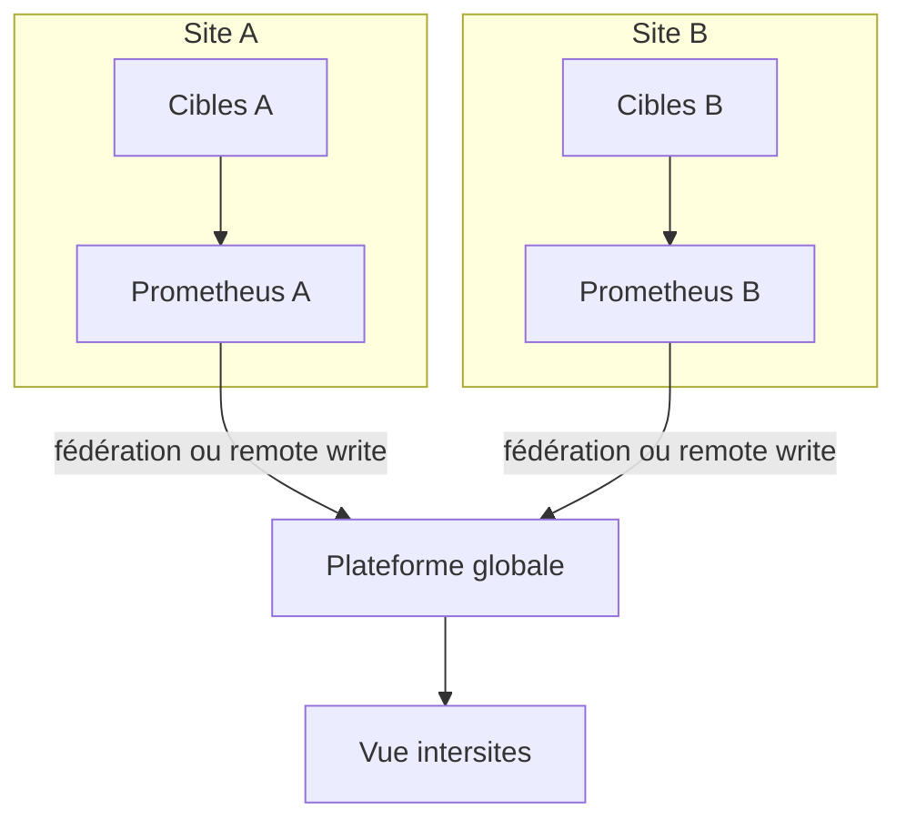

Il faut distinguer deux objectifs : la **résilience de collecte** et la **centralisation à long terme**. Plusieurs serveurs indépendants peuvent collecter les mêmes cibles pour améliorer la redondance, alors qu'une plateforme globale sert à consulter des séries provenant de plusieurs environnements. Les mécanismes de remote write, fédération et duplication ne sont pas interchangeables. Choisissez la solution à partir du volume, de la durée de rétention, des attentes de disponibilité et des besoins de requête, puis documentez ce qui doit se passer si le lien central tombe pendant plusieurs heures.

### 2.22. Sécurité des endpoints et de Prometheus

Prometheus et ses exporters fournissent des informations opérationnelles parfois sensibles. Le fait que les métriques ne soient pas des mots de passe ne les rend pas publiques. Elles peuvent indiquer les versions, les noms des services, la disposition du réseau, les routes, les volumes de trafic, les dépendances et des éléments internes. Protégez l'accès à l'interface, à l'API, aux endpoints des exporters et aux systèmes de notification selon le modèle de menace.

Les règles importantes incluent l'isolation réseau, l'exposition limitée des ports, l'usage du chiffrement et de l'authentification lorsque le contexte le requiert, la gestion des identifiants, la mise à jour des composants, les droits minimaux et la revue des plugins d'export. Ne considérez pas l'endpoint /metrics comme sûr par définition. Si le service est accessible depuis un réseau utilisateur ou Internet sans contrôle, un acteur peut cartographier l'infrastructure ou surcharger l'exporter.

Prometheus dispose de paramètres de ligne de commande et de configuration qui définissent les chemins de stockage, les jobs, les règles et divers comportements. Les paramètres disponibles dépendent de la version. Certaines interfaces de cycle de vie, notamment le rechargement HTTP ou des endpoints administratifs, doivent être activées uniquement lorsque c'est nécessaire et protégées. Une configuration de démonstration peut être moins restrictive qu'une configuration de production ; elle ne doit pas être copiée sans examen.

Les alertes ne doivent pas contenir de données sensibles inutiles. Les labels sont diffusés à travers les règles, les notifications et les outils en aval. Un label e-mail, identifiant de client ou texte d'erreur pourrait se propager dans plusieurs systèmes. Il faut privilégier les références stables et non personnelles, et garder les détails sensibles dans les systèmes appropriés avec des contrôles d'accès.

### 2.23. Disponibilité du système de supervision

Le système de métriques est lui-même une dépendance. Il doit surveiller son endpoint HTTP, sa capacité de scraping, son stockage, la durée d'exécution des requêtes, le nombre de cibles en échec, l'évaluation des règles et les erreurs d'envoi d'alertes. L'absence d'alerte ne prouve pas que tous les services vont bien ; elle peut signifier que Prometheus ne collecte plus ou que le canal d'alerte est cassé.

Pour limiter les angles morts, une source externe indépendante peut vérifier l'accessibilité de l'interface ou du service d'alerte, et un second serveur peut surveiller certains composants critiques. Le contrôle externe doit rester assez indépendant pour signaler la panne du système principal. Si les deux systèmes partagent la même alimentation, le même réseau ou le même canal de notification, ils peuvent échouer simultanément.

La haute disponibilité demande de clarifier le comportement attendu lors d'une panne. Deux Prometheus collectant les mêmes cibles peuvent produire les mêmes alertes, qui seront dédupliquées ou traitées par Alertmanager selon une architecture compatible. Les labels externes et les règles doivent être conçus pour éviter qu'un pair HA transforme une seule alerte en deux notifications. Les deux instances doivent avoir une configuration comparable et les mêmes définitions de règles, mais il faut vérifier les mécanismes de synchronisation plutôt que supposer que la parité existe automatiquement.

## 3. Architecture et Schémas

### 3.1. Parcours complet d'une métrique

Un échantillon ne devient utile que s'il traverse toute une chaîne sans perdre son sens. L'application mesure une valeur, l'expose sous un nom et des labels, le serveur découvre la cible, récupère les données, vérifie le format, ajoute ou transforme des labels, puis écrit les échantillons avec les horodatages. PromQL sélectionne les données, une règle les agrège ou évalue un état, et un dashboard ou une notification les présente à la personne qui doit agir.

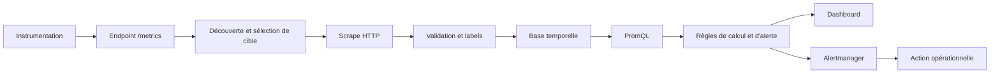

Ce modèle permet d'analyser les incidents en couches. Si une série est absente, l'endpoint peut ne pas exposer la métrique, le scrape peut échouer, une règle de relabeling peut filtrer la cible ou la série, le type de données peut être invalide, ou une requête peut utiliser un nom incorrect. Si le dashboard est vide, cela ne signifie pas nécessairement que Prometheus ne collecte rien : la requête ou les labels peuvent être incorrects. Le dépannage commence par la source la plus proche et progresse vers le système qui présente le résultat.

### 3.2. Collecte, évaluation des règles et visualisation

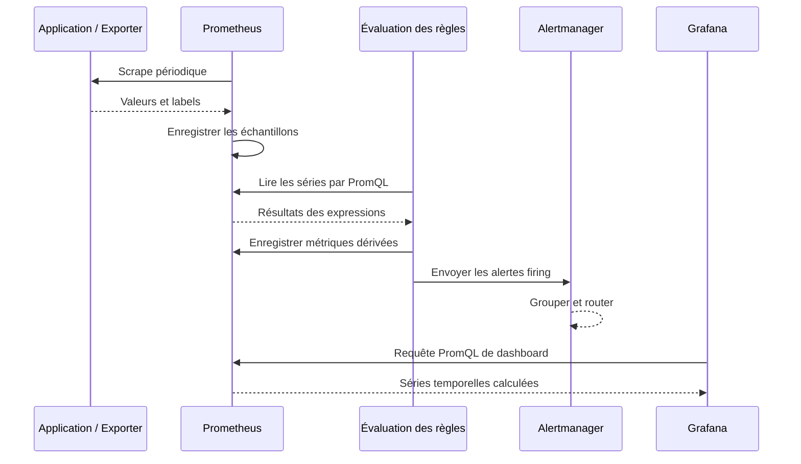

Le diagramme illustre un fonctionnement logique. Les règles d'enregistrement et les règles d'alerte sont évaluées selon leur intervalle. Grafana interroge généralement Prometheus au moment de construire les panels ; les données ne doivent pas nécessairement être exportées préalablement dans Grafana. Alertmanager est un composant distinct destiné à la gestion des notifications. Le serveur de métriques conserve les séries ; il ne remplace pas la gestion complète des incidents ou des tickets.

### 3.3. Pull contre Push : décision d'architecture

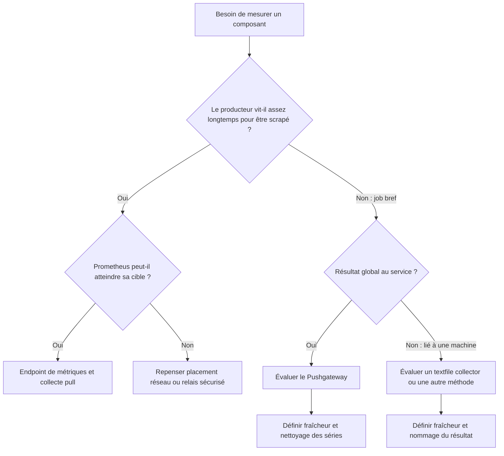

Le choix ne doit pas être dicté par la facilité d'écriture du code. Il doit préserver le cycle de vie des données et permettre de comprendre l'absence d'une mesure. Le modèle pull expose naturellement une cible indisponible via l'échec de scraping. Un résultat poussé peut survivre à l'émetteur, ce qui demande d'ajouter un contrôle de fraîcheur et un nettoyage explicite.

### 3.4. Flux de données et croissance de la cardinalité

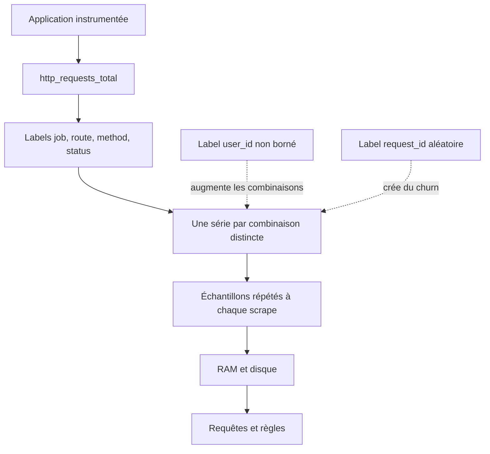

Les labels ne sont pas de simples annotations gratuites. Les deux dernières branches représentent des dimensions qui peuvent produire une croissance incontrôlée. Il est préférable d'enregistrer les détails individuels dans les logs ou les traces, puis de les corréler à des métriques agrégées par route, statut ou service. La granularité doit être choisie pour répondre aux questions opérationnelles tout en gardant un coût mesurable.

### 3.5. Règles, alertes et notifications

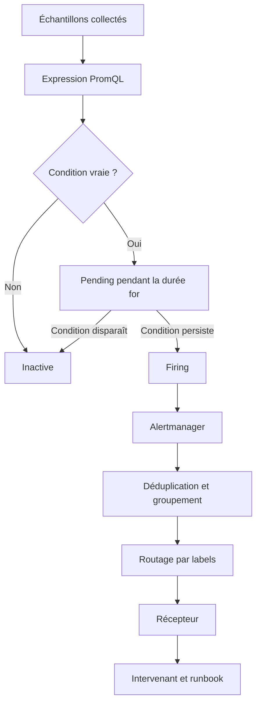

La durée for est appliquée par la règle d'alerte avant qu'elle devienne firing. Alertmanager traite ensuite les notifications. Pour analyser une alerte manquante, vérifiez si la condition PromQL devient vraie, si la règle est pending ou firing, si l'alerte est transmise, puis si les routes ou silences empêchent l'envoi. Ces états et leurs responsabilités doivent rester distincts dans les runbooks.

### 3.6. Couches de mesure : ressource, service et expérience

Une architecture mature suit plusieurs niveaux de preuve. Les métriques système identifient des contraintes de ressource. Les métriques applicatives décrivent le nombre et la durée des opérations. Les indicateurs de service mesurent un comportement utile aux utilisateurs. Les logs expliquent les événements individuels et les traces montrent un chemin à travers plusieurs composants. Prometheus est particulièrement puissant pour les mesures agrégées et les séries temporelles, mais il doit être articulé avec les autres signaux lorsqu'un diagnostic détaillé l'exige.

| Couche | Exemple de mesure | Question opérationnelle |
|---|---|---|
| Hôte | mémoire disponible, erreurs réseau | Une ressource est-elle saturée ou dégradée ? |
| Processus | redémarrages, mémoire résidente | Le programme est-il stable ? |
| Application | débit, erreurs, latence | L'API tient-elle son contrat ? |
| Dépendance | connexions DB, taille de file | Le goulot d'étranglement est-il en amont ? |
| Service métier | opérations réussies, délais | L'utilisateur peut-il réaliser le parcours attendu ? |
| Collecte | up, scrapes échoués, séries absentes | Les mesures sont-elles encore fiables ? |

### 3.7. Exemple de découpage multi-environnements

Une entreprise peut avoir une instance Prometheus pour le réseau interne, une autre pour la production applicative et une troisième dans une zone isolée. Ce découpage limite les dépendances croisées et permet de placer les collecteurs au plus près des cibles. Des requêtes globales, une fédération ou un système de stockage central peuvent fournir une vue consolidée, mais le serveur local doit rester utile lorsque la connectivité vers le central est interrompue.

La séparation par environnement évite aussi de mélanger les données de préproduction et de production dans des règles qui ont des effets différents. Les labels environment doivent être systématiques et fiables. Une instance mal étiquetée peut être exclue d'une alerte de production ou apparaître dans une visualisation qui laisse croire à un impact plus large qu'il ne l'est. L'automatisation de la découverte doit donc fournir une convention de labels vérifiable.

Le découpage doit suivre les frontières de responsabilités et les limites d'exploitation. Trop de petites instances rendent le maintien des configurations complexe ; une seule instance surchargée peut devenir un point de défaillance majeur. Évaluez le nombre de séries, la fréquence, les règles, la latence réseau, la disponibilité souhaitée et le coût de stockage. Une architecture de métriques doit être dimensionnée comme une application de production.

## 4. Étude de cas

### 4.1. Diagnostic initial : lenteurs du site e-commerce

Le site possède trois instances d'API, un cache, une base de données et une file de tâches asynchrones. Les utilisateurs se plaignent de lenteurs lors des promotions. Le dashboard existant présente uniquement le CPU moyen des serveurs. Cette valeur varie, mais elle n'explique pas les plaintes. L'équipe met donc en place des métriques et des questions par couche : combien de requêtes arrivent, quelle part échoue, quelle est la distribution de la latence, combien de connexions sont utilisées, quelle est la taille de la file et quel est l'âge du message le plus ancien ?

La première étape consiste à instrumenter l'API avec des compteurs de requêtes et un histogramme de durée. Les labels restent limités à la méthode HTTP, à une route normalisée et à la classe de statut. L'application ne crée pas de série par user_id, par adresse IP de visiteur ou par identifiant de commande. On expose les métriques de système via Node Exporter, les métriques de base de données avec un exporter adapté, et les métriques de file par l'interface de supervision prévue.

Les trois instances de l'API sont regroupées dans un job api et étiquetées avec environment et team. Les endpoints du cache, de la base de données et de la file utilisent des jobs distincts, afin de garder une identité claire. Les intervalles sont choisis selon la vitesse des événements, la charge et les besoins de détection. Une collecte toutes les 15 ou 30 secondes peut suffire à une grande partie des métriques, tandis que des indicateurs plus critiques peuvent exiger une mesure plus fréquente, si le coût reste acceptable.

### 4.2. Configurer les targets

Une première configuration peut ressembler à ceci. Les adresses sont fictives et doivent être remplacées par celles de l'environnement.

```yaml
global:
  scrape_interval: 15s
  evaluation_interval: 15s

rule_files:
  - "rules/*.yml"

scrape_configs:
  - job_name: prometheus
    static_configs:
      - targets: ["localhost:9090"]

  - job_name: api
    scrape_timeout: 5s
    static_configs:
      - targets:
          - "api-01.internal:8080"
          - "api-02.internal:8080"
          - "api-03.internal:8080"
        labels:
          environment: production
          team: commerce

  - job_name: node
    static_configs:
      - targets:
          - "api-01.internal:9100"
          - "api-02.internal:9100"
          - "api-03.internal:9100"
        labels:
          environment: production
          team: platform
```

Il faut valider la configuration avant le déploiement et inspecter l'état des targets dans l'interface de Prometheus. Chaque cible doit afficher le job, l'adresse, le dernier scrape, la durée de collecte et une éventuelle erreur. Un état DOWN ne suffit pas à identifier la cause ; le détail de l'erreur aidera à distinguer une connexion refusée, un timeout, une résolution DNS ou un problème de format.

La configuration doit ensuite être gérée comme du code : version, revue, validation et déploiement contrôlé. Les secrets ne doivent pas être mis en clair dans le dépôt. Les paramètres TLS et les identifiants doivent suivre le mécanisme de configuration approprié à l'environnement. Après changement, vérifiez que les règles restent chargées et que les cibles existantes continuent de collecter.

### 4.3. Interroger le débit et les erreurs

Pour voir le débit de requêtes par job, la requête suivante agrège les compteurs :

```promql
sum by (job) (rate(http_requests_total[5m]))
```

Pour estimer les erreurs 5xx par job :

```promql
sum by (job) (rate(http_requests_total{status=~"5.."}[5m]))
```

Le ratio d'erreurs peut être calculé comme suit :

```promql
100 *
sum by (job) (rate(http_requests_total{status=~"5.."}[5m]))
/
sum by (job) (rate(http_requests_total[5m]))
```

Il faut définir ce que la métrique compte et comment elle est émise. Si l'application ne compte que les requêtes qui arrivent à une couche particulière, elle peut ignorer les erreurs du load balancer ou du serveur frontal. Le ratio du service doit donc être comparé avec d'autres signaux. Si le trafic est nul, l'expression peut ne produire aucune valeur ou provoquer une interprétation inattendue. La visualisation doit distinguer explicitement l'absence de données d'un ratio nul.

Au moment de l'analyse, le débit est stable mais la part des erreurs ne dépasse pas le seuil attendu. En revanche, le percentile 95 augmente de 180 ms à 1,4 seconde pendant les pointes. Cela indique une dégradation de latence même si la majorité des requêtes réussissent. L'équipe ajoute alors les métriques de dépendances et les données de saturation pour localiser le goulot.

### 4.4. Analyser la latence au percentile 95

Si l'application expose un histogramme classique nommé http_request_duration_seconds, une requête type est :

```promql
histogram_quantile(
  0.95,
  sum by (le, job) (
    rate(http_request_duration_seconds_bucket[5m])
  )
)
```

Les valeurs de buckets doivent couvrir la plage réelle des latences. Si presque toutes les requêtes se terminent en moins de 100 ms mais que les buckets disponibles passent directement de 50 ms à 5 secondes, le percentile sera peu précis dans la plage utile. Si les pires requêtes dépassent la borne supérieure, le dashboard peut sous-représenter la queue de distribution. Le design de l'histogramme doit donc partir des objectifs et de la distribution attendue.

Le percentile 95 ne doit pas être interprété comme « 95 % des requêtes sont exactement à cette durée ». Il représente une frontière estimée de la distribution sur la fenêtre et la population agrégée. Il est également utile de mesurer la proportion de requêtes qui dépassent une limite métier, le volume d'observations et les différentes routes. Une moyenne globale peut masquer une route lente si celle-ci ne représente qu'une faible portion du trafic.

L'équipe remarque que les requêtes de paiement sont lentes alors que les pages produit restent rapides. Les labels route permettent d'isoler le problème, car l'instrumentation normalise les chemins. Les logs et les traces peuvent ensuite identifier la requête SQL ou l'appel externe concerné. La métrique localise le périmètre et la fenêtre temporelle ; elle n'apporte pas toujours à elle seule l'explication causale.

### 4.5. Rechercher une saturation en amont

Les métriques de la base indiquent que le nombre de connexions actives approche sa limite, tandis que la latence des requêtes augmente. La file de tâches montre un nombre croissant de messages en attente et un âge maximal qui s'allonge. Ces observations sont corrélées à la montée du percentile 95 de l'API. Le CPU des serveurs web reste modéré, ce qui explique pourquoi le premier dashboard n'avait pas révélé le problème.

L'équipe doit maintenant répondre à des questions précises. La base manque-t-elle de capacité, ou une fuite de connexions empêche-t-elle la libération des sessions ? Le nombre de requêtes est-il plus élevé que prévu ? Une opération récente exécute-t-elle des requêtes plus coûteuses ? La file est-elle saturée parce que les workers ont disparu ou parce que chaque tâche est plus lente ? Les métriques permettent de comparer la chronologie des symptômes, tandis que les logs et traces fournissent les détails des transactions.

Il faut éviter de considérer la corrélation comme une preuve. La hausse des connexions et de la latence peut avoir une cause commune, ou l'une peut être une conséquence de l'autre. L'équipe compare les changements récents, les métriques de chaque composant et les traces de transactions lentes. Elle découvre qu'une nouvelle version a multiplié le nombre de requêtes SQL pour certains parcours, faisant augmenter les connexions et l'âge de la file. La correction porte sur le code applicatif et la stratégie de pooling, pas sur le seuil du dashboard.

### 4.6. Construire une règle d'alerte utile

Une alerte de latence devrait être liée à l'expérience et non seulement à une valeur arbitraire. Un exemple simplifié peut signaler qu'un percentile calculé sur cinq minutes dépasse un seuil pendant dix minutes. La règle devrait aussi être adaptée au volume et à la route surveillée. Si certains endpoints ont une latence naturellement plus élevée, il faut un objectif par type de service ou un indicateur plus pertinent.

```yaml
groups:
  - name: commerce-api
    rules:
      - alert: ApiP95LatencyHigh
        expr: |
          histogram_quantile(
            0.95,
            sum by (le, job) (
              rate(http_request_duration_seconds_bucket{job="api"}[5m])
            )
          ) > 1
        for: 10m
        labels:
          severity: warning
          team: commerce
        annotations:
          summary: "Latence p95 élevée sur l'API {{ $labels.job }}"
          description: "Le percentile 95 dépasse une seconde depuis 10 minutes."
```

Il s'agit d'un exemple pédagogique. Avant de l'utiliser en production, vérifiez l'existence du nom de métrique, la couverture des buckets, le volume minimal, les conditions de faible trafic et le comportement si la série disparaît. Le seuil de une seconde doit être choisi selon le contrat de service, pas uniquement parce qu'il est facile à retenir. Les labels team et severity facilitent le routage, mais doivent correspondre aux valeurs attendues par Alertmanager.

La règle utilise for: 10m. Cela signifie que la condition doit rester vraie pendant une durée avant que l'alerte ne soit firing. Cela peut réduire les faux positifs produits par une pointe très courte ; en contrepartie, le délai global de détection inclut l'intervalle de scraping, la fenêtre de calcul, le temps for et le temps de notification. Si le service est critique, mesurez ce délai complet et comparez-le au besoin opérationnel.

### 4.7. Configurer le routage d'Alertmanager

Les alertes doivent être distribuées selon leur responsabilité et leur impact. Une alerte critique de paiement devrait toucher l'astreinte propriétaire ; une alerte d'espace disque en avertissement pourrait aller à l'équipe plateforme ; une alerte de test devrait être dirigée vers un canal d'expérimentation. Les labels utilisés dans la règle et l'arbre de routage doivent être cohérents et documentés.

```yaml
route:
  receiver: default-ops
  group_by: ["alertname", "cluster", "service"]
  group_wait: 30s
  group_interval: 5m
  repeat_interval: 4h
  routes:
    - matchers:
        - severity="critical"
        - team="commerce"
      receiver: commerce-oncall
    - matchers:
        - severity="warning"
      receiver: platform-team

receivers:
  - name: default-ops
  - name: commerce-oncall
  - name: platform-team
```

Les récepteurs sont ici des noms de démonstration et devraient être complétés avec des intégrations réelles. L'ordre des routes, les héritages et les options dépendent du modèle de configuration d'Alertmanager et de la version installée. Les courriels ou canaux d'astreinte doivent être configurés dans les récepteurs. Il faut éviter de mettre les identifiants d'intégration dans un dépôt public et suivre un processus sécurisé pour les secrets.

Les tests doivent couvrir les différents chemins. Déclenchez une alerte non critique et une alerte critique, vérifiez le destinataire, la déduplication, la façon dont les alertes similaires sont groupées, la répétition et la récupération. Testez aussi le comportement des silences et inhibitions. Une règle YAML syntaxiquement valide peut tout de même envoyer les alertes à la mauvaise équipe si les labels ne correspondent pas aux matchers.

### 4.8. Éviter une explosion de séries

Après la première instrumentation, un développeur propose d'ajouter les identifiants de client et de commande à la métrique de durée des requêtes. L'équipe refuse cette modification. Ces valeurs changent presque à chaque opération et pourraient créer un grand nombre de séries. Elles n'aident pas à mesurer un objectif de latence agrégé ; leur place est plutôt dans les logs ou traces, protégés par des contrôles d'accès.

L'équipe garde les labels method, route, status, environment et service. Elle normalise les routes dynamiques pour que toutes les requêtes d'une même opération soient agrégées dans une catégorie. Elle surveille ensuite le nombre de séries actives, les nouvelles séries, le volume d'échantillons et le temps de réponse des requêtes. Si la cardinalité augmente soudainement, elle examine les métriques les plus récentes et identifie quelle dimension en est responsable.

Ce choix permet de préserver la capacité d'analyse. Pendant l'incident, le SRE peut comparer la latence des routes de paiement, rechercher les erreurs 5xx et isoler l'environnement concerné sans faire exploser le stockage. Les détails d'une transaction individuelle restent disponibles par corrélation vers les logs ou traces. Les systèmes se complètent au lieu de stocker exactement le même niveau de détail.

### 4.9. Vérifier la chaîne de collecte

Une cible de production disparaît de la page Targets après une modification. Le dashboard devient vide et l'alerte de latence se résout, ce qui pourrait être interprété à tort comme un rétablissement. Le SRE examine up, la configuration effective, les erreurs de découverte et les logs de collecte. Il découvre qu'une règle de relabeling a exclu le job api après un changement de label.

Cette situation démontre une règle importante : la disparition de la série peut faire disparaître une alerte fondée seulement sur la valeur de cette série. Pour les cibles dynamiques, il faut définir comment détecter la disparition inattendue d'une cible ou une baisse anormale du nombre de cibles. Les contrôles de collecte doivent aussi être séparés des alertes de fonctionnalité. Une API ne peut pas être déclarée saine parce que sa métrique a cessé d'exister.

Le runbook de dépannage examine les targets, l'erreur affichée, le endpoint, la connectivité réseau et la configuration. Les modifications de relabeling sont testées sur un environnement de validation. Une alerte de collecte peut être routée à l'équipe plateforme, tandis qu'une alerte de latence est routée à l'équipe applicative. Cela accélère l'identification du propriétaire tout en maintenant une vision précise du problème.

### 4.10. Bilan : résultats et apprentissages

La plateforme finale contient des métriques système, des métriques applicatives, des mesures des dépendances, des règles de latence et d'erreur, ainsi que des alertes de collecte. Les tableaux de bord montrent le volume de requêtes, les erreurs, les percentiles de durée, les ressources de l'hôte, la capacité de la base et l'âge des files de messages. Les règles sont versionnées et testées, les notifications ont été validées en bout en bout, et les seuils sont liés à un contrat de service.

La résolution de l'incident ne vient pas d'une accumulation de graphes. Elle vient du choix de mesures qui permettent de réduire les hypothèses, d'agréger les données sans perdre les dimensions essentielles, et de relier une alerte à un propriétaire et une procédure. La plateforme montre où se trouve la dégradation, l'équipe examine les traces et les logs associés, puis modifie la cause dans l'application.

Le travail n'est jamais terminé définitivement. Les nouvelles versions introduisent de nouveaux endpoints et comportements ; le trafic change ; les objectifs évoluent ; certaines métriques deviennent inutiles et d'autres deviennent nécessaires. Une revue périodique doit vérifier les labels, les règles, les seuils, la rétention, la sécurité, les coûts et la pertinence des dashboards. L'observabilité est une pratique d'ingénierie continue, et non une tâche ponctuelle de configuration.

## 5. Pièges à éviter

### 5.1. Croire qu'une cible UP signifie que l'application va bien

La métrique up traduit le résultat du scrape. Elle ne confirme pas la réussite de chaque opération utilisateur. Une application peut exposer /metrics correctement tout en renvoyant des erreurs métier, en étant lente ou en ayant une dépendance indisponible. Il faut conserver une alerte de collecte et créer des métriques fonctionnelles qui mesurent le service rendu.

### 5.2. Utiliser un modèle push pour toutes les métriques

Pousser chaque mesure vers une gateway peut créer un point unique de défaillance, retirer la visibilité directe de la santé des producteurs et conserver des séries obsolètes. Le Pushgateway a des usages précis, notamment certains résultats de jobs courts au niveau du service. Pour des applications de longue durée, privilégiez l'exposition et le scraping, à moins qu'une contrainte opérationnelle justifie un autre modèle documenté.

### 5.3. Créer une série par utilisateur ou requête

Les labels non bornés augmentent la cardinalité, la mémoire, le stockage et le coût des requêtes. Les identifiants de transaction et les chaînes arbitraires sont généralement mieux conservés dans les logs ou traces. Dans les métriques, utilisez des catégories stables, des routes normalisées et des dimensions capables d'aider à une décision sans créer une série distincte pour chaque événement.

### 5.4. Appliquer rate à une jauge

rate() sert à estimer la vitesse de croissance d'un compteur sur une fenêtre. L'appliquer à une jauge de mémoire ou de connexions actives répond à une autre question et peut mener à des conclusions trompeuses. Distinguez le compteur, qui cumule des événements, de la jauge, qui mesure une valeur pouvant augmenter et diminuer. Choisissez la fonction PromQL selon la sémantique de la métrique.

### 5.5. Agréger avant de traiter les resets des compteurs

Les compteurs peuvent revenir à zéro au redémarrage. Il est généralement préférable d'appliquer rate() à chaque série de compteur avant d'agréger les débits. Agréger d'abord les compteurs bruts peut masquer les resets individuels et produire une estimation incorrecte. Les règles d'enregistrement peuvent formaliser cette pratique pour éviter qu'elle soit recopiée différemment dans chaque dashboard.

### 5.6. Utiliser une fenêtre de requête inadaptée

Une fenêtre trop courte produit des variations importantes ou manque d'échantillons ; une fenêtre trop longue lisse les changements et retarde la réaction. La fenêtre doit être compatible avec le scrape interval, le volume de trafic, la fréquence des événements et l'objectif d'alerte. Testez le comportement sur des périodes normales et sur des incidents simulés. Il n'existe pas de durée unique correcte pour tous les signaux.

### 5.7. Confondre absence et zéro

Une expression qui ne retourne aucune série n'a pas nécessairement une valeur zéro. Cela peut indiquer que la métrique n'a jamais été exposée, que la cible est disparue, que la collecte a échoué ou que les labels ne correspondent plus. Les règles doivent traiter les cas d'absence lorsque la présence de données est une exigence opérationnelle. Les dashboards doivent aussi afficher l'état de collecte et l'âge des mesures plutôt que transformer les trous en lignes rassurantes.

### 5.8. Calculer une moyenne de latence comme unique indicateur

La moyenne peut masquer la queue de distribution. Une petite proportion de requêtes très lentes peut dégrader l'expérience sans déplacer fortement la moyenne. Suivez les percentiles ou la proportion d'observations dépassant les limites définies, en choisissant des buckets adaptés. Associez ces mesures à des volumes et à des labels de route pour interpréter les résultats correctement.

### 5.9. Définir un seuil sans objectif de service

Une alerte à 80 % CPU ou à une seconde de latence n'est pas automatiquement pertinente. Les seuils doivent être liés à un contrat métier, une capacité, une tolérance de risque ou une tendance. Ils doivent aussi tenir compte de la persistance, du volume minimal, de la fréquence, du coût du faux positif et du temps nécessaire à l'équipe pour intervenir.

### 5.10. Faire confiance au YAML sans inspecter les cibles

Une configuration peut être valide syntaxiquement et malgré tout interroger la mauvaise adresse, appliquer des labels incorrects ou exclure un service avec une règle de relabeling. Après un changement, examinez la page Targets, les erreurs, le job, les labels et l'heure du dernier scrape. Une validation de configuration n'est pas un test fonctionnel complet.

### 5.11. Laisser Prometheus accessible sans contrôle

Les métriques peuvent révéler des détails d'architecture, de trafic et de fonctionnement. Protégez l'interface, l'API et les exporters avec des frontières réseau, des mécanismes d'authentification adaptés et les permissions minimales. Ne publiez pas les endpoints /metrics sur un réseau non fiable sans justification. Vérifiez également que les fonctionnalités administratives sont activées seulement lorsque cela est nécessaire.

### 5.12. Négliger les métriques de la plateforme de métriques

Une panne de Prometheus, une saturation disque ou une notification cassée peut créer un angle mort. Surveillez le serveur de collecte, ses cibles, sa base temporelle, ses règles et les canaux d'alerte. Utilisez une vérification indépendante pour les services les plus critiques, afin qu'une panne totale du système de monitoring ne supprime pas toute possibilité de la détecter.

### 5.13. Copier une règle sans vérifier ses hypothèses

Une requête PromQL dépend des noms de métriques, des labels, des unités, de la façon dont l'application incrémente les compteurs et du niveau où les observations sont faites. Une formule trouvée dans un exemple n'est pas automatiquement adaptée à votre application. Vérifiez les séries réelles, les cas de faible trafic, les valeurs absentes et les changements de version.

### 5.14. Accumuler des silences permanents

Un silence peut être nécessaire durant une maintenance, mais il doit avoir une portée claire, une raison, un propriétaire et une expiration. Les silences anciens peuvent masquer un incident réel si personne ne les examine. Les inhibitions doivent aussi être testées pour ne pas supprimer des alertes indépendantes. Le bon objectif est de réduire les notifications redondantes tout en conservant le diagnostic utile.

### 5.15. Faire de Grafana une source de vérité isolée

Un dashboard est une représentation des requêtes, pas le stockage primaire de métriques. Une visualisation vide peut venir d'une requête incorrecte, d'une variable mal définie ou d'une source de données indisponible. Dépannez les données dans Prometheus, puis la requête et enfin le panel. La logique importante d'alerte doit être versionnée dans les règles prévues plutôt que dépendre uniquement d'un graphique visible à l'écran.

### 5.16. Ignorer les changements de labels et d'unités

Un renommage ou un changement de label peut créer de nouvelles séries, casser des dashboards et faire échouer les alertes existantes. Un changement d'unité peut rendre une courbe incohérente sans produire d'erreur évidente. Les contrats de métriques doivent être traités comme des interfaces. Documentez et testez les changements incompatibles, gardez une période de migration quand elle est nécessaire et vérifiez l'impact sur les consommateurs.

### 5.17. Déployer sans tester les règles

Une règle peut être syntaxiquement correcte mais déclencher à tort sur une absence de trafic, ne jamais se déclencher à cause d'un label erroné ou envoyer la mauvaise alerte. Testez les expressions sur des exemples représentatifs, utilisez les outils de test disponibles, puis simulez une condition d'alerte. Après déploiement, vérifiez les états pending et firing, l'évaluation et le routage.

## 6. Checklist / À retenir

### 6.1. Avant d'exposer une nouvelle métrique

- [ ] La mesure correspond à une décision ou à une question opérationnelle.
- [ ] Le nom décrit la grandeur et comporte une unité cohérente si nécessaire.
- [ ] Le type — compteur, jauge ou distribution — est compris.
- [ ] Les labels sont utiles, stables et de cardinalité contrôlée.
- [ ] Les routes sont normalisées ; les identifiants non bornés ne sont pas utilisés comme labels.
- [ ] L'instrumentation met à jour les valeurs au bon endroit dans le code.
- [ ] La sortie de métriques ne révèle pas de secrets ou de données personnelles.
- [ ] Les métriques importantes disposent d'un owner et d'une description.
- [ ] Le coût de collecte et de stockage a été évalué.
- [ ] La métrique a été vérifiée avec un scrape réel.

### 6.2. Avant d'ajouter une cible

- [ ] Le job représente un groupe logique de cibles comparables.
- [ ] L'endpoint de métriques est joignable depuis le serveur Prometheus prévu.
- [ ] Le port, le chemin HTTP et le timeout sont corrects.
- [ ] Les règles TLS et d'authentification respectent la politique du réseau.
- [ ] Les labels environment, team et autres dimensions nécessaires sont cohérents.
- [ ] La cible est visible dans la page Targets après le déploiement.
- [ ] La métrique up est surveillée, et les cas de cible disparue sont considérés.
- [ ] La configuration a été validée, revue et versionnée.
- [ ] Les métriques exposées ont été inspectées.
- [ ] La santé de l'exporter est distincte de la santé de l'application.

### 6.3. Avant de créer une requête PromQL

- [ ] Le nom de la métrique existe et son sens est connu.
- [ ] Les labels sélectionnés correspondent aux séries présentes.
- [ ] rate est utilisé pour les compteurs, pas appliqué aveuglément aux jauges.
- [ ] Le traitement des resets est correct.
- [ ] L'agrégation conserve les dimensions nécessaires.
- [ ] La fenêtre de temps correspond à l'intervalle de collecte et au besoin.
- [ ] Les divisions gèrent le trafic nul et les séries absentes.
- [ ] Les unités et le type de résultat sont interprétés correctement.
- [ ] La cardinalité et le temps de réponse ont été évalués.
- [ ] La requête a été testée sur une période réelle et une situation dégradée.

### 6.4. Avant de créer une alerte

- [ ] La condition représente un risque opérationnel précis.
- [ ] Les seuils sont reliés à un SLI, un SLO ou une capacité documentée.
- [ ] La durée for tient compte du bruit et du délai maximal de détection.
- [ ] Les cas de faible trafic et de données absentes sont traités.
- [ ] Les labels severity, team et service sont normalisés.
- [ ] Le message contient un résumé, l'impact probable et une piste de diagnostic.
- [ ] Alertmanager route le message vers le bon récepteur.
- [ ] Les groupements, silences et inhibitions sont compris et testés.
- [ ] La notification et la récupération ont été testées de bout en bout.
- [ ] La règle est versionnée et testée avant son déploiement.

### 6.5. Lors d'un incident lié aux métriques

1. Vérifiez l'heure du dernier échantillon et l'état du scrape.
2. Consultez la page Targets et l'erreur de collecte exacte.
3. Confirmez la présence des métriques et labels dans Prometheus avant d'inspecter le dashboard.
4. Exécutez l'expression PromQL séparément et examinez les séries sélectionnées.
5. Vérifiez si le problème vient de la cible, de l'exporter, du réseau, du relabeling, de l'ingestion ou du calcul.
6. Si l'alerte est firing mais n'arrive pas, examinez Alertmanager, son routage, ses silences et ses récepteurs.
7. Comparez les métriques avec les logs et traces avant de conclure à une cause unique.
8. Après correction, vérifiez la fraîcheur, le retour de la cible, la stabilité et la récupération de l'alerte.
9. Enregistrez la cause et la modification nécessaire pour empêcher la récidive.

### 6.6. Tableau mental des composants

| Élément | Fonction principale | Question à se poser |
|---|---|---|
| Instrumentation | Mesure la grandeur dans l'application | La mesure représente-t-elle le bon événement ? |
| Exporter | Traduit la source en métriques exposables | La source est-elle bien interrogée et protégée ? |
| Target | Endpoint interrogé par Prometheus | Est-il joignable et attendu ? |
| Job | Groupe de cibles et paramètres de collecte | Les cibles sont-elles de même nature ? |
| Label | Dimension qui identifie une série | Cette dimension est-elle utile et bornée ? |
| Scrape | Collecte périodique via HTTP | Le résultat est-il récent et valide ? |
| TSDB | Stockage de séries temporelles | La capacité et la rétention sont-elles suffisantes ? |
| PromQL | Sélection et calcul sur les séries | La requête préserve-t-elle la bonne sémantique ? |
| Recording rule | Calcule et enregistre une série dérivée | Le résultat est-il utile et maintenable ? |
| Alerting rule | Déclenche une alerte sur une expression | Le signal justifie-t-il une intervention ? |
| Alertmanager | Groupe et route les alertes | Le message arrive-t-il au bon destinataire ? |
| Grafana | Visualise les séries | Le dashboard répond-il à une question utile ? |
| Remote write / fédération | Relie des données entre systèmes | Le besoin est-il l'agrégation ou la rétention longue ? |

### 6.7. Exercices de consolidation avec correction

**Exercice 1 — Une métrique de requêtes est un compteur. Vous voulez afficher le débit par seconde sur cinq minutes. Quelle approche utiliser ?**

**Correction :** utiliser rate() sur une fenêtre de compteur, par exemple rate(http_requests_total[5m]), puis agrégater avec sum by (job) si l'objectif est un débit par application. Le compteur brut représente un total depuis son dernier reset ; il ne donne pas le rythme actuel. Appliquer rate avant l'agrégation permet de mieux traiter les resets propres aux différentes instances.

**Exercice 2 — Le dashboard indique que l'utilisation mémoire est « négative » après le déploiement d'une requête utilisant rate(). Quelle erreur est probable ?**

**Correction :** rate() est probablement appliqué à une jauge ou à une métrique dont la sémantique n'est pas celle d'un compteur cumulatif. Une jauge peut augmenter et diminuer librement ; sa variation ne correspond pas à un débit d'événements. Il faut vérifier la définition de la métrique et utiliser la valeur instantanée ou une agrégation temporelle appropriée pour l'usage recherché.

**Exercice 3 — Prometheus affiche up=1, mais les utilisateurs reçoivent des erreurs de paiement. Que faut-il faire ?**

**Correction :** up=1 confirme que le scrape de la cible a réussi ; il ne garantit pas le fonctionnement métier. Il faut consulter les métriques fonctionnelles d'erreurs et de latence, contrôler les dépendances comme la base ou la passerelle de paiement, et corréler avec les logs et traces. Le service doit disposer d'un endpoint de santé ou d'indicateurs métier pertinents, tout en conservant une alerte distincte sur la collecte.

**Exercice 4 — Après l'ajout du label request_id, le nombre de séries et la mémoire augmentent fortement. Quelle correction est la plus appropriée ?**

**Correction :** retirer les identifiants non bornés des labels de métriques et les conserver dans les logs ou traces, où les détails individuels sont mieux adaptés. Utiliser des dimensions stables telles que route normalisée, méthode, classe de statut, environnement ou service. L'équipe doit ensuite observer le nombre de séries, les nouvelles séries et les requêtes coûteuses pour confirmer que la cardinalité est revenue à un niveau soutenable.

**Exercice 5 — Un job court pousse un résultat vers Pushgateway. Pourquoi ne suffit-il pas de consulter son ancienne valeur OK ?**

**Correction :** le Pushgateway peut conserver une série après que le job producteur a disparu, car son cycle de vie n'est pas automatiquement lié à celui du job. Il faut définir un indicateur de fraîcheur, identifier clairement le résultat attendu, nettoyer les séries obsolètes lorsque c'est nécessaire et surveiller le chemin de collecte. Pour un job lié à une machine, un mécanisme comme le textfile collector peut être plus adapté.

**Exercice 6 — Une règle d'alerte est firing, mais personne ne reçoit le message. Où poursuivre le diagnostic ?**

**Correction :** la condition PromQL est déjà vraie et l'alerte a atteint l'état firing. Il faut donc examiner la transmission à Alertmanager, les labels employés dans l'arbre de routage, les silences et inhibitions, le récepteur et les journaux d'envoi. On doit tester la réception réelle, y compris les intégrations externes et le message de récupération, au lieu de modifier d'emblée l'expression PromQL.

**Exercice 7 — Une cible disparaît et l'alerte de latence se résout. Comment éviter ce faux sentiment de rétablissement ?**

**Correction :** une série absente n'est pas une valeur saine, et l'expression d'alerte peut ne plus produire de résultat si la cible sort de la découverte ou si le label a changé. Il faut surveiller up, la fraîcheur et le nombre de targets attendues, puis créer des contrôles d'absence lorsque la présence d'une série est obligatoire. Après un changement de configuration, la page Targets et les logs de relabeling doivent être vérifiés.

**Exercice 8 — Le p95 calculé à partir d'un histogramme semble incohérent après un déploiement. Quels éléments vérifier ?**

**Correction :** vérifier le nom et le type de métrique, la présence des buckets et du label le, les bornes utilisées, l'agrégation des séries et la fenêtre rate(). Un changement de buckets peut modifier la précision, tandis qu'un nom ou label différent peut retirer une partie des instances de la requête. Comparez la distribution réelle, les volumes d'observations et les métriques par instance avant de modifier le seuil d'alerte.

### 6.8. Conclusion opérationnelle

Prometheus offre une base puissante pour collecter, stocker et analyser des métriques, mais sa valeur vient de la cohérence de la chaîne. Une instrumentation bien conçue fournit des mesures utiles. Le modèle pull maintient une relation claire entre le collecteur et les cibles. Les labels ajoutent de la dimension, à condition de contrôler la cardinalité. PromQL transforme les séries en indicateurs. Les règles convertissent ces indicateurs en décisions, puis Alertmanager distribue les notifications aux personnes responsables.

Retenez quatre principes : **une métrique doit avoir une sémantique connue**, **les labels doivent rester maîtrisés**, **une alerte doit correspondre à un risque exploitable**, et **la collecte doit surveiller sa propre fraîcheur**. Une valeur absente n'est pas automatiquement zéro, un scrape réussi n'est pas la preuve que l'application rend son service, et un joli dashboard ne remplace pas une procédure d'incident. Mesurez le comportement réellement attendu, confrontez les signaux et testez régulièrement la chaîne complète.

### 6.9. Références officielles pour approfondir

- Vue d'ensemble de Prometheus : https://prometheus.io/docs/introduction/overview/
- Configuration générale et scrape configs : https://prometheus.io/docs/prometheus/latest/configuration/configuration/
- Bases de PromQL : https://prometheus.io/docs/prometheus/latest/querying/basics/
- Convention de nommage des métriques et labels : https://prometheus.io/docs/practices/naming/
- Pratiques d'instrumentation : https://prometheus.io/docs/practices/instrumentation/
- Quand utiliser le Pushgateway : https://prometheus.io/docs/practices/pushing/
- Concepts d'Alertmanager : https://prometheus.io/docs/alerting/latest/alertmanager/
- Configuration d'Alertmanager : https://prometheus.io/docs/alerting/latest/configuration/
- Documentation de Node Exporter : https://github.com/prometheus/node_exporter

Les options de configuration, le support des formats d'exposition, les histogrammes et les mécanismes de haute disponibilité évoluent. Pour une mise en production, vérifiez les pages officielles correspondant à la version réellement installée, et testez les règles sur des données représentatives avant de les déployer.
