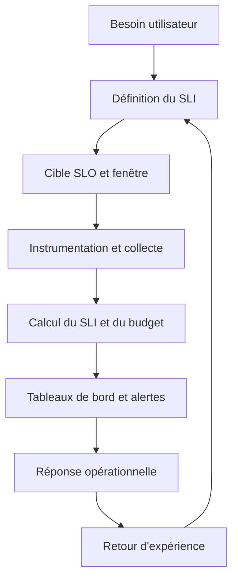
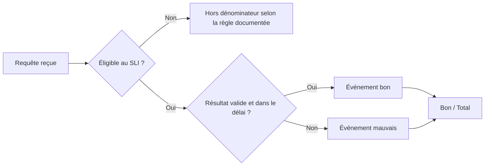
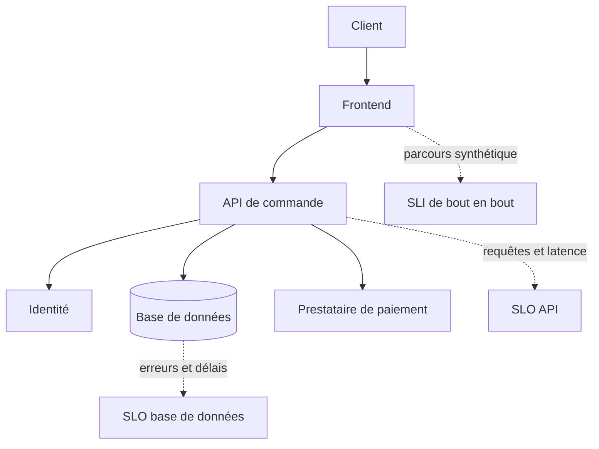
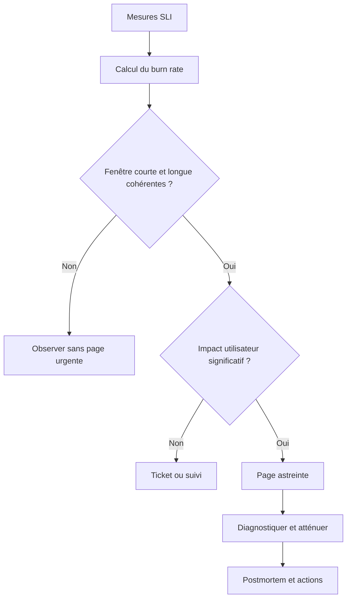
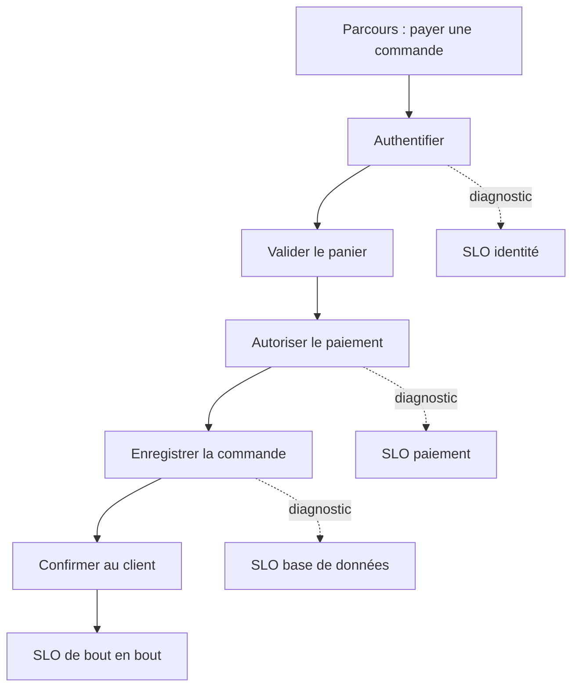

# SLI, SLO, SLA et error budgets

> **Mise en contexte.** Une plateforme peut afficher des serveurs « verts », un processeur peu chargé et aucun disque plein, tout en étant inutilisable pour ses clients. La fiabilité ne se résume pas à l’état des composants : elle se mesure par ce que les utilisateurs arrivent réellement à faire, dans un délai acceptable et avec un résultat correct. Les SLI, SLO, SLA et budgets d’erreur permettent de transformer cette idée en objectifs mesurables, en alertes actionnables et en décisions partagées entre produit, développement et exploitation.

## 1. Introduction

### 1.1. Pourquoi mesurer la fiabilité du point de vue de l’utilisateur ?

Imaginez un service de paiement en ligne. Le serveur HTTP répond à chaque requête avec un code 200, le cluster est disponible et les tableaux de bord sont presque entièrement verts. Pourtant, certains paiements mettent vingt secondes à aboutir, d’autres sont refusés par une dépendance, et plusieurs clients voient une page qui confirme une opération sans que la commande soit correctement enregistrée. Le système paraît sain du point de vue de l’infrastructure, mais l’expérience réelle est dégradée.

À l’inverse, un composant peut redémarrer sans aucun impact visible : le trafic est absorbé par une seconde instance, les requêtes restent dans les limites de latence et les données sont préservées. Compter chaque redémarrage comme une panne conduirait à surévaluer le risque. Il faut donc commencer par définir ce qui constitue une réussite pour l’utilisateur, puis mesurer cette réussite de façon cohérente.

L’observabilité complète fournit les signaux permettant de comprendre le fonctionnement interne. La discipline SRE ajoute une question de pilotage : quel niveau de fiabilité l’équipe vise-t-elle, comment saura-t-elle qu’il est respecté, et quelle décision doit-elle prendre lorsque la fiabilité se dégrade ? La chaîne logique est la suivante : besoins des utilisateurs, indicateurs mesurables, objectifs explicites, suivi du budget d’erreur, puis décisions opérationnelles.

### 1.2. Les quatre notions à ne pas confondre

Un **SLI** (*Service Level Indicator*) est une mesure de niveau de service : par exemple, la proportion de requêtes valides qui réussissent, ou le pourcentage de requêtes terminées en moins de 300 millisecondes. Il décrit ce qui est observé, avec une population, un mode de calcul et une source de données.

Un **SLO** (*Service Level Objective*) est une cible définie sur un SLI, durant une fenêtre de temps spécifiée. Exemple : « au moins 99,9 % des requêtes de consultation du catalogue réussissent sur une fenêtre glissante de 30 jours ». Le SLO guide la conception, les alertes, l’analyse du risque et les arbitrages.

Un **SLA** (*Service Level Agreement*) est un engagement formel entre un fournisseur et un client. Il peut préciser le niveau de service, la méthode de calcul, les exclusions, les obligations de signalement et les compensations éventuelles en cas de non-respect. Un SLA peut reprendre certains SLO, mais il n’est pas simplement un synonyme de SLO : son interprétation dépend du contrat et du contexte juridique.

Un **error budget**, ou budget d’erreur, représente la quantité d’échecs tolérée par rapport à un SLO sur sa fenêtre de mesure. Pour un objectif de réussite de 99,9 %, la fraction de budget correspondant aux échecs est de 0,1 %. Ce budget fournit un langage commun pour parler de risque : il indique la marge restante avant que le niveau de fiabilité visé ne soit compromis.

### 1.3. Objectifs du cours

À la fin de ce cours, vous devez savoir partir d’un parcours utilisateur pour choisir un SLI pertinent, écrire un SLO précis et interprétable, distinguer un objectif interne d’un engagement SLA, calculer un budget d’erreur en pourcentage, en événements et, lorsque cela a du sens, en temps, comprendre la consommation et le burn rate, choisir une fenêtre de mesure, concevoir des alertes significatives, relier les résultats aux changements et aux incidents, puis documenter un objectif dans un outil de supervision.

Ce cours suppose des connaissances de base en métriques, journaux, traces distribuées et supervision. Il approfondit leur utilisation au service de la fiabilité, sans exiger une marque de monitoring particulière. Les formules et fragments de configuration sont des supports de compréhension ; ils doivent être vérifiés avec les données et les versions d’outils réellement utilisées.

### 1.4. La bonne question avant le choix du seuil

La question initiale n’est pas « quel seuil permettrait d’avoir un beau tableau de bord ? », mais « quelle mauvaise expérience voulons-nous éviter ? ». Un taux d’erreurs inférieur à 1 % n’a pas le même sens pour un moteur de recherche qui peut réessayer une requête et pour une API de transfert bancaire. Une moyenne de latence peut masquer une minorité de requêtes catastrophiquement lentes. Un site de formation peut tolérer quelques minutes d’indisponibilité à 3 heures du matin, mais pas au début d’un examen programmé.

La fiabilité est donc une propriété du service rendu dans un contexte d’usage. Elle ne signifie pas que tous les composants doivent être continuellement actifs, ni que chaque métrique doit atteindre une valeur parfaite. Elle signifie qu’il existe une définition explicite de la réussite, une manière fiable de la mesurer, un niveau de service jugé acceptable et un processus décidé à l’avance lorsque les résultats s’écartent de cette cible.

## 2. Concepts clés

### 2.1. Définir un SLI sans ambiguïté

Un SLI doit être suffisamment simple pour être compris par les équipes et suffisamment précis pour être calculé de façon reproductible. Une définition utile comporte au minimum cinq éléments :

1. **L’objet mesuré** : une requête HTTP, une transaction, une opération de stockage, un job planifié, une session ou un parcours complet.
2. **La population** : routes incluses, clients concernés, région, classe de trafic, exclusions justifiées et dimension de service.
3. **La condition de réussite** : code de réponse acceptable, résultat correct, durée maximale, absence de perte de données ou terminaison dans les délais.
4. **Le calcul** : ratio d’événements bons sur le total, percentile de latence, ratio de fenêtres réussies ou autre formule explicitée.
5. **La source et la qualité des données** : compteur applicatif, test synthétique, événement de transaction, métrique de proxy ou trace, fréquence de collecte et traitement des données manquantes.

Un SLI flou comme « le site est rapide » ne peut pas être validé. Une définition comme « proportion des requêtes de recherche éligibles, hors trafic de test, qui retournent un résultat valide en moins de 400 ms du point de vue du serveur » peut être mesurée. Il reste à vérifier si la latence serveur correspond réellement à l'expérience complète du client, mais au moins les hypothèses sont visibles.

Le choix du point de mesure importe. Une latence mesurée dans le navigateur inclut le réseau et le rendu, mais dépend des conditions de test. Une latence du serveur est plus facile à segmenter et à diagnostiquer, mais elle peut ignorer un frontend bloqué. Pour un service interne, un SLI mesuré à l'entrée de l'API peut suffire ; pour une expérience de bout en bout, un parcours synthétique peut compléter la télémétrie côté serveur.

#### Ratio d'événements

Pour un SLI fondé sur les événements, on calcule :

**SLI de réussite = nombre d'événements bons / nombre d'événements éligibles**

Si 99 850 requêtes sur 100 000 réussissent selon la définition retenue, le SLI de réussite est de 99,85 %. Le dénominateur doit être aussi soigneusement défini que le numérateur. Si les requêtes lentes sont exclues du dénominateur, le système paraît artificiellement plus fiable. Si le trafic de test, les sondes ou les requêtes invalides sont mélangés sans réflexion, l’indicateur peut devenir trompeur.

Une autre formulation compte les événements mauvais : taux d’échec = événements mauvais / événements éligibles. Pour un même univers d’événements, le taux de réussite correspond à 1 moins le taux d’échec. Conserver une convention claire évite les alertes inversées et les calculs de budget avec le mauvais signe.

#### Distribution de latence

Pour les performances, une moyenne seule est souvent insuffisante. Supposons que 99 requêtes prennent 100 ms, mais qu’une requête prenne 20 secondes. La moyenne peut paraître raisonnable alors qu’un utilisateur a subi un blocage sévère. Les percentiles complètent cette vision : p50 décrit la médiane, p95 le seuil sous lequel se trouvent 95 % des observations, et p99 la queue de distribution à 1 %.

Un SLI de latence peut être exprimé comme la proportion de requêtes terminées sous un seuil, par exemple « 99 % des requêtes éligibles en moins de 250 ms ». Cette formulation se combine naturellement à un budget d’erreur : les requêtes au-delà du seuil sont mauvaises. Elle permet souvent un calcul plus robuste que le simple objectif de p99, notamment lorsque l’on veut compter le nombre d'événements qui consomment le budget.

### 2.2. Choisir des SLI utiles

Les SLI habituels incluent la disponibilité fonctionnelle, la latence, la correction du résultat, la fraîcheur des données, la durabilité, le débit utile et la complétude ou ponctualité d’un traitement. La disponibilité fonctionnelle demande si une requête aboutit à un résultat acceptable. La latence mesure si l’opération se termine dans la fenêtre de temps nécessaire. La correction vérifie que le résultat est exact, pas simplement que la requête a été transportée sans erreur. La fraîcheur évalue si les données sont récentes à l’usage. La durabilité évalue si les données confirmées comme écrites restent disponibles selon la garantie promise.

Il ne faut pas transformer chaque métrique technique en SLI. CPU, mémoire, profondeur de file et taux de redémarrage sont d'excellents signaux de diagnostic, mais ils ne démontrent pas à eux seuls qu’un utilisateur reçoit le service attendu. Ils peuvent toutefois servir d’indicateurs précurseurs : une file qui grossit peut annoncer une violation du SLO avant que les demandes n’expirent.

Le bon SLI est une approximation fidèle du besoin utilisateur, pas forcément la métrique la plus facile à collecter. Il doit rester mesurable et exploitable dans la durée. Si sa définition exige des données impossibles à obtenir ou à conserver, commencez par un indicateur plus simple, documentez sa limite et construisez progressivement une instrumentation plus proche de l’expérience réelle.

### 2.3. Définir un SLO complet

Un SLO est une cible, mais sa forme doit rendre son application claire. Une formulation utile précise le service ou le parcours concerné, le SLI et sa formule, la valeur cible, la fenêtre de mesure, la population concernée et les exclusions, la source de mesure et la gestion des données manquantes, le propriétaire de l'objectif, ainsi que la façon dont le résultat influence les alertes et décisions.

Exemple : « Sur une fenêtre glissante de 30 jours, au moins 99,9 % des requêtes de lecture du profil, reçues par l'API publique et correctement authentifiées, retournent un résultat fonctionnel en moins de 400 ms. Les requêtes mal formées rejetées avant le traitement métier ne sont pas dans le dénominateur ; toute exclusion est documentée. Le responsable du service révise l'objectif chaque trimestre. »

Cette description est meilleure que « disponibilité de 99,9 % » car le terme disponibilité est souvent ambigu. Compte-t-on les minutes pendant lesquelles une sonde réussit ? Les requêtes réussies ? Les requêtes réussies dans le délai ? Toutes les régions ? Les erreurs du fournisseur d'identité ? Un SLA contractuel peut imposer sa propre formule, qui ne doit pas être confondue avec le SLO interne.

#### Ne pas choisir la cible en observant seulement la performance actuelle

Si un système réalise déjà 99,99 % de réussite, il serait tentant de choisir cette valeur. Mais les performances actuelles peuvent être dues à une période favorable ou à un effort d'exploitation coûteux. Inversement, fixer un objectif légèrement supérieur à la performance actuelle peut être utile pour rendre visible l'écart, mais il ne garantit pas à lui seul que cet objectif est pertinent.

La cible doit refléter l'impact utilisateur, le coût d’une interruption, les attentes des clients, les contraintes de produit, les coûts d’architecture et le rythme de changement souhaité. Une cible trop basse accepte trop de mauvaises expériences ; une cible démesurément élevée peut conduire à des surcoûts, à ralentir les changements et à détourner les équipes d’améliorations utiles. Une garantie absolue de 100 % est rarement réaliste pour un service distribué : elle peut rendre les arbitrages plus risqués au lieu de les éliminer.

Il est souvent sain de garder une marge entre l'objectif interne et l'engagement externe. Cela permet de détecter une détérioration avant qu’elle ne devienne une violation contractuelle. Cette marge n'autorise pas à manipuler la mesure ; elle sépare simplement un indicateur de pilotage exigeant d'un engagement commercial calculé différemment.

### 2.4. SLA : l’engagement externe

Un SLA formalise une attente entre parties. Il peut contenir un niveau de disponibilité, une période d'évaluation, des modalités de déclaration, des délais de réponse, des exclusions, des compensations et les conditions d’éligibilité des clients. La définition juridique exacte dépend du contrat et de la juridiction ; les exemples de ce cours sont pédagogiques et ne remplacent pas un avis juridique.

Un fournisseur peut communiquer un SLA de 99,5 % de disponibilité mensuelle tandis que l’équipe d’ingénierie suit un SLO interne de 99,9 % sur les requêtes réussies dans un délai défini. Ces valeurs ne sont pas contradictoires si le SLI, la fenêtre et les règles de calcul ne sont pas identiques. Le SLO interne vise à piloter la qualité ; le SLA fixe ce qui a été convenu avec le client.

Évitez de publier un SLA dont le calcul ne peut pas être reproduit à partir de données conservées. Conservez les fenêtres temporelles, la source de vérité, les fuseaux horaires, les règles de maintenance planifiée et les critères d'exclusion. Toute exclusion doit être explicite et acceptable contractuellement : exclure après coup les périodes difficiles rend le chiffre inutile et détruit la confiance.

### 2.5. Le budget d’erreur : une marge de risque, pas un objectif d’échec

Pour un SLO de réussite de 99,9 %, la fraction d'événements mauvais autorisée est :

**Fraction de budget = 1 − cible de réussite**

Donc 1 − 0,999 = 0,001, soit 0,1 %. Cette fraction peut être interprétée comme 1 000 événements mauvais pour un million d'événements éligibles, si l’objectif est calculé sur les événements et si le dénominateur total est bien un million.

Le budget d'erreur existe pour reconnaître que les incidents, les déploiements défectueux et les aléas sont possibles. Il ne constitue pas une permission de dégrader volontairement le service jusqu’à la limite. Il aide à décider où investir, quand ralentir les changements et si une expérimentation supplémentaire est raisonnable.

Le budget peut être exprimé en nombre d'événements, en durée, ou par une méthode fondée sur des fenêtres temporelles. La formule exacte dépend du type de SLI. Un SLO de 99,9 % des requêtes réussies ne se traduit pas automatiquement par 43,2 minutes de panne autorisées par mois, car les requêtes ne sont pas uniformément distribuées dans le temps. Cette conversion n’est valable que pour une mesure fondée sur la disponibilité temporelle, avec une fenêtre mensuelle et une convention précise de durée.

#### Exemple de budget en événements

Un service reçoit 10 millions de requêtes éligibles pendant la fenêtre. Le SLO vise 99,9 % de réussite. Le budget théorique est donc 0,1 % du total, soit 10 000 événements mauvais. Si 2 500 requêtes sont déjà mauvaises, 25 % du budget est consommé et 7 500 événements mauvais restent tolérables avant la limite de cette fenêtre. Cela ne signifie pas que l’équipe doit consommer ce reste ; il s’agit d’une marge maximale.

#### Exemple de budget en temps

Pour une fenêtre de 30 jours, la durée totale est 30 × 24 × 60 = 43 200 minutes. Pour un objectif de disponibilité temporelle de 99,9 %, la fraction non disponible autorisée est 0,1 %, donc 43,2 minutes. Cette interprétation suppose que chaque minute est évaluée comme disponible ou indisponible. Un SLI événementiel peut donner un résultat différent si une panne arrive pendant une période de très faible trafic ou une pointe de charge.

### 2.6. Fenêtre de mesure : glissante ou calendaire

Une fenêtre **calendaire** commence et se termine selon une période déterminée : mois civil, trimestre ou semaine. Elle facilite les rapports mensuels et le rapprochement avec les engagements contractuels. Mais un incident juste avant le changement de mois peut sembler disparaître du tableau de bord dès la remise à zéro du budget, même si les utilisateurs continuent à ressentir les effets.

Une fenêtre **glissante** observe en continu, par exemple les 30 derniers jours. Elle donne une vue plus stable de l’expérience récente et évite l’effet artificiel du calendrier. En revanche, son comportement est plus complexe à expliquer et elle peut garder des erreurs dans la fenêtre plusieurs jours après un incident ponctuel.

Le choix doit répondre à l’usage. Un SLO destiné aux décisions quotidiennes de déploiement peut utiliser une fenêtre glissante. Un SLA associé à un mois contractuel peut avoir une fenêtre calendaire précise. Les deux peuvent être suivis simultanément si leur définition est claire. Ne mélangez pas le budget d'une fenêtre glissante avec un compteur mensuel remis à zéro le premier jour.

### 2.7. Consommation du budget et burn rate

La consommation du budget décrit la part déjà dépensée. Le **burn rate** indique à quelle vitesse le budget est consommé par rapport au rythme qui épuiserait le budget exactement à la fin de la fenêtre.

Une approximation utile est :

**Burn rate = taux d'erreur observé / taux d'erreur autorisé par le SLO**

Pour un SLO de 99,9 %, le taux d'erreur autorisé est de 0,1 %. Si le taux observé est de 1 %, le burn rate est 1 % / 0,1 % = 10. À ce rythme, la consommation est dix fois plus rapide que le rythme soutenable sur toute la période. À burn rate 1, le budget serait consommé au rythme de référence si le taux restait constant. À burn rate 0,2, il est consommé plus lentement.

Le burn rate donne un signal plus contextuel qu'un seuil isolé sur le nombre d’erreurs. Un taux de 1 % peut être exceptionnellement élevé pour une API à SLO 99,9 %, mais être normal pour un indicateur différent. Il faut toujours le comparer au budget correspondant au bon SLO.

Une alerte efficace prend en compte à la fois la vitesse de consommation et la quantité d'événements concernés. Un burn rate très élevé sur trois requêtes peut être du bruit statistique ; une détérioration modérée qui touche des centaines de milliers d'utilisateurs peut être urgente. Les règles de notification doivent tenir compte de la fenêtre, du volume minimum et de l’impact.

### 2.8. Budget restant et politique de changement

Le budget restant est une donnée pour la prise de décision, pas une règle universelle. Une organisation peut définir que lorsque le budget est presque épuisé, les déploiements à risque sont soumis à une revue supplémentaire, que les corrections de fiabilité deviennent prioritaires, et que les lancements non essentiels sont reportés. Si le budget est dépassé, elle peut instaurer un gel temporaire des changements risqués, en laissant possibles les correctifs d’incident et de sécurité.

Une politique responsable doit être écrite avant la crise. Elle précise les responsabilités, les exceptions, le processus d'approbation et les critères de retour à la normale. Sans cela, le budget reste un graphique que l’on consulte mais qui ne change aucune décision. Avec une politique trop rigide, il peut cependant devenir un objectif bureaucratique : par exemple, une équipe pourrait éviter un changement nécessaire de sécurité parce que le budget est bas. Les exceptions doivent donc être justifiées, enregistrées et analysées.

### 2.9. Quand un SLO est bon… et quand il est trompeur

Un objectif devient trompeur lorsqu’il ne couvre pas les parcours importants. Une API peut atteindre son SLO sur la route de santé tout en ayant une recherche inutilisable. Un SLO de disponibilité qui compte uniquement les réponses HTTP 2xx peut classer comme réussite une réponse vide ou incorrecte. Un objectif de latence calculé sur la moyenne peut masquer des queues de distribution très lentes. Un SLO mesuré uniquement par une sonde dans une région peut ignorer une panne régionale.

Les erreurs courantes sont les suivantes : choisir une métrique parce qu’elle est déjà disponible, sans vérifier si elle reflète l’expérience ; fixer une cible à 100 % ou un seuil trop ambitieux sans analyse de coût ; mélanger des populations dont les attentes sont différentes ; modifier la formule pendant la période d'évaluation sans versionner cette modification ; oublier le volume minimal ou les intervalles sans trafic ; exclure silencieusement des erreurs dues à une dépendance ; confondre amélioration d'une métrique interne et amélioration réelle de l'expérience ; créer tellement de SLO que personne ne sait lesquels gouvernent les décisions.

La solution n’est pas de mesurer tout ce qui bouge, mais d’avoir un petit ensemble d'objectifs significatifs, avec des métriques techniques de diagnostic en soutien.

## 3. Architecture et Schémas

### 3.1. Du parcours utilisateur à la décision

L’architecture de gestion des SLO comprend une source de besoin, une définition versionnée, des données de mesure, une couche de calcul et une boucle de décision. Il n’est pas nécessaire qu’un seul outil fournisse tous ces éléments. Un système peut collecter les événements dans Prometheus, calculer les SLI via des requêtes, afficher la consommation du budget dans Grafana et documenter les politiques dans un dépôt Git.



Ce cycle est itératif. Si l’équipe découvre pendant un incident que le SLI ne reflète pas l’impact, elle peut le corriger, mais la modification doit être documentée et suivie. Les données historiques ne doivent pas être présentées comme si la nouvelle définition avait toujours existé.

### 3.2. Ratio d’événements bons sur événements éligibles

Pour les requêtes, la méthode par événements est souvent intuitive. Le service émet ou observe un événement pour chaque opération éligible. Une condition définit un événement bon : code et résultat acceptables, latence sous le seuil, et éventuellement validation métier. Les autres événements constituent des échecs.



Ne retirez pas une requête du dénominateur simplement parce qu’elle a échoué. Les exclusions doivent correspondre à des catégories indépendantes et légitimes, comme une requête mal formée rejetée avant l’entrée dans le service, si telle est la définition choisie. Une fois qu’une opération est acceptée comme faisant partie du service, l’échec d’une dépendance est généralement une mauvaise expérience et doit rester visible.

### 3.3. Dépendances et frontières de service

Une application est souvent composée d’un frontend, d’une API, d’un cache, d’une base de données, d’un fournisseur d’identité et d’un service tiers. Les équipes ont besoin de SLO à plusieurs niveaux : un objectif de parcours visible par l’utilisateur, des SLO de service pour les composants qui ont des responsabilités propres, et des indicateurs techniques pour diagnostiquer une dégradation.



Une dépendance peut être en panne alors que la responsabilité de l’expérience reste chez le service principal. Il est rarement utile de dire aux utilisateurs que la disponibilité est mauvaise « uniquement parce que le fournisseur est en panne ». La cause est pertinente pour le diagnostic et les accords contractuels, mais l’utilisateur juge le résultat. En même temps, un SLO de service ne doit pas être utilisé pour attribuer automatiquement une faute à une équipe : il doit soutenir la coopération et la résolution des problèmes.

### 3.4. Exemple Prometheus : compter les demandes bonnes et totales

Supposons qu’une application expose un compteur de requêtes nommé **http_requests_total** avec les labels **service**, **route** et **code**, et que la route **/checkout** soit pertinente. Les noms et les labels sont un exemple : adaptez-les à votre instrumentation réelle et préférez les conventions de votre projet.

Requêtes totales, en excluant ici les routes internes de santé :

```promql
sum(rate(http_requests_total{service="checkout",route="/checkout"}[5m]))
```

Requêtes mauvaises dans une définition simplifiée où seuls certains codes serveur sont considérés comme mauvais :

```promql
sum(rate(http_requests_total{service="checkout",route="/checkout",code=~"5.."}[5m]))
```

Ratio d’erreur :

```promql
sum(rate(http_requests_total{service="checkout",route="/checkout",code=~"5.."}[5m]))
/
sum(rate(http_requests_total{service="checkout",route="/checkout"}[5m]))
```

Ce calcul est un exemple pédagogique, pas une définition universelle de l’échec. Il ne compte pas automatiquement les délais d’attente qui ne produisent pas de réponse, les réponses fonctionnellement incorrectes avec un code 2xx, ni les défaillances vues uniquement côté client. Il doit correspondre à la réalité des métriques de l’application. Les fonctions rate évaluent la vitesse moyenne de croissance d’un compteur sur un intervalle ; les agrégations doivent préserver ou supprimer uniquement les labels adaptés au SLI.

Pour un SLI de réussite de 99,9 %, le taux d'erreur cible est 0,001 sous forme décimale. Le burn rate à partir du ratio d’erreurs peut être calculé en divisant le ratio observé par 0,001. Vérifiez toujours les unités et le fait que le ratio renvoie une valeur entre 0 et 1. Une confusion entre 0,1 et 0,001 multiplie ou divise les résultats par cent et peut rendre l’alerte inutilisable.

### 3.5. Exemple de budget et de burn rate en PromQL

Avec un SLO de réussite de 99,9 %, le taux d’échec autorisé est de 0,001. Une mesure d’un ratio d’erreurs sur cinq minutes pourrait servir à calculer un indicateur de burn rate :

```promql
(
  sum(rate(http_requests_total{service="checkout",route="/checkout",code=~"5.."}[5m]))
  /
  sum(rate(http_requests_total{service="checkout",route="/checkout"}[5m]))
) / 0.001
```

Une valeur de 8 indique un taux d’erreur environ huit fois plus élevé que le taux moyen compatible avec l'objectif sur la période. Cette formule ne suffit pas à elle seule pour définir une alerte opérationnelle : il faut choisir la fenêtre, le seuil, le volume et les actions associées. Une division par zéro en période sans trafic produit des données non définies ; une règle de production doit gérer cette situation explicitement, par exemple en surveillant séparément le volume ou la disponibilité synthétique.

Il est préférable de tester les requêtes à partir des séries réellement exposées, d’inspecter leurs labels et de comparer le résultat à un décompte simple sur une période connue. Une requête PromQL syntaxiquement valide peut mesurer la mauvaise population. Lorsqu’un SLI a des exigences métier plus riches, exposez des métriques dédiées plutôt que d’essayer de deviner le succès à partir de codes HTTP génériques.

### 3.6. Les alertes orientées budget

Une alerte classique peut se déclencher lorsque le taux d’erreur dépasse 1 % pendant cinq minutes. Cette règle est simple, mais elle ne considère pas le SLO et peut être inadaptée à un objectif plus exigeant ou à une population de trafic réduite. Une alerte basée sur le burn rate relie le rythme actuel à la marge d’erreur disponible.

Les politiques multi-fenêtres utilisent généralement une fenêtre courte et une fenêtre plus longue : elles cherchent une consommation suffisamment rapide pour être urgente tout en évitant de déclencher sur une pointe isolée. Le choix précis des seuils dépend de la période du SLO, de la nature du service, du trafic et du coût des incidents. Il n’existe pas une paire de chiffres universelle à copier sans validation.



Les alertes de budget doivent indiquer le service, le SLO, la fenêtre, la consommation estimée, le burn rate, les liens vers les tableaux de bord et les premiers gestes de diagnostic. Une page « burn rate trop élevé » sans contexte oblige l’astreinte à refaire toute l’enquête au moment où elle en a le moins besoin.

### 3.7. Représenter le budget dans un tableau de bord

Un tableau de bord de fiabilité doit répondre rapidement à quatre questions : le SLO est-il respecté sur la fenêtre ? Quelle part du budget a été dépensée ? À quelle vitesse le reste est-il consommé ? Quels parcours ou régions contribuent le plus à la dégradation ? Il doit présenter séparément la valeur du SLI, la cible SLO, le budget restant et les données de qualité qui peuvent invalider l’interprétation.

Pour éviter les ambiguïtés, affichez le type de fenêtre et ses dates exactes, le dénominateur, les éventuelles données manquantes et la version de la définition. Un pourcentage sans volume peut être trompeur : deux erreurs sur dix requêtes représentent 20 %, tandis que mille erreurs sur un million représentent 0,1 %, mais le risque opérationnel et la population touchée sont différents. Le pourcentage doit donc être associé au volume et à la gravité des événements.

Une vue orientée équipes peut afficher la tendance hebdomadaire, les déploiements, les incidents et les changements de budget. Une vue exécutive peut regrouper les SLO par parcours métier. Évitez de classer publiquement les équipes sur la base d’un seul chiffre : cela encourage l’optimisation du score plutôt que l'amélioration du service.

### 3.8. Versionner les définitions avec OpenSLO

Un SLO est une politique d’ingénierie et doit être traité comme du code. Conservez la définition dans un dépôt, utilisez des demandes de revue, ajoutez des tests et rendez les changements audités. Une modification du seuil, des routes incluses ou des exclusions change le sens du chiffre historique. La documentation doit préciser la date d’entrée en vigueur et les raisons de la modification.

Un format déclaratif tel qu’OpenSLO propose une manière indépendante du fournisseur de décrire des SLI, objectifs, fenêtres et méthodes de calcul. La prise en charge réelle dépend de l’outil ou de l’intégration utilisée : une définition YAML valide n’assure pas à elle seule que le système collecte les bonnes métriques, qu’il calcule le budget comme prévu ou qu’il envoie des alertes. Validez le schéma, puis testez le comportement dans votre environnement.

Exemple conceptuel et simplifié de définition OpenSLO :

```yaml
apiVersion: openslo/v1
kind: SLO
metadata:
  name: checkout-success
  displayName: Réussite du paiement
spec:
  service: checkout
  indicator:
    metadata:
      name: checkout-good-events
    spec:
      ratioMetric:
        counter: true
        good:
          metricSource:
            type: Prometheus
            spec:
              query: sum(rate(checkout_requests_good_total[5m]))
        total:
          metricSource:
            type: Prometheus
            spec:
              query: sum(rate(checkout_requests_total[5m]))
  timeWindow:
    - duration: 30d
      isRolling: true
  budgetingMethod: Occurrences
  objectives:
    - displayName: Réussite des paiements
      target: 0.999
```

Cet extrait illustre les principales idées ; il n’est pas garanti prêt à déployer sans adaptation au parseur, à la version de la spécification, aux règles de collecte et à l’outil choisi. Vérifiez que les compteurs monotones sont adaptés à la requête, que les unités sont cohérentes et que les périodes d’évaluation correspondent aux exigences. Une version de production doit également préciser la définition des événements bons, les exclusions, les propriétaires et les politiques d’alerte.

### 3.9. SLO composés et parcours de bout en bout

Un parcours utilisateur complet peut dépendre de plusieurs sous-services. Définir un SLO uniquement pour l’API ne garantit pas la réussite du parcours si le frontend ne s’affiche pas, si l’authentification est bloquée ou si le résultat métier n’est pas persisté. Un SLO de bout en bout peut donc être mesuré indépendamment, au moyen de transactions synthétiques ou d’événements réels de parcours.

Les objectifs composés peuvent aider à exprimer un parcours formé de plusieurs objectifs, mais les méthodes d’agrégation sont importantes. Il ne faut pas supposer que les disponibilités de composants se multiplient ou s’additionnent automatiquement : cette estimation dépend des dépendances, des redondances, des corrélations d’échec, des mécanismes de retry et du point où la réussite est observée. Mesurer directement l’expérience complète est souvent préférable pour l’objectif utilisateur, tandis que les SLO de composants aident à comprendre les causes.



Pour les SLO composés, documentez l’objectif qui compte pour l’utilisateur et les objectifs secondaires qui aident au diagnostic. Sans cette séparation, chaque équipe peut déclarer son propre service conforme alors que l’ensemble du parcours échoue.

## 4. Étude de cas

### 4.1. Contexte : SkillTree, plateforme de formation

Une plateforme d'apprentissage propose la connexion, le catalogue des cours, les leçons, les examens et les laboratoires interactifs. Les utilisateurs se plaignent que « le site est lent », que certaines pages restent bloquées et que des examens ne démarrent pas. Le tableau de bord de l'infrastructure ne montre pas de saturation constante du processeur. L’équipe décide de remplacer le diagnostic vague par des objectifs de fiabilité centrés sur les parcours.

Le premier travail consiste à distinguer les symptômes. Le chargement du tableau de bord est une expérience frontend et API ; le démarrage d’un examen inclut l’obtention des questions, la création d’une session et le rendu de l’interface ; le contrôle d’un laboratoire dépend d’un endpoint de validation et de la persistance du résultat. Un unique SLO « site disponible » ne serait pas suffisamment représentatif.

L'équipe choisit trois SLI initiaux :
- lecture du contenu : proportion des requêtes éligibles qui retournent un contenu valide dans les 800 ms ;
- démarrage d’examen : proportion des tentatives qui parviennent jusqu’à une session prête et visible en moins de 2 secondes ;
- enregistrement d’un résultat : proportion des soumissions acceptées qui sont persistées et confirmées dans la 1,5 seconde.

Les seuils sont provisoires et doivent être confrontés à des mesures réelles, aux attentes des apprenants et à la distribution des usages. L’équipe exclut les tests de charge identifiés et les demandes manifestement mal formées avant le traitement métier, mais ne retire pas du dénominateur un examen qui échoue à cause d’une dépendance interne. Les exceptions sont écrites dans la documentation de chaque SLI.

### 4.2. Choisir des objectifs réalistes

Après avoir analysé les données de base et parlé aux utilisateurs, l’équipe définit par exemple les objectifs suivants pour les 30 derniers jours :

| Parcours | SLI | SLO initial |
|---|---|---:|
| Lecture de leçon | Réponses valides en moins de 800 ms | 99,5 % |
| Démarrage d’examen | Session prête et visible en moins de 2 s | 99,0 % |
| Enregistrement du résultat | Soumission persistée et confirmée en moins de 1,5 s | 99,5 % |

Ces nombres sont des exemples de conception, pas des promesses pour un produit réel. Le niveau final doit être fondé sur des données et une décision produit. L'équipe pourrait choisir une cible plus élevée pour l'enregistrement d'une réponse si une perte de données est particulièrement grave, ou séparer le démarrage des examens programmés du trafic de consultation générale.

La définition du SLI de démarrage doit être vérifiée. Si le frontend déclare une session prête dès la réception d’un identifiant, mais que la liste des questions n’arrive jamais, il compte une fausse réussite. La mesure doit correspondre à une condition observable et utile, comme la disponibilité de la première question et la possibilité d’interagir. Une petite instrumentation événementielle peut suivre le parcours complet avec un identifiant de corrélation, sans enregistrer de données personnelles inutiles.

### 4.3. Calculer le budget

Supposons que le SLO de démarrage d’examen soit 99,0 % sur une fenêtre glissante de 30 jours. Le budget d’erreur est de 1 %. Si le service a observé 40 000 démarrages éligibles pendant la fenêtre, son budget théorique est de 400 démarrages mauvais. Si 120 échouent, 30 % du budget est consommé. Il reste 280 événements mauvais avant que le budget soit entièrement dépensé, sous réserve des évolutions du dénominateur et de la fenêtre glissante.

Le dénominateur n’est pas constant. Chaque nouvelle requête correcte augmente le nombre total d'événements et, mathématiquement, le budget théorique associé à la fenêtre, tandis que les événements qui quittent la fenêtre glissante disparaissent également de son calcul. Les tableaux de bord doivent donc recalculer la consommation à partir de la fenêtre réelle, plutôt que d’afficher un simple compteur d'erreurs depuis le début du mois.

La lecture de leçon vise 99,5 %, donc un taux d’erreur autorisé de 0,5 %. Si le ratio d’erreur instantané approche 2,5 %, le burn rate est égal à 2,5 / 0,5 = 5. Une telle mesure, maintenue sur une fenêtre représentative, consomme le budget cinq fois plus vite que le rythme théorique. L’équipe doit vérifier le trafic, les routes, les codes de réponse et la corrélation avec un changement récent avant de décider si une page d’astreinte est justifiée.

### 4.4. Construire la supervision

Les métriques sont conçues pour distinguer les événements bons et mauvais à chaque étape. L’application expose des compteurs tels que **lesson_request_good_total**, **lesson_request_total**, **exam_start_good_total**, **exam_start_total**, **result_submit_good_total** et **result_submit_total**, avec des labels bornés comme le service, la région et la catégorie de résultat. Les identifiants d'utilisateur, les URL contenant des données sensibles ou les identifiants de transaction uniques ne doivent pas être utilisés comme labels de séries : ils entraînent une cardinalité excessive et peuvent introduire des risques de confidentialité.

L’équipe construit ensuite un panneau montrant le SLI et le SLO de chaque parcours sur 30 jours, un panneau de consommation du budget et de burn rate par fenêtre, une ventilation contrôlée par région et version applicative, des liens vers les journaux et traces d’un échantillon de requêtes en erreur, une annotation pour les déploiements et les incidents, une alerte urgente lorsque le burn rate dépasse une politique validée sur plusieurs fenêtres, et une alerte moins urgente lorsque le budget restant devient bas sans réveiller l’astreinte pour un risque non immédiat.

La collecte doit également surveiller ses propres défaillances. Si les métriques cessent d’être émises, un tableau de bord sans données ne signifie pas que le service est sain. Une règle de qualité des données peut signaler l’absence inattendue de séries, tandis que les sondes synthétiques fournissent une voie d’observation indépendante. Les deux systèmes ne sont pas infaillibles, mais leurs modes de défaillance ne sont pas toujours identiques.

### 4.5. Incident : le budget se consomme trop vite

Un déploiement change la façon dont l’API récupère les questions d’un examen. Le temps de réponse moyen de la base de données reste correct, mais le démarrage d’examen dépasse le seuil pour 8 % des tentatives. Le SLO visé est de 99 %, le taux d’erreur admissible est donc 1 %. Le burn rate calculé sur les démarrages mauvais est environ huit fois supérieur au budget de référence.

La réponse correcte ne consiste pas à attendre la violation du SLO pour agir. L'équipe confirme d’abord que l’indicateur est valide et que le volume est représentatif. Elle examine la distribution de latence, les versions de l’application et les traces de requêtes. La corrélation avec le déploiement oriente le diagnostic vers une requête de chargement devenue trop coûteuse. Si l'impact est élevé et l'atténuation simple, le rollback est envisagé avant une analyse définitive.

Une fois le service stabilisé, l’équipe compare la période d’incident avec le budget consommé. Elle enregistre l’incident, ses facteurs contributifs et les actions de prévention : test de performance du démarrage d’examen, contrôle du plan de requête, alerte de burn rate et validation du contrat d’API. Le postmortem sans blâme évite de réduire le problème à une erreur individuelle ; il cherche les conditions techniques et organisationnelles qui ont permis à la régression d'atteindre les utilisateurs.

### 4.6. Faire du budget un outil de planification

Le budget de la plateforme est encore suffisant au début de la période. Le produit souhaite lancer une fonctionnalité majeure qui touche le démarrage d'examen. L’équipe peut utiliser le budget courant, la tendance récente et l'impact potentiel pour décider d'un déploiement progressif, d'un canari, d'une observation renforcée ou d'un report. Le budget ne calcule pas automatiquement la décision, mais il rend le risque explicite et mesurable.

Si le budget est consommé presque entièrement, la politique de l’équipe peut suspendre les changements non essentiels sur le parcours d'examen, imposer un canari, exiger une approbation du responsable de service ou prioriser les correctifs de fiabilité. Les correctifs de sécurité urgents et les actions nécessaires pour réduire un incident doivent suivre une procédure d’exception claire. L’équipe doit éviter d’utiliser le budget comme une sanction : ce sont les mécanismes de décision et l'apprentissage qui comptent.

Une fois le budget rétabli et la cause de la régression traitée, l’équipe ne doit pas considérer la remise à zéro de la fenêtre comme une preuve de résolution. Elle vérifie que les actions ont été réalisées, que les mesures sont correctes et que le problème ne réapparaît pas. Un SLO est un système de pilotage continu, pas une note à obtenir à la fin du mois.

## 5. Pièges à éviter

### 5.1. Mélanger disponibilité, succès et rapidité

Une réponse HTTP valide ne garantit pas que l'utilisateur obtient le résultat attendu. Une opération peut répondre en 200 avec un contenu vide, écrire des données incorrectes ou laisser l'interface bloquée. Définissez la réussite de façon fonctionnelle, et complétez le taux de succès par un SLI de latence si le délai compte pour l’expérience.

Inversement, n'essayez pas d'incorporer toutes les dimensions dans une formule opaque. Des SLI séparés facilitent la compréhension : réussite, délai, fraîcheur ou correction peuvent tous être importants. Si vous combinez des dimensions dans la définition de « bon événement », documentez clairement les conditions.

### 5.2. Traiter une panne de dépendance comme une exclusion automatique

Lorsque le fournisseur d'identité, la base de données ou un service tiers échoue, les utilisateurs peuvent perdre l’accès au parcours. L'équipe principale doit pouvoir mesurer cette dégradation même si elle n’en est pas l'unique cause. Exclure toutes les erreurs de dépendance donne un chiffre rassurant mais ne décrit pas la qualité du service. Il peut être pertinent de suivre un SLO interne du composant et un SLO de bout en bout en parallèle.

Une règle contractuelle peut définir des exclusions spécifiques, mais elle doit rester distincte de l'indicateur interne de l'expérience réelle. On peut afficher séparément l'impact externe et l'attribution technique sans réécrire les événements observés.

### 5.3. Confondre le SLO et le SLA

Un SLO est principalement un objectif opérationnel, tandis qu'un SLA formalise un accord. Une alerte à l'approche du SLO sert à prévenir un problème ; une violation SLA peut déclencher des obligations contractuelles. Ne supposez jamais que les formules, exclusions, périodes ou fenêtres sont identiques. Faites valider le texte contractuel par les personnes compétentes et testez les calculs avec des données réelles.

### 5.4. Fixer des objectifs sans justification utilisateur

Le choix de 99,99 % peut paraître professionnel, mais quatre neuf ne sont pas toujours nécessaires. L’exigence ajoute des coûts de redondance, de surveillance et d'astreinte et peut compliquer les changements. Un objectif plus modeste peut être tout à fait adapté à un service non critique ; un parcours de paiement ou une fonction de sécurité peut exiger une analyse plus stricte.

Documentez le coût et les bénéfices de l'objectif : quel impact utilisateur éviter, quel risque l'équipe est-elle prête à accepter, quels compromis de capacité ou de budget sont impliqués ? Réexaminez ces hypothèses si les usages, l'architecture ou les attentes changent.

### 5.5. Lire une moyenne comme une garantie

La latence moyenne ne dit pas combien d'utilisateurs subissent les retards les plus sévères. Une moyenne peut s’améliorer lorsque la majorité du trafic devient rapide alors qu’un segment important reste lent. Suivez des distributions ou la proportion d'événements qui dépassent un seuil, puis segmentez par route ou région si le volume le justifie.

Attention à ne pas agréger des percentiles de manière incorrecte : la moyenne des p99 de plusieurs instances n’est pas nécessairement le p99 global. Pour un SLO événementiel, calculez de préférence le ratio sur le dénominateur global approprié ou utilisez une méthode statistique qui préserve la distribution.

### 5.6. Oublier les petits volumes et les données manquantes

Deux erreurs sur cinq requêtes donnent un taux d’échec de 40 %, mais cette mesure est très variable. Cent erreurs sur cent mille requêtes peuvent avoir un impact plus large sans paraître alarmantes en pourcentage. Les alertes doivent tenir compte de la confiance statistique, du volume et de la gravité. Pour les services à très faible trafic, les tests synthétiques ou des fenêtres plus longues peuvent être utiles, tout en reconnaissant qu'une sonde ne reproduit pas toute l'expérience réelle.

L'absence de données n'est pas la même chose qu'un taux d'erreur de zéro. Une série manquante peut signifier une absence de trafic, une panne d'instrumentation ou une interruption de collecte. Définissez une politique explicite : vérifier le volume, signaler les données inconnues et utiliser un signal indépendant si le service doit être surveillé même sans trafic réel.

### 5.7. Réinitialiser mentalement le budget au changement de mois

Une fenêtre calendaire est pratique pour les rapports, mais une remise à zéro du tableau de bord ne répare rien. Si les utilisateurs rencontrent une dégradation à la fin du mois, les équipes doivent continuer à corriger le problème après le début du mois suivant. Une fenêtre glissante complète ce suivi, et les rapports doivent préserver l'historique des incidents et des décisions.

N’utilisez pas un budget recalculé sur 30 jours comme s’il s’agissait d’un stock fixe d'erreurs depuis le premier jour du mois. Les nouvelles requêtes et les événements qui quittent la fenêtre changent le dénominateur et donc le budget théorique.

### 5.8. Utiliser le budget comme arme entre équipes

Une politique punitive pousse les équipes à cacher les incidents, contester les mesures ou éviter les changements nécessaires. Le budget doit rapprocher les équipes produit et exploitation autour d'une question partagée : combien de risque reste acceptable et quelle action protège le mieux l'utilisateur ? Les décisions doivent être transparentes et les exceptions documentées.

Une équipe dont le SLO est souvent violé n'a pas forcément travaillé moins sérieusement ; l'objectif peut être irréaliste, l'architecture insuffisante, l'instrumentation défectueuse ou les responsabilités mal réparties. La bonne réponse peut impliquer un investissement, une clarification des frontières de service ou une révision justifiée du SLO, plutôt qu'une simple injonction à faire mieux.

### 5.9. Déployer une configuration sans la tester

Une requête de SLI peut être syntaxiquement valide tout en utilisant une mauvaise route, une mauvaise fenêtre, une mauvaise unité ou un mauvais dénominateur. Une règle d'alerte peut comparer un ratio compris entre 0 et 1 à une cible exprimée en pourcentage. Une définition déclarative peut être acceptée par un outil tout en échouant à collecter les bonnes données.

Testez les requêtes sur un incident connu, vérifiez l’évolution avec une simulation contrôlée, vérifiez les règles de routage de notification et assurez-vous qu'une alerte contient des liens vers les informations utiles. Versionnez les changements et gardez une procédure de retour arrière pour la configuration de monitoring elle-même.

### 5.10. Multiplier les SLO au point de perdre le signal

Chaque SLO réclame une définition, des données, une maintenance, des revues et des décisions associées. Un service avec des dizaines d'objectifs redondants peut devenir plus difficile à piloter qu'un service sans SLO. Commencez par les parcours essentiels et quelques dimensions qui changent vraiment les décisions. Ajoutez des objectifs lorsqu'un besoin ou une classe d'utilisateur justifie une distinction.

Séparez les SLO de service des métriques de santé internes. Une métrique CPU peut expliquer un burn rate élevé sans nécessiter son propre SLO. Les objectifs doivent être maintenus avec le même sérieux que les API ou les contrats de données : propriétaires identifiés, revue périodique et suppression explicite lorsque le besoin disparaît.

## 6. Checklist / À retenir

### 6.1. Checklist de conception

Avant de publier un SLO, vérifiez les points suivants :

- [ ] Le parcours ou le service rendu à l’utilisateur est clairement identifié.
- [ ] Le SLI décrit la population, le numérateur, le dénominateur et la règle de réussite.
- [ ] La latence, la correction, la fraîcheur ou la durabilité sont couvertes lorsque cela compte.
- [ ] La cible a été discutée avec les équipes produit et techniques, et ne découle pas seulement des performances actuelles.
- [ ] La fenêtre de mesure est documentée et cohérente avec l'usage du SLO.
- [ ] Les exclusions sont écrites, légitimes, versionnées et testées.
- [ ] La source de données, les unités, les labels et la gestion des données manquantes sont connus.
- [ ] Le budget d'erreur peut être calculé et expliqué avec un exemple.
- [ ] Le tableau de bord montre le SLI, la cible, le volume, le budget restant et le burn rate.
- [ ] Les alertes ont des seuils testés, des destinataires, un contexte et une action attendue.
- [ ] Une politique de changement précise ce qui se passe lorsque le budget est bas ou épuisé.
- [ ] Les définitions et requêtes sont revues dans le contrôle de version.
- [ ] Les résultats ont été comparés à une mesure indépendante ou à un cas de test connu.
- [ ] Un responsable et une date de revue sont assignés.

### 6.2. Les formules essentielles

**Budget fractionnaire** : 1 − cible de réussite. Pour 99,9 %, le budget est 0,1 %, soit 0,001 en fraction.

**Budget en événements** : nombre d'événements éligibles × fraction du budget. Avec un million d'événements et un SLO de 99,9 %, le budget théorique est de 1 000 événements mauvais.

**Consommation** : événements mauvais observés / budget d'erreur théorique de la fenêtre. Cette valeur s'exprime souvent en pourcentage.

**Burn rate** : taux d'erreur observé / taux d'erreur autorisé. Si l'erreur observée est de 1 % et l'erreur autorisée de 0,1 %, le burn rate est 10.

**Budget temporel** : durée de fenêtre × fraction d'indisponibilité autorisée, seulement lorsque le SLI est réellement fondé sur le temps. Pour 30 jours et un SLO de disponibilité temporelle de 99,9 %, le budget théorique est 43,2 minutes.

Ces formules supposent que les valeurs sont exprimées dans des unités compatibles, que le SLI et la fenêtre ont été définis et que les données couvrent la bonne population. Elles ne dispensent pas de vérifier les limites statistiques et la signification opérationnelle du résultat.

### 6.3. Questions de révision avec correction

**Question 1 : quelle différence fondamentale existe entre SLI et SLO ?**

**Correction :** le SLI est une mesure du service, comme la proportion des requêtes réussies ; le SLO fixe la cible à atteindre sur cette mesure, avec une fenêtre et un périmètre définis. La mesure répond à « que se passe-t-il ? » ; l'objectif répond à « quel niveau voulons-nous respecter ? ».

**Question 2 : pourquoi un SLO de disponibilité basé uniquement sur les codes HTTP 200 peut-il être insuffisant ?**

**Correction :** il peut compter comme succès une réponse vide, erronée d'un point de vue métier ou trop lente. Il peut également ignorer les timeouts et les échecs côté client. La définition du succès doit refléter le résultat fonctionnel et le délai importants pour l'utilisateur.

**Question 3 : avec un SLO de 99,95 %, quelle est la fraction d'erreur autorisée ?**

**Correction :** 100 % − 99,95 % = 0,05 %, soit 0,0005 en fraction. Pour deux millions d'événements éligibles, le budget théorique est de 1 000 événements mauvais.

**Question 4 : que signifie un burn rate de 4 ?**

**Correction :** le taux d'erreur mesuré est quatre fois le taux moyen compatible avec le budget sur la fenêtre du SLO. Ce n’est pas la preuve automatique que le budget est déjà épuisé, mais une indication que le budget se consomme rapidement si le rythme persiste.

**Question 5 : pourquoi suivre un SLO de bout en bout quand chaque microservice respecte déjà son propre SLO ?**

**Correction :** le parcours utilisateur dépend de l’intégration des services, du frontend, des délais entre composants et du résultat métier complet. Des objectifs individuels conformes ne garantissent pas que la séquence complète réussisse, surtout en présence de dépendances, de corrélations d'échec ou de problèmes non mesurés.

### 6.4. TP guidé : construire un SLO pour une API

**But :** produire une définition testable du SLI de réussite, calculer le budget d'erreur et créer un premier indicateur de burn rate. Le TP utilise un exemple Prometheus ; les noms de métriques doivent être adaptés à votre application.

**Étape 1 — Définir l’expérience.** Choisissez une opération visible par l’utilisateur, par exemple la consultation d’un profil. Rédigez une phrase qui décrit le résultat fonctionnel acceptable, le délai maximum, la population éligible et la fenêtre. Ne commencez pas par choisir le seuil d'alerte.

**Étape 2 — Identifier les données.** Vérifiez que les métriques disposent d’un compteur total et d’un compteur de réussites. Si vous ne mesurez que les erreurs, définissez précisément quelles séries entrent dans le dénominateur. Confirmez que les erreurs applicatives et les délais dépassés ne disparaissent pas de la mesure.

**Étape 3 — Calculer le taux d'erreur.** Utilisez une requête proche de la suivante, après adaptation des noms et labels :

```promql
sum(rate(api_requests_bad_total{service="profile"}[5m]))
/
sum(rate(api_requests_total{service="profile"}[5m]))
```

Vérifiez que le résultat est un ratio. Si votre métrique api_requests_bad_total n’existe pas, construisez le numérateur avec une sélection de labels réellement observés et vérifiez qu'elle représente tous les événements mauvais de la définition du SLI.

**Étape 4 — Fixer un objectif d’essai.** Choisissez un SLO fictif de 99,9 % pour les besoins du calcul. Le taux d'erreur admissible est alors 0,001. Divisez le taux calculé à l'étape précédente par 0,001 pour obtenir une approximation du burn rate. Comparez-le à une période normale et à une période de panne connue si ces données sont disponibles.

**Étape 5 — Vérifier les cas limites.** Testez la période sans trafic, la disparition d'une série, une route inattendue et une réponse 2xx qui correspond à un échec fonctionnel. Déterminez si l’indicateur représente toujours l’expérience visée. Documentez les exclusions plutôt que de les introduire silencieusement dans la requête.

**Étape 6 — Proposer une politique.** Décrivez ce qui déclenche une page, ce qui crée un ticket, qui peut autoriser un changement risqué lorsque le budget est bas et comment l'équipe revient à la normale. Les valeurs finales doivent être testées, et non copiées sans contexte depuis le cours.

**Livrable attendu :** une page de définition du SLI/SLO, la formule du budget, une requête de mesure testée, une vue de tableau de bord et une règle d’alerte avec une action documentée.

### 6.5. Exercice d'application

Une API traite 500 000 requêtes éligibles sur sa fenêtre. Son SLO demande 99,95 % de réussite. Elle a connu 180 événements mauvais.

1. Calculez la fraction d’erreur autorisée.
2. Calculez le budget théorique en événements.
3. Déterminez la part du budget déjà consommée et le nombre théorique d’événements restants.
4. Si le taux d'erreur observé sur une courte fenêtre est 0,4 %, calculez le burn rate par rapport au taux d'erreur autorisé.
5. Expliquez pourquoi vous ne devez pas déclencher automatiquement une page sur la seule base de ce résultat sans regarder le volume ni la durée.

**Correction détaillée :**

1. 1 − 0,9995 = 0,0005, soit 0,05 %.
2. 500 000 × 0,0005 = 250 événements mauvais.
3. 180 / 250 = 0,72 : 72 % du budget théorique est consommé ; il reste 70 événements dans cette approximation.
4. 0,4 % / 0,05 % = 8. Le rythme mesuré est huit fois le rythme de référence compatible avec le SLO.
5. Le taux peut provenir d’un petit nombre de requêtes, d’une fenêtre très courte, d’une donnée erronée ou d’un événement ponctuel. L'équipe doit considérer la taille de l’échantillon, la persistance de la dégradation, l’impact réel et la cohérence sur plusieurs fenêtres. Pour un service à faible trafic, un test synthétique et une investigation ciblée peuvent être nécessaires.

### 6.6. Défi final : définir un système de fiabilité exploitable

Vous êtes responsable d'une API de réservation. Les clients signalent parfois une lenteur, mais la métrique historique n'est que le taux de disponibilité des pods. Concevez une approche SLO complète.

Votre livrable doit présenter deux parcours utilisateurs critiques et un SLI précis par parcours, la population incluse et les exclusions, la définition d'un événement mauvais, les cibles et fenêtres proposées avec leur justification utilisateur, le calcul d’un budget pour chaque SLO avec une hypothèse de volume, un tableau de bord faisant apparaître le résultat, le volume, le budget restant et le burn rate, une stratégie d’alerte distinguant une consommation rapide d'une dérive lente, une politique écrite pour les changements lorsque le budget est bas ou épuisé, un exercice d’incident où le budget déclenche une investigation puis une action d’atténuation, et une méthode de vérification de la qualité des mesures et de la configuration.

**Correction indicative :**

Un parcours critique peut être « rechercher des créneaux » et un autre « confirmer une réservation ». Pour la recherche, le SLI pourrait être la proportion de demandes éligibles qui retournent des créneaux valides en moins de 500 ms. Pour la confirmation, le SLI pourrait être la proportion des demandes acceptées qui produisent une réservation persistée avec confirmation dans les deux secondes. Les objectifs cibles doivent être fondés sur les usages et le coût des erreurs ; à titre d’exercice, une équipe pourrait étudier 99,5 % pour la recherche et 99,9 % pour une confirmation dont le doublonnage ou la perte de données aurait des conséquences élevées. Ce ne sont pas des valeurs universelles.

Avec un million de requêtes de recherche et une cible de 99,5 %, le budget théorique est de 5 000 événements mauvais. Avec 100 000 confirmations et une cible de 99,9 %, le budget théorique est de 100 événements mauvais. Ces calculs ne doivent être utilisés que si le SLI est un ratio d'événements et si les populations et fenêtres sont bien définies.

Le tableau de bord présente les deux objectifs séparément, ainsi que les volumes et les distributions de latence. Une alerte urgente détecte une consommation rapide persistante sur plusieurs fenêtres ; une alerte informative notifie une diminution progressive du budget sans réveiller automatiquement l'astreinte. Une perte de séries est traitée comme une anomalie de mesure. La politique de changement peut déclencher une revue de risque lorsque le budget est presque dépensé, tout en autorisant les changements nécessaires pour corriger une panne ou une vulnérabilité.

Lors d'un incident, l'équipe vérifie d'abord le SLI, le volume et l’impact, puis corrèle l'apparition du burn rate avec les versions, les dépendances et les traces. Elle applique l'atténuation la plus sûre — désactivation d'une fonctionnalité, réduction du trafic ou rollback si approprié — puis vérifie que les résultats s'améliorent. Le postmortem consigne les facteurs contributifs et les actions suivies. Enfin, l'équipe teste les requêtes, la génération de données, les alertes et les pages de diagnostic avant d’adopter la définition en production.

## Conclusion opérationnelle

Les SLI, SLO, SLA et budgets d'erreur structurent une conversation que les métriques isolées ne peuvent pas résoudre : quel service voulons-nous rendre, quel niveau est acceptable, quel risque reste disponible et quelle action devons-nous entreprendre ? Un SLI utile reflète l'expérience utilisateur ; un SLO rend l'attente mesurable ; un SLA formalise éventuellement un engagement externe ; le budget d'erreur traduit le compromis de fiabilité en une marge suivie et partagée.

La qualité du dispositif dépend moins du nombre de neuf affichés que de la qualité des définitions, de l'honnêteté des mesures et de la capacité à prendre une décision quand le signal évolue. Commencez par peu d'objectifs, définissez les formules sans ambiguïté, vérifiez les données, versionnez les changements et reliez les alertes à une action humaine concrète. Le résultat attendu n’est pas un tableau de bord plus impressionnant : c’est un service dont les risques sont visibles et qui s'améliore de manière continue.

### Références techniques

- Google, *The Site Reliability Workbook / SRE Book — Service Level Objectives* : https://sre.google/sre-book/service-level-objectives/
- Google, *SRE Book — Service Best Practices, Error Budgets* : https://sre.google/sre-book/service-best-practices/
- Google, *SRE Book — Embracing Risk* : https://sre.google/sre-book/embracing-risk/
- OpenSLO, *Specification* : https://openslo.com/specification/
- OpenSLO, *SLO v1 schema* : https://openslo.com/schema/v1/slo/
- Prometheus, *Querying basics* : https://prometheus.io/docs/prometheus/latest/querying/basics/
- Prometheus, *Functions* : https://prometheus.io/docs/prometheus/latest/querying/functions/
- Prometheus, *Alerting rules* : https://prometheus.io/docs/prometheus/latest/configuration/alerting_rules/

Les valeurs de seuil, les exemples de PromQL et le fragment OpenSLO sont pédagogiques. Avant une utilisation en production, vérifiez la version de l’outil, adaptez les noms de métriques et testez la définition sur des événements réels représentatifs.
