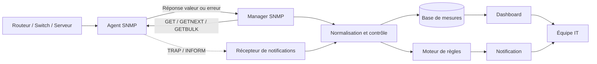
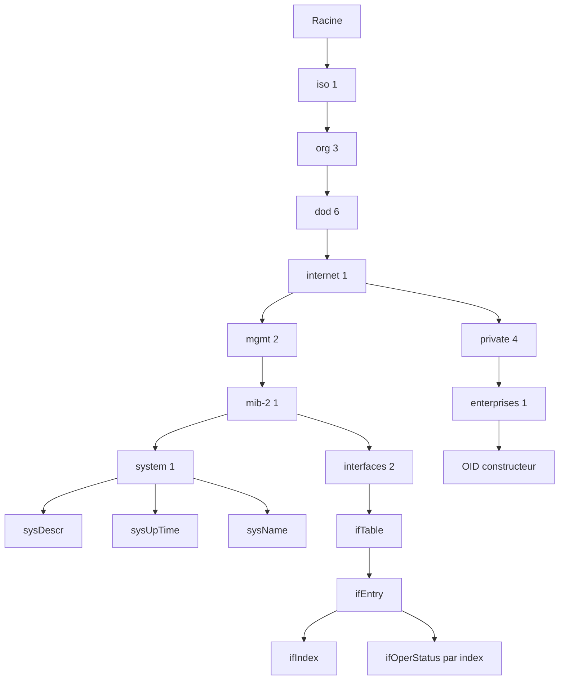
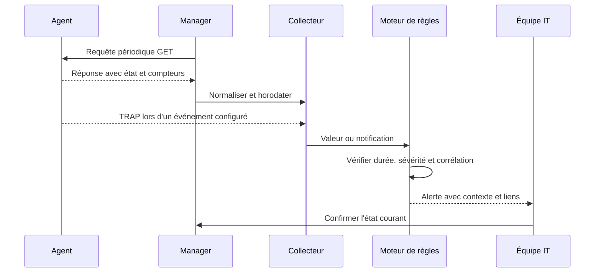
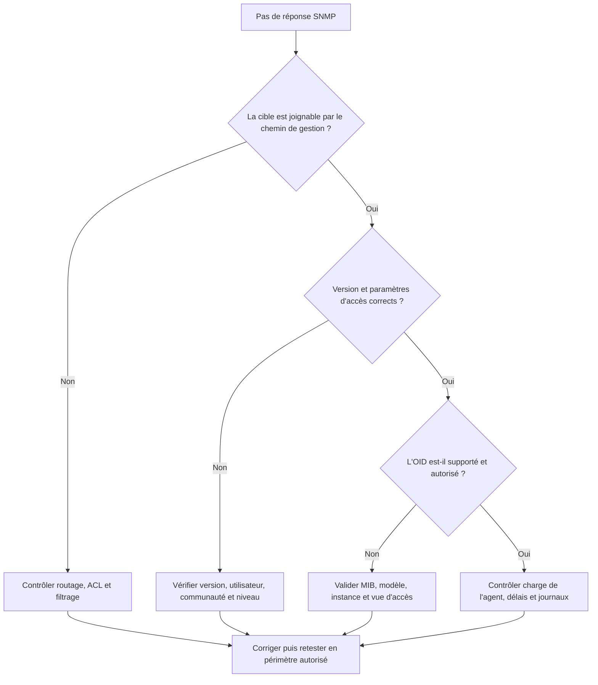
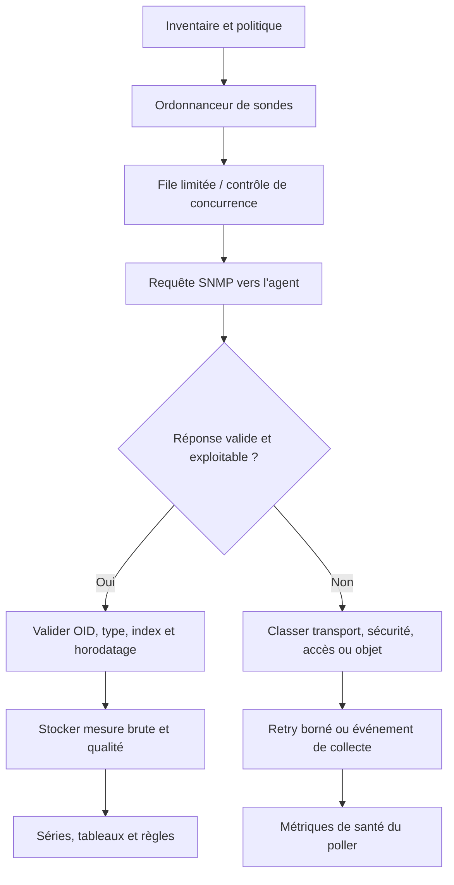

# SNMP v1/v2c/v3 et MIB

## 1. Introduction et enjeux : pourquoi SNMP reste un outil central de supervision

### 1.1. Le problème opérationnel que SNMP résout

Un réseau professionnel comporte souvent des routeurs, des commutateurs, des pare-feu, des points d'accès Wi-Fi, des imprimantes, des onduleurs, des équipements de stockage et des serveurs. Chacun possède son propre état interne : interfaces actives, compteurs de paquets, erreurs, température, charge processeur, mémoire disponible, alimentation, ventilateurs et événements récents. Se connecter manuellement à chaque équipement pour relever ces informations ne passe pas à l'échelle. Cette pratique prend du temps, ne garantit pas la régularité des mesures et rend difficile la détection précoce d'une anomalie.

SNMP signifie **Simple Network Management Protocol**, ou protocole simple de gestion de réseau. Il permet à un système de gestion d'interroger des informations structurées exposées par des équipements et des agents logiciels. Ces informations peuvent décrire l'identité d'un système, son temps de fonctionnement, l'état de ses interfaces, des compteurs de trafic, des erreurs, ou des données spécifiques au matériel. Selon la version et les droits configurés, SNMP peut aussi demander la modification de certains objets et recevoir des notifications envoyées par les équipements.

Le terme « simple » ne signifie pas que toute la gestion d'un réseau devient facile. La simplicité historique du protocole réside dans un modèle d'échange relativement uniforme et dans la possibilité de représenter les informations sous forme d'objets. La qualité de la supervision dépend encore de la configuration de l'agent, de la sécurité, du choix des objets, de la fréquence de collecte, de l'interprétation des compteurs et de la manière dont les alertes sont traitées.

SNMP est un moyen de collecter des données, pas une garantie qu'une application fonctionne correctement. Un serveur peut répondre aux requêtes SNMP et au ping tout en ayant une application en panne. Un commutateur peut signaler qu'un port est actif alors que le VLAN attendu n'est pas correctement configuré. Une base de données peut être joignable mais tellement lente que les utilisateurs ne peuvent plus travailler. La question essentielle reste donc : **quelle réalité souhaite-t-on mesurer et quelle décision la mesure doit-elle permettre de prendre ?**

### 1.2. Passer d'une gestion manuelle à une observation répétable

Sans supervision, l'administrateur découvre parfois une anomalie lors d'une plainte. Il se connecte au routeur, exécute quelques commandes, compare des valeurs à sa mémoire et demande aux utilisateurs si le problème persiste. Cette démarche peut suffire dans un très petit environnement, mais elle comporte des faiblesses : les données sont prises à un instant précis, l'historique manque, des changements temporaires peuvent être invisibles et les conclusions dépendent fortement de la personne présente.

Avec SNMP, un manager peut collecter les mêmes objets toutes les minutes, conserver les valeurs et calculer des variations. Il devient possible de voir que les erreurs d'une interface augmentent depuis 10 h 15, que le lien est presque saturé tous les jours à midi ou que l'uptime d'un équipement vient de repartir d'une faible valeur après un redémarrage. L'historique rend les tendances visibles et permet de comparer l'état avant, pendant et après un incident.

Cette automatisation ne supprime pas l'observation manuelle. Elle lui donne un meilleur point de départ. Lorsqu'une alerte signale une hausse de paquets abandonnés, l'administrateur dispose déjà d'une courbe et peut examiner le port concerné plutôt que de parcourir tous les équipements. La plateforme fournit des indices et conserve un historique ; le technicien reste responsable de la confirmation de la cause et de la décision d'intervenir.

### 1.3. Les rôles fondamentaux : manager et agent

L'architecture SNMP traditionnelle distingue le **manager** et l'**agent**. Le manager est le système de gestion qui lance les interrogations, reçoit des réponses, organise les données et déclenche éventuellement des règles de supervision. Il peut s'agir d'une plateforme centrale, d'un serveur de monitoring ou d'un composant de collecte. Il connaît les cibles à superviser, les objets intéressants et les intervalles de collecte.

L'agent est le composant qui expose les informations de gestion associées à un équipement. Il répond aux requêtes autorisées et peut envoyer des notifications quand certains événements se produisent. De nombreux routeurs et commutateurs possèdent un agent SNMP intégré. Un serveur peut nécessiter un service installé localement pour exposer des mesures d'exploitation. Il ne faut donc pas supposer que tous les systèmes ont exactement le même mécanisme d'agent.

Le manager n'a pas toujours besoin d'installer un logiciel supplémentaire sur chaque périphérique réseau. Il faut néanmoins activer et configurer la gestion sur l'équipement, choisir la version du protocole, définir les droits d'accès et vérifier que le chemin réseau est autorisé. Un agent désactivé, une vue de MIB trop restrictive ou un pare-feu bloquant les messages peuvent rendre l'équipement invisible, même si son fonctionnement normal semble correct.

### 1.4. Ce que SNMP permet de voir

Les usages courants incluent l'état administratif et opérationnel des interfaces, le volume d'octets échangés, les erreurs et abandons, le temps depuis le démarrage, l'identité de l'équipement et des informations sur certaines ressources matérielles. Les MIB spécifiques d'un constructeur peuvent exposer des mesures supplémentaires : consommation PoE, température, ventilation, alimentation redondante, batterie d'onduleur, état d'un contrôleur ou informations de radio Wi-Fi.

Ces données doivent être interprétées selon la documentation correspondante. Un compteur d'octets n'est pas un débit instantané ; il faut comparer deux échantillons et tenir compte de l'intervalle. Un état d'interface actif ne prouve pas que l'application de l'utilisateur est accessible. Un seuil de température ne peut être choisi sans comprendre la plage normale et les recommandations du fabricant. La supervision n'est fiable que si les objets et leurs unités sont compris.

SNMP est particulièrement utile dans un environnement hétérogène où une plateforme doit interroger des matériels provenant de plusieurs constructeurs. Les objets standards fournissent une base commune ; les extensions propriétaires complètent parfois les données. Mais « standard » ne signifie pas que toutes les implémentations exposent les mêmes extensions ou répondent avec les mêmes capacités de collecte. Il faut valider la prise en charge sur les modèles et versions réellement installés.

### 1.5. SNMP dans l'écosystème de supervision

SNMP s'intègre avec d'autres méthodes. ICMP peut vérifier qu'une cible répond au niveau réseau, tandis que SNMP rapporte l'état de ses interfaces et certains compteurs. Syslog conserve des événements textuels, tels que des changements de configuration ou des erreurs applicatives. Les métriques d'une application décrivent le nombre de requêtes, les taux d'erreur et les latences. Les traces distribuées aident à localiser le temps passé dans chaque dépendance.

Aucune de ces sources n'est universellement suffisante. Si un lien est déclaré actif mais que le site reste inaccessible, les compteurs SNMP peuvent aider à examiner l'utilisation et les erreurs du réseau, Syslog peut rapporter un changement de routage, et une sonde HTTP peut confirmer l'impact sur l'utilisateur. Une plateforme efficace relie ces données à un service et à une période communs, au lieu d'afficher des systèmes indépendants sans contexte.

L'objectif d'un débutant n'est pas d'installer immédiatement chaque outil possible. Il faut d'abord savoir formuler une question de gestion, déterminer quel objet pourrait y répondre, lire sa définition, vérifier la valeur et comprendre sa limite. Cette discipline permet de construire ensuite des règles plus complexes sans confondre signal technique et diagnostic complet.

### 1.6. Objectifs du cours et périmètre de sécurité

À la fin de ce cours, vous devez pouvoir expliquer le rôle du manager et de l'agent, lire un OID, comprendre ce qu'apporte une MIB, différencier SNMPv1, SNMPv2c et SNMPv3, connaître les principales opérations, mesurer un débit à partir de compteurs et diagnostiquer les échecs de collecte les plus courants. Vous devez aussi savoir pourquoi les communautés v1/v2c exigent des précautions, comment SNMPv3 protège les échanges selon son niveau de sécurité et comment limiter les droits du compte de supervision.

Les exemples pratiques doivent être exécutés sur un laboratoire ou un équipement dont vous avez l'autorisation d'administrer la supervision. N'effectuez pas de balayage massif, n'essayez pas des secrets au hasard et ne lancez pas de commande d'écriture sur du matériel de production sans approbation. Les opérations de lecture peuvent elles-mêmes générer une charge et révéler des informations d'infrastructure. La sécurité commence par un périmètre et une autorisation explicites.

## 2. Concepts clés : versions, MIB, OID et opérations SNMP

### 2.1. La MIB : un dictionnaire des objets de gestion

Une **MIB**, pour Management Information Base, est une définition structurée des objets de gestion qu'un agent peut exposer. On peut la considérer comme un dictionnaire technique : elle donne un nom à un objet, précise son identifiant, décrit son type et indique sa sémantique. Certaines définitions précisent aussi les règles d'accès, les valeurs possibles, les unités ou les conventions d'utilisation.

Une MIB n'est pas simplement un fichier contenant toutes les mesures courantes. Elle décrit les objets et leur organisation. Les valeurs réelles sont fournies par l'agent. Installer le fichier de MIB dans les outils ne crée pas un capteur dans l'équipement et ne rend pas disponible une fonctionnalité que le firmware ne prend pas en charge. Le manager a besoin de la définition pour comprendre et afficher les données, mais c'est bien l'agent qui doit exposer la valeur demandée.

Les modules MIB standards décrivent des objets communs à de nombreux types de systèmes. Des modules spécifiques aux constructeurs apportent des informations supplémentaires pour leur matériel ou leur logiciel. Il peut exister plusieurs versions d'un module ou des différences de prise en charge entre deux modèles. En pratique, il faut conserver une documentation sur les MIB utilisées par l'équipe et vérifier l'alignement avec les équipements réels.

Les MIB s'appuient sur des conventions de définition et de typage historiquement liées à ASN.1 et à la Structure of Management Information, abrégée SMI. Il n'est pas nécessaire de maîtriser toute la syntaxe ASN.1 pour débuter. Il est cependant utile de savoir que le module indique le type de valeur attendu et la façon dont elle doit être interprétée. Un entier peut représenter un état, un compteur ou une valeur en unités ; ces significations ne sont pas interchangeables.

### 2.2. OID : identifier précisément un objet

Un **OID**, ou Object Identifier, est un identifiant hiérarchique composé de nombres séparés par des points. Il décrit un chemin dans un arbre de noms. L'arbre permet à différentes organisations de créer des sous-branches sans s'approprier l'espace des autres. Un OID peut désigner un objet abstrait dans le catalogue ou une instance précise de cet objet sur un agent.

Une branche standard courante est 1.3.6.1.2.1, souvent connue sous le nom mib-2. Elle contient plusieurs groupes d'objets courants. Les extensions des constructeurs sont généralement organisées sous une branche d'entreprise. Cette structure explique pourquoi deux objets peuvent avoir des OID longs qui se ressemblent au début avant de diverger vers des groupes différents.

L'objet sysName permet d'illustrer la distinction entre le nom et l'instance. Dans les outils qui chargent la MIB appropriée, on peut l'exprimer sous la forme symbolique SNMPv2-MIB::sysName.0. L'OID numérique usuel de cette instance est 1.3.6.1.2.1.1.5.0. La partie sysName désigne le nom de l'objet ; le suffixe final .0 est l'instance de l'objet scalaire. Dans un cas de lecture réel, omettre ou ajouter un mauvais suffixe peut produire une erreur ou interroger une autre valeur.

Les objets scalaires représentent généralement une valeur unique par instance d'agent, comme le nom du système. Les objets tabulaires représentent des lignes, par exemple une ligne par interface. Une instance de table possède un index, qui peut être un nombre simple ou une combinaison de valeurs. L'OID complet d'une entrée peut donc se terminer par un index. Un manager doit associer cet index aux informations descriptives afin de ne pas surveiller le mauvais port après un changement.

### 2.3. Lire un OID en pratique

Quand vous découvrez un OID, ne commencez pas par mémoriser son numéro. Vérifiez le nom symbolique, le module MIB, le type de valeur, les unités et la description. Une valeur comme 2 peut représenter un état « down », une valeur numérique ou une catégorie différente selon l'objet. Une valeur de compteur peut être en octets alors qu'une autre est en paquets. La même valeur brute peut donc avoir des significations totalement différentes.

Un outil de traduction peut aider à convertir un nom symbolique en OID numérique ou inversement, à condition que le module MIB soit disponible. Le nom symbolique est plus lisible pour la documentation, tandis que l'OID numérique est utile pour vérifier le chemin exact et éviter les ambiguïtés de résolution locale. Conservez les deux dans les fiches de supervision importantes : un nom explicite pour les humains et l'identifiant réellement interrogé.

Il faut également distinguer un objet inconnu d'un objet interdit. L'agent peut ne pas implémenter l'OID, la requête peut viser la mauvaise instance, une vue d'accès peut masquer une branche ou un problème de version peut affecter la réponse. Une MIB chargée localement ne garantit pas que l'agent supporte l'objet. Lorsqu'une requête échoue, utilisez la documentation et les messages de diagnostic pour déterminer la couche fautive.

### 2.4. Les types de données et leur sémantique

Les MIB définissent plusieurs types de valeur. Les chaînes servent notamment à des noms ou descriptions. Les entiers et valeurs énumérées décrivent parfois un état. Les jauges représentent des valeurs qui peuvent monter ou descendre, par exemple une utilisation courante. Les compteurs cumulent des événements ou des quantités au fil du temps. Les objets de type TimeTicks représentent des durées dans une unité définie par le protocole, et ne doivent pas être interprétés comme une date absolue.

Un compteur doit être analysé sur une durée. Si une interface a transmis 1 000 000 octets à la première lecture puis 5 000 000 à la seconde, l'augmentation est de 4 000 000 octets. Si l'intervalle est de 20 secondes, le débit moyen correspondant est de 4 000 000 × 8 / 20, soit 1 600 000 bits par seconde, ou 1,6 Mbit/s en unités décimales. Cette moyenne ne signifie pas que l'interface a transmis exactement le même débit à chaque instant pendant les 20 secondes.

Les compteurs peuvent être interrompus ou réinitialisés. Un redémarrage du système de gestion de l'agent peut entraîner une discontinuité. Un compteur de 32 bits revient à zéro après avoir atteint sa limite, et cela peut se produire relativement rapidement sur une interface à haut débit. Les MIB d'interfaces modernes proposent souvent des compteurs 64 bits adaptés aux hautes capacités. Lorsqu'ils existent, ils sont préférables pour les liens rapides. Le collecteur doit toutefois tenir compte des redémarrages et des indicateurs de discontinuité définis par la MIB.

Une jauge n'a pas le même comportement qu'un compteur. La mémoire disponible peut augmenter après la fermeture d'une application. Le nombre de connexions simultanées peut diminuer. Il ne faut pas calculer le débit d'une jauge de la même façon que celui d'un compteur cumulatif. L'outil doit connaître le type et utiliser la bonne opération de calcul.

### 2.5. La MIB d'interfaces

La MIB d'interfaces, souvent désignée IF-MIB, définit de nombreux objets utiles pour suivre les ports et interfaces réseau. On y trouve notamment des descriptions, des index, la vitesse, l'état administratif, l'état opérationnel, des compteurs d'octets et des compteurs d'erreurs ou de paquets abandonnés. Les noms exacts des objets doivent être vérifiés dans la version de MIB utilisée par l'équipement.

L'index d'interface identifie une ligne dans la table. Il peut correspondre à un port physique, une interface logique, une interface VLAN, un tunnel ou un autre objet que le système considère comme interface. Il ne faut pas supposer que chaque index est un numéro de port physique visible sur la face avant. Il faut consulter la description, le nom et les autres attributs associés pour comprendre ce que l'index représente.

Les objets d'état administratif et d'état opérationnel sont différents. L'état administratif décrit généralement si l'interface est configurée pour être active ou désactivée. L'état opérationnel décrit si elle fonctionne effectivement selon les critères de l'agent. Une interface peut être administrativement activée mais opérationnellement down parce que le câble est absent ou que l'autre extrémité n'est pas active. À l'inverse, une interface volontairement désactivée peut être down sans indiquer une panne imprévue. Les alertes doivent connaître le rôle du port et son état attendu.

Les compteurs d'erreurs, de paquets abandonnés et d'octets doivent être interprétés ensemble. Une augmentation des erreurs peut indiquer un problème de liaison ou de transmission, tandis qu'une augmentation des abandons peut être liée à une congestion ou à des limites de files d'attente. Aucun compteur ne révèle automatiquement la cause exacte. Une investigation peut nécessiter les journaux, la configuration, les mesures des deux extrémités, une vérification physique et le contexte des changements récents.

### 2.6. Les opérations SNMP

L'opération **GET** demande une ou plusieurs instances précises. Elle convient quand le manager connaît déjà l'OID et souhaite obtenir une valeur ciblée. **GETNEXT** demande le prochain objet dans l'ordre des OID, ce qui permet de parcourir progressivement une branche. **GETBULK**, disponible avec SNMPv2 et versions ultérieures compatibles, permet de récupérer plusieurs valeurs successives dans un échange plus efficace. Il est particulièrement utile pour les tables, mais doit être utilisé avec des paramètres adaptés à la taille de réponse et à la capacité du matériel.

L'opération **SET** demande de modifier une valeur lorsque l'objet et les droits le permettent. Il est important de distinguer la capacité technique d'écriture de l'autorisation opérationnelle. Une MIB peut décrire un objet qui accepte une modification, mais cela ne signifie pas qu'il faut donner ce privilège à la plateforme de supervision. Une écriture incorrecte peut altérer la configuration d'un équipement, interrompre une interface ou modifier un comportement sensible. Dans un environnement de débutant, les lectures doivent être privilégiées. Toute opération SET en production doit être approuvée, testée, documentée et réalisée avec une stratégie de retour arrière.

Les réponses comprennent les valeurs ou des informations d'erreur. Selon la version et l'implémentation, l'erreur peut indiquer qu'un objet ou une instance est absent, qu'une opération n'est pas autorisée ou que le traitement a échoué. Un délai d'attente sans réponse est différent d'une réponse explicite d'erreur : le premier peut être causé par le réseau, le filtre, l'agent ou la sécurité, tandis que le second signifie que le message a été suffisamment traité pour retourner une réponse. Cette différence est utile pour structurer le dépannage.

### 2.7. SNMPv1 : compatibilité historique et limites

SNMPv1 est la version historique du protocole. Elle définit les opérations fondamentales de lecture et de notification, et peut encore être présente sur du matériel ancien. Son modèle traditionnel d'accès utilise une chaîne communautaire partagée. Cette chaîne ne constitue pas un mécanisme de confidentialité cryptographique équivalent à un chiffrement de la session. Un observateur ayant accès au trafic peut potentiellement voir les échanges et récupérer des informations sensibles.

SNMPv1 possède également des capacités plus limitées que SNMPv2c pour certaines opérations efficaces de récupération de tables. Son existence dans un environnement peut être justifiée par la compatibilité avec un appareil qui ne supporte pas mieux. Mais pour un déploiement neuf, elle ne doit pas être choisie par habitude sans évaluation du risque. Le fait que le protocole fonctionne ne prouve pas qu'il convient aux besoins actuels de sécurité.

Lorsqu'une entreprise doit conserver SNMPv1, elle peut réduire son exposition en isolant le réseau de gestion, en limitant les adresses sources, en désactivant les opérations d'écriture, en utilisant un périmètre d'OID strict et en documentant l'exception. Ces mesures ne transforment pas SNMPv1 en protocole chiffré ; elles réduisent seulement certaines possibilités d'accès. Un plan d'évolution doit indiquer si le firmware peut être mis à jour, si le matériel doit être remplacé et quelle échéance est réaliste.

### 2.8. SNMPv2c : meilleures capacités opérationnelles, sécurité limitée

SNMPv2c améliore certaines capacités opérationnelles, en particulier la récupération efficace de plusieurs objets avec GETBULK, tout en conservant le modèle communautaire. Le suffixe « c » renvoie à l'utilisation de ce modèle de communauté. Il ne signifie pas que les messages sont chiffrés. Le contenu et la communauté ne bénéficient pas des protections cryptographiques de SNMPv3 authPriv.

Les configurations distinguent souvent une communauté en lecture seule et une communauté en lecture-écriture. Une lecture seule permet de demander les objets autorisés ; une lecture-écriture peut permettre de modifier certains objets. La chaîne en écriture est particulièrement sensible et doit être supprimée ou désactivée si elle n'est pas nécessaire. Une communauté par défaut, une chaîne facile à deviner ou une chaîne partagée dans plusieurs environnements accroît le risque.

SNMPv2c reste rencontré dans les réseaux où des équipements n'offrent pas une implémentation SNMPv3 exploitable. Il peut être accepté temporairement dans un segment de gestion strictement contrôlé, avec une communauté dédiée, une vue minimale et une liste de managers autorisés. Il ne faut pas le présenter comme équivalent en sécurité à SNMPv3 simplement parce qu'une chaîne longue est configurée : le trafic n'est pas protégé de la même manière contre l'observation.

GETBULK peut diminuer le nombre d'échanges nécessaires pour récupérer une table. Mais une réponse volumineuse peut être fragmentée, perdue ou coûteuse à produire sur un équipement de faible capacité. Le manager doit ajuster le nombre de répétitions et les délais à la taille des tables, aux caractéristiques du matériel et au chemin réseau. Une configuration efficace cherche à limiter le travail total, pas à maximiser systématiquement la taille de chaque réponse.

### 2.9. SNMPv3 : authentification, intégrité, confidentialité

SNMPv3 ajoute un cadre de sécurité fondé notamment sur des utilisateurs, un modèle de sécurité et un contrôle d'accès. Le modèle USM, pour User-based Security Model, propose des mécanismes d'authentification et de confidentialité. L'architecture SNMPv3 sépare la réception et le traitement des messages, la sécurité et le contrôle d'accès. Cette séparation permet à une entité SNMP d'appliquer des règles de sécurité aux opérations de gestion au lieu de reposer uniquement sur une chaîne partagée.

Les niveaux de sécurité courants sont souvent nommés **noAuthNoPriv**, **authNoPriv** et **authPriv**. noAuthNoPriv ne fournit ni authentification cryptographique ni confidentialité. authNoPriv apporte l'authentification et l'intégrité mais ne chiffre pas le contenu. authPriv combine l'authentification et la confidentialité, sous réserve des algorithmes pris en charge et de leur configuration. Pour des échanges de gestion qui doivent être protégés contre l'observation et l'altération, authPriv est généralement le niveau à privilégier lorsque le matériel et les politiques de l'organisation le permettent.

L'authentification permet de vérifier que les messages satisfont les paramètres d'un utilisateur autorisé et qu'ils n'ont pas été modifiés sans détection. La confidentialité empêche un observateur du réseau de lire directement les contenus protégés. Les algorithmes et leurs options varient selon l'implémentation et sa version ; les administrateurs doivent suivre les recommandations de la documentation actuelle, les exigences de sécurité de l'entreprise et les politiques applicables. Les algorithmes historiques ou dépréciés ne doivent pas être repris automatiquement à partir d'une vieille procédure.

La sécurité SNMPv3 dépend de la cohérence entre le manager et l'agent. Le nom d'utilisateur, le niveau de sécurité, les paramètres d'authentification, les paramètres de confidentialité et les éventuels contextes doivent correspondre. Certains moteurs SNMP possèdent un identifiant unique, appelé engine ID, et des mécanismes de synchronisation qui interviennent dans les échanges sécurisés. Un remplacement de matériel ou une réinitialisation peut modifier l'environnement de sécurité et provoquer des échecs si la plateforme conserve des paramètres anciens.

Les secrets ne doivent pas être intégrés dans un dépôt de code, un script partagé, une capture ou un ticket non protégé. Les exemples de ce cours utilisent des marqueurs de remplacement et doivent être adaptés dans un laboratoire autorisé. Une commande qui place un secret directement dans la ligne de commande peut laisser des traces dans l'historique du shell ou être visible à certains utilisateurs du système. Préférez un mécanisme de gestion de secrets adapté, contrôlez les permissions des fichiers de configuration et limitez les comptes à ce qu'ils doivent réellement lire.

### 2.10. Contrôle d'accès : utilisateurs, vues et moindre privilège

La version du protocole ne suffit pas à déterminer la sécurité. Le dispositif doit aussi préciser qui peut interroger l'agent, depuis quelles adresses, quels OID sont visibles et si des modifications sont permises. Le principe du moindre privilège recommande de n'accorder que ce qui est nécessaire. Si la plateforme doit lire des compteurs d'interfaces, elle ne devrait pas avoir automatiquement le droit de modifier des routes, des paramètres d'administration ou l'état de ports.

Les listes de contrôle d'accès réseau limitent les sources qui peuvent atteindre l'agent. Des vues de gestion, quand l'agent les prend en charge, permettent de restreindre une branche de MIB ou certains objets. Les droits en lecture et en écriture doivent être séparés. Les comptes de collecte sont des identités de service ; il faut les gérer et les révoquer comme les autres identités techniques, avec une procédure de rotation des secrets et un inventaire des systèmes qui les utilisent.

Une restriction réseau et un mécanisme cryptographique ne répondent pas au même risque. Une ACL limite les sources, tandis que SNMPv3 protège les messages selon son niveau de sécurité. Les utiliser ensemble crée une défense en profondeur. A l'inverse, exposer SNMP sur tout le réseau et supposer que le nom de la communauté suffit est fragile. La configuration doit être évaluée en fonction de la menace, des contraintes d'exploitation et des exigences de l'environnement.

### 2.11. Polling, traps et informs

Le **polling** consiste à interroger périodiquement une cible. Il fournit un historique régulier et permet de mesurer les variations des compteurs, de vérifier les états et de réconcilier les notifications événementielles avec l'état courant. La cadence de polling définit une partie de la résolution temporelle : si une valeur est échantillonnée toutes les cinq minutes, une pointe de quelques secondes peut ne pas apparaître dans l'historique.

Un **trap** est une notification envoyée par un agent lorsqu'un événement se produit. Il peut signaler un changement d'état d'interface, une alarme matérielle ou un événement spécifique. Le trap n'attend généralement pas de confirmation applicative SNMP. Il peut être perdu si le chemin réseau, le récepteur ou la plateforme rencontre un problème.

Un **inform** est une notification qui demande une confirmation du récepteur. Il apporte un mécanisme d'accusé de réception au niveau du protocole, mais ne garantit pas à lui seul que la notification est ensuite enregistrée durablement ou traitée par un humain. La fiabilité dépend toujours de la chaîne de réception, de journalisation et de traitement. Un accusé de réception n'est pas une preuve que l'équipe a compris ou résolu l'incident.

Une architecture opérationnelle combine souvent polling et notifications. Le trap accélère la détection, puis le manager peut relire l'état et les compteurs concernés pour confirmer la situation. Le polling continue à construire l'historique et à détecter une absence de notification. Les règles peuvent dédupliquer les événements répétés et regrouper plusieurs alertes qui partagent une cause commune.

### 2.12. Transport, ports et chemin réseau

Dans les configurations SNMP courantes sur UDP, les requêtes à destination d'un agent sont généralement envoyées au port 161 et les notifications trap sont souvent envoyées au port 162 du récepteur. Il s'agit de valeurs habituelles qui peuvent être adaptées à une installation. Le protocole SNMP peut être transporté avec d'autres configurations selon l'implémentation, alors vérifiez toujours les paramètres réels.

UDP n'établit pas une connexion persistante comme TCP. Le manager envoie un message et attend une réponse, souvent avec une stratégie de délai d'attente et de nouvelle tentative. Une réponse peut être perdue, un pare-feu peut bloquer le chemin ou le retour, ou un équipement peut être trop occupé pour répondre. Lorsque le manager n'obtient rien, il ne faut pas automatiquement conclure que le routeur ou le serveur est en panne. Le silence est un symptôme ambigu.

Le chemin de gestion doit être documenté : adresse du manager, adresse de l'agent, règles d'ACL, ports, routage et composants de sécurité intermédiaires. SNMP ne doit pas être exposé directement à Internet. Lorsque les collecteurs sont répartis sur plusieurs sites, le trafic doit passer par un chemin de gestion contrôlé, et les versions du protocole doivent correspondre à la politique de sécurité. Le diagnostic doit distinguer la connectivité, la version, les paramètres d'authentification, le droit d'accès à l'objet et la capacité de l'agent.

### 2.13. Calculer un débit avec un compteur

Les compteurs d'octets des interfaces cumulent les octets transmis ou reçus. Pour obtenir une estimation de débit, relevez une première valeur C1 à l'instant t1 et une seconde valeur C2 à l'instant t2. Si le compteur n'a pas été réinitialisé ou débordé, la variation est C2 moins C1. Le débit moyen en bits par seconde est cette variation multipliée par huit, divisée par le nombre de secondes entre les deux lectures.

Exemple : à 10 h 00, le compteur entrant vaut 2 000 000 000 octets. Dix secondes plus tard, il vaut 2 012 500 000 octets. La variation est 12 500 000 octets. Le débit moyen est 12 500 000 × 8 / 10, soit 10 000 000 bits par seconde, donc environ 10 Mbit/s en unités décimales. Il s'agit d'une moyenne sur dix secondes, pas d'une mesure instantanée de chaque paquet.

Sur les liens rapides, les compteurs 32 bits peuvent revenir au début relativement vite. Si le collecteur ne gère pas ce débordement, il peut calculer un débit négatif ou une pointe absurde. Il faut préférer les compteurs 64 bits lorsqu'ils sont disponibles et adaptés à l'objet, vérifier les indicateurs de discontinuité de la MIB et tenir compte des redémarrages. Il est aussi nécessaire de confirmer que la valeur correspond au sens voulu : entrant et sortant ne sont pas la même mesure.

Le taux d'utilisation d'une interface compare le débit observé à une capacité de référence cohérente. Il faut tenir compte de la vitesse réellement négociée, des capacités asymétriques, des unités du tableau de bord et du fait que des interfaces full-duplex peuvent transmettre simultanément dans les deux sens. Une valeur de débit ne doit être comparée à la capacité qu'après avoir vérifié que les unités et le sens correspondent. Les erreurs et paquets abandonnés sont des signaux complémentaires importants.

### 2.14. Les pièges liés aux OID, aux index et aux versions

L'index d'interface peut changer après certaines modifications ou réinitialisations. Ne basez pas toute une supervision sur un index numérique permanent si le système peut réorganiser les entrées. Associez l'index à la description, au nom et aux autres attributs disponibles, puis contrôlez les correspondances après un remplacement de matériel ou une mise à jour.

L'objet standard peut exister mais être inaccessible parce que les vues sont restreintes. Un OID propriétaire peut être pris en charge uniquement sur certains modèles. Une MIB absente du manager peut empêcher la résolution du nom symbolique même si l'agent répond à l'OID numérique. Un message « no such object » doit être distingué d'un délai d'attente réseau et d'un refus d'accès. Ces cas exigent des vérifications différentes.

La fréquence de collecte doit également être adaptée à la capacité du matériel. Une interrogation trop fréquente de nombreuses tables peut consommer des ressources et perturber des équipements anciens. La collecte doit être mise en place progressivement, avec des objets ciblés, des intervalles adaptés, des tailles de réponse raisonnables et une observation de son propre impact. Plus de données n'implique pas automatiquement une meilleure supervision.

### 2.15. Lire une table SNMP sans confondre colonne, ligne et index

Les objets scalaires et les objets tabulaires ne se parcourent pas exactement de la même façon. Un objet scalaire représente une valeur unique pour une instance donnée ; dans une requête, son instance se termine souvent par un suffixe .0. Une table rassemble plusieurs lignes, par exemple une ligne par interface, et chaque colonne définit une propriété de cette ligne. L'instance d'une colonne de table est obtenue en ajoutant à l'OID de colonne l'index de la ligne. Cet index n'est pas nécessairement le numéro imprimé sur la façade d'un équipement ni le nom de l'interface.

Prenons un exemple conceptuel : une table d'interfaces peut exposer la colonne ifDescr, la colonne ifOperStatus et la colonne ifHCInOctets. La même interface indexée par 7 peut être décrite comme « TenGigabitEthernet1/0/7 », avoir un statut opérationnel up et posséder un compteur d'octets entrants. Ce sont trois objets différents qui partagent un index commun, tant que l'agent respecte la table et que l'index est stable dans le contexte concerné. Le bon réflexe consiste à inventorier d'abord les lignes, puis à lire les colonnes nécessaires et à associer les mesures par index.

Une erreur courante consiste à supposer que ifIndex reste universellement identique après un redémarrage, un remplacement de carte ou une modification de configuration. Certains équipements conservent les index ; d'autres peuvent les réattribuer après des changements. Pour l'analyse historique, associez donc l'index à des attributs d'identité plus lisibles, comme ifName, ifDescr, ifAlias et l'identité de l'équipement. Si l'index change, détectez-le comme une modification d'inventaire plutôt que de continuer à relier silencieusement les anciennes et nouvelles séries.

Lorsque vous utilisez un parcours de table, la fin de parcours doit être reconnue comme un résultat normal. Un GETNEXT ou un GETBULK avance lexicographiquement dans l'arbre des OID ; le prochain objet retourné peut appartenir à une autre branche que celle visée initialement. Le collecteur doit vérifier le préfixe de l'OID retourné, interpréter les exceptions de fin de vue et arrêter le parcours si l'OID sort de la sous-arborescence attendue. Sans cette validation, un script artisanal peut poursuivre sa marche dans toute la MIB et collecter des objets qui n'ont aucun rapport avec l'objectif de départ.

### 2.16. GET, GETNEXT et GETBULK : choisir le bon compromis

GET demande une ou plusieurs instances explicitement nommées. Il convient lorsque le collecteur connaît déjà les OID précis qu'il souhaite lire. GETNEXT demande le prochain OID dans l'ordre lexicographique et a historiquement permis d'itérer sur des tables. GETBULK, introduit pour améliorer l'efficacité du parcours avec SNMPv2, permet de recevoir plusieurs successeurs en réponse à une requête, avec des paramètres qui contrôlent notamment le nombre de répétitions. Cette différence change l'efficacité de collecte sur un parc contenant beaucoup d'interfaces ou de lignes.

GETBULK n'est pas un bouton « tout télécharger ». Une requête trop grande peut dépasser les limites de taille des messages, rencontrer une contrainte de l'agent, être fragmentée au niveau IP ou être abandonnée par un réseau qui filtre les fragments. À l'inverse, une requête trop petite peut générer beaucoup d'allers-retours et augmenter la charge. Il faut commencer par un volume modéré, observer la taille des réponses, les erreurs, le temps de traitement et les particularités des équipements, puis ajuster de façon contrôlée. Les versions et implémentations ne réagissent pas toujours de manière identique.

Le nombre d'objets demandés compte aussi. Une requête groupée peut retourner une partie des objets et produire des exceptions pour ceux qui ne sont pas disponibles, selon la structure de la requête et l'agent. Le collecteur doit donc enregistrer les résultats partiels et ne pas convertir toute réponse incomplète en « agent indisponible ». Lorsqu'une collecte s'interrompt, distinguez les problèmes de transport, les erreurs protocolaires, les objets non pris en charge et les limites de la vue d'accès.

Pour diagnostiquer une erreur, simplifiez d'abord la requête : testez un OID connu, puis un petit groupe, ensuite une table entière. Cette progression permet d'identifier si l'erreur dépend d'un objet précis, du volume de données, d'une vue SNMP, de la version ou de la capacité de l'agent. N'élargissez pas immédiatement les droits de lecture et ne basculez pas en SNMPv2c avec une communauté partagée simplement parce qu'une requête GETBULK échoue.

### 2.17. Counter32, Counter64 et calculer correctement un débit

Un compteur d'octets n'est pas une jauge instantanée ; c'est une valeur cumulative qui augmente au fil du temps. Pour estimer un débit, on relève le compteur à deux instants, on calcule sa variation, puis on divise par la durée entre les mesures. Si le compteur représente des octets, il faut multiplier la variation par huit pour obtenir des bits et convertir en bits par seconde. Par exemple, une augmentation de 12 500 000 octets sur 10 secondes correspond à 100 000 000 bits, soit 10 Mbit/s en moyenne sur l'intervalle.

Le calcul n'est valide que si les deux mesures représentent le même compteur pour la même interface et le même équipement, si les horodatages sont fiables et si aucun redémarrage ou changement de compteur n'a invalidé la comparaison. Une variation négative peut provenir d'un retour à zéro, d'un compteur réinitialisé, d'une interface remplacée ou d'un changement d'index. Il est dangereux de convertir automatiquement cette variation négative en une énorme valeur positive sans vérifier le contexte.

Counter32 compte sur 32 bits et revient à zéro après avoir atteint sa valeur maximale. À débit élevé, le cycle peut se produire assez rapidement pour que deux échantillons ne permettent plus d'identifier sans ambiguïté le nombre de tours du compteur. Counter64 augmente la plage et est généralement préférable pour les interfaces modernes rapides lorsque la MIB d'équipement expose ces objets. Les objets haute capacité d'interfaces sont définis par la MIB IF-MIB, mais leur disponibilité et leur fiabilité dépendent toujours de l'agent et du type de compteur implémenté.

Un exemple illustre le piège : si un compteur 32 bits est observé à 4 000 000 000, puis à 500 000 000, il a peut-être franchi la limite une fois. La différence corrigée théorique serait calculée en tenant compte de la valeur maximale et du redémarrage du compteur. Mais si l'interface a redémarré ou si l'index s'est vu réattribuer une autre interface, cette interprétation serait fausse. Le collecteur doit consulter les signaux de discontinuité disponibles et l'uptime de l'agent, et marquer l'intervalle comme non calculable si la cause de la variation n'est pas suffisamment déterminée.

Une supervision professionnelle conserve la valeur brute, les horodatages, la durée effective de l'intervalle, le compteur utilisé et les indications de discontinuité. Elle ne stocke pas seulement un nombre de Mbit/s, car la donnée brute permet de reproduire le calcul. Les taux doivent également être bornés ou vérifiés en plausibilité : une valeur très supérieure à la vitesse physique de l'interface signale souvent un calcul incorrect, un index mal associé ou un délai erroné plutôt qu'une performance extraordinaire.

### 2.18. Discontinuité, redémarrage et fraîcheur des mesures

Une collecte SNMP peut réussir tout en retournant une donnée ancienne, mal interprétée ou impossible à comparer avec la précédente. Le statut « requête réussie » doit donc être dissocié de la qualité de la mesure. Un collecteur peut recevoir une réponse valide à un compteur, mais si la dernière valeur a été conservée après une erreur de collecte pendant plusieurs cycles, le débit calculé à partir d'un mauvais intervalle sera faussé.

Pour réduire ce risque, stockez l'heure d'émission, l'heure de réception, le résultat du protocole et la date de la dernière valeur valide. La durée entre deux relevés doit être calculée avec les horodatages réellement observés, non supposée égale à la période nominale. Si l'intervalle a été interrompu pendant cinq minutes alors que le calcul suppose trente secondes, le taux risque d'être mal interprété. La base de données doit conserver la qualité de chaque échantillon plutôt que cacher les trous par une interpolation non documentée.

L'uptime SNMP et les objets de discontinuité peuvent contribuer à identifier les changements. Cependant, aucun indicateur isolé ne révèle tous les cas : une carte peut être remplacée sans redémarrage complet, l'agent peut être réinitialisé, ou des index peuvent changer. Lorsqu'une discontinuité est détectée, marquez l'événement, évitez de tracer une ligne continue qui laisserait croire à une mesure comparable et attendez deux nouveaux échantillons valides avant de reprendre le calcul. Ce comportement protège les tableaux de bord contre les pics artificiels.

Enfin, la disponibilité des données est elle-même une métrique. Une cible qui a été collectée à 100 % mais dont les compteurs sont incohérents ne fournit pas une supervision de qualité. Mesurez le taux de succès des requêtes, la fraîcheur des données, la proportion d'objets absents, le délai de collecte et le nombre d'intervalles invalides. Ces indicateurs révèlent les problèmes de capacité, de droits d'accès, de compatibilité d'agent ou de conception du poller avant qu'ils ne faussent une analyse opérationnelle.

### 2.19. SNMPv3 en pratique : sécurité, identité et synchronisation

SNMPv3 sépare plusieurs propriétés qui sont parfois mélangées dans les configurations. L'authentification protège l'intégrité du message et permet de vérifier l'identité du principal SNMP associé à l'échange. La confidentialité chiffre la charge utile lorsque le niveau de sécurité approprié est utilisé. Le contrôle d'accès décide quels objets et quelles opérations sont autorisés pour cet utilisateur. Le transport réseau, quant à lui, détermine si les paquets peuvent atteindre l'agent. Une configuration correcte doit satisfaire ces couches séparément.

Le niveau authPriv demande authentification et confidentialité. Le nom d'utilisateur, les algorithmes et les secrets doivent correspondre aux capacités de l'agent et du gestionnaire ; les protocoles pris en charge diffèrent selon les appareils et les versions de logiciel. Ne choisissez pas les algorithmes par simple copier-coller depuis un ancien exemple et ne placez pas des secrets réels dans l'historique d'un terminal, un ticket ou un dépôt Git. Préférez le gestionnaire de secrets ou le mécanisme de configuration sécurisé approuvé par l'équipe.

Le modèle USM emploie notamment l'identité du moteur SNMP et des indicateurs de temps de fonctionnement du moteur pour contribuer à la protection contre les messages rejoués. Lors d'un premier échange authentifié, le gestionnaire peut devoir découvrir et apprendre l'identité du moteur distant. Si l'état du moteur change de façon inattendue, si l'identité a été dupliquée ou si la synchronisation est invalide, les échanges peuvent échouer même si le routage et les identifiants semblent corrects. Les erreurs de synchronisation SNMPv3 doivent donc être diagnostiquées comme une catégorie distincte des timeouts de transport.

Une panne SNMPv3 se diagnostique par étapes. Confirmez d'abord l'IP et le port UDP 161 sur le chemin autorisé, puis l'absence de filtre bloquant. Testez ensuite un utilisateur connu avec le niveau de sécurité attendu, vérifiez le contexte demandé, les algorithmes et la vue d'accès. Examinez le détail d'erreur du client et les journaux de l'agent. Ne répondez pas à un problème d'authentification en remplaçant durablement le compte par une communauté SNMPv2c partagée ou en accordant des permissions SET dont la collecte n'a pas besoin.

Références complémentaires pour ces notions : RFC 3411 décrit l'architecture SNMP, RFC 3414 le modèle de sécurité utilisateur SNMPv3, RFC 3416 les opérations protocolaires de SNMPv2 et RFC 2863 la MIB d'interfaces. Ces références définissent les mécanismes ; l'interface de configuration d'un constructeur et les algorithmes effectivement supportés doivent être vérifiés dans la documentation de l'équipement utilisé.

## 3. Architecture et schémas

### 3.1. Architecture Manager/Agent

L'architecture logique relie une ou plusieurs sources de données à un agent, puis à un manager ou une plateforme de gestion. Le manager interroge l'agent, reçoit la réponse et normalise la mesure. Le stockage conserve l'historique et le moteur de règles évalue les conditions. Le tableau de bord permet de consulter l'état et les tendances, tandis que le système de notification transmet les événements qui nécessitent une action.



Les composants peuvent être regroupés dans un même logiciel ou répartis sur plusieurs systèmes. Dans un petit laboratoire, une seule plateforme peut effectuer la collecte, le stockage, les alertes et les tableaux de bord. Dans un grand réseau, des proxies de collecte, des récepteurs séparés et un stockage distribué peuvent améliorer la capacité et réduire les dépendances réseau. Le choix de l'architecture doit suivre le nombre d'équipements, la criticité, les contraintes de connectivité et les compétences d'exploitation.

La plateforme doit surveiller sa propre santé. Il faut savoir si la collecte fonctionne, si les dernières valeurs sont récentes, si le stockage dispose d'espace, si les messages sont traités et si les notifications atteignent leur destination. Un dashboard qui conserve la dernière valeur après une panne de collecteur peut donner une impression trompeuse de stabilité. La fraîcheur des mesures doit être affichée et un canal indépendant devrait signaler une défaillance majeure du système de supervision.

### 3.2. Arborescence des OID

Les OID sont des identifiants hiérarchiques. Une partie du tree est réservée à des familles standard de gestion, tandis que des sous-branches sont utilisées par des organisations et des constructeurs. Le dessin ci-dessous simplifie l'arbre pour montrer le principe et quelques objets courants ; il ne représente pas tous les chemins ni toutes les MIB existantes.



La branche sysName est un exemple d'objet scalaire. Son instance porte un suffixe qui permet d'identifier la valeur concrète, couramment .0 dans le cas de cet objet. Une table comme la table d'interfaces contient plusieurs entrées ; l'index sert à distinguer les lignes. Un même groupe de MIB peut donc produire de nombreux OID d'instances, un par interface ou entrée.

La MIB donne un nom symbolique, un type et une description à l'objet. Le manager peut afficher ce nom si le module est installé et résolu. Les identifiants numériques restent utiles pour confirmer la requête et diagnostiquer les erreurs. Les OID propriétaires doivent être accompagnés de la référence constructeur et d'une note sur les modèles ou versions qui les exposent.

### 3.3. Flux d'une notification SNMP

Le polling et les notifications ont un fonctionnement différent. Le polling est initié périodiquement par le manager. Le trap ou inform est initié par l'agent lorsqu'un événement est détecté. Le récepteur doit enregistrer la notification et permettre au système de déterminer si elle doit déclencher une alerte, être corrélée à un autre événement ou simplement être conservée dans l'historique.



Un trap n'est pas une garantie que l'événement sera conservé ; le chemin, le récepteur et la plateforme peuvent être indisponibles. Un inform prévoit une confirmation du récepteur mais ne garantit pas à lui seul le traitement complet par l'équipe. Pour les événements critiques, combinez la notification et une collecte périodique qui confirme l'état actuel. Dédupliquez les messages répétés et vérifiez que l'alerte contient assez d'informations pour mener une investigation.

### 3.4. Séquence de diagnostic d'un problème de collecte

Quand le manager n'obtient aucune réponse, ne supposez pas immédiatement que l'agent est arrêté. Il faut vérifier l'adresse de destination, la route, les filtres, les ports, la version, les paramètres de sécurité, les vues d'accès et l'OID demandé. Une procédure ordonnée évite les changements hasardeux et la réduction de la sécurité par essais successifs.



La séquence est un cadre de diagnostic, pas une garantie que chaque problème se classe parfaitement dans une seule catégorie. Une mauvaise configuration peut masquer plusieurs symptômes. Documentez ce qui est déjà confirmé et ne baissez pas le niveau de sécurité de manière permanente pour obtenir une réponse. Une validation en laboratoire peut aider à comparer les paramètres et à isoler la cause sans perturber un service de production.

### 3.5. Concevoir un poller résilient plutôt qu'une boucle de commandes

Dans une plateforme de supervision, le poller est le composant qui exécute les requêtes et transforme les réponses en mesures. Une implémentation naïve peut parcourir séquentiellement toutes les cibles, attendre longtemps les équipements qui ne répondent pas, puis prendre du retard sur les autres. À l'échelle d'un parc, il faut donc gérer des délais maximum, des files de tâches, des limites de concurrence, des retries bornés et un mécanisme de reprise. La robustesse vient de la prévisibilité du système, pas simplement du nombre de requêtes qu'il peut émettre en une seconde.

La concurrence permet de superviser de nombreuses cibles sans attendre la fin de chaque requête, mais une concurrence sans limite peut saturer l'agent, le réseau de gestion ou le poller lui-même. Définissez un plafond global et, lorsque c'est nécessaire, des limites par équipement ou par site. Les retries doivent avoir une stratégie : répéter immédiatement une opération des centaines de fois empire parfois la congestion ; un nombre limité de tentatives espacées et une alerte sur l'échec persistant sont plus sûrs. Le délai d'attente doit tenir compte du type d'équipement et de la distance réseau.



Un poller doit aussi gérer les changements de configuration. Si un secret SNMPv3 expire, si un utilisateur est supprimé, si une vue VACM est modifiée ou si l'équipement change d'adresse, un volume d'erreurs peut apparaître d'un coup. Une plateforme qui ne conserve pas la version de politique appliquée rendra difficile l'identification de la cause. Une pratique simple consiste à associer chaque collecte à l'identifiant de la configuration active, tout en évitant d'enregistrer les secrets eux-mêmes dans les journaux.

Un poller hautement disponible ne doit pas permettre que deux instances exécutent sans coordination les mêmes tâches à une fréquence doublée. Cela peut doubler la charge sur les agents et créer des métriques dupliquées. Il faut définir une stratégie d'affectation des cibles, de bascule et de déduplication des échantillons. Après un failover, comparez la fréquence effective et les horodatages avant de déclarer que le réseau produit deux fois plus de trafic.

### 3.6. Modéliser les données : identité, mesure et contexte

Une mesure exploitable comporte plus qu'un nom d'objet et une valeur. Elle doit conserver l'identité de l'équipement, l'OID ou l'objet logique, la valeur typée, l'horodatage, le point de collecte, l'index pertinent et la qualité de collecte. Pour une interface, l'index doit pouvoir être rapproché d'un nom humain, d'une description, d'un alias et de la vitesse déclarée. Pour les objets spécifiques à un constructeur, la MIB ou la documentation utilisée doit être versionnée ou au moins identifiée.

Il faut distinguer la valeur brute de sa représentation. Un objet SNMP peut être un Counter32, un Counter64, un Gauge, un Integer ou une chaîne. Stocker tous les retours sous forme de texte brut fait perdre la sémantique et complique les calculs ; convertir tous les objets en nombre sans préserver leur type peut être tout aussi dangereux. Le modèle de données doit préserver le type, les unités, la règle d'interprétation et la méthode utilisée pour calculer une métrique dérivée.

Le contexte de la cible doit évoluer sans corrompre l'historique. Si une interface change de nom mais garde son index, une annotation d'inventaire peut expliquer le changement. Si elle est remplacée et que l'index est réutilisé, la série historique doit marquer une nouvelle identité logique. Sinon, un graphique peut relier la charge de deux interfaces différentes et afficher une tendance qui n'a jamais existé.

Limitez aussi la cardinalité des étiquettes dans les systèmes de séries temporelles. Un label unique pour chaque réponse, chaque requête ou chaque texte de message crée un nombre excessif de séries et peut entraîner des coûts de stockage ou des lenteurs. Les dimensions utiles incluent généralement l'équipement, l'interface, le site, le type de mesure et l'environnement ; les identifiants éphémères doivent rester dans les événements détaillés si leur valeur analytique ne justifie pas une nouvelle série à chaque occurrence.

### 3.7. Segmentation du réseau de gestion

Les flux SNMP devraient être limités aux chemins nécessaires. Les requêtes de collecte vont généralement du gestionnaire vers les agents sur UDP 161 ; les notifications non sollicitées sont habituellement dirigées vers un récepteur sur UDP 162, selon les configurations. Les ports précis, les vues d'accès et les mécanismes de notification doivent être validés avec les appareils concernés. Un réseau de gestion séparé limite les possibilités d'accès depuis les postes utilisateurs et réduit la surface d'exposition des informations opérationnelles.

Une règle d'accès efficace identifie les adresses des gestionnaires autorisés, les équipements gérés, les ports et les fonctions permises. Pour les collecteurs, préférez un compte lecture seule et une vue limitée aux objets nécessaires. Une interface de gestion ne doit pas être accessible depuis Internet sans une architecture de sécurité explicitement conçue et validée. Les secrets SNMPv3 ne remplacent pas les ACL de réseau ; les deux contrôles sont complémentaires.

L'isolement doit toutefois être observable. Si une ACL bloque une collecte, le système doit permettre de distinguer un échec réseau d'un objet absent. Des journaux de pare-feu, les statistiques du poller et un test d'accès depuis le réseau de gestion peuvent confirmer le point de blocage. Il faut éviter de résoudre un incident en ouvrant largement le port depuis tous les sous-réseaux, car cette solution augmente la surface d'attaque et devient souvent permanente.

### 3.8. Traps, informs et corrélation avec le polling

Le polling et les notifications répondent à des besoins différents. Le polling interroge périodiquement des valeurs : il aide à observer les tendances, à calculer les taux et à repérer des changements même lorsqu'aucun événement n'est émis. Les traps sont envoyés sans accusé de réception applicatif normal et peuvent être perdus. Les informs attendent une réponse protocolaires du récepteur et permettent à l'émetteur de savoir que la notification a été reçue au niveau SNMP, mais ils ne garantissent pas à eux seuls que l'événement a été durablement stocké, analysé ou traité par un opérateur.

Un même événement peut être signalé par notification et apparaître dans les compteurs interrogés quelques secondes plus tard. La plateforme doit rapprocher ces observations sans compter deux fois l'incident. La corrélation peut utiliser l'identité de l'équipement, l'interface, le type de notification et une fenêtre temporelle. Ne dédupliquez pas uniquement sur le texte de message : deux événements distincts peuvent avoir un texte similaire, et une notification répétée peut être un rappel utile d'un défaut persistant.

La combinaison la plus solide conserve le message reçu, l'heure de réception, l'identité de la source et le résultat du polling qui confirme ou nuance l'événement. Un trap « lien down » indique un événement signalé par l'agent ; les valeurs d'état et les compteurs de l'interface peuvent préciser sa durée et ses conséquences. Si le trap arrive en retard ou ne parvient pas, le polling peut encore révéler l'état actuel, même s'il ne restitue pas la chronologie exacte.

Enfin, vérifiez régulièrement les chemins de notification. Les traps qui atteignent un port UDP ouvert peuvent encore être rejetés par une application, une règle de source, un parseur ou une file saturée. Un test contrôlé doit confirmer la réception, le stockage et la création de l'événement visible dans la console. Un test de simple connectivité ne valide que la première étape du parcours.

### 3.9. Stratégie de capacité et de polling par groupes

Regrouper les équipements par fréquence et criticité aide à maîtriser la charge. Les routeurs centraux et les liens critiques peuvent demander une collecte fréquente, tandis que des imprimantes ou des équipements de test peuvent être interrogés moins souvent. Les fréquences doivent être justifiées par le temps de détection souhaité et par la vitesse à laquelle l'état observé peut changer. Une fréquence inutilement élevée augmente la quantité de requêtes sans nécessairement améliorer la décision opérationnelle.

Décalez légèrement les planifications afin que toutes les cibles ne soient pas interrogées exactement au même instant. Ce mécanisme de répartition temporelle lisse les pointes et limite les à-coups de charge sur le poller et les équipements. Il faut néanmoins préserver la capacité à produire des agrégats cohérents et à comparer les temps observés. Les tableaux de bord doivent utiliser l'horodatage de la mesure réelle plutôt que supposer que toutes les valeurs d'un groupe ont été prises simultanément.

Dimensionnez l'architecture à partir de mesures de charge : nombre de cibles, nombre moyen d'OID par équipement, fréquence, latence, taille des réponses, taux de retries et proportion d'équipements lents. Un parc contenant des milliers d'agents rapides peut être moins difficile qu'un petit groupe d'appareils anciens qui répondent en plusieurs secondes ou renvoient des réponses volumineuses. Gardez une marge pour les périodes de panne, car les équipements qui ne répondent plus consomment souvent davantage de temps d'attente et de retries que les équipements sains.

## 4. Étude de cas : déployer SNMP dans une PME

### 4.1. Contexte et objectifs

Une PME d'environ 80 salariés possède deux commutateurs administrables au siège, un routeur vers Internet, un pare-feu, plusieurs points d'accès Wi-Fi, un onduleur et des serveurs. Les lenteurs sont généralement signalées par les utilisateurs, mais les techniciens ne savent pas toujours si elles proviennent du Wi-Fi, d'un lien montant, d'un service serveur ou du fournisseur d'accès. L'objectif est d'obtenir une vue opérationnelle sans remplacer toute l'infrastructure ni créer un projet disproportionné.

La première étape consiste à identifier les services et les équipements importants. L'entreprise dresse l'inventaire du routeur, du pare-feu, des commutateurs, des serveurs et des équipements de secours. Elle associe à chacun une adresse de gestion, un rôle, un site, un propriétaire et un niveau de criticité. Les ports reliant les serveurs et les liaisons montantes sont identifiés par leur description. Cette cartographie limite les erreurs de ciblage et fournit le contexte nécessaire aux dashboards.

L'équipe commence par quelques contrôles : état des interfaces critiques, trafic entrant et sortant, erreurs et paquets abandonnés, uptime des équipements et disponibilité de la collecte. Les objets supplémentaires propres aux constructeurs sont ajoutés seulement quand leur signification est documentée. La PME n'essaie pas de collecter toute la MIB de chaque appareil dès le premier jour. Elle privilégie les données qui répondent à des risques clairement identifiés.

### 4.2. Choisir une version et protéger les accès

L'équipe vérifie la version SNMP prise en charge par chaque modèle et firmware. Les équipements récents sont configurés en SNMPv3 avec un utilisateur réservé à la lecture de supervision, un niveau de sécurité conforme aux exigences et une vue limitée aux objets nécessaires. Les accès sont restreints aux adresses des managers autorisés. Les opérations d'écriture restent désactivées puisque la plateforme n'a pas besoin de modifier les configurations.

Un ancien équipement ne prend en charge que SNMPv2c. La PME documente cette exception et limite l'accès au segment de gestion. Elle utilise une communauté distincte, évite les valeurs par défaut, restreint la source et prévoit une évolution lors d'un prochain remplacement. Cette mesure réduit le risque d'exposition mais ne transforme pas v2c en protocole chiffré. La distinction est consignée dans la documentation de sécurité.

L'équipe teste les paramètres sur un périmètre restreint avant d'activer la collecte complète. Elle vérifie que les requêtes fonctionnent depuis le manager désigné et ne sont pas ouvertes inutilement depuis les réseaux utilisateurs. Les secrets ne sont pas inscrits dans un dépôt partagé ni dans une procédure accessible sans restriction. Les changements sont réalisés pendant une fenêtre approuvée si l'activation de SNMP peut avoir un effet sur le service ou sur les règles de sécurité.

### 4.3. Collecter les interfaces et interpréter les mesures

Les techniciens utilisent la table d'interfaces pour repérer les index et les descriptions. Ils identifient les liaisons montantes, les serveurs critiques et les points d'accès. Les compteurs d'octets sont collectés à intervalle régulier et convertis en débit à partir de la différence entre deux échantillons. Ils vérifient les unités et utilisent des compteurs haute capacité lorsque l'équipement les expose.

Les alertes portent d'abord sur les situations actionnables : une liaison montante attendue active devient opérationnellement down, une interface critique accumule des erreurs, ou un lien reste proche de sa capacité pendant une durée définie. Les seuils sont calibrés en observant le fonctionnement réel, plutôt que copiés depuis un modèle générique. Une utilisation élevée ponctuelle pendant une sauvegarde peut être normale ; une utilisation durable accompagnée d'une hausse de la latence et de la perte de paquets est beaucoup plus préoccupante.

Le dashboard principal présente les équipements et services critiques, l'état des liens, les alertes récentes et l'heure de dernière collecte. Une vue réseau affiche le trafic et les erreurs des interfaces montantes. Une autre vue suit les événements matériels du routeur et de l'onduleur lorsque ces objets sont disponibles. Le tableau de bord ne doit pas afficher une valeur ancienne comme si elle était actuelle : une donnée périmée est signalée comme telle.

### 4.4. Gérer les traps et les notifications

La PME configure des notifications pour les événements utiles, comme les changements d'état de certaines interfaces critiques. Ces notifications sont envoyées au récepteur prévu et testées dans une fenêtre de maintenance. Le polling continue à suivre l'état et les compteurs. Lorsqu'un trap est reçu, le manager peut relire la valeur courante et confirmer si l'interface reste indisponible ou si elle est déjà revenue à l'état normal.

La règle distingue une liaison montante d'un port de poste utilisateur. Plusieurs changements répétés sur une liaison montante déclenchent une alerte plus importante qu'un événement isolé sur un port non critique. Les messages sont dédupliqués, et le contenu de l'alerte indique le site, l'équipement, l'interface, l'heure, la valeur observée et un lien vers le dashboard. La notification contient aussi la première procédure à suivre, afin que le technicien ne doive pas rechercher les informations de base pendant l'incident.

### 4.5. Incident : hausse des erreurs sur une liaison montante

Un mardi matin, les utilisateurs signalent que l'application interne répond lentement. La supervision montre que le lien Internet semble normal, mais les compteurs d'erreurs d'une liaison entre deux commutateurs augmentent. L'interface reste active ; il ne s'agit donc pas d'une coupure complète. Plusieurs ports situés derrière cette liaison présentent des symptômes similaires. L'équipe vérifie la fraîcheur des mesures, les index et les descriptions des interfaces avant d'examiner la liaison physique.

Les techniciens consultent les mesures des deux extrémités, recherchent les changements récents et suivent le runbook. Une vérification sur site révèle un connecteur mal enfiché après un déplacement de matériel. Après correction, les compteurs d'erreurs cessent d'augmenter et les temps de réponse reviennent à leur niveau attendu. La conclusion est confirmée par les mesures et un contrôle applicatif, pas simplement par la disparition d'une alerte.

L'équipe documente l'incident et modifie la procédure de déplacement du matériel. Elle n'efface pas les historiques et ne désactive pas l'alerte parce qu'elle a été bruyante pendant l'incident. Elle confirme que la règle cible la bonne interface et conserve le contrôle des compteurs d'erreurs. La supervision a apporté une chronologie et un périmètre de recherche, mais la cause physique a été confirmée par une investigation complémentaire.

### 4.6. Mesurer le succès et maintenir le dispositif

Après quelques semaines, la PME mesure le délai de détection, la qualité des alertes et le temps nécessaire pour isoler les problèmes de liaison. Elle compte les équipements dont les données sont périmées, les règles inutiles et les objets propriétaires qui manquent de documentation. Elle effectue des essais contrôlés pour vérifier que les notifications atteignent le récepteur et que l'équipe peut lire correctement les valeurs.

Lors du remplacement d'un commutateur, elle revalide les descriptions, les index d'interfaces, les OID spécifiques et les paramètres de sécurité. Les comptes de collecte qui ne sont plus utilisés sont retirés. Les exceptions v2c font l'objet d'un suivi. La rétention des données est définie selon les besoins d'exploitation et de sécurité. Le projet est considéré comme réussi lorsque les techniciens détectent les anomalies plus tôt et disposent de mesures cohérentes pour confirmer les hypothèses, pas lorsqu'un nombre maximal de métriques a été collecté.

### 4.7. Plan de déploiement progressif et critères d'acceptation

Le déploiement SNMP doit commencer par un inventaire réaliste. Pour chaque famille d'équipements, notez les versions logicielles, les versions SNMP prises en charge, les capacités de la MIB, les interfaces de gestion, le modèle de contrôle d'accès, les contraintes du plan de contrôle et la méthode officielle d'activation. Une procédure conçue pour un commutateur d'une gamme ne doit pas être appliquée mécaniquement à tous les autres. Les différences de firmware, de configuration et de matériel peuvent modifier le comportement de l'agent.

Procédez par groupes pilotes : quelques équipements représentatifs d'abord, ensuite un site, puis une famille plus large. Pour chaque étape, vérifiez la connectivité depuis le bon réseau, le niveau de sécurité, les OID réellement disponibles, la justesse des unités, la stabilité des index et la charge sur l'agent. Maintenez une procédure de retour arrière. Si une collecte provoque une charge trop importante, le bon choix est de réduire le volume ou de revoir les fréquences, pas de multiplier les essais sans contrôle.

Les critères d'acceptation doivent être mesurables. Par exemple, l'équipe peut exiger que la majorité des cibles du pilote soient collectées avec le niveau authPriv, que les compteurs d'interfaces soient cohérents avec les compteurs locaux, que la fraîcheur soit dans la fenêtre attendue, que les erreurs de collecte soient classifiées et que le poller ne dépasse pas une limite de capacité validée. Fixez les valeurs en fonction de l'environnement et consignez le résultat : un « ça semble fonctionner » n'est pas une validation reproductible.

### 4.8. Exemple de collecte contrôlée avec Net-SNMP

Les utilitaires Net-SNMP peuvent aider à vérifier le comportement d'un agent depuis une machine autorisée. Les options exactes dépendent de la version du client, des algorithmes implémentés par le client et l'agent et de la politique de sécurité. À titre d'exemple, une interrogation SNMPv3 en authentification et confidentialité peut ressembler à la structure suivante :

```bash
snmpget -v3 -l authPriv -u <utilisateur> \
  -a <algorithme_auth> -A '<secret_auth>' \
  -x <algorithme_chiffrement> -X '<secret_priv>' \
  <adresse_agent> <oid_de_test>
```

Il ne s'agit pas d'une commande universelle à copier en production : remplacez les champs selon les capacités validées de l'équipement, et utilisez un mécanisme sûr pour fournir les secrets afin de ne pas les laisser dans l'historique du shell, les journaux d'exécution ou les captures d'écran. Les espaces réservés ne sont pas des valeurs utilisables tels quels. Pour un test répétable, documentez la version de Net-SNMP, le système depuis lequel la commande est lancée, l'heure, le contexte demandé, l'OID, le résultat et l'erreur exacte en cas d'échec.

Commencez par un OID scalaire documenté et attendu, puis vérifiez une vue tabulaire avec une commande de parcours qui limite son périmètre. L'objectif n'est pas d'interroger toute la MIB. Comparez la valeur affichée à une source indépendante, comme l'interface locale du routeur ou les compteurs système, en tenant compte des unités et de l'instant de lecture. Quand un objet retourne « noSuchObject » ou « noSuchInstance », vérifiez d'abord l'OID et la prise en charge par l'agent, puis les vues d'accès. L'erreur ne prouve pas que l'agent a cessé de fonctionner.

### 4.9. Vérifier la qualité avec des scénarios de test

Une configuration doit être testée dans les cas normaux et les cas d'échec prévus. Scénario 1 : l'agent répond avec l'utilisateur autorisé et la vue attendue. Scénario 2 : un OID hors de la vue n'est pas accessible. Scénario 3 : une mauvaise authentification est rejetée sans ouvrir un accès alternatif. Scénario 4 : l'agent ne répond plus et le poller remonte une erreur de transport après le timeout défini. Scénario 5 : un objet optionnel n'est pas pris en charge, mais le reste de la collecte continue. Scénario 6 : un compteur repart après une discontinuité et le calcul de débit ne produit pas un pic aberrant.

Testez aussi le fonctionnement quand plusieurs équipements sont lents simultanément. Une supervision peut passer tous ses tests fonctionnels sur un seul routeur et échouer quand des centaines de cibles ne répondent plus, parce que toutes les tâches restent bloquées en attente. Contrôlez le nombre de sondes en cours, la profondeur des files, le retard des collectes et le comportement du retry. Une stratégie de surcharge doit réduire ou différer le travail secondaire sans perdre les informations de santé les plus importantes.

Enfin, vérifiez le chemin de notification de bout en bout. Un trap de test peut être reçu sur le port du collecteur mais perdu à l'étape d'enrichissement ou de routage d'événement. Confirmez que l'événement est stocké, correctement associé à l'équipement, affiché dans la console et dirigé vers la bonne équipe. Gardez une preuve du test et sa date de prochaine révision pour que le contrôle ne repose pas sur une configuration historique qui n'a jamais été retestée.

### 4.10. Expliquer les résultats à une équipe non spécialiste

Un tableau de valeurs SNMP ne devient pas automatiquement une explication métier. Un Counter64 très élevé peut être normal parce qu'il est cumulatif depuis le dernier redémarrage ; une valeur faible ne prouve pas qu'une interface est saine ; un statut administratif up ne garantit pas que le lien physique et le trafic applicatif fonctionnent. L'équipe de supervision doit traduire les données en question vérifiable : « le débit entrant a augmenté sur cette période », « l'interface a changé d'état à cette heure », ou « les données ne sont plus fraîches ».

Dans un rapport d'incident, séparez les faits, les hypothèses et les conclusions. Un fait serait que le compteur d'erreurs a augmenté de 2 000 unités entre deux relevés ; une hypothèse serait que la liaison subit une dégradation physique ; la conclusion nécessiterait des preuves supplémentaires, comme les journaux de port, les erreurs CRC, les événements de négociation ou des tests de trafic. Cette discipline évite d'incriminer à tort un fournisseur ou un équipement.

Le rapport doit également signaler les limites de couverture. Si la MIB ne fournit pas un compteur sur certains modèles, il faut le noter au lieu d'afficher zéro. Une valeur zéro signifie que l'objet a été lu et a renvoyé zéro ; une valeur indisponible signifie que l'objet n'a pas fourni de mesure exploitable. Ces états sont très différents et doivent être représentés par une donnée manquante explicite, une étiquette d'état ou un motif de collecte.

## 5. Pièges à éviter

### 5.1. Traiter les communautés comme une protection moderne

SNMPv1 et SNMPv2c n'apportent pas de confidentialité cryptographique au contenu des échanges. Une communauté difficile à deviner reste une valeur transmise dans le modèle communautaire ; elle ne protège pas le trafic comme SNMPv3 authPriv. Évitez les communautés par défaut et les valeurs partagées largement. Si v1/v2c est temporairement indispensable, isolez le trafic, limitez les sources, désactivez l'écriture et documentez l'exception.

### 5.2. Donner des droits d'écriture inutiles

Les opérations SET peuvent modifier des objets lorsqu'ils sont accessibles en écriture. Une plateforme de lecture de métriques n'a généralement pas besoin de ce pouvoir. Des permissions excessives peuvent provoquer des changements accidentels ou augmenter l'impact d'une compromission. Utilisez des identités dédiées, des vues minimales et des droits séparés. Toute écriture en production doit être planifiée, testée, autorisée et réversible.

### 5.3. Balayer toutes les branches sans limite

Un parcours complet peut générer beaucoup d'échanges et de données. Sur du matériel ancien, des interrogations lourdes peuvent ralentir le plan de gestion ou conduire à des délais d'attente. Commencez par un sous-arbre précis et augmentez le périmètre après avoir observé la charge. GETBULK peut optimiser la récupération des tables, mais les tailles de réponse doivent rester compatibles avec l'agent et le réseau.

### 5.4. Confondre MIB chargée et objet pris en charge

Le fait que le manager connaisse le nom symbolique n'implique pas que l'agent expose l'objet. Vérifiez le modèle, le firmware, l'extension du constructeur, l'instance et les vues d'accès. Distinguez les erreurs explicites d'objet absent des délais d'attente réseau. Une traduction locale peut échouer alors que la lecture numérique fonctionne ; inversement, la traduction peut réussir alors que l'agent ne supporte pas l'objet.

### 5.5. Interpréter un compteur comme un débit

Une valeur de compteur est cumulative. Pour mesurer le débit, utilisez deux échantillons et une durée, vérifiez les unités et prenez en compte les débordements ou les redémarrages. Sur les interfaces rapides, choisissez les compteurs 64 bits quand ils existent. Après un changement de matériel, vérifiez que les index restent associés à la bonne interface. Ne déclenchez pas une alerte sur une pointe absurde avant d'avoir validé le calcul.

### 5.6. Supposer qu'un trap est un historique complet

Les notifications accélèrent la détection, mais peuvent être perdues ou arriver alors que l'état a déjà changé. Le polling doit continuer pour confirmer l'état actuel et observer les tendances. Un inform améliore la confirmation de réception, sans garantir que le traitement final a réussi. Vérifiez la réception, l'enregistrement, le routage vers la bonne équipe et la déduplication des événements.

### 5.7. Ignorer la fraîcheur ou la santé de la plateforme

Une dernière valeur connue n'est pas une preuve de fonctionnement actuel. La collecte peut être bloquée par un pare-feu, une communauté incorrecte, une configuration SNMPv3 incohérente, une panne du manager ou un agent surchargé. Affichez l'heure de dernière mise à jour et créez des contrôles sur l'absence de données. Surveillez aussi le stockage, les files de traitement et les notifications de la plateforme de gestion.

### 5.8. Configurer des seuils sans contexte

Une hausse d'utilisation ne signifie pas automatiquement une panne. Analysez l'historique, le rôle du port, la capacité, la durée de dépassement et les symptômes associés. Les seuils doivent déclencher une action définie. Un avertissement peut signaler une tendance, tandis qu'une alerte critique doit correspondre à un impact ou à un risque imminent. Révisez les règles après les incidents et retirez les notifications qui n'aident aucune décision.

### 5.9. Exposer le plan de gestion

SNMP ne doit pas être publié directement sur Internet. Autorisez les sources nécessaires, limitez les règles de pare-feu, contrôlez les comptes et évitez de placer les secrets dans les scripts ou les dépôts. Les informations de gestion peuvent révéler la topologie, les noms d'équipements, les capacités et les événements. Une plateforme de supervision doit être protégée et ses droits d'accès révisés régulièrement.

### 5.10. Oublier la documentation et les changements

Les OID propriétaires, les index d'interfaces, les exceptions de version, les communautés ou utilisateurs, les versions de MIB et les procédures de diagnostic doivent être documentés dans un espace contrôlé. Un changement de firmware peut modifier la prise en charge de certains objets ; un remplacement de matériel peut changer les index et les noms. Après chaque changement significatif, effectuez un test de lecture, vérifiez la fraîcheur et confirmez que les alertes ciblent encore le bon objet.

### 5.11. Surveiller l'objet plutôt que le service

Il est possible qu'un équipement soit actif alors que le service rendu est inutilisable. Les états SNMP doivent donc être associés à d'autres contrôles lorsque l'impact utilisateur dépend de plusieurs couches. Un port actif, un compteur de trafic normal et un CPU faible ne prouvent pas qu'une transaction métier réussit. Ajoutez un test applicatif, une sonde externe ou une lecture de logs selon la question opérationnelle. Il faut expliquer clairement ce que chaque indicateur peut et ne peut pas prouver.

### 5.12. Mauvaise gestion des identifiants de série et des changements de topologie

Une série temporelle SNMP peut devenir fausse sans que les requêtes échouent. Si l'agent réutilise un ifIndex après une réorganisation matérielle, le collecteur peut relier l'historique d'une interface à une interface différente. Les compteurs restent numériques et la requête continue à réussir, mais le graphique n'a plus de sens. Surveillez les changements d'identité d'interface et comparez plusieurs attributs, notamment ifName, ifDescr, ifAlias et les informations d'inventaire.

Lorsqu'une modification est détectée, créez une annotation ou une nouvelle identité logique selon le modèle de données, puis marquez la période de transition. Ne corrigez pas l'historique sans conserver la trace de la transformation. Si une valeur historique a été rattachée à la mauvaise interface, le rapport doit le signaler et indiquer les corrections effectuées. La traçabilité protège les analyses de capacité et les enquêtes a posteriori.

### 5.13. Faire confiance à une MIB sans connaître la version du logiciel

La présence d'un fichier MIB sur le manager décrit la manière de nommer et d'interpréter certains objets ; elle ne prouve pas que l'agent implémente ces objets. Inversement, un agent peut exposer des objets dont le fichier MIB local n'est pas installé. Tenez un catalogue des MIB et de leurs versions, mais vérifiez la capacité réelle de chaque famille d'équipements. La documentation constructeur peut préciser les révisions et les restrictions qui affectent certaines plateformes.

Une valeur renvoyée par un OID propriétaire doit être traitée avec prudence si sa sémantique est mal documentée. La même valeur numérique peut représenter des états différents selon un modèle ou une version. Avant de construire une alerte, vérifiez la description de l'objet, son type, ses unités, ses plages possibles et le comportement attendu lors d'un redémarrage. Une règle fondée sur un objet mal compris peut créer un incident permanent ou manquer un vrai défaut.

### 5.14. Lancer des parcours trop larges sur des équipements sensibles

Une opération de walk sur une arborescence étendue peut produire beaucoup de requêtes et de réponses. Certains agents anciens gèrent mal les requêtes volumineuses ou réagissent lentement lorsqu'ils traitent le plan de gestion. Sur un équipement de production, évitez d'effectuer des parcours non bornés pendant les heures critiques sans connaître la charge et les limites du constructeur. Choisissez les sous-arbres utiles et commencez par une collecte de petite taille.

Lorsque vous enquêtez sur un objet absent, ne parcourez pas toute la MIB en boucle. Confirmez l'OID, consultez la MIB et la documentation, testez une instance connue et élargissez uniquement si nécessaire. Les outils de walk peuvent être adaptés à un diagnostic ponctuel, mais une collecte régulière doit connaître précisément les OID demandés et leurs coûts. Un système de supervision doit être prévisible, y compris lors d'une panne.

### 5.15. Oublier les versions, secrets et responsabilités de configuration

Une configuration SNMP est un actif de sécurité. Documentez l'identité du compte de collecte, le niveau de sécurité, le propriétaire, la vue en lecture, le périmètre réseau et la date de dernière révision ; ne stockez jamais les mots de passe ou secrets en clair dans la documentation opérationnelle. Un changement d'équipe, une mise à niveau ou un remplacement d'équipement peut laisser des comptes oubliés et des politiques trop permissives.

Les secrets doivent être renouvelés suivant une procédure qui évite un arrêt généralisé de la supervision. Une rotation coordonnée peut prévoir une fenêtre, un compte transitoire limité si l'architecture le permet, une validation sur un groupe pilote, puis la suppression de l'ancien accès. Après le changement, mesurez le taux de succès, la fraîcheur et les erreurs de sécurité. Le simple fait que le nouveau secret ait été enregistré ne prouve pas que tous les pollers l'utilisent.

### 5.16. Ne pas tester les conséquences d'une panne de la plateforme

Si le gestionnaire SNMP perd son accès au stockage ou au réseau de gestion, il peut continuer à exécuter des commandes sans publier de données. Le tableau de bord risque alors d'afficher des valeurs anciennes comme si elles étaient actuelles. Ajoutez un contrôle de fraîcheur visible et une alerte sur l'absence de nouveaux échantillons, indépendamment du statut de la cible. Évitez d'afficher une valeur de dernière observation comme une mesure instantanée.

Testez les scénarios de défaillance du poller, de perte de la connectivité vers le collecteur central et de saturation du stockage. Chaque scénario doit produire un état distinct avec un propriétaire et une procédure. Une bonne plateforme ne se contente pas de dire qu'un routeur est inaccessible ; elle indique également quand elle n'est plus capable de mesurer correctement ce routeur.

## 6. Checklist opérationnelle et « À retenir »

### 6.1. Checklist de mise en service

| Domaine | Contrôle | Résultat attendu |
|---|---|---|
| Inventaire | Nom, rôle, site, adresse de gestion et propriétaire sont documentés. | La cible peut être reconnue immédiatement. |
| Version | Le matériel et le firmware prennent en charge la version SNMP choisie. | Le protocole est compatible avec l'agent. |
| Sécurité | SNMPv3 authPriv est privilégié lorsque supporté et requis. | Authentification et confidentialité sont adaptées au risque. |
| Accès | Les ACL limitent les sources autorisées au manager ou collecteur attendu. | La gestion n'est pas exposée à des réseaux inutiles. |
| Droits | La collecte utilise des permissions minimales et des vues limitées. | L'accès est en lecture seule lorsque possible. |
| MIB | Les modules de définition correspondent aux objets supportés. | Les noms, types et unités sont interprétés correctement. |
| OID | Le nom symbolique, l'OID et l'instance ont été validés. | La requête vise réellement l'objet voulu. |
| Interfaces | Les index sont associés à des descriptions vérifiées. | Les mesures ciblent les bons ports. |
| Compteurs | Les calculs d'écart et de débit sont vérifiés. | Les unités et les débordements sont correctement traités. |
| Polling | La fréquence est adaptée au besoin et à la capacité du matériel. | La collecte n'impose pas de charge excessive. |
| Notifications | Traps ou informs ont été testés sur le récepteur prévu. | Les événements arrivent au bon endroit. |
| Fraîcheur | Les données anciennes ou absentes sont clairement signalées. | Le silence n'est pas confondu avec un état sain. |
| Alertes | Chaque règle possède un but, un propriétaire et une action attendue. | Les messages sont actionnables. |
| Diagnostic | Les étapes de dépannage sont consignées dans un runbook. | L'équipe peut investiguer de façon cohérente. |
| Maintenance | Les changements de firmware ou de matériel déclenchent une revalidation. | Les OID et index restent pertinents. |

### 6.2. Checklist lorsqu'une requête SNMP échoue

- Confirmer l'adresse de gestion et que le test est effectué depuis le manager autorisé.
- Vérifier le chemin réseau, le routage et les ACL, ainsi que les ports configurés pour les requêtes et les notifications.
- Vérifier que l'agent est activé et que le manager utilise la bonne version SNMP.
- Pour v1/v2c, vérifier la communauté et les restrictions de source sans exposer la chaîne.
- Pour v3, vérifier l'utilisateur, le niveau de sécurité, les paramètres d'authentification et de confidentialité, le contexte et les éventuelles indications du moteur.
- Confirmer que l'OID, l'instance et la MIB correspondent au modèle et au firmware.
- Distinguer un délai d'attente d'une erreur explicite renvoyée par l'agent.
- Vérifier les journaux et la charge de l'agent si les étapes précédentes n'expliquent pas l'échec.
- Corriger une seule hypothèse à la fois, retester avec un objet connu et documenter le résultat.
- Ne pas réduire durablement la sécurité ni activer l'écriture simplement pour obtenir une réponse.

### 6.3. Checklist de diagnostic d'une alerte d'interface

- Vérifier le nom du matériel, l'index, la description et le rôle de l'interface.
- Confirmer la fraîcheur de la dernière mesure et comparer plusieurs échantillons.
- Distinguer l'état administratif de l'état opérationnel.
- Examiner les compteurs d'erreurs, d'abandons, les débits entrants et sortants et les changements d'état.
- Comparer les données des deux extrémités de la liaison et examiner les dépendances.
- Chercher les changements de configuration, les opérations de maintenance et les événements reçus par trap.
- Valider l'impact avec un contrôle représentatif du service utilisateur.
- Appliquer le runbook autorisé, confirmer le rétablissement et conserver l'historique de l'incident.

### 6.4. À retenir

SNMP est un protocole de gestion qui permet à un manager de lire des objets exposés par des agents et de recevoir des notifications. La MIB décrit la signification des objets ; l'OID les identifie sous forme hiérarchique. Les objets scalaires représentent des valeurs simples, tandis que les tables possèdent des entrées identifiées par un ou plusieurs index.

SNMPv1 et SNMPv2c utilisent un modèle de communauté qui n'offre pas la confidentialité cryptographique de SNMPv3 authPriv. SNMPv3 apporte des mécanismes de sécurité plus robustes lorsqu'ils sont correctement configurés. Le choix d'une version doit tenir compte de la compatibilité matérielle, de la menace, des règles de l'entreprise et du plan d'évolution. Il faut limiter les accès réseau, les droits et les objets consultables.

GET lit une instance connue, GETNEXT permet de parcourir les objets et GETBULK peut accélérer la récupération de tables. SET peut modifier une valeur et doit être réservé à un usage explicitement autorisé. Les traps et informs accélèrent la notification des événements, mais ne remplacent pas la collecte périodique et la confirmation de l'état actuel. Les compteurs se calculent sur un intervalle ; les index et les discontinuités doivent être vérifiés.

Une réponse SNMP est un signal, pas une explication définitive. Vérifiez le type, l'unité, l'index, l'heure, la version, les permissions et le contexte. Lorsqu'une collecte échoue, distinguez transport, authentification, contrôle d'accès et OID non pris en charge. Surveillez la fraîcheur des données ainsi que la santé du système de supervision. Une mise en œuvre réussie permet d'anticiper les anomalies, de diagnostiquer avec des preuves et de réduire le temps perdu en investigations improvisées.

### 6.5. Références techniques à consulter

- RFC 3411, *An Architecture for Describing Simple Network Management Protocol (SNMP) Management Frameworks* : https://www.rfc-editor.org/rfc/rfc3411
- RFC 3414, *User-based Security Model (USM) for SNMPv3* : https://www.rfc-editor.org/rfc/rfc3414
- RFC 3416, *Version 2 of the Protocol Operations for SNMP* : https://www.rfc-editor.org/rfc/rfc3416
- RFC 2863, *The Interfaces Group MIB* : https://www.rfc-editor.org/rfc/rfc2863
