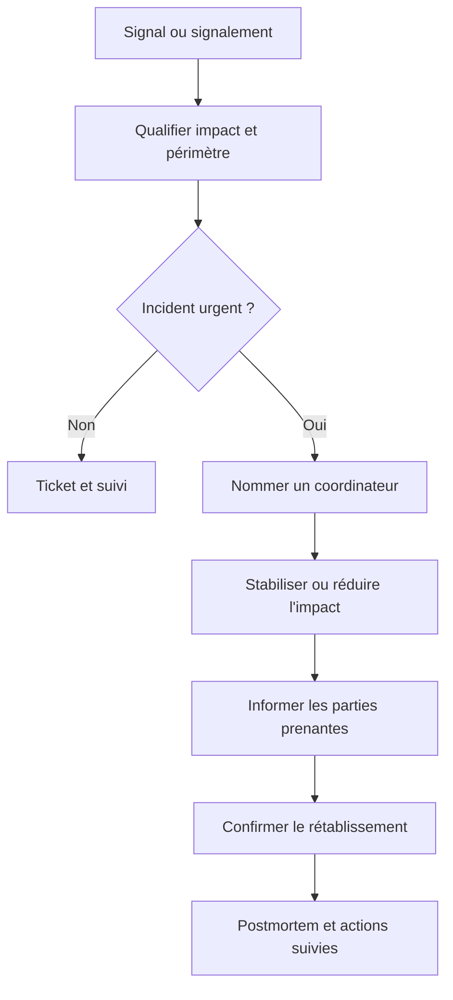
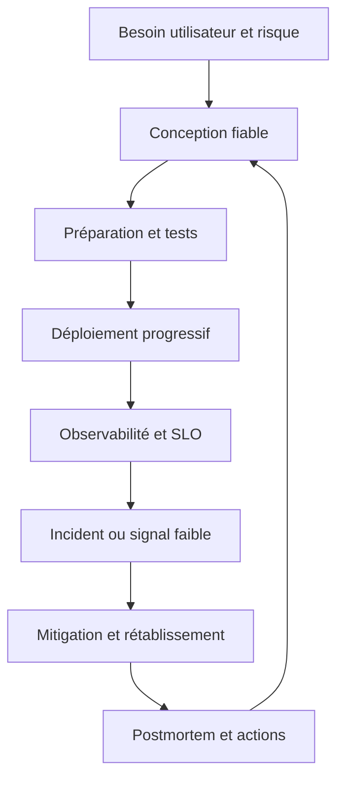
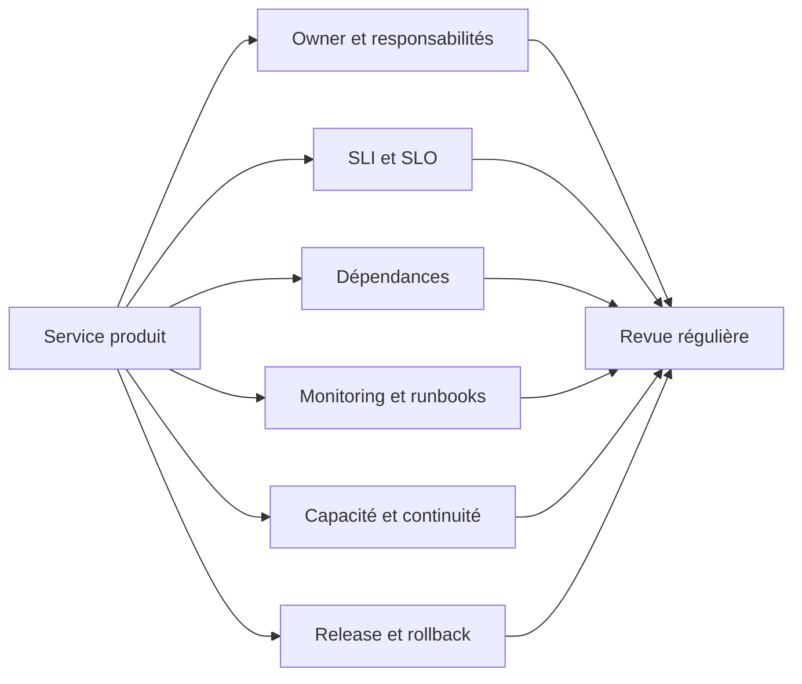
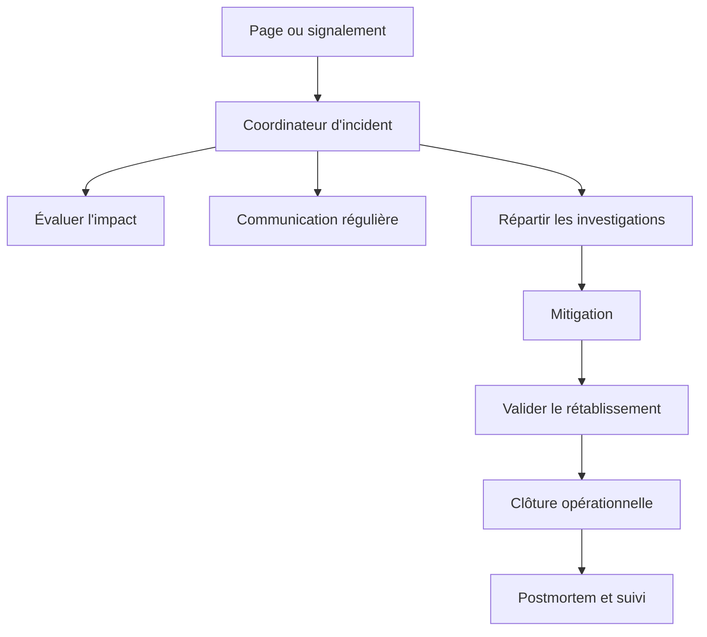
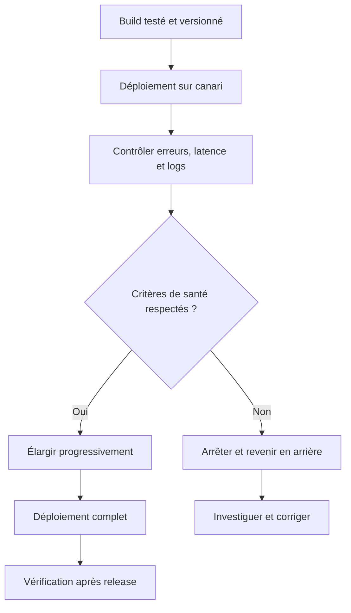
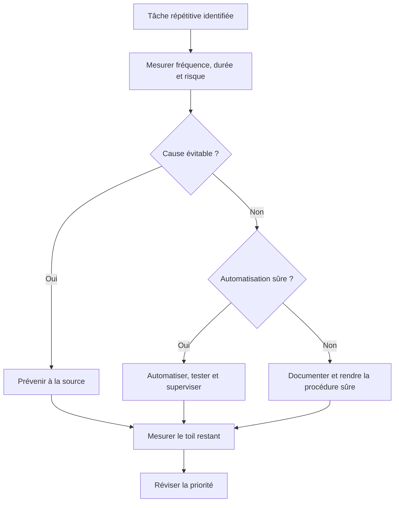

# SRE et culture de la fiabilité

> **Mise en contexte.** Une équipe peut posséder un excellent outil de supervision, des procédures d’incident et une infrastructure redondante, puis connaître malgré tout des pannes répétitives si les responsabilités sont floues, si les changements ne sont pas maîtrisés ou si les personnes sont épuisées par l’astreinte. L’ingénierie de la fiabilité des sites, ou SRE (*Site Reliability Engineering*), cherche à appliquer des pratiques d’ingénierie aux opérations de production. Elle combine mesure du niveau de service, automatisation, gestion du risque, préparation des mises en production, réponse aux incidents et apprentissage collectif. Ce cours porte autant sur les décisions et la culture que sur les outils.

## 1. Introduction

### 1.1. Qu’est-ce que le SRE ?

Le SRE est une approche d’ingénierie de l’exploitation : au lieu de traiter la production comme une succession de tâches manuelles à exécuter, l’équipe conçoit des systèmes, des logiciels et des processus qui rendent le service plus fiable, plus prévisible et plus facile à faire évoluer. Elle utilise les méthodes du développement logiciel pour réduire le travail répétitif, améliorer la détection des incidents, tester les comportements de panne et mesurer objectivement la qualité du service.

La fiabilité ne dépend pas d’un seul métier. Les équipes produit construisent les capacités attendues, les développeurs conçoivent le comportement applicatif, les équipes plateforme fournissent les environnements et les outils, les opérations surveillent les signaux et répondent aux incidents, tandis que la sécurité, les données et les partenaires techniques apportent leurs propres contraintes. Une culture SRE cherche à rendre ces interactions explicites, plutôt que de faire reposer l’ensemble du système sur quelques experts qui connaissent des procédures non documentées.

Une idée centrale est de considérer la fiabilité comme une caractéristique du produit, et non comme une étape finale confiée à une équipe séparée. Un service est fiable si son comportement observé correspond aux attentes définies, y compris lorsque des composants échouent, que le trafic augmente ou qu’un changement introduit une régression. L’objectif n’est pas d’éliminer tout risque, car ce serait souvent extrêmement coûteux ou impossible. Il s’agit de gérer le risque de manière explicite et de consacrer les efforts là où ils apportent le plus de valeur aux utilisateurs.

### 1.2. SRE, DevOps et opérations traditionnelles

DevOps désigne un ensemble de principes de collaboration entre développement et exploitation : responsabilité partagée, boucles de rétroaction plus courtes, automatisation et livraison plus sûre. SRE est une manière concrète d’appliquer ces idées avec des pratiques de fiabilité mesurables, par exemple les SLI, les SLO, les budgets d’erreur, la gestion du toil, la réponse aux incidents et les revues de préparation à la production.

Une opération traditionnelle peut être organisée autour de tickets et d’interventions humaines : une équipe demande un serveur, une autre le configure, une troisième prend en charge les alertes, et chaque passage ajoute du délai ou un risque de perte de contexte. Cette organisation n’est pas nécessairement mauvaise dans tous les contextes, mais elle devient difficile à soutenir lorsque le nombre de services, de déploiements et de dépendances augmente rapidement.

Une approche SRE vise plutôt des interfaces claires, des systèmes répétables et une responsabilité partagée du comportement en production. Cela ne signifie pas que tout le monde doit faire toutes les tâches ou que les équipes spécialisées disparaissent. Cela signifie que les responsabilités, les critères de qualité et les mécanismes de coopération sont définis au lieu d’être négociés dans l’urgence à chaque incident.

### 1.3. Les compromis que le SRE rend explicites

Les décisions de fiabilité impliquent souvent plusieurs objectifs légitimes :

- **Vitesse de livraison** : proposer rapidement des fonctions utiles.
- **Fiabilité** : limiter les interruptions, les résultats incorrects et les délais inacceptables.
- **Coût** : éviter de payer pour une redondance ou une capacité qui n’apporte pas une valeur suffisante.
- **Sécurité** : protéger les comptes, les données et l’intégrité du service.
- **Soutenabilité humaine** : éviter les rotations d’astreinte dangereuses et le travail répétitif sans fin.
- **Simplicité** : limiter les dépendances et les mécanismes difficiles à comprendre.

Optimiser un seul de ces objectifs peut dégrader les autres. Ajouter toutes les redondances possibles peut augmenter la complexité et le coût. Accélérer chaque déploiement sans contrôle peut provoquer plus d’incidents. Bloquer tout changement peut réduire temporairement les régressions, mais aussi laisser des défauts et des vulnérabilités sans correction. Une culture SRE mesure ces compromis et les discute avec des données.

### 1.4. Objectifs pédagogiques

À l’issue du cours, vous devez pouvoir expliquer ce qu’apporte le SRE, distinguer les modèles d’organisation possibles, reconnaître et réduire le travail opérationnel répétitif, définir une responsabilité d’astreinte soutenable, structurer une réponse aux incidents, produire un postmortem sans blâme, préparer un lancement en production, évaluer la capacité et la résilience, utiliser les SLO et budgets d’erreur dans les arbitrages, et mettre en place une feuille de route progressive pour faire évoluer la culture de fiabilité.

Les exemples utilisent des concepts indépendants d’un fournisseur. Ils peuvent s’appliquer à une API, une plateforme SaaS, un service réseau, un moteur de traitement par lots, un système de données ou un environnement interne.

## 2. Concepts clés

### 2.1. Le service avant l’organigramme

Un service fiable doit avoir un propriétaire fonctionnel et technique identifiable. Cette responsabilité comprend la définition du service rendu, les dépendances critiques, la qualité de la télémétrie, la politique de déploiement, la réponse aux incidents, la capacité, la sécurité opérationnelle et les actions d’amélioration. Un propriétaire n’est pas nécessairement la personne qui réalise toutes les tâches ; il est responsable de leur coordination et de la clarté du système.

Un piège fréquent consiste à confondre la possession d’un outil avec la responsabilité d’un résultat. L’équipe de supervision peut gérer Prometheus et Grafana, mais cela ne garantit pas que chaque équipe de service a défini les bons SLI ni que les alertes appellent une action adaptée. L’équipe plateforme peut fournir un pipeline de déploiement, mais cela n’assure pas que chaque application possède des tests de fumée ou une procédure de retour arrière. Une architecture opérationnelle saine précise les frontières entre les plateformes partagées et les services qui les utilisent.

Une matrice de responsabilités peut être utile, à condition de rester simple et réellement utilisée. Pour chaque service, identifiez qui décide des SLO, qui maintient l’instrumentation, qui peut déclencher un rollback, qui coordonne un incident majeur, qui valide un changement de risque élevé et qui suit les actions du postmortem. Si une responsabilité est partagée, décrivez la coopération attendue plutôt que de simplement écrire « tout le monde est responsable ».

### 2.2. Modèles d’équipe SRE

Il n’existe pas une seule structure universelle. Le bon modèle dépend de la taille de l’organisation, de la criticité des services, de la diversité technologique et de la maturité des équipes.

**SRE intégré à une équipe produit.** Un ingénieur de fiabilité ou une petite fonction SRE travaille au plus près des développeurs. Ce modèle favorise le partage du contexte et des améliorations qui se font dans le code. Il convient aux services où la conception et l’exploitation doivent être très coordonnées. Le risque est de disperser les pratiques, de dupliquer les outils et de manquer de masse critique pour les domaines spécialisés.

**Équipe SRE dédiée à un ensemble de services.** Une équipe prend en charge la fiabilité de plusieurs systèmes ou d’une plateforme métier. Elle peut diffuser des pratiques communes et accumuler de l’expertise opérationnelle. Elle doit cependant éviter de devenir une équipe d’astreinte universelle qui absorbe tous les défauts des autres sans pouvoir influencer l’architecture ou les priorités.

**Équipe plateforme ou SRE fournissant des capacités.** Elle construit des services internes réutilisables : collecte de métriques, alerting, pipelines de déploiement, environnements de test, gestion des secrets, outils de reprise et modèles de service. Ses utilisateurs sont les équipes produit. Le modèle fonctionne mieux quand la plateforme fournit une expérience de développeur claire, des contrats de service et un support proportionné, au lieu de demander aux équipes de maîtriser son implémentation interne.

**Modèle de conseil ou d’accompagnement.** Une équipe experte aide les équipes de service à établir leurs SLO, à faire leurs revues de préparation, à concevoir les alertes et à traiter les problèmes structurels. Ce modèle peut créer des capacités sans devenir propriétaire de chaque production. Il doit toutefois s’appuyer sur un engagement de la direction et des équipes produit : le conseil sans pouvoir de changement mène à des recommandations qui restent dans des documents.

Le modèle peut évoluer avec le temps. Une startup peut commencer par une équipe produit qui assume l’exploitation avec des règles simples, puis introduire des capacités plateforme communes quand les duplications deviennent coûteuses. Une organisation plus mature peut associer SRE intégré, plateforme centrale et experts de domaines. Le choix doit être évalué par les résultats obtenus, la charge opérationnelle et la qualité de collaboration, pas par le titre des postes.

### 2.3. Responsabilité partagée sans dilution de l’ownership

« Tout le monde est responsable » peut se transformer en « personne ne sait qui agit ». Une approche SRE cherche un équilibre : la fiabilité est une responsabilité collective, mais chaque décision critique a un responsable identifiable. Les développeurs doivent participer à la mise en production et comprendre les signaux de leur application ; les spécialistes SRE aident à améliorer le système de production et les pratiques d’ingénierie ; les responsables produit arbitrent les priorités et l’impact utilisateur.

Définissez les éléments partagés dans des contrats explicites. Par exemple, l’équipe produit s’engage à fournir une mesure de succès, des logs exploitables, une procédure de rollback et une personne joignable ; la plateforme s’engage à maintenir l’orchestrateur, la chaîne d’observabilité et les outils de déploiement ; le SRE accompagne les SLO, les revues de risques et les incidents majeurs. Ces contrats n’ont pas besoin d’être juridiques : ils doivent expliquer les attentes, les dépendances et la manière de demander de l’aide.

Une responsabilité claire aide également à gérer les incidents inter-équipes. Le commandant d’incident peut coordonner plusieurs équipes sans devenir propriétaire de toutes les corrections. Chaque équipe conserve la responsabilité de sa partie, avec un objectif commun de réduction de l’impact.

### 2.4. Le toil : un travail opérationnel qui ne crée pas de valeur durable

Dans le langage SRE, le **toil** est le travail opérationnel répétitif, souvent manuel, qui tend à croître avec le volume du service et qui n’apporte pas d’amélioration durable après son exécution. Exemples : relancer chaque semaine le même job bloqué, redémarrer manuellement un service dès que sa mémoire monte, copier-coller des commandes d’accès pour chaque nouveau client ou appliquer des changements identiques à de nombreux environnements.

Toute tâche manuelle n’est pas automatiquement du toil. Un exercice de reprise exceptionnel, une investigation nouvelle ou une décision d’architecture peut avoir une forte valeur même si elle est faite à la main. La caractéristique importante du toil est sa répétitivité et le fait qu’il pourrait souvent être supprimé, simplifié ou automatisé. Une opération manuelle rare qui demande un jugement humain peut être la meilleure option ; une tâche manuelle quotidienne identique indique souvent une opportunité d’ingénierie.

Mesurer le toil demande un peu de discipline. Une équipe peut tenir un registre d’une ou deux semaines et classer les interruptions : déclencheur, durée, fréquence, personnes impliquées, risque et cause probable. Additionner les minutes ne suffit pas toujours : un toil de trente minutes par mois peut présenter un risque élevé si une erreur détruit des données, alors qu’une tâche de cinq minutes par jour peut être sans danger mais très coûteuse au fil du temps.

Une méthode utile est de distinguer :
- **Supprimer** : retirer une étape devenue inutile ou une cause répétitive.
- **Prévenir** : modifier la conception pour que la condition ne se produise plus.
- **Automatiser** : rendre l’action répétable et sûre si elle doit continuer d’exister.
- **Rendre autonome** : permettre à un utilisateur habilité de réaliser lui-même l’opération avec des garde-fous.
- **Accepter temporairement** : documenter la limite et programmer une action si l’investissement n’est pas prioritaire.

L’automatisation ne doit pas masquer une conception fragile. Automatiser le redémarrage d’un service qui perd régulièrement sa connexion à la base de données peut réduire la charge immédiate, mais elle peut aussi cacher la cause et augmenter les risques de corruption ou de surcharge. Une bonne automatisation détecte l’état, vérifie les conditions, agit de manière idempotente lorsque c’est possible, enregistre son résultat, limite les tentatives et permet une intervention humaine.

### 2.5. Pourquoi l’automatisation doit être traitée comme du logiciel de production

Un script opérationnel peut supprimer une panne ou en provoquer une nouvelle. Il mérite donc des tests, une revue, une gestion de version, des logs, des limites de privilèges et une procédure de retour arrière. Les scripts lancés depuis le poste d’un administrateur avec des privilèges très élevés sont particulièrement dangereux : ils fonctionnent parfois grâce à un état local invisible et peuvent être difficiles à reproduire.

Pour automatiser une tâche, décrivez d’abord son contrat : entrées, préconditions, effets attendus, erreurs possibles, délais, idempotence, permissions et critères de réussite. Une commande idempotente peut être exécutée plusieurs fois sans produire un effet cumulatif indésirable, dans les limites de sa conception. Cette propriété est très utile pour les opérations de réconciliation et de configuration.

Une automatisation doit également être observable. Elle devrait exposer le nombre d’exécutions, les succès, les échecs, la durée, les tentatives, la dernière réussite et, lorsque c’est pertinent, le volume de travail traité. Un script qui ne signale plus rien peut sembler silencieux alors qu’il ne fonctionne plus. Pour une action risquée, imposez un mode simulation, une validation des paramètres, des seuils de volume, un mécanisme d’approbation et une trace d’audit.

### 2.6. SLO et budget d’erreur comme mécanismes de coopération

Les SLI décrivent les résultats observés, les SLO définissent les objectifs et les budgets d’erreur représentent la marge de dégradation compatible avec l’objectif. Le budget rend visible le compromis entre la vitesse de changement et la fiabilité. Il évite que l’équipe produit exige des livraisons rapides sans tenir compte du risque, ou que l’équipe d’exploitation cherche à empêcher tout changement sans mesure de l’impact.

Un budget presque épuisé peut conduire à une période de stabilisation, à des déploiements plus progressifs, à une priorité plus élevée pour les défauts qui consomment le budget ou à une revue des changements risqués. Il ne devrait pas déclencher un gel aveugle. Les correctifs d’incident et de sécurité peuvent être nécessaires pour améliorer l’état du service, et doivent disposer d’une voie d’exception explicite.

Un budget n’est utile que si sa politique est comprise et appliquée de façon prévisible. Documentez le propriétaire, la fenêtre de mesure, le seuil d’attention, les conséquences d’un dépassement, les exceptions et les conditions de reprise. Les équipes devraient comprendre que le budget est un outil de décision collective, pas un score destiné à punir des individus.

### 2.7. La fiabilité comme propriété de conception

La fiabilité doit être considérée dès la conception du système. Chaque dépendance ajoute des modes de panne, une latence et des exigences de supervision. Une architecture redondante peut améliorer la disponibilité, mais la redondance n’est utile que si le système détecte la panne, bascule correctement et évite les points de défaillance communs. Deux instances dans le même domaine de panne ne protègent pas contre une défaillance de ce domaine.

Les choix de conception doivent documenter les hypothèses : combien de trafic le service doit-il absorber, quelles données peuvent être perdues, combien de temps une opération peut-elle prendre, quel comportement est acceptable si une dépendance est indisponible, quelles capacités de reprise existent et comment seront-elles testées ? Ces questions transforment la fiabilité d’une propriété implicite en un ensemble de contraintes vérifiables.

La simplicité est aussi un facteur de fiabilité. Chaque couche de cache, file, service tiers et circuit de reprise peut aider, mais ajoute du comportement qu’il faut comprendre, mesurer et tester. Le but n’est pas d’éviter toute complexité ; c’est de faire en sorte que chaque mécanisme apporte une valeur justifiée et que l’équipe sache comment il se comporte pendant une panne.

### 2.8. Détection, diagnostic et action

Une chaîne d’alerte utile commence par un signal lié à l’impact utilisateur ou à un risque opérationnel clairement défini, puis donne un contexte assez riche pour décider. Les alertes sont généralement classées selon la réponse attendue :
- **Page urgente** : une personne doit agir immédiatement pour réduire un impact significatif.
- **Ticket ou tâche** : une action est nécessaire, mais peut attendre les heures ouvrées ou la prochaine planification.
- **Journal ou annotation** : l’information doit être conservée pour l’analyse, sans demander d’action immédiate.

Cette distinction doit être appliquée au routage. Une alerte importante envoyée dans une boîte mail que personne ne surveille n’est pas réellement opérationnelle. Une notification urgente doit inclure le service, l’impact, la période, un lien vers le tableau de bord, les procédures connues et l’équipe responsable. Elle doit aussi être testée : un système d’alerte peut échouer au moment où il est le plus nécessaire.

Évitez les alertes qui se déclenchent sur une métrique sans action claire. Si une alerte CPU à 80 % apparaît chaque jour sans impact, elle sera ignorée. Elle peut être transformée en seuil d’investigation, en ticket de capacité ou en signal de diagnostic, selon ce que l’équipe doit en faire. Les alertes doivent être révisées après les incidents et les faux positifs.

### 2.9. L’astreinte : une capacité humaine de production

L’astreinte n’est pas uniquement un calendrier : elle constitue une partie de l’architecture de fiabilité. Une rotation mal conçue, des alertes qui ne cessent jamais ou des procédures impossibles à suivre augmentent le risque humain et technique. Le rôle de la personne d’astreinte est de reconnaître un incident, stabiliser le service dans les limites de ses permissions, mobiliser l’aide requise et transmettre clairement les informations. Elle ne devrait pas être contrainte de découvrir seule toute l’architecture à trois heures du matin.

Une rotation saine s’appuie sur un périmètre clair, des alertes actionnables, des runbooks testés, une escalade vers des spécialistes, des changements de garde documentés et une capacité à récupérer après les incidents nocturnes. Un nouveau membre doit recevoir une formation, participer à des exercices et avoir accès aux outils nécessaires avant d’être responsable seul d’un service critique.

La charge d’astreinte se mesure également : pages par semaine, pages hors heures ouvrées, durée moyenne d’intervention, incidents récurrents, interruptions de sommeil signalées et temps consacré aux tâches non planifiées. Ces données ne servent pas à comparer les individus ; elles montrent si le système est soutenable et quelles améliorations techniques sont nécessaires. Si une personne reçoit des alertes répétitives, l’objectif est de corriger les mécanismes et la charge, pas de féliciter sa capacité à supporter l’épuisement.

### 2.10. Réponse aux incidents : réduire l’impact d’abord

Une réponse mature distingue la **restauration du service** de la **recherche exhaustive de cause**. Lors d’un incident actif, le premier objectif est de protéger les utilisateurs et les données, puis de comprendre et résoudre la cause. Il peut être préférable de revenir à la version précédente, désactiver une fonctionnalité, limiter temporairement le trafic ou basculer vers un mode dégradé plutôt que de continuer une investigation approfondie pendant que l’impact augmente.

Un incident majeur nécessite des rôles clairs. Le commandant ou coordinateur d’incident conserve la vue d’ensemble et organise les priorités. Le responsable technique conduit l’investigation et les actions de mitigation. Le responsable de communication tient les parties prenantes informées. Selon la taille de l’incident, une même personne peut occuper plusieurs rôles, mais une séparation devient utile lorsque la coordination prend trop de charge.

La communication doit être factuelle et régulière. Un bon message indique ce qui est affecté, depuis quand, l’impact connu, les actions en cours et l’heure de la prochaine mise à jour. Il évite de présenter une hypothèse comme une certitude. Les équipes doivent également conserver une chronologie horodatée des changements, alertes, décisions, essais et résultats : elle permet de reconstruire l’incident sans dépendre de la mémoire d’une personne.

### 2.11. Postmortem sans blâme

Un postmortem n’est pas une enquête destinée à trouver la personne à punir. Il cherche à comprendre les facteurs techniques, humains et organisationnels qui ont conduit à l’incident et à décider comment réduire la probabilité ou l’impact d’une récidive. Les personnes impliquées ont pris des décisions avec l’information et les outils disponibles à ce moment-là ; l’analyse doit comprendre ces conditions, sans transformer rétrospectivement les signes ambigus en preuves d’incompétence.

Un postmortem de qualité comprend généralement :
- un résumé et l’impact utilisateur ;
- la chronologie des événements ;
- les systèmes, changements et dépendances concernés ;
- les facteurs contributifs et les mécanismes de détection ;
- ce qui a limité ou aggravé l’impact ;
- les actions correctives et préventives, avec un propriétaire et une échéance ;
- les enseignements qui peuvent s’appliquer à d’autres services.

Évitez les formulations comme « l’ingénieur n’a pas fait attention ». Elles ne proposent pas de garde-fou. Cherchez plutôt pourquoi le changement n’était pas détecté par les tests, pourquoi la revue n’a pas rendu le risque évident, pourquoi le rollback était difficile ou pourquoi l’alerte était arrivée trop tard. Cela ne supprime pas la responsabilité individuelle ou les obligations de sécurité ; cela déplace l’analyse vers les mécanismes qui rendent le succès probable et l’erreur récupérable.

Les actions de postmortem doivent être suivies comme du travail de production. Une liste de vingt actions sans priorité, sans propriétaire et sans revue n’améliore pas la fiabilité. Choisissez les mesures qui réduisent le plus le risque, donnez-leur une date et revoyez leur statut. Si une action est abandonnée, notez pourquoi et si le risque associé reste acceptable.

### 2.12. Gestion du changement et mises en production sûres

Une grande partie des incidents de production est liée à des changements : code, configuration, schéma de base de données, dépendance, certificat, règle réseau, politique IAM ou capacité. Le SRE cherche à rendre ces changements progressifs, visibles et réversibles.

Les pratiques utiles incluent les tests automatisés, les artefacts reproductibles, la revue de configuration, le déploiement progressif, le canari, les feature flags, la mesure de santé après déploiement, le rollback et la traçabilité. Le choix dépend du type de changement. Un changement de schéma de données peut nécessiter une migration compatible en plusieurs étapes ; un changement réseau peut requérir une validation de connectivité avant de toucher tous les sites ; une nouvelle version d’API peut être déployée après une période de compatibilité.

Un déploiement canari expose une petite portion du trafic ou un groupe limité d’utilisateurs à la nouvelle version. L’équipe compare des indicateurs de réussite, de latence et de ressources à une base connue, puis augmente progressivement l’exposition si les conditions sont acceptables. Le canari n’est pas une garantie automatique : il doit représenter la charge et les parcours importants, et la procédure d’arrêt doit être testée.

La réversibilité doit être réelle. Un rollback du code peut ne pas inverser une migration destructrice ou une écriture incompatible. Les stratégies de déploiement doivent prendre en compte les effets persistants, la compatibilité ascendante et descendante, les migrations de données, les tâches asynchrones et les interactions entre versions. La sécurité de livraison se conçoit, elle ne s’ajoute pas à la dernière minute.

### 2.13. Revue de préparation à la production

Une revue de préparation à la production (*Production Readiness Review*, PRR) est un moyen structuré d’identifier les risques avant qu’un service soit largement utilisé. Elle ne doit pas se réduire à un formulaire administratif. Le niveau de profondeur doit être proportionné à la criticité : un outil interne à faible impact peut utiliser une checklist légère, tandis qu’un service qui traite des paiements, des données sensibles ou des examens critiques nécessite une validation plus approfondie.

Les sujets à examiner comprennent :
- architecture, dépendances et points de défaillance ;
- modèles de trafic, estimation de capacité et résultats de tests de charge ;
- objectifs de service et définition des SLI ;
- alertes, tableaux de bord, journaux et traces ;
- procédures d’incident et d’escalade ;
- sauvegarde, restauration et reprise après sinistre ;
- sécurité, identités, secrets, autorisations et gestion des certificats ;
- stratégie de déploiement, canari et rollback ;
- coûts, quotas et limites des dépendances tierces ;
- propriétaires, documentation et formation de l’astreinte.

Le résultat d’une PRR doit être une décision claire : prêt, prêt sous conditions ou non prêt, avec des risques acceptés et des actions suivies. Les dérogations doivent nommer le décideur et la raison. Un service peut parfois être lancé avec une limitation documentée, mais il ne doit pas être considéré comme fiable simplement parce qu’une date de sortie approche.

### 2.14. Capacité, croissance et limites

Un service doit être conçu pour son trafic courant, mais aussi pour les variations plausibles : campagne marketing, événement programmé, croissance de la base de données, reprise après panne ou concentration régionale. La capacité ne se limite pas au CPU. Les limites peuvent être la mémoire, le nombre de connexions, le pool de workers, les IOPS de stockage, le débit réseau, les quotas d’API tierces, les verrous de base de données ou la cardinalité d’une plateforme d’observabilité.

Une estimation utile associe un modèle de trafic à des tests de charge et aux observations de production. Elle identifie le point où la latence se dégrade, le débit plafonne ou les erreurs augmentent. Les marges doivent considérer le scénario de panne : si une zone entière disparaît, les instances restantes doivent-elles absorber le trafic ? La redondance sans capacité résiduelle peut n’offrir qu’une fausse impression de résilience.

Le surdimensionnement n’est pas toujours la réponse. Le contrôle de charge, le backpressure, les quotas, la mise en file, la dégradation fonctionnelle contrôlée et les priorités de service peuvent protéger les parcours essentiels. Mais ces mécanismes ont eux-mêmes besoin d’être testés. Une limitation mal configurée peut rejeter le trafic légitime, et des retries non bornés peuvent amplifier la surcharge.

### 2.15. Continuité, sauvegarde et reprise après sinistre

La sauvegarde n’est pas équivalente à une reprise réussie. Une sauvegarde peut être corrompue, incomplète, trop ancienne ou impossible à restaurer dans le délai requis. Il faut définir les objectifs de reprise : le **RPO** (*Recovery Point Objective*) décrit la perte de données maximale acceptable, tandis que le **RTO** (*Recovery Time Objective*) décrit le délai cible pour restaurer le service ou une capacité donnée.

Ces objectifs doivent correspondre au besoin métier. Un contenu de formation statique peut tolérer une restauration plus lente qu’un système de paiement. Les sessions d’examen ou les réservations peuvent demander des garanties plus fortes sur la cohérence et la récupération des états. Si une architecture est redondante, il faut vérifier que la réplication ne propage pas immédiatement toutes les suppressions ou corruptions.

Un plan de reprise efficace couvre les personnes, les accès, les dépendances, les procédures et la communication, en plus de l’infrastructure. Les exercices doivent être réguliers et réalistes : restaurer un échantillon de données, basculer un environnement, vérifier l’intégrité et mesurer le temps écoulé. Une procédure jamais testée n’est qu’une hypothèse.

### 2.16. Culture d’apprentissage et sécurité psychologique

La sécurité psychologique est la capacité à signaler un problème, poser une question ou reconnaître une erreur sans craindre une humiliation automatique. Elle ne signifie pas l’absence de normes ni de responsabilité. Elle permet de faire remonter les signaux faibles : une procédure incompréhensible, une alerte ignorée, une fatigue d’astreinte, un risque de configuration ou une dépendance fragile.

La direction doit montrer par les actes que les mauvaises nouvelles précoces sont préférables aux surprises tardives. Lorsque les personnes sont punies pour avoir signalé un incident, elles apprennent à cacher les problèmes ou à minimiser leur impact. La qualité de la fiabilité s’en trouve dégradée, car l’organisation perd l’information qui permettrait de corriger ses mécanismes.

Une culture d’apprentissage transforme les incidents et les quasi-incidents en actions concrètes. Elle encourage le partage de retours d’expérience, des exercices de panne, des revues inter-équipes et la publication de décisions. Les postmortems ne doivent pas être réservés aux catastrophes : un quasi-incident où un déploiement est arrêté au dernier moment peut révéler une faiblesse de validation avant qu’elle ne touche les utilisateurs.

### 2.17. Mesurer la maturité sans créer un classement artificiel

Les métriques organisationnelles peuvent aider à repérer des tendances, mais elles deviennent dangereuses lorsqu’elles servent à classer les individus. Le nombre de tickets fermés, de déploiements réalisés ou de pages reçues n’exprime pas directement la fiabilité. Une équipe qui réduit le volume de pages grâce à une meilleure conception peut paraître moins productive si l’organisation ne valorise que les interventions visibles.

Des indicateurs plus utiles incluent la proportion de services critiques ayant des SLO validés, la proportion d’alertes actionnables, le délai de détection, le délai de mitigation, la part de travail opérationnel répétitif, le taux d’actions de postmortem terminées, la fréquence de tests de restauration et les tendances de consommation des budgets d’erreur. Même ces indicateurs nécessitent un contexte : réduire artificiellement le délai de résolution en déclarant trop tôt l’incident terminé peut dégrader la qualité réelle.

La maturité n’est pas une progression linéaire de cases cochées. Les services n’ont pas tous le même risque, et les contrôles doivent être proportionnés. Il est souvent plus utile de définir une feuille de route par capacités — mesure, déploiement, incident, capacité, automatisation et apprentissage — que de produire un score unique qui masque les lacunes critiques.

## 3. Architecture et Schémas

### 3.1. La boucle opérationnelle SRE

La fiabilité est un cycle continu. Le service est conçu et instrumenté, livré avec des garde-fous, observé en production, amélioré à partir des incidents et des retours utilisateurs, puis réévalué à mesure que les usages changent. La culture SRE organise ce cycle afin que les informations et les responsabilités traversent les équipes.

Cette boucle doit être financée en temps d’ingénierie. Si toute la capacité est allouée aux nouvelles fonctionnalités, les actions de fiabilité restent en attente et les mêmes causes réapparaissent. Une organisation peut réserver une part de capacité pour le travail de fiabilité, prioriser selon le budget d’erreur et réviser régulièrement le rapport entre livraison de fonctionnalités et correction structurelle.

### 3.2. Modèle de responsabilité d’un service

Une fiche de service peut décrire le propriétaire, les utilisateurs, les dépendances, le SLI/SLO, la configuration de supervision, les procédures de déploiement et de rollback, la rotation d’astreinte, la politique de sauvegarde et les risques connus. Cette fiche n’est utile que si elle est tenue à jour et liée aux outils utilisés au quotidien.

Les fiches ne doivent pas devenir un catalogue de liens obsolètes. Automatisez autant que possible la découverte des versions, des dashboards, des pipelines et des astreintes. Les informations qui exigent un jugement humain — risque accepté, comportement dégradé, propriétaire de décision — doivent être vérifiées lors des revues.

### 3.3. Déroulement d’un incident avec rôles clairs

Un incident peut évoluer plus vite que la capacité d’une seule personne à investiguer, coordonner, communiquer et corriger. Des rôles simples réduisent la confusion : le coordinateur pilote, l’investigateur travaille sur les causes et les mitigations, le communicant informe les personnes concernées, et les équipes spécialisées exécutent les tâches qui leur sont attribuées.

La clôture opérationnelle ne signifie pas que toutes les causes sont résolues. Elle signifie que l’impact immédiat est terminé ou suffisamment maîtrisé, que les utilisateurs sont informés et que le suivi des risques est attribué. Les causes profondes peuvent nécessiter une analyse et des changements plus longs.

### 3.4. Déploiement progressif et retour arrière

Le déploiement progressif transforme un lancement binaire en étapes mesurables. Le canari permet d’observer une petite exposition avant d’augmenter le trafic, puis les signaux déterminent si la progression est sûre. Les seuils doivent être comparés à une base de référence ; une charge différente ou un bruit de trafic peut autrement conduire à de fausses conclusions.

Les critères d’arrêt doivent être définis avant la mise en production. Si l’équipe improvise les seuils pendant une panne, elle risque de prolonger l’exposition à une régression. Le rollback doit être testé au moins sur les scénarios représentatifs, y compris lorsque des changements de données ou de configuration sont persistants.

### 3.5. Mesurer et réduire le toil

Un registre du toil permet de transformer une frustration répétée en proposition d’ingénierie. Chaque tâche est classée selon sa fréquence, son coût, son risque et son potentiel d’élimination. On peut ensuite décider si la meilleure réponse est la suppression, une modification de conception, une automatisation ou une procédure plus sûre.

La réduction du toil doit produire une amélioration durable. Le simple fait d’exécuter une action plus vite ne supprime pas nécessairement le travail : une automatisation qui échoue souvent et exige une intervention manuelle peut déplacer le toil plutôt que le réduire. Suivez les coûts de maintenance, les échecs d’automatisation et les risques introduits.

### 3.6. Exemple d’indicateurs de santé organisationnelle

Un tableau de bord de maturité peut combiner des mesures quantitatives et des preuves qualitatives. Par exemple : les cinq services les plus critiques disposent-ils d’un SLO validé ? L’astreinte a-t-elle des procédures vérifiées ? Les incidents majeurs donnent-ils lieu à des actions terminées ? Les déploiements ont-ils un rollback testé ? Les alertes déclenchées conduisent-elles à une décision ? Une valeur numérique isolée ne suffit pas à établir la maturité.

Il est utile d’examiner ces indicateurs lors d’une revue mensuelle de service ou trimestrielle de plateforme. Les tendances sont souvent plus riches que les instantanés : la fréquence des pages augmente-t-elle après les mises à jour ? La consommation du budget a-t-elle été associée à une classe de changement ? La part de travail répétitif diminue-t-elle après l’automatisation ? Les tests de reprise ont-ils révélé des délais incompatibles avec les besoins métier ?

## 4. Étude de cas

### 4.1. Contexte : une plateforme de formation en croissance

Une plateforme de formation technique propose des cours, des examens, des laboratoires interactifs et des tableaux de bord. Le produit grandit, le nombre de déploiements augmente et plusieurs équipes contribuent au même service. Les utilisateurs rencontrent trois problèmes : les pages deviennent lentes pendant certaines périodes, les examens ne démarrent pas toujours et les équipes ont du mal à savoir qui doit intervenir lorsque plusieurs composants sont concernés.

Le premier constat est organisationnel autant que technique. Les tableaux de bord montrent la charge CPU et la mémoire, mais peu de mesures de parcours. Les alertes s’accumulent dans plusieurs canaux, sans distinction fiable entre information et urgence. Le déploiement d’une nouvelle version repose sur une procédure manuelle détenue par une seule personne. Les incidents sont corrigés rapidement, mais rarement documentés, donc les mêmes symptômes reviennent.

L’objectif n’est pas de créer immédiatement une grande équipe SRE avec une structure complexe. L’équipe commence par clarifier la propriété du service, sélectionner les parcours les plus importants et définir une amélioration progressive de l’ingénierie opérationnelle.

### 4.2. Première étape : nommer les responsabilités

La plateforme est découpée en domaines : expérience web et catalogue, API d’examen, moteur de laboratoire, données et plateforme d’exécution. Chaque domaine a un propriétaire technique et un responsable de produit. Un coordinateur d’incident est désigné pour les incidents majeurs, avec une procédure d’escalade et des relais identifiés. Les équipes conviennent que le propriétaire d’un composant doit fournir les signaux et les procédures nécessaires pour en assurer la fiabilité.

La plateforme centrale prend la responsabilité du pipeline de déploiement, de l’observabilité partagée et des outils communs. Elle ne devient pas pour autant responsable de chaque défaut métier. L’équipe d’examen conserve la responsabilité du parcours d’examen et de ses SLI ; la plateforme garantit que les outils permettent de déployer, mesurer et diagnostiquer correctement ce service.

Cette clarification réduit le temps perdu à chercher qui doit agir. Elle permet aussi à chaque équipe de proposer des améliorations à l’endroit où se trouve la cause plutôt que de demander à l’équipe opérations de réparer constamment le même symptôme.

### 4.3. Deuxième étape : définir les signaux utiles

L’équipe choisit trois mesures de départ :
- proportion des lectures de leçon qui retournent un contenu valide dans un délai acceptable ;
- proportion des examens qui deviennent réellement interactifs dans le délai attendu ;
- proportion des soumissions de réponse confirmées et persistées correctement.

Les mesures sont reliées à des SLO, avec une fenêtre définie et des règles d’exclusion documentées. Les métriques techniques existantes restent utiles pour diagnostiquer la cause, mais ne constituent plus le seul indicateur de santé. Les tests synthétiques vérifient les parcours qui doivent rester testables même lorsque le trafic réel est faible.

L’équipe vérifie que les erreurs métier ne sont pas comptées comme réussites simplement parce que le serveur répond avec un code HTTP normal. Elle corrèle les événements avec la version applicative et une trace, tout en évitant d’ajouter les identifiants utilisateurs aux labels de métriques. Le but est d’obtenir des mesures actionnables sans exposer de données personnelles ni créer une cardinalité excessive.

### 4.4. Troisième étape : assainir les alertes et l’astreinte

Une revue des alertes identifie de nombreuses notifications sans action définie. Certaines pages apparaissent à chaque pic CPU, même lorsque le parcours utilisateur reste sain ; d’autres erreurs d’examen ne sont visibles qu’au travers de plaintes. Les règles sont réorganisées : les alertes liées à un impact utilisateur sérieux et persistant déclenchent une page ; les dérives de capacité génèrent un ticket avec une échéance ; les signaux utiles au diagnostic restent dans les dashboards et logs.

Chaque page dispose d’un nom clair, d’une description de l’impact, d’une personne ou équipe responsable, d’un tableau de bord, d’un runbook et de conditions d’escalade. L’équipe teste les notifications de bout en bout. Elle mesure également la charge de l’astreinte et planifie une capacité de récupération après une nuit d’intervention.

Les procédures de diagnostic sont écrites au fur et à mesure des investigations. Au lieu de documenter une longue liste de commandes sans contexte, chaque runbook décrit les symptômes, les vérifications de sécurité, les commandes autorisées, les résultats attendus, les conditions d’arrêt et la manière de revenir à l’état normal. Les gestes destructifs nécessitent une validation renforcée.

### 4.5. Quatrième étape : mettre les déploiements sous contrôle

Les versions sont construites de manière reproductible et identifiées par un artefact immuable. Le pipeline exécute les tests, applique la configuration, déploie une petite fraction du trafic et observe les SLI avant de poursuivre. Si les indicateurs dépassent les critères d’arrêt, le pipeline interrompt la progression et propose un retour arrière lorsque celui-ci est sûr.

Le changement de schéma de base de données est traité séparément du simple changement de code. L’équipe privilégie les migrations compatibles : ajouter une structure, déployer du code qui peut lire l’ancien et le nouveau format, migrer progressivement les données, puis supprimer l’ancien chemin dans une version ultérieure. La procédure prévoit une sauvegarde vérifiée et une solution pour les écritures effectuées pendant le déploiement.

L’équipe ajoute une checklist de préparation proportionnée au risque. Avant une fonctionnalité qui touche les examens, elle vérifie les métriques de parcours, les limites de capacité, la gestion des dépendances, les logs de diagnostic, le rollback et l’astreinte. La checklist est automatisée lorsqu’un contrôle peut l’être et reste humaine uniquement pour les décisions qui exigent un jugement.

### 4.6. Incident : les examens deviennent lents après une livraison

Après une mise à jour, la latence de démarrage des examens augmente. Le tableau de bord du SLI indique que la proportion de sessions prêtes dans le délai cible se dégrade ; une alerte sur le budget d’erreur signale une consommation rapide. Le coordinateur d’incident réunit l’équipe examen et la plateforme, publie un premier état factuel et attribue l’analyse des traces au responsable technique.

Les traces montrent qu’une nouvelle étape de préparation fait un appel supplémentaire à une dépendance qui répond lentement. L'équipe décide de désactiver temporairement la fonctionnalité derrière un drapeau ou de revenir à la version précédente, selon la sécurité du rollback. Après la mitigation, les SLI reviennent à leur niveau précédent. L’équipe vérifie les soumissions en attente et s’assure qu’aucun état d’examen n’a été perdu.

Le postmortem examine ensuite pourquoi l’appel supplémentaire n’avait pas été détecté par les tests, pourquoi les critères du canari ne couvraient pas la durée du parcours et pourquoi la procédure de rollback n’avait pas documenté le cas des sessions déjà créées. Les actions incluent un test de charge réaliste, un contrôle de latence de bout en bout, une meilleure annotation de déploiement et une mise à jour du runbook. Les actions ont un propriétaire et une date de suivi.

### 4.7. Cinquième étape : réduire le toil

Pendant deux semaines, l’équipe enregistre les interventions répétitives. Elle constate que chaque nouveau laboratoire nécessite plusieurs opérations manuelles, que les certificats sont renouvelés avec des rappels individuels et qu’une tâche de nettoyage échoue régulièrement en raison d’un paramètre de configuration différent entre environnements.

Les priorités sont ordonnées selon le coût total et le risque. Le pipeline automatise d’abord la création des environnements de laboratoire avec des paramètres validés. Le renouvellement des certificats devient une tâche automatisée et surveillée. La tâche de nettoyage reçoit un contrôle de configuration à la source et un mécanisme de retry limité. L’équipe ne se contente pas d’ajouter un cron qui relance indéfiniment le travail : elle corrige la cause, limite les tentatives et alerte si la récupération échoue.

Après la mise en œuvre, l’équipe compare le nombre d’interventions manuelles, les échecs d’automatisation, le temps de diagnostic et les défauts créés. Si une automatisation génère un nouveau type d’incident, elle est traitée comme un système de production et améliorée. La réduction du toil libère alors du temps pour les tests de résilience, l’instrumentation et l’amélioration des parcours.

### 4.8. Feuille de route sur trois mois

**Mois 1 — rendre le service lisible.** Identifier les propriétaires, les dépendances critiques, les parcours principaux et les alertes urgentes. Définir les SLI/SLO initiaux et documenter l’escalade. Mesurer la charge d’astreinte et établir une chronologie des incidents importants.

**Mois 2 — rendre les changements plus sûrs.** Standardiser les tests, le déploiement progressif, les annotations de version et le rollback. Réaliser une revue de préparation des services les plus critiques. Construire les premiers runbooks, mesurer la consommation du budget et démarrer un registre du toil.

**Mois 3 — apprendre et réduire le travail répétitif.** Conduire les postmortems ouverts, terminer les actions prioritaires, automatiser une ou deux tâches à forte fréquence, tester une procédure de restauration et réviser les objectifs avec les données collectées. Décider ensuite quelles capacités plateforme ou SRE sont nécessaires à plus grande échelle.

Le succès se mesure par des résultats : moins d’incidents récurrents, un temps de mitigation plus court, des changements plus prédictibles, des alertes plus utiles, une réduction du travail répétitif et une équipe capable d’expliquer ses risques. Le succès ne se mesure pas au nombre de documents rédigés ni à la quantité d’outils installés.

## 5. Pièges à éviter

### 5.1. Transformer le SRE en équipe de pompiers

Si l’équipe SRE répond à toutes les pages, exécute tous les déploiements et corrige tous les défauts, elle devient un service d’exploitation manuel plus spécialisé. Elle n’a plus le temps d’améliorer les systèmes qui génèrent la charge. Il faut protéger sa capacité d’ingénierie, partager les responsabilités et exiger des équipes de service qu’elles maintiennent leur instrumentation et leurs runbooks.

Une équipe centrale peut avoir un rôle d’astreinte sur les systèmes qu’elle possède, mais elle ne doit pas absorber automatiquement les incidents de tous les services. Pour chaque alerte, le propriétaire et le chemin d’escalade doivent être explicites. Une dépendance envers quelques experts est un risque opérationnel : la connaissance doit être diffusée et les procédures doivent être reproductibles.

### 5.2. Automatiser un mauvais processus

Une automatisation peut accélérer une opération inefficace sans supprimer sa cause. Un script qui supprime puis recrée un environnement à chaque échec peut masquer une erreur de configuration et provoquer une perte de données. Avant d’automatiser, mesurez la fréquence, comprenez le comportement attendu et identifiez les effets secondaires.

Commencez par une version simple, testez-la sur un environnement non critique, ajoutez des garde-fous et surveillez ses résultats. L’automatisation doit avoir des limites, un propriétaire et une procédure de désactivation. Si le comportement devient plus difficile à comprendre que l’opération manuelle initiale, reconsidérez la solution.

### 5.3. Croire que les SLO résolvent à eux seuls les conflits

Les SLO et budgets d’erreur donnent un cadre de discussion, mais ne remplacent pas les décisions de produit ou les responsabilités. Une organisation peut continuer à imposer des lancements risqués si la direction ignore le budget, ou geler les changements de manière excessive si elle interprète l’objectif comme une obligation de perfection.

La politique doit préciser qui arbitre, quelles exceptions sont possibles, quelle preuve est attendue et comment les décisions sont communiquées. Si les SLO ne changent jamais une décision, ils sont peut-être mal choisis, mal mesurés ou déconnectés des priorités réelles.

### 5.4. Punir les personnes après un incident

La recherche d’un coupable simplifie le récit mais empêche souvent de comprendre la situation. Une personne peut avoir utilisé une procédure approuvée qui s’est révélée dangereuse, reçu une alerte ambiguë ou pris une décision raisonnable avec des informations incomplètes. Il faut comprendre comment le système a permis au risque de se matérialiser et comment réduire la probabilité d’un nouvel incident.

Une culture sans blâme n’interdit pas d’aborder les violations délibérées, les négligences répétées ou les obligations de conformité. Elle évite de remplacer l’analyse par une humiliation. L’objectif est de créer un environnement où les erreurs, limites et signaux faibles sont signalés assez tôt pour être corrigés.

### 5.5. Accumuler des actions de postmortem sans les terminer

Après chaque incident, les équipes peuvent écrire une longue liste d’améliorations qui ne seront jamais réalisées. Priorisez les actions selon le risque réduit, le coût, les dépendances et la probabilité de récidive. Une action doit avoir un propriétaire, une échéance réaliste et une méthode de validation.

Réutilisez les résultats lors des revues de service. Si une action est bloquée par une autre équipe, escaladez le problème plutôt que de laisser la ligne ouverte sans commentaire. Fermer une action exige une preuve : test ajouté, alerte vérifiée, procédure de reprise exécutée ou mécanisme de protection déployé.

### 5.6. Mesurer les personnes plutôt que le système

Le nombre de pages reçues, de commits écrits ou de tickets fermés ne reflète pas directement l’impact. Ces chiffres peuvent encourager des comportements contre-productifs, comme éviter de déclarer un incident ou fragmenter artificiellement des tâches. Utilisez les mesures pour comprendre les tendances collectives, puis examinez les causes avec les équipes.

La charge d’astreinte doit être interprétée comme une propriété du système et de la rotation. Une équipe qui reçoit beaucoup de pages n’est pas nécessairement moins compétente ; elle peut exploiter un service plus critique, avoir de meilleures alertes ou subir une dette technique particulière. La question utile est ce qui doit changer pour réduire les risques et la charge.

### 5.7. Négliger le coût humain de la fiabilité

Une personne fatiguée est plus susceptible de mal interpréter un signal, d’oublier une vérification ou de prendre une décision risquée. Une culture qui glorifie les interventions nocturnes et les héros individuels cache souvent un problème d’ingénierie. La réponse doit porter sur la réduction du bruit d’alerte, les rotations soutenables, l’escalade, les périodes de repos et l’amélioration de l’automatisation.

L’astreinte doit être évaluée régulièrement avec les personnes qui la réalisent. Une procédure peut sembler claire dans une réunion mais être impossible à appliquer sous stress. Les exercices et les retours d’expérience permettent d’identifier ces points avant un incident réel.

### 5.8. Considérer la redondance comme une garantie

Plusieurs instances ne garantissent pas une haute disponibilité si elles partagent une base de données, une région, une identité ou une configuration. Une bascule non testée peut échouer en même temps que le composant principal. La résilience demande une analyse des domaines de panne, une capacité résiduelle, des tests et une vérification des données.

Ajoutez une redondance lorsqu’elle répond à un risque identifié. Testez le mécanisme et ses effets : routage, cohérence, duplication des traitements, détection des défaillances et reprise après retour du composant. La complexité ajoutée doit être assumée dans les runbooks et dans l’astreinte.

### 5.9. Traiter une checklist de production comme une signature

Une checklist ne rend pas un service prêt simplement parce que toutes les cases sont remplies. Les contrôles doivent être appuyés par des preuves : test de restauration réussi, alerte déclenchée lors d’un exercice, rollback exécuté, charge testée et propriétaire joignable. Les réponses « oui » sans preuve ne réduisent pas le risque.

Le niveau de contrôle doit être proportionné à la criticité. L’objectif d’une revue de préparation n’est pas de ralentir tous les projets, mais de rendre visibles les risques acceptés, d’éviter les oublis graves et de s’assurer que les personnes savent comment opérer le service.

### 5.10. Chercher un grand programme de transformation avant de commencer

Une organisation peut passer plusieurs mois à choisir un outil de fiabilité, un nouveau modèle d’équipe et une taxonomie de maturité avant de corriger une seule alerte. Commencez avec un service pilote, un problème concret et des résultats visibles. Documentez ce qui fonctionne, simplifiez les outils et étendez progressivement les pratiques.

Le changement de culture est un travail continu, pas un projet qui se termine après un lancement. Les équipes doivent comprendre la valeur de chaque pratique et pouvoir l’adapter. Un modèle parfait sur le papier mais rejeté par les personnes qui l’utilisent aura moins d’effet qu’un système simple, fiable et adopté.

## 6. Checklist / À retenir

### 6.1. Checklist de mise en place d’une culture SRE

- [ ] Chaque service critique a un propriétaire identifiable et des limites de responsabilité claires.
- [ ] Les parcours utilisateur les plus importants sont définis.
- [ ] Les SLI/SLO sont documentés, mesurables et révisés.
- [ ] Le budget d’erreur influence réellement les décisions de livraison et de stabilisation.
- [ ] Les alertes distinguent pages urgentes, tickets et signaux de diagnostic.
- [ ] Les procédures d’astreinte sont testées et les escalades sont connues.
- [ ] Les changements de production sont versionnés, testés et réversibles autant que possible.
- [ ] Les déploiements risqués disposent d’un canari ou d’une stratégie de réduction d’exposition.
- [ ] Les dépendances et domaines de panne sont documentés.
- [ ] La capacité est analysée à partir du trafic, des tests et des scénarios de défaillance.
- [ ] Les sauvegardes sont restaurées lors d’exercices, avec RPO/RTO mesurés.
- [ ] Les incidents majeurs donnent lieu à des postmortems sans blâme.
- [ ] Les actions de postmortem ont des responsables, des dates et des preuves de validation.
- [ ] Le toil est mesuré et les améliorations visent ses causes récurrentes.
- [ ] Les scripts d’automatisation sont testés, supervisés, versionnés et limités en privilèges.
- [ ] La charge d’astreinte est évaluée de façon collective et soutenable.
- [ ] Les revues de préparation à la production sont proportionnées au risque.
- [ ] Les indicateurs de maturité sont utilisés pour améliorer le système, pas pour punir les individus.

### 6.2. Principes à mémoriser

**Automatiser ce qui se répète, mais comprendre avant d’automatiser.** Une procédure rapide n’est pas nécessairement une bonne procédure. Cherchez d’abord la cause, puis concevez une automatisation sûre, contrôlable et observable.

**Mesurer le service rendu, pas uniquement l’état des composants.** Un serveur vert n’implique pas que le parcours fonctionne. Les signaux techniques aident à diagnostiquer ; les SLI décrivent la qualité perçue.

**Réduire l’impact avant de rechercher une explication exhaustive.** Pendant un incident actif, la mitigation et la communication sont prioritaires. L’analyse profonde intervient après stabilisation si elle n’est pas nécessaire à la sécurité immédiate.

**Apprendre sans blâmer.** Les erreurs et quasi-incidents révèlent souvent les faiblesses du système. Les postmortems doivent produire des actions concrètes, suivies et vérifiables.

**Protéger la capacité humaine.** Une astreinte surchargée et des alertes sans fin créent un risque de fiabilité. La soutenabilité de l’équipe est une exigence opérationnelle.

**Faire des compromis explicites.** Les budgets d’erreur aident à équilibrer innovation, fiabilité et coût, à condition que les décisions soient définies et appliquées de façon prévisible.

### 6.3. Questions de révision avec correction

**Question 1 : en quoi le SRE se distingue-t-il d’une fonction qui exécute simplement les demandes d’exploitation ?**

**Correction :** le SRE utilise l’ingénierie pour améliorer durablement le fonctionnement en production. Il mesure les résultats, automatise les tâches répétitives, conçoit des systèmes observables et résilients et transforme les incidents en actions préventives. Il ne se contente pas d’exécuter manuellement les opérations ; il cherche à supprimer les causes de charge et à rendre les opérations reproductibles.

**Question 2 : qu’est-ce que le toil et pourquoi faut-il le mesurer ?**

**Correction :** le toil est un travail opérationnel répétitif qui tend à croître avec le service et qui n’apporte pas d’amélioration durable après son exécution. Le mesurer permet de déterminer les activités qui consomment de la capacité, d’identifier leurs causes et de comparer les options de suppression, de prévention ou d’automatisation. Sans mesure, la charge répétitive est souvent absorbée comme une normalité.

**Question 3 : que signifie un postmortem sans blâme ?**

**Correction :** l’analyse cherche les mécanismes techniques et organisationnels qui ont permis l’incident, plutôt que de réduire l’événement à la faute d’une personne. Elle reconstitue le contexte de décision, les signaux disponibles, les procédures et les lacunes de conception, puis attribue des actions de prévention avec un responsable et une échéance. L’approche conserve les exigences de responsabilité, mais évite la punition comme substitut à l’apprentissage.

**Question 4 : pourquoi tester un rollback avant un lancement ?**

**Correction :** une procédure de retour arrière peut être incomplète, impossible après une migration de données ou dangereuse lorsque plusieurs versions coexistent. La tester dans un scénario représentatif permet d’identifier les dépendances, les effets persistants et les étapes qui manquent avant qu’un incident réel n’impose une décision urgente. Un changement progressif doit disposer de critères d’arrêt et d’une solution de mitigation connue.

**Question 5 : comment distinguer une page urgente d’un ticket de suivi ?**

**Correction :** une page urgente doit demander une action humaine immédiate pour réduire un impact significatif ou un risque critique. Un ticket convient lorsqu’une action est nécessaire mais peut attendre une période de travail planifiée. Les informations de diagnostic sans action immédiate peuvent rester dans les logs ou les dashboards. La classification doit être liée à une réponse attendue, sinon le bruit finit par rendre les alertes inutiles.

### 6.4. TP guidé : lancer une initiative SRE dans une équipe

**Scénario :** une API rencontre des interruptions récurrentes après déploiement. Les développeurs accusent l’infrastructure, l’exploitation accuse le code, et aucun postmortem complet n’est réalisé. Votre objectif est de définir une première initiative de fiabilité sans commencer par acheter un nouvel outil.

**Étape 1 — Cartographier le service.** Dessinez le parcours utilisateur, l’API, la base de données, les dépendances externes et le pipeline de livraison. Identifiez les propriétaires et la voie d’escalade. Vérifiez si les responsabilités de rollback, de données et de communication sont explicites.

**Étape 2 — Choisir un signal utilisateur.** Définissez un SLI simple, tel que la proportion de requêtes valides qui réussissent dans un délai acceptable. Précisez le numérateur, le dénominateur, les exclusions, la fenêtre et la source de données. Établissez une valeur de base avant d’imposer un objectif ambitieux.

**Étape 3 — Auditer les alertes.** Pour chaque alerte active, écrivez l’action attendue. Classez-la en page, ticket ou signal de diagnostic. Retirez ou reformulez les alertes dont personne ne sait quoi faire, mais conservez une mesure indépendante de la qualité de collecte afin que le silence ne puisse pas être confondu avec la santé.

**Étape 4 — Préparer un changement sûr.** Ajoutez un contrôle automatique, un déploiement progressif ou un canari. Définissez les critères d’arrêt avant le lancement, ajoutez une annotation de version et testez le rollback dans un environnement représentatif. Si la migration de données est impliquée, décrivez les effets qui ne sont pas annulés par le rollback du code.

**Étape 5 — Simuler un incident.** Faites un exercice limité où une métrique se dégrade ou une dépendance devient indisponible. N’affectez pas les utilisateurs réels sans autorisation. Mesurez le temps de détection, la clarté du rôle de coordination, le temps pour réduire l’impact et la pertinence des procédures.

**Étape 6 — Réaliser le postmortem de l’exercice.** Décrivez la chronologie, les signaux, les décisions et les difficultés. Transformez les faiblesses les plus importantes en actions assignées et vérifiez leur réalisation à la revue suivante.

**Livrables attendus :** un schéma de service, une définition SLI/SLO, un tableau d’alertes avec actions, une procédure de rollback, une checklist légère de préparation et une liste d’améliorations priorisées avec propriétaires.

### 6.5. Exercice d’application

Une équipe consacre chaque semaine 12 heures à redémarrer manuellement des workers bloqués, 5 heures à expliquer des procédures non documentées et 3 heures à traiter des alertes qui n’entraînent aucune action. Après analyse, elle découvre que les workers se bloquent à cause d’un pool de connexions qui n’est pas libéré, que les procédures d’installation sont différentes entre environnements et que la plupart des alertes sont basées sur une utilisation CPU sans impact utilisateur.

1. Calculez la charge hebdomadaire répétitive totale.
2. Classez les trois problèmes selon une première action : prévention, documentation/standardisation, ou requalification des alertes.
3. Proposez une première mesure de réussite pour chaque action.
4. Expliquez pourquoi il ne faut pas simplement automatiser les redémarrages sans traiter la cause.
5. Définissez comment suivre le bénéfice dans le mois suivant.

**Correction détaillée :**

1. La charge initiale est de 12 + 5 + 3 = 20 heures par semaine. Sur quatre semaines, cela représente environ 80 heures, sans compter les coûts indirects et les interruptions.
2. Pour les workers, corriger la libération du pool et ajouter un test ciblé relève de la prévention ; pour les installations, standardiser les environnements et maintenir une procédure testée est une priorité ; pour les alertes CPU, relier la règle à un impact ou la convertir en signal de diagnostic réduit le bruit. Une automatisation peut compléter ces actions mais ne remplace pas l’analyse de cause.
3. Pour les workers, compter les blocages et interventions manuelles ; pour les installations, vérifier que les environnements sortent de la même procédure et que la réussite est testée ; pour les alertes, mesurer la proportion des pages qui déclenchent une action justifiée et le volume de faux positifs.
4. Un redémarrage automatique peut cacher le défaut, faire perdre du travail en cours et déclencher une boucle de redémarrage qui surcharge les dépendances. Il ne garantit ni la cohérence des données ni le rétablissement durable.
5. Répéter le relevé du toil sur une période comparable, suivre les incidents et les effets secondaires de l’automatisation, comparer la fréquence des blocages et recueillir le retour des personnes d’astreinte. Si le temps manuel diminue mais que les échecs utilisateur augmentent, l’initiative n’a pas réussi.

### 6.6. Défi final : construire un programme de fiabilité pour un service critique

Vous êtes responsable d’un service SaaS qui reçoit plusieurs milliers de requêtes par minute, utilise une base de données, une file de messages et deux services externes. Les mises en production sont fréquentes, les incidents sont récurrents et les équipes travaillent en silos. Concevez un programme de fiabilité sur 90 jours.

Votre proposition doit préciser le modèle de responsabilité, les parcours à mesurer, les SLI/SLO initiaux, la gestion des budgets d’erreur, les règles d’alerte et d’astreinte, la procédure d’incident, les rôles de coordination, la préparation à la production, les contrôles de déploiement, la stratégie de capacité et de restauration, la méthode de mesure du toil et un processus de postmortem avec suivi des actions.

**Correction indicative :**

Commencez par cartographier les services et nommer les propriétaires. Sélectionnez les parcours utilisateur les plus critiques, puis définissez des SLI mesurables plutôt que de créer des objectifs pour chaque métrique technique. Établissez une base de données et fixez les cibles avec le produit et les équipes de service. Définissez une politique de budget qui explique les conséquences d’une consommation rapide, en préservant une voie d’exception pour les correctifs de sécurité et la mitigation.

Réorganisez les alertes selon l’action attendue et testez le parcours de notification. Établissez des rôles d’incident et un format de communication. Pour les déploiements, construisez un canari ou un rollout progressif, des critères de santé, des annotations de version et un rollback adapté aux migrations de données. Déterminez les limites de capacité à partir de tests et de scénarios de panne ; exécutez au moins un exercice de restauration ou de bascule.

Pendant deux semaines, mesurez le toil et choisissez une ou deux causes à forte valeur de réduction. Après chaque incident significatif, produisez un postmortem sans blâme avec des actions priorisées. À 30, 60 et 90 jours, évaluez les tendances de SLO, les récurrences d’incidents, la durée de mitigation, la charge d’astreinte, les actions terminées et les heures répétitives évitées. Utilisez ces résultats pour adapter l’organisation, plutôt que d’imposer une structure SRE unique à tous les services.

## Conclusion opérationnelle

Le SRE est autant une discipline d’ingénierie qu’une manière d’organiser le travail autour de la fiabilité. Les SLO et budgets d’erreur rendent les compromis visibles ; l’automatisation réduit les opérations répétitives ; les déploiements progressifs diminuent le rayon d’impact des changements ; les alertes actionnables et l’astreinte soutenable améliorent la réponse ; les postmortems sans blâme transforment les incidents en apprentissages. Ces pratiques ne fonctionnent durablement que si les responsabilités, le financement et les priorités de produit les soutiennent.

La mise en place doit rester pragmatique : choisissez un service, mesurez le résultat, corrigez un problème réel, tirez les leçons de l’expérience et réutilisez les pratiques qui fonctionnent. Une organisation fiable ne dépend pas de quelques héros capables de réparer les incidents à toute heure. Elle construit un environnement où les systèmes sont plus faciles à comprendre, les erreurs plus faciles à détecter, les changements plus faciles à inverser et les équipes capables d’apprendre ensemble.

### Références techniques

- Google SRE Book, *The Site Reliability Workbook and SRE principles* : https://sre.google/sre-book/part-II-principles/
- Google SRE Book, *Service Best Practices* : https://sre.google/sre-book/service-best-practices/
- Google SRE Book, *Introduction and IT Service Management* : https://sre.google/sre-book/introduction/
- Google SRE Book, *Launch Coordination Checklist* : https://sre.google/sre-book/launch-checklist/
- Google SRE Workbook, *Organizational Change Management in SRE* : https://sre.google/workbook/organizational-change/
- Google SRE, *Creating a Production Launch Plan* : https://sre.google/resources/practices-and-processes/production-launch-planning/
- Google Cloud, *Identifying and tracking toil using SRE principles* : https://cloud.google.com/blog/products/management-tools/identifying-and-tracking-toil-using-sre-principles

Les pratiques proposées doivent être adaptées à la criticité du service, aux obligations de sécurité et aux contraintes humaines de l’organisation. Les exemples sont pédagogiques ; une politique d’astreinte, de reprise ou de lancement doit être testée et approuvée selon le contexte réel.
