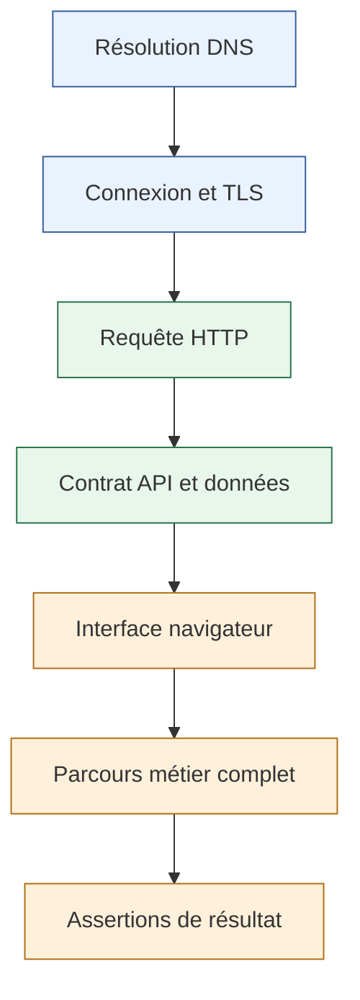
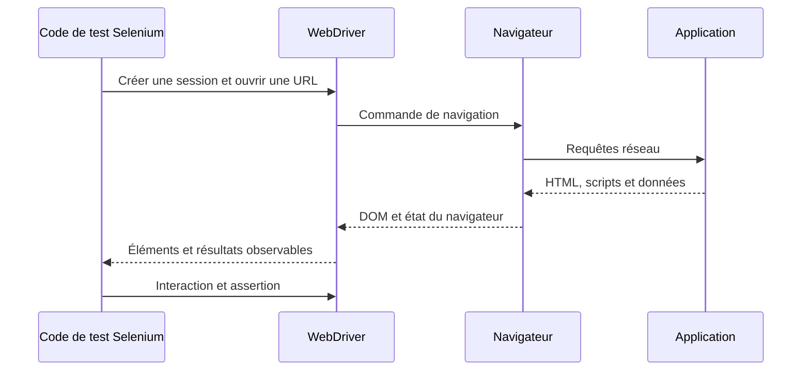
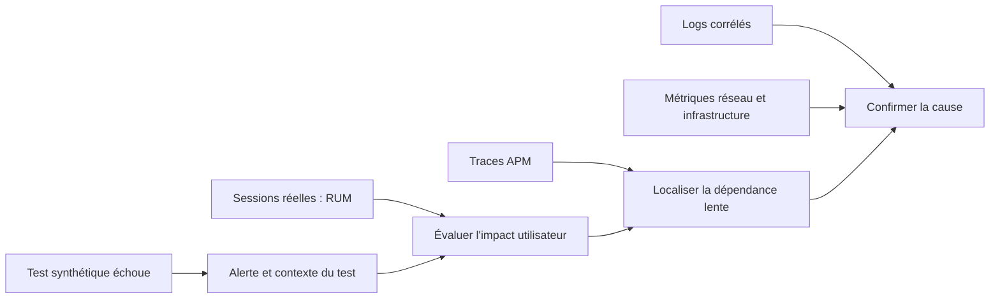
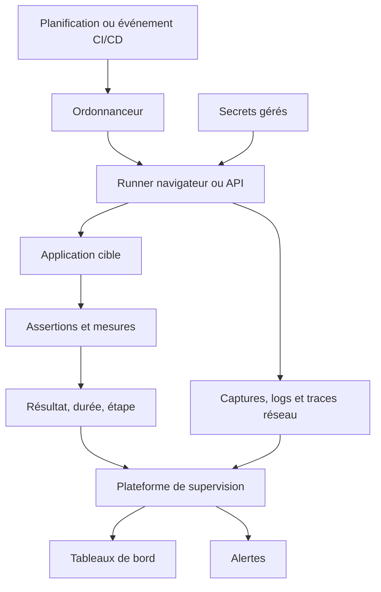
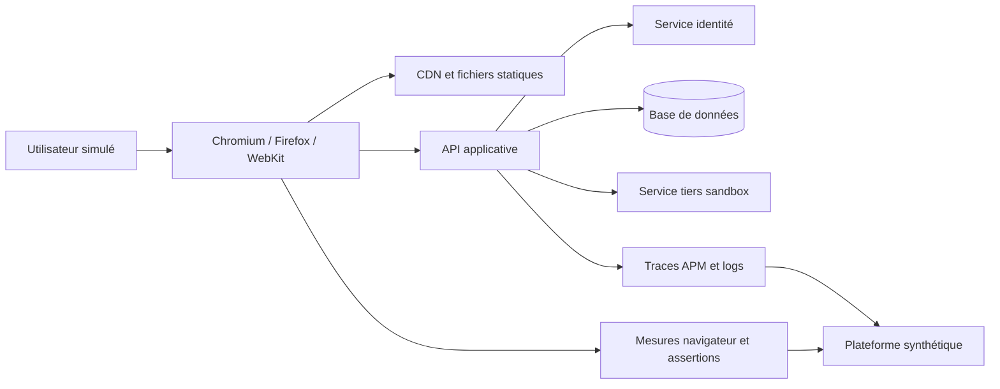
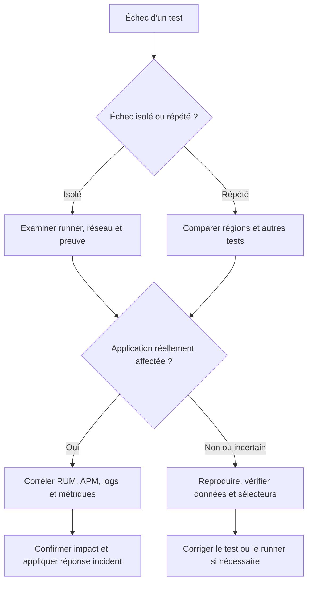

# Monitoring synthétique (Selenium, Playwright)

Le monitoring synthétique consiste à exécuter automatiquement des requêtes ou des parcours utilisateurs simulés pour vérifier qu’un service est disponible, que les fonctions essentielles répondent correctement et que les performances restent dans des limites acceptables. Selenium et Playwright permettent d’automatiser des navigateurs. Les plateformes de supervision proposent également des tests HTTP, API, DNS, TLS et des parcours de navigateur exécutés depuis des emplacements de contrôle. Le RUM, ou Real User Monitoring, observe quant à lui les performances mesurées dans les navigateurs des personnes qui utilisent réellement l’application. Ces approches répondent à des questions différentes et deviennent particulièrement puissantes lorsqu’elles sont combinées avec l’APM, les logs et les métriques d’infrastructure.

## 1. Introduction

### 1.1 Pourquoi vérifier un service de l’extérieur ?

Un serveur peut être allumé, le processus web peut écouter sur son port et le contrôle de santé peut être vert, alors que les utilisateurs ne peuvent pas terminer une commande. Le formulaire peut être bloqué par une erreur JavaScript, une API peut renvoyer une structure JSON inattendue, l’authentification peut expirer trop tôt, le bouton de validation peut ne rien faire ou un service tiers peut rendre la page inutilisable.

Les tests unitaires et les tests d’intégration sont nécessaires, mais ils ne garantissent pas qu’un parcours complet fonctionne dans un environnement déployé. Ils peuvent ne pas détecter une mauvaise configuration DNS, un certificat expiré, une règle de routage, une ressource statique bloquée par un CDN ou une régression qui n’apparaît que dans un navigateur donné. Le monitoring synthétique complète ces tests en rejouant des actions connues dans un environnement réel ou proche de la production.

Le terme synthétique signifie que le trafic utilisé pour la vérification est généré par un test contrôlé, et non par une session ordinaire d’un client. Cette caractéristique est utile pour garantir un minimum de couverture même pendant les périodes de faible fréquentation, avant qu’un utilisateur ne signale une panne, ou après chaque déploiement. Le test doit cependant refléter un comportement significatif : un simple chargement de page ne prouve pas que l’utilisateur peut se connecter, enregistrer un formulaire ou payer une commande.

### 1.2 Objectifs pédagogiques

À la fin de ce cours, l’apprenant pourra :

- distinguer les tests fonctionnels de CI, le monitoring synthétique en production et le RUM ;
- choisir entre test de disponibilité HTTP, test API, parcours multi-étapes et test de navigateur ;
- expliquer le rôle de Selenium WebDriver et de Playwright ;
- construire un parcours de test robuste, lisible et maintenable ;
- sélectionner les assertions qui vérifient réellement le résultat métier ;
- organiser les secrets, les comptes de test et les données utilisées par l’automatisation ;
- analyser les causes de tests intermittents, les délais d’attente et les faux positifs ;
- planifier les tests selon leur criticité, leur fréquence et leur emplacement ;
- mesurer la disponibilité et la performance des parcours sans confondre test simulé et expérience réelle ;
- relier les alertes synthétiques aux traces APM, aux logs et aux métriques ;
- protéger les données personnelles, maîtriser les coûts et intégrer ces contrôles au cycle de livraison ;
- définir une stratégie de supervision exploitable par une équipe de production.

### 1.3 Les problèmes auxquels répond le monitoring synthétique

Un test synthétique peut répondre à des questions précises : le DNS résout-il le nom attendu ? Le certificat TLS est-il valide ? L’API retourne-t-elle un statut conforme et un contenu attendu ? Un utilisateur de test peut-il se connecter ? Le catalogue affiche-t-il un produit ? Le panier accepte-t-il un article ? Une commande de test atteint-elle la confirmation ? La page répond-elle depuis plusieurs régions ? La durée reste-t-elle raisonnable après un déploiement ?

Ces contrôles ont de la valeur lorsqu’ils sont définis comme des objectifs opérationnels. Chaque test doit avoir un propriétaire, un but, une fréquence adaptée, une politique de retry et une action en cas d’échec. Un test sans assertion métier peut continuer à réussir alors que l’application est cassée. Un test sans propriétaire peut échouer pendant plusieurs jours sans que personne ne le traite.

Le monitoring synthétique n’est pas une solution qui remplace les utilisateurs, la supervision de l’infrastructure ou les tests de développement. Il constitue une sonde contrôlée. Sa force est la répétabilité : le même parcours peut être joué régulièrement et comparé dans le temps. Sa limite est que les données, la localisation, le navigateur, le compte et le scénario sont choisis par l’équipe et ne représentent qu’une partie des usages réels.

### 1.4 Selenium et Playwright : outils d’automatisation

Selenium est un écosystème d’automatisation de navigateur fondé sur WebDriver. Il permet de piloter différents navigateurs et de s’intégrer dans de nombreux environnements et systèmes de test. Il est largement utilisé lorsque l’organisation possède déjà une suite Selenium ou doit couvrir des configurations de navigateurs variées.

Playwright propose une API moderne pour automatiser Chromium, Firefox et WebKit dans des configurations prises en charge par le projet. Il fournit des mécanismes d’attente automatiques liés à la disponibilité des éléments, des contextes de navigateur isolés, des outils de diagnostic et une prise en charge des tests de parcours. Il permet notamment de créer des scénarios déterministes plus facilement quand les interactions et les attentes sont conçues correctement.

Aucun de ces outils ne rend un test fiable par magie. Des sélecteurs fragiles, des données de test partagées, des délais fixes arbitraires ou des assertions trop faibles peuvent produire des tests instables. Il faut choisir l’outil selon les compétences de l’équipe, les navigateurs requis, les systèmes existants, les possibilités d’exécution et le coût d’entretien. Les exemples du cours sont pédagogiques ; l’API exacte peut varier avec la version du paquet et le langage utilisés. Il faut vérifier la documentation officielle avant d’intégrer un exemple dans un dépôt.

Références techniques :
- Selenium WebDriver : https://www.selenium.dev/documentation/webdriver/
- Documentation Playwright : https://playwright.dev/docs/intro
- Datadog Synthetic Monitoring : https://docs.datadoghq.com/synthetics/
- Tests navigateur Datadog : https://docs.datadoghq.com/synthetics/browser_tests/
- Tests API Datadog : https://docs.datadoghq.com/synthetics/api_tests/
- New Relic Browser Monitoring : https://docs.newrelic.com/docs/browser/new-relic-browser/
- Web Vitals : https://web.dev/articles/vitals

### 1.5 Le RUM en complément

Le Real User Monitoring collecte des données relatives aux sessions et aux navigations des visiteurs réels dans leur navigateur, en fonction de l’instrumentation activée et des paramètres de confidentialité. Il peut renseigner sur les temps de chargement, les interactions, les erreurs JavaScript, les appels asynchrones et les différences selon le navigateur, l’appareil ou la zone géographique.

Un test synthétique répond à une question contrôlée depuis un environnement connu : le parcours marche-t-il dans les conditions du test ? Le RUM répond à une question plus large : que vivent les utilisateurs réellement présents, avec leurs réseaux, leurs appareils, leurs extensions, leur localisation et leurs parcours ? Les deux perspectives sont complémentaires. Un test synthétique qui passe depuis un centre de données ne garantit pas une expérience correcte sur un téléphone connecté à un réseau instable.

Le RUM ne doit pas être décrit comme une capture exhaustive de chaque action par défaut. Les fonctionnalités activées, les politiques de collecte, les mécanismes d’échantillonnage, les bloqueurs de scripts et les paramètres du navigateur modifient les données disponibles. Certaines vues avancées, comme les traces de session ou la relecture de session, peuvent demander un paramétrage supplémentaire. Toute collecte de données de navigateur doit être examinée à travers les exigences de minimisation, de transparence, de consentement et de sécurité applicables.

## 2. Concepts clés

### 2.1 Test fonctionnel, test de charge, synthétique et RUM

Le test fonctionnel de CI vise à prouver qu’un comportement attendu reste correct pendant le développement ou la livraison. Il peut être rapide, ciblé, lancé à chaque changement et connecté à un environnement de test. Son intérêt est d’empêcher des régressions avant la mise en production.

Le test de charge génère du trafic afin de comprendre comment le système se comporte sous une intensité donnée : débit maximal, latence, saturation, erreurs, montée en charge et récupération. Son but n’est pas simplement de vérifier qu’une fonction marche. Un test navigateur synthétique qui se connecte toutes les cinq minutes ne remplace pas une campagne de charge.

Le monitoring synthétique en exploitation vérifie un service et des parcours à intervalles réguliers ou à la demande. Il permet une détection indépendante des déclarations de santé émises par l’application elle-même. Il faut éviter de confondre sa fréquence avec celle d’un pipeline de CI : une suite de tests détaillée peut se lancer pendant une livraison alors que les tests de production restent limités aux parcours les plus critiques.

Le RUM observe les performances et erreurs issues du trafic réel instrumenté. Il met en évidence les usages que l’équipe n’avait pas anticipés, les différences géographiques, les appareils lents et les parcours où les utilisateurs abandonnent. Il n’exécute pas de scénario artificiel garanti, et il peut ne rien enregistrer si aucun utilisateur n’est actif.

### 2.2 Les couches possibles des tests synthétiques

Les tests doivent être choisis selon le risque qu’ils couvrent. Une sonde DNS vérifie la résolution d’un nom ; un test TLS valide des paramètres de connexion et peut détecter l’approche d’une expiration de certificat ; un test TCP peut vérifier qu’un port est joignable ; un test HTTP inspecte le statut, la réponse et éventuellement le temps de réponse ; un test API peut valider une structure métier ; un scénario navigateur reproduit plusieurs interactions de bout en bout.



Chaque couche isole une famille de problèmes. Le test DNS peut détecter une résolution manquante, mais pas un bouton de formulaire cassé. Le test HTTP peut recevoir un statut 200 alors que l’API retourne une réponse métier invalide. Le test de navigateur peut vérifier une transaction plus complète, mais sera plus lent, plus coûteux, davantage exposé à l’instabilité de l’interface et plus complexe à maintenir.

La stratégie efficace combine quelques tests détaillés sur les parcours vraiment critiques et des contrôles plus légers et fréquents pour les dépendances importantes. Il ne faut pas lancer des dizaines de scénarios navigateur coûteux pour vérifier un simple endpoint de santé qui peut être testé par une requête API plus directe.

### 2.3 Disponibilité technique et disponibilité fonctionnelle

La disponibilité technique peut être approximée par la capacité à se connecter à un endpoint et à obtenir une réponse. La disponibilité fonctionnelle examine si l’utilisateur parvient à obtenir le résultat attendu. Ces notions peuvent diverger : une page d’accueil statique peut fonctionner alors que l’API de commande est en panne, ou l’API peut renvoyer 200 sans enregistrer la commande.

Pour chaque test, définir l’objectif de succès. Un scénario d’authentification doit s’assurer que l’utilisateur de test est effectivement connecté, pas seulement que le formulaire a disparu. Un scénario d’achat doit vérifier que la confirmation correspond à la commande créée, sans pour autant réaliser un débit réel. Un test de recherche doit vérifier que les résultats correspondent à la requête ou au contrat de test, et pas seulement que la page s’est chargée.

Il faut distinguer une erreur d’application d’un défaut du test. Si le compte de test est expiré, si la donnée attendue a été supprimée ou si un captcha bloque une automatisation non autorisée, le test peut échouer sans que le service soit globalement indisponible. Ces événements doivent être distingués dans la classification des résultats afin que les équipes ne masquent pas une véritable panne derrière un bruit de monitoring.

### 2.4 Selenium WebDriver : fonctionnement général

Dans un scénario Selenium, le code de test communique avec une session WebDriver et pilote un navigateur. Le test localise un élément, déclenche une action et observe le résultat. Les éléments peuvent être trouvés par identifiant, attribut accessible, sélecteur CSS ou autre stratégie adaptée au DOM. Une suite maintenable préfère les identifiants stables destinés aux tests, ou les rôles et libellés accessibles lorsqu’ils sont fiables.



Dans l’usage réel, le pilote de navigateur et les processus peuvent dépendre de la configuration de Selenium, de la version et du mode d’exécution. L’équipe doit fixer les versions, comprendre la gestion du navigateur et prévoir la fermeture des sessions. Une session qui reste ouverte après un test peut épuiser les ressources d’un agent de CI ou d’une machine de test.

Selenium n’est pas réservé à un ordinateur de développeur. Il peut être exécuté dans un pipeline CI, dans un conteneur, sur une grille de navigateurs ou dans un service de test synthétique qui prend en charge les scripts correspondants. Il faut vérifier quels langages, bibliothèques et formats sont acceptés par la plateforme de destination. Un exemple Selenium générique ne se copie pas nécessairement tel quel dans tous les produits de monitoring.

### 2.5 Playwright : attente des éléments et contexte de navigateur

Playwright permet de décrire des interactions avec des locators et des assertions. Ses mécanismes d’auto-attente attendent que les conditions requises soient réunies pour les actions compatibles, au lieu de s’appuyer systématiquement sur des pauses fixes. Cela réduit plusieurs sources de tests intermittents, mais ne supprime pas le besoin de concevoir le scénario.

Un locator fondé sur un rôle et un nom accessible peut mieux représenter l’intention qu’un sélecteur CSS profondément lié à la structure de la page. Exemple : chercher un bouton par son nom « Se connecter » plutôt que par une chaîne de classes qui change lors d’une refonte. Il faut rester attentif aux interfaces internationales, aux noms dynamiques et aux composants personnalisés.

Les contextes de navigateur permettent d’isoler les cookies, le stockage local et les autres états de plusieurs sessions. Cette isolation contribue à la répétabilité et évite qu’un test réutilise par accident la session d’un scénario précédent. La gestion de l’authentification réutilisable doit toutefois rester sécurisée : les fichiers contenant l’état d’une session peuvent inclure des cookies ou des jetons valides.

### 2.6 Sélecteurs stables et interfaces accessibles

Un sélecteur est une dépendance entre le scénario automatisé et l’interface. Si le scénario cible le troisième div dans un conteneur, il devient fragile quand l’équipe change l’ordre ou le style des éléments. Si un élément est identifié par une classe générée lors du build, la moindre modification du CSS peut casser le test alors que la fonction est toujours correcte.

Privilégier, selon le contexte, les rôles d’accessibilité, les libellés de formulaires, les noms de boutons et des attributs explicites dédiés aux tests. Les attributs de test peuvent être utiles quand le texte visible varie ou quand l’élément n’a pas d’identité accessible stable. L’application doit conserver les conventions de sélecteurs dans le temps et les traiter comme une interface entre produit et tests.

Éviter les sélecteurs fondés uniquement sur des positions, le hasard de l’ordre du DOM ou un détail graphique. Un test ne doit pas dépendre du pixel exact d’un bouton si son objectif consiste à vérifier que la fonction d’achat marche. Les tests visuels ont leur place pour la régression du rendu, mais ils répondent à une autre question et nécessitent un contrôle distinct des différences attendues.

### 2.7 Attentes explicites et délais d’attente

Une attente fixe de plusieurs secondes peut rendre une suite lente dans les cas normaux et toujours trop courte dans les cas exceptionnellement lents. À l’inverse, une attente trop courte crée des échecs intermittents. Préférer attendre une condition précise : visibilité d’un élément, état activé, réponse attendue ou transition de route.

En Selenium, les attentes explicites permettent d’attendre jusqu’à ce qu’une condition soit vraie ou qu’un délai expire. Il faut comprendre la différence entre attente implicite, attente explicite et mécanismes propres à un framework, et éviter de les mélanger sans raison. Les délais doivent être définis selon la nature de l’opération et le budget temporel du parcours, et pas seulement augmentés chaque fois qu’un test échoue.

Dans Playwright, beaucoup d’actions et d’assertions attendent automatiquement un état convenable. Les appels réseau, les transitions d’application et les animations nécessitent parfois des attentes spécifiques. Attendre systématiquement un événement générique de réseau inactif peut être fragile si l’application garde des connexions ou des requêtes de fond ouvertes. Une assertion sur le contenu métier attendu est souvent plus utile qu’une attente de silence réseau.

### 2.8 Les assertions : vérifier le résultat, pas seulement l’action

Une action réussie n’implique pas que le résultat métier soit correct. Cliquer sur « Enregistrer » prouve uniquement que le clic a été envoyé. La validation doit vérifier une conséquence observable : message de confirmation, changement d’état, ressource créée ou réponse API conforme. Les assertions doivent être suffisamment précises pour échouer lorsque la fonction est cassée, mais pas si sensibles aux détails d’interface inutiles qu’elles provoquent des faux positifs.

Pour un formulaire, vérifier le message de validation en cas de saisie invalide et le résultat en cas de saisie valide. Pour l’authentification, vérifier la zone protégée ou l’identité de test reconnue, sans imprimer de secret dans les journaux. Pour une commande, utiliser une référence de test et vérifier que le résultat final est lié à cette référence.

Il faut aussi éviter de vérifier uniquement le texte d’un message générique. Un composant peut afficher « Succès » sans que l’enregistrement ait eu lieu. Quand cela est possible et proportionné, compléter le résultat UI avec une vérification de contrat ou d’état au niveau API. En revanche, un test de bout en bout ne doit pas contourner toute l’interface pour ne vérifier que l’API si l’objectif est justement de garantir que l’utilisateur peut accomplir son parcours.

### 2.9 Test API simple et test multi-étapes

Un test API isolé exécute une requête et vérifie le statut, la durée, des en-têtes ou un contenu. Il convient aux endpoints critiques, aux dépendances, aux contrats de réponse, aux certificats et aux contrôles rapides. Un test multi-étapes enchaîne plusieurs opérations, en réutilisant des valeurs de réponse lorsque c’est nécessaire, afin de vérifier un parcours au niveau HTTP sans ouvrir un navigateur.

Exemple de scénario API : créer une session de test, obtenir un jeton limité, appeler la route des produits, récupérer un identifiant de produit de test, puis effectuer une opération autorisée. Le script ne doit pas coder en dur un jeton permanent ni dépendre d’une valeur qui change sans mécanisme de préparation. Les étapes doivent être isolées et permettre de comprendre laquelle a échoué.

Les tests API peuvent être plus rapides et plus stables que les tests navigateur, mais ils ne détectent pas toutes les défaillances du frontend. Ils n’exercent pas nécessairement les mécanismes de chargement des scripts, l’accessibilité des contrôles, le rendu ou les interactions du navigateur. Ils doivent compléter, non remplacer, une petite suite navigateur portant sur les parcours les plus importants.

### 2.10 Emplacements de test : perspective externe et interne

Les emplacements gérés par une plateforme permettent souvent de lancer des tests depuis plusieurs régions. Une défaillance observée depuis une seule région peut indiquer un problème de DNS, CDN, routage, peering, filtrage réseau ou service régional. Un résultat identique depuis plusieurs régions renforce l’hypothèse d’un problème global, mais n’apporte pas une preuve absolue.

Les tests d’une application interne peuvent nécessiter un emplacement privé installé dans le réseau de l’organisation. Ce mécanisme permet de vérifier une application intranet sans l’exposer publiquement. Il implique une responsabilité supplémentaire : maintenir l’exécuteur, sécuriser l’accès réseau, mettre à jour les composants et s’assurer qu’un emplacement privé en panne ne soit pas confondu avec la panne de l’application cible.

Un test devrait documenter sa source et son objectif. Tester une application depuis le même réseau que le backend peut être pertinent pour un service interne, mais ne mesure pas l’expérience d’un client extérieur. Tester depuis une région éloignée peut détecter les problèmes d’accès public tout en ajoutant des variations réseau qui ne dépendent pas du code applicatif.

### 2.11 Fréquence, durée et politique de répétition

La fréquence est un compromis entre rapidité de détection, coût et bruit. Un parcours critique de paiement peut nécessiter une fréquence de quelques minutes, alors qu’un contrôle non essentiel peut se limiter à un intervalle plus large. La fréquence ne doit pas être réglée uniquement pour produire plus de points sur un graphique : elle doit respecter l’objectif de détection et les limites de charge.

La répétition automatique d’un test échoué peut aider à distinguer un échec ponctuel d’une panne persistante. Elle ne doit cependant pas masquer le premier échec ni transformer tous les problèmes en succès après un retry. Conserver le résultat initial, le résultat de répétition, la localisation et la chronologie. Si un test est critique, une première anomalie peut justifier une alerte informative alors qu’une condition de panne persistante déclenche une alerte plus forte.

Un scénario navigateur doit avoir un budget global de durée. Une page qui répond en deux secondes puis reste bloquée à cause d’un sélecteur vaut comme un échec fonctionnel du test, mais le diagnostic doit distinguer la durée du chargement de la durée de l’attente. Des étapes horodatées et des traces de diagnostic permettent d’identifier cette distinction.

### 2.12 Déterminer le niveau de criticité d’un parcours

Tous les parcours ne contribuent pas de la même façon au service. Les parcours essentiels peuvent être la connexion, l’accès au tableau de bord, la recherche de cours, l’envoi d’une réponse à un quiz ou la sauvegarde de progression. Les parcours d’administration peuvent être importants mais ne nécessitent pas la même fréquence que les parcours utilisés quotidiennement par la majorité des apprenants.

Évaluer chaque parcours selon son impact métier, son volume d’usage, la gravité de son échec, la capacité à détecter le problème par d’autres moyens et le coût du test. Construire une petite matrice de priorité facilite la discussion. Par exemple, le parcours de connexion peut avoir un test API fréquent et un test navigateur moins fréquent ; l’enregistrement de progression peut être vérifié par un test multi-étapes avec un compte dédié ; un parcours d’administration rare peut être exécuté à chaque déploiement et à intervalles plus espacés en production.

Les tests ne doivent pas tous se connecter avec le même compte ni modifier une donnée commune. Les conflits de données de test peuvent provoquer des erreurs artificielles et masquer les problèmes réels. Utiliser des comptes dédiés, des données uniques par exécution, un mécanisme de nettoyage ou des opérations idempotentes lorsque c’est pertinent.

### 2.13 Mesurer les performances d’un navigateur

Le temps de chargement d’une page est constitué de plusieurs étapes : résolution DNS, connexion, négociation TLS, réponse serveur, chargement des ressources, exécution JavaScript, construction du DOM, style, mise en page et rendu. Le temps mesuré dépend de l’outil, du navigateur, du cache, de la connexion, des extensions et de l’état du serveur.

Une métrique unique « page chargée » peut être insuffisante. Les Web Vitals fournissent des indicateurs d’expérience tels que LCP, INP et CLS, associés à des dimensions différentes du chargement, de la réactivité et de la stabilité visuelle. Les définitions et seuils sont susceptibles d’évoluer ; consulter la documentation courante de web.dev plutôt que d’encoder une valeur mémorisée sans vérification. Le TTFB peut aussi être utile pour séparer l’attente de réponse initiale du traitement de rendu, sans constituer à lui seul une mesure complète de l’expérience.

Les tests synthétiques doivent utiliser un profil de navigateur cohérent et documenter les conditions de réseau et de cache. Une exécution froide, sans cache, ne représente pas nécessairement les visites répétées. Un test avec un cache chaud peut masquer un problème de chargement initial. Selon le besoin, prévoir des profils différents et ne comparer que des tests dont les conditions sont compatibles.

### 2.14 Core Web Vitals : interprétation et limites

Largest Contentful Paint (LCP) mesure le moment où le plus grand élément de contenu pertinent visible est rendu. Il aide à comprendre quand l’élément principal apparaît. Interaction to Next Paint (INP) mesure la réactivité aux interactions durant la visite selon la méthode définie par les Core Web Vitals. Cumulative Layout Shift (CLS) mesure les décalages de mise en page inattendus. Ces indicateurs ne doivent pas être confondus avec le temps total d’exécution d’un test.

Un test synthétique peut enregistrer ces indicateurs dans un environnement contrôlé, mais le RUM permet d’observer leur distribution dans les sessions réelles instrumentées. Les appareils, les réseaux, les tailles d’écran et les parcours différents peuvent modifier les résultats. Pour décider d’un correctif de performance, combiner un cas reproductible avec la distribution réelle est souvent plus efficace que se fier à un score isolé.

Une amélioration apparente d’une métrique peut être obtenue au détriment d’une autre. Réduire le nombre de scripts peut améliorer certaines métriques, mais casser une fonction essentielle si les tests ne vérifient pas le résultat métier. Un élément qui se déplace peu sur la machine de test peut provoquer des décalages sur un écran étroit. Les tests doivent donc couvrir plusieurs profils utiles, sans prétendre représenter tous les appareils possibles.

### 2.15 Le RUM : ce que révèlent les sessions réelles

Le RUM peut montrer que les utilisateurs d’une région ont une latence plus élevée, que certaines versions de navigateur produisent davantage d’erreurs ou qu’un nouveau déploiement a dégradé une interaction. Il aide à identifier des chemins inattendus et les pages où les utilisateurs rencontrent le plus de difficultés. Les détails disponibles dépendent de l’agent installé, des options activées et des paramètres de collecte.

Les vues de RUM ne donnent pas automatiquement la cause racine. Une corrélation entre une version et une hausse de latence peut être due à la composition du trafic, à un changement de réseau ou à une dépendance. Il faut comparer des segments similaires, corréler les événements de déploiement et, si possible, reproduire le cas à l’aide d’un test synthétique.

Il est important de comprendre les biais de représentation. Les personnes qui utilisent des bloqueurs de scripts ou des navigateurs non compatibles peuvent ne pas être observées de la même façon. Une fréquence d’échantillonnage signifie que tous les événements ne seront pas nécessairement conservés. Les sessions enregistrées dans une période donnée ne doivent pas être interprétées comme un recensement parfait de tous les utilisateurs.

### 2.16 Relier synthétique, RUM et APM

Le monitoring synthétique détecte un problème à partir d’un parcours contrôlé. Le RUM indique si les visiteurs réels subissent une dégradation et sur quels segments. L’APM permet d’inspecter les temps de traitement côté serveur et les dépendances. Les logs expliquent les événements spécifiques, tandis que les métriques d’infrastructure apportent les informations de saturation et de capacité.



Par exemple, un test navigateur peut montrer qu’un formulaire de connexion ne progresse plus après la soumission. Le RUM peut révéler un taux inhabituel d’erreurs JavaScript sur la même route. Une trace APM peut montrer que l’API d’authentification répond normalement. La preuve oriente alors vers le frontend ou vers la façon dont l’interface traite la réponse, plutôt que vers une panne du service d’authentification.

Le contexte de corrélation doit être utilisé avec prudence. Il faut éviter de faire fuiter des identifiants de session ou des données personnelles entre le navigateur et les systèmes de logs. Les identifiants de trace et les données de RUM doivent avoir une politique de sécurité adaptée, et les outils doivent appliquer les règles de contrôle d’accès et de rétention.

### 2.17 Détecter les tests intermittents et les faux positifs

Un test intermittent réussit parfois et échoue parfois dans des conditions qui semblent similaires. Ses causes peuvent être une attente insuffisante, une dépendance externe variable, une donnée partagée, un ordre d’exécution implicite, une course entre opérations, un sélecteur fragile ou une animation. Dans un environnement synthétique, la charge du navigateur et les ressources du runner peuvent aussi influer sur l’exécution.

Il faut d’abord examiner les preuves de l’échec : capture d’écran, logs du navigateur, trace réseau, console JavaScript, URL, version de l’application et étape exacte. La correction consiste à supprimer la cause d’instabilité, pas simplement à augmenter tous les délais ou à relancer le test jusqu’à obtenir un succès.

Les retries doivent être configurés en tant que signal diagnostique, non comme un mécanisme de camouflage. Suivre le taux de flakiness par scénario. Un parcours dont le premier essai échoue fréquemment mais le second réussit doit être considéré comme instable et corrigé. Ignorer ces erreurs détruit la confiance de l’équipe dans les alertes synthétiques, et finit souvent par transformer un outil de sécurité en source de bruit.

### 2.18 Tests visuels et tests fonctionnels

Les tests fonctionnels vérifient que l’action produit le résultat attendu. Les tests visuels comparent des captures d’écran ou des éléments de rendu à une référence. Ils détectent des changements de mise en page, des éléments manquants, des superpositions et certaines régressions de style. Ils peuvent aussi échouer à cause de polices, d’animations, de contenus dynamiques ou de différences de rendu qui n’affectent pas la fonction.

Une référence visuelle doit être créée dans un environnement stable, et les mises à jour doivent être revues par des personnes compétentes. Il ne faut pas accepter automatiquement toute nouvelle capture comme la référence, car une régression réelle pourrait alors être approuvée sans contrôle. Les zones dynamiques, données personnelles et horodatages doivent être masqués ou stabilisés avec soin.

Un test visuel ne remplace pas une assertion fonctionnelle. Une page peut être visuellement identique tout en ayant un bouton qui ne déclenche rien. À l’inverse, une page peut être fonctionnelle avec une légère différence de pixel prévue. Les deux catégories de test sont complémentaires et doivent être utilisées en fonction de la question à valider.

### 2.19 Comptes de test, données et opérations destructrices

Les tests synthétiques ont souvent besoin d’un compte utilisateur pour vérifier une connexion ou un parcours authentifié. Ce compte doit être dédié et limité aux permissions nécessaires. Ne pas utiliser le compte personnel d’un administrateur ni un vrai compte client. Les secrets doivent être stockés dans le gestionnaire de secrets de la plateforme ou du pipeline, jamais dans le code, le dépôt ou les captures d’écran.

Le test doit éviter les opérations irréversibles. Pour un parcours de paiement, utiliser une simulation, un environnement sandbox ou un moyen de paiement de test spécifiquement prévu par le fournisseur. Si une réservation, une commande ou un message est créé, il faut définir un nettoyage maîtrisé, ou concevoir une donnée unique que le test pourra supprimer via un mécanisme sûr.

Il faut faire attention aux tests qui se chevauchent. Deux exécutions peuvent tenter de modifier le même profil, réutiliser le même code de vérification ou supprimer les données de l’autre. Employer un identifiant unique par exécution, isoler les sessions et limiter les dépendances partagées. Le nettoyage ne doit pas être plus dangereux que le test initial.

### 2.20 Sécurité et confidentialité du navigateur

Un test navigateur peut accéder à des pages authentifiées et produire des captures d’écran, des enregistrements ou des logs détaillés. Ceux-ci peuvent contenir des noms, adresses, jetons, données personnelles ou informations internes. Le périmètre des captures doit être défini, leur accès limité et leur durée de conservation justifiée. Ne pas activer une relecture détaillée des sessions sans examiner les réglages de masquage et le besoin opérationnel.

Les données RUM peuvent être sensibles selon les paramètres de collecte. Les noms de route, query strings, messages d’erreur et attributs personnalisés peuvent contenir des identifiants. Il faut appliquer une politique de minimisation, éviter l’enregistrement des champs de formulaire, exclure les pages sensibles et tester les règles de masquage. L’accès à la plateforme de monitoring ne doit pas permettre à un opérateur d’obtenir des informations qui ne sont pas nécessaires à son rôle.

La collecte et l’utilisation de données doivent respecter les exigences applicables à l’organisation et à ses utilisateurs, notamment en matière d’information, de finalité, de conservation et de contrôle des accès. Ce cours donne des principes techniques et ne remplace pas la validation juridique ou réglementaire adaptée au service.

### 2.21 Intégrer les tests à CI/CD

Les contrôles synthétiques peuvent être utilisés à plusieurs étapes. Avant le déploiement, une suite de tests sur un environnement de validation peut vérifier les parcours et faire échouer le pipeline si une assertion critique échoue. Après le déploiement, une sonde légère peut vérifier que l’instance nouvellement mise en ligne répond comme prévu. En production, un ensemble de tests planifiés vérifie la disponibilité et le parcours d’utilisateur de manière régulière.

Le test exécuté en pipeline peut être plus détaillé et plus coûteux que le test fréquent de production. La durée de livraison doit rester compatible avec l’objectif d’ingénierie, tandis que la surveillance de production doit fournir une détection suffisamment rapide sans créer une charge indue.

Il est possible d’utiliser les résultats synthétiques comme critère de progressive delivery. Un déploiement peut commencer sur une faible proportion du trafic, puis s’étendre si les métriques et tests restent satisfaisants. Le seuil doit être défini à partir des signaux réellement fiables et être combiné avec des mécanismes de retour arrière. Un simple test qui vérifie une page publique ne suffit pas à autoriser automatiquement le déploiement d’une fonctionnalité de paiement.

### 2.22 Définir les objectifs de service et les alertes

Un test qui échoue une fois n’implique pas toujours une panne générale. Les conditions d’alerte peuvent prendre en compte la durée, le nombre d’emplacements en échec, la persistance et la criticité du parcours. Une défaillance depuis plusieurs emplacements et sur plusieurs exécutions est plus probante qu’un seul échec isolé, sauf lorsqu’un incident sévère est constaté immédiatement.

Le SLI peut mesurer la proportion d’exécutions qui réussissent, le temps de réponse d’une opération ou la proportion de parcours achevés dans le délai fixé. Le SLO définit l’objectif sur une période. Pour que le calcul soit fiable, préciser la définition d’un succès, la cadence du test, les fenêtres exclues et le traitement des exécutions manquantes. Un test synthétique ne doit pas être considéré comme une mesure parfaite de toutes les transactions clientes.

Les alertes doivent fournir le nom et l’objectif du test, la localisation d’exécution, l’étape en échec, le dernier résultat réussi, le contexte de déploiement et le lien vers les preuves. Les destinations de notification doivent être cohérentes avec la gravité : un avertissement informatif n’a pas nécessairement besoin de réveiller l’astreinte, alors qu’un échec persistant du parcours de connexion peut le justifier.

### 2.23 Coûts, volume et maintenance

Le coût du monitoring peut dépendre du nombre de tests, des emplacements, de la fréquence, des étapes de navigateur, du nombre de navigateurs ou d’appareils, des options de RUM, du volume d’événements et de la rétention. Les offres et modalités exactes changent ; vérifier les conditions en vigueur plutôt que de déduire le coût d’un simple nombre de tests.

Pour maintenir le coût, tester le strict nécessaire à chaque fréquence, privilégier un test API pour un contrôle simple, réserver les parcours navigateur aux fonctions critiques, supprimer les scénarios obsolètes et maîtriser les données enregistrées. Mais ne réduisez pas la couverture en supprimant les tests d’un service essentiel sans évaluer le risque que cela introduit.

Le coût de maintenance comprend aussi le temps des développeurs. Un parcours fragile qui doit être corrigé après chaque changement d’interface peut coûter plus cher que la licence de l’outil. Des sélecteurs accessibles, des helpers partagés, des jeux de données isolés, des rapports clairs et une responsabilité d’équipe diminuent ce coût. Un test doit être supprimé lorsqu’il ne remplit plus de rôle, mais seulement après avoir vérifié que son objectif est couvert autrement.

## 3. Architecture et Schémas

### 3.1 Architecture de supervision synthétique

Un système de monitoring synthétique comprend un ordonnanceur, des emplacements d’exécution, le scénario, les secrets ou paramètres nécessaires, les mécanismes d’observation et le backend qui conserve les résultats. La chaîne doit être supervisée elle-même : une sonde qui ne s’exécute plus peut ressembler à un test qui passe, alors qu’aucun contrôle n’a eu lieu.



Le runner doit disposer des ressources nécessaires pour lancer le navigateur, résoudre le nom, atteindre la cible et transmettre les résultats. Les secrets doivent être injectés de manière sécurisée au moment de l’exécution. Les captures et traces réseau sont utiles à l’analyse mais leur conservation doit être limitée, notamment lorsque le parcours est authentifié.

Une plateforme peut gérer une partie de ces composants dans le service. Dans un environnement auto-hébergé ou privé, l’organisation doit aussi maintenir le runner, ses mises à jour, les certificats, les règles de sortie réseau et les capacités de navigateur. Cette différence doit être prise en compte dans le choix technique.

### 3.2 Architecture de test bout en bout

Un test de bout en bout traverse plusieurs couches du système. Son résultat dépend parfois de services externes, d’un système d’identité ou d’une configuration de navigateur. La conception doit définir la frontière du scénario et les composants dépendants qui sont réellement nécessaires.



Si le test utilise un service tiers de paiement en production, il peut provoquer des transactions réelles ou être affecté par des conditions externes que l’équipe ne contrôle pas. Dans la mesure du possible, utiliser un mode sandbox ou isoler la dépendance tout en conservant un test distinct qui vérifie sa disponibilité. La frontière doit être explicitement choisie, pas laissée au hasard.

### 3.3 Structure d’un scénario de qualité

Un scénario devrait comporter un objectif, un prérequis, des étapes lisibles, des assertions, une limite de temps, une politique de nettoyage et des éléments de diagnostic en cas d’échec. Chaque étape doit avoir un nom compréhensible pour la personne qui reçoit l’alerte. « Étape 4 en échec » n’est utile que si l’étape 4 est clairement documentée.

Avant le scénario, vérifier ou préparer l’état nécessaire. Pendant le test, effectuer les actions et observer les résultats. Après le test, restaurer l’état si nécessaire sans supprimer d’informations indispensables au diagnostic. L’échec d’un nettoyage doit être signalé indépendamment de la réussite fonctionnelle lorsque cela peut laisser des données ou des ressources.

Ne pas mettre en place un scénario qui dépend de son exécution précédente. Les tests doivent autant que possible être indépendants, rejouables et sûrs en cas de répétition. Si une dépendance d’état est incontournable, elle doit être explicite et son effet sur l’ordonnancement doit être documenté.

### 3.4 Exemple Playwright en JavaScript

L’exemple suivant montre un petit parcours de connexion dans un environnement de test. Il utilise des rôles accessibles et attend un résultat observable. Le mot de passe est fourni par une variable d’environnement et ne doit jamais être imprimé dans le rapport. Ce code illustre l’approche générale ; adapter les sélecteurs, la gestion des secrets et l’URL à la version du projet.

```javascript
const { test, expect } = require('@playwright/test');

test('connexion et ouverture de la page de suivi', async ({ page }) => {
  await page.goto(process.env.TEST_BASE_URL);

  await page.getByLabel('Adresse e-mail').fill(
    process.env.TEST_USERNAME
  );
  await page.getByLabel('Mot de passe').fill(
    process.env.TEST_PASSWORD
  );
  await page.getByRole('button', { name: 'Se connecter' }).click();

  await expect(
    page.getByRole('heading', { name: 'Mon parcours' })
  ).toBeVisible();

  await expect(page).toHaveURL(/parcours/);
});
```

Ce test ne valide que ce qu’il observe. Il confirme qu’un titre est visible et que l’URL correspond au parcours attendu, mais il ne prouve pas nécessairement que toutes les données de progression sont chargées. Si l’objectif du test inclut une donnée réelle, ajouter une assertion qui la vérifie sans exposer des informations privées dans le rapport.

Le test doit aussi prévoir les erreurs de connexion. Un scénario négatif peut vérifier qu’un message de refus apparaît et que l’utilisateur ne se retrouve pas dans une zone protégée. Éviter d’utiliser une vraie adresse client, et veiller à ne pas enregistrer le mot de passe en clair dans les vidéos, traces ou messages d’erreur.

### 3.5 Exemple Selenium avec attente explicite

Le code suivant illustre une attente explicite en Python. L’URL, les variables de test et la stratégie de sélection sont fictives et doivent être adaptées au laboratoire.

```python
import os
from selenium import webdriver
from selenium.webdriver.common.by import By
from selenium.webdriver.support.ui import WebDriverWait
from selenium.webdriver.support import expected_conditions as EC

driver = webdriver.Chrome()
wait = WebDriverWait(driver, 10)

try:
    driver.get(os.environ["TEST_BASE_URL"])

    wait.until(
        EC.visibility_of_element_located((By.ID, "email"))
    ).send_keys(os.environ["TEST_USERNAME"])

    driver.find_element(By.ID, "password").send_keys(
        os.environ["TEST_PASSWORD"]
    )
    driver.find_element(By.CSS_SELECTOR, "[data-testid='login']").click()

    wait.until(
        EC.visibility_of_element_located((By.ID, "learning-path"))
    )
finally:
    driver.quit()
```

La fermeture de la session dans un bloc de nettoyage réduit le risque de fuite de processus. Dans une suite professionnelle, il faut également traiter proprement les exceptions, les captures d’écran et les logs de diagnostic. La capture ne doit pas être enregistrée n’importe où si elle peut contenir une session ou des données personnelles.

L’attente explicite doit viser une condition utile. Une attente de présence dans le DOM n’équivaut pas nécessairement à un élément visible ou interactif. Choisir la condition correspondant à l’action à venir, et définir un délai raisonnable en fonction de l’importance du parcours. Si le délai expire, fournir dans le rapport l’étape et le contexte utiles plutôt qu’une erreur générique.

### 3.6 Préparer les données de test sans polluer la production

Un scénario de création doit utiliser un jeu de données prévisible et une référence propre à l’exécution. Les tests peuvent préparer des données par API, exécuter le parcours dans le navigateur, puis appeler un mécanisme de nettoyage limité. Cette préparation ne doit pas contourner la fonctionnalité testée : si l’objectif est de vérifier la création via UI, créer l’objet avant le test rendrait l’assertion sans valeur.

Les opérations de préparation et de nettoyage doivent être idempotentes autant que possible. Les données doivent être identifiables comme données synthétiques et ne pas être mélangées aux commandes, comptes ou événements des vrais utilisateurs. Pour une action financière, utiliser un environnement isolé et des instruments de test reconnus par le fournisseur.

Prévoir le cas où le test est interrompu avant le nettoyage. Un mécanisme périodique peut supprimer les données synthétiques anciennes, mais il doit identifier précisément ce qu’il supprime. Ne pas utiliser une règle large basée uniquement sur une date ou un préfixe insuffisamment contrôlé, car elle pourrait affecter des données légitimes.

### 3.7 Construire une matrice de couverture

Une matrice de couverture peut associer parcours, fréquence, emplacement, navigateur, dépendances et impact. Par exemple, la connexion est testée depuis plusieurs régions et un navigateur principal ; la sauvegarde de progression est vérifiée en test API multi-étapes ; l’affichage mobile est couvert par un petit nombre de scénarios de navigateur ; le chargement des cours critiques est mesuré avec un parcours de bout en bout.

Le but n’est pas de combiner toutes les régions, navigateurs, appareils et parcours possibles dans une matrice gigantesque. Le nombre de combinaisons explose rapidement et augmente le coût. Utiliser le risque pour sélectionner les profils : trafic, géographie importante, part des appareils, navigateur supporté et type de panne qu’on souhaite détecter.

Réviser cette matrice après les incidents et les changements produit. Si un incident réel échappe à la suite, demander si un scénario aurait pu le détecter, si le test existant doit être amélioré ou si le problème exige une autre méthode de supervision. Ajouter un test seulement s’il réduit un risque identifié.

### 3.8 Séquence de triage d’un test en échec

Quand un test échoue, la première tâche est de confirmer ce qui a échoué : résolution, connexion, statut HTTP, assertion de contenu, navigation, délai d’attente ou dépendance. L’heure, la localisation, le navigateur et la version doivent être recueillis automatiquement lorsqu’ils sont disponibles.



Ne pas désactiver l’alerte tant que l’équipe n’a pas compris si le test est instable ou si le service est affecté. Si le test présente un défaut récurrent, créer une tâche corrective et documenter la portée du contrôle manquant pendant la réparation. Un test cassé est lui-même un problème d’observabilité, parce qu’il crée un angle mort.

### 3.9 Relier un test synthétique au déploiement

Les événements de déploiement aident à comparer les résultats avant et après la livraison. Ajouter un identifiant de build ou de version dans les tableaux de bord et les rapports. Si le produit supporte l’intégration entre tests synthétiques et APM, utiliser cette relation pour examiner la trace correspondant à une requête ou à un parcours en échec.

Un test de production doit être suffisamment prudent pour ne pas déclencher d’effets métier réels. Un test qui crée une commande ou modifie un compte doit utiliser des données et des opérations prévues pour l’automatisation. Le contrôle post-déploiement doit signaler rapidement une régression et fournir une procédure de retour arrière, mais ne doit pas annuler aveuglément tout déploiement sur un échec manifestement lié à un runner indisponible.

L’équipe doit définir la règle de décision : combien d’échecs, depuis combien de régions, sur quelle période et avec quels signaux complémentaires déclenchent le retour arrière ? Ce choix dépend de la criticité du service. Il est préférable de le documenter et de le tester à l’avance plutôt que d’improviser lors d’un incident.

## 4. Étude de cas

### 4.1 Contexte : une plateforme d’apprentissage semble disponible mais ne fonctionne pas

Une plateforme d’apprentissage en ligne affiche une page d’accueil et son serveur HTTP répond. Toutefois, certains apprenants déclarent qu’ils ne peuvent pas ouvrir une leçon et que leur progression ne s’enregistre pas correctement. Les métriques du serveur restent normales et le contrôle de santé retourne un statut positif.

L’équipe crée trois contrôles complémentaires. Le premier effectue une requête API et valide le contrat de la route des leçons. Le deuxième parcourt le navigateur : ouvrir la page, se connecter avec un compte synthétique, atteindre la liste des cours et ouvrir une leçon. Le troisième vérifie la sauvegarde d’une progression dans un environnement de test contrôlé. Les tests utilisent un compte dédié et des identifiants distincts pour chaque exécution.

Le test API passe, mais le scénario navigateur échoue après la navigation vers une leçon. Une capture montre que le contenu principal n’apparaît pas ; la console du navigateur contient une erreur JavaScript liée à un champ inattendu dans la réponse. Le service HTTP répond pourtant correctement, ce qui explique pourquoi les contrôles de disponibilité classiques n’avaient rien signalé.

### 4.2 Investigation fondée sur des preuves

L’équipe compare la version actuelle à la version précédente. Le problème apparaît après un changement de schéma de réponse. L’API renvoie une propriété optionnelle absente pour les cours historiques ; le frontend la traite comme si elle existait toujours. L’APM indique que le temps de réponse API reste normal et le taux d’erreur serveur n’augmente pas. Le RUM montre davantage d’erreurs JavaScript sur le parcours de leçon pour la version courante.

Les résultats permettent de distinguer trois choses : l’API est disponible, le serveur répond avec une structure acceptable selon son contrat mais incomplète pour ce cas historique, et le frontend ne gère pas une valeur optionnelle. Le scénario synthétique a détecté le parcours cassé, tandis que le RUM indique que le problème touche aussi les utilisateurs réels. La trace APM a évité de concentrer inutilement l’investigation sur la performance backend.

L’équipe reproduit le cas avec un cours comportant la propriété manquante. Elle corrige le frontend pour gérer la valeur absente et ajoute une validation du contrat de réponse. Un test fonctionnel de CI couvre désormais le cas historique, et un test synthétique vérifie que la leçon s’ouvre toujours après déploiement.

### 4.3 Validation du correctif

Après la livraison, les tests sont exécutés depuis plusieurs emplacements. Le parcours passe et la console ne montre plus l’erreur ciblée. Le test d’enregistrement de progression est vérifié séparément afin de ne pas conclure que la persistance fonctionne simplement parce que le contenu s’affiche. Le RUM est suivi pendant une fenêtre suffisante pour observer les erreurs après le déploiement.

La validation inclut une comparaison avec la période de référence. Il faut vérifier la proportion de tests réussis, les erreurs JavaScript, le taux de succès du parcours et l’impact des navigateurs concernés. Une seule exécution réussie est un bon signal, mais elle ne suffit pas à prouver que toutes les combinaisons d’usage sont correctes.

L’équipe documente la cause, la preuve, le correctif et le nouveau contrôle. Le test n’est pas seulement un mécanisme de notification : il devient une preuve réutilisable de la disponibilité fonctionnelle du parcours. Si le scénario devient instable après une refonte, son propriétaire doit le mettre à jour plutôt que le supprimer sans analyse.

### 4.4 Variante : un problème régional

Quelques jours plus tard, un test exécuté depuis une région distante échoue sur une connexion TLS, alors que les autres régions réussissent. Le test de navigateur s’arrête avant le chargement de l’application. L’équipe compare le résultat du contrôle TLS, le certificat présenté, la chaîne de résolution DNS et la route réseau observée depuis la région concernée.

Les tests API et RUM peuvent montrer que la plupart des utilisateurs continuent à accéder au service. Ce fait n’annule pas l’incident : un sous-ensemble de clients peut être affecté. L’équipe vérifie les certificats ou le CDN, puis reproduit le problème depuis un environnement réseau comparable. Elle évite de corriger le frontend, qui n’est jamais chargé pendant cet échec.

Cet exemple illustre le bénéfice d’un test effectué depuis différents emplacements. Une surveillance réalisée uniquement depuis le réseau interne de l’entreprise peut passer alors que des visiteurs externes rencontrent un problème de certificat, de résolution ou de routage. Les résultats doivent toujours être interprétés selon l’objectif et la localisation de la sonde.

### 4.5 Plan d’amélioration après l’incident

À la suite de ces incidents, l’équipe établit une couverture minimale des parcours critiques : authentification, ouverture d’une leçon, réponse à un quiz, sauvegarde de progression et affichage du résultat. Les tests API vérifient les contrats et les tests navigateur vérifient la capacité à terminer les parcours. Le RUM mesure l’expérience réelle, tandis que l’APM donne le contexte serveur.

Les tests sont versionnés avec le code et exécutés dans la CI lorsque cela est approprié. Les tests de production utilisent des comptes dédiés, des données isolées et une fréquence adaptée à leur coût. Les alertes incluent la région, la version, l’étape, le lien vers les preuves et la consigne de diagnostic.

La liste des contrôles est revue après chaque incident majeur. Si la cause était une propriété absente, un test de contrat ou une assertion de rendu doit capturer ce cas. Si la cause était la résolution DNS ou TLS, un test de navigateur seul est peut-être trop haut dans la pile pour diagnostiquer rapidement le problème ; une sonde réseau complémentaire est plus appropriée.

## 5. Pièges à éviter

### 5.1 Tester uniquement que la page se charge

Un test qui confirme que le document HTML a été reçu peut passer même si le script principal échoue, si les données ne s’affichent pas, si l’utilisateur ne peut pas se connecter ou si le bouton principal est sans effet. Il doit s’assurer qu’un résultat représentatif de l’objectif est atteint.

Pour les parcours importants, inclure plusieurs assertions pertinentes : contenu visible, état de session attendu, données attendues et confirmation du résultat. Garder cependant les assertions limitées au but du scénario. Les détails visuels sans importance peuvent rendre le test inutilement fragile.

### 5.2 Utiliser des pauses fixes partout

Les pauses fixes ralentissent les cas normaux et ne garantissent pas la stabilité des cas lents. Utiliser des attentes sur les événements et états attendus du navigateur. Si le système met trop longtemps à répondre, le test doit échouer avec un diagnostic exploitable plutôt que d’attendre arbitrairement.

Les frameworks d’automatisation proposent différents mécanismes d’attente. Comprendre leur fonctionnement permet d’éviter de superposer des délais et de rendre la suite imprévisible. Les attentes générales de réseau inactif, en particulier, sont inadaptées à certaines applications qui maintiennent des appels continus.

### 5.3 Choisir des sélecteurs fragiles

Les sélecteurs basés sur le style, la position d’un élément ou les classes générées cassent souvent lors d’une refonte. Utiliser les rôles, libellés et attributs stables. Documenter la convention des attributs destinés aux tests et vérifier que les composants partagés les respectent.

Une stratégie de sélecteur est une interface de maintenance. Si l’équipe de frontend modifie les libellés, les tests doivent être adaptés consciemment. Éviter que la seule solution à chaque échec soit de chercher un nouveau sélecteur sans comprendre si la fonction testée a changé.

### 5.4 Réutiliser les mêmes données et sessions

Les exécutions en parallèle peuvent se connecter au même compte, modifier le même panier ou supprimer les données d’une autre exécution. Les cookies et le stockage local peuvent également survivre entre scénarios mal isolés. Utiliser des contextes dédiés, des données par exécution et des mécanismes sûrs de nettoyage.

La sécurité des comptes de test reste obligatoire. Limiter leurs privilèges et leur portée réseau, faire tourner leurs secrets, ne pas les inclure dans les captures et vérifier que les environnements de test n’atteignent pas des systèmes financiers ou clients réels.

### 5.5 Ignorer les échecs du runner

Un navigateur qui n’a pas pu démarrer, un agent sans mémoire ou un runner qui ne peut plus atteindre le réseau peuvent faire échouer le test même si l’application fonctionne. Surveiller l’état des emplacements et la chaîne de collecte. Distinguer le résultat du test, le résultat de connexion de la sonde et l’état du service de monitoring.

Ne pas conclure que le service est en panne sur la seule base d’un runner qui ne s’est pas exécuté. À l’inverse, ne pas considérer un test absent comme un succès. Les tableaux de bord doivent signaler les exécutions manquantes ou les retards d’exécution.

### 5.6 Trop de retries et tests intermittents

Un grand nombre de retries peut masquer la dégradation et faire croire que le système est sain. Conserver le premier échec et le taux de flakiness. Réduire les retries lorsque le but est de détecter rapidement une panne persistante ; les utiliser avec prudence pour obtenir des preuves supplémentaires.

Les tests intermittents abîment la confiance. Il faut suivre leur fréquence et définir un propriétaire de correction. Un scénario critique et fréquemment instable mérite une correction rapide, pas une désactivation silencieuse.

### 5.7 Un seul emplacement ou un seul navigateur

Une application peut fonctionner dans l’environnement de l’équipe tout en étant inaccessible dans une région, sur un navigateur supporté ou sur un format d’écran important. Choisir les combinaisons de test selon le trafic et le risque. Ne pas multiplier toutes les combinaisons sans besoin, mais couvrir les perspectives qui correspondent aux usages réels.

Les différences entre navigateurs peuvent concerner les APIs, le rendu, le stockage, les certificats ou la prise en charge des fonctions. Le choix du moteur et du système de test doit correspondre au périmètre de compatibilité du produit, et pas uniquement à celui qui est le plus simple à lancer dans le pipeline.

### 5.8 Secrets exposés dans les logs ou les captures

Les rapports de test peuvent capturer des champs de connexion, des jetons ou des données utilisateur. Ne pas écrire les mots de passe en clair dans les messages d’assertion ou les logs. Utiliser les secrets gérés, masquer les données dans les captures et contrôler l’accès aux artefacts.

Même un compte de test peut avoir accès à des environnements internes. Les captures et fichiers de session doivent être traités comme des données sensibles si elles permettent la réutilisation d’une session. Une politique de rétention définie limite l’exposition en cas d’accès non autorisé.

### 5.9 Confondre résultat synthétique et expérience réelle

Un test qui passe ne prouve pas que toutes les personnes ont une bonne expérience ; le profil de navigateur, le réseau, la géographie et le parcours sont contrôlés. Un RUM défavorable peut révéler un problème qui n’est pas couvert par la suite synthétique. Combiner les deux données au lieu de choisir une seule source.

Le RUM a également des limites : les bloqueurs de scripts, l’échantillonnage, les permissions et la configuration modifient ce qui est observé. Une absence de données ne prouve pas que tout va bien. Définir les limites de chaque signal évite les conclusions hâtives.

### 5.10 Mesurer une page sans regarder le parcours complet

Une page rapide n’est pas forcément une application efficace. Le chargement initial peut être rapide alors que la recherche ou la sauvegarde de progression bloque. Mesurer les étapes significatives et distinguer le temps de rendu de la durée de l’opération métier.

Les parcours doivent être assez courts pour donner un diagnostic rapide mais assez représentatifs pour vérifier le résultat final. Des tests séparés peuvent isoler l’étape lente et faciliter le triage, puis un test global vérifie que l’ensemble fonctionne.

### 5.11 Faire des transactions réelles pour prouver le paiement

Un test synthétique mal conçu peut créer des commandes, envoyer des messages, réserver des places ou déclencher des prélèvements réels. Il doit employer les environnements sandbox et opérations expressément prévues pour l’automatisation. Si le test ne peut pas être rendu sans danger, choisir une méthode de vérification adaptée et séparer le contrôle de la dépendance.

Le nettoyage ne garantit pas qu’un effet externe a été annulé. Supprimer une commande dans la base ne rembourse pas nécessairement un paiement ou n’annule pas un message envoyé à un tiers. Les effets secondaires doivent être conçus dès le début et examinés par l’équipe propriétaire.

### 5.12 Alerter sur chaque échec isolé sans contexte

Une erreur de réseau ponctuelle ou un runner mal préparé peut faire générer trop d’alertes. Définir une politique d’escalade selon la criticité, la persistance et le nombre de régions ou d’exécutions affectées. Garder une visibilité sur le premier échec et utiliser les répétitions comme contexte, pas comme mécanisme d’effacement.

L’alerte doit inclure les preuves et l’étape en échec. Une notification qui indique uniquement « test failed » oblige l’opérateur à tout reconstruire. Les rapports devraient permettre de naviguer directement vers les captures, logs, métriques, traces et informations du déploiement utiles.

### 5.13 Laisser les tests devenir obsolètes

Les parcours changent au fil des fonctionnalités et des redesigns. Un test qui ne représente plus une opération importante peut créer de faux incidents ou laisser des angles morts. Réviser les propriétaires, objectifs et assertions lors des changements de produit.

Supprimer un test uniquement après avoir vérifié que sa fonction est devenue inutile ou couverte ailleurs. Si un test échoue à chaque déploiement à cause d’une nouvelle interface, distinguer la mise à jour nécessaire du test d’une régression fonctionnelle réelle.

### 5.14 Collecter trop de données RUM

Les URL complètes, les paramètres, les messages d’erreur et les attributs personnalisés peuvent contenir des informations sensibles. Minimiser les champs collectés, masquer les données de formulaire et vérifier la configuration réelle de l’agent. Les fonctions de relecture ou de capture détaillée demandent une attention particulière aux zones sensibles.

Le RUM doit servir à améliorer le service. Éviter de l’utiliser pour suivre injustement les personnes ou collecter des données sans finalité claire. Définir des permissions, une rétention et une documentation de la collecte.

### 5.15 Confondre un statut HTTP réussi avec un succès métier

Un statut 200 peut contenir une réponse qui indique un échec métier ou des données incomplètes. Le test doit inspecter le contrat et le résultat. Inversement, certains statuts non-2xx représentent un chemin attendu du test, par exemple la validation d’une saisie invalide.

Définir les succès dans le contexte du parcours. Tester les codes, le contenu et l’état final selon le contrat du service. Éviter les assertions vagues qui passent même si la réponse contient une erreur ou un message inattendu.

## 6. Checklist / À retenir

### 6.1 Checklist avant mise en production

- Les parcours critiques et les conséquences d’un échec sont documentés.
- Chaque test possède un propriétaire, un nom compréhensible et un objectif clair.
- Le type de contrôle est adapté : réseau, HTTP, API, multi-étapes ou navigateur.
- Les assertions confirment un résultat fonctionnel et pas seulement une action.
- Les sélecteurs sont stables et les attentes sont fondées sur des conditions observables.
- Les comptes de test ont des privilèges minimum et ne représentent pas de vrais clients.
- Les secrets proviennent d’un gestionnaire adapté et ne sont jamais écrits dans les logs.
- Les données créées sont isolées et peuvent être nettoyées sans risque.
- Les effets financiers ou externes utilisent un environnement sandbox ou une procédure contrôlée.
- Les régions, navigateurs et profils sont sélectionnés selon le risque réel.
- Les délais, retries et alertes sont documentés et testés.
- Les artefacts de diagnostic sont protégés et leur durée de conservation est définie.
- Le fonctionnement des runners et des emplacements est lui-même surveillé.
- La configuration RUM est revue pour la minimisation et le masquage des données.
- Le coût attendu et les limites de volume sont compris.

### 6.2 Checklist après déploiement

- Le test de santé confirme que la cible répond.
- Le parcours de navigateur atteint le résultat métier attendu.
- Le test API valide le contenu ou le contrat, pas seulement le statut.
- Les tests sont exécutés depuis les emplacements pertinents.
- Les erreurs de console et les échecs JavaScript sont examinés.
- La latence du parcours est comparée à une référence compatible.
- Les signaux synthétiques sont corrélés au RUM et aux traces APM si cela est disponible.
- Le résultat et la version de déploiement sont enregistrés.
- Les échecs persistants déclenchent une alerte avec les preuves nécessaires.
- Les exécutions manquantes ou les runners indisponibles ne sont pas assimilés à des succès.
- Les données synthétiques et les sessions sont nettoyées de manière sûre.
- Les éventuelles différences de performance entre régions et navigateurs sont prises en compte.

### 6.3 Démarche de triage en production

1. Identifier le scénario, l’heure, la région, le navigateur et l’étape qui échoue.
2. Vérifier si la sonde s’est exécutée correctement et si d’autres tests échouent.
3. Distinguer un problème réseau ou TLS d’un problème HTTP, API, navigateur ou métier.
4. Consulter la capture et les logs de navigateur sans exposer de secrets.
5. Comparer les résultats entre régions et versions.
6. Utiliser le RUM pour déterminer si l’incident touche les visiteurs réels et quels segments sont affectés.
7. Consulter les traces APM, les logs serveur et les métriques de dépendance si la requête atteint le backend.
8. Formuler une hypothèse et rechercher une preuve qui la confirme.
9. Corriger le service, le test ou le runner selon la cause réelle, puis répéter le contrôle.
10. Mettre à jour le scénario ou la documentation afin que le même défaut soit mieux détecté la prochaine fois.

### 6.4 Mini-projet pratique

Construire un scénario de supervision pour une petite application web de formation. Le parcours doit accéder à la page d’accueil, se connecter avec un utilisateur de test, ouvrir un cours et vérifier qu’un élément de contenu apparaît. Ajouter un test API distinct pour un endpoint critique, puis provoquer dans l’environnement de test une réponse lente ou une erreur JavaScript contrôlée.

Le projet doit produire des résultats qui permettent de distinguer l’échec fonctionnel, le problème de réseau et le problème de runner. Conserver les journaux de test, capturer une preuve sans donnée sensible et définir le comportement des retries. Ensuite, comparer les résultats d’une exécution synthétique avec les mesures RUM disponibles ou, si l’application de démonstration ne dispose pas de RUM, documenter quelles questions ce signal aurait permis de répondre.

Pour valider le projet, l’apprenant doit expliquer pourquoi le test choisi est adapté au risque, décrire les assertions, justifier les attentes et les délais, démontrer la protection des secrets et présenter une action recommandée lors d’un échec. Un test qui passe mais ne détecte pas l’erreur injectée n’est pas un test complet.

### 6.5 Questions de révision

**Pourquoi un test HTTP 200 peut-il échouer à garantir la disponibilité fonctionnelle ?** Parce que le statut prouve qu’une réponse a été reçue, mais pas que les données, l’interface ou le résultat métier sont corrects. Il faut vérifier le contrat et les conséquences attendues.

**Quelle est la différence entre monitoring synthétique et RUM ?** Le monitoring synthétique exécute un scénario contrôlé de façon planifiée, tandis que le RUM mesure les sessions réelles instrumentées. Le premier apporte la répétabilité ; le second révèle la diversité des expériences réellement vécues.

**Pourquoi privilégier une attente conditionnelle à une pause fixe ?** Une attente conditionnelle poursuit dès que l’état attendu est présent et donne un échec significatif quand le délai expire. Une pause fixe gaspille du temps dans les cas rapides et peut rester insuffisante dans les cas lents.

**Quand un test API est-il préférable à un test de navigateur ?** Lorsqu’il suffit de vérifier rapidement un endpoint, un contrat, une authentification ou une dépendance sans avoir besoin de valider le rendu et les interactions du navigateur.

**Pourquoi isoler les sessions et données de test ?** Pour éviter les collisions entre exécutions parallèles, l’utilisation accidentelle d’un état précédent et les modifications sur des données réelles. L’isolation améliore la répétabilité et la sécurité.

**Comment interpréter un échec qui n’apparaît que depuis une région ?** Vérifier la résolution DNS, TLS, le routage, le CDN et la chaîne d’accès depuis cette région, puis comparer avec d’autres tests. Ne pas corriger le frontend si le navigateur ne reçoit même pas la page.

**À quoi sert le RUM quand un test synthétique échoue ?** Il aide à vérifier si les utilisateurs réels sont touchés, à identifier les segments concernés et à comparer leurs erreurs ou performances avec la chronologie du test.

**Pourquoi ne pas simplement augmenter les retries jusqu’à obtenir un succès ?** Parce que cela masque une instabilité récurrente et peut faire croire qu’un service est sain. Le premier échec et le taux de flakiness restent des informations importantes.

**Comment protéger les informations sensibles ?** Utiliser des comptes et secrets dédiés, limiter les permissions, masquer les champs et captures, réduire les données collectées et contrôler les accès et la rétention.

**Comment décider d’un parcours à exécuter fréquemment ?** Évaluer sa criticité, son volume d’usage, les conséquences d’un échec et son coût. Les fonctions essentielles méritent une détection rapide, sans multiplier inutilement les scénarios redondants.

### 6.6 À retenir

Le monitoring synthétique exécute des parcours et requêtes contrôlés afin de détecter des problèmes de disponibilité, de fonction et de performance avant ou pendant leur impact utilisateur. Selenium et Playwright sont des outils d’automatisation de navigateur ; les tests API et réseau couvrent des couches plus basses, avec des coûts et des limites différents.

Un test fiable possède un objectif métier précis, des assertions significatives, des sélecteurs stables, des attentes conditionnelles, des données isolées et une politique sûre de gestion des secrets. Les tests intermittents doivent être diagnostiqués, pas masqués par une accumulation de retries. Les emplacements et runners doivent être surveillés afin de distinguer une panne applicative d’un défaut de sonde.

Le RUM apporte une perspective issue des sessions réelles, avec la diversité des appareils, réseaux, régions et parcours. Les tests synthétiques fournissent des cas reproductibles et disponibles même lorsque le trafic est faible. Le RUM ne remplace pas les scénarios garantis, et un scénario synthétique ne représente pas toutes les expériences des visiteurs.

La meilleure stratégie relie le synthétique, le RUM, l’APM, les logs et les métriques. Chaque signal doit aider à répondre à une question précise, avec une politique de collecte, une rétention et des accès adaptés. La qualité d’une stratégie se mesure à sa capacité à détecter un problème, à en fournir des preuves exploitables et à guider une réponse sans créer de risques ou de bruit inutiles.

### Références officielles

- Selenium WebDriver : https://www.selenium.dev/documentation/webdriver/
- Playwright : https://playwright.dev/docs/intro
- Datadog Synthetic Monitoring : https://docs.datadoghq.com/synthetics/
- Datadog Browser Tests : https://docs.datadoghq.com/synthetics/browser_tests/
- Datadog API Tests : https://docs.datadoghq.com/synthetics/api_tests/
- New Relic Browser Monitoring : https://docs.newrelic.com/docs/browser/new-relic-browser/
- New Relic, fonctionnalités du monitoring navigateur : https://docs.newrelic.com/docs/browser/new-relic-browser/browser-pro-features/browser-features/
- Web Vitals : https://web.dev/articles/vitals
