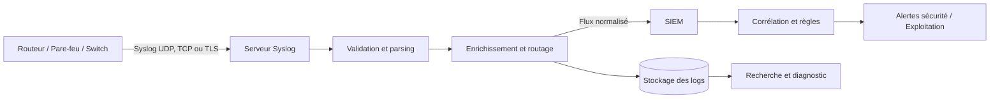
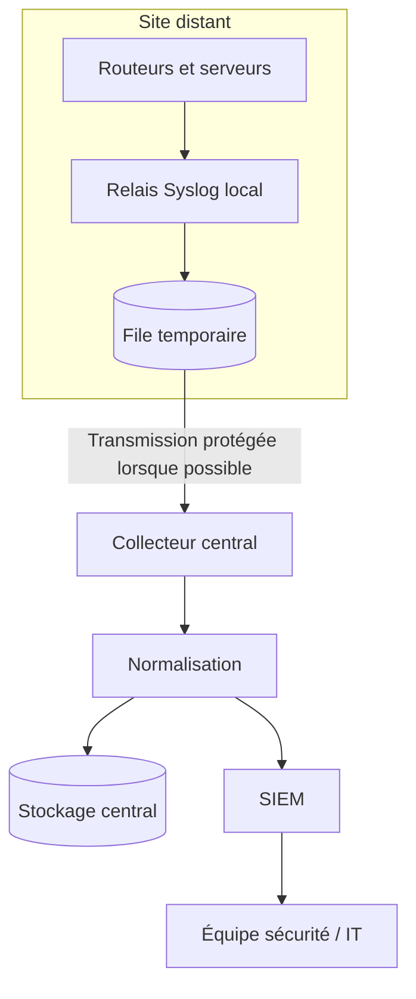
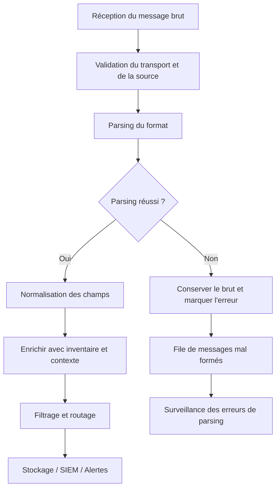
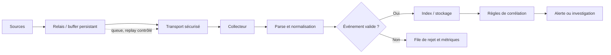

# Centralisation des logs (Syslog)

## 1. Introduction et enjeux : pourquoi centraliser les journaux ?

### 1.1. Un journal local est utile, mais rarement suffisant

Un système informatique produit constamment des événements. Un routeur peut signaler qu'une interface change d'état, qu'un voisinage de routage est réinitialisé ou qu'une session d'administration s'ouvre. Un serveur Linux enregistre les démarrages de services, les échecs d'authentification, les tâches planifiées et les problèmes de stockage. Une application web journalise les requêtes, les erreurs de traitement et les appels vers ses dépendances. Une base de données signale les connexions, les requêtes lentes ou les problèmes de réplication. Ces événements constituent une partie essentielle de l'historique opérationnel d'un système.

Les journaux sont souvent d'abord enregistrés sur l'équipement qui les produit. Ce choix est naturel : le logiciel connaît précisément l'événement et peut écrire les informations à proximité de leur source. Cependant, un journal conservé uniquement sur sa machine présente plusieurs limites. Si la machine est hors service, si son disque est plein ou si l'attaquant qui l'a compromise peut supprimer les fichiers, les informations peuvent devenir inaccessibles. De plus, lors d'un incident touchant plusieurs systèmes, les administrateurs doivent ouvrir plusieurs consoles, comparer des horodatages et reconstituer manuellement une chronologie.

La centralisation consiste à transférer les événements vers un ou plusieurs systèmes de collecte. Un serveur central reçoit les journaux, les organise, les écrit dans un stockage et les met à disposition pour la recherche, les tableaux de bord ou les outils de sécurité. Le protocole Syslog est une méthode couramment utilisée pour transporter ces événements depuis les équipements, les systèmes et les applications vers les collecteurs.

Centraliser n'est pas simplement « envoyer tous les messages au même endroit ». Il faut définir les sources autorisées, le transport, le format, le niveau de détail, la synchronisation temporelle, la rétention, les accès et les procédures de recherche. Une centralisation mal conçue peut déplacer le désordre local vers un grand serveur coûteux, remplir le stockage beaucoup plus vite que prévu et exposer des informations sensibles à davantage de personnes.

### 1.2. Passer de la réaction improvisée à une investigation fondée sur des faits

Imaginons qu'à 9 h 15 les employés ne puissent plus ouvrir une application métier. Dans une organisation sans journaux centralisés, un technicien se connecte au serveur web pour chercher une erreur, puis à la base de données, puis au pare-feu. Chaque système peut présenter son horloge et son format propres. Si le problème s'est produit dix minutes plus tôt et qu'une partie des journaux tourne rapidement, des informations utiles peuvent déjà avoir été écrasées. Une seconde équipe peut chercher sur le mauvais serveur parce que le nom du système n'est pas clairement visible.

Avec une centralisation fonctionnelle, les journaux des composants concernés sont disponibles dans un même environnement de recherche. Le technicien peut filtrer une période précise, retrouver les erreurs du serveur web, examiner les événements de connexion à la base de données et corréler un changement de configuration sur le réseau. La centralisation ne donne pas automatiquement la cause racine, mais elle réduit le temps consacré à rassembler les preuves. Elle permet aussi de distinguer un problème récent d'un comportement habituel.

Cette capacité est utile en exploitation, en sécurité, en audit et lors des changements. Après un déploiement, les journaux peuvent montrer si une nouvelle version génère des erreurs. Lors d'une coupure réseau, ils peuvent documenter le changement d'état d'une interface ou une négociation qui échoue. Lors d'une investigation de sécurité, ils peuvent rapprocher une ouverture de session, une modification de droits et des erreurs observées sur plusieurs machines. Il faut toutefois que les événements aient été collectés, horodatés et conservés au moment des faits ; on ne peut pas reconstruire avec certitude un événement qui n'a jamais été enregistré.

### 1.3. Syslog : un protocole de transport et un format de message

Syslog est un mécanisme largement répandu pour produire, transporter et traiter des messages d'événements. Le mot désigne couramment à la fois le protocole de message et les composants logiciels qui l'utilisent. Dans un déploiement, une application ou un équipement produit un message, un service local peut le recevoir, puis le transférer vers un collecteur distant. Le collecteur peut le conserver tel quel, le parser, l'enrichir ou le transmettre à un système de gestion des événements de sécurité.

Les spécifications historiques de Syslog ont été complétées par des standards qui définissent le transport et le format plus précisément. Le format moderne décrit dans la RFC 5424 fournit une structure avec une priorité, une version, un horodatage, une identité d'hôte, une application, un identifiant de processus, un identifiant de message, des données structurées et un contenu libre. Les messages historiques rencontrés dans les équipements peuvent utiliser un format plus ancien, souvent appelé RFC 3164 ou format BSD traditionnel. Les environnements réels doivent donc savoir accepter des messages hétérogènes et ne pas supposer que toutes les sources adoptent exactement la même structure.

Syslog n'est pas un SIEM à lui seul. Il définit une façon d'envoyer ou de représenter des messages, tandis qu'un SIEM collecte généralement des événements de plusieurs sources, les normalise, les met en relation et permet des analyses de sécurité. Un collecteur Syslog peut être un composant situé avant un SIEM : il reçoit le trafic, applique des règles de routage ou de filtrage, ajoute du contexte et transmet des événements selon la politique de l'organisation. D'autres architectures envoient les messages directement au SIEM si le produit et les contraintes de l'environnement le permettent.

### 1.4. Quels systèmes peuvent envoyer des messages Syslog ?

Les routeurs et commutateurs savent souvent envoyer des événements Syslog vers un serveur distant. Les pare-feu peuvent rapporter des connexions autorisées ou refusées, les changements de politique et les événements de sécurité. Les serveurs Unix et Linux produisent des messages système et applicatifs ; un service comme rsyslog ou syslog-ng peut les recevoir et les transférer. Des applications peuvent utiliser une bibliothèque Syslog, un agent de journalisation ou une passerelle chargée de convertir leur format vers un transport pris en charge.

Il existe néanmoins des différences entre les sources. Un équipement réseau peut n'envoyer que des messages textuels avec une sévérité et un horodatage partiellement normalisés. Une application moderne peut fournir un JSON détaillé avec des attributs tels que l'environnement, la version du code et un identifiant de requête. Un conteneur peut écrire sur sa sortie standard, puis être pris en charge par un agent d'hôte ou une plateforme de conteneurs. L'objectif de centralisation doit tenir compte de ces différences et choisir une méthode d'intégration appropriée.

Il est dangereux de traiter tous les messages comme s'ils étaient fiables et uniformes. Les noms d'hôte peuvent être mal configurés ; les formats peuvent varier après une mise à jour ; les événements peuvent être dupliqués ; certains appareils peuvent envoyer une quantité de données anormale. Un pipeline robuste conserve suffisamment de données brutes pour l'investigation, normalise les champs utiles et signale les problèmes de parsing ou de transport au lieu de les faire disparaître silencieusement.

### 1.5. Les bénéfices et les limites de la centralisation

La centralisation accélère la recherche et la corrélation. Elle facilite la conservation et la sauvegarde, améliore la visibilité multi-systèmes et permet à plusieurs équipes de travailler à partir des mêmes éléments, avec des droits distincts. Elle aide aussi à créer des alertes sur les motifs d'événements : répétition d'échecs d'authentification, redémarrages récurrents, messages de lien réseau, erreurs répétées dans une application ou expiration prochaine d'un certificat lorsqu'un système journalise cet événement.

Mais elle introduit de nouvelles dépendances. Si tous les équipements envoient leurs journaux vers un seul collecteur sans redondance, la panne de ce collecteur peut interrompre la collecte. Si le réseau est coupé, les messages UDP peuvent être perdus. Si la file d'ingestion est pleine, certains événements peuvent être supprimés ou retardés. Si les règles de rétention sont mal dimensionnées, le disque peut être saturé. La plateforme de logs devient donc un système critique qui doit être surveillé, sauvegardé, sécurisé et testé.

La centralisation ne doit pas non plus devenir une collecte indiscriminée. Les journaux peuvent contenir des identifiants, des jetons, des adresses IP, des données personnelles ou des informations métier confidentielles. On ne doit pas enregistrer un mot de passe en clair pour « faciliter le diagnostic ». Il faut collecter les événements nécessaires, masquer les secrets, limiter les accès et définir une durée de conservation cohérente avec les objectifs opérationnels et les obligations applicables.

### 1.6. Objectifs du cours

À la fin de ce cours, vous devez savoir expliquer ce que Syslog apporte, identifier les composants d'une chaîne de centralisation, reconnaître les champs de base d'un message, comprendre la priorité et la sévérité, distinguer le transport UDP, TCP et TLS, et élaborer une démarche de déploiement adaptée à un réseau d'entreprise. Vous devez également pouvoir diagnostiquer les erreurs courantes, dimensionner la collecte à un niveau élémentaire et éviter les pièges de sécurité et de conservation.

L'objectif n'est pas de mémoriser toutes les variantes de chaque constructeur. Il est d'apprendre à établir un contrat clair entre source et collecteur : quels événements sont envoyés, comment ils sont transportés, comment le temps est représenté, comment les messages sont reconnus et où ils sont conservés. Cette base facilitera ensuite l'intégration avec un SIEM, un moteur d'alertes ou une pile de recherche plus avancée.

## 2. Concepts clés : messages, facilities, sévérités, transports et rétention

### 2.1. Anatomie d'un message Syslog moderne

La RFC 5424 définit un format de message structuré. Sa forme générale peut être représentée ainsi :

\`\`\`text
<PRI>VERSION TIMESTAMP HOSTNAME APP-NAME PROCID MSGID STRUCTURED-DATA MSG
\`\`\`

La valeur PRI encode la facility et la sévérité. VERSION indique la version du format, et TIMESTAMP fournit l'horodatage si la source peut le produire. HOSTNAME identifie l'hôte ou la source, APP-NAME désigne l'application, PROCID identifie éventuellement le processus, et MSGID permet d'identifier un type de message. STRUCTURED-DATA contient des informations structurées selon la grammaire prévue ; MSG est le contenu libre du message. Certains champs peuvent être absents et représentés par le marqueur approprié. Les formats historiques n'ont pas toujours exactement cette disposition.

Comprendre les champs aide à écrire des règles de recherche. Il est plus fiable de filtrer sur un champ source ou une sévérité normalisée que de rechercher seulement une phrase dans le texte libre. Une recherche textuelle reste utile pour l'exploration, mais elle est fragile si un constructeur modifie les mots utilisés. Les champs structurés peuvent aussi permettre de rattacher une source à un site, un rôle ou un environnement au moyen d'enrichissements côté collecteur.

Ne supposez pas que chaque équipement produit un message parfaitement conforme à la RFC 5424. Certains matériels utilisent encore des messages historiques, omettent certains champs ou les formatent différemment. Le collecteur doit identifier ce qu'il sait parser, conserver le message brut lorsque cela est utile et marquer les échecs de parsing. Il ne faut pas inventer une valeur absente ni traiter un horodatage non fiable comme une certitude.

### 2.2. PRI, facility et sévérité

Dans le format Syslog, PRI est un nombre calculé à partir de la facility et de la sévérité. Le calcul classique est :

\`\`\`text
PRI = facility × 8 + severity
\`\`\`

La facility désigne la catégorie ou la provenance fonctionnelle du message, par exemple un service système, un composant d'authentification ou une application locale. La sévérité indique l'importance du message selon l'échelle Syslog. Les valeurs numériques exactes sont définies par la convention du protocole. Beaucoup d'outils affichent les noms symboliques, qui sont plus faciles à lire que les codes.

Les sévérités usuelles, de la plus grave à la plus faible, sont : Emergency (système inutilisable), Alert (action immédiate requise), Critical (condition critique), Error (erreur), Warning (avertissement), Notice (événement significatif mais normal), Informational (information) et Debug (détail de diagnostic). Les libellés peuvent être traduits par les interfaces, mais il faut conserver une correspondance stable dans les règles de traitement.

Il faut distinguer la sévérité d'un événement de sa priorité métier réelle. Un message « warning » sur un routeur secondaire peut ne pas avoir d'impact, tandis qu'un message informatif signalant un changement planifié peut avoir de l'importance pour une enquête. La sévérité source est un attribut, pas un jugement complet sur l'incident. La plateforme doit l'associer au rôle de l'équipement, au contexte et à l'impact du service avant de décider de déclencher une notification urgente.

La facility aide à organiser les messages, mais elle ne prouve pas toujours que la source est authentique. Elle peut être renseignée par le logiciel émetteur et ne doit pas être considérée comme un contrôle de sécurité. Les valeurs de facility disponibles et les conventions exactes dépendent du format et des logiciels. Documentez la manière dont vos sources les utilisent, surtout si vous souhaitez filtrer des événements d'authentification, de noyau ou d'application.

### 2.3. Horodatage et synchronisation du temps

L'horodatage est essentiel pour reconstruire une séquence d'événements. Si un pare-feu enregistre une connexion refusée à 14 h 03, mais que le serveur applicatif est décalé de quatre minutes, l'équipe peut croire que l'erreur applicative est antérieure à son contexte réseau. Les sources devraient synchroniser leurs horloges avec une source de temps appropriée, et la plateforme devrait conserver une représentation temporelle cohérente.

Les messages historiques peuvent ne pas porter l'année ou le fuseau dans le même format que les messages modernes. Le collecteur peut être contraint d'inférer certains éléments à partir de l'heure de réception ou de la configuration. Cette inférence doit être comprise et documentée. Il est préférable de conserver un horodatage source lorsqu'il est fiable ainsi qu'un horodatage de réception, car ils permettent de détecter du retard de transport ou une horloge décalée.

La synchronisation ne supprime pas toutes les incertitudes. Un appareil peut envoyer l'heure locale sans fuseau, produire des horodatages incorrects ou utiliser une horloge qui se décale progressivement. Une plateforme peut également recevoir un événement tardivement en raison d'une file d'attente. Les investigations importantes doivent examiner les écarts possibles entre l'heure de l'événement et celle de l'ingestion. Les données doivent être assez cohérentes pour comparer les événements sans masquer les limites de mesure.

### 2.4. UDP : simplicité et risques de perte

Syslog a historiquement été transporté fréquemment sur UDP, généralement sur le port 514. UDP est léger et simple à utiliser, mais il ne fournit pas de mécanisme de livraison garantie ou de contrôle de flux de bout en bout. Un émetteur peut envoyer un message sans savoir si le récepteur l'a stocké. Si un paquet est perdu, si le collecteur est indisponible ou si une file réseau déborde, l'événement peut ne jamais arriver.

UDP peut suffire pour des événements peu critiques ou dans des environnements où la perte occasionnelle est acceptable et compensée par d'autres mécanismes. En revanche, pour des journaux d'audit ou des événements de sécurité importants, il faut évaluer soigneusement les risques. Le fait que le réseau local soit réputé fiable n'élimine pas les pertes, les pannes de collecteur ni les erreurs de configuration. Si la perte est inacceptable, envisagez un transport adapté, des mécanismes de file d'attente côté source et une validation du pipeline.

UDP ne chiffre pas les messages. Un observateur du chemin peut potentiellement voir leur contenu ; un message non protégé peut également être falsifié si les conditions réseau le permettent. L'isolement du réseau de gestion réduit l'exposition mais ne remplace pas le chiffrement lorsque la confidentialité et l'intégrité sont nécessaires. Il faut considérer les données, le trajet, les menaces et les capacités de l'équipement avant de choisir le transport.

### 2.5. TCP : flux fiable, mais pas garantie de traitement final

Syslog peut être transporté sur TCP. TCP fournit un flux fiable entre deux points du réseau, avec retransmission et contrôle de flux. Cela réduit le risque de perte silencieuse pendant le transport, mais ne garantit pas que chaque message est définitivement écrit sur un stockage durable ou indexé dans un SIEM. La fiabilité de bout en bout dépend des files, du logiciel serveur, de la capacité d'écriture et de la gestion des erreurs.

Le port utilisé doit être convenu entre l'émetteur et le récepteur. Le port 514 est souvent associé à Syslog sur UDP et peut également être utilisé pour TCP selon les configurations. Il faut vérifier les paramètres réels des équipements, les règles de pare-feu et les conventions de la plateforme. Un simple changement de protocole côté émetteur sans adaptation du serveur peut entraîner une absence de collecte.

TCP peut introduire un comportement de blocage lorsque le collecteur ne lit plus assez rapidement. C'est souvent préférable à une perte silencieuse, mais il faut s'assurer que la source ou le relais gère correctement la reconnexion et le stockage temporaire. Certains appareils disposent de files très limitées et peuvent supprimer des événements si le serveur ne répond plus. Le protocole de transport et la capacité de buffer doivent être évalués ensemble.

### 2.6. TLS : protéger le transport

Pour Syslog sur TLS, la RFC 5425 décrit un mode de transport fondé sur TLS, classiquement associé au port 6514. TLS apporte un canal chiffré et un mécanisme d'intégrité de transport ; l'authentification du serveur par certificat est courante, et l'authentification mutuelle peut être mise en place si l'architecture le requiert. Le bénéfice est important lorsque les journaux traversent un réseau qui ne peut pas être considéré comme pleinement fiable.

Le chiffrement ne remplace pas la gestion des accès et du stockage. Un collecteur autorisé peut toujours voir le contenu en clair après déchiffrement. Un utilisateur qui possède un accès excessif au SIEM peut lire les messages. Les secrets contenus dans les journaux restent sensibles même si le transport est chiffré. Il faut donc sécuriser les certificats, les clés, les comptes, les fichiers conservés et les règles d'accès à l'interface de recherche.

Tous les équipements ne prennent pas en charge Syslog sur TLS, et les paramètres exacts varient. Certains peuvent envoyer en UDP seulement, d'autres via TCP ou TLS. Lorsqu'un équipement ancien ne propose pas le transport attendu, une architecture de relais dans un segment maîtrisé peut parfois être envisagée, mais le chemin non chiffré reste une exception à documenter. Il ne faut pas prétendre qu'un relais rend rétroactivement chiffrée la portion non protégée située en amont.

### 2.7. RFC 5424 et formats historiques

La RFC 5424 définit un format structuré qui permet de séparer clairement les champs. Elle est utile pour la normalisation, les données structurées et l'interopérabilité. La RFC 3164 décrit un format historique largement rencontré dans les équipements et les systèmes plus anciens. Les implémentations utilisent souvent des variantes, et certaines sources envoient un message texte simple sans respecter entièrement le format moderne.

Lorsqu'on déploie un collecteur, il faut vérifier les formats produits par les sources réelles. Ne présumez pas que l'horodatage, le nom de l'hôte, l'application et le message sont toujours à la même position. Une règle de parsing qui fonctionne sur un modèle de routeur peut échouer sur un autre modèle ou après une mise à jour. Conservez les exemples représentatifs, testez les parseurs et surveillez la quantité de messages qui ne sont pas normalisés.

Il est utile de distinguer le message brut et les champs extraits. Le message brut permet de revenir à la preuve originale lors d'une enquête. Les champs normalisés facilitent les recherches, les tableaux de bord et les règles de corrélation. Si le parser est corrigé plusieurs mois plus tard, conserver le brut peut permettre de retraiter les événements selon une nouvelle logique, dans les limites de la rétention choisie.

### 2.8. Relais, collecteurs et SIEM

Dans un réseau de grande taille, chaque équipement ne doit pas nécessairement communiquer directement avec le SIEM. Un relais peut recevoir les journaux d'un site, les mettre en file, enrichir certains champs et les transmettre à un collecteur central. Cela réduit parfois les contraintes de connectivité et permet d'absorber les interruptions temporaires. Le relais doit néanmoins être surveillé, mis à jour et dimensionné en fonction du volume et de la durée d'interruption qu'il doit absorber.

Le collecteur reçoit le flux, valide la structure, horodate la réception, sélectionne une route, écrit les messages et transmet éventuellement une partie des données à un indexeur. Le SIEM réalise ensuite des opérations supplémentaires, qui peuvent inclure la normalisation, la corrélation entre sources, les détections de sécurité, la recherche et la gestion des alertes. Les rôles exacts dépendent du produit : un logiciel peut remplir plusieurs étapes, ou ces fonctions peuvent être distribuées.

Il faut éviter de confondre l'acceptation d'un message par le premier serveur avec sa disponibilité dans le moteur de recherche. Entre les deux, le pipeline peut contenir des files, un parseur, un enrichisseur, une base ou un indexeur. Chaque étape peut ralentir ou échouer. Mesurez les messages reçus, transformés, rejetés, stockés et indexés, et conservez des métriques sur les retards. Une différence importante entre entrées et sorties est un signal à investiguer, pas une variation à ignorer.

### 2.9. Normalisation, enrichissement et classification

Les sources n'utilisent pas toujours les mêmes noms ou formats. Une normalisation peut transformer les champs vers un schéma commun : horodatage, hôte, adresse source, application, facility, sévérité, événement, environnement et catégorie. L'enrichissement peut ajouter un site, un rôle, un propriétaire ou une criticité depuis l'inventaire. Ces métadonnées permettent de faire des recherches plus utiles que la seule phrase du message.

La normalisation ne doit pas effacer l'incertitude. Si le collecteur déduit un site à partir d'une adresse IP, cette relation peut devenir incorrecte après une renumérotation. Si le parsing échoue, ne remplissez pas arbitrairement un champ avec une valeur fausse. Conservez le message brut, marquez l'échec et surveillez sa fréquence. Un système qui transforme silencieusement les messages mal formés en événements normaux peut produire de fausses conclusions.

La classification des événements est également utile. Tous les logs n'ont pas la même valeur. Des messages de diagnostic très détaillés peuvent aider lors d'un dépannage, mais générer un volume important. Les événements d'authentification et les modifications administratives peuvent être particulièrement importants pour la sécurité. Les événements de santé des services peuvent aider à détecter les pannes. Le niveau de collecte doit être calibré afin de ne pas supprimer des informations critiques ni conserver sans discernement une masse de messages à faible utilité.

### 2.10. Rétention, rotation et stockage

La rétention définit combien de temps les messages doivent être conservés, tandis que la rotation organise la création de nouveaux fichiers ou segments et la fermeture des anciens. Dans un environnement centralisé, les données peuvent rester dans des fichiers, une base orientée recherche ou un stockage d'objets, selon l'architecture. Le coût dépend du débit de messages, de la taille moyenne des événements, de la compression, de l'indexation, de la réplication et des données conservées.

Une approximation initiale du volume non compressé se calcule en multipliant le nombre moyen de messages par seconde par la taille moyenne d'un message, puis par le nombre de secondes de la période. Par exemple, 200 messages par seconde de 500 octets représentent environ 100 000 octets par seconde. Sur une journée de 86 400 secondes, cela donne environ 8,64 milliards d'octets, soit un ordre de grandeur de 8,64 Go décimaux avant indexation, réplication et surcoûts. Le calcul réel doit intégrer les pointes, la compression, le format de stockage et les métadonnées.

Il faut prévoir de la marge pour les rafales. Un changement réseau, une boucle de journalisation ou un service qui répète sans cesse une erreur peut multiplier le nombre de messages. La capacité ne doit pas être dimensionnée sur une journée calme uniquement. Mesurez le trafic sur plusieurs périodes représentatives et définissez une politique de réaction si le taux d'ingestion dépasse la capacité : mise en file, limitation contrôlée, séparation des flux, augmentation de capacité ou réduction de messages non essentiels après analyse.

La rétention ne doit pas être décidée uniquement par le stockage disponible. Elle dépend aussi des besoins de diagnostic, de la sécurité, de l'audit, des règles internes et des obligations légales applicables. Conserver plus longtemps peut coûter cher et augmenter l'exposition de données sensibles. Conserver trop peu peut empêcher une enquête sur une attaque lente ou un incident découvert tardivement. Il faut documenter le pourquoi, les durées, les propriétaires, les exceptions et les modalités de suppression.

### 2.11. Confidentialité et intégrité des journaux

Les logs sont parfois aussi sensibles que les bases de données qu'ils décrivent. Ils peuvent contenir des noms, adresses IP, identifiants, paramètres de requêtes, chemins internes, identifiants de session ou détails d'erreur qui révèlent l'architecture. Une application ne doit jamais journaliser un mot de passe en clair, une clé privée ou un jeton secret à des fins de facilité. Il faut masquer ou supprimer les valeurs sensibles à la source dès que possible, plutôt que compter uniquement sur des filtres après l'ingestion.

Les accès doivent être accordés selon le rôle. Un technicien réseau n'a pas nécessairement besoin de lire tous les journaux d'authentification ou les informations métier. Les comptes administrateurs du collecteur doivent être protégés, l'accès à la recherche doit être audité et les opérations de suppression contrôlées. Pour les données les plus critiques, une séparation des rôles peut réduire le risque qu'une même personne modifie la configuration de collecte et supprime ensuite les preuves.

L'intégrité des journaux peut être renforcée par les contrôles d'accès, le transport protégé, la conservation de copies contrôlées, une piste d'audit et des mécanismes de stockage adaptés. Un serveur Syslog ne garantit pas à lui seul qu'un événement n'a pas été falsifié avant son envoi. Si l'horloge ou la source est compromise, le message peut être trompeur. Les logs doivent être confrontés à d'autres éléments et les hypothèses de confiance de chaque source doivent être connues.

### 2.12. Différence entre log, métrique et trace

Un log décrit un événement, par exemple « authentification refusée » ou « interface changée d'état ». Une métrique est une valeur numérique agrégée dans le temps, comme le nombre d'échecs d'authentification par minute ou le taux d'erreur d'une interface. Une trace suit une opération à travers plusieurs composants et mesure la durée des étapes. Les trois signaux se complètent, mais ne se remplacent pas.

Un pic de messages d'erreur dans Syslog peut signaler un incident, mais le nombre de logs doit être interprété en fonction du trafic et du niveau de journalisation. Une métrique peut montrer que le taux d'erreur a augmenté brusquement. Une trace peut indiquer où les requêtes ont échoué ou attendu trop longtemps, si l'application est instrumentée. Les logs expliquent des détails concrets ; les métriques donnent une vue de tendance ; les traces exposent un parcours distribué.

La centralisation Syslog fait principalement partie de la stratégie de logs. Pour améliorer la résolution des incidents, reliez les événements à des métriques et à des traces lorsque c'est utile. Une convention de nommage, un horodatage cohérent et un identifiant de corrélation permettent de naviguer d'un signal à l'autre sans devoir reconstruire la relation à partir d'une phrase approximative.

### 2.13. Anatomie complète de RFC 5424 : de l'en-tête au message libre

Un message Syslog moderne peut se lire comme plusieurs éléments associés. L'en-tête indique notamment le PRI, la version, l'horodatage, l'hôte déclaré, l'application, l'identifiant de processus et l'identifiant de message. La partie Structured Data permet d'ajouter des champs structurés selon des identifiants de données, puis la partie MSG contient le texte libre ou le contenu d'événement. Ce format permet de conserver un minimum de structure tout en prenant en charge des messages qui n'ont pas de schéma métier universel.

Le champ version identifie le format normalisé ; il ne doit pas être confondu avec la version du logiciel de l'équipement émetteur. Les valeurs NILVALUE, généralement représentées par un tiret, indiquent certaines informations absentes. Il faut éviter de convertir un champ absent en une valeur inventée, comme un horodatage artificiel ou un nom d'application supposé. Une bonne pipeline conserve le message brut et différencie clairement « non fourni par la source » de « extrait par enrichissement ».

Le Structured Data est particulièrement précieux pour transmettre un contexte qui serait difficile à extraire du texte. Une source peut fournir des identifiants de session, une classe d'événement ou une donnée de diagnostic sous forme d'attributs nommés. Les noms et la signification exacts dépendent du module de données et de l'implémentation. Un parseur doit respecter les règles d'échappement et ne pas découper simplement à chaque espace ou crochet. Sinon, des messages légitimes seront mal interprétés ou des valeurs seront attribuées au mauvais champ.

Le champ MSG reste souvent libre et peut contenir des textes humains, des codes propres au constructeur, des valeurs concaténées ou des détails non structurés. Il est utile de le conserver pour l'investigation, mais les règles de détection ne devraient pas dépendre uniquement de variations de formulation non documentées. Lorsqu'un constructeur change son format de message après une mise à jour, une règle basée sur une expression régulière fragile peut soudainement manquer des événements. La normalisation doit combiner des champs structurés, des parsers versionnés et une validation sur des exemples réels.

### 2.14. Calculer PRI et comprendre les catégories de messages

La valeur PRI combine la facility et la sévérité. Dans le modèle Syslog courant, PRI = facility × 8 + severity. La facility indique un type d'origine ou de sous-système logique ; la sévérité indique la gravité déclarée par l'émetteur. Il faut donc décoder les deux dimensions avant d'afficher la valeur numérique. Le nombre brut ne doit pas être interprété directement comme une priorité métier globale.

Les facilities peuvent distinguer, selon le standard et les conventions des implémentations, des fonctions telles que l'authentification, le système, l'impression, les mécanismes locaux ou des applications. Les valeurs local0 à local7 sont fréquemment employées pour des catégories définies par l'organisation ou par une application. Elles ne disposent pas d'une signification métier universelle : il faut tenir un registre des conventions internes et éviter que deux sources attribuent des sens contradictoires au même identifiant.

La sévérité est traditionnellement numérotée de 0, Emergency, à 7, Debug, avec des niveaux intermédiaires tels que Alert, Critical, Error, Warning, Notice et Informational. Un numéro inférieur représente habituellement une gravité Syslog plus élevée. La manière de filtrer dépend donc de l'implémentation et de la notation de seuil dans le produit ; certaines interfaces demandent une liste de niveaux, d'autres un niveau maximum ou un ordre de comparaison. Ne copiez pas une valeur « 4 » d'un outil vers un autre sans vérifier si elle signifie inclure le niveau Warning et les niveaux plus critiques.

Un niveau déclaré n'est pas le même qu'un impact métier. Un message Critical provenant d'une application de test peut être moins urgent qu'une série de messages Informational indiquant que l'authentification échoue pour tous les utilisateurs d'un système de production. L'ingestion doit préserver la sévérité d'origine et appliquer séparément les politiques de corrélation, de criticité de l'actif et d'impact du service. Évitez de réécrire la gravité source sans garder la valeur d'origine, sinon les investigations futures ne pourront plus distinguer ce que l'équipement a réellement déclaré.

### 2.15. Multiligne, encodage et limites de taille

Les applications produisent parfois des événements répartis sur plusieurs lignes, par exemple une pile d'appel, une exception ou un diagnostic détaillé. Si chaque ligne est envoyée comme un message indépendant, l'analyse peut perdre le lien entre le début de l'événement et les lignes qui le suivent. À l'inverse, fusionner toutes les lignes consécutives d'un hôte peut rassembler des événements distincts. La stratégie de regroupement doit être explicitement configurée selon la source et validée sur des exemples représentatifs.

L'encodage joue aussi un rôle. Des caractères accentués, des symboles ou des champs multilingues peuvent être altérés si la source et le collecteur n'interprètent pas les octets de la même manière. Une transformation irréversible peut modifier une chaîne utilisée pour une règle de sécurité. Conservez le message brut lorsque c'est possible, indiquez l'encodage ou la politique de normalisation et testez les caractères spéciaux, les retours à la ligne et les guillemets.

Les limites de taille dépendent de la source, du transport et du collecteur. Un message tronqué peut perdre précisément la partie contenant l'identifiant d'erreur ou la cause de l'incident. La pipeline doit exposer les messages tronqués et les rejets, pas simplement les supprimer silencieusement. Si le transport ou l'équipement impose une taille limitée, privilégiez un format d'événement structuré et compact ; ne supposez pas qu'un message très long traversera tous les relais sans modification.

### 2.16. Le temps des événements : source, réception et traitement

Trois moments doivent être distingués : l'heure indiquée par la source, l'heure où le collecteur reçoit le message, et l'heure où l'événement est traité ou indexé. Ils peuvent différer à cause d'une horloge d'équipement décalée, d'une file d'attente, d'un réseau lent, d'une indisponibilité du relais ou d'un traitement coûteux. Le journal final doit conserver les valeurs nécessaires pour comprendre cette différence et ne pas remplacer discrètement l'heure d'origine par l'heure d'ingestion.

La synchronisation NTP ou le service de temps approuvé est une dépendance importante de la centralisation. Une horloge de source qui avance de six minutes peut faire apparaître un événement avant un changement qui l'a réellement provoqué. Un collecteur dont l'horloge dérive peut rendre les délais d'ingestion incompréhensibles. Surveillez le décalage temporel, conservez le fuseau ou le décalage fourni et expliquez la règle utilisée pour afficher les heures à l'opérateur.

Pour rapprocher des événements, utilisez des clés d'actif, des identifiants de session ou de requête lorsque les sources les fournissent. L'ordre des lignes dans l'interface n'est pas une preuve de causalité. Deux événements horodatés presque simultanément peuvent avoir emprunté des chemins différents ou être reçus dans un ordre différent de leur émission. Lorsqu'une chronologie est importante pour une investigation de sécurité, comparez les sources indépendantes et consignez l'incertitude plutôt que de fabriquer un ordre strict à partir d'horodatages peu fiables.

### 2.17. Normalisation : conserver la preuve originale

La normalisation convertit les variations de formats en champs et catégories cohérents. Elle peut associer les adresses IP à un actif, normaliser les noms d'utilisateur, transformer les codes de gravité en niveaux communs et extraire les identifiants d'événement. Cependant, cette transformation est une interprétation. Elle doit être traçable, versionnée et réversible autant que possible, afin qu'un analyste puisse vérifier la règle appliquée au message brut.

Conservez au minimum le message original, la source déclarée, l'adresse réseau d'origine observée, l'heure d'ingestion, les champs extraits, la version du parseur et les erreurs de parsing. La valeur « hôte » fournie dans le message n'est pas nécessairement fiable : un expéditeur peut écrire un nom trompeur dans son contenu. Le collecteur peut associer l'adresse source à l'inventaire et conserver côte à côte les deux informations, plutôt que faire totalement confiance à un seul champ.

Les enrichissements doivent être séparés des valeurs originales. Une adresse IP peut être associée à un propriétaire, un site, une criticité ou un rôle d'actif dans l'inventaire ; ces informations peuvent évoluer. Si le propriétaire a changé en juin, un événement de février ne devrait pas être silencieusement réinterprété comme s'il provenait du nouveau propriétaire. Conservez la date de validité ou la version de l'inventaire lorsqu'une attribution historique précise est nécessaire.

### 2.18. Construire des règles de détection à partir de plusieurs signaux

Un événement isolé porte rarement toute l'information nécessaire pour décider. Une succession d'échecs d'authentification peut révéler un mot de passe oublié, une application mal configurée, une tentative de force brute ou un scanner. La signification dépend de la fréquence, de la source, de la dispersion des comptes, de la criticité de l'actif et de ce qui s'est produit ensuite. La règle doit décrire le motif et la fenêtre de temps, ainsi que les critères de regroupement.

Évitez de faire dépendre une alerte d'une seule phrase exacte si plusieurs versions logicielles produisent des formulations différentes. Préférez les champs normalisés lorsque leur signification est stable, complétés par des conditions sur la source et le contexte. Si une expression régulière est indispensable, testez-la sur des messages positifs, négatifs, tronqués et provenant des versions réelles. Enregistrez la version de la règle et sa date de déploiement pour expliquer toute modification du volume d'alertes.

Une règle doit aussi considérer les doublons et les répétitions. Un relais peut rediffuser un message après une reprise ; certaines sources réessaient une transmission ou génèrent régulièrement le même événement. Une déduplication peut réduire le bruit, mais elle doit préserver le nombre d'occurrences et la période couverte. Il ne faut pas transformer cent échecs d'authentification en une unique ligne qui ferait disparaître l'ampleur réelle d'une attaque potentielle.

### 2.19. Logs, preuves d'audit et limites de confiance

Un journal est une preuve d'observation produite par un composant, pas une vérité absolue indépendante. Un appareil compromis peut émettre des messages trompeurs, un administrateur autorisé peut modifier sa configuration de journalisation, un relais peut perdre des messages et un parseur peut se tromper. L'enquêteur doit donc distinguer le fait que « la source a envoyé ce message » de l'affirmation « l'action décrite a certainement eu lieu ». La corroboration est particulièrement importante pour les décisions sensibles.

La centralisation améliore la résilience des preuves, car un attaquant qui efface un fichier local ne supprime pas automatiquement les copies distantes. Elle ne garantit toutefois pas l'immutabilité par elle-même. Les contrôles d'accès, la séparation des rôles, l'audit des modifications, la sauvegarde, la rétention et, si les exigences l'imposent, le stockage protégé contre l'altération sont nécessaires. Le modèle doit préciser qui peut lire, supprimer, exporter ou modifier les règles et les index.

La collecte doit aussi respecter le principe de minimisation. Les applications peuvent journaliser des jetons, des mots de passe, des adresses personnelles, des charges utiles ou des données de santé. Avant d'envoyer leurs messages à un SIEM, définissez les champs qui doivent être masqués ou exclus, où la transformation se fait et comment éviter qu'un secret soit recopié dans un autre index. Un journal utile à la sécurité ne doit pas devenir une copie incontrôlée des données sensibles de l'application.

### 2.20. Une chaîne Syslog a besoin de contrats de données

Pour chaque catégorie de source, documentez le format attendu, le transport, la taille approximative des messages, les champs disponibles, la politique de filtrage, les besoins de rétention, la criticité et le propriétaire. Ce contrat permet de tester une intégration avant de la déclarer prête. Si une nouvelle version d'un équipement change les noms de champs ou ajoute un préfixe, la validation peut détecter la modification avant que les règles d'alerte cessent de fonctionner silencieusement.

La qualité peut être mesurée par le taux de messages correctement parsés, le pourcentage d'événements sans identité d'actif, la fraîcheur, les erreurs d'ingestion et la proportion de sources qui ont envoyé un message récemment. Un flux qui contient beaucoup de journaux mais dont la plupart restent dans un champ texte indifférencié peut coûter cher tout en offrant peu de capacité de recherche. Un flux correctement normalisé avec un volume plus faible peut être plus utile à l'opérateur.

Les contrats de données doivent être revus à chaque modification importante : mise à niveau, ajout de champs, remplacement d'un relais, changement d'heure, migration de stockage ou changement de politique de sécurité. La validation doit inclure des exemples réels anonymisés, avec des cas limites. Ne stockez pas seulement un exemple heureux dans la documentation, car les erreurs de parsing apparaissent souvent sur les événements rares mais importants.

## 3. Architecture et schémas

### 3.1. Flux principal : routeur vers serveur Syslog puis SIEM

Dans une architecture simple, le routeur ou l'équipement réseau émet ses événements vers un serveur Syslog. Le serveur reçoit les messages, applique les contrôles de format et les règles de traitement, les conserve ou les transmet au SIEM. Le SIEM rapproche les événements avec d'autres sources et permet de rechercher les incidents. Il est possible de répartir les composants sur plusieurs machines afin de séparer la réception, le stockage et l'analyse.



Le schéma présente un flux logique. Dans un environnement réel, le collecteur peut recevoir des messages de centaines ou de milliers de sources, utiliser des files d'attente et distribuer les événements vers plusieurs destinations. Le SIEM peut embarquer ses propres mécanismes de collecte et de stockage, ou se situer en aval d'une chaîne déjà centralisée. L'architecture doit documenter quelle étape possède le message, où il est conservé et comment une perte ou un retard est détecté.

### 3.2. Collecte directe ou avec relais

Une collecte directe convient souvent à un petit site : les équipements envoient vers un collecteur central qui est joignable sur le réseau de gestion. Lorsque les sites sont distants, une liaison intermittente ou une bande passante limitée peut rendre préférable un relais local. Le relais reçoit les messages localement, les met en file si c'est supporté, puis les retransmet au centre lorsque la connexion fonctionne.



Le relais ne doit pas être traité comme une boîte noire. Il doit exposer ses propres métriques, notamment les messages reçus, envoyés, rejetés, retardés et mis en file. La durée de stockage temporaire doit être dimensionnée selon le volume quotidien et la durée maximale d'interruption envisagée. Si la liaison est coupée pendant plus longtemps que la capacité de la file, le relais devra supprimer ou rejeter certains événements. Cette limite doit être connue, signalée et testée.

### 3.3. Du message brut à l'événement exploitable

La réception brute n'est que la première étape. Le système doit lire le format, extraire les champs, normaliser les valeurs et éventuellement ajouter des informations de contexte. Si le parsing est impossible, le message ne doit pas disparaître sans trace : il peut être conservé dans un flux d'erreurs dédié, accompagné d'une raison ou d'un indicateur.



Le parsing transforme une structure de message en champs interrogeables. La normalisation harmonise les noms, les horodatages et les catégories. L'enrichissement peut ajouter le site et le propriétaire en se basant sur l'inventaire. Le filtrage doit être prudent : supprimer des messages peut réduire les coûts, mais une règle trop large peut faire disparaître les éléments qui expliquent un incident. Il faut tester les changements avec des échantillons et préserver l'information nécessaire à la relecture.

### 3.4. Fiabilité de la chaîne

Une chaîne de logs comporte plusieurs points possibles de perte : l'application peut ne rien journaliser, le système local peut être mal configuré, le réseau peut perdre des datagrammes, le collecteur peut être hors service, le stockage peut être plein et l'indexeur peut prendre du retard. Pour chaque étape, définissez un signal de santé et une alerte indépendante si l'absence de données constitue un risque.

Le nombre de messages reçus par seconde constitue une mesure utile, mais il ne suffit pas. Il faut comparer le nombre reçu au nombre envoyé lorsqu'une telle mesure existe, suivre la longueur des files, les erreurs de parsing, l'espace disque, les délais d'indexation et les échecs de livraison vers le SIEM. Certains équipements n'exposent pas de compteur fiable de messages envoyés ; dans ce cas, la détection de perte doit s'appuyer sur des événements de test, des mesures côté collecteur et une vérification des fonctions de bout en bout.

Il est utile de créer un événement de test périodique envoyé depuis une source de laboratoire ou un système de test autorisé. Un contrôleur peut vérifier qu'il apparaît dans le stockage à l'heure prévue. Un tel test ne prouve pas que chaque appareil envoie tous ses messages, mais il valide une partie du chemin de collecte. Il faut le combiner à des contrôles propres aux sources critiques et à l'observation des retards.

### 3.5. Sécurité de l'architecture et séparation des responsabilités

Le serveur Syslog est souvent accessible depuis plusieurs zones réseau et reçoit des données de nombreux équipements. Il doit être isolé et configuré pour accepter uniquement les flux attendus. Les interfaces d'administration ne doivent pas être exposées aux mêmes réseaux que les sources si ce n'est pas nécessaire. Le transport TLS doit être utilisé lorsque la protection du canal est requise et que les sources le permettent. Les certificats et clés doivent être renouvelés selon un processus maîtrisé.

La source de journal ne doit pas être supposée fiable simplement parce qu'elle a envoyé un paquet. Une machine compromise peut envoyer des messages trompeurs, saturer le collecteur ou tenter d'injecter des chaînes qui perturbent le parsing. Il faut authentifier les sources lorsque possible, limiter le volume, normaliser les données et éviter de traiter automatiquement tout message reçu comme un fait validé. La provenance doit rester visible dans les recherches.

Les responsabilités peuvent être séparées entre l'équipe qui configure les équipements, celle qui administre le collecteur et celle qui définit les règles du SIEM. Cela permet de limiter les accès et de clarifier qui est responsable de chaque étape. Une règle qui supprime des journaux doit être examinée, testée et documentée. Les modifications de pipeline doivent être versionnées et accompagnées d'une validation sur des exemples représentatifs.

### 3.6. Transport : comprendre TCP, TLS et le découpage des messages

TCP fournit un flux d'octets ordonné et fiable entre ses extrémités de transport, tant que la connexion se maintient et que les mécanismes de transport fonctionnent. Il ne préserve pas les frontières des messages d'application. Un récepteur peut lire un morceau d'un message, plusieurs messages concaténés ou une portion qui traverse plusieurs lectures. La couche Syslog doit donc savoir où un message commence et se termine. Si les implémentations émettrice et réceptrice n'utilisent pas la même convention de framing, le parsing peut échouer même si TCP est connecté.

Le RFC 6587 décrit des méthodes historiques de framing pour Syslog sur TCP. L'octet-counting précède un message par sa longueur en octets, ce qui permet au récepteur de connaître sa frontière sans confondre un retour à la ligne présent dans le message avec la fin du message. Le framing non transparent utilise généralement un caractère de fin, et devient ambigu si ce caractère apparaît dans le contenu sans mécanisme de protection adéquat. Ce RFC est historique ; pour les nouveaux déploiements, le cours recommande de préférer les transports normalisés et protégés définis dans la série Syslog, selon les possibilités des équipements. Référence : https://www.rfc-editor.org/rfc/rfc6587.

TLS protège les données en transit sur la session, mais il faut encore vérifier l'identité du pair et la configuration des certificats. Si un client accepte n'importe quel certificat sans contrôle, le chiffrement ne garantit pas qu'il envoie ses journaux au collecteur attendu. Dans les environnements qui le permettent, utilisez une validation robuste des certificats, une gestion des renouvellements et, selon l'architecture, une authentification mutuelle. Surveillez les dates d'expiration et testez le renouvellement avant d'arriver à une panne de collecte.

Même en TCP/TLS, la livraison jusqu'au stockage final n'est pas automatiquement garantie. Une connexion acceptée prouve que la session réseau a été établie ; elle ne prouve pas que chaque message a été validé par le parseur, écrit sur disque, indexé puis rendu consultable. La source ne reçoit pas nécessairement un accusé applicatif indiquant que l'événement est durablement enregistré. Le diagnostic doit donc s'appuyer sur des compteurs à chaque étage et sur un test d'événement identifiable de bout en bout.

### 3.7. Files persistantes, reprise et limitation de charge

Un relais peut absorber temporairement les pointes lorsqu'il dispose d'une file persistante. Si la destination SIEM devient indisponible pendant quinze minutes, le relais peut conserver les événements, puis les retransmettre lorsque la connexion revient. Cette protection n'est efficace que si la capacité de la file, le comportement lors d'une saturation et la persistance après redémarrage sont documentés et testés. Une file en mémoire peut perdre son contenu lors d'une panne du processus ou de l'hôte.

Dimensionnez la file selon le débit moyen, les pointes et le temps de panne que l'architecture doit absorber. Une approximation initiale consiste à multiplier le volume moyen par seconde par le nombre de secondes de reprise attendu, puis à ajouter une marge pour les pointes et l'encodage. Le calcul doit utiliser la volumétrie réellement observée et être validé sur la capacité disque et les limites de l'outil. Une file qui se remplit plus vite qu'elle ne se vide finit par provoquer une perte si elle a une taille maximale.

Les politiques de surcharge doivent être explicites. Selon la criticité, on peut ralentir les sources lorsque le protocole le permet, mettre en file les événements, rejeter certaines catégories à faible valeur ou générer une alerte de saturation. Il faut éviter qu'une règle silencieuse supprime les événements critiques juste au moment où le réseau devient instable. Si une suppression est nécessaire pour protéger le système, elle doit être documentée, mesurée et visible dans les rapports.



Le schéma montre une stratégie de résilience logique. La file de rejet ne doit pas être un trou noir : elle doit garder un échantillon ou une référence du message, la raison du rejet, la source et l'heure, avec des protections adaptées aux données sensibles. La reprise après panne doit faire attention aux doublons. Lorsqu'un événement est retransmis, une déduplication raisonnable peut aider, mais elle ne doit pas supprimer deux actions distinctes simplement parce qu'elles ont des textes similaires.

### 3.8. Dimensionner le volume et la rétention

Pour estimer la volumétrie, partez d'un échantillon réel. Si 300 équipements envoient en moyenne 8 messages par seconde chacun et que la taille moyenne conservée est de 700 octets, le flux brut théorique est de 300 × 8 × 700 = 1 680 000 octets par seconde, soit environ 1,68 Mo/s en unités décimales avant les surcoûts de transport, d'indexation, de réplication et de métadonnées. Sur une journée, ce seul flux représente environ 145 Go avant compression et architecture de stockage. L'exemple montre pourquoi le debug continu peut devenir coûteux ; il ne constitue pas une estimation universelle.

La taille moyenne masque les pointes. Un pare-feu peut envoyer un grand volume lorsqu'une attaque ou un problème de connectivité survient. Les tests de capacité doivent donc simuler une période normale et une période de forte activité. La rétention des messages bruts, des événements normalisés et des agrégats peut être différente : les messages nécessaires à une enquête réglementaire doivent être conservés selon la politique applicable, tandis que certaines données de débogage peuvent avoir une durée plus courte.

La compression peut réduire l'espace, mais elle ne supprime pas les coûts de parsing, de recherche et de réplication. Une stratégie d'indexation doit équilibrer la vitesse de recherche, le coût et la période d'accès fréquente. Les données plus anciennes peuvent être déplacées vers un stockage moins coûteux si la politique le permet, à condition que les délais de restauration soient connus. Avant de raccourcir la rétention, vérifiez les exigences de sécurité, d'audit, de contrat et de conformité qui s'appliquent à l'organisation.

### 3.9. Haute disponibilité des collecteurs et séparation des rôles

Une architecture centrale peut devenir un point de défaillance unique si un seul serveur reçoit toutes les sources. Des relais par site, plusieurs récepteurs ou un cluster peuvent réduire cette dépendance, mais ils introduisent des choix de routage, de déduplication, de capacité et d'exploitation. L'architecture doit documenter le comportement lors de la perte d'un relais : les sources disposent-elles d'un secours, les journaux restent-ils localement en attente, ou les événements sont-ils perdus pendant la coupure ?

Séparez, autant que possible, les rôles de collecte, de parsing, de stockage et d'analyse. Cela ne signifie pas toujours plusieurs machines physiques ; cela signifie que les capacités, files et limites sont observables distinctement. Un parseur mal conçu peut consommer beaucoup de CPU, alors que le réseau et le stockage sont sains. Sans métriques par étape, l'équipe risque d'augmenter le stockage pour résoudre une file de parsing, ou d'augmenter les récepteurs alors que le SIEM est déjà saturé.

La redondance ne doit pas produire une illusion de fiabilité. Si deux collecteurs partagent le même disque, le même lien WAN ou la même gestion d'identités, une panne commune peut affecter les deux. Identifiez les dépendances partagées et testez les bascules. Gardez les événements de santé de la chaîne hors du seul canal qu'ils sont censés surveiller, autant que cela est raisonnablement possible.

### 3.10. Sécuriser le contenu et les chemins d'administration

Les sources doivent être autorisées à envoyer les événements attendus, mais un collecteur ne doit pas considérer tout message reçu comme digne de confiance. Filtrez par réseaux et identités de sources lorsque cela est possible, validez les champs, limitez les tailles, surveillez les rafales et appliquez les règles de parsing de façon robuste. Un message construit pour ressembler à une alerte d'un autre équipement ne doit pas pouvoir remplacer l'identité observée de la source dans les métadonnées.

L'accès à la console du SIEM, aux index et aux exports doit suivre le principe du moindre privilège. Les administrateurs de pipeline n'ont pas nécessairement besoin de consulter toutes les données métier ; les analystes ne doivent pas forcément pouvoir supprimer les événements bruts ; les comptes d'export doivent être séparés des comptes humains. Les opérations sensibles, notamment changement de rétention, suppression et modification de règles, doivent être journalisées et accessibles en audit.

Prévoyez aussi le cycle de vie des certificats, les clés privées, les sauvegardes et les procédures de renouvellement. Un certificat expiré peut arrêter silencieusement une partie de la collecte si les alertes de santé ne sont pas configurées. Un secret de transport copié dans un dépôt Git peut annuler le bénéfice du chiffrement. Les vérifications de sécurité doivent donc couvrir autant la configuration et les identifiants que les messages eux-mêmes.

## 4. Étude de cas : centraliser Syslog dans une PME

### 4.1. Contexte de départ

Une PME de 70 employés exploite un routeur Internet, un pare-feu, plusieurs commutateurs administrables, un réseau Wi-Fi, quelques serveurs Linux et Windows et une application métier. Les techniciens consultent les fichiers de logs sur chaque serveur et l'interface de chaque équipement lors des incidents. L'entreprise a parfois du mal à savoir si une anomalie de connexion vient d'un changement réseau, d'un échec d'authentification ou d'une défaillance applicative. Elle souhaite centraliser d'abord les messages les plus utiles, sans collecter immédiatement chaque ligne de diagnostic.

L'équipe identifie les sources qui contribuent le plus à la sécurité et à la continuité de service : pare-feu, routeur, commutateurs critiques, serveurs d'authentification, serveurs applicatifs et équipements de secours. Pour chaque source, elle note le type de message disponible, le volume approximatif, le protocole pris en charge, la criticité et les informations sensibles possibles. Elle distingue les journaux opérationnels, les journaux de sécurité et les messages de diagnostic détaillé.

### 4.2. Préparer le collecteur

La PME choisit un serveur de collecte dimensionné d'après une estimation du nombre de messages par seconde et leur taille moyenne. Elle commence par mesurer le volume sur une période représentative. Elle prévoit une marge de capacité pour les pics, réserve le stockage nécessaire et configure la rotation ou la rétention afin d'éviter que les journaux remplissent le disque. Une procédure d'alerte de capacité est définie pour le serveur lui-même.

Le collecteur est placé dans une zone de gestion contrôlée. Les règles réseau n'autorisent que les sources prévues à envoyer des logs vers le port configuré. L'administration de la plateforme utilise des accès séparés et limités. Pour les équipements qui prennent en charge un transport protégé, l'équipe évalue Syslog sur TLS et le cycle de vie des certificats. Les appareils qui ne supportent que UDP font l'objet d'une exception documentée et d'un trajet réseau aussi restreint que possible.

L'équipe configure d'abord un petit nombre de sources de test. Elle confirme que les messages arrivent, vérifie leur horodatage, identifie les champs qui sont extraits et compare les valeurs à la sortie locale. Elle ne bascule pas l'ensemble des équipements tant que la chaîne complète ne fonctionne pas. Cette étape permet de détecter les différences de format, les problèmes de fuseau et les règles de pare-feu sans multiplier les causes possibles.

### 4.3. Choisir les événements et la rétention

Le routeur et le pare-feu envoient les changements d'état et les événements de gestion importants. Les serveurs produisent les messages système et les erreurs applicatives pertinentes. L'équipe évite d'activer globalement un niveau debug très bavard sur tous les équipements. Les journaux de diagnostic détaillé peuvent être activés temporairement sur une source précise lorsqu'un incident le justifie, puis ramenés au niveau normal après validation.

Les données sont classées en catégories : événements de sécurité, état du réseau, erreurs systèmes, événements applicatifs et diagnostics temporaires. Chaque catégorie reçoit une rétention adaptée aux besoins d'exploitation et aux exigences applicables. Les événements qui contiennent des données sensibles sont masqués ou exclus à la source lorsque cela est possible. Les droits de recherche sont définis selon le rôle et les actions administratives importantes sont elles-mêmes journalisées.

La PME mesure les volumes après quelques jours. Elle découvre qu'un service génère un message répétitif à chaque tentative de connexion vers une dépendance indisponible. Le problème est traité dans l'application et le pipeline ne supprime pas indistinctement tous les messages similaires. L'équipe conserve les premières occurrences et surveille le taux d'événements, afin de garder la trace d'une anomalie sans laisser une boucle de journalisation épuiser le stockage.

### 4.4. Acheminer les messages au SIEM

Pour les événements de sécurité pertinents, le collecteur normalise les champs essentiels puis les transmet au SIEM utilisé par l'entreprise ou son prestataire. Le SIEM peut rapprocher les échecs d'authentification de plusieurs serveurs, les changements de politique du pare-feu et les événements d'administration. Il faut s'assurer que les événements ne sont pas éliminés par une règle de filtre avant d'atteindre cette destination.

Le pipeline mesure le nombre de messages reçus, les erreurs de parsing, les messages mis en attente et les problèmes d'envoi vers le SIEM. La PME s'assure aussi de pouvoir rechercher dans les logs du collecteur lorsque la plateforme d'analyse est indisponible. Le stockage intermédiaire ne remplace pas une stratégie de sauvegarde, mais il peut fournir un délai de protection si l'architecture et les volumes le permettent.

### 4.5. Incident : échecs d'authentification et modification réseau

Un lundi, plusieurs utilisateurs se plaignent de déconnexions. Le SIEM signale une augmentation d'échecs d'authentification sur plusieurs serveurs, et le collecteur central présente un changement de configuration sur le pare-feu au même intervalle. L'équipe vérifie d'abord que les horloges sont suffisamment cohérentes et que les messages proviennent bien des sources attendues. Elle examine la chronologie et compare les journaux aux changements approuvés.

Les recherches montrent qu'une règle réseau destinée à un autre service a modifié le chemin d'accès à un contrôleur d'authentification. Les techniciens confirment la relation avec un test contrôlé, restaurent la règle approuvée selon la procédure de changement, puis vérifient que les connexions réussissent et que le taux d'erreurs revient à son niveau habituel. Les logs n'ont pas, à eux seuls, prouvé la causalité ; ils ont fourni une chronologie et des éléments permettant de cibler l'hypothèse.

Après l'incident, l'équipe améliore l'enrichissement du collecteur avec les noms de sites et de rôles, et ajoute une règle qui corrèle une hausse d'échecs d'authentification avec des changements réseau proches dans le temps. La règle ne déclare pas automatiquement une cause ; elle signale une combinaison d'événements à vérifier. Cette approche évite les conclusions irréfléchies et permet de réduire le temps d'enquête.

### 4.6. Mesurer la qualité de la centralisation

Après le premier mois, la PME examine le pourcentage de sources critiques qui envoient effectivement des logs, le délai entre l'événement et son apparition dans l'interface, le taux de messages mal formés, la croissance du stockage et la fréquence des alertes actionnables. Elle vérifie que les événements de test arrivent pendant les fenêtres prévues et qu'un arrêt du collecteur provoque une notification indépendante.

L'équipe révise aussi les accès : chaque administrateur dispose-t-il du niveau de lecture adapté ? Les données sensibles sont-elles masquées ? Les règles de rétention restent-elles cohérentes ? Les certificats et clés utilisés pour le transport protégé sont-ils renouvelables ? Les procédures de restauration ont-elles été exercées ? Ces contrôles sont indispensables car une centralisation qui fonctionne aujourd'hui peut devenir fragile après un changement d'infrastructure ou de personnel.

### 4.7. Déroulé détaillé de l'incident et raisonnement d'investigation

Reprenons le cas de la PME : des événements d'authentification inhabituels apparaissent au même moment qu'une modification de configuration réseau. La première étape consiste à valider la chronologie. L'équipe collecte l'heure déclarée par chaque source, l'heure de réception par le relais et les changements documentés. Elle constate qu'un équipement a une horloge décalée de quatre minutes. La chronologie brute ne peut donc pas être utilisée seule pour déterminer si la connexion a précédé ou suivi la modification.

L'investigation compare ensuite plusieurs sources : journaux du pare-feu, événements d'authentification du serveur, journaux de l'annuaire et historique de changement. Une source signale une série d'échecs sur un compte de service ; une autre indique un changement d'adresse source après la modification réseau ; l'annuaire n'a pas observé de réussite d'authentification correspondante. Ces indices justifient une enquête mais ne prouvent pas automatiquement une attaque. Une application avec un ancien secret peut produire un motif similaire.

L'équipe recherche la portée : nombre de comptes, nombre d'adresses source, équipements affectés, fréquence et durée. Elle examine si d'autres événements surviennent après les échecs, comme une authentification réussie, une élévation de privilèges ou un changement de configuration. Le parseur fournit les champs normalisés, mais les analystes gardent l'accès au message brut pour vérifier que le contexte n'a pas été perdu. Le résultat de l'enquête doit décrire ce qui est confirmé et ce qui reste une hypothèse.

### 4.8. Détection, validation et escalade sans dépendre d'une phrase exacte

Une règle candidate pourrait détecter plusieurs échecs d'authentification par compte depuis une même source dans une courte fenêtre. Le seuil exact doit être défini à partir du trafic normal, du type de système et du risque ; une entreprise où des clients partagent une sortie NAT peut produire beaucoup d'échecs légitimes depuis une même adresse. Le contexte d'identité, la criticité de la cible et la distribution sur plusieurs comptes peuvent améliorer la pertinence.

Avant de déployer la règle, évaluez-la sur un échantillon historique. Estimez les vrais positifs, les faux positifs et les événements qu'elle manquerait. Essayez des variantes de message, des champs absents, un format différent après une mise à jour et des événements à la limite de la fenêtre. Une règle qui fonctionne uniquement sur un message de démonstration est fragile. Versionnez la règle, conservez le jeu de tests et notez les modifications des seuils.

La notification doit transmettre le contexte utile : actif, compte concerné si sa diffusion est autorisée, sources, période, nombre d'occurrences, sévérités d'origine, règles déclenchées et liens vers les événements. Elle doit éviter de divulguer un mot de passe, un jeton ou un message contenant un secret. L'escalade doit indiquer une action initiale prudente, par exemple vérifier le propriétaire du compte et les changements récents, plutôt que recommander automatiquement un blocage de grande portée.

### 4.9. Test de bout en bout après configuration

Un test de transport seul peut donner une fausse confiance. Pour valider la chaîne complète, générez un événement de test identifiable depuis une source autorisée, avec un identifiant non sensible et une heure connue. Vérifiez qu'il est reçu, associé à la bonne source réseau, parsé avec les champs attendus, stocké, consultable et visible dans le tableau de bord. Vérifiez également que la règle de test se déclenche lorsque cela est prévu, puis supprimez ou désactivez proprement le test pour ne pas polluer les investigations futures.

Exécutez le test dans des conditions contrôlées afin d'éviter de confondre un message de test avec une activité réelle. Le test devrait inclure des caractères accentués, les champs optionnels pertinents, un texte qui contient des signes de ponctuation et, si la source le permet, une taille proche du maximum attendu. Pour une intégration multiligne, vérifiez que l'événement n'est ni coupé en morceaux incohérents ni fusionné avec le message suivant.

Répétez le test après les changements sensibles : mise à jour d'équipement, changement de certificat, modification du format, déplacement d'un collecteur, changement de règle ou migration du stockage. La vérification de la chaîne doit faire partie du processus de changement. Un test réussi six mois plus tôt ne garantit pas que la nouvelle topologie continue de fonctionner.

### 4.10. Critères de réussite du projet

La réussite ne se mesure pas seulement au nombre de sources qui ont été ajoutées au collecteur. Il faut vérifier que les messages arrivent dans le délai attendu, que les sources critiques ont une couverture connue, que le parsing est stable, que les événements sont consultables, que les rejets sont visibles, que le stockage tient la charge et que les personnes responsables savent interpréter les alertes. Les indicateurs peuvent inclure la dernière réception par source, le taux de parsing réussi, la profondeur de file, le débit entrant, l'âge du plus ancien message en attente et les erreurs de transport.

Mesurez aussi la pertinence. Si des centaines de milliers de messages sont reçus mais que les règles ne permettent pas de retrouver l'événement de sécurité utile, l'objectif n'est pas atteint. Les équipes doivent identifier les catégories sous-journalisées, les champs trop pauvres, les règles trop bruyantes et les messages inutiles. Des ateliers avec les opérateurs aident à relier les logs aux scénarios de diagnostic et aux décisions de support.

Enfin, définissez la responsabilité du cycle de vie : qui ajoute une source, qui valide le format, qui approuve les règles, qui gère la rétention, qui teste les certificats et qui intervient lorsque le collecteur perd des événements. Un schéma d'architecture ne suffit pas à assurer l'exploitation. Les runbooks, les contrôles automatisés et les revues régulières garantissent que la centralisation reste fiable lorsque les équipements, les équipes et les applications changent.

## 5. Pièges à éviter

### 5.1. Croire qu'UDP garantit la livraison

UDP est simple, mais il ne garantit pas qu'un message soit reçu et enregistré. En cas de surcharge, de perte ou d'indisponibilité du collecteur, les événements peuvent disparaître sans accusé de réception. Pour les journaux critiques, évaluez le transport, les files locales et les mécanismes de reprise. Une architecture ne doit pas promettre une conservation absolue si elle ne dispose d'aucun mécanisme pour récupérer les messages perdus.

### 5.2. Confondre transport fiable et stockage garanti

TCP ou TLS peuvent fournir une meilleure fiabilité et une protection du transport, mais ne garantissent pas que le message a été écrit durablement et indexé. Un collecteur peut recevoir un message puis échouer avant de le stocker. Des files peuvent atteindre leur limite. L'indexeur peut prendre du retard. Mesurez chaque étape et distinguez réception, traitement, écriture et disponibilité dans la recherche.

### 5.3. Collecter tous les messages en mode debug

Activer un niveau très détaillé sur chaque source peut multiplier le volume et noyer les événements importants. Les messages debug doivent être activés avec un but et une durée, idéalement sur un périmètre restreint. Après le diagnostic, revenez au niveau habituel et vérifiez que la collecte reprend un volume soutenable. Une hausse brutale des messages doit elle-même être surveillée.

### 5.4. Ignorer le temps et les fuseaux

Des horloges décalées rendent la corrélation difficile. Synchronisez les systèmes, conservez les horodatages sources et de réception si utile, et vérifiez comment les formats historiques sont interprétés. N'inférez pas un fuseau absent sans documenter la règle utilisée. Un ordre chronologique erroné peut conduire à une mauvaise hypothèse de cause.

### 5.5. Faire confiance aveuglément au contenu des logs

Les messages peuvent être mal formés, tronqués, falsifiés ou issus d'une machine compromise. Un champ HOSTNAME indiqué dans le message n'est pas toujours une preuve d'identité. Authentifiez les sources lorsque possible, utilisez des réseaux de gestion contrôlés, préservez le contexte de transport et cherchez des corroborations. Les logs constituent des éléments de preuve opérationnelle, mais doivent être évalués selon la fiabilité de la source.

### 5.6. Autoriser des messages sans limites

Un équipement mal configuré ou compromis peut envoyer une rafale de messages et saturer le collecteur. Prévoyez des limites de volume, des files, des alertes de capacité et une politique d'urgence. Les mesures de limitation doivent éviter de supprimer silencieusement tous les événements critiques. Si le pipeline rejette des messages, il doit exposer le taux et la raison des rejets. Il faut savoir quelle information est perdue et pourquoi.

### 5.7. Ne pas surveiller le serveur Syslog lui-même

Le collecteur peut tomber en panne, manquer d'espace, perdre son certificat ou ne plus transmettre au SIEM. Contrôlez les volumes reçus, les files, l'espace disque, les erreurs de parsing, les délais d'ingestion et les échecs de sortie. Une sonde ou une notification indépendante est utile pour signaler l'indisponibilité du système lui-même. Le serveur Syslog ne doit pas être son unique mécanisme de signalement de panne.

### 5.8. Supprimer trop agressivement les messages

Le filtrage permet de réduire le coût, mais une règle mal conçue peut éliminer le message qui aurait expliqué un incident. Testez les règles sur des échantillons réels, versionnez-les et documentez leur intention. Préservez les événements de sécurité et la trace des transformations selon les besoins. Lorsqu'un filtre est modifié, vérifiez que les messages importants continuent d'arriver au stockage et au SIEM.

### 5.9. Exposer des secrets et données personnelles

Les journaux peuvent contenir des jetons, identifiants, données de requête ou informations personnelles. Masquez les données sensibles à la source, définissez les contrôles d'accès et les durées de rétention, et protégez les exports. Le transport chiffré ne protège pas contre une personne non autorisée qui a accès au stockage déchiffré. Il faut gérer les accès à l'outil de recherche comme ceux d'un système critique.

### 5.10. Oublier la rotation et la capacité

Sans rotation ni politique de rétention, les fichiers peuvent remplir le disque. Une fois le disque plein, le collecteur peut cesser d'enregistrer des messages, et d'autres services hébergés sur la même machine peuvent être affectés. Dimensionnez le stockage sur des mesures observées, prévoyez des pointes et définissez une procédure d'urgence. Vérifiez que la suppression respecte les obligations de conservation et ne se fait pas avant la validation d'une enquête.

### 5.11. Traiter les niveaux Syslog comme un verdict métier

Un message de sévérité « error » n'est pas forcément un incident critique, et un message « informational » peut être essentiel pour une enquête de sécurité. Utilisez le niveau de sévérité comme un signal initial, puis ajoutez le contexte de la source, du service et de la politique. Testez les règles pour éviter des notifications trop nombreuses ou des événements importants qui ne sont jamais examinés.

### 5.12. Négliger le test de bout en bout

Un port ouvert ou un statut « connected » ne prouve pas que les messages apparaissent dans le stockage et le SIEM. Envoyez un message de test identifié, suivez-le de la source jusqu'à la destination et mesurez le délai. Vérifiez aussi le comportement lorsque la destination est indisponible si votre laboratoire permet de tester ce scénario en toute sécurité. Documentez les limites et le résultat de l'exercice.

### 5.13. Confondre une connexion TCP établie avec une livraison durable

Une session TCP active indique que le transport est établi ; elle ne prouve pas que la totalité de chaque événement est enregistrée durablement au bon endroit. Le collecteur peut accepter les octets, puis rencontrer une erreur de parsing, une file saturée, un index indisponible ou un rejet par politique. Sans mesure à chaque étape, une baisse de l'indexation peut être prise à tort pour une absence d'émission par les sources.

Créez des compteurs distincts pour les octets et messages reçus, les événements parsés, les rejets, les écritures réussies, les retards de file et les erreurs de destination. Comparez ces valeurs dans une fenêtre cohérente ; ne soustrayez pas deux compteurs qui ne couvrent pas la même période ou les mêmes unités. Une différence persistante entre les messages reçus et les messages indexés exige une explication, même si l'interface indique que la connexion reste verte.

Un mécanisme de reprise peut également entraîner des doublons. Lorsque des messages sont réémis après une coupure, conservez le nombre d'occurrences et, si disponible, l'identifiant de source ou d'événement. Une déduplication peut être utile, mais sa fenêtre et ses clés doivent être documentées. Supprimer deux événements identiques en texte peut faire perdre une répétition significative, par exemple deux échecs d'authentification distincts.

### 5.14. Traiter le contenu Syslog comme une entrée non fiable

Un message peut contenir des séparateurs, des caractères de contrôle, des guillemets, des retours à la ligne ou des valeurs conçues pour tromper un parseur. Si une application assemble des données utilisateur dans un journal sans neutralisation, un acteur malveillant peut provoquer des lignes qui ressemblent à un événement différent ou déformer une alerte. Les parseurs doivent fonctionner avec des limites d'entrée, des règles d'échappement et des tests de robustesse.

Ne construisez pas une identité de source en vous fiant uniquement au nom d'hôte écrit dans le message. Conservez l'adresse réseau observée séparément et associez-la à l'inventaire lorsque c'est possible. Si un relais transforme le message, gardez le champ d'origine et la transformation appliquée. Lors de la normalisation, échappez les données avant de les placer dans des sorties HTML, CSV ou des outils de ticketing, afin qu'un message ne devienne pas du contenu exécutable dans une autre interface.

La prévention des injections ne consiste pas à supprimer tous les caractères inhabituels. Un texte légitime peut contenir des guillemets ou des retours à la ligne. Il faut utiliser un parseur adapté au format et conserver le contenu brut conformément à la politique de sécurité, tout en séparant les champs et en assurant un rendu sûr. Les jeux de tests doivent contenir les cas d'échappement documentés et des contenus anormaux qui ne doivent jamais altérer l'identité ou le niveau de confiance de la source.

### 5.15. Ne pas masquer les rejets et les messages tronqués

Un pipeline peut rejeter des messages parce que le format est invalide, parce que la taille dépasse la limite ou parce qu'un champ requis est absent. Si les rejets ne sont pas comptés et inspectables, l'équipe croit que les sources sont correctement intégrées alors que les événements importants ne parviennent pas jusqu'à l'index. Créez un mécanisme de rejet contrôlé qui conserve une référence, la raison, la source et l'heure, sans exposer inutilement des données sensibles.

Lorsqu'un message est tronqué, les champs d'origine doivent indiquer l'état de troncature. N'ajoutez pas silencieusement une fin de chaîne qui donne l'impression que le message est complet. Si la taille dépasse une limite standardisée ou propre au produit, vérifiez si le transport, la source ou le collecteur impose cette contrainte. Il peut être préférable de modifier la source pour envoyer un événement compact et structuré plutôt que d'augmenter aveuglément toutes les limites.

Surveillez le taux de rejet et la variation par version de source. Une hausse rapide après une mise à niveau peut indiquer une nouvelle structure de message ou une taille différente. Les tests de contrat doivent être exécutés avant de généraliser le changement. Une bonne gestion des rejets transforme un problème invisible en événement opérationnel avec un propriétaire et une procédure.

### 5.16. Éviter les règles de sécurité fragiles ou trop bruyantes

Les règles basées sur une phrase littérale sont vulnérables aux changements de formulation et de langue. Elles peuvent également déclencher sur un événement de test, un compte de service mal configuré ou une activité normale de maintenance. Utilisez les champs normalisés et le contexte des actifs lorsque leur qualité est connue. Si une règle doit reposer sur du texte libre, versionnez le parseur, testez les formats et ajoutez une revue après chaque changement important de source.

Évaluez la règle sur des périodes normales et sur des cas d'incident connus. Mesurez le volume d'alertes, la proportion d'alertes utiles, les événements manqués et l'effort de triage. Un seuil n'est pas optimal simplement parce qu'il déclenche peu : il peut être trop permissif et manquer des activités suspectes. À l'inverse, une règle qui alerte sur toutes les petites variations devient du bruit et finit par être ignorée.

Chaque alerte doit avoir une réponse opérationnelle. Si personne ne sait quelle action initiale effectuer, quelles preuves consulter ou quand escalader, la règle est incomplète. Documentez les causes bénignes communes, les critères de gravité, les sources de corroboration, les mesures à préserver et le chemin de retour à la normale. Le runbook doit être suffisamment précis pour guider un opérateur, sans prétendre automatiser un jugement qui requiert une enquête.

### 5.17. Mal gérer les fenêtres de rétention et les exports

Les journaux peuvent contenir des informations sensibles et des détails d'architecture. Une rétention excessive augmente les coûts et l'exposition en cas de compromission ; une rétention trop courte peut rendre impossible une enquête différée. La durée doit être déterminée selon les besoins d'exploitation, la sécurité, les obligations contractuelles ou réglementaires applicables et les capacités de l'organisation. Ne copiez pas une durée trouvée sur un autre projet sans vérifier le contexte.

Les exports manuels vers des fichiers CSV, des tickets ou des pièces jointes créent de nouvelles copies, qui peuvent échapper aux contrôles de rétention et d'accès du SIEM. Définissez qui peut exporter, où les fichiers doivent être stockés, comment les données sont masquées et quand les copies temporaires sont supprimées. L'accès à une requête de recherche ne donne pas automatiquement le droit de diffuser toutes les données qu'elle retourne.

La suppression programmée doit être testée et auditée. Vérifiez qu'elle s'applique aux bons espaces, aux sauvegardes et aux index répliqués selon la politique prévue. Une documentation qui indique « rétention de 90 jours » n'est pas suffisante si les archives et les exports restent présents plus longtemps. Inversement, les événements soumis à une conservation particulière doivent être protégés contre une suppression automatique non contrôlée.

### 5.18. Négliger les dépendances temporelles et de santé

La synchronisation horaire, le stockage, les certificats, les files persistantes et les mises à jour de parseurs sont des dépendances de la chaîne Syslog. Une panne de l'une d'elles peut empêcher la collecte sans faire apparaître immédiatement une erreur sur les sources. Surveillez la fraîcheur, le décalage d'horloge, les erreurs TLS, les files, l'utilisation du disque, les erreurs d'indexation et les versions actives de configuration.

Le système de monitoring doit pouvoir signaler que sa propre observation est incomplète. Si le canal principal Syslog transporte également ses événements de santé, une panne de ce canal peut empêcher de notifier l'échec qui s'y produit. Utilisez un contrôle indépendant lorsque cela est raisonnablement possible, par exemple un heartbeat depuis l'agent, une métrique système ou une supervision externe de la disponibilité du collecteur.

Lors d'une mise à jour, gardez un jeu de messages représentatifs et comparez les résultats du parseur avant et après. Une mise à niveau peut modifier la façon dont les dates, les champs structurés ou les valeurs manquantes sont interprétés. Conservez les versions, effectuez un déploiement progressif et prévoyez un retour arrière. Ces pratiques réduisent le risque qu'une modification de pipeline transforme silencieusement l'observabilité.

## 6. Checklist opérationnelle et « À retenir »

### 6.1. Checklist de mise en service

| Domaine | Vérification | Critère d'acceptation |
|---|---|---|
| Sources | Les équipements et applications prioritaires sont identifiés. | Chaque source a un propriétaire et un but de collecte. |
| Périmètre | Les catégories de messages souhaitées sont définies. | La collecte ne dépend pas d'un mode debug permanent. |
| Transport | UDP, TCP ou TLS sont choisis selon le risque et la capacité. | Émetteur, récepteur et pare-feu partagent les paramètres. |
| Sécurité | Les sources sont limitées et le transport protégé lorsque requis. | Les logs ne sont pas exposés à des réseaux inutiles. |
| Temps | Les horloges et fuseaux sont cohérents. | Les événements peuvent être ordonnés de manière fiable. |
| Format | Les variantes de message des sources sont testées. | Le parsing extrait les champs utiles sans perte silencieuse. |
| Parsing | Les messages bruts et les erreurs de parsing sont gérés. | Un message mal formé peut être diagnostiqué. |
| Enrichissement | Les noms de site, rôle et propriétaire sont corrects. | Les recherches donnent un contexte opérationnel. |
| Stockage | Le volume et les pointes sont estimés. | La capacité et la rotation sont prévues. |
| Rétention | Une durée est définie par besoin et catégorie. | Conservation et suppression sont justifiées. |
| Confidentialité | Les secrets sont masqués et les droits sont limités. | Seules les personnes autorisées accèdent aux données. |
| Pipeline | Les entrées, rejets, files et retards sont mesurés. | La chaîne est observable de bout en bout. |
| SIEM | Les événements pertinents arrivent à la destination attendue. | Une règle et une recherche ont été testées. |
| Alertes | Le collecteur et son stockage sont eux-mêmes surveillés. | Une panne de collecte est détectable indépendamment. |
| Procédures | L'équipe dispose d'un runbook de dépannage. | Les étapes de test, diagnostic et rétablissement sont documentées. |

### 6.2. Checklist lorsqu'un événement manque

1. Vérifier que la source produit réellement le message dans ses journaux locaux ou son interface de diagnostic.
2. Confirmer l'adresse du serveur Syslog, le port, le transport et les règles du pare-feu.
3. Vérifier les compteurs d'entrée du collecteur, les files et l'heure de dernière réception.
4. Examiner le format du message et les erreurs de parsing ou de normalisation.
5. Vérifier le routage, les filtres, les règles de suppression et la destination finale.
6. Contrôler le retard d'indexation et rechercher le message avec sa source et sa fenêtre temporelle.
7. Distinguer absence de génération, perte de transport, rejet, retard et problème de recherche.
8. Envoyer un événement de test clairement identifié depuis une source autorisée.
9. Corriger une hypothèse à la fois et enregistrer le résultat dans le runbook.
10. Si des événements critiques sont perdus, évaluer l'impact sur l'enquête et déclencher le processus d'incident prévu.

### 6.3. Checklist lors d'une rafale de journaux

Lorsque le volume augmente brusquement, confirmez d'abord si l'augmentation vient d'une charge normale, d'un changement planifié, d'un incident réel ou d'une boucle de messages. Identifiez les sources qui contribuent le plus au volume et comparez les événements avec les métriques de santé des services. Vérifiez l'espace disque, les files d'attente, le délai d'indexation et les rejets. Ne supprimez pas arbitrairement tous les messages similaires avant d'avoir examiné leur signification.

Si le pipeline est menacé de saturation, appliquez une procédure contrôlée : préserver les événements importants, limiter un flux manifestement excessif de manière documentée, augmenter la capacité si possible et corriger la source qui génère la rafale. Après l'incident, ajustez les niveaux de journalisation, la gestion des erreurs ou la stratégie de reprise. La réduction du volume ne doit pas être obtenue au prix d'une perte invisible des journaux critiques.

### 6.4. Mini-laboratoire avec logger et un collecteur

Réalisez ce laboratoire sur une machine ou dans un environnement que vous êtes autorisé à administrer. N'envoyez pas de messages de test vers un collecteur de production sans autorisation.

Sur un système Linux disposant de la commande \`logger\`, vous pouvez générer un événement de test local :

```bash
logger -p user.notice -t supervision-lab "Test Syslog centralisation"
```

Cette commande demande au système de journalisation local d'enregistrer un message identifié. Selon la configuration, le message peut apparaître dans le journal système, être transféré à un collecteur ou suivre une autre règle. Vérifiez d'abord le comportement local, puis configurez un transfert de test vers la destination choisie dans un environnement sûr. Confirmez que le message apparaît côté collecteur avec une heure plausible, le nom de la source et le tag supervision-lab.

Un format de configuration typique de rsyslog peut utiliser une action de transfert vers un serveur central ; les paramètres doivent être adaptés à la version installée et à la politique de sécurité. Dans la syntaxe traditionnelle, un préfixe simple peut distinguer le transport UDP du transport TCP, mais vérifiez toujours la documentation locale. Ne supposez pas que le transfert est chiffré parce qu'il utilise TCP : TLS doit être configuré explicitement et validé des deux côtés.

Une fois le test réussi, simulez une erreur de configuration uniquement dans votre laboratoire et observez le résultat : le message n'arrive plus, le collecteur signale-t-il un manque de données, et les journaux locaux restent-ils disponibles ? Restaurez ensuite la configuration correcte. Documentez le chemin source, le transport, les champs extraits et les contrôles réalisés. Le laboratoire est validé lorsque l'équipe sait distinguer une absence d'émission, une perte de transport et un problème de recherche dans la destination finale.

### 6.5. Tableau récapitulatif des concepts

| Terme | Sens | Utilité principale | Limite à retenir |
|---|---|---|---|
| Syslog | Convention de message et mécanismes de transport de journaux. | Transférer les événements d'équipements et de systèmes. | Les formats et capacités varient entre sources. |
| Émetteur | Système ou application qui produit les messages. | Générer les événements opérationnels. | Une source compromise peut produire des messages trompeurs. |
| Collecteur | Service qui reçoit, normalise, route ou conserve les logs. | Centraliser et rendre les événements consultables. | Il doit être dimensionné et surveillé. |
| Facility | Catégorie de provenance du message. | Organiser les événements. | Elle ne prouve pas à elle seule l'identité de la source. |
| Sévérité | Niveau de gravité porté par le message. | Filtrer et prioriser certains événements. | La gravité métier exige le contexte. |
| UDP | Transport léger sans garantie de livraison. | Collecte simple lorsque la perte occasionnelle est acceptable. | Des messages peuvent être perdus. |
| TCP | Transport avec flux fiable entre les points. | Réduire la perte au niveau du transport. | Ne garantit pas l'indexation finale. |
| TLS | Protection cryptographique du canal. | Protéger confidentialité et intégrité du transport. | Les accès et le stockage doivent aussi être sécurisés. |
| Parsing | Extraction de champs à partir du message. | Rendre les messages recherchables. | Un format variable peut faire échouer le parseur. |
| SIEM | Plateforme de corrélation et d'analyse d'événements de sécurité. | Détecter des combinaisons suspectes dans plusieurs sources. | Il dépend de la qualité des événements collectés. |
| Rétention | Durée de conservation des événements. | Équilibrer enquête, conformité et coût. | Trop court perd des preuves ; trop long augmente les coûts et les risques. |
| Rotation | Organisation des fichiers ou segments de logs. | Contrôler le stockage. | Une politique incorrecte peut saturer le disque ou supprimer trop tôt. |

### 6.6. À retenir

Syslog est une brique fondamentale de la centralisation des journaux. Il transporte des événements produits par des routeurs, des serveurs, des pare-feu et des applications vers un collecteur qui peut ensuite les normaliser, les conserver et les transmettre à un SIEM. La centralisation accélère la recherche et la corrélation, mais ne garantit pas automatiquement une collecte complète ou une explication correcte de l'incident.

Un message comporte généralement une priorité qui combine facility et sévérité, ainsi que des champs qui identifient le temps, la source, l'application et le contenu. Les formats modernes et historiques coexistent ; il faut tester le parsing sur les équipements réels et conserver assez de contexte pour revenir au message brut. Les horloges doivent être cohérentes afin de reconstruire une chronologie fiable.

UDP est léger mais peut perdre des messages ; TCP améliore la fiabilité du transport, sans garantir le stockage final ; TLS protège le canal si ses certificats et paramètres sont correctement configurés. Le choix dépend de l'importance des événements, du matériel, du réseau et des exigences de sécurité. Les secrets et informations personnelles doivent être supprimés ou masqués à la source lorsque possible, et les accès au stockage doivent être contrôlés.

Enfin, dimensionnez la capacité avec des mesures réelles, prévoyez les pointes, définissez la rotation et la rétention, et surveillez le collecteur lui-même. Mesurez les entrées, les rejets, les retards et les erreurs. Testez la chaîne de bout en bout avec un événement identifié et documentez la procédure de diagnostic. Une centralisation de qualité est celle qui rend les preuves disponibles, compréhensibles, protégées et exploitables au moment où elles sont nécessaires.

### 6.7. Références techniques

- RFC 5424, *The Syslog Protocol*: https://www.rfc-editor.org/rfc/rfc5424
- RFC 5425, *TLS Transport Mapping for Syslog*: https://www.rfc-editor.org/rfc/rfc5425
- RFC 5426, *Transmission of Syslog Messages over UDP*: https://www.rfc-editor.org/rfc/rfc5426
- RFC 3164, *The BSD Syslog Protocol* (format historique): https://www.rfc-editor.org/rfc/rfc3164
