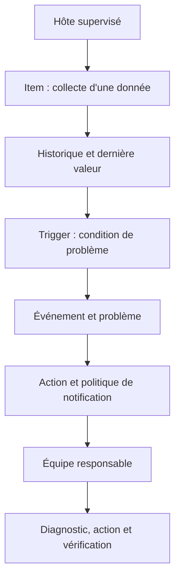
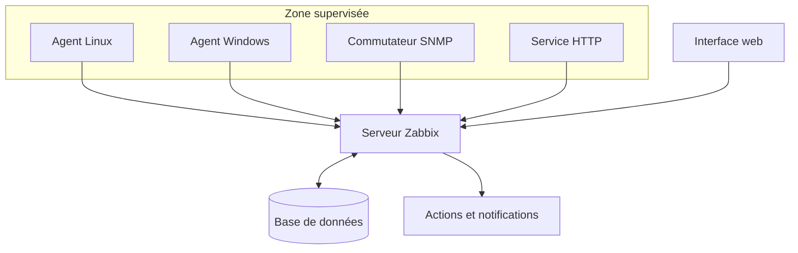
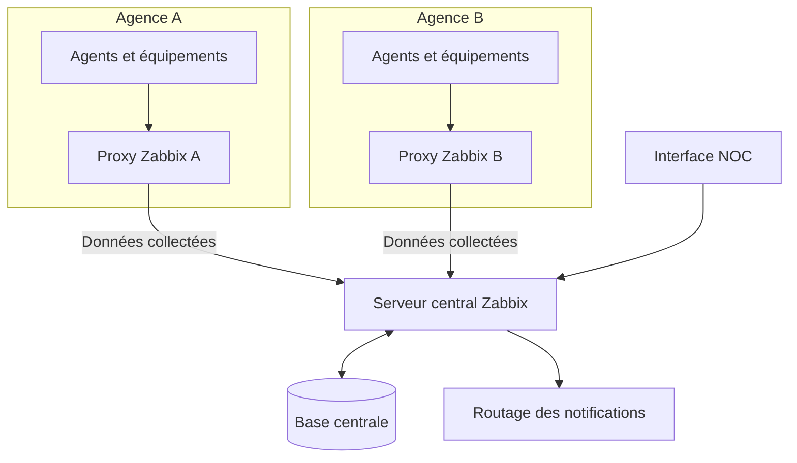
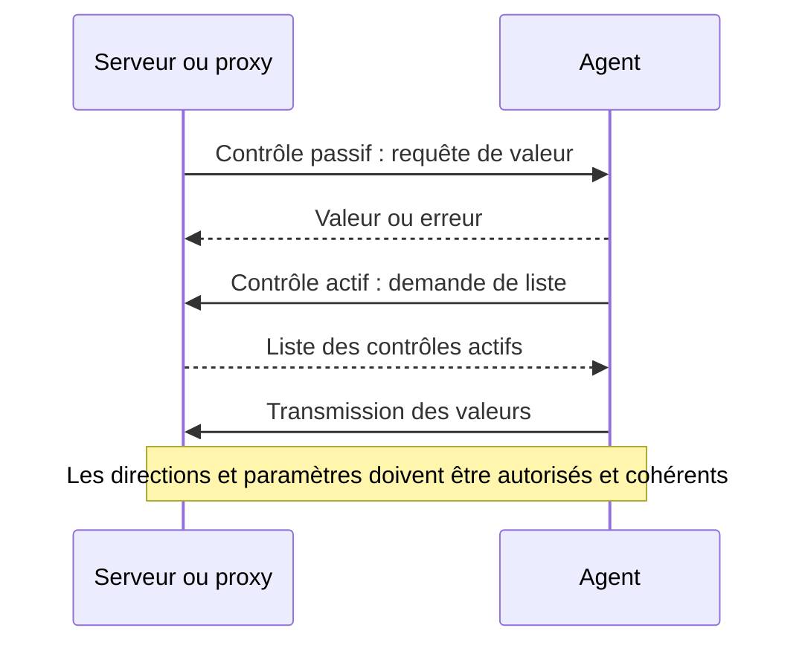
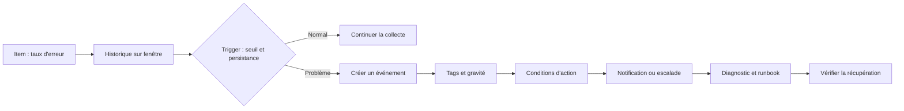
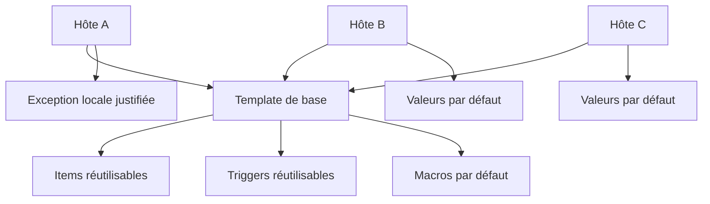
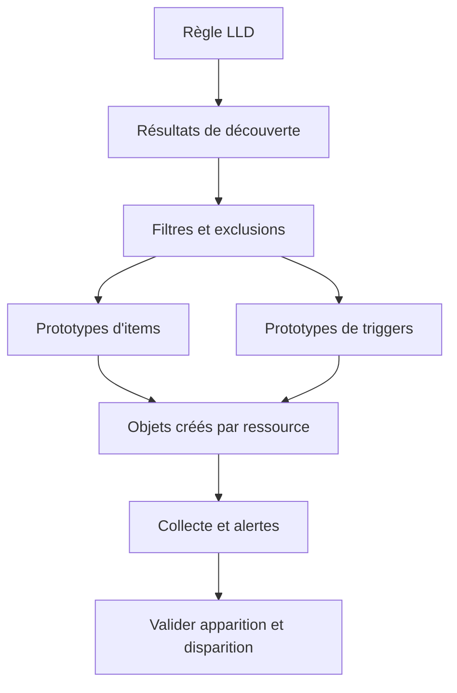

# Supervision avec Zabbix

## 1. Introduction

### 1.1. Pourquoi structurer la supervision au lieu d'empiler des sondes

Dans une petite infrastructure, quelques commandes ping, des scripts système et un tableau de bord improvisé peuvent sembler suffisants. Dès que le parc grandit, ces approches deviennent difficiles à maintenir : les scripts sont dispersés, les seuils divergent, les données ne sont pas toujours comparables et l'équipe ne sait pas si une valeur absente signifie un système en panne ou une chaîne de collecte interrompue. Une plateforme de supervision doit transformer des composants hétérogènes en un modèle d'exploitation stable, visible et maintenable.

Zabbix est une plateforme de supervision qui collecte des données de disponibilité et de performance sur les serveurs, applications, équipements réseau et services. Elle permet de définir des hôtes, des éléments de collecte, des déclencheurs de problèmes, des modèles réutilisables, des tableaux de bord, des actions de notification et des règles de découverte. Son intérêt ne réside pas seulement dans le nombre de métriques qu'elle peut mesurer, mais dans la manière de relier les données à des responsabilités, des seuils et des procédures.

Le déploiement de Zabbix doit être conçu comme un système logiciel. Il possède un serveur, une base de données, une interface web, des agents ou connecteurs, et parfois des proxies. La capacité de la base, les intervalles de collecte, la rétention, le nombre d'items, les règles de découverte et les notifications influencent le comportement global. Une configuration qui fonctionne pour dix hôtes n'est pas nécessairement adaptée à plusieurs milliers d'hôtes.

### 1.2. Encadré de mise en contexte : superviser une entreprise multisite

> **Situation professionnelle.** Une PME dispose d'un siège, de deux agences, de serveurs Linux, de postes Windows, de commutateurs, de routeurs et d'une application métier. Le siège possède une liaison stable, mais les liens des agences sont plus fragiles. Le NOC doit visualiser l'ensemble du parc, être prévenu si une application devient indisponible et conserver les données collectées pendant une interruption WAN temporaire. L'équipe veut éviter de déployer une base complète de supervision dans chaque agence.

Une architecture fréquente consiste à héberger un serveur Zabbix central et sa base de données au siège ou dans un datacenter, puis à déployer un proxy Zabbix pour les sites distants. Les agents des serveurs et les équipements supervisés transmettent ou exposent les données aux composants de collecte. Le proxy conserve temporairement les résultats et les transfère au serveur lorsque la liaison revient. Le serveur central reste responsable de la vision globale, de l'évaluation des problèmes et des notifications.

Cette architecture n'est pas obligatoire dans tous les environnements. Dans un petit parc local et bien connecté, un serveur central peut suffire. Pour des sites distants, des réseaux isolés ou un grand nombre d'appareils, des proxies peuvent répartir la collecte et diminuer les connexions directes vers le serveur. Il faut toutefois dimensionner les buffers, surveiller leur capacité et documenter les comportements durant une coupure. Un proxy ne transforme pas automatiquement une architecture fragile en architecture hautement disponible.

### 1.3. Objectifs pédagogiques

À la fin de ce cours, vous devrez pouvoir expliquer le rôle du serveur, de la base de données, de l'interface web, des agents et des proxies ; distinguer les contrôles actifs des contrôles passifs ; créer un hôte et lui associer un template ; comprendre les items, les triggers, les macros, les tags, les actions et les problèmes ; utiliser le prétraitement et la découverte de bas niveau ; diagnostiquer les données absentes et les fausses alertes ; et concevoir une supervision adaptée à plusieurs sites.

Vous apprendrez aussi à estimer l'impact des intervalles de collecte et de la rétention, à sécuriser les communications, à éviter les templates monolithiques, à déployer progressivement une nouvelle configuration et à surveiller la plateforme elle-même. Les exemples sont pédagogiques : les clés disponibles, les fonctions d'expression et les options peuvent varier selon la version, le système d'exploitation et le type d'agent. Avant d'utiliser un exemple, comparez-le à la documentation de la version effectivement déployée.

### 1.4. Les composants principaux

Le **serveur Zabbix** est le composant central de traitement. Il reçoit les données des proxies et des collecteurs, met à jour les informations opérationnelles, évalue les expressions de triggers, génère les événements de problème et pilote les actions de notification. Il possède plusieurs processus internes spécialisés, notamment pour la collecte, les événements, l'évaluation, les notifications et la maintenance des données.

La **base de données** conserve la configuration, l'historique, les tendances, les événements, les utilisateurs, les problèmes et d'autres informations opérationnelles. Le moteur de base et son dimensionnement doivent respecter les recommandations applicables à la version choisie. Une base sous-dimensionnée peut provoquer des retards d'écriture, un historique incomplet, des traitements lents et des évaluations qui prennent du retard. Des tableaux de bord lents peuvent donc être le symptôme d'un problème de stockage ou de requêtes, pas seulement de l'interface web.

L'**interface web** permet de gérer la configuration, consulter les données, examiner les problèmes, créer des tableaux de bord et administrer les permissions. Elle ne remplace pas le serveur de supervision. Une interface accessible ne prouve pas que les collecteurs fonctionnent ; inversement, une interface momentanément indisponible ne signifie pas obligatoirement que tous les traitements du serveur se sont arrêtés.

L'**agent Zabbix** s'installe sur un hôte surveillé pour relever des informations locales : CPU, mémoire, systèmes de fichiers, interfaces, processus ou métriques applicatives. Il peut répondre aux demandes du serveur ou du proxy, ou effectuer des contrôles actifs et transmettre les valeurs. L'agent n'est pas l'unique méthode de collecte : Zabbix propose aussi SNMP, des contrôles de disponibilité, des vérifications HTTP, des scripts et d'autres types d'items.

Le **proxy Zabbix** agit comme collecteur intermédiaire pour un ensemble de cibles. Il collecte les données au nom du serveur et peut les conserver localement pendant une période de déconnexion avant de les transférer. Il dispose de son propre stockage local, dont les options dépendent de la version et du mode de déploiement. Le proxy est un collecteur : il ne remplace pas le serveur dans l'évaluation globale des triggers et l'envoi des notifications. Cette distinction est fondamentale pour les responsabilités et le diagnostic.

La documentation officielle résume les responsabilités des composants : https://www.zabbix.com/documentation/current/en/manual/introduction/overview.

### 1.5. Hôte, item, trigger, événement et action

Un **hôte** est un objet supervisé. Il peut représenter un serveur, un routeur, une instance applicative ou un service logique. Il possède un nom technique, éventuellement un nom visible, des interfaces de collecte, des groupes, des templates, des tags et d'autres métadonnées. Il ne correspond pas nécessairement à une machine physique unique ; son identité doit refléter les besoins de supervision et d'exploitation.

Un **item** définit une donnée à collecter ou à calculer. Il précise notamment un mécanisme ou une clé, un type de valeur, un intervalle, une durée de conservation et parfois une chaîne de prétraitement. Un item peut recueillir la charge CPU, la disponibilité d'un service, un nombre de sessions, une réponse HTTP ou un compteur SNMP. Les items sont les sources de nombreux graphiques, calculs et triggers.

Un **trigger** exprime une condition de problème à partir d'une ou plusieurs valeurs. Il peut détecter une valeur trop élevée, un taux d'erreur, une absence de données ou une évolution anormale. Un trigger ne se résume donc pas toujours à comparer une seule valeur au dernier échantillon : l'expression peut dépendre de l'historique, d'une fenêtre, de plusieurs items ou de macros.

Un **événement** est créé lorsqu'une transition pertinente est détectée, par exemple le début ou la résolution d'un problème. Un **problème** représente l'état actif présenté aux opérateurs. Une **action** applique une réponse configurée à certains événements : envoi d'une notification, exécution d'une opération autorisée, appel d'une intégration ou progression d'une escalade.

Cette chaîne aide à localiser un défaut de configuration. Si une valeur manque, la question porte sur l'hôte, l'interface, l'item ou le chemin de collecte. Si la valeur est correcte mais qu'aucun problème ne se déclenche, examinez le trigger. Si le problème apparaît mais qu'aucun message n'arrive, regardez les conditions de l'action, les médias, les permissions, les horaires et les journaux de notification. Modifier un seuil lorsque la panne se situe dans la route de notification ne corrige pas le problème.

### 1.6. Versions et compatibilité

La version du serveur, des agents, des proxies, des templates et des plugins doit être connue. La compatibilité dépend parfois de la version majeure et des fonctions prises en charge. Un proxy plus ancien peut transférer certaines données sans prendre en charge toutes les mises à jour de configuration ou fonctions récentes. Une version plus récente que celle du serveur peut également introduire une incompatibilité. Le fait que les paquets s'installent ne prouve pas que la configuration complète fonctionnera.

Avant une mise à niveau, consultez la matrice de compatibilité, les notes de version, les prérequis de base de données et les instructions de migration. Réalisez une sauvegarde et testez la mise à niveau dans un environnement représentatif. Vérifiez ensuite les connexions des agents et proxies, l'importation des templates, le statut des items, les triggers et les notifications. La compatibilité est une propriété de l'ensemble, pas d'un seul binaire.

Référence : https://www.zabbix.com/documentation/current/en/manual/appendix/compatibility.

## 2. Concepts clés

### 2.1. Agents actifs et contrôles passifs

Avec un **contrôle passif**, le serveur ou le proxy contacte l'agent et lui demande la valeur d'un item. L'agent écoute sur l'interface et le port configurés, et les règles d'accès doivent autoriser l'adresse du collecteur. Le collecteur initie la connexion. Cette méthode est simple à comprendre et permet au serveur ou au proxy de décider quand l'item est demandé, mais exige une connectivité entrante vers l'agent depuis le réseau de supervision.

Avec un **contrôle actif**, l'agent contacte le serveur ou proxy configuré pour récupérer la liste des contrôles à effectuer, puis transmet les valeurs collectées. L'agent est à l'origine des échanges de collecte, ce qui peut être plus pratique derrière un pare-feu qui interdit les connexions entrantes. Il faut toutefois que le nom d'hôte déclaré dans la configuration agent corresponde à l'identité connue dans Zabbix et que la destination active soit correcte.

Les deux méthodes ne sont pas interchangeables sans réflexion. Les types d'items disponibles, les directions de connexion, les besoins réseau et les détails de diagnostic diffèrent. Un agent peut être joignable par ping mais ne pas transmettre ses contrôles actifs ; il peut aussi répondre aux demandes passives alors que la récupération de la liste active échoue. Les tests doivent vérifier la méthode réellement utilisée pour chaque item et pas seulement l'état du processus agent.

Pour choisir la méthode, demandez-vous si le pare-feu autorise le serveur ou proxy à contacter l'agent, si les hôtes sont derrière des NAT, si un proxy existe par site, si la source peut initier une connexion sortante, et quel délai de détection est attendu. Les environnements mixtes peuvent utiliser les deux méthodes, si elles sont documentées et sécurisées.

Documentation officielle : https://www.zabbix.com/documentation/current/en/manual/concepts/agent.

### 2.2. Nom d'hôte, DNS et interface de collecte

Le nom technique de l'hôte sert à l'identifier dans la configuration et peut être utilisé par les contrôles actifs. Le nom visible facilite la lecture dans l'interface. L'interface décrit comment joindre l'objet pour un type de contrôle, par exemple adresse IP et port d'agent ou adresse SNMP. Confondre ces notions est une source fréquente d'erreurs.

Pour un agent actif, un nom déclaré côté agent qui ne correspond pas au nom d'hôte attendu peut empêcher l'association des données. Pour un contrôle passif, une adresse incorrecte ou un port fermé produit un timeout même si le nom technique est correct. Pour SNMP, les identifiants de sécurité et les vues d'accès comptent également. Le diagnostic doit séparer identité logique, résolution réseau, port, méthode de contrôle et autorisations.

Adoptez une convention de nommage stable. Le site, l'environnement, la fonction, l'équipe et la criticité peuvent être représentés par des groupes et tags plutôt que d'être tous encodés dans le nom. Si un serveur change d'emplacement ou de propriétaire, modifier ses métadonnées est souvent plus simple que modifier son identité et casser des références. Documentez les conventions et validez les imports avant de les appliquer à un grand parc.

### 2.3. Templates : standardiser avant de multiplier les hôtes

Un **template** regroupe des objets réutilisables, notamment des items, des triggers, des graphiques, des règles de découverte et des macros. Le lier à un hôte permet d'hériter des objets qu'il définit. Ainsi, un même modèle de supervision Linux peut être associé à des centaines de serveurs. Une amélioration du template peut être propagée plutôt que corrigée manuellement sur chaque hôte.

Les templates doivent représenter une technologie ou un rôle cohérent. Un template système Linux peut collecter CPU, mémoire, fichiers et interfaces ; un modèle de base de données peut ajouter les connexions et l'état du moteur ; un modèle applicatif peut observer les requêtes et les dépendances. Un template gigantesque contenant toutes les vérifications de toutes les plateformes devient difficile à tester. À l'inverse, une fragmentation excessive crée une multitude de modèles quasi identiques.

Privilégiez les templates officiels lorsqu'ils répondent au besoin et sont compatibles avec la version utilisée. Vérifiez leur README, leurs macros et leurs prérequis. Si un template attend un endpoint, un utilisateur de supervision ou un plugin, cette dépendance doit être configurée. Le lien du template n'installe pas automatiquement les agents et ne donne pas à l'application les permissions nécessaires.

La modification d'un template partagé peut impacter de nombreux hôtes. Testez dans un groupe pilote, vérifiez les erreurs de clés et de triggers, mesurez le nombre d'items ajoutés et l'utilisation des ressources. Ne choisissez pas à l'aveugle entre les opérations de dissociation qui conservent les objets et celles qui suppriment les objets hérités : comprenez leur effet dans la version utilisée avant de confirmer.

Guide officiel de conception : https://www.zabbix.com/documentation/guidelines/en/template_guidelines.

### 2.4. Items : clé, type de valeur et intervalle

Chaque item définit comment une valeur est obtenue. Le **type d'item** indique le mécanisme : agent Zabbix, agent SNMP, vérification simple, agent HTTP, vérification externe, trapper ou autre type pris en charge. La **clé** identifie la donnée demandée ou la fonction qui la produit. Le **type de valeur** indique comment interpréter le résultat, par exemple valeur numérique entière, nombre à virgule, texte ou journal selon les capacités de la version.

L'intervalle d'actualisation détermine la fréquence normale de collecte. Un intervalle court augmente la fraîcheur, mais aussi le nombre de requêtes, d'échantillons et de traitements. Un intervalle long réduit la charge, mais peut manquer une pointe ou retarder une alerte. La fréquence dépend de la vitesse d'évolution du signal : l'état d'un service critique peut demander une observation fréquente, alors que la capacité d'un système de fichiers évolue plus lentement.

Tous les items ne renvoient pas une valeur à chaque tentative. Un contrôle peut être indisponible, une donnée invalide, une dépendance en erreur ou un item maître absent. La valeur doit être interprétée avec son statut et sa fraîcheur. Ne transformez pas automatiquement une erreur de collecte en zéro, car zéro est une valeur valide pour beaucoup de mesures. Un système de fichiers utilisant zéro octet et un item dont la collecte échoue ne signifient pas la même chose.

Les noms et unités doivent être cohérents. Un compteur cumulatif nécessite une dérivation pour obtenir un débit ; un gauge peut monter ou descendre ; une durée doit conserver la même unité. Lorsque l'item prend en charge une description ou des tags, utilisez-les pour documenter son objectif. La référence officielle décrit les champs des items : https://www.zabbix.com/documentation/current/en/manual/config/items/item.

### 2.5. Triggers : exprimer un problème sans déclencher sur le bruit

Un trigger utilise une expression qui évalue une condition à partir de valeurs d'items. Une formule peut comparer la dernière valeur, calculer une statistique sur une fenêtre, compter des échecs ou vérifier si les données sont trop anciennes. Les fonctions et la syntaxe exactes varient selon la version ; consultez la référence des expressions applicable à votre instance.

Un trigger simple peut surveiller l'utilisation d'un volume au-dessus d'un seuil. Une expression plus robuste peut combiner le pourcentage utilisé, l'espace restant et le temps estimé avant épuisement. La première est facile à mettre en place, mais elle peut arriver trop tard sur un petit volume et être trop agressive sur un très grand. La seconde dépend de l'historique et peut devenir imprécise si la croissance est irrégulière. Le choix doit rester compréhensible et testable.

Un trigger devrait être nommé d'après le symptôme, par exemple « Espace disque presque épuisé sur /var », plutôt que « Disk check 3 ». La gravité reflète la priorité opérationnelle et doit considérer l'impact et le délai de réaction. Des tags peuvent représenter l'équipe, le service, l'environnement ou le type d'événement afin de faciliter le routage. Les macros d'expression peuvent enrichir le problème avec la valeur mesurée, mais le message doit rester intelligible si une valeur n'est pas disponible.

Il faut distinguer la condition de problème de la condition de récupération. Certaines versions permettent une expression de récupération dédiée ou des options de fermeture distinctes ; vérifiez la syntaxe et la fonction exactes dans la documentation. Une récupération trop sensible fait osciller le problème entre actif et résolu ; une récupération trop stricte peut laisser un problème ouvert après disparition du symptôme. Testez les seuils, les fenêtres et les transitions.

### 2.6. Historique, tendances et rétention

Zabbix conserve les données détaillées dans l'historique pendant une période définie et peut conserver des tendances agrégées plus longtemps selon le type de valeur et les paramètres. L'historique fin sert au diagnostic d'une pointe courte ou à la comparaison de quelques instants ; les tendances servent à étudier des évolutions longues sans conserver chaque échantillon détaillé. La rétention est un compromis entre précision et stockage.

L'estimation commence par le volume. Si 2 000 hôtes produisent chacun 100 items toutes les 60 secondes, cela représente environ 200 000 valeurs par minute, soit près de 3 333 valeurs par seconde avant les items à d'autres fréquences, les événements, les valeurs découvertes et les contrôles internes. Le nombre de valeurs sur une journée dépasse rapidement des centaines de millions. Cette approximation aide à comprendre l'ordre de grandeur, mais le dimensionnement réel doit aussi compter la taille des lignes, les index, la réplication, les écritures et le housekeeping.

La rétention doit varier selon les catégories de données. Des métriques d'interface peuvent servir à l'analyse de capacité sur plusieurs mois ; des mesures très fréquentes sans valeur à long terme peuvent demander une conservation plus courte ; les problèmes et événements peuvent répondre à des besoins d'audit. Ne réduisez pas la rétention sans examiner les besoins internes et les procédures de restauration. Supprimer les données trop tôt peut empêcher d'expliquer un incident.

Les opérations de housekeeping et de maintenance peuvent consommer des ressources. Si la base est lente ou le stockage sous-dimensionné, les évaluations et la collecte peuvent prendre du retard. Surveillez les indicateurs internes de Zabbix, les files de traitement, les processus chargés et les performances de base de données. Le seul indicateur « disque libre » ne suffit pas pour déterminer si le système peut absorber l'historique.

### 2.7. Macros et paramètres par environnement

Les macros permettent de réutiliser des paramètres comme un seuil, un intervalle, un nom d'endpoint ou un identifiant sans modifier chaque item ou trigger. Une macro de template fournit une valeur par défaut ; une macro d'hôte peut la remplacer lorsqu'une exception est justifiée. La résolution et les capacités dépendent du type de macro et de la version. Pour les paramètres critiques, vérifiez l'ordre de résolution et évitez les exceptions non documentées.

Une macro de seuil est utile quand plusieurs hôtes partagent une logique mais possèdent des capacités différentes. Un volume système de 20 Go peut nécessiter un seuil absolu différent d'un volume de 2 To. Le modèle peut offrir un défaut commun tout en autorisant quelques exceptions. Évitez une macro différente sur chaque hôte sans justification : cela transforme un template standard en une multitude de configurations difficiles à auditer.

Les macros secrètes et les intégrations de coffre-fort peuvent protéger des identifiants lorsque l'installation les prend en charge. Ne stockez pas de mot de passe dans un nom de template, un tag, une annotation visible ou un export accessible aux opérateurs non autorisés. Testez l'export et l'import pour vérifier que les valeurs secrètes ne sont pas divulguées dans les fichiers, tickets et journaux.

### 2.8. Tags et responsabilité opérationnelle

Les tags associent un nom et une valeur à des objets comme les hôtes, templates, triggers ou services pris en charge. Ils aident à classer les événements, filtrer les problèmes, router les notifications et effectuer des recherches. Des tags tels que équipe réseau, environnement production, site agence A ou service ERP peuvent représenter un contexte utile s'ils utilisent des valeurs cohérentes.

Un système de tags non gouverné devient un second inventaire incohérent. Si une équipe écrit « prod », une autre « production » et une troisième « live », les filtres et actions deviennent fragiles. Définissez un vocabulaire partagé et un propriétaire de la taxonomie. Les tags qui influencent les notifications doivent être testés : une valeur absente ou mal orthographiée peut envoyer l'alerte au mauvais destinataire.

N'utilisez pas les tags pour recopier tout ce qui est déjà géré par l'inventaire. Un tag doit apporter une valeur à la recherche, au routage ou à l'analyse. Évitez les identifiants secrets, les noms de clients confidentiels et les valeurs uniques non nécessaires. La taxonomie doit rester assez stable pour soutenir les tableaux de bord et les actions sans demander une maintenance constante.

Référence officielle : https://www.zabbix.com/documentation/current/en/manual/config/tagging.

### 2.9. Prétraitement des valeurs et items dépendants

Le prétraitement transforme ou valide les données avant leur stockage ou leur usage par les items concernés. Il peut convertir un format, extraire une valeur d'un JSON, calculer une différence à partir d'un compteur, appliquer une conversion d'unité ou rejeter une donnée invalide. L'ordre des étapes compte : si une valeur JSON doit être extraite avant d'être convertie en nombre, inverser les opérations peut rendre l'item inutilisable.

Le prétraitement doit préserver le sens de la donnée. Un compteur cumulatif d'octets peut être converti en débit, mais il faut gérer les redémarrages et les retours à zéro. Un code HTTP peut être converti en valeur numérique, mais une réponse vide ne doit pas devenir artificiellement un succès. Les règles doivent préciser ce qui constitue une donnée valide et comment traiter les erreurs de transformation.

Les **items dépendants** peuvent réutiliser une donnée maître lorsque la source fournit plusieurs mesures dans un même document. Une requête HTTP pourrait renvoyer un JSON avec plusieurs indicateurs ; un item maître collecte le document, puis des items dépendants extraient les valeurs nécessaires. Cela réduit les appels répétés. Cependant, si l'item maître échoue, tous les items dépendants peuvent devenir indisponibles. Surveillez la taille de la réponse, la fréquence, les transformations et les erreurs.

### 2.10. Découverte de bas niveau (LLD)

La découverte de bas niveau permet de créer automatiquement des objets à partir de ressources trouvées. Elle peut détecter des interfaces, systèmes de fichiers, disques, volumes, composants applicatifs ou autres éléments décrits par une règle. Les prototypes servent à définir les items, triggers et graphiques pour chaque ressource découverte.

La découverte réduit le travail manuel et s'adapte aux changements, mais elle peut créer une grande quantité d'objets. Une machine possédant des interfaces virtuelles, des conteneurs éphémères ou des montages temporaires peut produire une découverte beaucoup plus importante que prévu. Avant de généraliser une règle, observez les résultats, filtrez les ressources non pertinentes et définissez le comportement lors de la disparition d'un objet.

Les filtres LLD doivent correspondre au besoin. Il est souvent utile d'ignorer certaines interfaces temporaires, mais les exclusions doivent être documentées pour ne pas masquer une ressource critique. Une liste découverte qui change à chaque redémarrage peut révéler des identifiants instables. Il faut distinguer un changement réel de topologie d'une simple modification de nom ou d'ordre.

La disparition d'une ressource doit être gérée avec prudence. Si un disque disparaît momentanément à cause d'une erreur de collecte, supprimer immédiatement tous ses objets peut provoquer une perte de contexte et des événements en rafale. Si les objets obsolètes restent indéfiniment, la configuration s'encombre. Utilisez les délais et options disponibles dans la version installée, puis testez l'apparition et la disparition d'une ressource.

### 2.11. Actions et notifications

Une action définit quand et comment Zabbix réagit à un événement. Elle peut combiner des conditions, des opérations, des étapes et des escalades. Une action peut dépendre des tags, de la gravité, de groupes d'hôtes, de l'environnement, de l'heure ou d'autres conditions supportées. Le modèle doit garantir qu'un événement atteint le bon propriétaire au bon moment.

Le déclenchement d'un problème ne garantit pas l'envoi d'un message. Il peut manquer une action correspondante, le destinataire peut ne pas avoir le média approprié, la plage horaire peut exclure le moment actuel, le niveau minimum de gravité peut être trop élevé, ou le serveur peut rencontrer une erreur du fournisseur. Vérifiez l'état du problème, les conditions, l'action, les médias, les permissions et les journaux de notification.

Les escalades peuvent envoyer des rappels, élargir la liste des destinataires ou créer une autre étape lorsqu'un événement reste ouvert. Une répétition trop fréquente produit du bruit ; une répétition trop rare peut laisser une alerte critique sans suivi. Définissez des délais selon la gravité et la procédure opérationnelle. La résolution doit également être gérée : certains canaux bénéficient d'une notification de récupération, tandis que d'autres doivent principalement enregistrer l'état dans l'outil de gestion d'incident.

### 2.12. Maintenance et fenêtres planifiées

Les maintenances permettent de gérer les périodes où un hôte ou un groupe subit une intervention planifiée. Elles peuvent influencer la collecte ou la suppression des notifications selon le mode et la configuration. Une maintenance où les données continuent d'être collectées permet d'observer l'évolution ; un mode qui interrompt la collecte peut réduire le bruit mais créer un trou d'observation.

Une maintenance doit avoir un périmètre, un propriétaire, un début et une fin. Évitez les périodes trop larges ou permanentes, qui peuvent masquer un problème réel. Si une intervention se prolonge, réévaluez la fenêtre et enregistrez la justification. Après la maintenance, vérifiez que la surveillance est de nouveau active et que les événements attendus remontent correctement.

La maintenance n'est pas une solution à une règle mal conçue. Si une alerte se déclenche chaque jour sur un comportement normal, calibrez le seuil, la fenêtre ou le modèle de signal. N'ajoutez pas une maintenance récurrente indéfinie pour faire disparaître le bruit, car les conditions peuvent évoluer.

### 2.13. Découverte réseau et supervision SNMP

Zabbix peut superviser des équipements réseau par SNMP, contrôles de disponibilité et mécanismes de découverte. SNMP peut fournir des compteurs d'interface, des états de lien, une charge processeur, une température et des métriques propres au constructeur lorsque les MIB et OID sont disponibles. La découverte peut repérer des hôtes ou services selon des règles configurées, mais elle doit être limitée au périmètre autorisé et ne remplace pas la gestion d'inventaire.

La découverte automatique ne signifie pas que chaque adresse répondant sur un port doit être intégrée immédiatement à la supervision. Les résultats peuvent inclure des actifs temporaires ou non autorisés. Définissez des actions contrôlées, vérifiez la source réseau et l'inventaire, puis appliquez les templates et permissions adaptés.

Pour les équipements réseau, les compteurs sont sensibles à l'indexation et aux discontinuités. Un index d'interface peut changer après un remplacement ; un compteur cumulatif peut revenir à zéro. Les templates doivent calculer correctement les taux et préserver la sémantique. Vérifiez la vitesse des interfaces, les unités et les versions SNMP. Une valeur collectée n'est utile que si son type et son interprétation sont corrects.

### 2.14. Disponibilité et point de mesure

Un affichage « hôte indisponible » dépend du mécanisme de contrôle et du point de vue du collecteur. Un agent peut ne pas répondre alors que le service HTTP reste accessible ; un ping peut échouer parce qu'ICMP est filtré sans que l'application soit hors ligne. Définissez ce que signifie disponibilité pour chaque service : réponse réseau, réponse agent, réponse HTTP, transaction synthétique ou combinaison de signaux.

Le calcul de disponibilité doit préciser le dénominateur temporel, les périodes exclues ou incluses, la fréquence des tests et le traitement des états inconnus. Une surveillance qui interroge toutes les cinq minutes ne détecte pas nécessairement une panne de dix secondes. Les fenêtres de maintenance influencent les rapports ; les exclure sans politique claire peut embellir artificiellement les résultats. Documentez la méthode et les intervalles non mesurés.

La disponibilité d'une application dépend parfois de plusieurs sous-systèmes. Il est utile de superviser les composants individuellement, mais un seul symptôme peut avoir plusieurs causes. Distinguez l'indisponibilité d'un composant, la dégradation du service et la perte de capacité de supervision. Une alerte de serveur inaccessible ne prouve pas automatiquement que toute l'activité métier est arrêtée.

### 2.15. Proxies : collecte, tampon et limites

Un proxy collecte les données pour le serveur central et peut les conserver temporairement sur son stockage local. Il est utile dans les sites distants, les réseaux aux connexions fragiles et les grands parcs. Le proxy peut effectuer les contrôles configurés et transférer les résultats lorsque la connexion revient. Il nécessite une configuration et un stockage adaptés au volume et à la durée de coupure attendue.

Le proxy n'est pas un serveur avec toutes les fonctions centrales. Il ne remplace pas le serveur dans le calcul final des problèmes et l'envoi des notifications. Si le serveur central est inaccessible, le proxy peut continuer la collecte et tamponner les valeurs selon sa capacité, mais les décisions et notifications centralisées peuvent être retardées. Il faut distinguer la continuité locale de la collecte de la continuité complète de l'alerting.

Dimensionnez le stockage du proxy selon le nombre de valeurs par seconde, la durée de coupure visée, le débit de transfert et la marge. La file locale n'est pas illimitée. Surveillez le retard de transfert, la taille de la base locale, les erreurs de synchronisation et la fraîcheur des données au serveur.

Référence officielle : https://www.zabbix.com/documentation/8.0/en/manual/concepts/proxy.

### 2.16. Sécurité et séparation des rôles

Une plateforme de supervision contient des informations sensibles : topologie, noms de serveurs, versions, adresses, métriques internes et événements de sécurité. Les comptes et communications doivent être protégés. Utilisez les mécanismes de chiffrement pris en charge, limitez les sources qui peuvent joindre les agents ou proxies, protégez les identifiants de la base de données et appliquez le moindre privilège à l'interface web.

Les contrôles actifs et passifs ont des directions de connexion différentes et des règles de pare-feu différentes. Pour un contrôle passif, autorisez le serveur ou proxy à joindre l'agent sur le port prévu et limitez les sources. Pour un contrôle actif, l'agent doit pouvoir joindre la destination configurée. Pour les sites distants, le proxy peut réduire les connexions qui traversent le WAN. N'exposez pas un port de supervision à Internet simplement pour simplifier le déploiement.

Séparez les rôles de lecture, de configuration et d'administration. Les utilisateurs qui consultent des dashboards n'ont pas tous besoin de modifier les triggers ou les actions. Les changements de routage et les silences sont sensibles, car ils peuvent empêcher la réception d'une notification. Journalisez les changements, révisez les permissions et retirez les comptes inutilisés.

Ne placez pas les secrets dans les noms, tags ou descriptions de templates. Pour les identifiants d'API ou de base, privilégiez les mécanismes sécurisés pris en charge ou un coffre-fort approuvé. Testez l'export et l'import des templates afin d'éviter d'inclure involontairement des valeurs secrètes. Les journaux de support doivent également masquer les identifiants.

## 3. Architecture et Schémas

### 3.1. Architecture centralisée

Dans une architecture simple, le serveur, la base et l'interface web sont hébergés dans un environnement contrôlé. Les agents et équipements transmettent les données au serveur ou lui répondent selon le type de collecte. Cette architecture réduit le nombre de composants à administrer et convient aux petits environnements bien connectés. Elle nécessite toutefois un dimensionnement correct du serveur et de la base, car ils deviennent centraux.

Le diagramme représente les responsabilités principales, pas chaque requête interne de l'installation. Séparez les dépendances réseau de la base, les permissions, les secrets et la sauvegarde. Si l'interface et le serveur sont sur le même hôte, cela ne signifie pas qu'ils doivent partager tous leurs comptes systèmes ou secrets.

### 3.2. Architecture distribuée avec proxies

Chaque proxy gère les cibles qui lui sont attribuées. Cela réduit le trafic de collecte qui traverse chaque site et permet de tamponner les valeurs durant certaines coupures. Le serveur central conserve la vue globale et traite les problèmes selon les règles. Les proxies doivent être supervisés eux-mêmes : un proxy indisponible peut rendre plusieurs centaines de cibles invisibles, même si les cibles fonctionnent encore.

Le choix d'un proxy par site doit considérer la taille du parc, la disponibilité, le modèle réseau, le débit et le délai de retour des données. Un proxy unique est un point de défaillance local s'il n'existe pas de stratégie de secours. Des versions et architectures avancées peuvent proposer des groupes de proxies ou des fonctions de haute disponibilité, mais celles-ci doivent être configurées et testées conformément à la documentation, pas supposées actives par défaut.

### 3.3. Flux de collecte actif et passif

Le schéma représente les deux modèles conceptuels, pas une séquence obligatoire exécutée pour chaque item. Un item passif utilise la demande du collecteur ; un item actif est exécuté par l'agent selon sa configuration et les informations reçues. En diagnostic, identifiez d'abord le type d'item : tester le port entrant peut aider pour un contrôle passif mais ne prouve pas que la chaîne active fonctionne. Inversement, un agent qui transmet des valeurs ne prouve pas que l'adresse passive est accessible.

Écrivez les règles de pare-feu à partir des directions réelles. Pour un contrôle passif, autorisez le serveur ou le proxy à joindre l'agent et limitez les sources. Pour un contrôle actif, l'agent doit pouvoir joindre le serveur ou le proxy configuré. La politique de chiffrement et d'identité doit être cohérente des deux côtés. Les fichiers de configuration diffèrent selon l'agent, le système et la version.

### 3.4. De l'item au trigger et à l'action

Cette chaîne clarifie où agir quand une notification manque. Vérifiez d'abord que l'item reçoit des valeurs valides et fraîches. Regardez ensuite l'expression et l'état du trigger. Si l'événement existe, examinez les tags, la gravité, les conditions de l'action et les médias du destinataire. Enfin, contrôlez la livraison. Cette progression évite d'ajuster au hasard le seuil alors que la condition est déjà évaluée correctement.

### 3.5. Templates, macros et exceptions

Le template définit le comportement commun ; les macros permettent de varier des paramètres sans dupliquer toute la logique. Une macro locale doit rester une exception justifiée. Si toutes les machines d'un même rôle nécessitent des valeurs différentes et non documentées, le modèle devrait peut-être être séparé ou les classes d'hôtes redéfinies.

Lors d'une mise à jour du template, identifiez les hôtes liés, les macros locales et les triggers affectés. Testez le changement sur quelques cibles représentatives, puis généralisez. Vérifiez les objets hérités et les tags. Les opérations de suppression de template peuvent également supprimer des objets : ne les effectuez pas à l'aveugle.

### 3.6. Découverte de bas niveau

La découverte doit être limitée et reproductible. Testez d'abord les résultats bruts et la liste des ressources incluses. Vérifiez ensuite le nombre d'items et de triggers générés, la fréquence de collecte et les valeurs. Si le nombre de ressources change de manière excessive, recherchez les éléments temporaires ou les identifiants instables avant d'augmenter les ressources du serveur.

### 3.7. Architecture de notification

Le moteur d'évaluation crée des événements ; les actions choisissent les opérations ; les médias transmettent les messages. Le système doit garder la relation entre événement, destinataire et résultat de notification. Une action peut avoir plusieurs conditions, plusieurs opérations ou plusieurs étapes. Cela permet d'envoyer une alerte à un groupe puis d'élargir l'escalade si le problème persiste. Mais une configuration complexe doit être testée avec des exemples afin de vérifier que toutes les branches se comportent comme prévu.

Les tags et la gravité facilitent le routage. Une alerte du réseau peut aller au NOC, un problème de base de données à l'équipe plateforme et un incident applicatif à l'équipe propriétaire. Les urgences en production peuvent être envoyées à l'astreinte ; les avertissements non urgents peuvent être inscrits dans un canal ou un ticket. Les labels doivent être normalisés, car une valeur manquante peut empêcher la correspondance avec l'action attendue.

La chaîne de notification doit elle-même être surveillée. Un compte de messagerie peut être désactivé, un secret d'intégration peut expirer ou un canal peut rejeter les messages. Un test de bout en bout permet de vérifier l'état d'un problème, l'action, la réception de la notification et la récupération. Une règle qui passe en problème mais n'est pas distribuée n'est pas opérationnelle.

## 4. Étude de cas

### 4.1. Contexte d'entreprise

Une entreprise possède environ 600 actifs répartis entre le siège et trois agences. Le siège héberge le serveur Zabbix, la base et l'interface. Les agences supervisent des serveurs de fichiers, des routeurs, des commutateurs, des applications locales et des points d'accès. Les liens WAN sont de qualité variable et une agence peut être isolée pendant 10 à 20 minutes. L'objectif est d'avoir un tableau de bord central, une notification en cas de perte de service et une capacité d'analyse à plusieurs semaines.

Le premier déploiement configure chaque hôte pour communiquer directement avec le serveur central. Cela fonctionne en conditions normales, mais les coupures WAN génèrent des trous. Les contrôles sont nombreux et le serveur gère un volume élevé de connexions traversant les liens fragiles. Plusieurs items sont copiés manuellement entre hôtes, les seuils divergent et les alertes similaires ne sont pas cohérentes. L'équipe décide de structurer les templates et d'ajouter des proxies aux sites où le bénéfice est justifié.

### 4.2. Inventaire et classification des hôtes

La première étape consiste à inventorier chaque actif : type, site, rôle, environnement, criticité, propriétaire, interface, méthode de collecte et besoin de rétention. Les équipements sont regroupés par fonction plutôt que par adresse. Les serveurs Linux reçoivent un template système adapté ; les équipements réseau reçoivent leurs modèles SNMP ; les applications utilisent des items de santé et contrôles HTTP. La criticité et le propriétaire sont représentés avec des métadonnées cohérentes.

L'équipe évite de lier immédiatement tous les templates disponibles. Elle vérifie les prérequis et les métriques exposées, puis choisit les items pertinents. Un serveur de fichiers nécessite la surveillance de l'espace, des services, des performances disque et de la disponibilité réseau. Un contrôleur réseau a d'autres besoins : état des interfaces, disponibilité, CPU, mémoire, erreurs de lien et événements de configuration. Le modèle doit collecter les indicateurs qui peuvent mener à une action définie.

Les conventions de nommage et de tags sont documentées. Les noms techniques restent stables ; site, environnement et responsabilité sont gérés dans les groupes ou tags. Les macros de template fournissent des seuils par défaut et permettent quelques exceptions contrôlées. Une revue est exigée avant d'ajouter une valeur locale afin d'éviter que chaque hôte se comporte différemment sans justification.

### 4.3. Déployer le proxy dans une agence

Un proxy est installé dans une agence importante, proche des équipements supervisés. Il collecte les valeurs des agents et des équipements SNMP, puis les transmet au serveur central. La configuration réseau autorise les flux nécessaires vers les cibles et le flux proxy-serveur attendu. Le proxy dispose d'un stockage local dimensionné selon la période d'interruption visée. L'équipe vérifie aussi la synchronisation horaire, le chiffrement et les permissions de son compte système.

Le test commence avec une seule cible et quelques items. Ensuite, l'équipe interrompt temporairement la liaison vers le serveur dans une fenêtre de test approuvée, tout en gardant l'accès local aux équipements. Elle vérifie que le proxy continue de collecter et tamponner les données, puis que les valeurs remontent lorsque la connexion revient. Le résultat dépend de la configuration et du stockage : ce comportement doit être vérifié dans l'environnement réel, pas seulement déduit de la présence d'une base locale.

Le proxy est supervisé lui-même. La plateforme suit sa disponibilité, le retard de transfert, la taille du stockage local, la capacité du système de fichiers et les erreurs de connexion. Sans ces contrôles, une panne du proxy pourrait masquer toute l'agence. Un heartbeat ou une mesure interne permet de distinguer un équipement inaccessible d'une rupture du collecteur régional, ce qui facilite le triage et évite des centaines d'alertes secondaires.

### 4.4. Créer des règles de seuil adaptées

L'équipe configure une alerte sur le taux d'erreurs de l'application, une alerte sur l'espace disque disponible et une alerte de disponibilité du routeur critique. Le taux d'erreurs utilise une fenêtre qui filtre les erreurs isolées sans dépasser le délai de détection attendu. L'espace disque possède un seuil d'avertissement et un seuil critique, ajustés selon la croissance observée et le temps nécessaire à l'intervention. Le routeur est observé à partir de plusieurs sources si nécessaire : ping, SNMP et état d'interface.

Cette combinaison évite deux erreurs courantes. Premièrement, un ping échoué ne suffit pas toujours à prouver que l'application métier est indisponible : ICMP peut être filtré ou le service rester accessible par un autre chemin. Deuxièmement, une CPU élevée n'implique pas toujours un impact utilisateur. Les règles urgentes privilégient les symptômes métier et la disponibilité des fonctions critiques, tandis que les indicateurs techniques orientent le diagnostic.

Les alertes portent des tags de site, de service, de gravité et d'équipe. Les actions acheminent le problème vers le bon groupe. Les notifications contiennent le nom de l'hôte, la valeur observée, le seuil, l'heure, un lien vers l'historique et un runbook. Une alerte disque précise le volume concerné si cette information est disponible, sans exposer de secrets ou de données personnelles.

### 4.5. Gérer une tempête d'alertes pendant une coupure WAN

Un matin, la liaison WAN de l'agence B devient indisponible. Plusieurs serveurs, le routeur et les équipements réseau sont injoignables depuis le centre. Sans modélisation, chaque hôte déclencherait une alerte indépendante et l'astreinte recevrait des dizaines de messages. Les tags du site et les relations de dépendance permettent de regrouper les symptômes et d'identifier l'alerte principale liée à la connectivité. Les problèmes des actifs restent consultables, mais la notification priorise la perte du site plutôt que les répercussions attendues.

L'équipe vérifie d'abord le statut du proxy, la liaison WAN et les mesures locales connues. Si le proxy reste actif, il peut continuer la collecte même si le serveur ne reçoit plus les données durant la coupure. Après le rétablissement, l'équipe contrôle la reprise du transfert, la fraîcheur et l'absence de retard persistant. Elle ne considère pas la résolution du ping comme preuve que toutes les applications ont récupéré : des tests fonctionnels doivent confirmer les services critiques.

L'étude montre que le modèle de dépendances et la qualité des tags ont une valeur opérationnelle directe. Les données brutes montrent les hôtes touchés ; les alertes groupées indiquent le problème commun ; les dashboards permettent de vérifier l'impact et la récupération. Il faut toutefois surveiller la chaîne d'observabilité : si le proxy, le serveur ou la base tombe en panne, cela doit être signalé distinctement.

### 4.6. Préparer la capacité et la rétention

L'équipe calcule le volume de données attendu en fonction du nombre d'items, de leur fréquence et de la rétention. Elle estime le débit de valeurs, distingue l'historique fin des tendances et mesure la croissance réelle de la base. Elle commence par un échantillon représentatif, puis extrapole en gardant une marge. Les équipements qui exposent des centaines d'objets SNMP ou les règles de découverte d'interfaces peuvent contribuer davantage que prévu.

Pour réduire la charge, l'équipe retire les items sans valeur opérationnelle, augmente certains intervalles lents et remplace les copies manuelles par des templates communs. Elle ne baisse pas toutes les fréquences uniformément, car les services critiques exigent des données plus fraîches. Elle vérifie les temps de traitement et le retard d'évaluation après chaque changement. Une optimisation réussie maintient le niveau de détection requis tout en réduisant les collectes superflues.

La rétention est ajustée selon les usages : données détaillées pour l'analyse proche, tendances pour les comparaisons à long terme et durées spécifiques pour les événements. Avant de supprimer une catégorie, l'équipe vérifie les exigences de capacité, de sécurité, d'audit et de dépannage. La suppression d'historique peut réduire le stockage, mais elle ne doit pas éliminer les éléments nécessaires à une enquête encore ouverte.

### 4.7. Procédure de validation et retour arrière

Le déploiement suit une progression : validation sur quelques hôtes représentatifs, pilote sur un site, extension par groupes, puis vérification post-déploiement. Chaque phase possède des critères de réussite et un propriétaire. Les critères comprennent la proportion d'items valides, la fraîcheur, le nombre de problèmes attendus, les temps de traitement et le volume de notifications.

Les erreurs sont classées par type : réseau, identité, permissions, protocole, template, prétraitement, stockage ou évaluation. Cette classification évite de corriger un symptôme avec une action trop large, comme ouvrir tous les ports ou désactiver les alertes. Le plan de retour arrière indique comment restaurer les versions précédentes de templates, macros, triggers ou configuration du proxy. Selon le changement, une sauvegarde de la base peut être nécessaire en plus d'une sauvegarde de configuration.

## 5. Pièges à éviter

### 5.1. Supposer qu'un hôte visible est correctement supervisé

Un hôte peut être créé et apparaître dans l'interface sans fournir les données attendues. Il peut manquer un template, avoir une interface incorrecte, utiliser un mauvais type d'item ou être bloqué par une permission. La création de l'objet n'est que la première étape. Vérifiez les dernières valeurs, les erreurs d'item, la fraîcheur, la méthode de collecte et les prérequis du template.

Une valeur absente ne doit pas être considérée comme zéro. Si un item de température n'a plus d'échantillons, le système ne sait pas que la température vaut zéro ; il ne sait plus la mesurer. Ajoutez des contrôles de fraîcheur et des alertes sur l'indisponibilité des collecteurs. Les dashboards doivent distinguer les données actuelles des anciennes.

### 5.2. Mélanger les noms, adresses et types d'item

Le nom technique, le DNS, l'adresse d'interface et le nom d'hôte déclaré par l'agent ont des rôles distincts. Un agent actif peut échouer si son identité ne correspond pas à l'hôte attendu ; un contrôle passif peut échouer si l'adresse est incorrecte. Un test ICMP réussi ne valide pas le port agent ou la sécurité SNMP. Procédez par couches et consignez les tests réalisés.

Avant de répliquer une configuration à des centaines d'hôtes, validez-la sur un petit groupe. Vérifiez le nom technique, le type de contrôle, les interfaces, les ports, les autorisations, les templates et les résultats. Ne corrigez pas une erreur de nommage en créant des doublons sans vérifier le devenir des données historiques et des triggers.

### 5.3. Déployer un template sans ses prérequis

Un template peut attendre un agent, un endpoint HTTP, un compte de supervision, un plugin, une macro ou une version de protocole spécifique. Le lier n'installe pas ces composants et n'accorde pas les permissions nécessaires. Lisez la documentation du template, vérifiez les prérequis et adaptez les macros. Testez les items de base avant de généraliser.

Un template importé depuis une autre version peut contenir des clés ou fonctions incompatibles. Les erreurs peuvent apparaître lors de la collecte ou l'évaluation des triggers. Versionnez les modèles et évitez les changements manuels non tracés en production. Les templates représentent des dépendances logicielles de l'environnement.

### 5.4. Créer trop d'items ou des intervalles trop courts

Une collecte chaque seconde peut être justifiée pour certains états dynamiques, mais elle augmente rapidement le débit, le stockage et la charge. Des milliers d'hôtes avec des centaines d'items à intervalles courts peuvent saturer les composants. Choisissez la fréquence selon la dynamique et le délai de détection requis. Préférez les items utiles à des duplications de mesures déjà disponibles.

Une fréquence courte n'améliore pas nécessairement le diagnostic si la mesure est bruyante ou si le trigger utilise une fenêtre beaucoup plus large. Elle peut augmenter le coût sans modifier la décision. À l'inverse, un intervalle trop long retarde la détection. Évaluez la fraîcheur nécessaire et testez les retards, notamment durant une panne où les contrôles échoués peuvent consommer davantage de temps.

### 5.5. Mal interpréter un compteur

Un compteur cumulatif ne représente pas un débit instantané. Il faut calculer sa variation sur une durée connue et gérer les redémarrages ou discontinuités. Un pourcentage CPU dépend de la clé et de la définition utilisée. Les unités doivent être vérifiées dans la documentation de l'item. Un graphique peut sembler cohérent tout en affichant une unité fausse.

Avec SNMP, vérifiez l'index d'interface, la vitesse, le type de compteur et les objets utilisés par le template. Après un changement matériel, une interface peut être réindexée. Conservez des attributs d'identité et examinez les discontinuités. Ne publiez pas un pic impossible simplement parce qu'une différence a été convertie sans validation.

### 5.6. Utiliser des triggers trop sensibles

Un trigger qui s'active à chaque petite oscillation génère des problèmes qui apparaissent et se résolvent continuellement. Choisissez des fenêtres, une persistance et des critères de récupération cohérents avec la variation normale. Testez une excursion courte, une anomalie persistante et un retour progressif.

Ne configurez pas toutes les alertes avec le même délai : une panne critique de service et un avertissement disque n'exigent pas la même réaction. Documentez le risque et l'action attendue. Une règle qui masque le bruit mais déclenche trop tard peut être aussi mauvaise qu'une règle bruyante.

### 5.7. Confondre gravité technique et urgence métier

Une CPU élevée peut être normale ; un service métier indisponible peut être critique même si le serveur semble sain. La gravité doit refléter l'impact, la portée et le délai avant action. Les templates techniques apportent les données, mais les équipes doivent adapter conditions, tags et actions à leur service.

Un trigger de gravité élevée qui ne mène à aucune action utile fatigue les opérateurs. Un avertissement qui annonce une saturation suffisamment tôt peut être très utile. Définissez les niveaux avec des critères partagés et revoyez les incidents pour vérifier qu'ils correspondent au risque réel.

### 5.8. Penser que le proxy résout toutes les pannes

Le proxy peut collecter et tamponner les valeurs, mais il ne garantit pas que le serveur central évalue les problèmes ou envoie les notifications pendant que le serveur est inaccessible. Sa capacité dépend de la configuration et du stockage. Si le WAN est coupé plus longtemps que la période couverte, des données peuvent être perdues ou remonter en retard. Testez la durée d'isolation et la reprise.

Le proxy constitue aussi un point de défaillance local s'il n'y a pas de redondance appropriée. Surveillez son service, sa base locale, l'utilisation disque et le temps de rattrapage. Une alerte proxy indisponible devrait être prioritaire sur de nombreuses alertes secondaires d'équipements qui en dépendent. Les fonctions de haute disponibilité varient selon les versions ; vérifiez la topologie réelle et la documentation.

### 5.9. Négliger la base de données

Une collecte fréquente et une rétention excessive peuvent faire croître la base plus vite que prévu. Si le stockage se remplit ou si les écritures ralentissent, les valeurs, événements et évaluations peuvent prendre du retard. Le nombre d'hôtes n'est pas le seul facteur : nombre d'items, fréquence, type de valeur, taille des messages et housekeeping influencent la charge.

Mesurez les valeurs par seconde, l'espace occupé, les temps d'écriture, les requêtes lentes et les retards du serveur. Utilisez les stratégies d'optimisation documentées pour le moteur retenu. N'effectuez pas de suppression massive ou de modification de schéma en production sans sauvegarde, plan de retour arrière et procédure approuvée.

### 5.10. Laisser la découverte créer un volume incontrôlé

Une règle LLD peut découvrir des interfaces, montages, conteneurs ou ressources temporaires et créer de nombreux nouveaux items. Si aucun filtre n'est appliqué, la configuration peut croître fortement après un déploiement ou un redémarrage. Examinez les résultats bruts, filtrez les éléments inutiles et testez les changements de topologie.

Les filtres doivent être contrôlés après une mise à jour système ou matérielle. Une exclusion peut masquer une interface importante si son nom change ; une règle trop large peut superviser des centaines de ressources éphémères. Mesurez le nombre d'objets créés et la fréquence à laquelle les ressources apparaissent ou disparaissent.

### 5.11. Ne pas superviser Zabbix lui-même

Le serveur, la base, l'interface, les agents, les proxies et les notifications doivent eux-mêmes être surveillés. Un collecteur arrêté peut rendre les dashboards silencieux. Une base saturée peut retarder les évaluations. Un média de notification expiré peut empêcher l'envoi. Créez des checks de santé et, pour les fonctions critiques, une vérification indépendante.

Les états normal, inconnu et absent doivent être séparés. L'absence de problème actif ne prouve pas que tous les systèmes fonctionnent. Surveillez les dernières données reçues, les erreurs des agents, le retard des proxies, la capacité du stockage et les erreurs d'envoi. Testez périodiquement un problème contrôlé dans un environnement approprié et vérifiez la réception puis la résolution.

### 5.12. Oublier la sécurité des communications

Un agent ou proxy ne devrait pas accepter n'importe quelle source. Limitez les flux aux serveurs et proxies autorisés ; activez les mécanismes de chiffrement et d'identité pris en charge ; stockez les secrets de façon contrôlée ; appliquez le moindre privilège. Un port ouvert n'est pas une politique d'accès suffisante.

Les données de supervision peuvent aider un attaquant à comprendre la topologie et les capacités du réseau. Contrôlez les permissions des dashboards et des exports, et évitez de divulguer des identifiants dans les tags, macros affichées ou messages. Lors du dépannage, ne copiez pas de secrets de production dans des tickets. Les changements de certificats doivent être testés pour prévenir les interruptions de collecte.

### 5.13. Modifier la configuration directement en production

Un changement d'item, de template ou de trigger peut toucher de nombreux hôtes, créer des alertes massives ou supprimer des objets hérités. Versionnez la configuration, utilisez des exports contrôlés et testez sur un groupe pilote. Pour une modification urgente, gardez la justification, la version précédente et un retour arrière documenté. La supervision est une fonction de production et mérite la même discipline de changement que les applications.

Après un import, comparez le nombre d'objets, les erreurs de configuration, les hôtes impactés et les notifications. Évitez les mises à jour globales lorsque les versions ou prérequis diffèrent. Le déploiement progressif réduit le rayon d'impact et fait apparaître les incompatibilités tôt. La validation doit inclure valeur, trigger et notification, pas seulement le succès de l'import.

### 5.14. Ignorer les horloges

Les horodatages sont nécessaires pour corréler mesures, incidents, déploiements et événements réseau. Si un agent, un proxy, le serveur et la base ont des horloges décalées, les graphiques peuvent montrer les événements dans un ordre trompeur. Utilisez un service de synchronisation horaire et vérifiez le fuseau de l'interface et des journaux. Le stockage des dates et leur affichage peuvent suivre des conventions différentes.

Ne concluez pas à une causalité uniquement à partir de l'ordre visuel de deux événements si les horloges ne sont pas fiables. Une dérive peut aussi affecter les intervalles de collecte et les calculs de durée. La qualité temporelle est une dépendance de la supervision, pas un détail cosmétique.

## 6. Checklist / À retenir

### 6.1. Checklist de conception

- [ ] La version du serveur, des agents, des proxies et des templates est connue.
- [ ] Chaque hôte possède une identité technique stable et des interfaces correctes.
- [ ] La méthode de collecte (agent actif ou passif, SNMP, HTTP, etc.) est documentée.
- [ ] Les flux réseau sont limités aux sources et destinations autorisées.
- [ ] Les templates sont réutilisables, versionnés et testés avant généralisation.
- [ ] Les items ont un nom, un type de valeur, une unité et un intervalle cohérents.
- [ ] Les triggers représentent un symptôme ou un risque justifié.
- [ ] Les seuils, fenêtres, macros, gravités et critères de récupération sont documentés.
- [ ] Les tags permettent d'acheminer les événements à la bonne équipe.
- [ ] Les actions et médias de notification sont testés de bout en bout.
- [ ] Les règles LLD sont filtrées et le volume découvert est surveillé.
- [ ] La rétention de l'historique et des tendances répond aux besoins.
- [ ] La base, le serveur, les proxies et les notifications sont eux-mêmes supervisés.
- [ ] Les changements possèdent des tests, un propriétaire et un retour arrière.

### 6.2. Checklist de dépannage rapide

1. Vérifier l'heure de la dernière valeur et l'état de l'item.
2. Identifier le type d'item et la méthode active ou passive utilisée.
3. Confirmer le nom technique, l'adresse, le port et le chemin réseau.
4. Vérifier les journaux de l'agent, du proxy ou du serveur selon le point de collecte.
5. Vérifier permissions, chiffrement, certificats et secrets sans les exposer.
6. Confirmer que le template est compatible avec la version et l'application.
7. Tester l'item et examiner son prétraitement avant d'ajuster le trigger.
8. Vérifier la formule et l'état du trigger si les valeurs sont correctes.
9. Vérifier actions, tags, média, horaires et journaux si le problème existe sans notification.
10. Examiner la base et les files si les valeurs ou événements sont en retard.
11. Si plusieurs hôtes d'un site sont absents, tester le proxy et la liaison du site.
12. Après correction, confirmer plusieurs nouvelles valeurs et la résolution.

### 6.3. Parcours pratique du débutant

**Étape 1 — Créer un hôte pilote.** Choisissez une machine de test autorisée. Créez l'hôte avec un nom technique stable, l'adresse de collecte et le groupe approprié. Installez ou vérifiez l'agent et choisissez un template compatible. Ne commencez pas avec un grand groupe de production : l'objectif est de comprendre toute la chaîne.

**Étape 2 — Valider les communications.** Déterminez si les items utilisent les contrôles actifs ou passifs. Pour le passif, vérifiez l'accès du serveur ou proxy vers l'agent. Pour l'actif, vérifiez la destination configurée et le nom d'hôte déclaré. Confirmez le chiffrement si nécessaire. Ne considérez pas un ping réussi comme preuve que l'agent ou tous les items fonctionnent.

**Étape 3 — Observer quelques items.** Regardez la dernière valeur, son unité, sa fréquence et son historique. Vérifiez que la charge CPU, la mémoire ou le système de fichiers correspondent aux valeurs observées localement. Si un item échoue, lisez le détail de l'erreur et vérifiez l'item avant d'ajouter un trigger. Une collecte mal définie ne sera pas corrigée par un seuil mieux choisi.

**Étape 4 — Créer un trigger contrôlé.** Dans l'environnement de test, définissez un trigger facile à provoquer et à résoudre sans risque. Donnez-lui un nom explicite, une gravité adaptée, les tags nécessaires et des critères de récupération connus. Testez le comportement normal, le déclenchement, la résolution et les notifications. Enregistrez les délais et les messages obtenus.

**Étape 5 — Relier l'alerte à l'action.** Configurez une action vers un destinataire de test. Vérifiez les permissions, les médias, les horaires et les conditions de routage. Un problème actif sans notification doit être diagnostiqué dans la chaîne d'action, pas corrigé par une modification arbitraire du seuil. Vérifiez aussi la notification de récupération si elle est prévue.

**Étape 6 — Ajouter un template partagé.** Testez un template sur quelques hôtes similaires et comparez le nombre d'items, les valeurs et les problèmes générés. Documentez les macros et évitez les exceptions sans raison. Si la découverte de bas niveau est activée, inspectez les résultats, filtrez les éléments temporaires et vérifiez les objets créés.

**Étape 7 — Simuler une interruption de collecteur.** Dans une fenêtre approuvée, interrompez temporairement la connectivité entre un proxy et le serveur ou entre un agent et son collecteur. Vérifiez états, buffers, fraîcheur et reprise. Ne réalisez pas cet exercice sur un site critique sans procédure et autorisation. Après le test, confirmez le retour des données et la résolution correcte des alertes.

### 6.4. Mini-laboratoire : un item ne remonte pas

**Situation :** l'hôte Linux est affiché dans l'inventaire, mais l'item de charge CPU n'a pas de valeur récente. Le ping répond. Le trigger ne se déclenche pas et personne ne reçoit de notification.

**Question 1 : faut-il d'abord baisser le seuil du trigger ?**

**Correction :** non. Sans valeur récente, le trigger ne possède peut-être pas d'entrée utilisable. Vérifiez l'état de l'item, la dernière valeur, le type de contrôle et l'erreur affichée. Baisser le seuil ne répare pas une collecte absente.

**Question 2 : que vérifier pour un contrôle passif et un contrôle actif ?**

**Correction :** pour le passif, vérifier que le serveur ou proxy peut joindre l'adresse et le port de l'agent, que la source est autorisée et que le service écoute. Pour l'actif, vérifier la destination configurée, le nom d'hôte déclaré, le retour de la liste des contrôles et la transmission des valeurs. Dans les deux cas, contrôler versions, chiffrement et journaux.

**Question 3 : si l'item reçoit de nouveau des données mais que le trigger ne se déclenche pas, que faire ?**

**Correction :** examiner la valeur, l'unité, l'expression, les macros résolues, la fenêtre et l'état du trigger. Il est possible que la condition ne soit pas satisfaite ou que la mesure ne corresponde pas à la notion de CPU visée. Testez la formule avec les valeurs réelles avant de modifier le seuil.

**Question 4 : si le problème existe dans Zabbix mais que la notification ne part pas, où chercher ?**

**Correction :** consulter l'événement, les actions et leurs conditions, les tags, les médias de l'utilisateur, les horaires, les étapes d'escalade et les journaux d'envoi. Vérifier le droit du destinataire et tester la chaîne de notification séparément de l'évaluation du trigger.

### 6.5. Exercices avec corrections

**Exercice 1 — Agent actif ou passif.** Une machine se trouve derrière un pare-feu qui bloque les connexions entrantes depuis le serveur central, mais autorise les connexions sortantes vers le proxy local. Quel modèle peut convenir ?

**Correction :** les contrôles actifs peuvent être adaptés, car l'agent initie les échanges vers le serveur ou proxy configuré. Il faut vérifier la destination, le nom technique côté agent et les paramètres de sécurité. Les contrôles passifs exigeraient un chemin entrant autorisé depuis le proxy.

**Exercice 2 — Hôte joignable mais item absent.** Le ping répond et l'hôte apparaît dans la console, mais un item agent affiche un timeout. Quelle conclusion faut-il éviter ?

**Correction :** ne concluez pas que la collecte fonctionne parce que le ping répond. ICMP, agent, SNMP et HTTP utilisent des mécanismes distincts. Vérifiez le type d'item, adresse, port, route, autorisations et journaux. Un hôte peut être joignable par un protocole et inaccessible par un autre.

**Exercice 3 — Template lié mais aucun résultat.** Un template applicatif est associé à un hôte, mais tous ses items HTTP échouent. Quelles vérifications sont prioritaires ?

**Correction :** lire la documentation du template et ses prérequis ; vérifier URL ou endpoint, macros, identifiants et droits ; confirmer la connectivité depuis le composant qui exécute le contrôle ; puis tester un item. Le template ne déploie pas les dépendances applicatives ni les permissions requises.

**Exercice 4 — Trop d'items.** Après activation d'une règle LLD sur un serveur de conteneurs, le nombre d'items augmente fortement. Quelle procédure adopter ?

**Correction :** examiner les résultats de découverte, identifier les ressources éphémères ou non pertinentes, ajouter des filtres adaptés et mesurer le nombre de prototypes. Vérifier la fréquence et la rétention avant de généraliser. Augmenter les ressources sans comprendre l'origine du volume ne corrige pas la conception.

**Exercice 5 — Valeur de compteur.** Un compteur de paquets passe de 1 000 000 à 1 100 000 en 20 secondes. Que peut-on calculer et quelles précautions prendre ?

**Correction :** la variation observée est de 100 000 paquets en 20 secondes, soit 5 000 paquets/s en moyenne, sous réserve que les deux valeurs appartiennent au même compteur et à la même interface. Il faut tenir compte des timestamps réels, des redémarrages, des discontinuités et des changements d'index. Le compteur brut seul n'est pas un débit instantané.

**Exercice 6 — Proxy et WAN coupé.** Un site perd sa liaison vers le serveur central pendant 15 minutes. Le proxy local continue de fonctionner. Que peut-on raisonnablement attendre ?

**Correction :** le proxy peut continuer à collecter et tamponner les valeurs selon sa configuration et sa capacité, puis les transférer à la reprise. Les données seront en retard au serveur central et les notifications centralisées peuvent être retardées. Il faut tester le buffer et surveiller le proxy. Sa présence ne garantit pas que les fonctions centrales restent disponibles.

**Exercice 7 — CPU élevée sans impact.** Le trigger CPU se déclenche chaque jour pendant un job planifié, mais le service respecte ses objectifs. Comment améliorer la règle ?

**Correction :** examiner l'historique et la charge attendue, puis requalifier le trigger comme avertissement de capacité ou le conditionner à une persistance, une marge restante ou un symptôme utilisateur pertinent. Conserver les métriques CPU pour le diagnostic. Ne masquez pas l'alerte sans évaluer le risque de capacité.

**Exercice 8 — Pas de notification.** Le problème est visible dans l'interface, mais l'équipe responsable ne reçoit pas de message. Quelles étapes examiner ?

**Correction :** vérifier l'action, ses conditions, les tags, les médias, les plages horaires, les permissions, les étapes d'escalade et les erreurs du canal. Tester une notification de bout en bout. Le seuil ou le trigger n'est pas nécessairement en cause si le problème est déjà créé.

**Exercice 9 — Rétention.** L'équipe veut conserver toutes les mesures détaillées pendant trois ans. Quels éléments examiner ?

**Correction :** estimer les valeurs par seconde, le stockage, les index, la réplication, les sauvegardes et la charge de maintenance ; vérifier les besoins à cette résolution, la disponibilité des tendances et les exigences de conformité. Une rétention différente pour historique fin, tendances et événements peut mieux équilibrer coût et utilité.

**Exercice 10 — Compatibilité.** Le serveur est mis à niveau mais un proxy reste sur une version majeure plus ancienne. Quels risques vérifier ?

**Correction :** consulter la matrice de compatibilité et les notes de version ; vérifier les mises à jour de configuration, les types d'items et les tâches supportées. Un proxy ancien peut fournir un support partiel plutôt qu'une compatibilité complète. Planifier une mise à niveau coordonnée après sauvegarde et tests et examiner les journaux.

### 6.6. Dix principes à retenir

1. **Zabbix est une chaîne de collecte et de décision.** Un hôte créé n'est pas nécessairement supervisé correctement.
2. **Serveur et proxy ont des rôles différents.** Le proxy collecte et tamponne ; le serveur central gère l'évaluation globale et les notifications.
3. **Actif et passif changent les flux réseau.** Diagnostiquez la méthode configurée au lieu de tester un port au hasard.
4. **Les templates standardisent la configuration.** Ils doivent être compatibles, testés et associés à des prérequis explicites.
5. **Items et triggers sont distincts.** L'item fournit une donnée ; le trigger interprète une condition.
6. **Fréquence et rétention ont un coût.** Estimez les valeurs par seconde et la durée de conservation.
7. **La découverte LLD doit être filtrée.** Une découverte trop large crée une explosion d'items et de problèmes.
8. **La sécurité fait partie de l'architecture.** Contrôlez les communications, les secrets, les rôles et les changements.
9. **La plateforme doit se superviser elle-même.** Surveillez base, serveur, proxies, collecte et notification.
10. **Versionnez et testez les règles.** Chaque changement doit inclure une validation et un retour arrière.

### 6.7. Modèle de fiche d'hôte

**Nom technique :** identifiant stable utilisé dans Zabbix.

**Nom visible :** libellé humain destiné aux opérateurs.

**Site et environnement :** valeurs issues d'une taxonomie partagée.

**Propriétaire :** équipe responsable de l'exploitation.

**Criticité :** risque et délai de réaction attendus.

**Interface(s) :** agent, SNMP ou autre méthode, avec adresses et ports vérifiés.

**Méthode de collecte :** contrôle actif/passif, proxy assigné et mécanisme utilisé.

**Templates :** modèles validés, versions et prérequis associés.

**Macros :** valeurs par défaut et exceptions locales justifiées, sans divulguer de secrets.

**Items essentiels :** état de service, ressources, disponibilité et dépendances pertinentes.

**Triggers :** symptôme, seuil, fenêtre, gravité, tags et récupération.

**Actions :** équipe destinataire, média, calendrier et escalade.

**Rétention :** historique, tendances et événements selon le besoin.

**Tests :** valeur attendue, scénario d'erreur, notification et résolution.

**Révision :** propriétaire de configuration, date de validation et prochaine revue.

### 6.8. Références techniques officielles

- Zabbix, **Architecture et aperçu** : https://www.zabbix.com/documentation/current/en/manual/introduction/overview — rôles du serveur, de la base, de l'interface, des proxies et des agents.
- Zabbix, **Agent** : https://www.zabbix.com/documentation/current/en/manual/concepts/agent — architecture et contrôles actifs/passifs.
- Zabbix, **Proxy** : https://www.zabbix.com/documentation/8.0/en/manual/concepts/proxy — collecte déléguée et buffer local.
- Zabbix, **Items** : https://www.zabbix.com/documentation/current/en/manual/config/items/item — définition et types d'items.
- Zabbix, **Tags** : https://www.zabbix.com/documentation/current/en/manual/config/tagging — tags et événements.
- Zabbix, **Compatibilité** : https://www.zabbix.com/documentation/current/en/manual/appendix/compatibility — compatibilité entre composants.
- Zabbix, **Conception de templates** : https://www.zabbix.com/documentation/guidelines/en/template_guidelines — conventions et modèles réutilisables.

La documentation actuelle peut présenter des différences de syntaxe et de fonctionnalités selon la version et le type d'agent. Utilisez les pages correspondant à la version installée, notamment pour TLS, triggers, macros, découverte et proxies. Les exemples de ce cours expliquent les principes ; adaptez et testez avant le déploiement.

### 6.9. Conclusion : construire un modèle exploitable

Zabbix devient utile lorsqu'il représente un modèle cohérent du système surveillé : hôtes identifiés, templates réutilisables, items pertinents, triggers justifiés, tags normalisés, actions testées et rétention adaptée. La qualité de la supervision ne dépend pas uniquement du nombre de mesures. Elle dépend de la capacité à distinguer un problème réel d'une erreur de collecte, à orienter une notification vers le bon propriétaire et à garder assez de contexte pour diagnostiquer un incident.

La plateforme doit être exploitée comme un composant critique. Le serveur, la base, l'interface, les agents, les proxies et les canaux de notification ont leurs propres limites. La charge doit être mesurée à partir des items et de leur fréquence. Les templates et triggers doivent être testés en pilote. Les modifications doivent être versionnées, sécurisées, documentées et accompagnées d'un retour arrière.

Lors d'une panne, commencez par déterminer ce que la plateforme sait réellement : quelle valeur a été collectée, à quelle heure, par quel chemin et avec quel statut ? Confirmez ensuite l'expression de problème et le parcours de notification. Vérifiez la cause à l'aide de mesures indépendantes plutôt que d'accuser le premier composant qui semble anormal. Cette méthode transforme Zabbix, d'un simple catalogue de graphes, en un outil fiable pour l'exploitation quotidienne.
